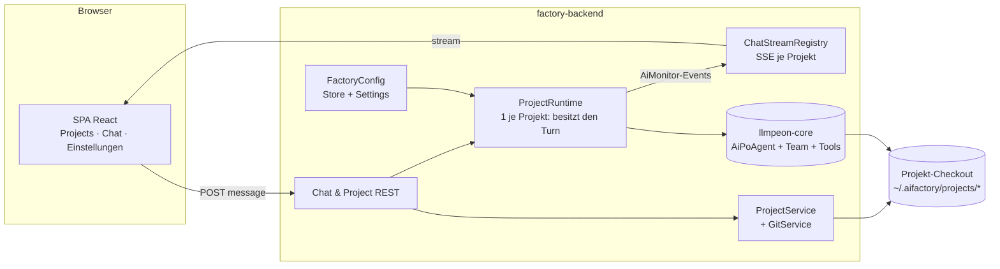
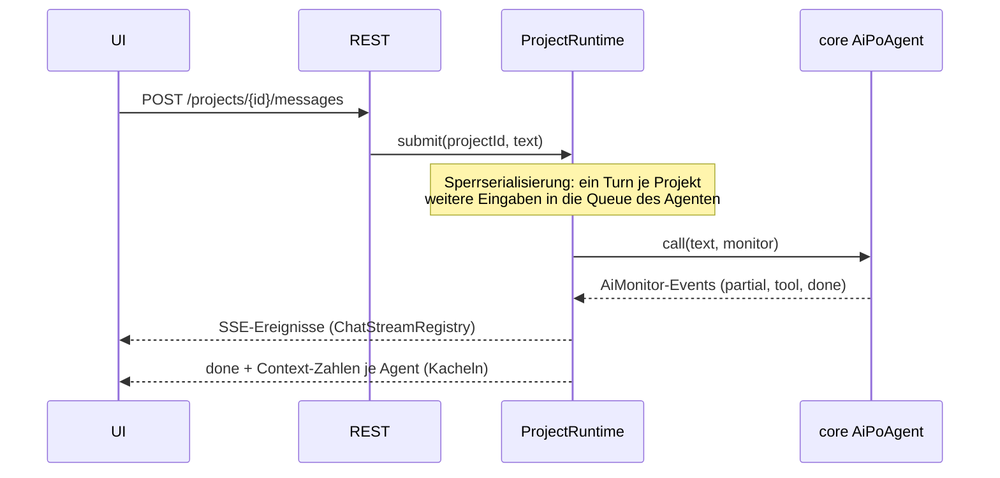
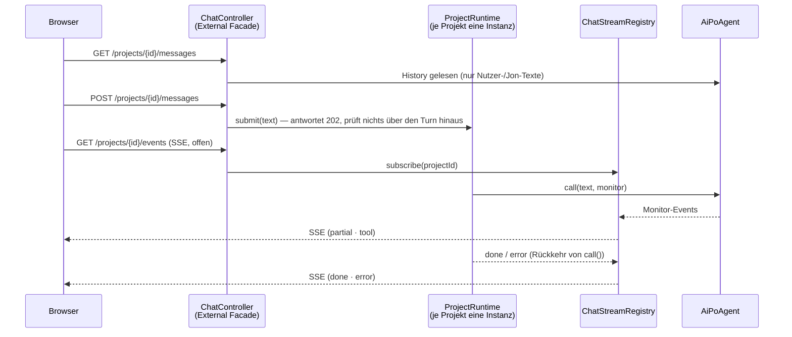
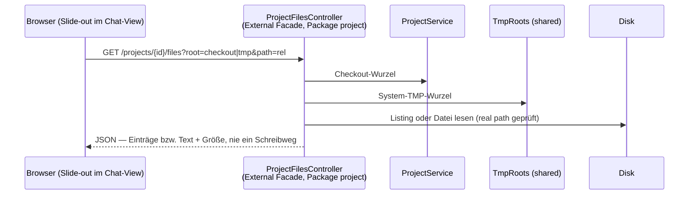
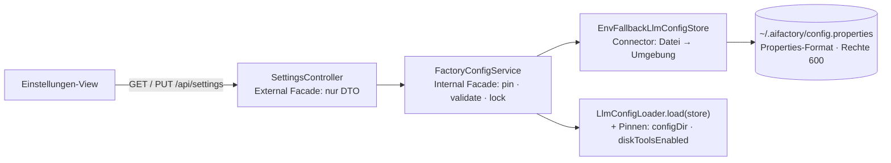

# Architektur — AI Factory (Web)

> **Status:** ◐ teilweise gebaut (2026-10-25) — `ui` (Auslieferung), `project` (Registry/Clone) und
> `config` (Config + Einstellungen) stehen; `ProjectRuntime`, SSE und Jon Light sind SOLL. Regeln und BDD
> stehen in [web-prototype.md](web-prototype.md) und [jon-light-stories.md](jon-light-stories.md); hier
> nur das WIE.

## Grundgedanke

Die Factory ist ein **dünner HTTP/Transport-Ring um den Core**. Alles, was ein Agent ist (Memory,
Tool-Loop, Compact, Delegation, Prompts), gehört `llmpeon-core` und wird dort gebaut, nie in der Factory
nachgebaut ([AF-ADR-001](adr/001-factory-shares-core-disk-only.md)).

**Besitzer des Turn:** `ProjectRuntime` (Factory). Es hält genau einen Jon je Projekt, serialisiert
Zugriffe und ist die einzige Stelle, die den Core aufruft. HTTP-Handler rufen den Core **nie** direkt.

## Komponenten



## Verantwortung und Grenzen

| Komponente | Besitz | Darf nicht |
|---|---|---|
| `ProjectService` (Package `project`) | Projektliste, Klonen, Entfernen, Pfad je Projekt | den Core kennen |
| `ProjectRuntime` | Jon + Team je Projekt, Serialisierung der Turns, Clear/Compact je Agent, Tool- und Write-Roots | HTTP, JSON, Browser-Formate |
| `ChatStreamRegistry` | Events des `AiMonitor` als SSE je Projekt verteilen, tote Zuschauer abmelden | eigene Nachrichten halten (Memory ist im Core), **kein** Replay des Verlaufs, kein Emitter-I/O unter dem Projekt-Lock (ein langsamer Leser darf den Turn nicht bremsen, UC-WP-41) |
| `FactoryConfig` (Package `config`) | Lesen/Schreiben der Factory-Config, Maskierung der Keys, Auflösung pro Turn | den geteilten Config-Bestand des Plugins schreiben **oder lesen** |
| `JonLightRuntime` | ein read-only Jon je Nutzer, Write-Liste `stories/*` | Team, Delegation, Projekt-Jon-Memory |
| Core (`AiPoAgent` …) | Agent-Logik, Tools, Memory, History-Store | Eclipse, HTTP, Factory-Klassen |

## Turn (Sequenz)



### Chat: HTTP-Kanten und SSE (Design für Inc 3)



* **Drei Kanten, kein vierter Pfad:** `GET …/messages` (Verlauf), `POST …/messages` (Turn anstoßen,
  `202`), `GET …/events` (SSE). Die Oberfläche spricht nur mit diesen dreien.
* **Der Turn gehört dem Projekt, nicht der Verbindung.** `POST` kehrt sofort zurück; ohne Zuhörer
  läuft nichts ins Leere und nichts blockiert (`ProjectRuntime` serialisiert, der Core queued).
  Ein Browser-Reload verliert **nur** Live-Zeilen (R-WP-11): der Verlauf wird neu gelesen, alles
  Weitere kommt ab dem Moment der neuen Verbindung.
* **Ein `ProjectRuntime` je Projekt**, `ChatStreamRegistry` hält **keine** Nachrichten — nur die
  Zuhörer je Projekt und den Broadcast. Wer den Verlauf braucht, liest ihn aus dem Core-History-Store
  (`home.stateDir(id)`), nicht aus einem zweiten Speicher.
* **Ereignis-Namen, jeder mit Besitzer:** `partial` (ein Token-Delta), `tool` (eine Werkzeug-/
  Problem-Zeile), `done`, `error`. `done`/`error` sendet `ProjectRuntime`, wenn `jon.call()`
  zurückkehrt bzw. wirft — **kein** Monitor-Event (ein Mitglieds-Ende ist kein Turn-Ende).
* **Finale Team-Antwort (UC-WP-40) ❌ offen:** der Weg über `onDelegatedAnswer` + Attribut am
  Werkzeug-Ergebnis ist 2026-10-27 gestrichen ([AF-ADR-002](adr/002-origin-in-core-display-in-factory.md));
  ein neuer Weg ohne zweiten Monitor-Kanal ist nicht entworfen. Der Code ist bis dahin bewusst defekt.
* **Chat-Rebuild nach Compact:** dieselbe Regel wie im Plugin —
  [R-CT-7](../../org.sterl.llmpeon.core/docs/compact-lock.md) (`onCompactCompleted` mit dem angezeigten
  Agenten als Absender → neu aus dem Verlauf aufbauen).

* **Komponentenzuschnitt:** `chat` besitzt Controller + `ProjectRuntime` + `ChatStreamRegistry` und darf
  `config` und `project` fragen; `config` liefert die `LlmConfig` pro Turn (UC-WP-24 GIVEN 3), `project`
  den Pfad. Niemand sonst hält Agenten-Instanzen.

### Datei-Bereich: eine Lese-Kante im `project`, kein vierter Chat-Pfad (Design für Inc 4b)



* **Nur `GET`, zwei Wurzeln, ein Endpunkt.** `root=checkout` (Default) oder `root=tmp`; `path` ist
  **relativ** zur Wurzel, leer heißt Wurzel selbst. Antwort ist eine Verzeichnisliste oder der Text
  einer Datei (binär/zu groß ⇒ Kennzeichnung statt Inhalt). Es gibt **kein** `PUT`/`POST` in diesem
  Bereich — geschrieben wird dort nie (R-WP-14, UC-WP-19).
* **Der Guard sitzt in der Fassade.** Der Controller löst Pfad und Wurzel auf, normalisiert und
  vergleicht **real path gegen real path** (`toRealPath`); `..`, absolute Pfade und hinausführende
  Symlinks enden damit als Fehler, nicht als Leck (UC-WP-42). Kein Agent und kein Tool ist beteiligt:
  Lesen ist keine Agenten-Fähigkeit, deshalb wird auch kein `WriteValidator` gefragt.
* **Die Chat-Kanten bleiben drei.** Dieser Endpunkt gehört `project` (es besitzt die Pfade), nicht
  `chat`; die Chat-Oberfläche hängt ihn nur ein. Im UI heißt die Komponente `project`
  (`project.files.tsx` + `files.client.ts`), der Chat-View bekommt sie als Slot von `app` — die
  Abhängigkeitsrichtung bleibt `app` → `chat` · `project`, `chat` kennt `project` nicht.


## UI-Aufbau — dieselben Komponenten wie im Backend (Entscheidung 2026-10-26)

Die SPA spiegelt die Backend-Komponenten: **ein Ordner je Komponente, gleicher Name**, und darin je
Datei die Rolle im Namen (`<komponente>.<rolle>.tsx`). Kein Sammelordner für Views, keine
`components/`-Schublade, keine Tests unter `src/`.

```
factory-ui/
  src/
    app/      app.shell.tsx          Tabs, Auswahl des Projekts
    project/  project.page.tsx       Liste + Hinzufügen
              project.list.tsx
              project.add.tsx
    chat/     chat.page.tsx          Verlauf, Composer, Live-Zeilen
              chat.log.tsx
              chat.composer.tsx
              chat.stream.ts         SSE-Lesen/Parser
    config/   config.page.tsx        Einstellungen
              config.form.tsx
    shared/   api.client.ts          HTTP + Fehlertyp, von allen benutzt
              dto.ts
  test/
    project/project.page.test.tsx
    chat/chat.page.test.tsx
```

* **Gleicher Name wie im Backend** (`project`, `chat`, `config`, `shared`): wer den Server versteht,
  findet die Oberfläche — und umgekehrt. Ein neues Feature legt in beiden Bäumen dieselbe Komponente an.
* **Rolle im Dateinamen** statt in der Tiefe: `.page` = das, was eine Route/Ansicht füllt, `.log`,
  `.composer`, `.form`, `.list` = Fragmente, `.stream`, `.client` = Nicht-UI-Teile der Komponente.
* **Tests liegen außerhalb von `src/`** unter `test/<komponente>/` mit demselben Dateinamen plus
  `.test`. Ein Test neben dem Code ist im UI-Baum verboten — sonst wandert Build-Code in das, was
  ausgeliefert wird, und beides wird beim Lesen verwechselt.
* **Abhängigkeitsrichtung wie im Backend:** `app` kennt die Komponenten, `shared` kennt keine; eine
  Komponente importiert nie aus einer anderen außer `shared` (Ausnahme: `app` als Verdrahtung).

## Abbildung Core → Factory

| Braucht die Factory | nutzt sie |
|---|---|
| Jon + Team | `AiPoAgent(ConfiguredChatModel, ToolService, historyDir, List<NamedAgent>)`, `AiPlanAgent`/`AiDevAgent`/`AiReviewAgent`, `PoDelegateTool`, `SearchAgentTool` |
| Tools ohne Eclipse | `ToolService(true)` + `DiskFileReadTool`/`DiskFileWriteTool`/`DiskGrepTool`/`DocsLinterTool`/`DocsIdTool`/`WebGetTool`, `ShellTool.setDefaultWorkingDir` |
| Schreib-Pinning | `DynamicRootsWriteValidator` je Agent (Projekt-Root + TMP bzw. `stories/*`) |
| Konfiguration | eigener `LlmConfigStore` der Factory (siehe Konflikt unten), `LlmConfigLoader.load(store)` |
| Chat-Persistenz | `FileAgentHistoryStore` über `historyStateDir` — ein Verzeichnis je Projekt |
| Streaming/Status | `AiMonitor` → SSE; Compact/Clear über die bestehenden Core-Pfade |

## Config — wer liest, wer schreibt (Package `config`, gebaut 2026-10-25)



* **Datei-Store im Core** (`org.sterl.llmpeon.ai.FileLlmConfigStore` auf der SPI `LlmConfigStore`) —
  deterministisch (sortierte `key=value`, LF, kein Kommentar, kein Zeitstempel), atomar geschrieben,
  `600`. Ein Kommentar in einer von Hand gepflegten Datei überlebt das Speichern **nicht**.
* **Lesen:** Datei → Umgebung (`AIFACTORY_LLM_{PROVIDER,MODEL,URL,API_KEY}`) → Core-Default; die **Datei
  gewinnt**. `configDir` und `diskToolsEnabled` setzt `FactoryConfigService` **nach** dem Laden (auf das
  Factory-Home bzw. `true`) — was dazu in der Datei steht, ist wirkungslos (UC-WP-36, UC-WP-37).
* **Schreiben:** nur die gesendeten, nicht-leeren Felder; die Antwort ist ein frischer maskierter Read,
  nie das gesendete Objekt. Ein Key lässt sich setzen, **nie** löschen — Löschen heißt Datei von Hand.
* **Maskierung ist eine Typ-Frage, kein Filter:** `SettingsSnapshot` und `SettingsDto` haben kein Feld, in
  das ein Key passt (nur `keySet` + `keySource`), die Feldliste ist per Test fixiert. Ein `LlmConfig`
  verlässt die Komponente nur Richtung `ProjectRuntime` und trägt keinen Key in `toString`.
* **Alleiniger Config-Besitzer:** nur `config` darf `LlmConfigLoader` und `FileLlmConfigStore` benutzen
  (ArchUnit-Regel `onlyConfigReadsTheFactorysOwnConfig`) — sonst lädt jemand am Pinning vorbei und
  Agent-Zustand landet wieder in `~/.peon`.

## Fehlende Teile — Entscheidung je Teil

Steht hier "Factory", baut es die Factory; "Core" heißt: der Port nützt auch dem Plugin und wird als
eigene Story im Core gemacht (mit globalem ADR, wenn das Plugin dadurch angefasst wird).

| Teil | Stand | Entscheidung |
|---|---|---|
| `LlmConfigStore` für Dateien | ✅ gebaut 2026-10-25 (Inc 2): `FileLlmConfigStore` im Core, benutzt von `config` | **Core** (bleibt dort: verhaltenstreu, vom Plugin weiterverwendbar, testbar) |
| `askUser` ohne Eclipse | `AskUserTool` hängt an einer Eclipse-Basisklasse | **Factory** (MVP): eigener Frage-Werkzeug-Kern + Presenter über SSE; Core-Port folgt, wenn das Plugin denselben Kern nutzt |
| Workspace-Memory (memory*-Tools) | Plugin, Eclipse-Prefs | **Core-Port** als eigene Story; bis dahin hat der Factory-Jon keine memory*-Tools |
| Static Context (Env-Text) | Plugin-Klasse mit Eclipse-Guidance | **Factory**: eigene `ContextItem`-Texte (OS, Pfade, Regeln) |
| Plan-Werkzeuge (`planWithPlanAgent` …) | IFile-basiert im Plugin | **Factory** (MVP): scheibchenlos — Plan-Datei bleibt `peon-plan/overview.md` im Checkout, Jon nutzt Disk-Tools; echte Plan-Tools = eigene Story |
| `AgentContextComponent`, `UserContext` | Eclipse-typisiert | **Factory**: eigener Turn-Kontext aus Core-`ContextItem` |

## Invarianten

* **Ein Turn je Projekt.** Ein `ProjectRuntime` pro Projekt, Aufrufe serialisiert; der Core-Queue
  nimmt parallele Eingaben auf, ein zweiter paralleler `call()` auf derselben Memory ist unmöglich.
* **Schreibgrenze am Choke-Point.** Erlaubte Wurzeln setzt der Agent (`WriteValidator`), nicht der
  Handler; es gibt keinen Schreibpfad an ihm vorbei.
* **Der Checkout bleibt sauber.** Runtime-Zustand (History, Config, Logs) liegt unter
  `~/.aifactory/`, nie im Projekt — `stories/` ist die bewusste Ausnahme.
* **Kein `org.eclipse`-Import** in Factory und Core (`AF-ADR-001`, PR-4).
* **Keys verlassen den Server nie im Klartext** (Settings zeigt maskiert).
* **`shared` kennt keine Komponente.** Was alle Fachpakete brauchen (z. B. `ApiError`, `FactoryHome`,
  `TmpRoots`), liegt in `shared` und kennt nur JDK und Framework — nie ein Fachpaket. Ein
  Exception-`@ExceptionHandler`, der Fachtypen aus einem Paket behandelt, gehört in **dieses** Paket.

## Konflikt, dokumentiert 2026-10-25

`R-WP-9` sagte ursprünglich, die Factory lese Provider/Model/Keys aus dem *bestehenden geteilten
Bestand* (`~/.peon`). **Das stimmt nicht:** der Plugin-Bestand liegt in Eclipse-Prefereces
(`EclipseLlmConfigStore` auf `IEclipsePreferences`), `~/.peon` enthält nur Skills/Agents/Commands.
Es gibt also keine Datei, die die Factory lesen könnte. Entscheidung (Nachtzyklus, ⏳ in
[Open Points](open-points.md)): die Factory bekommt eine **eigene** Config (`~/.aifactory/config.properties`,
Keys auch aus Umgebungsvariablen), die Einstellungen-Seite schreibt ausschließlich dorthin. Der
Plugin-Bestand bleibt unberührt — die Absicht aus `R-WP-9` (nichts Gemeinsames schreiben) bleibt erhalten.
