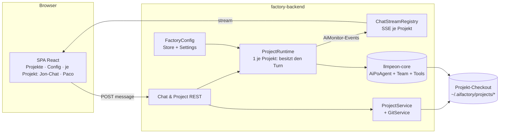
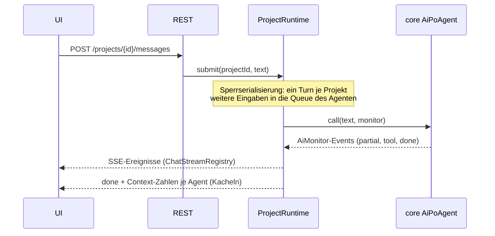
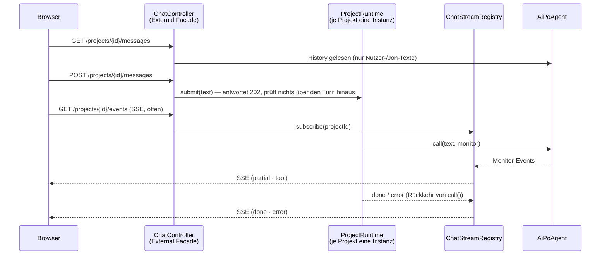
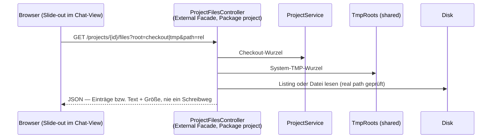
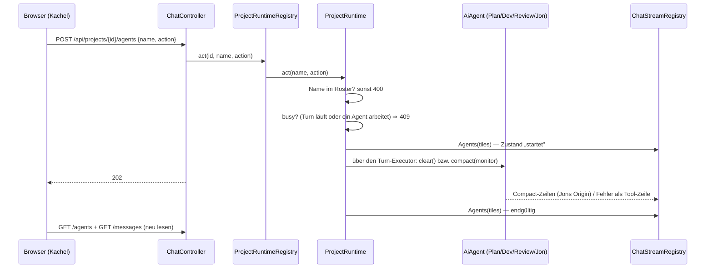
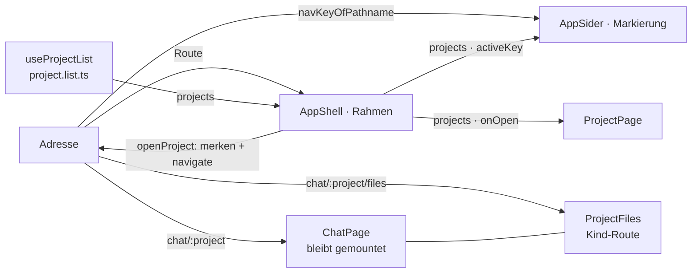
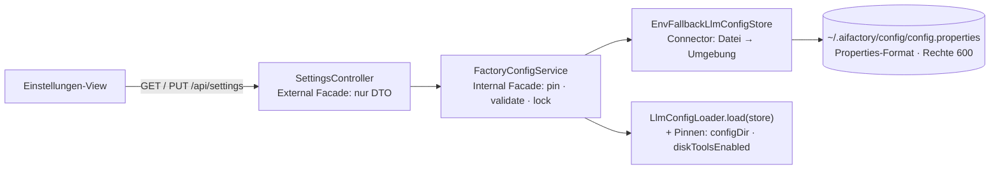

# Architektur — AI Factory (Web)

> **Status:** ◐ teilweise gebaut (2026-10-27) — `ui`, `project` (Registry/Clone/Datei-Bereich),
> `config` und `chat` (`ProjectRuntime`, SSE, Verlauf, Schreib-Pinning) stehen; Kacheln und Paco
> sind SOLL. Fabrik-Code seit dem Core-Rückbau bewusst defekt ([AF-ADR-002](adr/002-origin-in-core-display-in-factory.md)). Regeln und BDD
> stehen in den Feature-Docs ([Index](index.md)); hier
> nur das WIE.

## Grundgedanke

Die Factory ist ein **dünner HTTP/Transport-Ring um den Core**. Alles, was ein Agent ist (Memory,
Tool-Loop, Compact, Delegation, Prompts), gehört `llmpeon-core` und wird dort gebaut, nie in der Factory
nachgebaut ([AF-ADR-001](adr/001-factory-shares-core-disk-only.md)).

**Besitzer des Turn:** `ProjectRuntime` (Factory). Es hält genau einen Jon je Projekt, serialisiert
Zugriffe und ist die einzige Stelle, die den Core aufruft. HTTP-Handler rufen den Core **nie** direkt.

## Komponenten



## Verantwortung und Grenzen

| Komponente | Besitz | Darf nicht |
|---|---|---|
| `ProjectService` (Package `project`) | Projektliste, Klonen, Entfernen, Pfad je Projekt | den Core kennen |
| `ProjectRuntime` | Jon + Team je Projekt, Serialisierung der Turns, Clear/Compact je Agent, Tool- und Write-Roots | HTTP, JSON, Browser-Formate |
| `ChatStreamRegistry` | Events des `AiMonitor` als SSE je Projekt verteilen, tote Zuschauer abmelden | eigene Nachrichten halten (Memory ist im Core), **kein** Replay des Verlaufs, kein Emitter-I/O unter dem Projekt-Lock (ein langsamer Leser darf den Turn nicht bremsen, UC-WP-41) |
| `FactoryConfig` (Package `config`) | Lesen/Schreiben der Factory-Config, Maskierung der Keys, Auflösung pro Turn | den geteilten Config-Bestand des Plugins schreiben **oder lesen** |
| `PacoRuntime` | ein Paco je Nutzer und Projekt, Write-Liste `stories/<nutzer>/` + `proposals/<nutzer>/`, nur `searchAgent` | Team Plan/Dev/Review, Projekt-Jon-Memory |
| Core (`AiPoAgent` …) | Agent-Logik, Tools, Memory, History-Store | Eclipse, HTTP, Factory-Klassen |

## Turn (Sequenz)



### Chat: HTTP-Kanten und SSE (Design für Inc 3)



* **Drei Kanten, kein vierter Pfad:** `GET …/messages` (Verlauf), `POST …/messages` (Turn anstoßen,
  `202`), `GET …/events` (SSE). Die Oberfläche spricht nur mit diesen dreien.
* **Der Turn gehört dem Projekt, nicht der Verbindung.** `POST` kehrt sofort zurück; ohne Zuhörer
  läuft nichts ins Leere und nichts blockiert (`ProjectRuntime` serialisiert, der Core queued).
  Ein Browser-Reload verliert **nur** Live-Zeilen (R-WP-11): der Verlauf wird neu gelesen, alles
  Weitere kommt ab dem Moment der neuen Verbindung.
* **Ein `ProjectRuntime` je Projekt**, `ChatStreamRegistry` hält **keine** Nachrichten — nur die
  Zuhörer je Projekt und den Broadcast. Wer den Verlauf braucht, liest ihn aus dem Core-History-Store
  (`home.stateDir(id)`), nicht aus einem zweiten Speicher.
* **Ereignis-Namen, jeder mit Besitzer:** `partial` (ein Token-Delta), `tool` (eine Werkzeug-/
  Problem-Zeile), `done`, `error`. `done`/`error` sendet `ProjectRuntime`, wenn `jon.call()`
  zurückkehrt bzw. wirft — **kein** Monitor-Event (ein Mitglieds-Ende ist kein Turn-Ende).
* **Finale Team-Antwort (UC-WP-39/40):** im Verlauf liest die Fabrik die `ToolExecutionResultMessage`
  in Jons History; der Urheber kommt aus einer festen Zuordnung Werkzeugname → Mitglied in `chat`.
  Live gibt es **keinen** Werkzeug-Ergebnis-Kanal — die Mitglieder-Zeile erscheint bei `done`, live
  sichtbar ist nur Jons Werkzeug-Zeile der Delegation; das `delegated`-SSE-Event entfällt. Die
  Live-Trennung Jon/Mitglied läuft allein über den vom Core gestempelten `origin`
  ([ADR-0078](../../docs/adr/0078-origin-in-core-owner-monitor.md)) — keine Id-Buchführung für offene
  Delegationen, das Web zeigt Zeilen mit Mitglieds-Origin grundsätzlich nicht.
* **Chat-Rebuild nach Compact:** dieselbe Regel wie im Plugin —
  [R-CT-7](../../org.sterl.llmpeon.core/docs/compact-lock.md) (`onCompactCompleted` mit dem angezeigten
  Agenten als Absender → neu aus dem Verlauf aufbauen).

* **Komponentenzuschnitt:** `chat` besitzt Controller + `ProjectRuntime` + `ChatStreamRegistry` und darf
  `config` und `project` fragen; `config` liefert die `LlmConfig` pro Turn (UC-WP-24 GIVEN 3), `project`
  den Pfad. Niemand sonst hält Agenten-Instanzen.

### Datei-Bereich: eine Lese-Kante im `project`, kein vierter Chat-Pfad (Design für Inc 4b)



* **Nur `GET`, zwei Wurzeln, ein Endpunkt.** `root=checkout` (Default) oder `root=tmp`; `path` ist
  **relativ** zur Wurzel, leer heißt Wurzel selbst. Antwort ist eine Verzeichnisliste oder der Text
  einer Datei (binär/zu groß ⇒ Kennzeichnung statt Inhalt). Es gibt **kein** `PUT`/`POST` in diesem
  Bereich — geschrieben wird dort nie (R-WP-14, UC-WP-19).
* **Der Guard sitzt in der Fassade.** Der Controller löst Pfad und Wurzel auf, normalisiert und
  vergleicht **real path gegen real path** (`toRealPath`); `..`, absolute Pfade und hinausführende
  Symlinks enden damit als Fehler, nicht als Leck (UC-WP-42). Kein Agent und kein Tool ist beteiligt:
  Lesen ist keine Agenten-Fähigkeit, deshalb wird auch kein `WriteValidator` gefragt.
* **Die Chat-Kanten bleiben drei.** Dieser Endpunkt gehört `project` (es besitzt die Pfade), nicht
  `chat`; die Chat-Oberfläche hängt ihn nur ein. Im UI heißt die Komponente `project`
  (`project.files.tsx` + `files.client.ts`), der Chat-View bekommt sie als Slot von `app` — die
  Abhängigkeitsrichtung bleibt `app` → `chat` · `project`, `chat` kennt `project` nicht.
* **Ein Symlink ist ein Name, keine Metadaten (Inc 5a).** Das Listing verfolgt einen Link nie:
  ein Symlink erscheint mit `symlink: true`, `directory: false` und Größe 0 — auch wenn sein Ziel
  regulär erscheint; Ziel-Wissen fließt nie in die Antwort. Der Leseweg bleibt unverändert: Link
  innerhalb der Wurzel liest 200, ausbrechender Link endet 400 (UC-WP-42).


### Kacheln und Blick je Agent (Design für Inc 5, chat.md R-WP-7/R-WP-26)



* **Die drei Gesprächs-Kanten bleiben drei.** `GET/POST …/messages` und `GET …/events` führen den
  Turn; die **Kachel-Familie** (`GET …/agents` — Roster, `POST …/agents` — Clear/Compact,
  `GET …/agents/{name}` — Blick) startet weder Turn noch zweiten Verlauf. Alles Agent-bezogene
  bleibt im `chat`-Paket (`ComponentArchitectureTest` verbietet Agent-Instanzen anderswo).
* **SSE `agents` ist ein Snapshot, kein Verlauf.** Das Event trägt die ganze Kachel-Liste, die UI
  ersetzt ihren Zustand; kein Replay, kein zweiter Speicher. Frisch gelesen wird beim Mount/Reconnect
  über `GET …/agents` (dieselbe Regel wie beim Verlauf: *re-connect ⇒ lesen*). Die Kontextzahl ist
  der Plugin-Wert (`getTotalTokenUsed()` + `isTokenEstimate()`, Prozent gegen das Auto-Compact-Budget);
  die Fabrik formatiert nicht selbst. Search ist ein Sub-Loop — Kachel ohne Kontext, kein Clear/Compact,
  kein Blick (R-WP-7/R-WP-26).
* **Ein Claim je Projekt — Turn und Aktion treffen sich nie** (`TurnClaim` in `chat`, Inc 5e):
  Clear/Compact mutieren das Memory, ein paralleler Turn würde sie zerschreiben; der Claim entscheidet
  „Turn läuft" und „Aktion läuft" in **einem** Monitor. `POST` antwortet `202`; läuft ein Turn, wird die
  Aktion abgelehnt (`409`), nicht eingereiht. Umgekehrt wartet ein Senden hinter einer laufenden Aktion
  — Senden wird **nie** abgelehnt (R-WP-10). Ein Stop während einer wartenden Aktion wird abgelehnt
  (`409`): der Cancel-Flag gehört der Aktion, ein halber Compact ist kein Ergebnis (D-17). Nach einer
  abgeschlossenen Aktion ist der Cancel-Flag gelöscht — ein Compact nach einem Stop läuft. Wartet ein
  Senden länger als **10 s** auf die Freigabe (Frist gegen das Claim-Leck), endet der Turn als
  `failed`-Event, nie als stiller Block. Fehler einer Aktion sind eine `tool`-Zeile (live), kein neuer
  Kanal.
* **Der Blick (`GET …/agents/{name}`) liest das Core-Memory im RAM** (`AiAgent.getMemory()`) —
  schreibgeschützt, nur für Plan/Dev/Review (Jon/Search ⇒ 400), begrenzt (letzte 500 Zeilen, 8 192
  Zeichen je Zeile, `truncated`-Kennzeichnung). Nach einem Neustart ist der Blick leer (Team beginnt
  leer, R-WP-11); es gibt keine Route, die ein Agentengespräch anlegt oder wählt.
* **Stop (UC-WP-50)** gehört zur Gesprächs-Kante: er bricht den laufenden Turn ab (Jon und laufende
  Delegationen), kein zweiter Turn-Pfad, keine zweite Speicherung — die already gezeigten Zeilen
  bleiben. Die Queue-Klausel von [UC-WP-50](chat.md) ist **nicht** erfüllt: eine Eingabe, die der
  laufende Turn beim Abbruch schon aus der Queue gepollt hat, geht mit ihm verloren (gemessenes
  Core-Verhalten: `AbstractAgent.call` pollt, die Cancel-Schleife verlässt, der Drain findet eine leere
  Queue); nur was in diesem Moment noch wartet, überlebt (`handleAbortAndDrain` legt es als Memory-Zeile
  ab). Das ist Core-Verhalten, nicht Fabrik-Code — UC-WP-50 bleibt offen.

## UI-Aufbau — dieselben Komponenten wie im Backend (Entscheidung 2026-10-26)

Die SPA spiegelt die Backend-Komponenten: **ein Ordner je Komponente, gleicher Name**, und darin je
Datei die Rolle im Namen (`<komponente>.<rolle>.tsx`). Kein Sammelordner für Views, keine
`components/`-Schublade, keine Tests unter `src/`.

```
factory-ui/
  src/
    app/      app.shell.tsx          Rahmen: Header · Sider · Content (R-WP-38)
              app.top.tsx            dunkles Top-Menü — hält keine Auswahl (R-WP-43)
              app.menu.ts            NavItem + entry(): eine Markenregel für beide Menüs
              app.routes.tsx         eine Adresse je Seite und je Einheit (R-WP-1)
              app.sider.tsx          Projektbaum — hält keine Auswahl
              app.paths.ts           das Adress-Modell: Erzeuger und Deuter in EINER Datei
              app.context.ts         was der Rahmen den Seiten reicht
    project/  project.page.tsx       Liste + Hinzufügen/Entfernen — liest die Liste nicht selbst
              project.list.ts        useProjectList: der Eigner der Liste im Rahmen
              project.files.tsx      Datei-Bereich (Slide-out), props-getrieben
    chat/     chat.page.tsx          Verlauf, Composer, Live-Zeilen
              chat.log.tsx · chat.composer.tsx · chat.tools.tsx
              chat.stream.ts         SSE-Lesen/Parser
    config/   config.page.tsx        Config-Seite
    shared/   api.client.ts · sse.client.ts · content.ts · theme.ts · last.project.ts
  test/<komponente>/                 Spiegel von src/, niemals Tests unter src/
```

* **Gleicher Name wie im Backend** (`project`, `chat`, `config`, `shared`): wer den Server versteht,
  findet die Oberfläche — und umgekehrt. Ein neues Feature legt in beiden Bäumen dieselbe Komponente an.
* **Rolle im Dateinamen** statt in der Tiefe: `.page` = das, was eine Route/Ansicht füllt, `.log`,
  `.composer`, `.form`, `.list` = Fragmente, `.stream`, `.client` = Nicht-UI-Teile der Komponente.
* **Tests liegen außerhalb von `src/`** unter `test/<komponente>/` mit demselben Dateinamen plus
  `.test`. Ein Test neben dem Code ist im UI-Baum verboten — sonst wandert Build-Code in das, was
  ausgeliefert wird, und beides wird beim Lesen verwechselt.
* **Abhängigkeitsrichtung wie im Backend:** `app` kennt die Komponenten, `shared` kennt keine; eine
  Komponente importiert nie aus einer anderen außer `shared` (Ausnahme: `app` als Verdrahtung).

### Rahmen, Adresse, Einheit (2026-11-07)



* **Der Rahmen besitzt Liste und Navigation.** `useProjectList` (eine Datei, ein GET) füttert Sider
  **und** Projekte-Seite über `app.context.ts`; eine Seite fragt die Liste nie selbst. `app.paths.ts` ist
  der **einzige** Ort, der Adressen baut und liest (`chatPath`, `projectSegment`, `navKeyOfPathname`) —
  der Sider hält dafür **keinen** Zustand.
* **Markierung ist eine Funktion der Adresse**, nicht das Ergebnis eines Klicks. Messbarer Grund
  (Review 2026-11-07): eine Auswahl im State überlebt Back/Forward und jede Weiterleitung — und bleibt
  bei Tests grün, wenn die Mutation nur `useState(null)` trifft. Zu treffen sind **geseedeter** State und
  **beim Mount eingefrorener** Wert; `unmount()` + Neu-Mount prüft zwei Mounts, nie eine Zustandsänderung.
* **Der Datei-Bereich gehört der Adresse, nicht dem Seiten-State** (Inkrement 5b): **wer** „offen" nennt,
  entscheidet die Route — `project.files.tsx` ist props-getrieben, die Panel-**Fläche** wird mit der
  Adresse geboren und stirbt mit ihr („Schließen vergisst die Position" gilt damit **per Konstruktion**,
  nicht durch einen Reset-Effekt); der „Files"-Tab bleibt außen gemountet, weil er die sichtbare Öffnung
  ist. Der Tab im Chat ([R-WP-33](files.md)) und der Sider-Eintrag sind zwei Griffe auf dieselbe
  Adressänderung, kein zweiter Mechanismus.
* **Gemessen, nicht geglaubt (5b-1):** die Kind-Route ist die **klare Grammatik** (die Einheit ist ein
  Unterpfad der Chat-Adresse), aber sie ist **nicht** der Grund, warum die Chat-Seite gemountet bleibt —
  eine Schwesterroute mit demselben Element an derselben Stelle mountet `chat/:project` ebenfalls **nicht**
  neu (React Router 7.18.5, gemessen: `/messages` bleibt bei einem Read). Bewiesen wird der bleibende Mount
  deshalb über einen **erzwungenen** Remount (`key` auf die Adresse ⇒ Test rot), nie über die Routenform
  ([UC-WP-70 G2](ui.md): „ein laufender Turn endet nicht an diesem Klick").


## Abbildung Core → Factory

| Braucht die Factory | nutzt sie |
|---|---|
| Jon + Team | `AiPoAgent(ConfiguredChatModel, ToolService, historyDir, List<AiAgent>)`, `AiPlanAgent`/`AiDevAgent`/`AiReviewAgent`, `PoDelegateTool`, `SearchAgentTool` |
| Tools ohne Eclipse | `ToolService(true)` + `DiskFileReadTool`/`DiskFileWriteTool`/`DiskGrepTool`/`DocsLinterTool`/`DocsIdTool`/`WebGetTool`, `ShellTool.setDefaultWorkingDir` |
| Schreib-Pinning | `DynamicRootsWriteValidator` je Agent (Projekt-Root + TMP bzw. `stories/<nutzer>/` + `proposals/<nutzer>/`) |
| Konfiguration | eigener `LlmConfigStore` der Factory (siehe Konflikt unten), `LlmConfigLoader.load(store)` |
| Chat-Persistenz | `FileAgentHistoryStore` über `historyStateDir` — ein Verzeichnis je Projekt |
| Streaming/Status | `AiMonitor` → SSE; Compact/Clear über die bestehenden Core-Pfade |

## Config — wer liest, wer schreibt (Package `config`, gebaut 2026-10-25)



* **Datei-Store im Core** (`org.sterl.llmpeon.ai.FileLlmConfigStore` auf der SPI `LlmConfigStore`) —
  deterministisch (sortierte `key=value`, LF, kein Kommentar, kein Zeitstempel), atomar geschrieben,
  `600`. Ein Kommentar in einer von Hand gepflegten Datei überlebt das Speichern **nicht**.
* **Lesen:** Datei → Umgebung (`AIFACTORY_LLM_{PROVIDER,MODEL,URL,API_KEY}`) → Core-Default; die **Datei
  gewinnt**. `configDir` und `diskToolsEnabled` setzt `FactoryConfigService` **nach** dem Laden (auf das
  Factory-Home bzw. `true`) — was dazu in der Datei steht, ist wirkungslos (UC-WP-36, UC-WP-37).
* **Schreiben:** nur die gesendeten, nicht-leeren Felder; die Antwort ist ein frischer maskierter Read,
  nie das gesendete Objekt. Ein Key lässt sich setzen, **nie** löschen — Löschen heißt Datei von Hand.
* **Maskierung ist eine Typ-Frage, kein Filter:** `SettingsSnapshot` und `SettingsDto` haben kein Feld, in
  das ein Key passt (nur `keySet` + `keySource`), die Feldliste ist per Test fixiert. Ein `LlmConfig`
  verlässt die Komponente nur Richtung `ProjectRuntime` und trägt keinen Key in `toString`.
* **Alleiniger Config-Besitzer:** nur `config` darf `LlmConfigLoader` und `FileLlmConfigStore` benutzen
  (ArchUnit-Regel `onlyConfigReadsTheFactorysOwnConfig`) — sonst lädt jemand am Pinning vorbei und
  Agent-Zustand landet wieder in `~/.peon`.

## Fehlende Teile — Entscheidung je Teil

Steht hier "Factory", baut es die Factory; "Core" heißt: der Port nützt auch dem Plugin und wird als
eigene Story im Core gemacht (mit globalem ADR, wenn das Plugin dadurch angefasst wird).

| Teil | Stand | Entscheidung |
|---|---|---|
| `LlmConfigStore` für Dateien | ✅ gebaut 2026-10-25 (Inc 2): `FileLlmConfigStore` im Core, benutzt von `config` | **Core** (bleibt dort: verhaltenstreu, vom Plugin weiterverwendbar, testbar) |
| `askUser` ohne Eclipse | `AskUserTool` hängt an einer Eclipse-Basisklasse | **Factory** (MVP): eigener Frage-Werkzeug-Kern + Presenter über SSE; Core-Port folgt, wenn das Plugin denselben Kern nutzt |
| Workspace-Memory (memory*-Tools) | Plugin, Eclipse-Prefs | **Core-Port** als eigene Story; bis dahin hat der Factory-Jon keine memory*-Tools |
| Static Context (Env-Text) | Plugin-Klasse mit Eclipse-Guidance | **Factory**: eigene `ContextItem`-Texte (OS, Pfade, Regeln) |
| Plan-Werkzeuge (`planWithPlanAgent` …) | IFile-basiert im Plugin | **Factory** (MVP): scheibchenlos — Plan-Datei bleibt `peon-plan/overview.md` im Checkout, Jon nutzt Disk-Tools; echte Plan-Tools = eigene Story |
| `AgentContextComponent`, `UserContext` | Eclipse-typisiert | **Factory**: eigener Turn-Kontext aus Core-`ContextItem` |

## Invarianten

* **Ein Turn je Projekt.** Ein `ProjectRuntime` pro Projekt, Aufrufe serialisiert; der Core-Queue
  nimmt parallele Eingaben auf, ein zweiter paralleler `call()` auf derselben Memory ist unmöglich.
* **Schreibgrenze am Choke-Point.** Erlaubte Wurzeln setzt der Agent (`WriteValidator`), nicht der
  Handler; es gibt keinen Schreibpfad an ihm vorbei.
* **Der Checkout bleibt sauber.** Runtime-Zustand (History, Config, Logs) liegt unter
  `~/.aifactory/`, nie im Projekt — `stories/` und `proposals/` sind die bewusste Ausnahme.
* **Kein `org.eclipse`-Import** in Factory und Core (`AF-ADR-001`, PR-4).
* **Keys verlassen den Server nie im Klartext** (Settings zeigt maskiert).
* **`shared` kennt keine Komponente.** Was alle Fachpakete brauchen (z. B. `ApiError`, `FactoryHome`,
  `TmpRoots`), liegt in `shared` und kennt nur JDK und Framework — nie ein Fachpaket. Ein
  Exception-`@ExceptionHandler`, der Fachtypen aus einem Paket behandelt, gehört in **dieses** Paket.

## Konflikt, dokumentiert 2026-10-25

`R-WP-9` sagte ursprünglich, die Factory lese Provider/Model/Keys aus dem *bestehenden geteilten
Bestand* (`~/.peon`). **Das stimmt nicht:** der Plugin-Bestand liegt in Eclipse-Prefereces
(`EclipseLlmConfigStore` auf `IEclipsePreferences`), `~/.peon` enthält nur Skills/Agents/Commands.
Es gibt also keine Datei, die die Factory lesen könnte. Entscheidung (Nachtzyklus, ⏳ in
[Open Points](open-points.md)): die Factory bekommt eine **eigene** Config (`~/.aifactory/config/config.properties`, [R-CR-10](config-repo.md),
Keys auch aus Umgebungsvariablen), die Einstellungen-Seite schreibt ausschließlich dorthin. Der
Plugin-Bestand bleibt unberührt — die Absicht aus `R-WP-9` (nichts Gemeinsames schreiben) bleibt erhalten.
