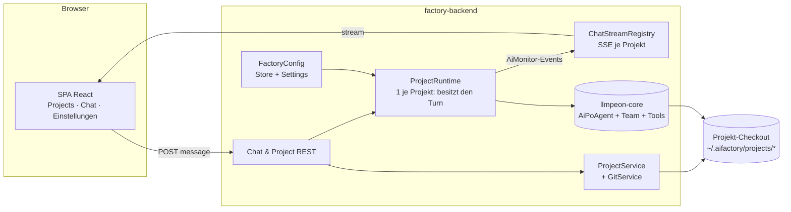
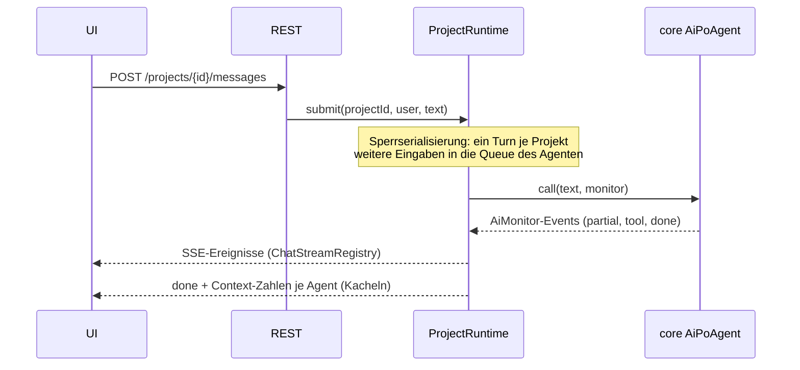

# Architektur — AI Factory (Web)

> **Status:** ❌ specified (2026-10-25) — gilt vor dem ersten Plan. Regeln und BDD stehen in
> [web-prototype.md](web-prototype.md) und [jon-light-stories.md](jon-light-stories.md); hier nur das WIE.

## Grundgedanke

Die Factory ist ein **düner HTTP/Transport-Ring um den Core**. Alles, was ein Agent ist (Memory,
Tool-Loop, Compact, Delegation, Prompts), gehört `llmpeon-core` und wird unverwendet gelassen, wenn
die Factory es selbst bauen würde ([AF-ADR-001](adr/001-factory-shares-core-disk-only.md)).

**Besitzer des Turn:** `ProjectRuntime` (Factory). Es hält genau einen Jon je Projekt, serialisiert
Zugriffe und ist die einzige Stelle, die den Core aufruft. HTTP-Handler rufen den Core **nie** direkt.

## Komponenten

## Verantwortung und Grenzen

| Komponente | Besitz | Darf nicht |
|---|---|---|
| `ProjectService` (Package `project`) | Projektliste, Klonen, Entfernen, Pfad je Projekt | den Core kennen |
| `ProjectRuntime` | Jon + Team je Projekt, Serialisierung der Turns, Clear/Compact je Agent, Tool- und Write-Roots | HTTP, JSON, Browser-Formate |
| `ChatStreamRegistry` | Events des `AiMonitor` als SSE je Projekt verteilen, Replay des Verlaufs | eigene Nachrichten halten (Memory ist im Core) |
| `FactoryConfig` | Lesen/Schreiben der Factory-Config, Maskierung der Keys, Auflösung pro Turn | den geteilten Config-Bestand des Plugins schreiben |
| `JonLightRuntime` | ein read-only Jon je Nutzer, Write-Liste `stories/*` | Team, Delegation, Projekt-Jon-Memory |
| Core (`AiPoAgent` …) | Agent-Logik, Tools, Memory, History-Store | Eclipse, HTTP, Factory-Klassen |

## Turn (Sequenz)

## Abbildung Core → Factory

| Braucht die Factory | nutzt sie |
|---|---|
| Jon + Team | `AiPoAgent(ConfiguredChatModel, ToolService, historyDir, List<NamedAgent>)`, `AiPlanAgent`/`AiDevAgent`/`AiReviewAgent`, `PoDelegateTool`, `SearchAgentTool` |
| Tools ohne Eclipse | `ToolService(true)` + `DiskFileReadTool`/`DiskFileWriteTool`/`DiskGrepTool`/`DocsLinterTool`/`DocsIdTool`/`WebGetTool`, `ShellTool.setDefaultWorkingDir` |
| Schreib-Pinning | `DynamicRootsWriteValidator` je Agent (Projekt-Root + TMP bzw. `stories/*`) |
| Konfiguration | eigener `LlmConfigStore` der Factory (siehe Konflikt unten), `LlmConfigLoader.load(store)` |
| Chat-Persistenz | `FileAgentHistoryStore` über `historyStateDir` — ein Verzeichnis je Projekt |
| Streaming/Status | `AiMonitor` → SSE; Compact/Clear über die bestehenden Core-Pfade |

## Fehlende Teile — Entscheidung je Teil

Steht hier "Factory", baut es die Factory; "Core" heißt: der Port nützt auch dem Plugin und wird als
eigene Story im Core gemacht (mit globalem ADR, wenn das Plugin dadurch angefasst wird).

| Teil | Stand | Entscheidung |
|---|---|---|
| `LlmConfigStore` für Dateien | fehlt (nur Eclipse-Prefs + Test-Double) | **Core**: `FileLlmConfigStore` — verhaltenstreu, vom Plugin weiterverwendbar, testbar |
| `askUser` ohne Eclipse | `AskUserTool` hängt an einer Eclipse-Basisklasse | **Factory** (MVP): eigener Frage-Werkzeug-Kern + Presenter über SSE; Core-Port folgt, wenn das Plugin denselben Kern nutzt |
| Workspace-Memory (memory*-Tools) | Plugin, Eclipse-Prefs | **Core-Port** als eigene Story; bis dahin hat der Factory-Jon keine memory*-Tools |
| Static Context (Env-Text) | Plugin-Klasse mit Eclipse-Guidance | **Factory**: eigene `ContextItem`-Texte (OS, Pfade, Regeln) |
| Plan-Werkzeuge (`planWithPlanAgent` …) | IFile-basiert im Plugin | **Factory** (MVP): scheibchenlos — Plan-Datei bleibt `peon-plan/overview.md` im Checkout, Jon nutzt Disk-Tools; echte Plan-Tools = eigene Story |
| `AgentContextComponent`, `UserContext` | Eclipse-typisiert | **Factory**: eigener Turn-Kontext aus Core-`ContextItem` |

## Invarianten

* **Ein Turn je Projekt.** Ein `ProjectRuntime` pro Projekt, Aufrufe serialisiert; der Core-Queue
  nimmt parallele Eingaben auf, ein zweiter paralleler `call()` auf derselben Memory ist unmöglich.
* **Schreibgrenze am Choke-Point.** Erlaubte Wurzeln setzt der Agent (`WriteValidator`), nicht der
  Handler; es gibt keinen Schreibpfad an ihm vorbei.
* **Der Checkout bleibt sauber.** Runtime-Zustand (History, Config, Logs) liegt unter
  `~/.aifactory/`, nie im Projekt — `stories/` ist die bewusste Ausnahme.
* **Kein `org.eclipse`-Import** in Factory und Core (`AF-ADR-001`, PR-4).
* **Keys verlassen den Server nie im Klartext** (Settings zeigt maskiert).
* **`shared` kennt keine Komponente.** Was alle Fachpakete brauchen (z. B. `ApiError`, `FactoryHome`,
  `TmpRoots`), liegt in `shared` und kennt nur JDK und Framework — nie ein Fachpaket. Ein
  Exception-`@ExceptionHandler`, der Fachtypen aus einem Paket behandelt, gehört in **dieses** Paket.

## Konflikt, dokumentiert 2026-10-25

`R-WP-9` sagte ursprünglich, die Factory lese Provider/Model/Keys aus dem *bestehenden geteilten
Bestand* (`~/.peon`). **Das stimmt nicht:** der Plugin-Bestand liegt in Eclipse-Prefereces
(`EclipseLlmConfigStore` auf `IEclipsePreferences`), `~/.peon` enthält nur Skills/Agents/Commands.
Es gibt also keine Datei, die die Factory lesen könnte. Entscheidung (Nachtzyklus, ⏳ in
[Open Points](open-points.md)): die Factory bekommt eine **eigene** Config (`~/.aifactory/config.properties`,
Keys auch aus Umgebungsvariablen), die Einstellungen-Seite schreibt ausschließlich dorthin. Der
Plugin-Bestand bleibt unberührt — die Absicht aus `R-WP-9` (nichts Gemeinsames schreiben) bleibt erhalten.
