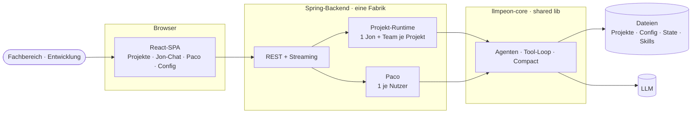

# Product Vision — Open AI Fabric (OAF, Jon@Web)

> Entwurf 2026-10-27 aus [Pauls Produktvision](../pauls-product-vision.md) — noch nicht abgestimmt.
> Max. 100 Zeilen. Repo-/Ordnername bleibt `aifactory/`. Geteilte Lib: [Core Ground Rules](../../org.sterl.llmpeon.core/docs/ground-rules.md);
> Schwesterprodukt: [Peon AI (Eclipse-Plugin)](../../docs/product-vision.md).

## Vision

Fachbereich und Entwicklung arbeiten in **einem** Werkzeug am selben Projekt: im Browser, mit Jon
und seinem Team. Kleine Änderungen und Bugs erledigt der Fachbereich direkt mit Jon — ohne
Entwickler dazwischen. Das Agenten-Verhalten ist dasselbe wie im Eclipse-Plugin, weil es aus
derselben Core-Lib kommt.

## Zusammenfassung

Eine Web-App (React + Spring) als **Fabrik**: sie hält mehrere Git-Projekte, je Projekt genau einen
Jon mit Team — der **technische PO**, der im Projekt baut. Der Jon-Chat liegt auf dem Server und
gehört dem Projekt — alle Nutzer sehen denselben Chat, der Turn läuft weiter, wenn man das Projekt
wechselt oder den Browser schließt. Daneben hat jeder Nutzer **Paco**, den **fachlichen PO**: privat,
lesend, er grillt Vision, Ziele und SOLL und schreibt Stories/Proposals. Gespeichert wird in
Dateien, nicht in einer Datenbank. Wer mehrere Fabriken will, installiert mehrere Instanzen.

## Kernfunktionen

1. **Projekte** — Git-Projekte hinzufügen/entfernen; sichtbar, ob gerade daran gearbeitet wird.
2. **Jon-Chat je Projekt** — nur mit Jon chatten; im Verlauf Jons Nachrichten und die **finalen**
   Antworten seines Teams, jeweils mit Absender; Kacheln je Agent (Status, Context, Clear, Compact)
   mit Slide-out des Agenten-Chats (nur lesen); Datei-Slide-out.
3. **Paco je Nutzer** — fachlicher PO: privat, nur lesend + Such-Agent, schreibt ausschließlich
   Stories/Proposals.
4. **Schreibgrenze** — Schreib-Tools sind auf das Projektverzeichnis und das System-TMP gepinnt.
5. **Konfiguration** — Provider/Modell/Keys, MCP, Agenten, Prompt-Override, Codegraph; geteilt über
   alle Projekte, ebenso die Skills.
6. **Rollen** — Admin · User · Reader (mit OAuth2, später).

## Ist / ist nicht

| OAF **ist** | OAF **ist nicht** |
|---|---|
| Jon-Mode im Browser: ein Jon + Team je Projekt, dazu Paco je Nutzer | eine Sammlung frei wählbarer Agenten (v1) |
| ein gemeinsamer, serverseitiger Chat je Projekt | ein persönlicher Chat-Client pro Browser |
| dateibasiert: Config git-sicherbar, Chat-State im State-Verzeichnis | ein Datenbank-Produkt |
| eine Instanz = eine Fabrik | mandantenfähig (mehrere Fabriken in einer Instanz) |
| dieselbe Agenten-Logik wie das Plugin (Core-Lib) | eine zweite, eigene Agenten-Implementierung |
| Werkzeug für Fachbereich **und** Entwicklung | eine IDE im Browser (kein Build-/Debug-/Java-Navigations-Ersatz) |

## Komponenten

