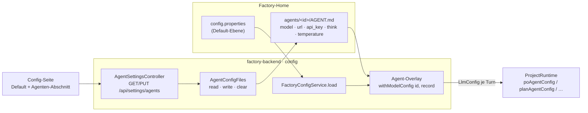

# UI-Nacharbeiten nach Pauls Smoke-Test (Zyklus 2026-11-02)

> Branch `web-factory-mvp`, Spitze `3957defc`. Ersetzt den archivierten MVP-Plan (Inc 5/6 sind fertig:
> Backend 156/0/0, UI 47 Tests/7 Dateien, lint 0/0, Doc-Lint UC 63/63, 0 Findings).
> **Q1–Q7 sind beantwortet** (Jon 2026-11-02, siehe §17): UC-WP-1/43 stehen wieder im Doc,
> `config.md` trägt „URL = Default, Modell wird geleert", UC-WP-46 gilt in 7a/7b (GIVEN 1 / GIVEN 2),
> der SPA-Fallback ist ein `PathResourceResolver` am `/ui/**`-Handler. **Q8–Q10 offen** (nur 7b).
> **SOLL ist geschrieben** — `docs/ui.md` (R-WP-1/22/27, UC-WP-1/43/51/52/53), `docs/chat.md` (R-WP-28…32,
> UC-WP-54…59), `docs/files.md` (R-WP-33, UC-WP-60/61), `docs/config.md` (R-WP-16, UC-WP-46/62/63),
> `docs/project.md` (R-WP-24, UC-WP-47), `docs/memory.md:13-46` (Pauls 19 Befunde + Entscheidungen).
> Der Plan **zitiert** diese Sätze und erfindet keine Regel. Step 0 jedes Inkrements ist der Abgleich
> Doc ↔ Code; der Marker-Flip (`❌ → ✅`) passiert **nach** grünem Gate und **nur** für die eigenen Ids.
>
> **Harte Grenzen:** kein Core-Touch (Produktion **und** Tests, Paul 2026-10-29) · keine neue
> Gesprächsroute (`OneChatPerProjectTest` bleibt unangetastet) · kein vierter Tab, kein Router-Zustand
> außerhalb der URL · Docs schreibt **nur Jon**.

## 0. Inkremente (je laufende grüne Software)

| Inc | Inhalt | UCs / Regeln | hängt ab von |
|---|---|---|---|
| **1a** | Bootstrap + eigenes Theme, volle Breite, Top-Nav, Chat-Kopf ohne „Chat"-Überschrift | R-WP-1 (Rahmen), R-WP-27 (Look) | — |
| **1b** | Englische UI + String-Catalog `content.ts` (inkl. Draht-Wert `[no text]`) | R-WP-27 / UC-WP-53 | 1a |
| **1c** | URL-Routing, Reload bleibt, unbekannte `/ui/`-Adresse zeigt die App, „Chat" öffnet das zuletzt aktive Projekt | R-WP-1, UC-WP-1/43/51/52 | 1a, 1b |
| **2** | Projektliste live: „arbeitet · N wartend" über SSE | R-WP-24 / UC-WP-47 | 1a, 1b |
| **3a** | Chat-Zeilen-Look: User blau rechts, Agent grün, kein grauer Block, `<hr>` je Rollenwechsel | R-WP-29 / UC-WP-55 | 1a, 1b |
| **3b** | Markdown-Streaming (markstream-react) + Code (react-shiki) + Tool-Zeilen inline | R-WP-28 / UC-WP-54 | 3a |
| **4** | Textarea, Enter/Cmd+Enter, Resend, Warte-Leiste mit Live-Preview | R-WP-30/31, UC-WP-56/57/58 | 3b |
| **5** | Kacheln als Reihe, Name als Titel, Hover, Klick öffnet den Blick | R-WP-32 / UC-WP-59 | 1a, 1b |
| **6** | Datei-Bereich: Slide-out rechts, vertikaler „Files"-Tab, Wurzeln als Cards, Baum, Shiki-Viewer | R-WP-33 / UC-WP-60/61 | 3b (Shiki), 1a |
| **7a** | Config-Defaults: Provider-Wechsel setzt URL + leert Modell, Think-Vorgabe, „Remove key", geleertes Feld löscht, frischer Status, Fehlersatz → Settings | R-WP-16 / UC-WP-62/63, UC-WP-46 GIVEN 1 | 1a, 1b |
| **7b** | Agenten-Override-Bereich: Slots + Checkbox „überschreiben", Felder (leer erbt), Abwählen löscht die Config-Werte aus der Agent-Datei | R-WP-23 / UC-WP-44/45, UC-WP-46 GIVEN 2 | 7a |

Reihenfolge ist bindend, weil 1a das Theme und 1b den Catalog liefert, auf dem alle späteren Inkremente
Texte schreiben; 3b liefert die Shiki-Komponente, die 6 wiederverwendet, und die Live-Liste, auf der 4
aufsetzt. **2, 5 und 7a/7b sind von 3b unabhängig** und dürfen vorgezogen werden, wenn Paul früher eine
bestimmte Ansicht sehen will. 1a–6 sind am Code gemessen gebaut; offen ist nur der Config-Bereich.

## 0.1 Abnahme-Schlüssel (UCs und Gates je Inkrement)

| Inc | UCs (Marker im Test) | Gates |
|---|---|---|
| **1a** | — (R-WP-1 Rahmen, R-WP-27 Look) | UI-Tests grün, lint 0/0, `tsc -b` clean, Backend unverändert 156 |
| **1b** | UC-WP-53 | UI grün, lint 0/0, Backend 157 |
| **1c** | UC-WP-1, UC-WP-43, UC-WP-51, UC-WP-52 | UI grün, Backend 161, lint 0/0 |
| **2** | UC-WP-47 | Backend 165, UI +1, lint 0/0 |
| **3a** | UC-WP-55 | UI grün, lint 0/0 |
| **3b** | UC-WP-54 | UI grün, lint 0/0, `tsc -b` clean |
| **4** | UC-WP-56, UC-WP-57, UC-WP-58 | UI grün, lint 0/0 |
| **5** | UC-WP-59 | UI grün, lint 0/0 |
| **6** | UC-WP-60, UC-WP-61 | UI grün, lint 0/0 |
| **7a** | UC-WP-62, UC-WP-63, UC-WP-46 (GIVEN 1) | alle Tests grün (Baseline vorher messen), UI +5, `tsc -b`, lint 0/0 |
| **7b** | UC-WP-44, UC-WP-45, UC-WP-46 (GIVEN 2) | alle Tests grün, UI +4, `tsc -b`, lint 0/0 |

Am Code gemessen (2026-11-02) sind **1a–6 gebaut**; die Baseline für 7a ist der Test-Stand vor dem
Inkrement — je Inkrement **messen und im Report nennen**, nicht schätzen. Jedes Inkrement endet mit
`lintDocsAndTests` (Baseline UC 63/63, 0 Findings). UC-WP-46 wird erst nach **7b** ✅ (GIVEN 1 in 7a,
GIVEN 2 in 7b).

## 1. Kontext — warum jetzt

Pauls Smoke-Test (2026-11-02) hat 19 Befunde ergeben; sie sind als SOLL in die Docs geschrieben und
in `memory.md:13-46` mit den Entscheidungen festgehalten. Der Prototyp funktioniert, sieht aber nicht
wie ein Produkt aus: zentrierter Container mit statischen Rändern, deutsche Texte, keine Bootstrap-Basis,
Chat-Zeilen als graue Blöcke, Tool-Ausgaben als Liste hinter dem Verlauf, keine Warte-Anzeige, keine
URL, keine Live-Statusanzeige der Projekte, ein Datei-Bereich ohne Baum und ohne Highlighting, eine
Config-Seite, die sich nicht wie der Provider-Dialog des Plugins verhält.

Der Zyklus schließt genau diese Lücke — **kein neues Feature**, keine neue Route im Chat, kein
Core-Touch. Jedes Inkrement ist einzeln abnehmbar (Paul nimmt ab, bevor gebaut wird; Dev committet und
pusht je Inkrement).

## 2. Ausgangslage (am Code gemessen, nicht behauptet)

| Fakt | Ort |
|---|---|
| Zentrierung kommt aus **zwei** Stellen: `#root{width:1126px;margin:0 auto;text-align:center;border-inline}` und `.app{max-width:52rem;margin:0 auto}` | `factory-ui/src/index.css:53-63`, `src/styles.css:3-7` |
| Kein Router, kein URL-Zustand: `useState<ViewName>` + `useState<Project>` | `src/app/app.shell.tsx:14-15` |
| Chat-Kopf trägt `<h1>Chat</h1>` + `Projekt: {name}` | `src/chat/chat.page.tsx:266-277` |
| Live-Zustand ist **getrennt**: `live: string` + `toolLines: string[]` ⇒ Reihenfolge geht verloren, Tool-Zeilen landen am Ende | `src/chat/chat.page.tsx:67-68, 111-119`, `src/chat/chat.log.tsx` |
| `applyHistory` **löscht** `live` und `toolLines` ⇒ nach `done` sind die Tool-Zeilen weg (UC-WP-54 verlangt „bleiben sichtbar") | `src/chat/chat.page.tsx:84-89` |
| Chat-Zeilen: `.chat-line.jon{background:var(--code-bg)}`, Cards/Border, alles linksbündig im zentrierten Container | `src/styles.css`, `src/chat/chat.log.tsx` |
| Composer = `<input type="text">` + „Senden"/„Stop" | `src/chat/chat.composer.tsx` |
| Kacheln = `inline-flex`-Liste mit eigenem „Blick"-Knopf, deutsche State-Labels | `src/chat/chat.tiles.tsx` |
| Datei-Bereich = `fixed`-`aside` rechts, Projektname im Panel, Wurzel-Umschalter, **eine** Ebene, `<pre>` ohne Highlighting | `src/project/project.files.tsx` |
| Config = statische Form, `UNCHANGED_HINT='leer = unverändert'`, kein „Remove key", keine abhängigen Felder | `src/config/config.page.tsx`, `src/config/config.client.ts` |
| Dependencies: **nur** react/react-dom — kein Bootstrap, kein Router, kein Markdown, kein Shiki | `factory-ui/package.json` |
| Projektliste kennt keinen Laufzeit-Zustand; `ProjectRuntimeRegistry` baut Runtimes **lazy** (`runtime(id)`) | `src/project/project.page.tsx`, `chat/ProjectRuntimeRegistry.java:135-147` |
| `ProjectController` hat GET/POST/DELETE, **kein** `GET /{id}` ⇒ `GET /api/projects/events` ist frei | `project/ProjectController.java` |
| `SpaIndexController` mappt **nur** `/ui` und `/ui/` (bleibt so); der SPA-Fallback für UC-WP-43 sitzt als `PathResourceResolver` am `/ui/**`-Handler von `ResourceUIConfig` (Q7) | `ui/SpaIndexController.java:21-34`, `ui/ResourceUIConfig.java:26-32` |
| `OneChatPerProjectTest` friert **genau einen** Controller im `chat`-Paket (`ChatController`) und vier Gesprächs- + drei Kachelrouten ein | `test/.../chat/OneChatPerProjectTest.java:180-233` |
| `FactoryConfigService.update` nutzt `putIfPresent` ⇒ ein Key lässt sich setzen, **nie** löschen; `TURN_API_KEY_HINT` nennt die Settings nicht | `config/FactoryConfigService.java:37, 171-179` |
| Core: `LlmProvider.defaultBaseUrl()` für OLLAMA/LM_STUDIO/GITHUB_MODELS/GITHUB_COPILOT, **kein** Modell-Default; `AiAgent.getQueuedMessageCount()` existiert | Core, nur lesend |
| `ChatEvent.Partial(kind,text)` trägt **keine** Herkunft; `ToolLine(text)` ist live-only | `chat/ChatEvent.java:16-21` |

## 3. Architektur-Entscheidungen

**D-1 · Bootstrap als Basis, eigenes Theme als Schicht — nicht Bootstrap-Komponenten überall.**
`bootstrap` (CSS) + `react-bootstrap` (Einzelimporte) + `bootstrap-icons`; die Farben der alten
`chat.html` werden als CSS-Variablen über Bootstrap gelegt (`--bs-primary`, `--bs-body-bg`, eigene
`.chat-*`-Regeln). Begründung: R-WP-27 verlangt Bootstrap **mit eigenem Theme**; die kompakte
Chat-Optik (flache Zeilen, 3-px-Akzent, 11-px-Labels) ist keine Bootstrap-Komponente und bleibt
eigenes CSS. `stara-web` bleibt Referenz, keine Abhängigkeit.

**D-2 · Volle Breite heißt: beide Zentrierungen weg, ein Rand.** `#root` verliert
`width/margin/text-align/border-inline`, `.app` verliert `max-width/margin:auto` und bekommt
`padding: 0 1rem`. Kein `container`-Wrapper (Bootstrap-`container` zentriert wieder). Der Chat nutzt
`width:100%`; der Datei-Bereich ist ein Overlay und nimmt keinen Platz aus dem Fluss.

**D-3 · Der String-Catalog ist eine Datei, kein i18n-Framework.** `src/shared/content.ts` exportiert
ein verschachteltes `content`-Objekt (`content.nav.projects`, `content.chat.send`, …). Kein
`react-i18next`, keine Locale-Dateien: R-WP-27 verlangt einen Catalog, den Tests adressieren können —
ein Objekt genügt, und ein späteres i18n kann es ersetzen, ohne die Komponenten zu ändern.
**Draht-Werte sind auch UI-Text:** `AgentTranscript` liefert heute `"[kein Text]"` (deutsch) — das wird
`"[no text]"` (Backend, `chat/AgentTranscript.java`), weil `open-points.md:140-143` „keine deutschen
Draht-Werte" sagt.

**D-4 · Routing: echte Pfade; der SPA-Fallback sitzt im `/ui/**`-Resource-Handler (Q1, Q7).**
`/ui/projects`, `/ui/chat/:id`, `/ui/settings` über `react-router-dom` mit `basename="/ui"`. Das
Backend bekommt **keine** weiteren Mappings: `SpaIndexController` bleibt bei `/ui` und `/ui/`. Der
Fallback für Deep-Links und unbekannte Adressen entsteht in `ResourceUIConfig` über einen
`PathResourceResolver` am bestehenden `/ui/**`-Handler (Q7, Jon 2026-11-02): findet der Resolver keine
Datei, liegt der Pfad nicht unter `assets/` und trägt das letzte Segment keine Datei-Endung ⇒
`index.html`; sonst bleibt es beim `404`. Damit sind Assets unberührt (fehlendes Asset = `404`), es
gibt keinen freien Catch-all und keine Weiterleitung: zurückgegeben wird weiterhin eine
`ClassPathResource`, kein View-Name, kein Forward — der alte Forward-Schaden bleibt ausgeschlossen.
`/ui` und `/ui/` bleiben beim Controller, weil der Resource-Handler einen leeren Pfad verwirft.

```java
// ui/ResourceUIConfig.java — der Handler bleibt, er bekommt eine Resource-Chain
registry.addResourceHandler(BASE + "/**")
        .addResourceLocations("classpath:/static" + BASE + "/")
        .resourceChain(true)
        .addResolver(new SpaFallbackResolver());          // neu: ui/SpaFallbackResolver.java

// ui/SpaFallbackResolver extends PathResourceResolver
@Override
protected Resource getResource(String resourcePath, Resource location) throws IOException {
    Resource found = super.getResource(resourcePath, location);
    if (found != null && found.exists()) return found;   // fehlende Datei fällt durch, nicht durchreichen
    return isAppRoute(resourcePath) ? INDEX_HTML : null;  // null ⇒ 404
}
// isAppRoute: nicht mit "assets/" beginnen und letztes Segment ohne "."
// CacheControl-Hinweis: die Chain cached hier nur /ui/** (HTML), der Asset-Handler behält seinen 90-Tage-Header.

**D-5 · „Zuletzt aktives Projekt" lebt im Browser.** `localStorage['aifactory.lastProject']`
(`src/shared/last.project.ts`), geschrieben beim Öffnen eines Projekts, gelesen von „Chat" im Menü.
Begründung: es gibt keinen Login (R-WP-17), „zuletzt aktiv" ist eine Eigenschaft des Betrachters, nicht
des Servers; ein Server-Feld wäre ein zweiter Speicher für eine Ansichtsvorliebe. Ohne Eintrag führt
„Chat" auf Projekte (UC-WP-51).

**D-6 · Projekt-Status: `project` besitzt die Kante, `chat` liefert den Zustand über einen Port.**
`OneChatPerProjectTest` friert den `chat`-Controller ein — eine Statusroute im `chat`-Paket würde den
Guard brechen. Deshalb:

```mermaid
flowchart LR
  subgraph project[factory-backend · project]
    PC[ProjectStatusController<br/>GET /api/projects/events]
    PS[ProjectStatusStream<br/>SseEmitter je Betrachter]
    PORT{{ProjectWorkStates<br/>Port}}
  end
  subgraph chat[factory-backend · chat]
    IMPL[ChatProjectWorkStates]
    REG[ProjectRuntimeRegistry<br/>peek(id) — baut nichts]
    RUN[ProjectRuntime]
  end
  PC --> PORT
  PORT -.implementiert.-> IMPL
  IMPL --> REG
  RUN -->|publish(id, working, queued)| PS
  PC --> PS
```

* `ProjectWorkStates` (Interface in `project`) ist der **einzige** Weg, auf dem `project` den
  Laufzeit-Zustand sieht; `chat` implementiert es (Richtung `chat → project` bleibt die einzige).
* `ProjectRuntimeRegistry.peek(id)` liest **ohne** eine Runtime zu bauen — sonst würde das Öffnen der
  Projektliste für jedes Projekt Jon + Team anlegen.
* `ProjectStatusStream` hält **keine** Zustände: beim Verbinden schickt der Controller den vollen
  Snapshot (`projects`), jede Änderung kommt als Delta (`project`). Kein zweiter Speicher (R-WP-24).
* Publiziert wird an den drei Stellen, an denen sich der Zustand ändert: Turn-Start, ein **gequeuter**
  Submit, Turn-Ende (`finally`). Der Zähler ist ein Snapshot, kein Poll — UC-WP-47s „erst wenn auch
  diese Eingabe abgearbeitet ist, frei" ist damit erfüllt.

**D-7 · Live-Liste statt zwei Strings — mit Anker statt Textvergleich.**
`live: LiveItem[]` (`{kind:'text'|'tool', text, afterLines:number}`) ersetzt `live:string` +
`toolLines:string[]`. `afterLines` = Anzahl der **gerenderten** Zeilen (Verlauf + `outgoing`) im
Moment des Eintreffens. Beim Rendern läuft die Verlaufsliste durch und nach der `afterLines`-ten Zeile
werden die Tool-Zeilen dieses Ankers eingefügt; der streamende Text steht am Ende. Damit
* überlebt die Reihenfolge den `done`-Refresh (der Anker ist eine Zahl, kein Textvergleich),
* bleiben die Tool-Zeilen eines beendeten Turns sichtbar (UC-WP-54), obwohl `applyHistory` den Verlauf
  ersetzt — sie werden erst bei Reconnect/Projektwechsel/Mount gelöscht (R-WP-11: live-only),
* und es gibt weiterhin **einen** Speicher (der Core-Verlauf).

**D-8 · Markdown: markstream-react 1.x, Code über react-shiki; Fallback ist die Doc-Regel.**
`src/chat/chat.markdown.tsx` kapselt `<MarkdownRender content final fade={false}/>` und die
Code-Block-Anbindung an `react-shiki` (`engine:'javascript'`, kein WASM). **Spike zuerst** (30 min):
rendert markstream 1.x in jsdom, und lässt sich der Code-Block auf react-shiki umbiegen? Wenn nein:
`react-markdown` + `react-shiki` (R-WP-28 nennt genau diesen Fallback) — als **benannte Abweichung**
im Report, kein stiller Wechsel. Version **pinnen** (2.0-beta entfernt die Shiki-APIs).
*(Stand 2026-11-02: 3b ist gebaut, installiert ist `markstream-react 2.0.23` — der Spike-Vorbehalt ist
erledigt, die Version bleibt gepinnt.)*

**D-9 · Kachel-Klick ohne verschachtelte Knöpfe.** Die Kachel wird ein Container mit
`role="button"`, `tabIndex=0`, `onClick` + `onKeyDown` (Enter/Space); Clear/Compact/… rufen
`event.stopPropagation()`. Nur Kacheln mit `TRANSCRIPT` sind klickbar (Jon/Search nicht) — dieselbe
Fähigkeitsmenge, die schon `act`/`transcript` prüfen (D-14 aus Inc 5b bleibt die einzige Regel).

**D-10 · Config-Defaults kommen aus dem Core, nicht aus einer zweiten Liste.**
Neue Route `GET /api/settings/providers` → `[{name, defaultUrl}]`, abgeleitet aus
`AiProvider`/`LlmProvider.defaultBaseUrl()`. **Kein `defaultModel`-Feld**: der Core kennt keinen
Modell-Default (Q2, Jon 2026-11-02) — beim Provider-Wechsel wird die URL gesetzt und das Modellfeld
**geleert** („leer = nicht gesetzt", es gilt der Provider-Default des Core). Damit verschwindet die
doppelte Provider-Liste (`open-points.md:113-118`) und es wird **kein** Default erfunden.
`removeApiKey` ist ein eigenes Feld im bestehenden `PUT` (Q5: kein DELETE). Die Datei-Semantik
„geleert = gelöscht" (R-WP-16) gilt für alle sichtbaren Nicht-Key-Felder (UC-WP-46, Q4 = ja): der
heutige Hint „leer = unverändert" verschwindet dort und bleibt **nur** am Key-Feld.

**D-11 · Agent-Overrides liegen in `agents/<id>/AGENT.md` und werden beim Laden überlagert (R-WP-23, Q8).**
Der Core hat die Datei-Config nur als *Ziel* (ADR-0077/V2, „in design"): `LlmConfigLoader` liest heute
`llm.agent.<id>.*`, und die Fabrik konstruiert ihre Agenten direkt. Die Fabrik schreibt die Werte
deshalb selbst in die Agent-Datei — mit Core-Werkzeugen, ohne Core-Touch: `PromptYmlParser.parseYml`
liest, `SimplePromptFile.setValue/remove/save` schreibt (kanonische Schlüssel aus `CustomAgent.MODEL`
/`URL`/`API_KEY`/`THINK`/`TEMPERATURE`), und `FactoryConfigService.load()` legt je Slot
`LlmConfig.withModelConfig(id, record)` über die geladene Config. Der Override greift damit im
nächsten Turn (`configForTurn` → `ConfiguredChatModel.updateConfig`), ohne Runtime-Cache und ohne
Neustart. Kein zweiter Speicher: die Datei ist die Quelle, gelesen wird sie je Turn.



**D-12 · Zwei Endpunkte, ein Slot je Request.** `GET /api/settings/agents` liefert alle Slots
(maskiert: `keySet`, nie der Key), `PUT /api/settings/agents/{id}` schreibt **einen** Slot.
Begründung: der Default-Teil bleibt ein kleiner Payload, und ein Request mit sieben Slots macht
Fehler ununterscheidbar und wächst mit jedem Slot — genau die Größe, an der der Schreibpfad stolpert.
Die Antwort ist der frische Stand des Slots (dieselbe Regel wie `SettingsController`: Antwort =
gespeicherter Stand, nie der gesendete Rumpf).

**D-13 · Agent-Abschnitt: Felder aus dem Core, nichts erfunden.** Je Slot: `model`, `url`, `think`,
`temperature`, `api_key` (maskiert, write-only, eigener „Remove key"). **Kein Provider-Feld** — der
Provider ist Basis-Ebene (`EffectiveConnection`: „the provider stays at the base level", PO
2026-08-28) und erscheint nur als geerbter Wert. Leere Felder erben über die Core-Auflösung
(`resolveModel`, `resolveThink`, `agentBuilder`); Temperatur bleibt „nicht gesetzt". Slots: die, die
die Fabrik wirklich fährt (Jon=`po`, plan, dev, review, search) + der Config-Slot `compact` (Q9).
**Bekannte Lücke:** `devAgentConfig()` erzwingt das Basismodell — ein `model` für Slot `dev` wird
gespeichert, aber vom Core nicht angewandt (`AgentModelConfig`: „The dev slot is special"). UC-WP-44
prüft die Datei, nicht die Wirkung; kein Core-Touch (Q10).

## 4. Inkrement 1a — Bootstrap, Theme, volle Breite, Top-Nav

**Ziel:** die App sieht wie ein Produkt aus (Bootstrap-Basis, chat.html-Farben, volle Breite) und die
Navigation ist ein Top-Menü mit drei Einträgen; der Chat-Kopf zeigt nur das Projekt.

**UCs/Regeln:** R-WP-1 (Rahmen), R-WP-27 (Look-Teil). Kein neuer UC-Marker in diesem Inkrement
(die UCs von R-WP-1 kommen in 1c).

**Dateien**
| Datei | Änderung |
|---|---|
| `factory-ui/package.json` | + `bootstrap`, `react-bootstrap`, `bootstrap-icons` |
| `src/main.tsx` | Import `bootstrap/dist/css/bootstrap.min.css`, `bootstrap-icons/font/bootstrap-icons.css`, dann `styles.css` |
| `src/index.css` | `#root` ohne `width/margin/text-align/border-inline`; nur `min-height:100vh` |
| `src/styles.css` | `.app` volle Breite + `padding:0 1rem`; Theme-Variablen aus `chat.html` (User `#0969da`/`#58a6ff`, Agent `#1a7f37`/`#7ee787`, Tool `#888`/`#9ca3af`, Problem `#d32f2f`/`#f85149`); `.app-header` als Top-Bar |
| `src/app/app.tabs.tsx` → `src/app/app.nav.tsx` | Top-Nav (Bootstrap `Nav`), drei Einträge, aktiver Eintrag markiert; Datei umbenannt, weil es keine Tabs mehr sind |
| `src/app/app.shell.tsx` | Header = Titel · Nav · Nutzername; `main` ohne Container |
| `src/chat/chat.page.tsx` | `<h1>Chat</h1>` und `Projekt: …` raus; Kopfzeile zeigt **nur** den Projektnamen (R-WP-1) |
| `test/chat/chat.page.test.tsx` | Assertion auf die „Chat"-Überschrift wird zur Gegenprobe: kein `heading` „Chat", Projektname steht im Kopf |

**BDD**
| GIVEN/WHEN/THEN | Test |
|---|---|
| GIVEN der Chat eines Projekts WHEN er gerendert wird THEN gibt es keine zweite „Chat"-Überschrift und der Projektname steht im Kopf | `chat.page.test.tsx#theChatHeaderNamesTheProjectOnly` |
| GIVEN die App WHEN sie gerendert wird THEN trägt die Navigation genau drei Einträge | `test/app/app.nav.test.tsx#theTopNavHasThreeEntries` |

**Gates:** UI-Tests grün (Zahl messen), `pnpm lint` 0/0, `tsc -b` clean, Backend unverändert.
**Abhängigkeit:** keine. **Commit:** `1a: bootstrap theme, full width and a top nav (R-WP-1, R-WP-27)`.

## 5. Inkrement 1b — Englische UI + String-Catalog

**Ziel:** die Oberfläche ist englisch, und kein sichtbarer Text steht mehr im Komponenten-Code.

**UCs/Regeln:** R-WP-27 / **UC-WP-53**.

**Dateien**
| Datei | Änderung |
|---|---|
| `src/shared/content.ts` **(neu)** | der Catalog: `nav`, `projects`, `chat`, `tiles`, `insight`, `files`, `config`, `user`, `common` |
| `src/app/*.tsx`, `src/chat/*.tsx`, `src/project/*.tsx`, `src/config/*.tsx` | jeder sichtbare String aus `content`; deutsche Labels (`Senden`, `Stop`, `bereit`, `Schließen`, `Dein Name`, `Dateien`, `gesetzt`, `Quelle: Datei`, …) → englisch |
| `chat/AgentTranscript.java` | `"[kein Text]"` → `"[no text]"` (Draht-Wert, D-3) + betroffener Test |
| `test/**` | Assertions auf englische Strings; `test/shared/content.test.ts` **(neu)** prüft, dass die im UI benutzten Schlüssel existieren |

**BDD**
| GIVEN/WHEN/THEN | Test |
|---|---|
| **UC-WP-53** GIVEN die App WHEN sie gerendert wird THEN ist die Oberfläche englisch (Nav, Chat, Kacheln, Dateien, Config) | `test/app/app.shell.test.tsx#theUiSpeaksEnglish` |
| **UC-WP-53** GIVEN der Quellbaum WHEN er geprüft wird THEN enthält keine Komponente deutsche UI-Texte (Umlaute/`ß` außerhalb von `content.ts`) | `test/shared/content.test.ts#noGermanTextInComponents` (liest `src/**/*.tsx` über `fs`) |
| — GIVEN ein leeres Transkript WHEN der Blick es liest THEN ist der Draht-Wert englisch | `chat/AgentInsightTest#anEmptyLineIsNamedInEnglish` |

**Gates:** UI-Tests grün, lint 0/0, Backend 156 + 1 = 157 (messen).
**Abhängigkeit:** 1a. **Commit:** `1b: english ui through a string catalog (UC-WP-53)`.

## 6. Inkrement 1c — URL-Routing, Reload und „Chat" = zuletzt aktives Projekt

**Ziel:** jede Navigation ändert die URL, ein Reload bleibt auf der Seite, eine unbekannte Adresse
unter `/ui/` liefert die App (kein 500, keine Schleife, Assets unberührt), „Chat" öffnet das zuletzt
aktive Projekt.

**UCs/Regeln:** R-WP-1, **UC-WP-1**, **UC-WP-43**, **UC-WP-51**, **UC-WP-52**.

**Dateien**
| Datei | Änderung |
|---|---|
| `factory-ui/package.json` | + `react-router-dom` |
| `src/app/app.routes.tsx` **(neu)** | `BrowserRouter basename="/ui"`, Routen `projects`, `chat/:id`, `settings`; unbekannte Pfade → `<Navigate to="/ui/projects" replace/>` |
| `src/app/app.shell.tsx` | `useState`-View/`selected` entfällt; Projekt aus `:id` (Liste wird gelesen, um den Namen zu haben), Navigation über `navigate()` |
| `src/shared/last.project.ts` **(neu)** | `readLastProject()` / `writeLastProject(id)` (D-5) |
| `src/app/app.nav.tsx` | „Chat" → letztes Projekt oder `/ui/projects` |
| `ui/SpaFallbackResolver.java` **(neu)** | `extends PathResourceResolver`: fehlt die Datei, liegt der Pfad nicht unter `assets/` und trägt das letzte Segment keine Endung ⇒ `index.html` als `ClassPathResource`, sonst `null` (404) — D-4, Q7 |
| `ui/ResourceUIConfig.java` | der `/ui/**`-Handler bekommt `resourceChain(true).addResolver(new SpaFallbackResolver())`; Asset-Handler und Cache-Control bleiben unverändert |
| `ui/SpaIndexController.java` | **keine neuen Mappings**; nur der JavaDoc-Satz „There is no fallback for unknown sub-paths" wird ersetzt (der Fallback liegt jetzt im Resource-Handler) |
| `test/app/app.routes.test.tsx` **(neu)**, `test/app/user.name.test.tsx` | Router-Wrapper (`MemoryRouter`) |
| `test/.../ui/UiDeliveryTest.java` | **bestehende** Klasse erweitern (echter Server, `RANDOM_PORT`): Deep-Link, Reload, unbekannte Adresse; `hashedAssetsServedAsThemselves` (UC-WP-35) bleibt unverändert und ist der Mutationsbeweis |

**BDD**
| GIVEN/WHEN/THEN | Test |
|---|---|
| **UC-WP-1** GIVEN die App WHEN sie gerendert wird THEN sind Projekte, Settings und je Projekt der Jon-Chat erreichbar (keine weitere Seite) | `app.routes.test.tsx#theMvpPagesAreReachable` |
| **UC-WP-52** GIVEN die App WHEN der Nutzer ein Projekt öffnet THEN ist die URL `/ui/chat/<id>` | `app.routes.test.tsx#openingAProjectChangesTheUrl` |
| **UC-WP-52 / UC-WP-43** GIVEN die URL `/ui/chat/<id>` WHEN sie direkt aufgerufen wird THEN zeigt die App denselben Chat | `#aDeepLinkShowsTheSameState` + `UiDeliveryTest#deepLinksAnswerTheApp` |
| **UC-WP-43** GIVEN ein Chat WHEN die Seite neu geladen wird THEN ist der Nutzer wieder im selben Chat | `#aReloadStaysOnThePage` + `UiDeliveryTest#aReloadOfThePathAnswersTheApp` |
| **UC-WP-43** GIVEN `/ui/settings` WHEN aufgerufen THEN ist Settings aktiv (Reload bleibt) | `#aReloadStaysOnSettings` |
| **UC-WP-43** GIVEN eine unbekannte Adresse unter `/ui/` WHEN sie aufgerufen wird THEN kommt `200` + `text/html` mit `<div id="root">` | `UiDeliveryTest#anUnknownPathServesTheApp` |
| **UC-WP-43** GIVEN eine fehlende Datei unter `/ui/assets/` WHEN aufgerufen THEN `404`, kein HTML | `UiDeliveryTest#aMissingAssetStaysAnError` |
| **UC-WP-51** GIVEN ein zuletzt aktives Projekt WHEN „Chat" geklickt wird THEN öffnet es dessen Chat | `#chatOpensTheLastActiveProject` |
| **UC-WP-51** GIVEN kein zuletzt aktives Projekt WHEN „Chat" geklickt wird THEN landet man auf Projekte | `#chatWithoutAProjectGoesToProjects` |

**Gates:** UI-Tests grün, Backend 157 + 4 = 161 (messen), lint 0/0.
**Abhängigkeit:** 1a, 1b. **Commit:** `1c: url routing, reload stays and chat opens the last active project (UC-WP-1, UC-WP-43, UC-WP-51, UC-WP-52)`.

## 7. Inkrement 2 — Projektliste zeigt live, woran gearbeitet wird

**Ziel:** jede Zeile der Projektliste sagt „working · N queued" oder „free", ohne Neuladen.

**UCs/Regeln:** **R-WP-24 / UC-WP-47**.

**Dateien (Backend)**
| Datei | Änderung |
|---|---|
| `project/ProjectWork.java` **(neu)** | `record ProjectWork(String projectId, boolean working, int queued)` |
| `project/ProjectWorkStates.java` **(neu)** | Port: `List<ProjectWork> current()` (D-6) |
| `project/ProjectStatusStream.java` **(neu)** | SseEmitter-Registry wie `ChatStreamRegistry` (bounded outbox, `publish(ProjectWork)`, `closeAll`) |
| `project/ProjectStatusController.java` **(neu)** | `GET /api/projects/events` → Snapshot `projects` beim Verbinden, danach Deltas `project` |
| `chat/ChatProjectWorkStates.java` **(neu)** | implementiert den Port über `ProjectRuntimeRegistry.peek(id)` + `jon.isWorking()` + `jon.getQueuedMessageCount()` |
| `chat/ProjectRuntimeRegistry.java` | `peek(String)` (paket-privat, baut nichts); `ProjectStatusStream` in den Konstruktor von `ProjectRuntime` reichen |
| `chat/ProjectRuntime.java` | `publishStatus()` an Turn-Start, nach einem gequeuten Submit, im `finally` |

**Dateien (UI)**
| Datei | Änderung |
|---|---|
| `src/project/project.status.client.ts` **(neu)** | `openProjectStatusStream(onEvent)` (EventSource, Reconnect wie `chat.stream.ts`) |
| `src/project/project.page.tsx` | Status je Zeile; Snapshot ersetzt, Delta merged; Reconnect ⇒ neu lesen |

**BDD**
| GIVEN/WHEN/THEN | Test |
|---|---|
| **UC-WP-47** GIVEN in A läuft ein Turn WHEN die Liste offen ist THEN zeigt A „working"; nach dem Turn „free" ohne Neuladen | `project/ProjectStatusTest#theListShowsWorkingAndQueued` |
| **UC-WP-47** GIVEN ein Turn läuft und eine Eingabe liegt in der Queue WHEN die Liste liest THEN „working · 1 queued" | `#aQueuedInputIsCounted` |
| — GIVEN ein Projekt ohne Runtime WHEN der Status gelesen wird THEN entsteht **keine** Runtime | `#readingTheStatusBuildsNoRuntime` (`runtimeCount()` unverändert) |
| — GIVEN ein Neustart WHEN die Liste liest THEN ist jedes Projekt „free" | `#afterARestartEveryProjectIsFree` |
| — GIVEN die Projektliste WHEN gerendert THEN steht der Status in der Zeile | `test/project/project.page.test.tsx#theListShowsWorkingAndQueued` |

**Gates:** Backend 161 + 4 = 165 (messen), UI +1, lint 0/0.
**Abhängigkeit:** 1a, 1b. **Commit:** `2: the project list shows live work state over sse (UC-WP-47)`.

## 8. Inkrement 3a — Chat-Zeilen-Look

**Ziel:** User-Zeile blau und rechtsbündig, Agent-Zeile grün, kein grauer Block, `<hr>` beim
Rollenwechsel, nichts zentriert.

**UCs/Regeln:** **R-WP-29 / UC-WP-55**.

**Dateien:** `src/chat/chat.log.tsx` (Rollen-Klassen, Label uppercase, `<hr>` bei Rollenwechsel),
`src/styles.css` (`.chat-line.user`, `.chat-line.agent`, `.chat-line.tool`, `.chat-role`; `.chat-line.jon`
verliert `background`), `test/chat/chat.page.test.tsx`.

**BDD**
| GIVEN/WHEN/THEN | Test |
|---|---|
| **UC-WP-55** GIVEN eine User- und eine Agent-Zeile WHEN beide stehen THEN trägt die User-Zeile den blauen Akzent rechts, die Agent-Zeile den grünen | `chat.page.test.tsx#userLineIsBlueAndRightAligned` |
| **UC-WP-55** GIVEN eine Agent-Zeile WHEN gerendert THEN hat sie keinen grauen Hintergrund-Block | `#agentLineHasNoGrayBlock` |
| **UC-WP-55** GIVEN zwei Zeilen derselben Rolle WHEN gerendert THEN steht zwischen ihnen **kein** `<hr>`; bei Rollenwechsel schon | `#roleChangeDrawsARule` |

**Gates:** UI-Tests grün, lint 0/0. **Abhängigkeit:** 1a, 1b.
**Commit:** `3a: chat lines follow the chat.html colours (UC-WP-55)`.

## 9. Inkrement 3b — Markdown-Streaming und Tool-Zeilen inline

**Ziel:** Antworten rendern als Markdown (streaming-fest), Code mit Shiki, Tool-Zeilen stehen inline
an ihrer Stelle und bleiben nach dem Turn sichtbar.

**UCs/Regeln:** **R-WP-28 / UC-WP-54**.

**Dateien**
| Datei | Änderung |
|---|---|
| `factory-ui/package.json` | + `markstream-react` (**1.x pinnen**), `react-shiki` |
| `src/chat/chat.markdown.tsx` **(neu)** | `<Markdown text final/>` (D-8), Code-Block → `react-shiki` |
| `src/chat/chat.tools.tsx` **(neu)** | gemergte Tool-Zeilen (aufeinanderfolgende in **eine** Box, max. 10 Zeilen, klein/grau/italic, 3-px-Akzent) |
| `src/chat/chat.page.tsx` | `live: LiveItem[]` mit `afterLines`-Anker (D-7); `partial` hängt an das letzte Text-Item, `tool` fügt ein Tool-Item ein; `applyHistory` löscht die Live-Liste **nicht** mehr |
| `src/chat/chat.log.tsx` | rendert Verlauf + Live-Liste in Reihenfolge (Anker), Markdown für Agenten-Text |
| `src/styles.css` | `.chat-markdown`, `.chat-tools`, Shiki-Theme-Variablen |

**BDD**
| GIVEN/WHEN/THEN | Test |
|---|---|
| **UC-WP-54** GIVEN ein laufender Turn WHEN unvollständiges Markdown streamt THEN bleibt es lesbar (kein kaputtes Markup) | `test/chat/chat.markdown.test.tsx#streamingMarkdownStaysReadable` |
| **UC-WP-54** GIVEN ein Code-Block WHEN gerendert THEN trägt er Shiki-Markup | `#codeBlocksAreHighlighted` |
| **UC-WP-54** GIVEN Tool-Aktivität WHEN Zeilen erscheinen THEN stehen sie zwischen den Text-Teilen in der richtigen Reihenfolge | `chat.page.test.tsx#toolLinesStayInlineInOrder` |
| **UC-WP-54** GIVEN ein beendeter Turn WHEN `done` den Verlauf neu liest THEN sind die Tool-Zeilen weiter sichtbar | `#toolLinesSurviveTheDoneRefresh` |
| — GIVEN zehn Tool-Zeilen WHEN gerendert THEN stehen sie in **einer** kompakten Box | `#consecutiveToolLinesAreMerged` |

**Gates:** UI-Tests grün, lint 0/0, `tsc -b` clean.
**Abhängigkeit:** 3a. **Commit:** `3b: streaming markdown with inline tool lines (UC-WP-54)`.

## 10. Inkrement 4 — Eingabe, Warte-Leiste, Resend

**Ziel:** Textarea mit Enter = Zeilenumbruch und Cmd/Ctrl+Enter = Senden, „Resend" ohne Neueingabe,
Warte-Leiste mit Live-Preview.

**UCs/Regeln:** **R-WP-30/31, UC-WP-56/57/58**.

**Dateien:** `src/chat/chat.composer.tsx` (Textarea, Keydown-Regel, Send/Stop/Resend),
`src/chat/chat.waiting.tsx` **(neu)** (sticky, dunkel, Mono, blinkender Cursor, Live-Preview),
`src/chat/chat.page.tsx` (`lastSent` merken, Resend, Warte-Leiste einhängen), `src/styles.css`,
`test/chat/chat.composer.test.tsx` **(neu)**, `test/chat/chat.page.test.tsx`.

**BDD**
| GIVEN/WHEN/THEN | Test |
|---|---|
| **UC-WP-56** GIVEN das Feld WHEN Enter THEN neue Zeile, kein Senden | `chat.composer.test.tsx#enterAddsANewline` |
| **UC-WP-56** GIVEN das Feld WHEN Cmd/Ctrl+Enter THEN sendet | `#ctrlEnterSends` |
| **UC-WP-57** GIVEN eine gesendete Nachricht WHEN „Resend" THEN geht derselbe Text erneut raus | `#resendSendsTheLastMessageAgain` |
| **UC-WP-57** GIVEN ein Fehler nach dem Senden WHEN „Resend" THEN geht derselbe Text erneut raus | `#resendWorksAfterAnError` |
| **UC-WP-58** GIVEN ein laufender Turn ohne Ausgabe WHEN gerendert THEN steht „Waiting for AI…" | `chat.page.test.tsx#waitingBarShowsTheLivePreview` |
| **UC-WP-58** GIVEN der Stream liefert WHEN gerendert THEN zeigt die Leiste das Live-Preview und endet mit dem Turn | `#waitingBarEndsWithTheTurn` |

**Gates:** UI-Tests grün, lint 0/0. **Abhängigkeit:** 3b (Live-Preview braucht die Live-Liste).
**Commit:** `4: textarea, waiting bar and resend (UC-WP-56, UC-WP-57, UC-WP-58)`.

## 11. Inkrement 5 — Kacheln als Reihe, Klick öffnet den Blick

**Ziel:** Kacheln stehen oben in einer Reihe, Name als Titel, Rest darunter, Hover, Klick öffnet den
schreibgeschützten Blick.

**UCs/Regeln:** **R-WP-32 / UC-WP-59** (R-WP-7/R-WP-26 bleiben unverändert).

**Dateien:** `src/chat/chat.tiles.tsx` (Layout, `role="button"` + `stopPropagation`, D-9),
`src/styles.css` (`.chat-tile`, `:hover`, `:focus-visible`), `test/chat/chat.tiles.test.tsx`.

**BDD**
| GIVEN/WHEN/THEN | Test |
|---|---|
| **UC-WP-59** GIVEN der Chat WHEN gerendert THEN stehen die Kacheln als Reihe, Name als Titel, Actions darunter | `chat.tiles.test.tsx#tilesAreARowWithTheNameAsTitle` |
| **UC-WP-59** GIVEN eine Kachel mit `TRANSCRIPT` WHEN geklickt THEN öffnet sich der Blick | `#clickingATileOpensTheInsight` |
| — GIVEN eine Kachel WHEN Clear geklickt THEN öffnet sich **kein** Blick | `#clearDoesNotOpenTheInsight` |
| — GIVEN Jons/Search-Kachel WHEN geklickt THEN passiert nichts (kein `TRANSCRIPT`) | `#tilesWithoutTranscriptAreNotClickable` |

**Gates:** UI-Tests grün, lint 0/0. **Abhängigkeit:** 1a, 1b.
**Commit:** `5: tiles as a row, a click opens the insight (UC-WP-59)`.

## 12. Inkrement 6 — Datei-Bereich als Slide-out mit Baum und Highlighting

**Ziel:** vertikaler „Files"-Tab am rechten Rand, Slide-out mit `>`/`<`, Wurzeln als Cards,
Baum-Navigation, Viewer mit Shiki, kein Projektname im Panel, immer schließbar.

**UCs/Regeln:** **R-WP-33 / UC-WP-60/61** (R-WP-14/UC-WP-19/42 bleiben unverändert).

**Dateien:** `src/project/project.files.tsx` (Tab, Panel, Cards, Baum, Viewer),
`src/project/files.client.ts` (Baum-Knoten: `listDirectory(root, path)` je Ebene),
`src/shared/code.tsx` **(neu)** (Shiki-Viewer, von 3b und 6 gemeinsam genutzt),
`src/styles.css` (`.files-tab`, `.files-panel`, `.files-tree`, `.files-viewer`),
`test/project/project.files.test.tsx`.

**BDD**
| GIVEN/WHEN/THEN | Test |
|---|---|
| **UC-WP-60** GIVEN der Chat WHEN der „Files"-Tab genutzt wird THEN klappt das Slide-out auf und zeigt die zwei Wurzeln als Cards | `project.files.test.tsx#theFilesTabOpensTheSlideOut` |
| **UC-WP-60** GIVEN eine Wurzel WHEN ein Ordner aufgeklappt wird THEN erscheinen seine Kinder (Baum) | `#theTreeExpandsALevel` |
| **UC-WP-60** GIVEN das Panel WHEN gerendert THEN steht der Projektname **nicht** darin | `#thePanelDoesNotRepeatTheProjectName` |
| **UC-WP-61** GIVEN eine Datei WHEN geöffnet THEN zeigt der Viewer Syntax-Highlighting | `#theViewerHighlightsTheFile` |
| **UC-WP-61** GIVEN ein geöffneter Viewer WHEN geschlossen THEN ist der Chat unverändert sichtbar | `#theViewerCanAlwaysBeClosed` |

**Gates:** UI-Tests grün, lint 0/0. **Abhängigkeit:** 3b (Shiki-Komponente), 1a.
**Commit:** `6: the file area is a right slide-out with a tree and highlighting (UC-WP-60, UC-WP-61)`.

## 13. Inkrement 7a — Config-Defaults: dynamische Felder, Remove key, geleert = gelöscht

**Ziel:** der Provider-Wechsel setzt die URL auf den Core-Default und leert das Modell, Think zeigt
die Provider-Vorgabe an, ein Key lässt sich entfernen, ein geleertes sichtbares Feld wird aus der
Datei gelöscht, der Status ist nach jedem Speichern frisch, und der Fehler „turn needs an api key"
nennt die Settings-Seite.

**UCs/Regeln:** **R-WP-16 / UC-WP-62, UC-WP-63, UC-WP-46 (GIVEN 1)**. R-WP-23 (UC-WP-44/45) kommt in 7b.

**Wire-Kontrakt (drei Zustände, nicht zwei):** `null`/abwesend = unverändert; `""` = **Wert löschen**
(UC-WP-46); Wert = setzen. Der Key bleibt die Ausnahme: leer = unverändert, Löschen nur über
`removeApiKey: true` (Q5). `config.client.ts#withoutBlanks` darf leere Strings deshalb **nicht** mehr
wegwerfen — nur der Key-Feldpfad tut das.

**Dateien (Backend)**
| Datei | Änderung |
|---|---|
| `config/dto/ProviderDefaultsDto.java` **(neu)** | `record ProviderDefaultsDto(String name, String defaultUrl)` — kein Modell (D-10, Q2) |
| `config/SettingsController.java` | + `GET /api/settings/providers` (aus `AiProvider`/`LlmProvider.defaultBaseUrl()`, D-10) |
| `config/dto/SettingsUpdateRequest.java`, `config/SettingsUpdate.java` | + `boolean removeApiKey` |
| `config/FactoryConfigService.java` | `update`: `removeApiKey` löscht den Key aus der Datei (Rechte `600` bleiben; idempotent — ein ENV-Key bleibt, die Quelle wechselt nicht); **geleertes sichtbares Feld löscht den Eintrag** (UC-WP-46, „leer = unverändert" bleibt allein für den Key); `TURN_API_KEY_HINT` nennt die Settings-Seite und den Provider (Q5) |
| `test/.../config/FactoryConfigServiceTest.java` | + Remove-key-, Leerfeld- und Meldungsfälle |

**Dateien (UI)**
| Datei | Änderung |
|---|---|
| `src/config/config.client.ts` | `listProviders()`, `SettingsPatch.removeApiKey`; `PROVIDERS`-Konstante entfällt (kommt vom Server) |
| `src/config/config.page.tsx` | Provider-Wechsel: URL aus den Defaults, **Modellfeld leeren**, Think nur als Info und bei Providern ohne Think deaktiviert (Q3); „Remove key"-Knopf (nur bei `keySource === 'FILE'`); Status nach dem Speichern neu lesen; Hint „leer = unverändert" **nur** am Key-Feld (UC-WP-46) |
| `src/styles.css` | `.config-*`-Feinschliff (Bootstrap-Form) |

**BDD**
| GIVEN/WHEN/THEN | Test |
|---|---|
| **UC-WP-62** GIVEN die Config-Seite WHEN der Provider wechselt THEN steht die URL sofort auf dessen Default | `config.page.test.tsx#changingTheProviderUpdatesTheUrl` |
| **UC-WP-62** GIVEN ein Provider-Wechsel WHEN er passiert THEN ist das Modellfeld leer (kein erfundener Wert) | `#theModelFieldIsClearedOnProviderChange` |
| **UC-WP-62** GIVEN ein Provider ohne Think-Unterstützung WHEN gewechselt THEN ist Think sichtbar deaktiviert | `#unsupportedThinkIsShownAndDisabled` |
| **UC-WP-63** GIVEN ein Key aus der Datei WHEN „Remove key" + Speichern THEN steht kein Key mehr in der Datei und der Status sagt „not set" | `#removeKeyDeletesItAndRefreshesTheStatus` + `FactoryConfigServiceTest#removeKeyDeletesTheKeyFromTheFile` |
| **UC-WP-63** GIVEN ein Key aus ENV WHEN die Seite lädt THEN meldet sie ENV und bietet kein Entfernen | `#anEnvKeyIsReportedButNotRemovable` |
| **UC-WP-63** GIVEN ein gesetzter Key und ein leeres Key-Feld WHEN gespeichert THEN bleibt der Key unangetastet | `FactoryConfigServiceTest#anEmptyKeyFieldLeavesTheKeyUntouched` |
| **UC-WP-46** GIVEN ein sichtbares Feld mit Wert WHEN geleert + gespeichert THEN steht der Wert nicht mehr in der Datei | `FactoryConfigServiceTest#aClearedFieldIsRemovedFromTheFile` + `#theUnchangedHintIsGoneFromVisibleFields` |
| **UC-WP-20 / R-WP-16** GIVEN ein fehlender Key WHEN ein Turn startet THEN nennt die Meldung die Settings-Seite | `FactoryConfigServiceTest#theMissingKeyMessageNamesTheSettings` |

**Gates:** alle Tests grün (Baseline vorher messen und im Report nennen), UI +5, `tsc -b` clean, lint 0/0.
**Abhängigkeit:** 1a, 1b. **Commit:** `7a: config follows the provider, removes a key and deletes cleared fields (UC-WP-46, UC-WP-62, UC-WP-63)`.

## 13b. Inkrement 7b — Agenten-Override-Bereich (R-WP-23)

**Ziel:** unter dem Default listet die Config-Seite die Agenten-Slots; je Slot eine Checkbox
„überschreiben", die beim Öffnen aus dem Datei-Inhalt abgeleitet ist. Haken gesetzt ⇒ die Felder sind
eingeblendet, ein leeres Feld erbt den Default; Haken entfernt + Speichern ⇒ alle Config-Werte des
Slots verschwinden aus seiner Datei, der Prompt-Rumpf bleibt unberührt, beim nächsten Öffnen ist der
Haken leer.

**UCs/Regeln:** **R-WP-23 / UC-WP-44, UC-WP-45, UC-WP-46 (GIVEN 2)**.

**Speicherort (D-11):** `<home>/agents/<id>/AGENT.md`, Frontmatter mit den kanonischen Core-Schlüsseln
(`model`, `url`, `api_key`, `think`, `temperature`; `extra_body` unbenutzt). Geschrieben über
`SimplePromptFile`, gelesen über `PromptYmlParser` — Core-Klassen, **kein Core-Touch**. Die Datei wird
bei Bedarf angelegt; ein Rumpf wird nie geschrieben und nie angewandt (Prompt-Override ist Core-V1/V2
und nicht gebaut). Rechte `600` wie die Config-Datei — die Datei kann einen Key tragen.

**Dateien (Backend)**
| Datei | Änderung |
|---|---|
| `config/agent/AgentConfigFile.java` **(neu)** | eine Datei lesen/schreiben/löschen je Slot: `read(id)`, `write(id, values)`, `clear(id)`; `hasOverrides()` = mindestens einer der fünf Schlüssel steht im Kopf; ein leeres Feld **entfernt** den Schlüssel, `save()` über `SimplePromptFile` (Rumpf unverändert) |
| `config/agent/AgentSlots.java` **(neu)** | die Slot-Liste mit Anzeigenamen (`po`→Jon, `plan`, `dev`, `review`, `search`, `compact`) — eine Quelle für API, UI und Test (Q9) |
| `config/AgentSettingsController.java` **(neu)** | `GET /api/settings/agents` (maskiert: `keySet`, kein Key), `PUT /api/settings/agents/{id}` (ein Slot, D-12); `overridden=false` ⇒ `clear`, sonst Feld für Feld schreiben/löschen |
| `config/FactoryConfigService.java` | `load()` legt je Slot das Datei-Record über die geladene Config (`withModelConfig`), vor `pin` (D-11) |
| `config/dto/AgentSettingsDto.java`, `AgentSettingsUpdateRequest.java` **(neu)** | Lesemodell (id, name, overridden, model, url, think, temperature, keySet) und Schreibmodell (overridden + fünf Felder + `removeApiKey`); der Key ist write-only |
| `test/.../config/AgentConfigFileTest.java`, `AgentSettingsTest.java` **(neu)** | Datei-Fälle + HTTP-Fälle |

**Dateien (UI)**
| Datei | Änderung |
|---|---|
| `src/config/config.agents.client.ts` **(neu)** | `listAgents()`, `updateAgent(id, patch)` |
| `src/config/config.agents.tsx` **(neu)** | eigener Abschnitt `<Agents>`: Zeile je Slot, Checkbox, eingeblendete Felder, Key maskiert + „Remove key", ein Speichern je Slot |
| `src/config/config.page.tsx` | Abschnitt unter dem Default-Formular einhängen (kein Umbau des Default-Teils) |
| `src/shared/content.ts` | Texte für den Abschnitt (Titel, Checkbox, Feldnamen, „inherits default") |
| `src/styles.css` | `.config-agents*` |

**BDD**
| GIVEN/WHEN/THEN | Test |
|---|---|
| **UC-WP-44** GIVEN Dev ohne Config-Felder in seiner Datei WHEN die Seite lädt THEN ist der Haken leer und keine Dev-Felder sind sichtbar | `config.agents.test.tsx#anAgentWithoutConfigShowsNoFields` + `AgentSettingsTest#anEmptyFileReportsNoOverrides` |
| **UC-WP-44** GIVEN Dev WHEN der Haken gesetzt, nur `gpt-5` als Modell eingetragen und gespeichert wird THEN trägt Devs Datei nur `model: gpt-5`, alles andere erbt vom Default, beim nächsten Öffnen ist der Haken gesetzt | `#savingAnOverrideWritesOnlyThatField` + `AgentConfigFileTest#onlyTheSubmittedFieldIsWritten` |
| **UC-WP-44** GIVEN ein gesetzter Haken WHEN ein Feld geleert und gespeichert wird THEN fehlt der Schlüssel in der Datei (erbt wieder) | `AgentConfigFileTest#aClearedAgentFieldIsRemoved` |
| **UC-WP-45** GIVEN Devs Datei trägt `model` und einen Prompt-Rumpf WHEN der Haken entfernt und gespeichert wird THEN trägt die Datei kein Config-Feld mehr, der Rumpf bleibt unverändert (nur der Kopf wird neu geschrieben), der Haken ist beim nächsten Öffnen leer | `AgentConfigFileTest#uncheckRemovesTheConfigAndKeepsTheBody` + `#theCheckboxIsRebuiltFromTheFile` |
| **UC-WP-46 (GIVEN 2)** GIVEN Compact mit `model` und `think` WHEN das Modell geleert wird THEN trägt der Eintrag nur noch `think` | `AgentConfigFileTest#aClearedCompactFieldLeavesTheOthers` |
| **R-WP-16** GIVEN ein Agent-Key in der Datei WHEN die Slots gelesen werden THEN trägt die Antwort kein Zeichen des Keys, nur `keySet` | `AgentSettingsTest#anAgentKeyIsOnlyReportedAsSet` |
| — GIVEN ein Override in der Datei WHEN `FactoryConfigService.load()` läuft THEN trägt die Config den Slot-Wert (Wirkung, D-11) | `AgentSettingsTest#theFileOverridesTheLoadedConfig` |

**Gates:** alle Tests grün (messen), UI +4, `tsc -b` clean, lint 0/0.
**Abhängigkeit:** 7a. **Commit:** `7b: agent overrides live in the agent file (UC-WP-44, UC-WP-45, UC-WP-46)`.

## 14. Regeln & Verträge (für alle Inkremente)

* **Kein Core-Touch** (Produktion und Tests). Alles, was fehlt, ist eine Frage an Paul, kein Eingriff.
* **Keine neue Gesprächsroute.** `OneChatPerProjectTest` bleibt unverändert; die Statusroute liegt in
  `project` (D-6), nicht in `chat`.
* **Ein Speicher:** Verlauf, Kacheln, Transkript und Projekt-Status lesen den Laufzeit-Zustand; nichts
  wird persistiert (R-WP-11, R-WP-24).
* **Agent-Configs ohne Core-Touch:** nur über `PromptYmlParser`, `SimplePromptFile` und
  `LlmConfig.withModelConfig`; Frontmatter-Schlüssel kanonisch aus `CustomAgent` (`model`, `url`,
  `api_key`, `think`, `temperature`), keine eigene Syntax, kein `AiProvider.parse` (coerct).
* **Slot-Regel UI:** `app` kennt `chat` und `project`; `chat` importiert nichts aus `project`
  (oxlint-Regel aus Inc 5a bleibt scharf); `shared` kennt keine Komponente.
* **Kein vierter Tab, kein Router-Zustand außerhalb der URL** (R-WP-1, UC-WP-52).
* **UI englisch, Code englisch (auch Kommentare), Docs deutsch** (AGENTS.md, von Paul 2026-11-02
  bestätigt). Sichtbare Texte nur aus `content.ts`.
* **Kein `-parameters`:** jeder `@PathVariable("id")`/`@RequestParam(name=…)` mit explizitem Namen.
* **Fehler-Mapping:** `IllegalArgumentException` ⇒ 400, `IllegalStateException` ⇒ 409,
  `ProjectNotFoundException` ⇒ 404 (bestehender `ApiExceptionHandler`).
* **UC-Marker:** `// UC-WP-…` in jeder Testmethode, die eine UC trägt; keine Marker ohne Beweis, keine
  erfundenen Ids. `UC-WP-43` existiert wieder (`ui.md:42`, Jon 2026-11-02) und wird in 1c bedient.
  Ist eine UC unklar, ist das eine Frage an Jon — keine neue Id.
* **Builds immer `clean`**, `pnpm` auf dem PATH (`~/.nvm/versions/node/v22.12.0/bin`).

## 15. Teststrategie

* **UI:** vitest + jsdom, Tests unter `test/<komponente>/`, nie neben dem Code. Router-Tests mit
  `MemoryRouter`; `localStorage` in `beforeEach` leeren (wie `user.name.test.tsx`).
* **Shiki in jsdom:** `engine:'javascript'` (kein WASM); wenn das in jsdom nicht trägt, wird die
  Highlighting-Assertion auf „Code-Block mit Sprach-Klasse" verengt und das im Report benannt.
* **Backend:** `@SpringBootTest(RANDOM_PORT)` + `MockLlmServer` + `@Timeout(60)`; Warten über
  `awaitUntil`-Muster mit Deadline, **nie** `Thread.sleep` als Assertion.
* **SSE-Tests:** wie `ChatStreamRegistry`-Tests — Emitter abonnieren, Event lesen, mit Deadline.
* **Agent-Dateien (7b):** `@TempDir`-Home über `FactoryHome.of`; nach jedem Speichern wird die Datei
  **neu gelesen** (Kopf und Rumpf getrennt geprüft); der Rumpf-Vergleich ist der Beweis für UC-WP-45,
  `hasOverrides()` der Beweis für den Haken. Keine Testmethode schreibt ins echte Home.
* **Mutationsbeweise** je Inkrement (im Report nennen): z. B. 1c — Resolver abhängen ⇒
  `anUnknownPathServesTheApp` rot; `assets/`-Ausnahme entfernen ⇒ `aMissingAssetStaysAnError` rot; 2 — `peek` durch `runtime` ersetzen ⇒ `readingTheStatusBuildsNoRuntime` rot;
  3b — Anker entfernen ⇒ `toolLinesStayInlineInOrder` rot; 4 — Enter sendet ⇒ `enterAddsANewline` rot;
  5 — `stopPropagation` entfernen ⇒ `clearDoesNotOpenTheInsight` rot; 6 — Projektname wieder einbauen ⇒
  `thePanelDoesNotRepeatTheProjectName` rot; 7a — `removeApiKey` ignorieren ⇒ Remove-key-Test rot;
  7b — Overlay weglassen ⇒ `theFileOverridesTheLoadedConfig` rot, `clear()` durch „Felder leeren"
  ersetzen ⇒ `uncheckRemovesTheConfigAndKeepsTheBody` rot.
* **Doc-Lint** nach jedem Inkrement: `lintDocsAndTests` (root `/Users/sterlp/dev/workset/peon-ai`,
  `docRoots:["aifactory/docs"]`, `testRoots:["aifactory/factory-backend/src/test","aifactory/factory-ui/test"]`,
  `idPattern UC-WP-\d+`). Baseline am 2026-11-02 gemessen: **UC 63/63, 0 Findings**; ein neuer Finding
  ist ein Fehler im Inkrement, keine Doc-Korrektur durch den Dev (Docs schreibt Jon).

## 16. Befund → Inkrement (nichts geht verloren)

| # | Pauls Befund | Inkrement |
|---|---|---|
| 1 | Bootstrap rein; Config-UI Kraut und Rüben | 1a + 7a/7b |
| 2 | Provider-Wechsel ohne Live-Update | 7a |
| 3 | API-Key muss gesetzt werden, obwohl Endpunkte konfiguriert sind | 7a (+ Q5) |
| 4 | Statische Ränder L/R raus | 1a |
| 5 | Enter = Neue Zeile, Cmd/Ctrl+Enter = Senden | 4 |
| 6 | „Waiting for AI…"-Indikator | 4 |
| 7 | Farben: AI grün, User blau, User rechts | 3a |
| 8 | Agent-Cards oben nebeneinander | 5 |
| 9 | Erneut senden ohne Neueingabe | 4 |
| 10 | „Chat"-Überschrift raus | 1a |
| 11 | Card-Klick = Funktion, Hover | 5 |
| 12 | Jons Antwort: grauer Block raus, `<hr>` bei Rollenwechsel | 3a |
| 13 | Tool-Ausgaben kompakt | 3b |
| 14 | Antworten/Dateien nicht mittig | 1a (global) + 3a + 6 |
| 15 | Dateien: „linkes Slide-out" | **überholt** — R-WP-33 sagt **rechts** (Paul 2026-11-02) |
| 16 | Linke Sidebar mit Projekten + Status | **überholt** — R-WP-1: Top-Nav, keine Sidebar; Status steht in der Projektliste (R-WP-24) |
| 17 | UI Englisch + `content.ts` | 1b |
| 18 | Syntax-Highlighting react-shiki | 3b + 6 |
| 19 | URL-stabil | 1c |

## 17. Entscheidungen und offene Fragen

**Beantwortet (Jon, 2026-11-02) — bindend für den Dev:**

| Q | Entscheidung |
|---|---|
| Q1 | Echte Pfade (`/ui/projects`, `/ui/chat/<id>`, `/ui/settings`) + Backend-Fallback; UC-WP-1/43 sind wieder im Doc (63/63, 0 Findings) |
| Q2 | URL = Core-Default, **Modellfeld wird geleert**; `config.md` ist korrigiert; keine Fabrik-Modell-Liste |
| Q3 | `sendThinking` bleibt Boolean; Think-Form des Providers nur als Info, Feld deaktiviert, wo der Provider es nicht kann; kein neues Feld |
| Q4 | **UC-WP-46 gilt in 7a/7b** — GIVEN 1 (Default-Felder) in 7a, GIVEN 2 (Compact-Slot) in 7b; „leer = unverändert" verschwindet von den sichtbaren Feldern und bleibt nur am Key |
| Q5 | Key-Pflicht bleibt (UC-WP-20); Fix sind die Meldung (Settings + Provider) und „Remove key"; keine „eigene URL ⇒ kein Key"-Ausnahme |
| Q6 | erledigt — `UC-WP-43` ist wieder definiert (Reparatur, keine Ersatz-Id) |
| Q7 | SPA-Fallback = `PathResourceResolver` am `/ui/**`-Handler: fehlt die Datei, liegt der Pfad nicht unter `assets/` und trägt das letzte Segment keine Endung ⇒ `index.html`; fehlendes Asset bleibt `404`; keine weiteren Mappings im Controller |

**Offen für 7b (7a ist entschieden):**

**Q8 — Wo liegen die Agent-Overrides?** R-WP-23/UC-WP-44/45 sprechen von der **Agent-Datei**; der Core
hat das (ADR-0077/V2) nur als Design — `LlmConfigLoader` liest heute `llm.agent.<id>.*`, und die Fabrik
baut ihre Agenten direkt. Empfehlung: `agents/<id>/AGENT.md` schreiben/lesen mit den Core-Klassen
(`PromptYmlParser`, `SimplePromptFile`) und beim Laden überlagern (D-11) — doc-konform, je Slot eine
Overlay-Zeile. Alternative: `llm.agent.<id>.*` in der Factory-Config (kleinster Delta, der Core liest
es direkt), widerspricht aber dem Wortlaut der UCs („Devs Datei trägt `model: gpt-5`").

**Q9 — Welche Slots listet die Seite?** R-WP-23 nennt Jon, Plan, Dev, Review, Search, **Paco, Custom
Agents** + Compact. Die Fabrik fährt aber nur Jon(`po`), Plan, Dev, Review, Search und den
Compact-Slot: `ProjectRuntime` baut keinen Paco und keine Custom Agents, `AgentModelConfig.CORE_IDS`
kennt keinen Paco-Slot. Empfehlung: 7b listet genau diese sechs; Paco/Custom wären Zeilen, die nichts
tun — der R-WP-23-Satz müsste dann von dir geschärft werden.

**Q10 — Dev-Modell ist im Core wirkungslos.** `LlmConfig.devAgentConfig()` setzt das Modell immer auf
die Basis (`AgentModelConfig`: „The dev slot is special"): ein `model` in Devs Datei wird gespeichert,
aber nicht angewandt. UC-WP-44 prüft nur die Datei, nicht die Wirkung. Empfehlung: Feld bleibt und
speichert doc-konform; die Lücke steht im Plan (kein Core-Touch, kein erfundener UI-Hinweis).

STATUS: AWAITING_ANSWERS — **7a ist final und kann an Dev**, 7b wartet auf Q8–Q10.

## 18. Review-Fundstellen 7b (2026-11-02, Spitze `c123ff65`) — nur Fundstellen, kein Verdict

Tests: `eclipseRunJavaTests factory-backend` → **193 / 0 Failures**; `pnpm vitest run` → **110 Tests / 14 Dateien grün**;
`pnpm lint` 0/0; `npx tsc -b` clean; `lintDocsAndTests` (docs, factory-backend/src/test, factory-ui/test, `UC-WP-\d+`)
→ **UC 63/63, 216 Test-Ids, 0 Findings**. Kein Core-Commit in `346e2b85..c123ff65`, kein `import org.eclipse` in `aifactory/`.

1. **Dev-Slot: auch `url` und `api_key` wirkungslos, im Doc steht nur „Modell".**
   `factory-backend/.../config/FactoryConfigService.java:306-308` — `dev ? null : blankToNull(values.url())`,
   `dev ? null : blankToNull(values.apiKey())`; Kern-Beleg `org.sterl.llmpeon.core/.../ai/LlmConfigLoader.java:67-70`.
   `docs/open-points.md:8-13` dokumentiert nur „**Dev-Modell** wird gespeichert, aber vom Core nicht angewandt".
   Die Seite zeigt Dev trotzdem URL und Key (`factory-ui/src/config/config.agents.tsx:174-202`) und meldet `keySet`
   → `agents/dev/AGENT.md` trägt einen Key im Klartext, den kein Turn benutzt; UC-WP-20 bleibt offen.
   Nur `aifactory/AGENTS-DEV.md` (Block „Inc 7b", Bullet „Der Dev-Slot nimmt kein Modell, keine URL, keinen Key") nennt url/key.
2. **Kommentar behauptet, der Kern lese die Datei.** `config/agent/AgentConfigFile.java:20-24` — „the file
   `AgentService` picks up, so the factory writes where the core reads". `new AgentService(` existiert nur in
   `org.sterl.llmpeon/src/org/sterl/llmpeon/parts/ai/PeonAiService.java:180` und in Core-Tests; die Factory hat
   **keine** AgentService/agents-Dir-Einbindung (grep 0 Treffer) — einziger Leser ist der eigene Overlay
   (`FactoryConfigService.java:292-301`). Dieselbe Dir ist die Custom-Agent-Dir des Kerns
   (`org.sterl.llmpeon.core/src/main/java/org/sterl/llmpeon/AgentService.java:180-190`: `new CustomAgent(agentCfg, …)`,
   Name = Ordnername per `PromptYmlParser.java:24-31,49`) → sechs zusätzliche Agenten `po/plan/dev/review/search/compact`,
   sobald die Dir je eingebunden wird; nichts pinnt das.
3. **Read-modify-write ohne Sperre.** `config/agent/AgentConfigFile.java:120-152` (parse → mutate → `target.save()`,
   das schreibt Kopf **und Rumpf** neu, `SimplePromptFile.java:80` nicht atomar). `AgentSettingsService.java:45-58`
   hat keine Sperre, obwohl derselbe Code-Park sie am Default begründet: `FactoryConfigService.java:58-63`
   „an interleaved save would drop the other writer's key". Folge: zwei Saves desselben Slots, oder ein `load()`
   während `write()` liest einen leeren Kopf (Overlay verliert den Slot für diesen Turn). Nicht gemessen, kein Test.
4. **Neu ins Doc geschriebene Regel ohne Test.** `docs/config.md:71` „im UI hebt Tippen ins Key-Feld eine
   vorgemerkte Entfernung auf" → `config.agents.tsx:104-107`; kein Test tippt nach „Remove key" ins Feld
   (`test/config/config.agents.test.tsx:186-208` prüft nur Button → `removeApiKey`). Ebenso ohne Test: der 400-Fall
   im UI (`config.agents.tsx:131-133` „what was typed stays on the screen").
5. **Docs im Dev-Commit geändert** (Plan `overview.md:16` „Docs schreibt **nur Jon**", `:653` „keine Doc-Korrektur
   durch den Dev"): `1ac34834` schreibt `docs/config.md:69-71` (Key setzen+entfernen ⇒ 400, UI-Verhalten),
   `docs/config.md:132-133` (R-WP-23 auf sechs Slots umformuliert = Antwort auf Q9) und `docs/open-points.md:8-13`.
6. **Marker nicht geflippt** für die eigenen Ids (Plan `:11-12`: Flip nach grünem Gate): `docs/config.md:113`
   UC-WP-46 ❌, `:149` UC-WP-44 ❌, `:156` UC-WP-45 ❌ (daneben 7a: `:119` UC-WP-62 ❌, `:124` UC-WP-63 ❌).
7. **Doc ↔ Code: „Provider" als Checkbox-Feld.** `docs/config.md:136` „mindestens ein Config-Feld trägt (Provider,
   Modell, URL, Key, Think, Temperatur …)" vs. `AgentConfigFile.java:41-43` (fünf Keys) und `:37-39`
   „neither is a provider". Sechs Slots und Reihenfolge stimmen dagegen exakt (`AgentSettingsTest.java:90-91`).
8. **Overlay in `pin()`, nicht in `load()`** (Plan `:581` „`load()` legt je Slot … vor `pin`"):
   `FactoryConfigService.java:275-280` → auch `snapshot()` (`:136`) und `loadForTurn()` (`:92`) lesen jetzt pro
   Aufruf sechs Dateien.
9. **Vier Besitzer für einen Begriff „Agent-Datei"**: `AgentConfigFile` (Datei), `config/agent/AgentSlots` (Ids/Namen),
   `AgentSettingsService` (Maske+Validierung), `FactoryConfigService.recordFor`/`withAgentOverrides` (`:292-312`,
   Wirkung). Ein weiteres Feld (z. B. `extra_body`) ändert alle vier + dto + `content.ts`.
10. **Typbindung aufgegeben**: `factory-ui/src/config/config.client.ts:74` `export function trimBody(patch: object)`
    (vorher `SettingsPatch`) — ein Tippfehler im Feldnamen kompiliert und reist zum Server.
11. **`@Timeout` fehlt**: Plan `:637` verlangt `@SpringBootTest(RANDOM_PORT) + @Timeout(60)`;
    `AgentSettingsTest.java:46` hat keins (wie `SettingsControllerTest`, `FactoryConfigServiceTest`).

Geprüft und fundiert (Gegenprobe): Bau vorhanden — `config/agent/AgentSlots.java:23-29`, `config/agent/AgentConfigFile.java`,
`config/{AgentSettings,AgentSettingsService,AgentSettingsUpdate,AgentSettingsController}.java`,
`config/dto/{AgentSettingsDto,AgentSettingsUpdateRequest}.java`, Overlay `FactoryConfigService.java:292-312`.
Key-Regeln echt getestet, nicht nur im Kommentar: leer = unverändert `AgentSettingsTest.java:181-183`,
`removeApiKey` je Slot `:186-188`, beides ⇒ 400 und nichts geschrieben `:204-211`.
`name`-Zeile nur bei Gleichheit entfernt `AgentConfigFile.java:129-131` (Parser erfindet sie, `PromptYmlParser.java:49`).
`settingsShowsMaskedConfig` = Verschärfung, nicht Lockerung: `test/config/config.page.test.tsx:155-166` (+1 GET,
Liste weiter exakt, kein PUT). R-WP-16-Masking auf dem Rohbody `AgentSettingsTest.java:170-189`; Rumpf-Beweis
`AgentConfigFileTest.java:101-123`; Datei-Lese-Effekt `AgentSettingsTest.java:229-241`.
