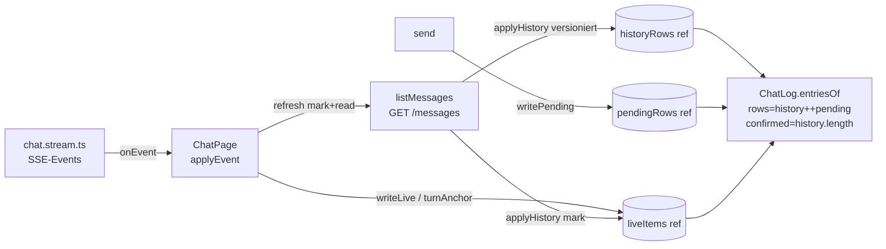
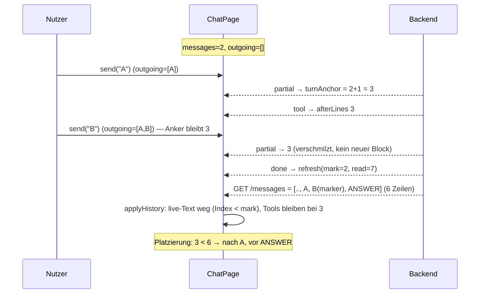
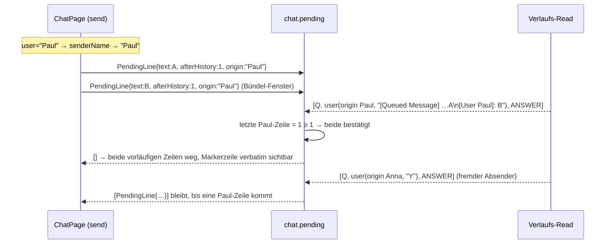

# C-5 — Verlauf out of order / gestreamte Antwort verschwindet

Branch `web-factory-mvp-2`. **Reiner UI-Fix** — die Ursache liegt im Merge von Live-Liste und
Verlaufs-Read, nicht im Backend. Backend bleibt unangetastet.

## 1. Kontext

Paul nutzt den Chat live: bei längerer Konversation ist der Verlauf „total defekt" — Zeilen in
falscher Reihenfolge, eine von Jon gestreamte Antwort verschwand, Reload repariert. Das
Referenz-Frontend (`/Users/sterlp/dev/workset/ai-schulung/app/frontend`) hat dasselbe Problem
nicht.

### 1.1 Was die Referenz anders macht (gelesen, nicht vermutet)

`app/frontend/src/pages/chat/`:

| Referenz | Datei:Zeile | Wirkung |
|---|---|---|
| **Eine** Liste `messages` je Thread ist die einzige Wahrheit | `useChatSessions.ts:17-33` | kein Merge zweier Listen |
| `send` hängt Nutzerzeile **und** eine leere Assistenten-Zeile an *dieselbe* Liste | `useChatSessions.ts:143-148` | die laufende Antwort ist eine Zeile des Verlaufs, kein Sonderfall |
| Tokens hängen an der letzten Assistenten-Zeile, Tools an deren `toolGroup` | `messages.ts:19-47` | Reihenfolge ist **strukturell**, kein Index |
| `done` stempelt nur die Dauer, **liest den Verlauf nicht** | `useChatSessions.ts:205-226` | kein Race zwischen Read und Stream |
| Verlauf wird nur beim Öffnen/Reload gelesen; `seed` überschreibt nie einen laufenden Stream | `useChatSessions.ts:83-93` | Read kann Live-Zeilen nicht wegwerfen |

**Nicht 1:1 übernehmbar:** unser `done`-Read ist nötig, weil die **finale Team-Antwort**
(Werkzeug-Ergebnis, ADR-0078 Entscheidung 6) und die **Fehlerzeile** (R-WP-34) ausschließlich im
Verlauf existieren und bewusst nie als Live-Zeile reisen (`SseTurnMonitor.java:36-40`). Unser
Done-Read bleibt also — repariert wird der **Merge**, nicht der Read.

### 1.2 Tatsächliche Ursache (drei Defekte in `chat.page.tsx` / `chat.log.tsx`)

**U1 — Der Live-Anker ist eine Zeilenzahl, die vorläufige eigene Zeilen mitzählt.**
`shownRows = messages.length + outgoing.length` (`chat.page.tsx:126-128`) ist der Anker jedes
Live-Items (`chat.page.tsx:171/175/180/200`). Sendet der Nutzer **während** des Turns eine zweite
Eingabe, wächst `outgoing` → alle weiteren Chunks bekommen einen **neuen** Anker → `appendLiveText`
verschmilzt nicht mehr (`chat.live.ts:19-25`) → die Antwort **zerfällt in Blöcke**, und ihr Schwanz
steht **unter** der gerade getippten nächsten Frage. Genau Pauls „Reihenfolge stimmt nicht", und
zwar genau bei längeren Gesprächen, weil man dort tippt, während Jon arbeitet.

**U2 — Die bestätigte eigene Zeile wird am Text erkannt; eine gequeuete Zeile trägt aber den
Core-Marker.**
`withoutSent` (`chat.page.tsx:444-459`) entfernt eine vorläufige Zeile nur, wenn ein
**textgleicher** Nutzer-Eintrag im Verlauf steht. Eine während des Turns gesendete Eingabe geht in
die Core-Queue und landet als `[Queued Message] (14:32): <text>` im Memory
(`UserName.java:96-104`, `ProjectRuntime.java:460-462`; Q6: der Marker bleibt sichtbar) → Text ist
nie gleich → **die Zeile bleibt für immer** stehen, **doppelt** neben ihrer Verlaufszeile, am Ende
des Logs, und hebt `shownRows` dauerhaft an. Mit jeder gequeueten Eingabe wächst der Müll.
**Reload baut `outgoing` leer neu → repariert** (Pauls Beobachtung).

**U3 — Der `done`-Read wirft Live-Text weg, den er nicht kennt, und Reads sind ungeordnet.**
`applyHistory` ruft unbedingt `setLive(liveLinesAfterHistory)` (`chat.page.tsx:142-146`,
`chat.live.ts:59-61`) — der Live-Text verschwindet **im Moment der Antwort**, nicht im Moment ihres
Eintreffens. Streamt zu diesem Zeitpunkt schon der **nächste** Turn (der Read ist ein echter
Netzwerk-Roundtrip und wächst mit dem Verlauf, weil `GET /messages` den kompletten Speicher
abbildet — `ChatController.java:56-61`), ist dessen Text fort; da Chunks **Deltas** sind
(`SseTurnMonitor.java:115-116`), fehlt der Kopf bis zum nächsten Read. Zusätzlich hat `refresh()`
keine Reihenfolge: eine ältere, langsamere Antwort kann eine neuere überschreiben (`messages`
springt zurück). **Reload repariert**, weil der Verlauf die vollständige Zeile hat.

Alle drei Symptome (Reihenfolge, verschwundene Antwort, Reload heilt) sind damit erklärt; der
Backend-Pfad ist korrekt geordnet (Memory vor Event: `ProjectRuntime.java:355-358`, `:406-409`).

## 2. SOLL-Check gegen `docs/chat.md`

| Regel | Wirkung des Fixes |
|---|---|
| R-WP-5 / UC-WP-7 (Antworten laufen mit) | U3-Fix stellt sicher, dass ein Verlaufs-Read nur wegnimmt, was er kennt → **stärker** |
| R-WP-11 (Verlauf = Wahrheit für fertigen Text) | bleibt: fertiger Text kommt weiter aus dem Read. U3 verschiebt nur den **Zeitpunkt des Weggebens** |
| R-WP-28 / UC-WP-54 (Tool-Zeilen inline an ihrer Stelle, bleiben sichtbar) | U1-Fix macht die Stelle erst richtig; bestehender Test `toolLinesSurviveTheDoneRefresh` (Tool vor Antwort) bleibt grün |
| R-WP-31 / UC-WP-65 (Warte-Rahmen endet mit dem Turn) | unberührt |
| R-WP-34 / UC-WP-64 (Fehlerzeile aus dem Verlauf) | unberührt (Fehlerzeile wird weiter vom Folge-Read ersetzt) |
| R-WP-35 (Scroll folgt nur am Ende) | unberührt |
| R-WP-10 / UC-WP-14 (Eingabe während des Turns wird gequeued) | unberührt; **aber** die Anzeige der eigenen gequeueten Zeile ist nicht geregelt → **SOLL-Lücke**, s. §8 Q1 |

Kein Widerspruch zwischen einem Fix und einer bestehenden Regel gefunden.

## 3. Design-Entscheidungen

**D-A — Anker ist eine Zahl in *Verlaufs*-Koordinaten, pro Turn eingefroren.**
Ein Live-Item trägt den Anker „so viele Zeilen standen, als es ankam" — aber gerechnet **einmal
je Turn** und **inklusive der damals vorläufigen eigenen Zeilen**. Der Wert bleibt für alle Items
des Turns derselbe (auch wenn danach eine weitere Eingabe gequeued wird), weil die vorläufigen
Zeilen beim Read **1:1 an denselben Indizes** zu Verlaufszeilen werden (Verlauf ist append-only).
Damit gilt vor *und* nach dem Read dieselbe Zahl, und die Antwort zerfällt nicht mehr.
Eingefroren wird im Ref `turnAnchor`; zurückgesetzt bei `done`, `error` und `setLive([])`.

**D-B — Alle Live-Schreibvorgänge laufen über je eine Schreibfunktion mit Ref.**
`historyRows`, `pendingRows`, `liveItems` sind Refs, die zusammen mit dem State über
`writeHistory` / `writePending` / `writeLive` gesetzt werden. Grund: der Event-Handler braucht den
Wert **synchron** (State in `applyEvent` ist durch `useCallback([projectId, refresh, refreshTiles])`
nicht lesbar, und die Deps dürfen sich nicht pro Chunk ändern), und ein Effekt-Ref hinkt einen
Render nach — genau der Fehler, den wir beheben. Refs werden nur in Event-Handlern/Read-Callbacks
geschrieben, nie im Render und nie in einem State-Updater (StrictMode ist aktiv,
`main.tsx:9`; React Compiler ist aktiv, `vite.config.ts:10`).

**D-C — Ein Verlaufs-Read gibt nur Live-Items auf, die er kennen kann.**
`refresh()` merkt sich beim Start `mark = liveItems.current.length` und eine laufende Nummer;
`applyHistory(loaded, mark, read)` (a) ignoriert Antworten, die älter sind als die zuletzt
angewandte, und (b) wirft `text`/`error` nur unter den ersten `mark` Items weg. `tool`/`diff`
bleiben unverändert (R-WP-11/UC-WP-54, live-only).

**D-D — Die eigene vorläufige Zeile wird über Position, nicht über Text bestätigt** (Inc 3,
blockiert, s. §8 Q1). Jede vorläufige Zeile merkt sich, wie viele Verlaufszeilen beim Senden
standen; bestätigt wird sie von der ersten noch nicht verbrauchten **Nutzer**-Zeile an dieser
Position oder dahinter. Das kennt kein Format (Core-Marker, `[User …]:`), ist O(n) und behebt
nebenbei die im Code dokumentierte Grenze „derselbe Text zweimal hintereinander". Die Logik
kommt als reines Modul `chat.pending.ts`, damit sie ohne React testbar ist.

**D-E — Stream erst nach dem ersten Verlaufs-Read öffnen.**
`connect()` läuft im Mount-Effekt erst nach `refresh()` (Promise-Kette). Nur so ist der Anker
beim ersten Event eine wahre Aussage über den Verlauf; heute kann ein Event bei noch leerem
`messages` ankern und landet nach dem Read **über** dem ganzen Verlauf.

**Nicht getan:** kein Umzug der Live-Zeilen in die Verlaufsliste (Referenz-Muster), kein Entfall
des Done-Reads, keine Backend-Änderung, kein neuer Event-Typ.

## 4. Architektur

Anteile und Abhängigkeitsrichtung: `chat.page.tsx` besitzt **allen** Zustand (Verlauf, eigene
vorläufige Zeilen, Live-Liste, Anker); `chat.live.ts` bleibt reine Listen-/Anker-Funktionen;
`chat.log.tsx` entscheidet **nur** über die Platzierung beim Zeichnen und kennt weder Read noch
Anker-Ref; `chat.pending.ts` (neu) ist eine reine Wertfunktion ohne React.





### Code-Skizze (Signaturniveau)

```ts
// chat.live.ts — Semantik präzisiert, Typname bleibt (20 Tests hängen an den Handles)
export type LiveItem = { kind: 'text'|'tool'|'error'|'diff'; …; afterLines: number }

// chat.page.tsx — drei Fakten, je eine Schreibstelle
const historyRows = useRef(0)
const pendingRows = useRef(0)
const liveItems   = useRef<LiveItem[]>([])
const turnAnchor  = useRef<number | null>(null)
function writeLive(next: LiveItem[], after: number | null): void  // setzt liveItems + setLive
function anchorOf(): number  // turnAnchor.current ??= historyRows.current + pendingRows.current
function refresh(): Promise<void>  // read = ++reads.current; mark = liveItems.current.length
function applyHistory(loaded: ChatMessage[], mark: number, read: number): void

// chat.log.tsx
function entriesOf(rows: Row[], live: LiveItem[], confirmed: number): Entry[]
//   at = run[0].afterLines >= confirmed ? rows.length : run[0].afterLines

// chat.pending.ts (Inc 3)
export interface PendingLine { text: string; afterHistory: number }
export function withoutConfirmed(pending: PendingLine[], history: ChatMessage[]): PendingLine[]
```

## 5. Betroffene Dateien

| Datei | Änderung |
|---|---|
| `factory-ui/src/chat/chat.page.tsx` | Refs + Schreibfunktionen, eingefrorener `turnAnchor`, `refresh()` mit `mark`/`read`, `applyHistory(loaded, mark, read)`, `confirmed = messages.length` an `ChatLog`, `connect()` nach `refresh()`; Inc 3: `PendingLine[]` statt `string[]`, `withoutSent` entfällt |
| `factory-ui/src/chat/chat.log.tsx` | `entriesOf(rows, live, confirmed)` + Platzierungsregel; Prop `confirmed` (oder aus `messages.length` ableiten) |
| `factory-ui/src/chat/chat.live.ts` | nur Doc-Kommentar zu `afterLines` („Anker des Turns"); **Signaturen unverändert** |
| `factory-ui/src/chat/chat.pending.ts` | **neu** (Inc 3): `PendingLine`, `withoutConfirmed` |
| `factory-ui/test/chat/chat.page.test.tsx` | `stubChat` um `deferNextHistoryRead()` erweitern (Promise, das der Test auflöst — kein `sleep`); neue Tests |
| `factory-ui/test/chat/chat.log.test.tsx` | Platzierungstests für `entriesOf` |
| `factory-ui/test/chat/chat.pending.test.ts` | **neu** (Inc 3) |
| `docs/chat.md` | **nur Jon/docs-Besitzer**: fehlende Regel (§8 Q1). Dev fasst docs **nicht** an |
| Backend | **keine Änderung** |

Unverändert bleiben: `chat.stream.ts`, `chat.client.ts`, `shared/sse.client.ts`, `chat.tools.tsx`,
`chat.diff.tsx`, `chat.waiting.tsx`, alle Backend-Klassen.

## 6. Regeln & Randbedingungen

- **Keine neuen Draht-Handles umbenennen**: `chat-live`, `chat-tool-line`, `chat-line-jon`,
  `chat-line-user`, `chat-diff*` sind Griffe bestehender Tests (AGENTS-DEV.md:175-177).
- **Kein State in Refs schreiben, die im Render gelesen werden**; Refs nur in Handlern/Callbacks.
- **Keine Sleeps in Tests**; asynchrone Reads werden über aufgelöste Promises gesteuert, jeder
  neue Test bleibt unter dem Vitest-Default (5 s) — kein `vi.useFakeTimers` nötig.
- Der bestehende Test `toolLinesSurviveTheDoneRefresh` (Tool **vor** der Antwort,
  `chat.page.test.tsx:794-819`) ist der Vertrag von UC-WP-54 und bleibt unverändert grün; er darf
  nicht umformuliert werden.
- Bauprüfung: `cd factory-ui && COREPACK_ENABLE_PROJECT_SPEC=0 pnpm test`, `npx tsc -b`,
  `pnpm lint` (AGENTS-DEV.md:778-781).

## 7. Inkremente (je einzeln grün lauffähig)

### Inc 1 — Live-Zeilen bleiben, wo sie hingehören (U1 + D-A + D-E) — **GEBAUT 2026-11-05, grün**
`turnAnchor`/`historyRows`/`pendingLines`-Refs + `anchorOf()`, `writeHistory`/`writePending`, `connect()`
nach dem ersten `refresh()`, Tests 1–3 neu (Mutationsproben belegt). UI 137 Tests / 17 Dateien, tsc +
oxlint 0/0, Doc-Lint 1 Finding (UC-WP-69 unbelegt = Inc 3).
**Abweichung:** `entriesOf(rows, live, confirmed)` nicht gebaut — die Klammer `afterLines >= confirmed ?
rows.length : afterLines` setzt die Antwort hinter die eben getippte zweite Frage und widerspricht §7 Test 1
wie D-A; Platzierung bleibt `Math.min(afterLines, rows.length)`, `confirmed` hätte keine Wirkung.
`deferNextHistoryRead()` schon in Inc 1 (Test 3 braucht es).
Kein sichtbarer Text ändert sich, nur die Reihenfolge.
- `chat.page.tsx`: `turnAnchor`-Ref, `historyRows`/`pendingRows`-Refs, `anchorOf()`; `refresh()`
  vor `connect()` im Mount-Effekt.
- `chat.log.tsx`: `entriesOf(rows, live, confirmed)`.

**BDD / Tests** (`factory-ui/test/chat/`):
1. `aLiveAnswerKeepsItsAnchorWhenAnInputIsQueuedMidTurn` — GIVEN Turn streamt WHEN eine zweite
   Eingabe gesendet wird und weitere Chunks kommen THEN steht die Antwort als **ein** `chat-live`-
   Block und **vor** der zweiten Eingabe. (R-WP-28, UC-WP-54)
2. `aLiveTraceStaysBetweenItsInputAndTheAnswer` — GIVEN Verlauf `[frage]`, Turn mit Tool-Zeilen
   WHEN `done` den Verlauf `[frage, sendung, antwort]` liefert THEN steht die Tool-Box nach
   `sendung` und vor `antwort` (`chat.log.test.tsx`, Platzierungsregel). (UC-WP-54)
3. `theStreamOpensAfterTheFirstHistoryRead` — GIVEN Mount mit vorhandenem Verlauf WHEN der
   Verlauf geliefert ist THEN öffnet sich `…/events` erst danach (Reihenfolge in `chat.calls`).
4. Bestehend: `toolLinesStayInlineInOrder`, `toolLinesSurviveTheDoneRefresh`,
   `aFileChangeIsLiveAndDoesNotOutliveTheReload` bleiben unverändert grün.

### Inc 2 — Die gestreamte Antwort verschwindet nicht mehr (U3 + D-C) — **GEBAUT 2026-11-05, grün**
`refresh()` mit `read = ++readSeq` und `mark = liveItems.current.length` (vor der Anfrage),
`applyHistory(loaded, mark, read)` verwirft Antworten unter der zuletzt angewandten Nummer und gibt
`text`/`error` nur unter `mark` auf (`liveLinesAfterHistory(items, mark)`, Default = ganze Liste);
alle Live-Schreibvorgänge über `writeLive`. Tests 5–6 neu (Mutationsproben: ohne `mark` → Test 5 rot,
Guard raus → Test 6 rot, `mark = 0` → 6 Tests rot). UI 139 Tests / 17 Dateien, tsc + oxlint 0/0,
Doc-Lint 1 Finding (UC-WP-69 unbelegt = Inc 3).
**Abweichung:** „die Antwort steht nach dem `done`" ist als `chat-line-jon` aus dem Read behauptet, nicht als
`chat-live` — R-WP-11 und `toolLinesSurviveTheDoneRefresh` verbieten die doppelte Antwort; der
`chat-live`-Griff gehört dem Text, den der Read nicht kennen kann. Kein `// UC-WP-69`-Marker in Inc 2
(Inc 3 gehört die Regel; Pauls Entscheidung 2026-11-05).
- `refresh()`: `read = ++reads.current`, `mark = liveItems.current.length`;
  `applyHistory(loaded, mark, read)` verwirft veraltete Reads und gibt nur Items `< mark` auf.
- `chat.page.tsx`: Live-Schreibvorgänge über `writeLive`.

**BDD / Tests:**
5. `aLaterTurnKeepsStreamingWhileAnEarlierReadIsInFlight` — GIVEN der `done`-Read des vorigen
   Turns ist offen WHEN die Antwort des nächsten Turns streamt THEN steht der gestreamte Text
   weiterhin im Log und fehlt nach dem Auflösen des Reads nicht. (R-WP-5, UC-WP-7)
6. `anOlderHistoryReadNeverOverwritesANewerOne` — GIVEN zwei Reads WHEN der ältere zuletzt
   antwortet THEN bleibt der neuere Verlauf stehen (kein Rücksprung, keine verschwundene Antwort).
   (R-WP-11)
7. Bestehend: `droppedStreamReopensAndReadsHistory`, `aFileChangeIsLiveAndDoesNotOutliveTheReload`,
   `toolLinesSurviveTheDoneRefresh` bleiben grün.

### Inc 3 — Eine gequeuete Eingabe steht genau einmal (U2 + D-D) — **GEBAUT 2026-11-05, grün**
`chat.pending.ts` (`PendingLine{text, afterHistory}`, `withoutConfirmed` über Position mit zwei Zeigern:
`used` = eine Verlaufszeile bestätigt genau eine vorläufige; Wasserlinie der behaltenen Zeile wird auf die
erreichte Suchposition angehoben, damit ein Folge-Read dieselbe Zeile nicht ein zweites Mal verbraucht).
`outgoing`/`pendingLines` → `PendingLine[]`, `send()` stempelt `afterHistory = historyRows.current`,
`withoutSent` entfallen, `applyHistory` ruft `withoutConfirmed`. **Abweichungen:** (a) vier reine Tests
statt drei — der vierte (`aConfirmingLineConfirmsNoSecondPendingLine`) pinnt die Verbrauchs-Semantik über
zwei Reads; (b) Mutationsprobe: die treue `withoutSent`-Form (splice) macht genau
`theQueuedInputStandsOnceInTheLog` + `theSameTextTwiceIsConfirmedTwice` rot — ein Filter-Mutant ohne
Verbrauchen ließe Test 9 grün, die Sonde muss die Verbrauchsschleife reproduzieren. UI 145 Tests /
18 Dateien, tsc + oxlint 0/0, Doc-Lint **0 Findings** (UC-WP-69 belegt; Marker-Flip bleibt bei Jon).
- `chat.pending.ts` neu; `chat.page.tsx` hält `PendingLine[]`, `applyHistory` ruft
  `withoutConfirmed`.
- `chat.log.tsx`/`ChatPage`: `outgoing` wird zu `PendingLine[]` (Text unverändert gezeichnet).

**BDD / Tests:**
8. `theQueuedInputStandsOnceInTheLog` — GIVEN Eingabe während des Turns gesendet WHEN `done` den
   Verlauf mit `[Queued Message] (14:32): <text>` liefert THEN steht die Frage **einmal** und die
   vorläufige Zeile ist weg. (R-WP-10, UC-WP-14, R-WP-11)
9. `theSameTextTwiceIsConfirmedTwice` — GIVEN derselbe Text zweimal gesendet WHEN der Verlauf beide
   Zeilen trägt THEN sind beide vorläufigen Zeilen weg (behebt die heute dokumentierte Grenze).
   (UC-WP-57)
10. `chat.pending.test.ts`: `aLaterUserLineConfirmsAnEarlierPendingLine`,
    `aUserLineBeforeTheWatermarkConfirmsNothing`,
    `aQueuedMarkerLineConfirmsItsPendingLine` (Format-Unkenntnis: der Marker wird nicht geparst).

**Teststrategie allgemein:** jede Symptomklasse bekommt genau einen Test, der ohne den Fix rot ist
(Mutationsprobe je Inkrement: Anker zurück auf `messages+outgoing` → Test 1 rot; `applyHistory`
ohne `mark` → Test 5 rot; ohne `read`-Vergleich → Test 6 rot; `withoutConfirmed` auf Textvergleich
zurück → Tests 8/9 rot). `ChatPage`-Tests laufen weiter über den bestehenden `stubChat`-Harness;
das neue `deferNextHistoryRead()` liefert ein `resolve()`, damit ein Read im Flug gehalten und
deterministisch aufgelöst wird.

## 8. Offene Fragen (an Jon — blockieren Inc 3)

**Q1 — SOLL-Lücke: die eigene Zeile erscheint genau einmal, auch als gequeuete.**
`docs/chat.md` regelt Queue-Verhalten (R-WP-10/UC-WP-14), den Verlauf als Wahrheit (R-WP-11) und
den Absender-Namen (R-WP-25/UC-WP-48) — aber nirgends, dass eine eigene Eingabe **genau einmal**
im Verlauf steht und dass die bestätigte Zeile die vorläufige **ersetzt**. Genau diese Regel
entscheidet den Fix von U2, deshalb gehört sie ins Doc, bevor gebaut wird.
Vorschlag (deutsch, in `docs/chat.md` als eigener Absatz bei R-WP-10, plus eine UC):

> **Eine eigene Eingabe steht genau einmal im Verlauf.** Solange der Verlauf sie nicht trägt,
> zeigt der Chat sie als vorläufige Zeile; sobald der Verlaufs-Read sie liefert, ersetzt diese
> Zeile die vorläufige **an ihrer Stelle** — auch dann, wenn der Core sie als gequeuete Eingabe
> mit seinem Marker `[Queued Message] (hh:mm): ` schreibt (Q6: der Marker bleibt sichtbar).
> Dieselbe Eingabe zweimal ist zwei Zeilen.
> - GIVEN eine Eingabe, die während eines Turns gesendet wurde WHEN `done` den Verlauf liest
>   THEN steht sie genau einmal im Log.
> - GIVEN dieselbe Eingabe zweimal WHEN der Verlauf beide trägt THEN sind beide bestätigt.

**Q2 — Sichtbare Textänderung in Inc 3:** Nach dem Fix zeigt die eigene gequeuete Zeile den
Marker des Cores (`[Queued Message] (14:32): …`) statt des getippten Texts. Das ist Q6-konform,
aber eine sichtbare Änderung. Empfehlung: **ja, Marker zeigen** (er ist Realität, R-WP-11), nicht
in der UI wegschneiden.

**Q3 — Scope-Bestätigung:** Inc 1 + Inc 2 sind unabhängig von der Doc-Lücke und adressieren Pauls
zwei Symptome (Reihenfolge, verschwundene Antwort). Empfehlung: **sofort bauen**, Inc 3 nach der
Regel. Kein Backend-Eingriff.

STATUS: Inc 1–4 gebaut und grün (2026-11-05) — Review bei Jon; er flippt `R-WP-37`/`UC-WP-69` in `docs/chat.md`.

---

## 9. Review-Befund (Review, 2026-11-05) — **VERDICT: REJECTED**

Scope: `49571dc4..8360d27e` (Inc 1 `195b149d`, Inc 2 `a3da4b01`, Inc 3 `8360d27e`), Plan oben,
`docs/chat.md`. Geprüft: Plan↔Code, Docs↔Code, Docs↔Plan, Architektur.

**Tests / Bau (gemessen):** `COREPACK_ENABLE_PROJECT_SPEC=0 pnpm test` → **145 passed / 18 Dateien**,
3.56 s; `npx tsc -b` → exit 0; `pnpm lint` (oxlint) → 0/0 (62 Dateien);
`lintDocsAndTests` (docRoots `docs`, testRoots `factory-ui/src`, `factory-ui/test`,
`factory-backend/src/test`, idPattern `UC-WP-\d+`) → **0 Findings**, UC 69/69, 270 Test-Ids.
Backend in der Distanz unverändert (`git diff --name-only` → keine Backend-Pfade). Plangemäße
Abweichungen von Jon akzeptiert und hier **nicht** gewertet: 4. reiner Pending-Test, Marker-Zeile in
Test 9, `confirmed`-Param nicht gebaut, `// R-WP-11` statt `// UC-WP-11`.

### BUGs (nach Wirkung)

**BUG-1 — Der Core verschmilzt zwei gequeueete Eingaben zu EINER Verlaufszeile; die zweite
vorläufige Zeile bleibt und verschiebt alle Bestätigungen danach dauerhaft.**
Item 1/2/6 · verletzt R-WP-37 ("steht genau einmal", `docs/chat.md:113-121`) und UC-WP-69 GIVEN 1+2
(`docs/chat.md:123-131`).
*Stelle:* `factory-ui/src/chat/chat.pending.ts:24-40` (`used`/`from`: eine Verlaufszeile bestätigt
genau eine vorläufige), aufgerufen in `factory-ui/src/chat/chat.page.tsx:218`.
*Kette (gelesen, nicht vermutet):* Core-Queue bündelt im sliding window —
`org.sterl.llmpeon.core/src/main/java/org/sterl/llmpeon/queuedmessages/UserMessageQueue.java:66-95`
(Fenster 10 s, `batchStartTime` wird bei jedem Add zurückgesetzt, Join bis 300 Zeichen), Produktion
default per `org.sterl.llmpeon.core/src/main/java/org/sterl/llmpeon/agent/AbstractAgent.java:58`;
Regel: `org.sterl.llmpeon.core/docs/queued-user-messages.md` §1 "Join Short Burst Messages". Belegt
durch den Core-Test selbst: `org.sterl.llmpeon.core/src/test/java/org/sterl/llmpeon/agent/AbstractAgentTest.java:100-116`
— "msg2+msg3 merge per batch window (Rule 1)", `userTexts` hat Größe 2, **eine** Memory-Zeile trägt
beide Texte. `ProjectRuntime.history()` (`factory-backend/.../ProjectRuntime.java:470-477`) bildet
genau eine Memory-`UserMessage` auf genau eine `ChatLine` → auf dem Draht **eine** `role: user`.
*Input → erwartet vs. tatsächlich:* Pauls Browser, Verlauf 1 Zeile, Turn läuft; er sendet A, 3 s
später B (beide gequeueet, `chat.page.tsx:370` stempelt beide `afterHistory = 1`). `done` → Read
bringt `[Q, "[Queued Message] (14:32): [User Paul]: A\n[User Paul]: B", ANSWER]`.
`withoutConfirmed([A,B])`: A verbraucht Index 1 (`used = 2`), B sucht ab 2, findet nichts → **B bleibt
stehen** (`chat.pending.ts:34`) mit Wasserlinie 2. **Erwartet (R-WP-37):** beide Eingaben genau einmal.
**Tatsächlich:** B steht doppelt (Text steckt in der Verlaufszeile, zusätzlich als vorläufige Zeile am
Log-Ende, `chat.log.tsx:81-90`), und weil die Wasserlinie auf 2 angehoben wurde, verbraucht beim
nächsten Read **die Zeile der nächsten Eingabe** diese Restzeile — der Versatz wandert mit jeder
Runde weiter, die jeweils letzte Eingabe steht doppelt. Zusätzlich bleibt `pendingLines.current` um 1
erhöht und steckt in `anchorOf()` (`chat.page.tsx:191-196`) → Live-Items späterer Turns ankern eine
Zeile zu tief (C-5-Symptom "Reihenfolge" zurück).
*Test-Lücke (Item 6):* Kein Test bildet die Verschmelzung ab. `theSameTextTwiceIsConfirmedTwice`
(`factory-ui/test/chat/chat.page.test.tsx:1007-1030`) modelliert **zwei** getrennte Verlaufszeilen —
eine Drahtform, die der Core nur außerhalb des Fensters (>10 s oder >300 Zeichen) liefert;
`aConfirmingLineConfirmsNoSecondPendingLine` (`chat.pending.test.ts:50-60`) pinnt die 1:1-Regel sogar
fest. Der Test ist grün, obwohl das Symptom im Feld bleibt.
*Reparatur braucht eine Entscheidung:* s. offene Frage unten (§9.1).

**BUG-2 — Die Bestätigung ignoriert den Absender: eine fremde Nutzer-Zeile isst die eigene
vorläufige Zeile, obwohl die eigene Eingabe noch in der Queue steht.**
Item 1/2 · verletzt R-WP-37 Satz 1 ("Solange der Verlauf die Eingabe nicht trägt, zeigt der Chat sie
als vorläufige Zeile") und UC-WP-69 GIVEN 1; geteilte Chats sind SOLL (R-WP-15/UC-WP-21/22,
`docs/chat.md:99-110`).
*Stelle:* `chat.pending.ts:43-50` `indexOfUserLine` prüft ausschließlich `role === 'user'`;
`withoutConfirmed(pending, history)` kennt den Namen dieses Browsers nicht, obwohl jede
Verlaufszeile `origin` trägt (`factory-ui/src/chat/chat.client.ts:12-16`, R-WP-25) und
`ChatPage` ihn hält (`chat.page.tsx:95` Prop `user`).
*Input → erwartet vs. tatsächlich:* Verlauf `[Q]` (`historyRows = 1`), Turn läuft, Anna hat Y
gequeueet, **danach** sendet Paul X → `pending = [X{afterHistory:1}]`. `done` → der Core drain-first
Y (FIFO, Rule 2) → Read bringt `[Q, Y(origin Anna), ANSWER]`. `from = max(0,1) = 1` →
`indexOfUserLine(history,1)` = 1 = **Y** → X gilt als bestätigt. **Erwartet:** X bleibt als
vorläufige Zeile, bis der Verlauf es trägt. **Tatsächlich:** X ist vom Bildschirm weg, obwohl es noch
in der Queue wartet — genau Pauls Klage "meine Eingabe ist weg", jetzt ohne Reload-Heilung bis zum
Folge-Turn.
*Test-Lücke:* kein Test mit fremdem `origin` im Bestätigungsfenster; `aUserLineBeforeTheWatermarkConfirmsNothing`
(`chat.pending.test.ts:26-33`) prüft nur die Richtung "Zeile **vor** der Wasserlinie".

### Plan conflict (Item 4)

*Plan §3 D-D* ("bestätigt wird sie von der ersten noch nicht verbrauchten **Nutzer**-Zeile an dieser
Position oder dahinter", §7 Inc 3) vs. *Core-Doc §1* (`queued-user-messages.md`, Fenster 10 s →
Verschmelzung) und vs. *`docs/chat.md:99-110` R-WP-15* (ein Chat für alle Nutzer). Der Plan (und mit
ihm `docs/chat.md` R-WP-37 "Dieselbe Eingabe zweimal ist **zwei** Zeilen") setzt 1:1
"Eingabe = Verlaufszeile" voraus; die Core-Doc sagt das Gegenteil, und im geteilten Chat steht eine
fremde Nutzer-Zeile im selben Koordinatensystem. Auch §1.2 U2 bleibt unvollständig: der Marker-Text
ist nicht "die Zeile der Eingabe", sondern ggf. mehrere Eingaben in einer Zeile. Der Code folgt dem
Plan — gemessen wird er an den Docs, und die sind an dieser Stelle zu eng.

### Suspicion (blockiert nicht)

* **S1 — Clear/Compact verkürzt den Verlauf, die Wasserlinie bleibt hoch.** `act()` liest nach einer
  erfolgreichen Aktion den Verlauf (`chat.page.tsx:468`); ist der Verlauf danach kürzer als die
  gestempelte `afterHistory`, findet `indexOfUserLine` nie wieder eine Zeile → vorläufige Zeile
  dauerhaft + Anker dauerhaft zu hoch. Erreichbar über "Stop (kein Read, D-16) → Clear". Vor Inc 3
  gleichartig (Textvergleich traf dann auch nie) — deshalb nicht als neuer BUG gewertet, aber die
  neue Wasserlinie macht es unerreichbar statt nur unwahrscheinlich.
* **S2 — Ein Read während eines live streamenden Turns gibt streamenden Text auf, den er nicht
  kennen kann** (`liveLinesAfterHistory` schützt nur Items **ab** `mark`, `chat.live.ts:68-70`).
  Der einzige Read dieser Art ist `act()`, und der wird vom Backend bei laufendem Turn mit 409
  abgelehnt (`chat.page.tsx:450-452` Kommentar) — deshalb heute nicht erreichbar. Würde eine Aktion
  je bei laufendem Turn durchgehen, ist U3 zurück.

### LOW (nicht blockierend)

* **LOW-1 — Zwei Koordinatensysteme, eine davon ungenutzt:** `PendingLine.afterHistory` zählt nur
  Verlaufszeilen, `LiveItem.afterLines` zählt Verlaufs- **plus** vorläufige Zeilen.因为 die
  Verlaufszeilen beim Read nur um die bestätigten wachsen, zeigt der eingefrorene Anker nach einem
  Read, der eine Queue-Zeile **nicht** trägt, an der falschen Stelle: `chat.page.test.tsx:458` pinnt
  `[…, chat-line-jon, chat-live, chat-line-user]` — die Antwort des laufenden Turn steht **über ihrer
  eigenen** noch vorläufigen Frage. Einfacher und testbarer: vorläufige Zeilen am eigenen
  `afterHistory` platzieren (`chat.log.tsx:81-90`) → ein Koordinatensystem, kein Overshoot. (Kosten:
  Test 458 muss mit benannter Abweichung umformuliert werden.)
* **LOW-2 — Default-Parameter ohne Nutzer:** `liveLinesAfterHistory(items, mark = items.length)`
  (`chat.live.ts:68`) wird in Produktion nur mit `mark` gerufen; der Default erhält eine Form, die es
  nicht mehr gibt. `mark` Pflicht-Parameter machen.
* **LOW-3 — Regelprosa wird im Code fünffach nacherzählt** (`chat.page.tsx:117-141`, `185-190`,
  `198-208`; `chat.live.ts:5-9`, `57-67`; `chat.log.tsx:151-158`; `chat.pending.ts:3-23`), obwohl die
  Regel seit diesem Zyklus in `docs/chat.md` R-WP-37 steht. AGENTS.md:1 "Never duplicate existing
  docs—link to them instead". Warum einmal pro Modul, sonst nur `R-WP-37`/`UC-WP-54` als Referenz.
* **LOW-4 — Doc-Buchung hinkt:** `docs/chat.md:113`/`:123` tragen weiter ❌ (gebaut und belegt),
  `docs/open-points.md:44-48` behauptet "Gebaut ist Inc 1 von 3". Beides beim Abschluss-Commit mit
  dem Marker-Flip mitziehen.

### Pre-existing (nie blockierend)

* `chat.page.tsx:382` — abgelehnter Send entfernt die **letzte** vorläufige Zeile
  (`slice(0, -1)`); bei zwei gleichzeitigen Sends erwischt es die falsche. Gleiche Form wie vor C-5.
* Projektwechsel setzt `live`, `turnAnchor`, `pendingLines` nicht zurück (nur `done`/`error`/
  Stream-Abbruch). Vor C-5 war die Live-Liste ebenfalls schon fremd; neu ist, dass der **eingefrorene**
  Anker mitgenommen wird. Ein Reset der drei Refs beim Projektwechsel behebt beides.
* `An update to ChatPage inside a test was not wrapped in act(...)` in `chat.page.test.tsx`
  (3× pro Lauf, in AGENTS-DEV als vorbestehend gemessen).

### 9.1 Offene Frage an Jon (blockiert die Reparatur von BUG-1/BUG-2)

Woran erkennt die UI "diese Verlaufszeile ist **meine** Eingabe", wenn der Core zwei Eingaben zu einer
Zeile verschmilzt und der Verlauf fremde Nutzer-Zeilen im selben Koordinatensystem trägt?
**Meine Empfehlung:** R-WP-37 vor der Reparatur präzisieren (Docs-Besitzer Jon) — Bestätigung nur bei
gleichem `origin` wie dem Namen dieses Browsers **und** "eine Verlaufszeile bestätigt alle vorläufigen
Zeilen, die vor ihr gesendet wurden" (damit ist der Fall "2 Eingaben → 1 Zeile" entschieden, ohne
dass die UI den Marker parst); Umsetzung weiterhin rein in `chat.pending.ts`, Signatur um `user`
erweitert. Alternative wäre, jede vorläufige Zeile beim nächsten `done` grundsätzlich fallen zu
lassen — billiger, aber sie verliert die Unterscheidung "noch in der Queue" vs. "im Verlauf".

### 9.2 Skill-/Instruktionslücke (Item 10, nur Empfehlung)

`AGENTS-DEV.md` (C-5-Blöcke, Zeilen 783-857) enthält Mutationsproben und Ref-Regeln, aber keinen
Leitsatz, dass eine **modellierte Draht-Form** in einem UI-Test die Core-Regel belegen muss, die sie
erzeugt. Genau dadurch konnte Test 9 zwei Verlaufszeilen modellieren, die der Core nur außerhalb
seines 10-s-Fensters liefert. Vorschlag: eine Zeile in `AGENTS-DEV.md` — "Bildet ein UI-Test eine
Verlaufs-/Draht-Form nach, steht an der Testdatei die Core-Regel mit Datei:Zeile, die diese Form
erzeugt; sonst ist der Test eine Annahme."

### 9.3 Lesehilfe zu LOW-1 und Vorbehalt zu §9.1

* LOW-1, erster Satz (Zeichengestörung im Original): gemeint ist — „`PendingLine.afterHistory` zählt
  nur Verlaufszeilen, `LiveItem.afterLines` zählt Verlaufs- **plus** vorläufige Zeilen. **Weil** die
  Verlaufszeilen beim Read nur um die bestätigten wachsen, …". Alles Weitere an LOW-1 gilt unverändert.
* Zu §9.1: die `origin`-Gleichheit trägt nur, wenn dieser Browser einen Namen hat. Ohne Namen schreibt
  `UserName.payload` keinen Präfix (UC-WP-48), die Verlaufszeile hat dann `origin = null` — dort kann
  nur die Anzahl sprechen („neue Nutzer-Zeilen ≥ wartende Eingaben"), nicht der Absender. Die
  R-WP-37-Präzisierung muss beide Fälle nennen — erledigt, die geschärfte R-WP-37 (Wasserlinie je
  Absender, Bündel-Fall) ist der SOLL für §10.

---

## 10. Inc 4 — Bestätigung je Absender (Reparatur von BUG-1 + BUG-2)

**Status: GEBAUT 2026-11-05, grün** (UI 149 Tests / 18 Dateien, `tsc` + oxlint 0/0, Doc-Lint 0 Findings,
274 Test-Ids; Mutationsproben §10.7 alle vier ausgeführt). Die Regel ist entschieden und geschärft:
`docs/chat.md` R-WP-37 / UC-WP-69 (Wasserlinie je Absender, Bündel-Fall, Marker verbatim). Docs fasst der
Dev **nicht** an (Eigentümer Jon, inkl. Marker-Flip und `docs/open-points.md`). Backend **keine** Änderung.
**Benannte Abweichungen:** (a) `aLaterTurnKeepsStreamingWhileAnEarlierReadInFlight` konnte §10.6 zufolge
nicht unverändert grün bleiben — die geschärfte R-WP-37 bestätigt beide namenlosen vorläufigen Zeilen
durch die eine Read-Zeile (von §10.8.3 akzeptierter Fall, heilt mit dem Folge-Read). **Minimal**
umformuliert: letzte Shape-Assertion auf `[…, chat-line-jon, chat-live]`, Kern-Assertions (streamender
Text überlebt den Read, genau ein `chat-live`, Antwort genau einmal) wörtlich erhalten, positiver Ersatz
ergänzt (Folge-Read bringt die Markerzeile → genau einmal, kein `chat-live`). Die Docs entscheiden über
die Plan-Guardliste. (b) §10.7-Proben sind Mindestmengen: Zusatz-Rotes (u. a.
`failedTurnLeavesNoPendingFrame` bei Sonde A) ist aus der Mutanten-Semantik erklärbar.

### 10.1 Warum dieses Inkrement

Beide Review-Befunde (§9) liegen in **derselben** Funktion und haben dieselbe Ursache: die
Bestätigung kennt weder den Absender noch den Fall „eine Verlaufszeile trägt mehrere Eingaben".

- **BUG-1 (Bündel):** `chat.pending.ts:24-40` verbraucht 1:1 (`used`) — der Core verschmilzt zwei
  gequeuete Eingaben im Fenster (`UserMessageQueue.java:66-92`, Join bis 300 Zeichen) zu **einer**
  Memory-Zeile, also einer Verlaufszeile (`ProjectRuntime.java:470-477`); die zweite vorläufige Zeile
  bleibt stehen und hebt die Wasserlinie dauerhaft an (Versatz wandert mit jeder Runde, `anchorOf()`
  (`chat.page.tsx:191-196`) ankert zu tief).
- **BUG-2 (fremder Absender):** `chat.pending.ts:42-50` prüft nur `role === 'user'` — im geteilten Chat
  (R-WP-15) isst Annas Verlaufszeile Pauls noch wartende vorläufige Zeile.

Ein Inkrement, eine Stelle (`chat.pending.ts` + zwei Stempelstellen), ein Testpaar.

### 10.2 Entscheidungen

**D-F — Die vorläufige Zeile trägt ihren Absender.** `PendingLine` bekommt `origin: string | null`.
Ohne Namen ist `origin` `null` — und `null` ist **eine** Absenderklasse (R-WP-25/UC-WP-48: ohne Namen
kein Präfix, die Verlaufszeile hat dann ebenfalls `origin = null`).

**D-G — Bestätigung = Wasserlinie je Absender, zustandslos aus dem Read abgeleitet.** Kein
mitgeschleppter Verbrauchszustand mehr wie in Inc 3: die Wasserlinie eines Absenders ist die **letzte
Nutzerzeile dieses Absenders im gelieferten Verlauf** (Index). Bestätigt ist eine vorläufige Zeile,
wenn dieser Index `>= afterHistory` ist. Damit gilt per Konstruktion:
- eine Verlaufszeile bestätigt **alle** vorläufigen Zeilen desselben Absenders, die vor ihr gesendet
  wurden (Bündel, BUG-1) — mehrere pro Zeile sind erlaubt, nicht verboten;
- eine Zeile eines **anderen** Absenders bestätigt nichts (BUG-2);
- kein Formatwissen: `role` + `origin` sind alles, was das Modul vom Draht kennt (kein Marker-Parsen);
- derselbe Text zweimal bleibt zwei Zeilen (UC-WP-69 GIVEN 3).

**D-H — Ein Name wird an genau einer Stelle normalisiert.** `sendMessage` trimmt heute selbst
(`chat.client.ts:63`) und der Server schreibt den getrimmten Namen ins Memory (`UserName.payload` →
`UserName.clean`) — die Verlaufszeile trägt also den getrimmten Namen als `origin`. Die vorläufige
Zeile muss **denselben** Wert tragen, sonst bestätigt sie nie. Deshalb: `senderName(user)` in
`chat.client.ts` exportieren (eine Definition von „was ein Name ist") und von `sendMessage` **und**
`ChatPage.send` benutzen — nicht zweimal `trim` schreiben.

**D-I — Der Log zeichnet den Absender der Zeile, nicht den dieses Browsers.** Mit `origin` an der
vorläufigen Zeile gibt es den Namen zweimal (Prop `user` + Zeile). Die Zeile gewinnt: `ChatLog` zeichnet
`line.origin ?? content.chat.you` und das Prop `user` entfällt (Information Hiding: der Log muss nicht
wissen, wem der Browser gehört, dessen Chat er zeichnet). Sichtbar ändert sich nichts.

### 10.3 Architektur



```ts
// chat.client.ts — eine Definition von "was ein Name ist", für Draht und Bestätigung
export function senderName(user?: string | null): string | null {
  const name = user?.trim()
  return name ? name : null   // kein Name: kein Feld auf dem Draht, kein Präfix im Speicher (UC-WP-48)
}

// chat.pending.ts — rein, ohne React, Signatur bleibt
export interface PendingLine {
  text: string
  /** Verlaufszeilen, die beim Senden standen — die eigene Zeile kann nicht davor stehen. */
  afterHistory: number
  /** Der Absender dieser Zeile; null = eine Absenderklasse für alle namenlosen Eingaben (R-WP-25). */
  origin: string | null
}
export function withoutConfirmed(pending: PendingLine[], history: ChatMessage[]): PendingLine[]

// Kern der Regel (O(n), zustandslos, formatfrei):
const lastOf = new Map<string | null, number>()          // letzte Nutzerzeile je Absender
history.forEach((line, at) => { if (line.role === 'user') lastOf.set(line.origin ?? null, at) })
const rest = pending.filter(line => { const last = lastOf.get(line.origin); return last === undefined || last < line.afterHistory })
return rest.length === pending.length ? pending : rest    // referenzstabil, wie bisher
```

Abhängigkeitsrichtung unverändert: `chat.page.tsx` besitzt den Zustand und stempelt; `chat.pending.ts`
ist eine reine Wertfunktion über `ChatMessage[]`; `chat.log.tsx` zeichnet nur. `chat.live.ts` und
`entriesOf` bleiben **unberührt** (LOW-1 aus §9 ist nicht Teil von Inc 4).

### 10.4 Betroffene Dateien

| Datei | Änderung |
|---|---|
| `factory-ui/src/chat/chat.pending.ts` | `PendingLine.origin`; `withoutConfirmed` auf Wasserlinie je Absender (Map Absender → letzter Index); Doc-Kommentar auf R-WP-37/UC-WP-69 verweisen statt die Regel zu nacherzählen |
| `factory-ui/src/chat/chat.client.ts` | `senderName(user)` neu exportiert, `sendMessage` nutzt es (verhaltensgleich) |
| `factory-ui/src/chat/chat.page.tsx` | `send`: `origin: senderName(user)` stempeln; `ChatLog` ohne `user`-Prop; Props-Doc von `user` auf „labelt den Send" präzisieren |
| `factory-ui/src/chat/chat.log.tsx` | vorläufige Zeile: `author: line.origin ?? content.chat.you`; Prop `user` entfällt |
| `factory-ui/test/chat/chat.pending.test.ts` | Semantik je Fall neu; ein Test **ersetzt** (s. §10.6), zwei neu |
| `factory-ui/test/chat/chat.page.test.tsx` | zwei neue Tests (BDD 1/2); eine Zusatz-Assertion in `theSendCarriesTheName` |
| `docs/**`, Backend | **keine Änderung** |

### 10.5 Regeln & Randbedingungen

- **Nur UI.** Kein Backend, keine Draht-Handles umbenannt (`chat-live`, `chat-tool-line`, `chat-line-jon`,
  `chat-line-user`, `chat-diff*`), `chat.live.ts`/`chat.log.tsx`-Platzierung unverändert.
- **Docs bleiben bei Jon** — auch der `❌`-Flip an R-WP-37/UC-WP-69 und die Korrektur „Inc 1 von 3" in
  `docs/open-points.md`.
- Refs aus D-A/D-B unangetastet; `pendingLines.current.length` bleibt Teil von `anchorOf()`.
- `slice(0, -1)` im `send`-catch (`chat.page.tsx:382`, Pre-existing aus §9) bleibt **bewusst** stehen —
  nicht mitziehen, sonst wächst das Inkrement um einen dritten Fall.
- Keine Sleeps; `deferNextHistoryRead()` ist vorhanden, wird hier aber nicht gebraucht (beide neuen
  Tests arbeiten mit `setMessages` + `done`).
- `withoutConfirmed` bleibt rein und referenzstabil (`toBe(pending)` bei nichts bestätigt).

### 10.6 BDD / Tests

**BDD 1 — Bündel** (`chat.page.test.tsx`, `// UC-WP-69`)
`aBundledQueuedLineReplacesBothPendingLines`
GIVEN ein Turn läuft (`user="Paul"`, Verlauf `[QUESTION]`) WHEN Paul zweimal innerhalb des
Bündel-Fensters sendet und `done` den Verlauf mit **einer** gebündelten Markerzeile liefert
(`[Queued Message] (14:32): [User Paul]: zähl die Dateien\n[User Paul]: und die Tests?`, `origin: 'Paul'`)
THEN sind **beide** vorläufigen Zeilen weg und `userLineTexts()` zeigt die Markerzeile **verbatim**
(ein `chat-line-user`, kein `chat-live`).

**BDD 2 — fremder Absender** (`chat.page.test.tsx`, `// UC-WP-69`)
`aForeignUserLineConfirmsNoOwnPendingLine`
GIVEN Paul sendet während eines Turns WHEN `done` einen Verlauf mit Annas Zeile an der Position hinter
Pauls Wasserlinie liefert THEN bleibt Pauls vorläufige Zeile sichtbar; WHEN der nächste Read **seine**
Zeile (mit Marker) liefert THEN ist sie ersetzt — nicht doppelt.
Assertions: erst `userLineTexts()` enthält `'meine Frage'` (die getippte Form) **und** `'Annas Frage'`;
nach dem zweiten Read enthält es die Markerform und kein zweites `'meine Frage'`.

**Reine Tests** (`chat.pending.test.ts`, je `// UC-WP-69`)
- erhalten, an `origin` angepasst: `aLaterUserLineConfirmsAnEarlierPendingLine`,
  `aUserLineBeforeTheWatermarkConfirmsNothing`, `aQueuedMarkerLineConfirmsItsPendingLine`.
- **ersetzt:** `aConfirmingLineConfirmsNoSecondPendingLine` → `oneHistoryLineConfirmsEveryPendingLineOfItsSenderSentBeforeIt`
  (zwei vorläufige, gleicher Absender, `afterHistory 0`, **eine** Verlaufszeile → `[]`).
  *Benannte Abweichung:* dieser Test pinnte die 1:1-Regel aus Inc 3; die geschärfte R-WP-37
  (Bündel-Fall) sagt das Gegenteil. Ersatz ist der genannte Test im selben Lauf — nicht stillschweigend
  löschen, nicht aufweichen.
- **neu:** `aLineOfAnotherSenderConfirmsNothing` (Pauls Zeile, Annas Verlaufszeile → `toBe(pending)`),
  `aNamelessLineConfirmsTheNamelessPendingLine` (`origin: null` auf beiden Seiten → `[]`).

**Bestehend, bleibt grün und darf nicht umformuliert werden:** `theQueuedInputStandsOnceInTheLog`,
`theSameTextTwiceIsConfirmedTwice`, `toolLinesSurviveTheDoneRefresh` (UC-WP-54),
`aLiveAnswerKeepsItsAnchorWhenAnInputIsQueuedMidTurn`, Inc-2-Test `anOlderHistoryReadNeverOverwritesANewerOne`;
`aLaterTurnKeepsStreaming…` — Ausnahme: benannte Abweichung (a) oben; geschärfte R-WP-37 bestätigt dort
beide namenlosen vorläufigen Zeilen; `aConfirmingLine…` entfällt nur per benannter Abweichung.

**Zusatz (kein Umbau):** in `theSendCarriesTheName` (`user=" Anna "`) eine Assertion
`userAuthorsOnScreen()` = `['Anna']` — sie belegt D-H: der Stempel der vorläufigen Zeile ist derselbe
getrimmte Name, den der Server als `origin` zurückgibt.

### 10.7 Mutationsproben (jede muss rot machen)

| Mutante | erwartet rot |
|---|---|
| Absendervergleich entfernt (jede Nutzerzeile bestätigt) | `aForeignUserLineConfirmsNoOwnPendingLine` + `aLineOfAnotherSenderConfirmsNothing` |
| Mehrfachbestätigung auf 1:1 zurück (Verbrauchsschleife aus Inc 3) | `aBundledQueuedLineReplacesBothPendingLines` + `oneHistoryLineConfirmsEveryPendingLineOfItsSenderSentBeforeIt` |
| `origin` beim Senden ungefiltert (`user` statt `senderName(user)`) | `theSendCarriesTheName`-Assertion (bei `" Anna "`) |
| Vergleich `last <= afterHistory` statt `<` | `aUserLineBeforeTheWatermarkConfirmsNothing` |

### 10.8 Bekannte Grenzen (bewusst nicht in Inc 4, kein Blocker)

1. **Gemischt-Absender-Bündel:** verschmilzt der Core Annas und Pauls Eingabe zu einer Zeile, nennt der
   Draht nur den ersten Absender (`UserName.parse` → `ProjectRuntime.history():474-477`). Annas
   vorläufige Zeile bleibt dann bis zu ihrer nächsten eigenen Zeile/Reload stehen. Das ist die
   Konsequenz der per-Absender-Regel (R-WP-37), nicht ein Fehler der UI; eine Reparatur wäre Backend
   (eine ChatLine je gebündelter Eingabe).
2. **Exotische Namen:** der Server reinigt den Namen (`UserName.clean`: `]`/Steuerzeichen weg, max. 32),
   `senderName` trimmt nur. Ein Name mit `]` oder >32 Zeichen liefert einen anderen `origin` als der
   Stempel → Zeile bleibt bis zum Reload. Die Reinigungsregel wird **nicht** in die UI dupliziert
   (R-WP-25: das Format hat einen Eigentümer im Backend).
3. **Stale-Wasserlinie:** sendet der Browser, während ein Read unterwegs ist, kann eine *vor* dem Send
   geschriebene, noch ungelesene Zeile als Bestätigung zählen (Position statt Identität). Erbt Inc 3,
   heilt mit dem nächsten Read — keine neue Regel, kein Test.

### 10.9 Abnahme / Bauprüfung

`cd factory-ui && COREPACK_ENABLE_PROJECT_SPEC=0 pnpm test` → erwartet **149** Tests / 18 Dateien
(145 + 2 Seite + 2 rein); `npx tsc -b` → 0; `pnpm lint` → 0/0.
`lintDocsAndTests` (docRoots `docs`, testRoots `factory-ui/src`, `factory-ui/test`, idPattern
`UC-WP-\d+`) → **0 Findings**; UC-WP-69 bleibt im Doc `❌`, bis Jon flippt.
Commit: nur `aifactory/`-Pfade, Message mit `UC-WP-69`, kein Modellname, push.

### 10.10 Offene Fragen

Keine blockierenden. Der Bündel- und der Absender-Fall sind durch die geschärfte R-WP-37 entschieden;
die drei Grenzen aus §10.8 sind Konsequenzen dieser Regel und als solche dokumentiert.
