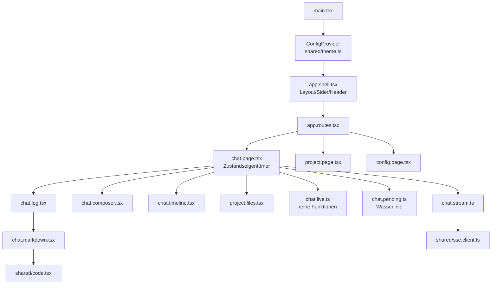

# Plan: AntD-Umbau der Fabrik-UI

Branch `web-factory-mvp-2`, Spitze `d94784ad`. Nur `factory-ui/`. Kein Backend, keine Wire-Änderung,
keine neuen Endpunkte.

Build/Prüfen: `cd factory-ui && COREPACK_ENABLE_PROJECT_SPEC=0 pnpm test` (Node 22.12, pnpm 10.28.0),
`pnpm exec tsc --noEmit`, `pnpm exec oxlint`. Ausgangslage: 149 Tests / 18 Dateien grün.

Die Feature-Docs sind der goldene Record. Dieser Plan nennt nur IDs und verweist auf die Regel:
`docs/ui.md` (Look, R-WP-1, R-WP-38/UC-WP-70, R-WP-39/UC-WP-71), `docs/chat.md` (R-WP-28/UC-WP-73,
R-WP-40/UC-WP-72, R-WP-41/UC-WP-74, R-WP-29/UC-WP-55, R-WP-30/UC-WP-56, R-WP-11, R-WP-27,
R-WP-31, R-WP-34, R-WP-35/UC-WP-66, R-WP-37/UC-WP-69), ADR 003, `docs/open-points.md`.

---

## 1. Kontext

Die UI basiert heute auf Bootstrap (Layout, Nav, Formulare) plus einer eigenen Stylesheet-Sprache
(`src/styles.css`, `src/index.css`). Die Docs verlangen eine Designbasis statt Bootstrap (R-WP-1),
Markdown-Rendering statt Markstream (R-WP-28/UC-WP-73), Autogrow-Eingabe (R-WP-41/UC-WP-74),
Tool-Timeline ohne Trennlinien (R-WP-40/UC-WP-72, R-WP-29/UC-WP-55) und eine Sider-Navigation
(R-WP-38/UC-WP-70) mit einem Look, der aus der Designbasis kommt (R-WP-39/UC-WP-71).

Referenz-App `/Users/sterlp/dev/workset/ai-schulung/app/frontend` ist Spender der Muster, nie
Vorbild des Zustands (ADR 003): Wir übernehmen Muster (TextArea `autoSize`, Timeline, Sider), keine
Komponentenauswahl per Copy-Paste auf falscher Versionsbasis.

Zielreihenfolge = Pauls Reihenfolge: 1 Basis → 2 Markdown → 3 Eingabe → 4 Timeline → 5 Sider/Files.
Jedes Inkrement lässt die Suite grün laufen.

## 2. Design-Entscheidungen

**D1 – antd v6 + @ant-design/icons v6.** React ist 19.3.1; v5 bräuchte
`@ant-design/v5-patch-for-react-19`. v6 unterstützt React 19 nativ. Icons immer mit gleicher
Major-Version. Alte Namen nicht verwenden: `Card variant="outlined"` (nicht `bordered`),
`Alert title` (nicht `message`), `Timeline items`/`Menu items`.

**D2 – Theme als ein Ort.** `src/shared/theme.ts` exportiert `factoryTheme()` und baut aus den
CSS-Tokens (`src/index.css`) ein antd-ThemeObject; `src/main.tsx` setzt
`<ConfigProvider theme={factoryTheme(dark)}>` um `<App/>`. Kein `locale`-Prop (UI ist Englisch);
Beschriftungen von antd-Dialogen kommen aus `content.ts` (`okText`/`cancelText`), damit R-WP-27 gilt.
Kein antd-Token an mehreren Stellen, kein `!important` gegen antd-Styles.

Abbildung (einmalig, danach Quelle der Wahrheit):

| Token (index.css) | antd Token |
|---|---|
| `--accent` | `colorPrimary` |
| `--bg` | `colorBgBase` |
| `--text-h` | `colorTextHeading` |
| `--text` | `colorText` |
| `--border` | `colorBorder` |
| `--agent` | `colorSuccess` |
| `--problem` | `colorError` |
| `--question` | `colorWarning` |
| `--sans` / `--mono` | `fontFamily` / `fontFamilyCode` |
| `--user` | bleibt UI-CSS (Chat-Rollenfarbe, R-WP-39) |

Dark: `theme.darkAlgorithm` + `darkAlgorithm`-Schalter aus `usePrefersDark()` (neuer kleiner Hook
`src/shared/prefers.dark.ts`, `matchMedia('(prefers-color-scheme: dark)')` mit
`addEventListener('change')`). Es gibt heute keinen Theme-Umschalter – bleibt so.

**D3 – Chat bleibt eigenen CSS-Klassen treu (R-WP-39).** Log, Zeilen, Rollen, `chat-markdown`,
`chat-code`, `chat-diff`, `chat-waiting`, Tiles behalten `chat-*`-Klassen und Border-Left-Linien.
antd liefert nur die Basis (Buttons, Inputs, Cards, Timeline, Sider) – kein `Card` um den Log,
keine Liste `antd.List` für Chat-Zeilen. Gewonnene Sheet-Assertions (Farben/Border) müssen daher
weiterhin gegen `styles.css` prüfbar bleiben.

**D4 – Bootstrap vollständig raus, in Inc 1.** Drei Dependencies (`bootstrap`,
`bootstrap-icons`, `react-bootstrap`), zwei CSS-Imports in `main.tsx`, die `--bs-*`-Brücke in
`index.css`, `react-bootstrap`-Import in `app.nav.tsx`, `bi bi-*`-Icon in `project.files.tsx`.

**D5 – Markdown: react-markdown + remark-gfm + remark-breaks.** R-WP-28 nennt seit 2026-11-06 alle
drei Pakete und begründet `remark-breaks` (`react-markdown` v10 hat keine `breaks`-Option, im
Referenz-`node_modules` geprüft). Keine Abweichung mehr: Plan folgt dem Doc.

**D6 – Eingabe:** `Input.TextArea autoSize={{minRows:1,maxRows:5}}` ersetzt `textarea rows={3}`.
Tastatur bleibt R-WP-30/UC-WP-56 (Enter = Zeilenumbruch, Cmd/Ctrl+Enter = senden) – bewusst
abweichend vom Referenzmuster (dort sendet Enter). Send ist **nur bei leerem Entwurf** deaktiviert;
**während eines laufenden Turns bleiben Textarea und Send-Knopf aktiv**, die Eingabe geht in die
Queue (R-WP-10/UC-WP-14). R-WP-41 sagt ausdrücklich, dass wir der Referenz-App beim Sperren **nicht**
folgen (AF-ADR-003). Die 7 bestehenden Queue-Tests in `chat.page.test.tsx` bleiben unverändert grün.

**D7 – Tool-Zeilen in der Timeline werden verbatim gerendert, nicht geparst.** Backend liefert
fertige Zeilen (`PoDelegateTool.java:246` `"<Name> start: \n<prompt>"`, `ProjectRuntime.java:270`
`name + ": " + …`, `ToSimpleMessage.java:39` `"Using <tool>"`). Es gibt keinen Wire-Kanal für
Werkzeugname/Dauer je Werkzeug; `SseTurnMonitor` verwirft Fremdzeilen. Also: erste Zeile = Titel der
Timeline-Node, Rest = Beschreibung, `done.millis` = Turn-Dauer (eine Node, nicht pro Werkzeug).
Kein erfundener Name, keine erfundene Dauer.

**D8 – Zeitsempel je Node** (für UC-WP-72, „wann") = Browser-Ankunftszeit. Additive Erweiterung von
`chat.live.ts`: `at: number` am Tool-LiveItem plus ein Parameter in `appendLiveTool`. Semantik von
`appendLiveText`/`appendLiveTool`/`liveLinesAfterHistory`/Anker/Wasserlinie bleibt unverändert
(R-WP-37/UC-WP-54-Tests bleiben grün) – Erweiterung, kein Umbau.

**D9 – Sider-Navigation + URL auf Projektname.** Name ist eindeutig (gemessen:
`ProjectService.java:132-136` weist Doppelnamen ab, `idOf` = slug + URL-Hash) und ändert sich nie;
alle API-Aufrufe bleiben auf der Id (keine Wire-Änderung). Routen: `/chat/:projectName` und
`/chat/:projectName/files`. Reload-Stabilität der URL ist Testzusicherung (UC-WP-70).

**D10 – Files ist eine Einheit in der Chat, kein eigener Screen.** Heute ist `ProjectFiles` ein
selbstverwaltetes Panel, geöffnet über einen Tab-Button (`files-open`). Die Sider bekommt einen
Eintrag „Files" (Route), der dasselbe Panel öffnet ⇒ `ProjectFiles` erhält kontrolliertes
`open`/`onOpenChange` von der Route, Baum-/Viewer-Zustand bleibt intern. Split bestätigt:
**5a** = UC-WP-70 GIVEN 1+2 (Sider, Baum, URL auf Name), **5b** = GIVEN 3 (Files-Einheit,
Einklappen unter Breakpoint, dockende Eingabe).

## 3. Architektur

Komponenten nach Verantwortung, Abhängigkeitsrichtung nach innen (Domänen-/Darstellungslogik kennt
keine Library von außen, außer über die gemeinsame Basis):



- `chat.page.tsx` bleibt alleiniger Zustandseigentümer (Netz, Live-Items, Draft, Turn). Kinder sind
  dumm: `chat.log.tsx` (Anordnung/Zeichnen), `chat.timeline.tsx` (Darstellung von Werkzeugzeilen),
  `chat.composer.tsx` (Eingabe/Ereignisse nach oben).
- `shared/theme.ts` ist die einzige Stelle, die antd-Theme-Tokens kennt; Seiten kennen nur
  Komponenten und `chat-*`-Klassen.
- `chat.live.ts` nur **additiv** (D8: `at`), Semantik unangetastet (C-5/R-WP-37); `chat.pending.ts`
  (Wasserlinie), `shared/api.client.ts`, `shared/sse.client.ts`, `shared/dto.ts`, alle
  Backend-Verträge unverändert.

Schnittstelle, die neu entsteht (Signaturniveau):

```ts
// shared/theme.ts
export function factoryTheme(dark: boolean): ThemeConfig;
// shared/prefers.dark.ts
export function usePrefersDark(): boolean;
// chat/timeline.tsx
export interface TimelineNode { text: string; at?: number; loading?: boolean }
export function ChatTimeline(props: { nodes: TimelineNode[] }): JSX.Element;
// project/files-Unit (Inc 5b)
export function ProjectFiles(props: { project: Project; open: boolean; onOpenChange(open: boolean): void }): JSX.Element;
```

---

## 4. Inkremente

Jedes Inkrement: Code + Tests + `tsc`/`oxlint` grün, Suite grün, committet, danach nächstes.

### Inkrement 1 – AntD-Basis, Bootstrap raus

**Status: fertig (2026-11-06).** antd 6.7.0 + @ant-design/icons 6.3.4 (gemessen: latest, keine v7), Bootstrap
vollständig raus; Suite 154 Tests / 19 Dateien grün in ~8 s, `tsc -b` und oxlint 0/0. Abweichungen A1–A4
(Nav-Rolle `menuitem`, `Popconfirm` statt `window.confirm`, Select-DOM/Label statt Drahtwert + `id` an den
Choices, `.anticon-*`), Ersatzbelege in `test/shared/theme.test.ts` (`// UC-WP-71`). Eine Zeile im Chat-Rumpf
(`chat.page.test.tsx:561` `button` → `menuitem`). Mutationen: theme/Popconfirm/ResizeObserver/Guard — je
getroffen und zurückgenommen; `matchMedia` ist unter jsdom 26 nicht mehr load-bearing (Befund).

**Ziel:** Eine Designbasis (D1–D4) trägt Shell, Projekte, Konfiguration; Bootstrap ist vollständig
entfernt. Deckt R-WP-1 (Basis), R-WP-39/UC-WP-71 (Oberflächen aus der Basis) für die Nicht-Chat-Seiten.
Chat-Oberfläche bleibt in diesem Inkrement unverändert (Beweis: Chat-Tests unangetastet grün).

**Dateien**
- `factory-ui/package.json`: +`antd@^6`, +`@ant-design/icons@^6`; −`bootstrap`, −`bootstrap-icons`,
  −`react-bootstrap`.
- `src/main.tsx`: Bootstrap-/Icon-CSS-Imports raus, `ConfigProvider` + `factoryTheme(usePrefersDark())`.
- `src/shared/theme.ts` (neu), `src/shared/prefers.dark.ts` (neu).
- `src/index.css`: `--bs-*`-Brücke entfernen; Tokens bleiben.
- `src/styles.css`: `.app-nav`/`.nav-link`-Regeln ersetzen durch minimale antd-Overrides (Sider kommt
  erst in Inc 5); `.ui-card` bleibt für noch nicht umgestellte Flächen.
- `src/app/app.shell.tsx`: `Layout`/`Header`/`Content`, `Button`/`Input` für User-Feld; `open()` bleibt.
- `src/app/app.nav.tsx`: `Menu mode="horizontal"` mit `items` (Projekte/Chat/Einstellungen).
- `src/project/project.page.tsx`: `Card`, `Input`, `Button`, `Alert`, `Popconfirm` statt `window.confirm`.
- `src/project/project.files.tsx`: `bi bi-*` → `@ant-design/icons` (`FolderOpenOutlined`,
  `FolderOutlined`, `FileOutlined`, `CloseOutlined`, `RightOutlined`, `LeftOutlined`).
- `src/config/config.page.tsx`, `src/config/config.agents.tsx`: `Card`, `Input`/`Input.Password`,
  `Select`, `Button`, `Alert`, `Checkbox`.
- `test/shared/setup.ts`: Polyfills `matchMedia` (und ggf. `ResizeObserver`, empirisch) – nur Test.

**Tests (neu/umgeschrieben, mit `// UC-WP-…`)**
- neu `test/shared/theme.test.ts` – `// UC-WP-71`: `factoryTheme(false).token.colorPrimary` folgt
  `--accent` aus `index.css`; `factoryTheme(true).algorithm` enthält `darkAlgorithm`;
  `usePrefersDark` liefert `false` bei nicht-dunklem `matchMedia`.
- `test/app/app.nav.test.tsx` **umgeschrieben (benannte Abweichung A1)**: `role="menuitem"` statt
  Buttons; `aria-current` entfällt (antd Menu nutzt `aria-selected`/Item-State) ⇒ Assertion auf
  `selectedKeys`-Markup + Klicknavigation. `viewOfPathname`-Tests bleiben unverändert.
- `test/app/app.shell.test.tsx` **angepasst (A1)**: Navigation über Menü-Items; User-Feld weiterhin
  `data-testid="user-name"`; Projektfluss/Settings-Fluss unverändert.
- `test/project/project.page.test.tsx` **umgeschrieben (A2)**: Entfernen = Klick auf „Remove" →
  `Popconfirm`-Bestätigungsknopf (statt `window.confirm`-Spy); Fehler über `role="alert"`
  (antd `Alert` hat `role=alert`) bleibt; Reihenfolge/Texte unverändert.
- `test/config/config.page.test.tsx` **umgeschrieben (A3)**: `valueOf()` liest jetzt
  `.ant-select-selection-item`/`input`; Providerwechsel = `mouseDown` auf Select + Klick auf Option
  im Portal; `settingsUsesTheChatCard` prüft `Card`-Existenz (`.ant-card`) und dass
  `.settings-form` die Layout-Klasse behält; die `--bs-*`-Brücke wird **nicht mehr** geprüft.
- `test/config/config.agents.test.tsx` **umgeschrieben (A3)**: Think-Auswahl als antd `Select`
  (Optionen über Dropdown, nicht `Array.from(select.options)`); `agent-dev-think-unsupported` bleibt.
- `test/project/project.files.test.tsx` **angepasst (A4)**: Icon-Assertions (falls vorhanden) auf
  `.anticon`; alle `files-*`-Testids und `aria-expanded` bleiben unverändert.

**BDD**
- GIVEN die App startet / WHEN keine Bootstrap-CSS geladen ist / THEN sieht jede Seite wie aus einer
  Basis aus und nichts bricht (`app.shell.test`, `project.page.test`, `config.page.test`).
- GIVEN OS ist dunkel / WHEN die App startet / THEN sind antd-Flächen dunkel (`theme.test`).
- GIVEN ein Projekt in der Liste / WHEN „Remove" geklickt / THEN erscheint eine Bestätigung, erst
  deren Ja entfernt (`project.page.test`).

**Mutationsprobe (Polarität: Basis, Theme oder Schutz entfernt → rot):** `colorPrimary` aus
`factoryTheme` entfernen → `theme.test` rot. `matchMedia`-Polyfill aus `setup.ts` nehmen →
`app.shell.test` rot (antd wirft). `Popconfirm` durch sofortiges Löschen ersetzen →
`project.page.test` rot.

**Grenzen nicht berührt:** `chat/*` (außer `styles.css`-Chat-Regeln unverändert), `chat.live.ts`,
`chat.pending.ts`, `shared/api.client.ts`, `shared/sse.client.ts`, `shared/dto.ts`, Backend.

### Inkrement 2 – Markdown (R-WP-28 / UC-WP-73)

**Ziel:** Markstream raus, echtes GFM-Markdown mit erhaltener Zeilenstruktur.

**Dateien**
- `package.json`: −`markstream-react`; +`react-markdown@^10`, +`remark-gfm@^4`, +`remark-breaks@^4`.
- `src/chat/chat.markdown.tsx`: `ReactMarkdown` + `remarkPlugins=[remarkGfm, remarkBreaks]`,
  `components={{ pre: ({children}) => <>{children}</>, code: ChatCode }}`; `div.chat-markdown`
  + `data-testid="chat-markdown"` bleiben. `ChatCode` rendert bei Sprachklasse `CodeView`
  (`testId="chat-code"`, `className="chat-code"`), sonst `<code>` – **kein** `<div>` in `<pre>`.
- `src/chat/chat.log.tsx`: `final={false}` am `ChatMarkdown`-Aufruf entfällt (eine Zeile).
- `src/styles.css`: `chat-markdown`-Regeln an react-markdown-Ausgabe anpassen (P/UL/CODE-Abstände).

**BDD / Tests** (`test/chat/chat.markdown.test.tsx`, `test/chat/chat.log.test.tsx`)
- GIVEN GFM-Text (Liste, Tabelle, fett) / WHEN gerendert / THEN `li`-Anzahl und `<strong>` korrekt,
  keine Literale `*` (`markdownRendersGfm`).
- GIVEN Text mit einfachem Umbruch / WHEN gerendert / THEN stehen zwei Zeilen (`remarkBreaksKeepsLineBreaks`).
- GIVEN Zaun mit Sprache / WHEN fertig / THEN `pre.shiki` + hervorgehobene Spans, Testid `chat-code`
  (`codeBlocksAreHighlighted` – bleibt, ggf. Selektor `pre` → `div.code-view` anpassen).
- **Umgeschrieben (A5, doc-gedeckt durch R-WP-28/UC-WP-54, keine stille Lockerung):**
  `streamingMarkdownStaysReadable` – Zusicherung nach Doc: während des Streamings **kein rohes HTML**
  (kein `<script>` im DOM) und **kein Abbruch**; rohe Syntax-Zeichen (`**`, offener Zaun) sind erlaubt.
  Nach dem letzten Token: derselbe Knoten enthält `<strong>` und kein `**`. Kommentar `// A5` mit
  Doc-Verweis. Das ist die verlangte Polarität: „roh erlaubt / final gerendert".

**Mutationsprobe (Polarität: Zeilenumbruch oder Code-Struktur weg → rot):** `remarkBreaks` aus den
Plugins nehmen → `remarkBreaksKeepsLineBreaks` rot. `pre`-Override entfernen → DOM-Prüfung auf
`div.code-view` außerhalb `pre` rot.

**Grenzen nicht berührt:** `chat.live.ts`, `chat.pending.ts`, Stream/Client, `chat.page.tsx`-Zustand
(nur `chat.log.tsx`-Aufrufzeile), Backend.

### Inkrement 3 – Eingabe (R-WP-41 / UC-WP-74, R-WP-30 bleibt)

**Ziel:** Autogrow-Eingabe; Send nur bei leerem Entwurf deaktiviert, während eines Turns bleiben
Textarea und Send aktiv (Queue, R-WP-10/UC-WP-14). Tastatur R-WP-30 unverändert.

**Dateien**
- `src/chat/chat.composer.tsx`: `Input.TextArea autoSize={{minRows:1,maxRows:5}}` statt
  `textarea rows={3}`; `aria-label`/`data-testid="chat-input"`/Placeholder bleiben; `onKeyDown`
  Cmd/Ctrl+Enter → `form.requestSubmit()`; Fokus-Refokus bei `disabled`-Wechsel per
  `useEffect` + `wasDisabled`-Ref (Muster `MessageInput.tsx:18`, aber ohne Enter-Senden).
- `src/styles.css`: `.chat-composer textarea`-Regeln auf `.chat-composer .ant-input` umstellen.
- `disabled={draft.trim() === ''}` bleibt die **einzige** Sperrbedingung; `busy` sperrt nicht
  (R-WP-41/UC-WP-74, Abgrenzung zur Referenz-App AF-ADR-003).

**Tests** (`test/chat/chat.composer.test.tsx`)
- GIVEN leeres Feld / WHEN Cmd+Enter / THEN kein Submit (`composerIgnoresMetaEnterWhenEmpty`).
- GIVEN Text / WHEN Cmd/Ctrl+Enter / THEN genau ein Submit (`composerSendsOnMetaEnter` – bleibt).
- GIVEN leerer Entwurf / THEN Send disabled (`sendIsDisabledWhileDraftIsEmpty` – bleibt).
- neu `// UC-WP-74`: GIVEN laufender Turn / THEN bleiben Textarea und Send aktiv und die Eingabe
  landet in der Queue (`sendStaysEnabledWhileTurnRuns`); GIVEN Turn endet / THEN steht die
  Queued-Zeile einmal im Log (`queuedLineAppearsOnceAfterTurn`). Beide ergänzen die unveränderten
  7 Queue-Tests in `chat.page.test.tsx`, sie ersetzen sie nicht.
- GIVEN Feld wächst / THEN Höhe folgt dem Inhalt bis `maxRows` (`composerGrows`, neu).
- Fokus: nach dem Mounten fokussiert (`chat.inputFocus` – bleibt); nach einem Submit wieder
  fokussiert (`focusReturnsAfterSend`, neu).

**Mutationsprobe (Polarität: Sperre zu weit → rot):** `autoSize` entfernen → `composerGrows` rot;
`busy` in `disabled` aufnehmen → `sendStaysEnabledWhileTurnRuns` rot; Queue-Tests in `chat.page.test`
bleiben dabei unverändert grün (Gegenprobe).

**Grenzen nicht berührt:** Sendenachricht-Format, `chat.stream.ts`, Backend-Endpunkte.

### Inkrement 4 – Tool-Timeline (R-WP-40 / UC-WP-72, R-WP-29 / UC-WP-55)

**Ziel:** Werkzeugzeilen als antd `Timeline` am selben Anker; keine `<hr class="chat-rule">` mehr.
Jede Node trägt ihre Ankunftszeit aus dem additiven `at` (D8).

**Dateien**
- `src/chat/chat.timeline.tsx` (neu, ersetzt `chat.tools.tsx`): `Timeline` mit `items`;
  Node-Inhalt = erste Zeile als `.chat-tool-title`, Rest als `.chat-tool-text`; Testid
  `chat-tool-line` bleibt am Node-Inhalt; letzte Node `color/loading` solange `pending`.
  Turn-Dauer (`done.millis`) erscheint als Suffix der letzten Node oder als Kopfzeile – **eine**
  Stelle, deterministisch aus demselben `millis`-Wert.
- `src/chat/chat.tools.tsx`: entfällt.
- `src/chat/chat.log.tsx`: `kind:'tools'` rendert `ChatTimeline`; **`hr`-Zeichnung im
  Voice-Wechsel entfällt** (R-WP-29).
- `src/chat/chat.page.tsx`: `applyEvent('tool')` stempelt `Date.now()` in die Live-Liste;
  `pending`/`done`-Weiterleitung an `ChatLog` bleibt.
- `src/chat/chat.live.ts`: **additiv** – `at: number` am Tool-Variant plus ein Parameter in
  `appendLiveTool`; `MAX_TOOL_LINES`, Anker, `liveLinesAfterHistory`, Wasserlinie unverändert
  (UC-WP-54-Tests bleiben grün, keine Umbauten).
- `src/styles.css`: `.chat-rule`, `.chat-tools-label` raus; `.chat-tool-*` bleibend; antd-Timeline-
  Abstände minimal überstimmen.

**BDD / Tests**
- GIVEN zwei Werkzeugzeilen zwischen Frage und Antwort / WHEN gerendert / THEN zwei Timeline-Nodes
  in Reihenfolge (`aLiveTraceStaysBetweenItsInputAndItsAnswer`, `chat.log.test` – bleibt, Klassen
  `chat-line-user … chat-tool-line … chat-line-jon` unverändert).
- GIVEN laufender Turn / THEN letzte Node lädt (`timelineMarksTheRunningNode`, neu).
- GIVEN Turn beendet mit `done.millis=1234` / THEN Dauer „1,2 s" sichtbar
  (`timelineShowsTurnDuration`, neu).
- `// UC-WP-72` GIVEN zwei Zeilen treffen zu verschiedenen Zeiten ein / THEN zeigen die Nodes die
  jeweilige Ankunftszeit (`timelineShowsArrivalTime`, neu, `vi.setSystemTime`).
- GIVEN mehr als `MAX_TOOL_LINES` Zeilen / THEN nur die letzten 10 als Nodes (`liveToolTail`, bleibt).
- **Umgeschrieben (benannte Abweichung A7):** `test/chat/chat.log.test.tsx`
  `roleChangeToAnErrorDrawsARule` (hr-Zählung) → `roleChangeToAnErrorKeepsTheOrdering`: keine Nodes
  > 0 für `hr.chat-rule`, Reihenfolge user → error bleibt; sheet-Assertion auf `.chat-rule` entfällt.
  Ebenso in `test/chat/chat.page.test.tsx` die Shape-Assertion `['user','rule agent','agent',…]`
  → Abweichungsform ohne `rule`-Einträge, mit positiver Zusicherung, dass die Grenze weiterhin als
  `chat-line-agent`-Block sichtbar ist.

**Mutationsprobe (Polarität: Zeit/Ordnung weg → rot):** `loading` an der letzten Node entfernen →
`timelineMarksTheRunningNode` rot. `hr`-Erzeugung wieder einbauen → A7-Test rot. `at`-Stempel
weglassen → `timelineShowsArrivalTime` rot.

**Grenzen nicht berührt:** Ankerlogik, Wasserlinie (`chat.pending.ts`), `readSeq`/Apply-Reihenfolge,
Stream-Format, Backend.

### Inkrement 5 – Sider-Navigation, URL auf Name, Files-Einheit

Split bestätigt: **5a** = UC-WP-70 GIVEN 1+2 (Navigation, URL auf Name), **5b** = GIVEN 3
(Files-Einheit, Einklappen unter Breakpoint, dockende Eingabe). Jeder Teil grün, eigener Commit.

#### 5a – Sider + Projektbaum + URL auf Name
- `src/app/app.shell.tsx`: `Layout` mit `Layout.Sider` (Baum aus `listProjects()`, Klick →
  Chat), `Layout.Header` (Marke, User-Feld, Einstellungen-Icon), `Layout.Content`.
- `src/app/app.sider.tsx` (neu): lädt Projekte wie `project.page.tsx` (eine eigene Ladefunktion,
  keine Duplizierung des SSE-Streams – Baum nutzt Snapshot + bestehende `project.status`-Events,
  wenn ohne Aufwand erreichbar, sonst Snapshot bei Navigation).
- `src/app/app.paths.ts`: `chatPath(name)`, `viewOfPathname` vereinfacht.
- `src/app/app.routes.tsx`: Route `/chat/:projectName`; `ChatRoute` sucht Projekt **per Name** in
  `listProjects()` (unbekannt → `/projects`), `writeLastProject` speichert weiter die Id.
- `src/app/app.nav.tsx` entfällt (Navigation = Baum); `app.nav.test.tsx` → `app.sider.test.tsx`.
- `src/styles.css`: Shell-Regeln auf `Layout` umstellen (`--files-width` bleibt für 5b).

Tests: `test/app/app.sider.test.tsx` (neu, `// UC-WP-70` GIVEN 1+2: GIVEN Projekte / THEN Baum mit
Namen, aktives Projekt markiert; Klick navigiert in den Chat; Datei-/Settings-Eintrag vorhanden),
`test/app/app.routes.test.tsx` **umgeschrieben (A8)** (`CHAT_PATH = /chat/demo`, Deep-Link per Name,
unbekannter Name → Liste, localStorage speichert weiter die Id), neu
`chatUrlIsReloadStable` (`// UC-WP-70`: dieselbe URL zeigt nach Reload dasselbe Projekt; die
Eindeutigkeit des Namens belegt `ProjectService.java:132-136`), `test/app/app.shell.test.tsx` angepasst.

#### 5b – Files als Einheit, Responsive
- `src/project/project.files.tsx`: kontrolliertes `open`/`onOpenChange`; interne Zustände bleiben.
- `src/app/app.routes.tsx`/`app.paths.ts`: `/chat/:projectName/files` als „Chat mit geöffnetem
  Files-Panel" (D9); `ChatRoute` gibt `open={files}` + `onOpenChange` an `ChatPage` → `ProjectFiles`.
- `src/chat/chat.page.tsx`: `files`-Prop wird zu `{filesOpen, onFilesOpenChange}` (Datenfluss nach
  oben, keine neue Zustandsquelle); Composer bleibt am unteren Rand gedockt.
- Sider `breakpoint="lg"`, `collapsedWidth={0}` (Einklappen unter dem Breakpoint, Inhalt bleibt
  erreichbar über den Trigger).

Tests (`// UC-WP-70` GIVEN 3): `test/project/project.files.test.tsx` **angepasst (A9)**:
`files-open` steuert jetzt die Route (Assertion auf `current-path` statt nur lokalem
`aria-expanded`), `files-close` navigiert zurück (`filesUnitIsTheRoute`, neu);
`test/app/app.sider.test.tsx`: GIVEN schmaler Viewport / THEN ist die Sider eingeklappt und über den
Trigger wieder erreichbar (`siderCollapsesUnderBreakpoint`, neu, `matchMedia`-Stub aus `setup.ts`);
`test/chat/chat.page.test.tsx`: GIVEN langer Verlauf / THEN bleibt der Composer am unteren Rand
(`composerStaysDocked`, neu).

**Mutationsprobe (Polarität: Route/Baum/URL entkoppelt → rot):** Route `/chat/:projectName/files`
ignorieren (Panel immer zu) → `filesUnitIsTheRoute` rot. Sider-Aktivmarkierung entfernen →
`app.sider.test` rot. URL wieder auf die Id stellen → `chatUrlIsReloadStable` bleibt grün, aber die
Deep-Link-Tests per Name (A8) werden rot. Einklappen abschalten → `siderCollapsesUnderBreakpoint` rot.

**Grenzen nicht berührt:** alle API-Pfade (weiter Id-basiert), `shared/dto.ts`, Backend, Chat-Stream.

---

## 5. Betroffene Dateien (Gesamt)

Neu: `src/shared/theme.ts`, `src/shared/prefers.dark.ts`, `src/chat/chat.timeline.tsx`,
`src/app/app.sider.tsx`, `test/shared/theme.test.ts`, `test/app/app.sider.test.tsx`.
Gelöscht: `src/app/app.nav.tsx`, `src/chat/chat.tools.tsx`, `test/app/app.nav.test.tsx`.
Geändert: `package.json`, `vite.config.ts` (nur falls Polyfills/Transform nötig – vermeiden),
`src/main.tsx`, `src/index.css`, `src/styles.css`, `src/app/{app.shell,app.routes,app.paths}.tsx`,
`src/project/{project.page,project.files}.tsx`, `src/config/{config.page,config.agents}.tsx`,
`src/chat/{chat.log,chat.markdown,chat.composer,chat.page}.tsx`, `src/chat/chat.live.ts` (additiv:
`at`), `test/shared/setup.ts`, Testdateien laut Inkrementen.
Unverändert: `src/chat/chat.pending.ts`, `src/chat/chat.stream.ts`, `src/chat/chat.client.ts`,
`src/shared/{api.client,sse.client,dto,content,code,user.name,last.project}.ts*`, gesamtes Backend.

## 6. Regeln & Constraints

- Alle sichtbaren Texte aus `src/shared/content.ts` (R-WP-27); neue Labels dort ergänzen, keine Strings im JSX.
- Keine Umlaute in der UI-Textausgabe (bestehender Test in `app.shell.test`).
- Tests: keine `sleep`/`waitFor` mit Zeit, keine echten Timer; Zeit über injizierte/abgefragte Werte
  (`Date.now()` im Test via `vi.setSystemTime` oder Spy), Timeouts default lassen.
- Spring-Kontext-Regel betrifft uns nicht (reine UI) – aber Suite bleibt schnell (< ~30 s).
- Keine `!important`-Kriege gegen antd; Abweichungen über Theme-Tokens lösen.
- Keine Änderung an API-Pfaden, SSE-Format oder Backend-Dateien (ADR 003 / R-WP-37).

## 7. Teststrategie

- Startpunkt 149/18. Jedes Inkrement: `tsc --noEmit`, `oxlint`, `pnpm test` grün, eigener Commit.
- Blatt-Beweise (Sheet-Leser `test/shared/sheets.ts`) bleiben das Mittel für Look-Regeln. Wo antd
  die Quelle wird, wandert die Assertion in `theme.test.ts` (Token-Wert) – das ist die **positive**
  Ersatzprüfung; die CSS-Selektor-Zeile entfällt nur mit benannter Abweichung (A1–A9).
- Ein Test je UC-GIVEN; UC-IDs als `// UC-WP-…`-Kommentar über dem `test(...)`.
- BDD-Testnamen-Liste pro Inkrement siehe oben; Tests, die eine Abweichung tragen, tragen den
  Abweichungscode (A1–A9) im Kommentar.
- Eine Mutationsprobe je Inkrement mit klarer Polarität: Mutation einbauen → genau eine benannte
  Testaussage wird rot; Mutation zurücknehmen → grün. Ergebnis je Inkrement im Commit-Text.
- Doc-gedeckte Umbauten (A5 nach R-WP-28/UC-WP-54) sind keine Abweichungen mehr; die übrigen
  A1–A4, A7–A9 bleiben benannte Abweichungen mit Testkommentar.

## 8. Risiken & offene Enden (nicht entschieden, nur benannt)

R1 – antd v6 unter jsdom: Sider/`Menu`/`Select`/`Popconfirm` brauchen evtl. mehr als `matchMedia`
(`ResizeObserver`, `getComputedStyle`-Fallbacks, Portale in `document.body`). Polyfills gehören in
`test/shared/setup.ts`; nach Inc 1 empirisch nachziehen, nie in Produktivcode.
R2 – antd v6 API-Drift: `Collapse`/`Timeline`/`Menu` `items`-API kann sich zwischen 6.x-Minor
ändern; Version pinnen (`^6` nur mit Lockfile) und beim ersten roten Test die installierte
Doku-Version prüfen statt zu raten.
R3 – Doppel-Dark: `darkAlgorithm` (antd) und unsere `prefers-color-scheme`-CSS-Tokens laufen
parallel. Beide lesen dieselbe Media-Query über `usePrefersDark` – bei Abweichung entsteht ein
Mischbild. Prüfen in Inc 1 (`theme.test` + ein Shell-Screenshot-Test ist nicht möglich, also
Token-Gleichheit assertieren).
R4 – `--bs-*`-Brücke: vor dem Löschen grep auf `var(--bs-`; eine vergessene Nutzung fällt sonst erst
optisch auf (kein Test fängt fehlende CSS-Variablen).
R5 – `ProjectFiles` von unkontrolliert auf kontrolliert: `chat.page.test` rendert `ChatPage` direkt
ohne Route. Prop muss optional/default-fähig bleiben, sonst brechen die Files-Tests in Inc 1–4.
R6 – URL auf Name: der Name ist heute unveränderlich (Ordner = Name, Doppelnamen abgewiesen). Wird
ein Projekt auf der Platte außerhalb der App umbenannt, fällt der Deep-Link auf `/projects` zurück –
gewollter Fallback, kein Fehler, aber im Test benennen (`unknown name → list`).
R7 – `writeLastProject` speichert die Id, die URL den Namen: nach Inc 5a müssen beide Wege (Header-
Chat-Link, Sider-Klick, Reload) dasselbe Projekt öffnen; ein Test deckt nur die Summe, nicht jede
Quelle – bewusst klein halten.
R8 – `at` bei `MAX_TOOL_LINES`-Trimming: Zeit muss am überlebenden Item bleiben; Test
`timelineShowsArrivalTime` mit >10 Zeilen prüft das (nicht nur 2 Zeilen).
R9 – Shiki/`CodeView` in `chat-code`: react-shiki lädt Sprachen asynchron; bestehende Tests warten
implizit – kein `sleep` einführen, sondern vorhandenes Muster (vorhandene `code.test`/`markdown`-Tests)
übernehmen.
R10 – Suite-Laufzeit: der antd-Import kostet Zeit; Ziel bleibt < ~30 s. Verlangsamt Inc 1 die Suite
deutlich, ist das ein Befund für dich, kein stiller Zustand.
