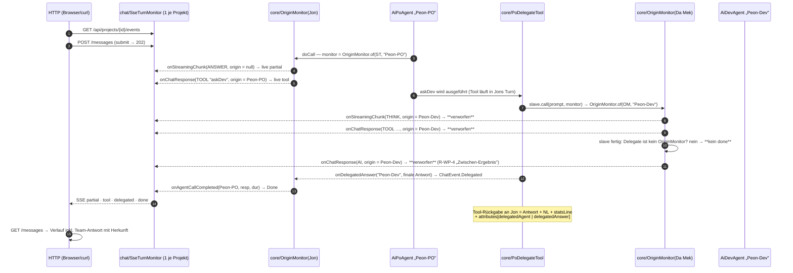
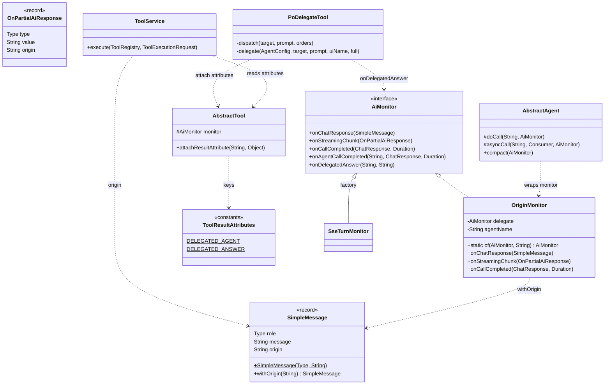
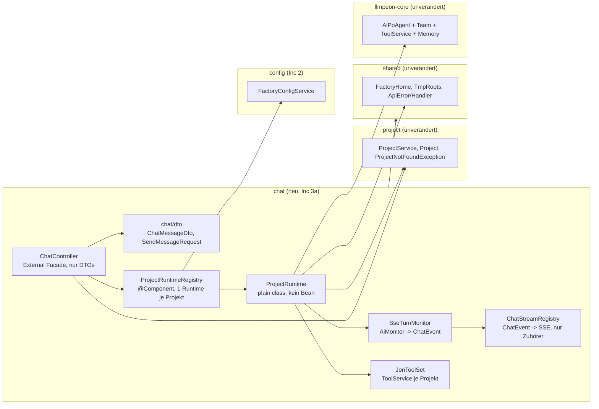
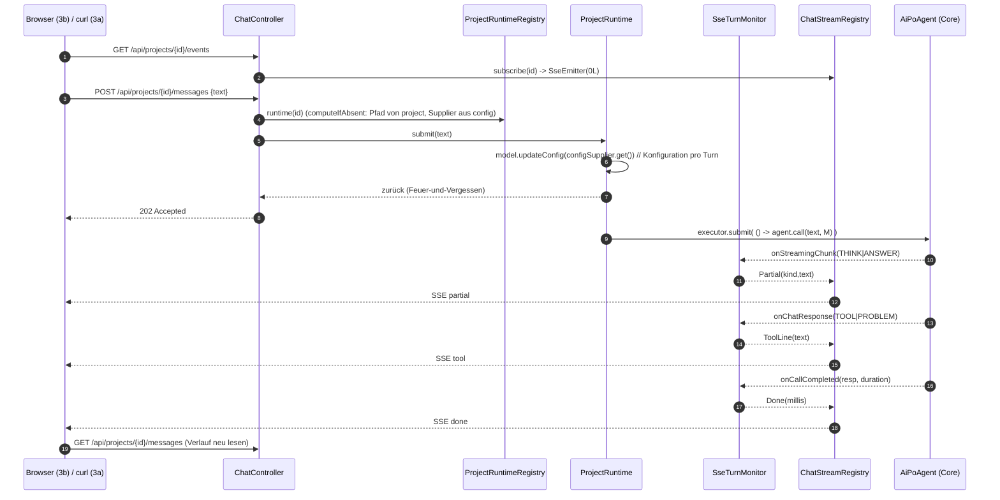
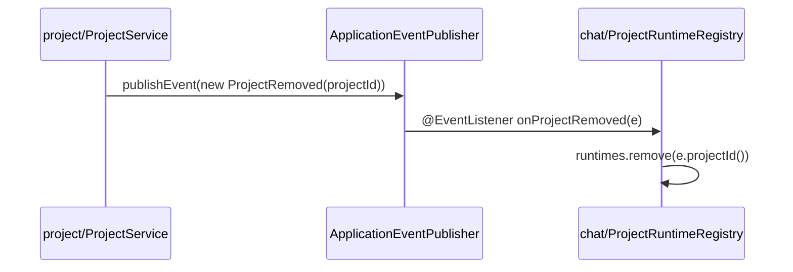

# Increment 3f — Herkunft je Chat-Zeile und nur die finale Antwort des Teams (FREIGEGEBEN 2026-10-26 — 3f-1 im Bau)

> **Only this top section is the binding work order.** `aifactory/docs/**` is the SOLL and belongs to Jon:
> no agent reads-and-fixes, rewords or renames anything under it; UC/rule ids are quoted, never reworded;
> **no agent invents an id** — the marker on a test is the doc heading's id, copied (`AGENTS-DEV.md:21-27`).
> Everything below the `---` (`## 3.0` … `### 3H2-E`) is the **archive** of Inc 3a–3e, 3-H1, 3-H2:
> built, accepted, committed. It is **read-only evidence** — no line of it is edited, not even §3.9.1 whose
> `lintDocsAndTests` test-root is stale since 3-H1 (correct roots are in §3f.8).
> **File rule for the dev agent:** each increment appends its own short execution log as `### 3f-1-E` …
> `### 3f-4-E` **inside this section**, directly after its own §. This file is never replaced by a build log.
> **Dev-agent scope:** only `aifactory/peon-plan/*` is writable for the planner; the dev agent writes code in
> core + factory + UI as listed below and commits per increment.

Repo root `/Users/sterlp/dev/workset/peon-ai`, branch `web-factory`. Core module
`/Users/sterlp/dev/workset/peon-ai/org.sterl.llmpeon.core`, backend
`/Users/sterlp/dev/workset/peon-ai/aifactory/factory-backend`, UI
`/Users/sterlp/dev/workset/peon-ai/aifactory/factory-ui`. Baseline HEAD = `ec13b2e4` (3-H2), previous
`eb642e3e` (3-H1). Green before the first edit: backend **86 tests / 0 failures**, UI **19 tests / 3 files**,
lint 0/0, `lintDocsAndTests` `UC definitions: 51/51; test IDs: 61/30; findings: 21`, VERWAIST 0.

**What this increment is about (Jon, 2026-10-26):** the Chat shows only Jon and the **final answers of his
team**. Today Jon's live monitor is handed to every team member, so a member's thinking, tool lines and
partial answers reach the browser live and the finished member answer never reaches the Chat at all
(3b-E, 3-H2). Two doc rules are open and this increment closes them: **UC-WP-39** `everyLineCarriesItsAuthor`
and **UC-WP-40** `onlyFinalAnswersFromTheTeam` (`aifactory/docs/web-prototype.md:171-188`).
**Jon decided to extend the shared core** (`aifactory/proposals/agent-origin-proposal.md` is his
directional input, read it, do not edit it, it is not the SOLL). This is the first increment of the aifactory
line that changes core **source** — additively only (PR-3 `aifactory/docs/index.md:35`: the plugin must keep
working and must not be forced to change).

## 3f.0 Slice — four increments, one polarity each

| Inc | Polarity | Lands (running software) | UC ids / GIVENs carried |
|---|---|---|---|
| **3f-1** | only-add (core) | The core says **who** spoke: `origin` on every `SimpleMessage`/`OnPartialAiResponse`, an `onDelegatedAnswer` callback, and the final team answer + its author persisted in the **same** Jon history file. Nothing is filtered; the plugin is untouched. | — (core carries no UC ids, `AGENTS-DEV.md:21-27`) |
| **3f-2** | **removes** behaviour (factory) | A member's internals are gone from the live stream, and a member's end no longer sends `done`. Jon's lines, Jon's tool lines and the delegation lines stay. After this increment the member's finished answer is deliberately **still invisible** — no lie, one gap. | **UC-WP-40** GIVEN 2 (live half) |
| **3f-3** | only-add (factory) | The team's final answer arrives live as its own event and is read back from the history with its author — also after a real restart. Every history line carries its origin (`user` → none). | **UC-WP-40** GIVEN 1 + GIVEN 3, **UC-WP-39** GIVEN 1 + GIVEN 2 |
| **3f-4** | only-add (UI) | The Chat-Log names the author of every line that has one and shows the team's answer as its own line; member thinking stays invisible. | **UC-WP-39** + **UC-WP-40** (browser halves) |

Order **3f-1 → 3f-2 → 3f-3 → 3f-4**; 3f-1 is the only hard prerequisite for the other three, 3f-3 and 3f-4
each need **3f-2** (the filter rule they must not break). 3f-4 needs 3f-3.
Each increment is fully green on its own gates (§3f.8) before the next starts. 3f-1 is the largest slice; if
it must be split, the seam is **origin (3f-1a)** vs. **delegated answer + result attributes (3f-1b)** —
3f-1a alone is already green, additive and useless-but-harmless; only split there, nowhere else.

**Doc ids used, verbatim from `aifactory/docs/web-prototype.md`** (heading = test name, marker is a pure ID
line on its own line above the test):

| UC | doc heading = test name | rule | increment / half |
|---|---|---|---|
| UC-WP-39 | `everyLineCarriesItsAuthor` | R-WP-4 `:150-165` | 3f-3 (server, GIVEN 1+2) + 3f-4 (browser) |
| UC-WP-40 | `onlyFinalAnswersFromTheTeam` | R-WP-4 `:150-165` | 3f-2 (GIVEN 2 live) + 3f-3 (GIVEN 1 live+history, GIVEN 3 restart) + 3f-4 (browser) |

No new id is invented: the next free id in the doc is **UC-WP-42**; nothing in this increment needs one.
`R-WP-4` stays 🚧 for the parts 3f does not build (per-agent transcripts = Inc 5 Kacheln).

**Not in this increment (do not build, but build nothing that has to be re-made):** Kacheln / Clear /
Compact / per-agent transcripts = Inc 5 (UC-WP-11/12/13); user name on `user` lines = Inc 6 (UC-WP-25 /
R-WP-17 `:402` — a `user` line stays **unnamed**, which is exactly what R-WP-4 `:157-159` demands today);
write pinning = Inc 4 (UC-WP-8/9/10); `askUser`, Jon-Light, story/plan tools = own stories. The team stays
Da Thinka / Da Mek / Da Dok (`index.md:31` PR-1) and **Da Sniffa stays the search tool**, not a team member —
so its internals get filtered and its answer becomes **no** chat line (D6/Q6).

## 3f.1 Ground truth (read first, read-only — paths are cached, do not re-search during the build)

* `aifactory/docs/web-prototype.md` — R-WP-4 `:150-165` (Delegation = **eine** Zeile, die das Mitglied nennt;
  **jede Zeile trägt ihren Urheber**; Zeilen ohne Agenten-Beziehung tragen **keinen** Namen, kein „System",
  kein „Peon"; `user`-Zeilen nur mit Namen, wenn ein Name existiert; **nur** Jons Zeilen und die **finalen**
  Antworten seiner Team-Mitglieder sind sichtbar — Denk-Prozess und Zwischen-Schritte **nie**, live nicht und
  im Verlauf nicht; **genau ein** Gesprächsfaden), UC-WP-39 `:171-177`, UC-WP-40 `:179-188`, R-WP-5/UC-WP-7
  `:190-197`, R-WP-11 `:286` (Neustart: User- und Jon-Texte aus dem Verlauf, Werkzeug-/Status-Zeilen nur live,
  **kein zweiter Speicher**), R-WP-17 `:402`.
* `aifactory/docs/aifactory-architektur.md` — §Chat `:68-99` (drei Kanten; SSE-Namen `partial · tool · done`
  `:85`; kein Replay; Verlauf aus `home.stateDir(id)`; nur `chat` hält Agenten `:99`), §Turn `:51-66`,
  §UI-Aufbau `:105-149` (`src/<komponente>/<komponente>.<rolle>.tsx`, Tests in `test/<komponente>/`,
  `shared` importiert nichts), §Invarianten `:190-202`.
* `aifactory/docs/open-points.md:6-13` — the ⏳ point („Werkzeug-Zeichen … verläuft im Nichts"): the mechanism
  for „die Team-Antwort steht nach dem Neuladen im Verlauf" is **decided in Inc 3f by the PO, not by the dev
  agent**; candidate (a) rebuild from Jon's history (tool result + agent mapping), candidate (b) the core
  stores it with origin; if neither → GIVEN 3 of UC-WP-40 is dropped from the doc. §3f.3.4 states the decision
  the PO is asked to confirm (Q1).
* `aifactory/proposals/agent-origin-proposal.md` — directional input only: `origin` on `SimpleMessage`, the
  emitter sets it, nobody guesses, no fake fallback, UI decides presentation. §3f.3.7 D1 names the two places
  this plan deliberately goes further than the proposal.
* `AGENTS.md` → skill `component-architecture`; `AGENTS-DEV.md:15-60` (marker rule `:21-27`, never widen scope
  `:34-35`, doc input vs. HEAD `:36-39`, commit message carries the gate result `:55-59`);
  `aifactory/AGENTS-DEV.md` (pnpm on PATH, **no `-parameters`**, `TestRestTemplate` unusable offline,
  `spring-boot:run` needs `install` first); skills `test-honesty`, `component-architecture`.

**Pre-flight (before the first line of 3f-1) — blocking:**
1. `git status --porcelain` and `git log -1 -- aifactory/docs/web-prototype.md
   aifactory/docs/aifactory-architektur.md aifactory/docs/open-points.md`. UC-WP-39/40 and R-WP-4 are what
   this increment is built against; if those doc lines are **uncommitted**, report both listings to the PO and
   stop — the doc input must not become the increment. Staging a doc file needs a fresh, explicit PO
   authorization naming *this* increment.
2. `git log -1` → record HEAD in the 3f-1 report as the "green before" baseline.
3. `~/.peon`: write the recursive checksum **before** the increment; the report quotes the before/after pair
   (byte-identical expected, no test may read or write that file).
4. `mvn -f aifactory/pom.xml clean verify` (expect 86/0/0) and `pnpm -C aifactory/factory-ui test|lint|build`
   (expect 19/0/0/✓) and `mvn -f org.sterl.llmpeon.core/pom.xml test` — all green **before** the first edit.
5. Build trap already measured twice (3d-E, 3e-E): after any Eclipse edit `target/classes` can hold
   Lombok-blanked error stumps → **every** Maven run with `clean`, and after every core change
   `mvn -o -pl org.sterl.llmpeon.core install -DskipTests` before the factory build, or the factory compiles
   against the stale `~/.m2` artifact.

## 3f.2 Verified facts (read from disk 2026-10-26 — trust these, re-reading is a waste)

**Core** (`org.sterl.llmpeon.core/src/main/java/org/sterl/llmpeon/`):

* `shared/AiMonitor.java` — abstract `onChatResponse(SimpleMessage):19`; defaults `onStreamingChunk:26`,
  `onCallStart:33`, `onCallCompleted:42`, `onTool:68`, `onFileUpdate:72`, `onProblem:76` (the last three build
  a `SimpleMessage` and call `onChatResponse`), `onCompactCompleted:66`, `isCanceled:80`, `NULL_MONITOR`,
  `nullSafety:86`. **62 implementations** (core 44, plugin 16, factory 1, tests 1) → only **new `default`
  methods** may be added; an abstract addition breaks the plugin.
* `tool/model/SimpleMessage.java` — `record (Type role, String message)`, `Type = AI|USER|PROBLEM|TOOL|THINK|
  QUESTION|DIFF`; ~25 construction sites, plugin included (`AIChatView`, `ChatMarkdownWidget`) → the 2-arg
  form must keep compiling.
* `shared/OnPartialAiResponse.java` — `record (Type type, String value, Instant startedAt, long tokenPhaseStart)`,
  `Type = START|THINK|ANSWER|TOOL|END`. **Complete** construction-site list:
  `streaming/StreamingBridge.java:98,150,159,168,186,197`, `streaming/AsyncStreamingBridge.java:62,133,142,
  151,190,204`, `streaming/LiveStatusTest.java:21,28,92`. The streaming bridges stay untouched — the stamp is
  applied by the monitor wrapper.
* `agent/AbstractAgent.java` — `doCall(String, AiMonitor):316` opens `monitor = AiMonitor.nullSafety(monitor)`
  `:317`, hands that monitor to `ToolLoopRequest` `:335` (**tools inherit the caller's monitor**) and fires
  `onCallCompleted` `:344`; `asyncCall(String, Consumer, AiMonitor):349` **duplicates** the loop (any stamping
  added to `doCall` must be added there too, otherwise that path leaks); `compact(AiMonitor):402-433` emits
  `CompactFeedback.startLine` inside `doCompact` (called `:454`), `endLine` `:429`, `onCompactCompleted` `:422`
  — a **slave's** compact line is otherwise read as Jon's.
* `poagent/tools/PoDelegateTool.java` — `dispatch(target, prompt, orders):241-271`: emits
  `onTool(uiName + " start: " + prompt)` `:249`, calls `slave.call(prompt, this.monitor)` `:256` ← **the leak**
  (the comment `:251-254` explains why: ADR-0025 needs the request headers of the delegating call, so the
  monitor cannot simply be dropped), then `onTool(statsLine + " " + charsSuffix(result))` `:265`; the text
  returned to the model is `answer + NL + statsLine` `:262-263`, `statsLine = uiName + " done. Context: … "`
  — so the author appears in the model text **only as a paraphrase and only for the delegation result**, and
  an answer of a *second* delegation is not distinguishable from any other text. Tool names per target:
  `talkPlan`/`planWithPlanAgent` → plan, `reviewPlanAgent` → review, `askDev`/`buildWithDev` → dev.
  `compactSlaveBeforeDelegation:274-280` fires only above 0.7 · `autoCompactAfter` (default 80 000) → never in
  a `MockLlmServer` test.
* `tool/tools/AbstractTool.java` — fields `monitor` `:25`, `request` `:26`; `withToolRequest(request):28-34`
  sets both and is called by `SmartToolExecutor.run` `:37` before `run()` **and with `null` in `finally`**
  `:59-61` → a per-invocation hook that already cleans up. `tool/tools/SearchAgentTool.java:56-109` rebuilds
  the loop with `this.request.toBuilder()` `:77` (inherits the parent monitor = leak #2), `.agent(null)` `:85`,
  emits `"Da Sniffa start:"` `:87` / `"Da Sniffa done."` `:102`, returns the pure answer `:101`.
* `tool/ToolService.java` — `execute(ToolRegistry, ToolExecutionRequest):254-274`; the non-MCP result message is
  built **once**, at `:273` `ToolExecutionResultMessage.from(tr, result)`.
* Identity: `getName()` returns the **core id** — `AiPoAgent.NAME = "Peon-PO"` `:39,80`,
  `AiPlanAgent` = `Peon-Plan` `:18`, `AiDevAgent` = `Peon-Dev` `:14`, `AiReviewAgent` = `Peon-Review` `:23`.
  Display names exist **only** as `NamedAgent.uiName()` (`agent/NamedAgent.java:9`); `getTeam():90-95` hardcodes
  `"Da Boss"` for Jon, while the factory names them Da Thinka / Da Mek / Da Dok
  (`chat/ProjectRuntime.java:66-68`). `getName()` is also the history-file stem (`AbstractAgent:85`), so the
  core ids must not change.
* langchain4j **1.22.0** (`pom.xml:14`): `dev.langchain4j.data.message.ToolExecutionResultMessage` has
  `Map<String,Object> attributes()` (since 1.12) and a `builder()`/`toBuilder()` with `.attributes(...)`;
  Javadoc 1.22: *"Attributes are **not sent to the LLM** but can be persisted in a ChatMemory"*
  (docs.langchain4j.dev → `ToolExecutionResultMessage.html`). `memory/FileAgentHistoryStore.java:27` persists
  line-by-line via `ChatMessageSerializer.messageToJson`, reads via `ChatMessageDeserializer.messageFromJson`.
  **Not verified by me** (offline): that the mixin/codec really writes and reads `attributes` — `readTypeSource`
  resolves the public class but not the package-private `ToolExecutionResultMessageMixin` /
  `JacksonChatMessageJsonCodec`, and the `1.22.0` sources-jar exists in `~/.m2` but is not readable with these
  tools. Hence the **measurement gate in 3f-1 step 0**.
* `mock/MockLlmServer` (core `src/main`, on the factory test classpath): `queueResponse(String)`,
  `queueResponse(AiMessage)` (an `AiMessage` with `ToolExecutionRequest`s is served as `finish_reason:
  tool_calls`), `getCapturedMessages()`, `getCapturedTools()/getCapturedTool(name)`, `getLastRequestBody()`,
  `reset()`, `stop()`; **`getRequestCount()` does not exist** (3a-E) — count requests through the captured
  payload. An empty queue answers a default line instead of blocking.

**Factory** (`aifactory/factory-backend/src/main/java/org/sterl/open/aifactory/chat/`):

* `ChatController.java` — three edges `:39` GET messages, `:50` POST messages (202), `:63` GET events; maps
  `ChatLine` → `ChatMessageDto` in `messages(...)`.
* `ProjectRuntime.java` — ctor builds model → `JonToolSet` → three slaves (2-arg ctor = RAM memory) →
  `tools.addDelegateTool(plan, review, dev, () -> model.getConfig().getAutoCompactAfter())` → anonymous
  `AiPoAgent` overriding `getWriteValidator()` → `setStaticContext`; `submit:91-105` per-turn
  `model.updateConfig(configForTurn.get())` then `turns.submit(() -> jon.call(text, monitor))`;
  `history():111-125` = `jon.getMemory().getCopy()` filtered to `UserMessage`→`user`, `AiMessage` without tool
  calls→`jon`, **everything else skipped** (3f-3 changes exactly this skip rule); readers `jon()`, `model()`.
* `SseTurnMonitor.java` — one instance per project; THINK/ANSWER → `ChatEvent.Partial`; TOOL/PROBLEM →
  `ChatEvent.ToolLine`; `onCallCompleted:54-60` → `Done(millis)` **or** `Failed`.
  **Defect found by this plan:** that method cannot tell Jon's completion from a **slave's** — every team
  member's end today sends an extra `done`, and the UI reloads the history on each (§3f.9 finding F1).
* `ChatEvent.java` — sealed: `Partial(kind,text)`, `ToolLine(text)`, `Done(millis)`, `Failed(message)`.
* `ChatStreamRegistry.java` — `toSse:170-186` is the **only** place where wire names and JSON keys are
  produced (`partial`, `tool`, `done`, `error`; `payload(Object...)` = key/value pairs); per-subscriber outbox
  (UC-WP-41), `closeProject(id)`, `listenerCount(id)`, `projectCount()`.
* `ProjectRuntimeRegistry.java` — `runtime(id)` package-private with `putIfAbsent`, `runtimeCount()`,
  `history()`, `submit()`, `subscribe()`, `@EventListener onProjectRemoved`, `ContextClosedEvent` shutdown.
* Green guards that constrain 3f: `ComponentArchitectureTest.onlyChatHoldsAgentInstances` +
  `sharedKnowsNoComponent` + `onlyConfigReadsTheFactorysOwnConfig`; `ArchitectureGuardTest` (no `org.eclipse..`,
  no `Eclipse*`, no `AskUserTool`/`PlanTool`/`StaticContextItem`/…);
  **`OneChatPerProjectTest.java:78-79` forbids chat DTO field names** `chatId, sessionId, threadId,
  conversationId, dialogId, user, username, userName, **author**, owner`, and `SharedProjectChatTest:145-152`
  repeats the check. → the new field is named **`origin`**, and those two guards stay untouched.
* Test Vorbilder, path-cached (`aifactory/factory-backend/src/test/java/org/sterl/open/aifactory/chat/`):
  `ChatTurnTest.java` (MockLlmServer scripting incl. a tool turn, `RestTemplate` + `@LocalServerPort` +
  `NoOpResponseErrorHandler`, JDK `HttpClient` + `BodyHandlers.ofLines()` for SSE), `ChatQueueTest.java`
  (busy/queue assertions, `isWorking()`), `ChatRestartTest.java` (two self-built contexts on
  `target/inc3d-home`, no `@TempDir`, `banner-mode=off`, second port), `ChatConfigTurnTest.java`,
  `ChatFirstTouchTest.java`, `JonToolSetTest.java`.
* Note for a later core tidy-up (**out of 3f scope, do not touch**): `AgentsTool.java:33` "Paul WIP — don't
  touch" has the same monitor hand-off at `:149-165`; once 3f's stamp exists it is covered automatically.

**UI** (`aifactory/factory-ui/`): `src/chat/chat.client.ts` (`ChatMessage {role:'user'|'jon', text}`,
`ChatStreamEvent` = `partial{thinking}|tool|done|error`, `listMessages`, `sendMessage`, `ChatStreamHandlers`),
`src/chat/chat.stream.ts` (own SSE parser over `fetch` + `ReadableStream`), `src/chat/chat.page.tsx` (holds
history + one live line + `toolLines[]`; `applyHistory:40-45` clears live and tool lines; one `done` → one
history reload; `RECONNECT_MS = 500`), `src/chat/chat.log.tsx` (test ids `chat-log`, `chat-line-<role>`,
`chat-live`, `chat-tool-line`; the comment `:14-15` states "restored lines carry no author, no time" — 3f-4
replaces that sentence and that half-truth), tests `test/chat/chat.page.test.tsx`, `test/config/…`,
`test/project/…`. No UI test forbids an author label today.

## 3f.3 Design (Änderungen daran sind Plan-Änderungen, keine Implementierungs-Entscheidungen)

### 3f.3.1 Grundregel: der Core liefert **Information**, die Fabrik entscheidet **Policy**

Der Core weiß, welcher Agent eine Zeile erzeugt hat, und sagt es. **Welche** Zeilen ein Kunde sehen darf und
**wie** die Herkunft heißt, entscheidet die Fabrik. Drei Gründe, die das zwingend machen:

1. **PR-3 / Plugin-Verträglichkeit.** Würde der Core filtern („kein Mitglied durchreichen"), änderte sich das
   Verhalten des Plugins — ein Eclipse-Nutzer sieht dann Jons Delegationen nicht mehr. `AiMonitor`-`default`
   Methoden sind leer, das Plugin kompiliert und verhält sich exakt wie bisher.
2. **Zuständigkeit.** „Jon + finale Team-Antworten" ist Fabrik-Produktwissen (`R-WP-4`). Der Core kennt keinen
   Kundenbegriff und soll nicht raten, ob ein Slave in dieser Anwendung sichtbar ist.
3. **Architektur.** `chat`→`config`→`shared`, `chat`→`project`; der Core bleibt Eclipse-frei
   (`docs/adr/001-factory-shares-core-disk-only.md`). Eine Filter-Regel im Core wäre webliches Wissen im Core.

Dazu paßt die Regel „**niemand rät die Herkunft**": gestempelt wird am Ort der Erzeugung, die Fabrik bildet
nur ab, was sie selbst gebaut hat, und erfindet keinen Namen (Vorschlag §6, ohne Straftat am Plugin).

### 3f.3.2 Woher eine Zeile ihren Namen bekommt



Zwei Regeln tragen das Bild:

* **Der Besitzende stempelt.** `OriginMonitor` setzt `origin` **nur, wenn er noch null ist** — die innerste
  (also die besitzende) Umschreibung gewinnt, und der Turn-Inhaber kann nichts unterschlagen. Die
  Delegations-Zeile stammt von **Jons** Tool, also trägt sie Jons Herkunft und bleibt sichtbar; die
  Mitglieder-Interna stammen aus dessen eigenem Umschlag und fallen der Filterung zum Opfer.
* **Die finale Antwort ist eine eigene Tatsache**, nicht „die letzte Antwort eines Agenten". Sie ist der Text,
  den das Delegations-Werkzeug an Jon zurückgibt — deshalb gibt es dafür einen eigenen Callback
  (`onDelegatedAnswer`) und ein eigenes Attribut im Werkzeug-Ergebnis. Ein Denk-Zwischenprodukt ist
  begrifflich keine „finale Antwort des Teams", und der Vorschlag „letzte Sklave-Antwort = final" ist damit
  ausdrücklich verworfen (§3f.9 F3).

### 3f.3.3 Die neue Core-Schicht (nur-hinzufügen)



Beide neuen `AiMonitor`-Methoden sind **leere `default`-Methoden** ⇒ die 62 bestehenden Implementierungen
bleiben unangetastet; `onChatResponse` bleibt die einzige abstrakte Methode.
`chat`-seitig bleibt es bei einer einzigen neuen Klasse (`AgentNames`), alle übrigen Änderungen sind
Feld-/Zweig-Ergänzungen in bestehenden Klassen — kein neues Fabrik-Paket.

### 3f.3.4 Die finale Team-Antwort im Verlauf — **die** Kernentscheidung (Q1)

**Beschlossen (und vom PO zu bestätigen): (b) der Core legt sie ab — im selben Store, an der Stelle, an der
sie ohnehin steht.** `PoDelegateTool` schreibt die finale Antwort und ihre Herkunft als
**langchain4j-`attributes` an das Werkzeug-Ergebnis**, das in Jons Memory und damit in
`<home>/state/<id>/Peon-PO-history.jsonl` landet:

* Key `delegatedAgent` = Kern-Id des Mitglieds, Key `delegatedAnswer` = **reiner** Antworttext.
* Kanal: `AbstractTool.attachResultAttribute(k, v)` — eine Map, die `withToolRequest` (`AbstractTool.java:28`)
  bei **jedem** Aufruf neu leer beginnend vorfindet und die `ToolService.execute` `:273` beim Bauen der
  `ToolExecutionResultMessage` über `.attributes(...)` anhängt.
* Warum das der richtige Ort ist: (1) **kein zweiter Speicher** — dieselbe Datei, derselbe Mechanismus
  (R-WP-11 `:286`), die Home-Aufzählung bleibt `config.properties`, `projects`, `projects.json`, `state/…`
  (`restartNeedsNoSecondStore` bleibt grün); (2) der **reine** Text überlebt, weil der Modell-Text unangetastet
  bleibt (`answer + NL + statsLine` `:262-263` wird nicht umgebaut); (3) attributes gehen laut 1.22-Javadoc
  **nicht** ans Modell → keine Prompt-Veränderung, keine Token-Kosten, kein Einfluss auf die Modell-Eingabe;
  (4) die Fabrik **parst** keinen Text und kennt keine Werkzeug-Namen.

**Ausdrücklich nicht getan** und warum: *Rekonstruktion aus Werkzeug-Name + Text* (Candidate (a)) = Parsen von
Core-Formulierungen (`statsLine`, `charsSuffix`) in der Fabrik — ein zweiter, stiller Vertrag, beim nächsten
Core-Umbau still kaputt, und ein `ToolExecutionResultMessage` hat nunmal kein Feld für einen Absender.
*Eigenes Memory-Objekt* (`UserMessage`/`CustomMessage`) = veränderte Modell-Eingabe.
*Zweite Chat-Datei* = R-WP-11-Verstoß. *GIVEN 3 streichen* = nur Fallback, wenn Q1 verneint wird.

**Mess-Tor (3f-1 Schritt 0, hart):** ein Core-Test schreibt eine `ToolExecutionResultMessage` mit gesetzten
attributes durch `ChatMessageSerializer.messageToJson` → `ChatMessageDeserializer.messageFromJson` und
verlangt beide Werte zurück. **Besteht dieser Test die Runde nicht, stoppt 3f-1 und meldet Q1 erneut** —
dann ist Candidate (a) oder das Streichen von GIVEN 3 zu entscheiden, nicht der Dev-Agent.
(`~/.peon` wird dafür nicht angefaßt; der Test nutzt `@TempDir`.)

### 3f.3.5 Skizzen (Signatur-Ebene, mehr nicht)

```java
// core shared/OriginMonitor.java (NEU) — der einzige Ort, der eine Herkunft setzt
public final class OriginMonitor implements AiMonitor {
  static AiMonitor of(AiMonitor delegate, String agentName)   // null-Sicherheit innen, kein Wrapper wenn agentName blank
  public void onChatResponse(SimpleMessage m)      // delegate.onChatResponse(m.origin() != null ? m : m.withOrigin(agentName))
  public void onStreamingChunk(OnPartialAiResponse c) // dito mit c.withOrigin(agentName)
  public void onCallCompleted(ChatResponse r, Duration d) {
    if (!(delegate instanceof OriginMonitor)) ((AiMonitor) delegate).onAgentCallCompleted(agentName, r, d);
    delegate.onCallCompleted(r, d);                 // Plugin-Verhalten bleibt, neu ist nur der Extra-Callback
  }
  // alles andere (onCallStart, onTool, onProblem, onFileUpdate, onTokenUsage, onCompactCompleted, isCanceled) forwardet
}

// core shared/AiMonitor.java (NUR-HINZUFÜGEN, beide leer)
default void onAgentCallCompleted(String agentName, ChatResponse response, Duration duration) {}
default void onDelegatedAnswer(String agentName, String answer) {}

// core tool/model/SimpleMessage.java (NUR-HINZUFÜGEN)
record SimpleMessage(Type role, String message, @Nullable String origin) {
  SimpleMessage(Type role, String message) { this(role, message, null); }   // 62-Nutzer bleiben gültig
  SimpleMessage withOrigin(String origin)
}
// core shared/OnPartialAiResponse.java — gleiches Muster: +@Nullable String origin, +4-Arg-Konstruktor, +withOrigin

// core tool/ToolResultAttributes.java (NEU, Konstanten)  + tool/tools/AbstractTool.java
public static final String DELEGATED_AGENT = "delegatedAgent";  public static final String DELEGATED_ANSWER = "delegatedAnswer";
protected final void attachResultAttribute(String key, Object value)  // Map, bei withToolRequest(null) geleert

// core tool/ToolService.java:273 (eine Zeile geändert, non-MCP-Zweig)
return ToolExecutionResultMessage.from(tr, result).toBuilder().attributes(activeTool.resultAttributes()).build();

// core poagent/tools/PoDelegateTool.java (in dispatch, nach slave.call)
monitor.onDelegatedAnswer(target.getName(), answer);                     // nur bei StringUtil.hasValue(answer)
attachResultAttribute(ToolResultAttributes.DELEGATED_AGENT, target.getName());
attachResultAttribute(ToolResultAttributes.DELEGATED_ANSWER, answer);

// core agent/AbstractAgent.java (drei Stellen, je ein Wrap)
monitor = OriginMonitor.of(AiMonitor.nullSafety(monitor), getName());   // doCall:317, asyncCall (Analog), compact:403

// factory chat/AgentNames.java (NEU, paketprivat) — die Fabrik-Identität, nicht der Core
AgentNames(String jonCoreId, String jonDisplayName)                      // "Peon-PO" → "Jon"
AgentNames add(String coreId, String displayName)                        // "Peon-Dev" → "Da Mek" …
String display(String origin)      // unbekannt → null  (R-WP-4: kein erfundener Name)
String jonOrigin()                 // "Jon"
boolean isJon(String origin)
```

**Warum `compact(AiMonitor)` mitgestempelt wird:** ohne das wäre die Compact-Zeile eines Sklaven
visuell eine Zeile Jons (Herkunft null ⇒ durch den Filter) — derselbe Fehler, nur seltener.
**Warum der Umweg über `AbstractTool` und kein Feld am Delegations-Werkzeug:** das Ergebnis wird in
`ToolService` gebaut, nicht im Werkzeug; die Per-Aufruf-Map ist die einzige Stelle, die Aufruf für Aufruf
zuverlässig geleert ist (`SmartToolExecutor:59-61`) und kein Werkzeug-eigenes Gedächtnis braucht.

### 3f.3.6 Der Draht (Vertrags-Ergänzung)

| Kante | Änderung |
|---|---|
| `GET /api/projects/{id}/messages` | `200 [{role, text, origin}, …]`. `origin` = **Anzeigname oder `null`**; `user`-Zeilen immer `null` (R-WP-17, Inc 6); Jons Zeilen `"Jon"`; Team-Antworten `"Da Mek"` usf. Rollen bleiben genau `user` \| `jon` — eine Team-Antwort ist Rolle `jon` **mit** Herkunft, kein dritte Rolle. |
| `POST /api/projects/{id}/messages` | unverändert `202`, unverändert kein Adressat im Body (`SendMessageRequest` bleibt `{text}`). |
| `GET /api/projects/{id}/events` | unverändert `text/event-stream`, `SseEmitter(0L)`. Ereignis-Namen: `partial`, `tool`, `done`, `error` **und neu `delegated`**. |

| `event:` | `data` | wann | Herkunft auf dem Draht |
|---|---|---|---|
| `partial` | `{kind:"think"\|"answer", text}` | **nur** aus Jons Turn (nach Filter) | kein Feld — nach dem Filter ist jede Live-Zeile Jon |
| `tool` | `{text}` | Jons Werkzeug-Zeilen inkl. `askDev start:`/`done. Context:` | kein Feld, Begründung Q7 |
| `delegated` | `{origin, text}` | **neu**: die finale Antwort eines Team-Mitglieds, live | `origin` = Anzeigename |
| `done` | `{millis}` | **nur** noch je beantworteter Eingabe des äußersten Agenten | — |
| `error` | `{message}` | wie bisher (Q1 aus Inc 3a bleibt: `POST` bleibt 202) | — |

* **`delegated` ist die vierte Ereignis-Art** — eine **benannte Abweichung** von `aifactory-architektur.md:85`
  („partial · tool · done"). Grund: Nach der Filterung ist die Team-Antwort über keinen anderen Kanal live
  erreichbar; die Alternativen (Mitglieder-Denken weiterreichen, oder Antwort erst nach `done` aus dem Verlauf)
  verletzen R-WP-4 bzw. UC-WP-40 GIVEN 1. Der Arch-Doc gehört Jon, er zieht die Zeile nach.
* **Verlauf vs. Live bleibt eine Wahrheit, zwei Kanäle:** Jons fertiger Text kommt weiterhin **nicht** als SSE
  (3a-Entscheidung D3 bleibt). Die Team-Antwort kommt **beides**: live als `delegated` **und** danach im
  Verlauf. Die View muß das nicht entknoten: `applyHistory` ersetzt ohnehin den Verlauf und leert die Live-Zeilen.
* **Fehlerklassen:** unbekannte Herkunft ⇒ `origin = null` (nie ein Rat); leere Team-Antwort ⇒ **kein**
  `delegated`-Ereignis und **kein** Attribut, es bleibt die Werkzeug-Zeile (der Fehlerfall ist bereits
  sichtbar); Exception im Turn ⇒ `error`, wie bisher.

### 3f.3.7 Entscheidungen (D1 … D10)

* **D1 — Kern-Identität im Core, Anzeigename in der Fabrik.** Der Core stempelt `getName()` (`Peon-Dev`), die
  Fabrik bildet über **ihre eigenen** `NamedAgent`-Paare ab (`ProjectRuntime.java:66-68`: `Da Mek` + der
  zugehörige `AiDevAgent`), Jon heißt dort **„Jon"** (Core sagt `Peon-PO`/`Da Boss`). Damit steht der
  Anzeigename an genau **einer** Stelle und Inc 5 (Kacheln) nutzt dieselbe Tabelle.
  *Bewusste Abweichungen vom Vorschlag:* (a) der Vorschlag denkt bei `origin` an den Anzeigenamen — der Kern
  kennt ihn nicht (nur `uiName()` am `NamedAgent`, nicht am Agenten), (b) der Vorschlag nennt
  `SearchAgentTool`/`AgentsTool` „unverändert" — ohne Stempel wäre Da Sniffas Denken eine Zeile **Jons**;
  eine Zeile im `toBuilder()` (`SearchAgentTool.java:77`) kostet das und ist nur-hinzufügen.
* **D2 — `OriginMonitor` als Umschlag, nicht `onChatResponse`-Raten.** Der Umschlag entsteht da, wo der
  Agent seinen Monitor in Empfang nimmt (`AbstractAgent`), und setzt nur, wenn `origin` noch null ist.
  Verworfen: (a) jede Bau-Stelle von `SimpleMessage` einzeln pflegen (~25 Stellen, core + plugin, fehleranfällig);
  (b) Herleitung aus dem Werkzeug-Kontext (Raten — genau das, was R-WP-4 „niemand rät" verbietet);
  (c) Monitor-Delegation ohne Stempel (liefert keinen Namen).
* **D3 — `onDelegatedAnswer` ist ein eigener Callback, nicht „die letzte Sklaven-Antwort".** Der Kern kennt
  den Unterschied schon: `dispatch` weiß, was es an Jon zurückgibt. Siehe §3f.9 F3 für die verworfene
  „Letzte-Antwort"-Regel.
* **D4 — `onAgentCallCompleted` nur für den äußersten Abschluss.** Der Umschlag erkennt den innersten daran,
  daß sein Delegate selbst ein `OriginMonitor` ist. Die Fabrik bildet `done`/`error` **ausschließlich** darauf
  ab und ignoriert `onCallCompleted`. Das entfernt den überzähligen `done` aus Inc 3a (F1) und erhält
  „genau ein `done` je beantworteter Eingabe" (UC-WP-7), auch bei zwei Eingaben in der Queue.
* **D5 — Filter in `SseTurnMonitor`, Herkunft je Projekt-Monitor.** `origin == null || isJon(origin)` ⇒
  durchreichen, sonst verwerfen. Ein Monitor je Projekt bleibt (Queue-Entwässerung, 3a-Entscheidung).
  Die Fabrik **erzwingt** nichts im Kern — das Plugin sieht weiterhin alles.
* **D6 — Da Sniffa bleibt Werkzeug (PR-1).** Sein Unterlauf bekommt `Peon-Search` als Herkunft ⇒ Interna
  fallen weg; er erzeugt **keine** `delegated`-Zeile, weil keine Delegation an ein Team-Mitglied vorliegt.
  Die beiden Linien „Da Sniffa start:/done." bleiben Werkzeug-Zeilen Jons.
* **D7 — Team-Namen aus dem Kern-Prompt bleiben unangetastet.** Der Fabrik-Umschlag nennt Jon „Jon", Jons
  Kern-Prompt nennt weiter „Da Boss" (Q8/Q9 aus Inc 3 bleiben offen, Inc 4/5). `setStaticContext` wird **nicht**
  angefaßt — die Anzeige hat nichts mit dem Prompt zu tun.
* **D8 — `origin` heißt `origin`.** `author` ist durch `OneChatPerProjectTest:78-79` verboten und die beiden
  Guards bleiben unangetastet; ein dritter Name (`agentName`, `speaker`) wäre ein dritter Begriff für dieselbe
  Sache, und der Vorschlag heißt es bereits `origin`.
* **D9 — Unbekannte Herkunft ⇒ `null`.** R-WP-4: „Zeilen ohne Agenten-Beziehung tragen keinen Namen" und
  „kein erfundener Name". Die Fabrik zeigt keinen Kern-Id, den sie nicht selbst gebaut hat.
* **D10 — Core nur-hinzufügen, Fabrik-Umbau klein.** Keine Signatur wird entfernt, kein Verhalten des Plugins
  ändert sich, keine neue Abhängigkeit, kein Core-Feld wird umgenannt. Die Fabrik ändert genau: eine
  Filterbedingung, eine `done`-Quelle, eine Verlaufs-Regel, ein DTO-Feld, ein SSE-Zweig, eine neue Klasse.

**Staging-Freigabe 2026-10-26 (3f):** der Dev-Agent darf genau diese fünf uncommitteten Doc-Dateien **mit
dem Increment-Commit teilen** — Inhalt unverändert, kein Edit, kein Umformulieren:
`aifactory/docs/web-prototype.md`, `aifactory/docs/index.md`, `aifactory/docs/open-points.md`,
`aifactory/docs/aifactory-architektur.md`, `aifactory/docs/memory.md`. Damit ist §3f.1 Pre-flight Punkt 1
erfüllt (die Freigabe nennt diesen Increment). Alles Übrige unter `aifactory/docs/**` bleibt für ihn
inhaltlich nur-lesbar; ungeteilt bleiben `AGENTS*.md`, `CHANGELOG.md`, `aifactory/peon-plan/**` und
`aifactory/proposals/**`.

## 3f.4 Increment 3f-1 — der Core sagt, wer gesprochen hat

**Freigabe 2026-10-26 (PO) — drei bindende Zeilen für 3f-1:** (a) die **Kern-Gates laufen vor** den
Fabrik-Gates: `mvn -f org.sterl.llmpeon.core/pom.xml clean test`, danach
`mvn -o -pl org.sterl.llmpeon.core install -DskipTests`, erst dann die Fabrik-Gates (§3f.8); (b) der
Ausführungsnachweis kommt als `### 3f-1-E` **direkt nach §3f.4**, vor §3f.5; (c)
`ToolResultAttributesRoundTripTest` ist der einzige neue Kern-Test, der **nie gelöscht werden darf** —
er ist die Vertragsstelle für „kein zweiter Speicher" (§3f.3.4).

**Läuft danach:** jeder `SimpleMessage` und jedes `OnPartialAiResponse` trägt im Kern eine Herkunft; ein
delegiertes Mitglied meldet seine finale Antwort per Callback; dieselbe Antwort samt Autor hängt als Attribut
am Werkzeug-Ergebnis in Jons Memory und überlebt den History-Rundschliff. **Die Fabrik filtert noch nicht** —
das Verhalten der Fabrik ist nach diesem Increment **identisch** zu heute (nachgewiesen durch die bestehenden
86 grünen Backend-Tests).

**Dateien (alle unter `org.sterl.llmpeon.core/src/`):**

| Datei | Änderung |
|---|---|
| `main/.../tool/model/SimpleMessage.java` | `+@Nullable String origin`, 2-Arg-Konstruktor bleibt, `withOrigin` |
| `main/.../shared/OnPartialAiResponse.java` | dito (`+origin`, 4-Arg-Konstruktor bleibt, `withOrigin`) |
| `main/.../shared/OriginMonitor.java` | **neu** — der Umschlag (§3f.3.5) |
| `main/.../shared/AiMonitor.java` | zwei leere `default`-Methoden `onAgentCallCompleted`, `onDelegatedAnswer` |
| `main/.../agent/AbstractAgent.java` | drei Wrap-Stellen: `doCall` (nach `:317`), dieselbe Zeile im `asyncCall`-Pfad `:349`, `compact` (nach `:403`) |
| `main/.../tool/tools/AbstractTool.java` | `attachResultAttribute(String,Object)` + per-Aufruf-Map, geleert in `withToolRequest` |
| `main/.../tool/ToolResultAttributes.java` | **neu** — zwei Schlüssel-Konstanten |
| `main/.../tool/ToolService.java` | `:273` baut das Ergebnis mit `.attributes(...)` (non-MCP-Zweig, eine Zeile) |
| `main/.../tool/tools/SearchAgentTool.java` | `:77` `.monitor(OriginMonitor.of(parentMonitor, NAME))`, neue Konstante `NAME = "Peon-Search"` |
| `main/.../poagent/tools/PoDelegateTool.java` | `onDelegatedAnswer` + zwei `attachResultAttribute` in `dispatch` |
| `test/.../shared/OriginMonitorTest.java` | **neu** |
| `test/.../tool/ToolResultAttributesRoundTripTest.java` | **neu** — **das Mess-Tor** |
| `test/.../poagent/tools/PoDelegateToolTest.java`, `test/.../tool/ToolServiceTest.java`, `test/.../tool/tools/SearchAgentToolTest.java`, `test/.../agent/AbstractAgentTest.java` | je ein **neuer** Test, bestehende unangetastet |

**Bauschritte (jeder kompiliert, keiner löscht Verhalten):**

0. **Mess-Tor zuerst:** `ToolResultAttributesRoundTripTest` — `ToolExecutionResultMessage` mit beiden
   attributes bauen → `ChatMessageSerializer.messageToJson` → `ChatMessageDeserializer.messageFromJson` →
   beide Werte wieder da (Text unverändert). **Fällt er durch: 3f-1 stoppen, Q1 melden.** Dieser Test bleibt
   danach dauerhaft im Kern (er ist die Vertragsstelle für „kein zweiter Speicher").
1. `SimpleMessage` + `OnPartialAiResponse` (nur-hinzufügen) → Kern baut und ist grün.
2. `OriginMonitor` + die zwei `default`-Methoden + `OriginMonitorTest`.
3. `AbstractAgent`-Wraps (drei Stellen) + `AbstractAgentTest`-Ergänzung.
4. `AbstractTool`-Attribute + `ToolResultAttributes` + `ToolService`-Zeile + `ToolServiceTest`-Ergänzung.
5. `PoDelegateTool`: `onDelegatedAnswer` + zwei Attribute + `PoDelegateToolTest`-Ergänzung.
6. `SearchAgentTool`-Herkunft + `SearchAgentToolTest`-Ergänzung.
7. `mvn -f org.sterl.llmpeon.core/pom.xml clean test` **und** `mvn -o -pl org.sterl.llmpeon.core install -DskipTests`,
   danach Fabrik-Gates (§3f.8) — die müssen **unverändert grün** sein (Nachweis, daß der Kern nichts bricht).

**Tests (Kern-Tests tragen **keine** UC-id — Begründung: §3f.0, `AGENTS-DEV.md:21-27`):**

| Test | Behauptung |
|---|---|
| `ToolResultAttributesRoundTripTest#attributesSurviveHistoryRoundTrip` | beide Attribute überleben `messageToJson`/`messageFromJson`, Text unverändert (**Tor aus Schritt 0**) |
| `OriginMonitorTest#stampsOnlyWhenOriginIsMissing` | gesetzte Herkunft bleibt, fehlende wird gesetzt, beides `SimpleMessage` **und** `OnPartialAiResponse`; Forwarding aller anderen Callbacks inkl. `isCanceled()` |
| `OriginMonitorTest#outermostCompletionAnnouncesOnce` | äußerster Umschlag ⇒ genau ein `onAgentCallCompleted` mit dem eigenen Namen; verschachtelter ⇒ keiner; `onCallCompleted` läuft in **beiden** Fällen weiter (Plugin-Parität) |
| `AbstractAgentTest#doCallStampsMonitorWithAgentName` (neu, eine Methode) | `call(…, monitor)` liefert dem Monitor eine Antwort mit `origin = <agent name>`; Rüsttest für die drei Wrap-Stellen |
| `PoDelegateToolTest#delegationAnnouncesFinalAnswerAndCarriesItInResult` | `onDelegatedAnswer(<slave name>, <reine Antwort>)`; das zurückgegebene `ToolExecutionResultMessage` trägt `delegatedAgent` = Sklave, `delegatedAnswer` = reine Antwort; **der Modell-Text bleibt `antwort + NL + statsLine`** (Parität, F3) |
| `ToolServiceTest#resultAttributesArePerInvocation` | zwei Aufrufe: After Attributes aus Aufruf 1 sind im Ergebnis von Aufruf 2 **nicht** mehr da |
| `SearchAgentToolTest#subLoopCarriesItsOwnOrigin` | jede Zeile des Unterlaufs trägt `Peon-Search`, nichts trägt `Peon-PO` |

**Mutations-Nachweis (jede einzeln, danach zurück):** keine Wraps in `AbstractAgent` ⇒
`doCallStampsMonitorWithAgentName` rot · `withOrigin` setzt immer (überschreibt) ⇒
`stampsOnlyWhenOriginIsMissing` rot · `onAgentCallCompleted` auch beim inneren Umschlag ⇒
`outermostCompletionAnnouncesOnce` rot · Attribut-Map nicht pro Aufruf geleert ⇒
`resultAttributesArePerInvocation` rot · Attribut am Modell-Text statt `.attributes(...)` ⇒
`delegationAnnouncesFinalAnswerAndCarriesItInResult` rot (und der Round-Trip-Test bewiese nichts) ·
`onDelegatedAnswer` weggelassen ⇒ derselbe Test rot.

**Konsequenzen / was danach offen bleibt (ehrlich):** Die Fabrik zeigt weiterhin alles — Mitglieder-Denken
live, Team-Antwort nirgends. 3f-1 ändert **kein** Nutzerverhalten; der Nutzwert kommt in 3f-2/3f-3.

**Commit:** `feat(core): Herkunft je Monitor-Ereignis und finale Team-Antwort im Werkzeug-Ergebnis` —
Gate-Zahlen im Text (Kern-Tests vorher/nachher, Fabrik unverändert grün, Round-Trip gemessen).

### 3f-1-E — Ausführungsnachweis (gebaut 2026-10-26, Commit `9ece7b89`, Baseline `2fe73998`)

**Mess-Tor zuerst, und es hat bestanden:** `tool/ToolResultAttributesRoundTripTest#attributesSurviveHistoryRoundTrip`
— `delegatedAgent` + `delegatedAnswer` überleben `ChatMessageSerializer.messageToJson` →
`ChatMessageDeserializer.messageFromJson` **und** `FileAgentHistoryStore` (Append → Load), Text unverändert,
Nachrichten gleich. Q1 ist damit **gemessen**, nicht angenommen; der Test bleibt dauerhaft im Kern.

**Produktionscode (Kern, 9 Dateien, nur-hinzufügen):** `SimpleMessage`/`OnPartialAiResponse` `+origin`
(2-/4-Arg-Konstruktor bleibt, je `withOrigin`) · **neu** `shared/OriginMonitor` · `AiMonitor` zwei leere
`default`-Methoden · `AbstractAgent` drei Wrap-Stellen (`doCall`, `asyncCall`, `compact`) + Meldung des
fertigen Agenten · `AbstractTool.attachResultAttribute`/`resultAttributes()` · **neu** `tool/ToolResultAttributes` ·
`ToolService:273-287` hängt die Attribute an · `PoDelegateTool.dispatch → announceFinalAnswer` ·
`SearchAgentTool` (`NAME = "Peon-Search"`, eigener Monitor für den Unterlauf).

**Drei Plan-Klarstellungen des PO (2026-10-26, mündlich in diesem Chat — keine Doc-Änderung), alle gebaut:**
**(A)** `OriginMonitor` stempelt auch die drei abgeleiteten Chat-Zeilen (`onTool`/`onProblem`/`onFileUpdate`) —
über `AiMonitor.super.…` in das **eigene** `onChatResponse`, also ohne eigenen Textaufbau. Roh forwardet wird
nur, wenn der Zuhörer den Callback **selbst überschreibt** (`getMethod(...).getDeclaringClass() != AiMonitor.class`)
**und** kein Umschlag ist; der `instanceof OriginMonitor`-Zweig verhindert, daß ein äußerer Umschlag eine
Mitglieder-Zeile umbiegt. Gemessener Grund: `AIChatView:395` überschreibt `onFileUpdate` (Diff-Ansicht) —
ein Umweg wäre ein PR-3-Verstoß. **Begründung, die der Plan so noch nicht hatte:** ohne A käme jede
Mitglieder-Werkzeug-Zeile **namenlos** an, und 3f-2s Filter `origin == null || isJon` könnte sie nicht
verwerfen — UC-WP-40 GIVEN 2 wäre unerreichbar geblieben.
**(B)** `onAgentCallCompleted` feuert in `doCall` neben `onCallCompleted` (Tatsache „dieser Agent ist fertig"),
der Umschlag reicht sie **nur als äußerster** weiter (`!(delegate instanceof OriginMonitor)`);
`onCallCompleted` forwardet unverändert ⇒ Plugin-Parität, und F1 hat eine scharfe Grundlage.
**(C)** die Attribut-Map wird **beim Betreten** eines Aufrufs geleert (`withToolRequest(request != null)`),
nicht im `finally`: `SmartToolExecutor:60` ruft `withToolRequest(null)` **vor** `ToolService.execute` das
Ergebnis baut — dort geleert wäre die Übergabe immer leer.

**Neue Kern-Tests (10; Kern-Tests tragen keine UC-id):** `ToolResultAttributesRoundTripTest` (1) ·
`OriginMonitorTest` (4: `stampsOnlyWhenOriginIsMissing`, `outermostCompletionAnnouncesOnce`,
`derivedChatLinesAreStampedAndAnOverrideIsNeverBypassed`, `of_neitherInventsANameNorStacksAWrapper`) ·
`AbstractAgentTest#doCallStampsMonitorWithAgentName` · `PoDelegateToolTest` (2: mit und ohne Antwort) ·
`ToolServiceTest#resultAttributesArePerInvocation` · `SearchAgentToolTest#subLoopCarriesItsOwnOrigin`.

**Mutationsbatterie 9/9 rot auf dem geplanten Test, alle zurück (`git grep MUTATION` = leer):**
kein Umschlag in `doCall` ⇒ `doCallStampsMonitorWithAgentName` rot · Umschlag überschreibt eine gesetzte
Herkunft (Zeile **und** Chunk, je einzeln) ⇒ `stampsOnlyWhenOriginIsMissing` rot · abgeleitete Callbacks
durchgehend forwarden ⇒ `derivedChatLinesAreStampedAndAnOverrideIsNeverBypassed` rot (Klarstellung A) ·
`onAgentCallCompleted` unbedingt weitergereicht ⇒ `outermostCompletionAnnouncesOnce` rot (Klarstellung B) ·
Map nie zurückgesetzt ⇒ `resultAttributesArePerInvocation` rot · `.attributes(...)` weggelassen ⇒
`delegationAnnouncesFinalAnswerAndCarriesItInResult` rot · `onDelegatedAnswer` weggelassen ⇒ derselbe Test rot ·
Unterlauf erbt den Parent-Monitor ⇒ `subLoopCarriesItsOwnOrigin` rot.
**Nachbesserung während der Batterie:** die erste Fassung von `resultAttributesArePerInvocation` trug in beiden
Aufrufen **denselben** Key — die Mutation „Map nie zurückgesetzt" blieb grün, weil der zweite Wert den ersten
einfach überschrieb. Der Test trägt jetzt zusätzlich einen Key, den nur der erste Aufruf setzt (`onlyInFirstCall`),
und ist damit scharf; Assertionen sind stärker, keine ist weicher geworden.

**Gates (Reihenfolge wie vorgeschrieben):** `mvn -o -f org.sterl.llmpeon.core/pom.xml clean test` →
**1386 Tests, 0 Fehler, 0 Auslassungen** (Baseline 1376, +10), 23,3 s · danach
`mvn -o -pl org.sterl.llmpeon.core install -DskipTests` (Jar `llmpeon-core-2.8.1-SNAPSHOT` in `~/.m2`) ·
`mvn -f aifactory/pom.xml clean verify` → **86 Tests, 0 Fehler, 0 Fehlermeldungen, BUILD SUCCESS**, 49,1 s —
**unverändert**: der Kern bricht weder Fabrik noch etwas anderes · UI **19 Tests / 3 Dateien**,
lint „Found 0 warnings and 0 errors." (20 files), build ✓ (`index-CMQaxmnl.js` 233,64 kB) ·
`lintDocsAndTests` (root Repo, docRoots `aifactory/docs`, testRoots backend/src/test + ui/test,
idPattern `UC-WP-\d+`) → `UC definitions: 41/41; test IDs: 61/30; findings: 11`, **VERWAIST 0**; mit dem
Baseline-Muster `UC-[A-Z]+-\d+[a-z]?` → `UC definitions: 51/51; test IDs: 61/30; findings: 21`, **VERWAIST 0** —
**zahlenmäßig identisch zu 3-H2**, wie für 3f-1 erwartet (kein neuer id, keine Test-id).

**Laufender Nachweis mit echtem Modell** (Ollama `qwen3.5:4b`, Home `/tmp/aifactory-inc3f1`, **Port 8099**,
Projekt `spring-petclinic-c2cea48`, 8080 nie angefasst): Turn ohne Delegation — `POST` **202 in 11 ms**,
**47 `partial`** (44 `think` + 3 `answer`) und genau **ein** `done{millis:1791}`, keine Werkzeug-Zeile.
Delegations-Turn — `POST` **202 in 11 ms**, **198 `partial`** (143 `think` + 55 `answer`), genau **zwei**
Werkzeug-Zeilen (`Da Mek start: …`, `Da Mek done. Context: ~4874 … (12s, 13:16)`), **zwei** `done`
(12 870 ms = Mitglied, 50 048 ms = Jon) und **kein** `delegated`: Mitglieder-Denken liegt weiter auf der
Leitung, der Filter kommt erst in 3f-2. **F1 damit zum ersten Mal live gemessen** — der erste `done` war der
des Mitglieds; die View hätte zu diesem Zeitpunkt den Verlauf neu geladen, während Jon noch antwortete.
`GET …/messages`: Rollen weiterhin genau `user`|`jon`, Draht-Schlüssel genau `{role,text}` (kein `origin` —
das ist 3f-3). **Persistenz am echten Fall:** `state/spring-petclinic-c2cea48/Peon-PO-history.jsonl` =
einzige Chat-Datei, zwei `TOOL_EXECUTION_RESULT` mit `delegatedAgent=Peon-Dev` und `delegatedAnswer`
(**reiner** Text „Birne." / „Banane."), Modell-Text unverändert „antwort + statsLine"; Home =
`config.properties`, `projects`, `projects.json`, `state` — kein Sidecar. `~/.peon` **byte-identisch**
(124 Dateien, Sammel-Prüfsumme `3825560c7455f18435a9ec8a30087f2f5dbdedc6` vor dem Start = nach dem Stop;
der Wert unterscheidet sich von 3-H2, weil das Plugin zwischen den Sessions daran schreibt — verglichen wird
das Paar dieses Increments). Ports 8099 und 8080 danach frei.

**Abweichungen und Funde, keine ändert eine UC-Aussage:** (a) Klarstellungen A/B/C oben (Plan-Text §3f.3.2/-§3f.3.5
wichen ab — A und B sind im Code begründet, C war die Ursache des zuerst gemessenen leeren Attribut-Paares);
(b) `ToolService` baut das Ergebnis **nur bei nicht-leeren** Attributen neu (Plan skizzierte `.toBuilder()`
unbedingt) — jedes Werkzeug ohne Attribute bleibt exakt dasselbe Objekt; (c) `target.agent().getName()` statt des
Plan-Texts `target.getName()` (`NamedAgent` = `record(uiName, agent)`); (d) Meßbefund für künftige Kern-Tests:
ein Test-Werkzeug braucht `@P(name = "…")` — der Core baut **ohne** `-parameters`, `@P("value")` ist die
Beschreibung, und die Anfrage lief dann mit `null` durchs Werkzeug (`done null` statt `done eins`);
(e) AssertJ: `extracting(…)` auf eine Liste mit `null`-Einträgen wirft NPE — über Indizes prüfen;
(f) Beobachtung, nicht geändert: die Kern-Eigenen Linien des Unterlaufs (`Da Sniffa start:`/`done.`) tragen
berechtigterweise die Herkunft des rufenden Agenten — ihr Name ist Jons Werkzeug-Spurlinie, nicht Da Sniffas
Antwort (D6).

**Was 3f-2 jetzt braucht (offen, nicht 3f-1-Stoff):** Filter `origin == null || names.isJon(origin)` in
`SseTurnMonitor.onChatResponse` **und** `onStreamingChunk`; `done`/`error` ausschließlich aus
`onAgentCallCompleted` (F1); `AgentNames` (Jon „Jon", drei Mitglieder, unbekannt ⇒ `null`). Nach 3f-2 ist die
finale Team-Antwort bewusste **noch unsichtbar** — 3f-3 liefert `delegated`-Ereignis und Verlaufs-Lesung.

### 3f.5 Increment 3f-2 — die Fabrik filtert (Polarität: **Verhalten fällt weg**)

**Läuft danach:** Auf der Live-Leitung stehen nur noch Jons Zeilen — Denk-Prozeß und Zwischen-Schritte der
Mitglieder sind weg, und ein Mitglied sendet kein `done` mehr. Die **finale** Team-Antwort ist bewusste
**noch nicht** sichtbar (das ist 3f-3; die Lücke ist hier dokumentiert, nicht versteckt).

**Dateien (Fabrik, `factory-backend/src/main/java/org/sterl/open/aifactory/chat/`):**

| Datei | Änderung |
|---|---|
| `AgentNames.java` | **neu**, paketprivat, aus den eigenen `NamedAgent`-Paaren gebaut (§3f.3.5) |
| `SseTurnMonitor.java` | Filter `origin == null || names.isJon(origin)` in `onChatResponse` **und** `onStreamingChunk`; `onCallCompleted` wird ignoriert; neu `onAgentCallCompleted` → `Done`/`Failed`; Konstruktor erhält `AgentNames` |
| `ProjectRuntime.java` | baut `AgentNames` (Jon „Jon" + drei Mitglieder) und gibt sie dem Monitor mit; **die Team-Namen bleiben eine Zeile pro Mitglied** |

Nichts weiter: kein neuer Pfad, kein DTO, kein SSE-Zweig, keine Regel in `ComponentArchitectureTest` nötig
(die bestehende `onlyChatHoldsAgentInstances` greift weiterhin).

**Tests** (`aifactory/factory-backend/src/test/java/org/sterl/open/aifactory/chat/`):

| Marker | Datei#Test | THEN aus dem Doc — Beweis |
|---|---|---|
| `// UC-WP-40` | `TeamInternalsTest#onlyFinalAnswersFromTheTeam` (`@SpringBootTest(RANDOM_PORT)`, `@Import(FakeGitConfig.class)`, `MockLlmServer`) | GIVEN 2 live: ein Turn skriptet `askDev` (`queueResponse(AiMessage` mit `ToolExecutionRequest("askDev", {"prompt":…}))`, dann Mitglieds-Antwort, dann Jons Folge-Antwort). Auf einer vorher geöffneten SSE-Leitung gilt: **kein** `partial` nach dem `askDev`-Werkzeugruf bis Jons eigene Folge-Antwort wieder beginnt (Denk-Prozeß
des Mitglieds ist unsichtbar), **keine** `tool`-Zeile aus dem Mitglied (seine `shell`-Zeile fehlt), genau **zwei** `tool`-Zeilen von Jon (`askDev … start:` und `Da Mek done. Context:`), und genau **ein** `done` für den ganzen Turn. `mock.getCapturedMessages()` belegt zugleich, daß Da Mek wirklich gelaufen ist (System-Prompt `developer.md` im Mitglied-Call) — gefiltert wird also etwas, das stattgefunden hat |
| — (intern) | `TeamInternalsTest#memberCompletionSendsNoDone` | dasselbe Skript: `done`-Zähler **1** obwohl zwei Agenten abschlossen; vor dem Fix waren es 2 (F1) |
| — (intern) | `AgentNamesTest#unknownOriginHasNoDisplayName` (ohne Spring) | `display("Peon-Dev")` = „Da Mek", `display("Peon-PO")` = „Jon", `display("Peon-Etwas")` = `null` (D9: kein erfundener Name), `isJon` greift über die Kern-Id |

**MockDrehbuch für eine Delegation** (das Skript braucht es mehrfach, deshalb hier): 1) `AiMessage` mit
`ToolExecutionRequest(name="askDev", arguments={"prompt":"…"} )`, 2) Antwort des Mitglieds (Text), 3) Jons
finale Antwort (Text). Der Mitglieds-Call geht an **denselben** Mock (die Fabrik-Datei trägt keine
`llm.agent.*`-Schlüssel ⇒ jedes Agent nutzt das Basismodell). `getRequestCount()` gibt es nicht — Zahlen über
`getCapturedMessages()`/`getLastRequestBody()`. Zeitverhalten: `@Timeout(30)`, Latch/Deadline-Schleife
(25 ms Vorschau, max. 10 s), kein `Thread.sleep` als Synchronisation.

**Mutations-Nachweis:** Filter auf `origin != null` umgedreht ⇒ beide `TeamInternalsTest`-Tests rot.
Filter nur im `onChatResponse`, nicht im `onStreamingChunk` ⇒ `onlyFinalAnswersFromTheTeam` rot
(genauso die halbe Wahrheit von 3b). `onCallCompleted` weiterhin auf `Done` abgebildet ⇒
`memberCompletionSendsNoDone` rot (2 statt 1). `AgentNames` ohne Jon-Eintrag ⇒ derselbe Test rot (Jons
eigene Linien würden verschwinden — die scharfe Seite des Filters).

**Konsequenzen:** 3c- und 3a-Tests bleiben grün und sind die Falsifizierungsnetze für diese Umstellung
(`ChatQueueTest` zählt `done` ≥ 2 bei **zwei** Eingaben ohne Delegation; `ChatTurnTest` zählt genau ein `done`
bei Jons eigenem `shell`-Werkzeug). Wird eine dieser beiden Klassen durch 3f-2 rot, ist **die Umstellung
falsch**, nicht der Test — melden statt Test ändern. Nach 3f-2 ist die Team-Antwort unsichtbar: R-WP-4 ist
damit halb erfüllt, UC-WP-40 GIVEN 1 bleibt offen.

**Commit:** `feat(chat): Mitglieder-Interna und überzählige done von der Live-Leitung (UC-WP-40)`.

### 3f-2-E — Ausführungsnachweis (gebaut 2026-10-26, Commit `f3d61f6f`, Baseline `9ece7b89`)

**Produktionscode (Fabrik, 3 Dateien, Kern unverändert):** **neu** `chat/AgentNames.java`
(paketprivat, unveränderlich, **ohne** Kern-Import — `ofJon`, `add` als Kette, `display(origin)` ⇒ `null`
für Unbekanntes, `isJon` über die Kern-Id) · `chat/SseTurnMonitor.java` — Konstruktor erhält `AgentNames`,
neue private Regel `isTheConversation(origin) = origin == null || names.isJon(origin)` in
**`onStreamingChunk` und `onChatResponse`**, `onCallCompleted` wird **nicht** mehr überschrieben, neu
`onAgentCallCompleted` ⇒ `Done`/`Failed` · `chat/ProjectRuntime.java` — Monitor-Bau ans Ende des
Konstruktors (braucht `jon.getName()`), konstant `JON_DISPLAY_NAME = "Jon"`, Tabelle aus den **eigenen**
`NamedAgent`-Paaren von Plan/Dev/Review. Kein neuer Pfad, kein DTO, kein SSE-Zweig, keine ArchRegel,
keine Abhängigkeit, **kein Kern-Quellcode** (Kern-Gates daher nicht nötig — nichts im Kern angefaßt).

**Plan-Klarstellung des PO (2026-10-26, mündlich in diesem Chat, keine Doc-Änderung):** Jons **eigene**
`think`-Partials bleiben auf der Leitung — R-WP-4 „Denk-Prozess … nie" gilt den **Mitglieder**-Interna.
Also **kein** `kind`-Filter, keine Doc-Änderung, kein zusätzlicher Test über §3f.5 hinaus.

**Neue Fabrik-Tests (4):** `AgentNamesTest` (`unknownOriginHasNoDisplayName` — enthält
`display("Peon-Search")` = `null` nach D6 —, `addingAMemberNeverRewritesTheTableItCameFrom`) ·
`TeamInternalsTest` (MockDrehbuch wie §3f.5, eigener SSE-Leser, je Test ein eigener `MockLlmServer`):
`// UC-WP-40` `onlyFinalAnswersFromTheTeam` (Mitglied **nachweislich gelaufen**: sein Werkzeug-Ergebnis
trägt `mitglieds-kommando` und `MITGLIEDS-ANTWORT` im Anbieter-Payload; die Leitung trägt beides **nicht**;
**0** `partial` zwischen `Da Mek start:` und `Da Mek done.`; answer-Text bei `done` = Jons Folge-Antwort;
genau **zwei** Werkzeug-Zeilen; genau **ein** `done`; 0 `error`) und intern
`memberCompletionSendsNoDone` (ohne Mitglieder-Werkzeug, `done` = 1 und die Antwort ist Jons).

**Nachweis der scharfen Netze (die bindende Regel aus §3f.5):** `ChatTurnTest` **5/5** grün,
`ChatQueueTest` **3/3** grün, und zwar schon **vor** der Mutationsbatterie — die Umstellung ist also
richtig, **kein** bestehender Test wurde geändert oder abgeschwächt.

**Mutationsbatterie 6/6 rot, alle zurück (`git grep MUTATION` = leer außer Plan-Prosa):**
M1 Filter aus ⇒ **beide** `TeamInternalsTest` rot (Leitung leakte, answer-Text
`MITGLIEDS-ANTWORT: BirneJONS-FOLGE-ANTWORT: die Birne`) · M2 `origin != null ‖ isJon` (Umkehrung) ⇒
**beide** rot (M2 traf auch `memberCompletionSendsNoDone` — schärfer als geplant) · M3 Filter nur im
`onChatResponse`, nicht im `onStreamingChunk` (die halbe Wahrheit von 3b) ⇒ **beide** rot
(`partial` zwischen den Delegation-Zeilen: 3 statt 0) · M4 `done` zusätzlich aus `onCallCompleted` ⇒
**beide** rot, gemessene `done`-Zahl **3** (Mitglied + Jons unbenannter + Jons benannter Abschluß) —
**nicht** 2 wie im Plan angesetzt, die Doppel-Abbildung ist also noch deutlicher als F1 ·
M5 `AgentNames.ofJon("Peon-Niemand", "Jon")` (Jon fehlt) ⇒ **beide** rot, und zwar an der scharfen Seite:
`no tool line carrying 'Da Mek start:' — got []`, answer-Text `""` · M6 `display` erfindet den Kern-Id ⇒
**beide** `AgentNamesTest` rot (`expected: null but was: "Peon-Etwas"`).

**Gates:** `mvn -o -f aifactory/pom.xml clean verify` → **90 Tests, 0 Fehler, 0 Fehlermeldungen,
BUILD SUCCESS**, 50,7 s (Baseline 86, +4) · UI **19 Tests / 3 Dateien**, lint „Found 0 warnings and
0 errors." (20 files), build ✓ (`index-CMQaxmnl.js` 233,64 kB) · `lintDocsAndTests` (root Repo, docRoots
`aifactory/docs`, testRoots backend/src/test + ui/test, idPattern `UC-WP-\d+`) →
`UC definitions: 41/41; test IDs: 62/31; findings: 10`, **VERWAIST 0** — erwartet 62 und 10, **getroffen**;
UC-WP-40 ist aus der UNBELEGT-Liste verschwunden, **UC-WP-39 bleibt offen** (3f-3/3f-4). Mit dem
Baseline-Muster `UC-[A-Z]+-\d+[a-z]?` → `UC definitions: 51/51; test IDs: 62/31; findings: 20`,
**VERWAIST 0** (3f-1: 61/30/21 — genau **+1 id**, **−1 Befund**).

**Laufender Nachweis mit echtem Modell** (Ollama `qwen3.5:4b`, Home `/tmp/aifactory-inc3f2`, **Port 8099**,
Projekt `spring-petclinic-c2cea48`, 8080 nie angefasst): `POST` **202 in 0,137 s**; die vorher geöffnete
Leitung zählt **201 Ereignisse: 198 `partial` (195 `think` + 3 `answer`), 2 `tool`, 1 `done`
(`millis: 101378`), 0 `delegated`, 0 `error`**, danach nichts mehr. **Entscheidend gemessen: zwischen
`Da Mek start:` und `Da Mek done.` stehen 0 Ereignisse** — das Mitglied lief dabei 15 s und gab 78 Zeichen
(`Da Mek done. Context: ~4880 … (15s, 13:53) (78 chars)`), sein Denken und seine Teil-Antwort erreichten die
Leitung **nicht**. Die beiden Jon-Delegations-Zeilen bleiben (Q7). **Genau ein `done`** — in 3f-1 waren es
zwei (12 870 ms Mitglied + 50 048 ms Jon), **F1 ist damit weg**. Answer-Text auf der Leitung: `Banane 🍌`
= Jons eigene Folge-Antwort. `GET …/messages`: genau `user` + `jon`, Felder weiterhin `{role,text}`, die
Team-Antwort **bewusst noch nicht** darin (die dokumentierte Lücke bis 3f-3). `state/…/Peon-PO-history.jsonl`
= einzige Chat-Datei, Home = `config.properties`, `projects`, `projects.json`, `state` — kein Sidecar.
`~/.peon` **byte-identisch** (124 Dateien, Sammel-Prüfsumme
`2a02b4e04eca24cfa76e925ed8a8658e911b58a9edd74e2dcf7b4bd738e4e0e3` vor dem Start = nach dem Stop; der Wert
unterscheidet sich von dem zubeginn des Chats gemessenen, weil das Plugin zwischenzeitlich schreibt —
verglichen wird das Paar dieses Laufs). Ports 8099 und 8080 danach frei.

**Abweichungen und Funde, keine ändert eine UC-Aussage:** (a) `AgentNames.display` braucht einen
`null`-Zweig — eine unveränderliche `Map` wirft NPE auf `get(null)`; gefunden von `unknownOriginHasNoDisplayName`,
**implementiert** statt Assertion geändert; (b) die Plan-Skizze nannte `jonOrigin()` — **kein** Aufrufer,
deshalb weggelassen (3f-3 kann `display(jon.getName())` nehmen); `AgentNames` hält bewußt **keinen**
Kern-Import; (c) `memberCompletionSendsNoDone` brauchte eine **zweite** Assertion: der bloße Zähler 1 ist
auch erfüllt, wenn nur das Mitglied abschließt — erst „die Antwort bei `done` ist Jons" macht den Test
scharf (ohne sie ließen M1/M2/M3 teilweise grün); (d) der Plan-Beweis „System-Prompt `developer.md` im
Mitglied-Call" ist **nicht meßbar**: `MockLlmServer.getCapturedMessages()` fängt nur die Rollen `user` und
`tool`, nie `system`/`assistant` — ersetzt durch das Mitglieder-Werkzeug-Ergebnis im Anbieter-Payload
(ebenda gemessen); (e) M4 lieferte 3 statt 2 `done` (siehe oben); (f) **begründet, nicht gemessen:**
Da Sniffas Unterlauf-Zeilen sind bereits weg, seit 3f-1 `Peon-Search` stempelt und diese Tabelle ihn nicht
kennt (`display` = `null`, D6); seine beiden Linien „Da Sniffa start:/done." bleiben, weil Jons Werkzeug sie
erzeugt.

**Was 3f-3 jetzt braucht:** `ChatEvent.Delegated(origin,text)` + `toSse`-Zweig `delegated`,
`onDelegatedAnswer` → `Delegated` (`display` = `null` ⇒ kein Ereignis), **ein** neuer Zweig in
`ProjectRuntime.history()` **vor** dem Überspringen von `ToolExecutionResultMessage` (Text =
`delegatedAnswer`, Herkunft = `display(delegatedAgent)`), `ChatLine`/`ChatMessageDto` `+origin`.
Der Filter aus diesem Increment bleibt unverändert grün und prüft die Team-Antwort **nicht** — sie kommt
über einen eigenen Callback, nicht durch den Filter.


### 3f.6 Increment 3f-3 — die finale Antwort kommt live und steht im Verlauf

**Läuft danach:** Die Antwort eines Team-Mitglieds erscheint live als eigene Zeile mit Namen, sie steht nach
`done` im Verlauf — und sie steht **nach einem echten Neu-Start** wieder im Verlauf, mit demselben Namen.
Jede Verlaufs-Zeile trägt ihre Herkunft (`user` → keine).

**Dateien:**

| Datei | Änderung |
|---|---|
| `chat/ChatEvent.java` | `record Delegated(String origin, String text) implements ChatEvent` (einer mehr in der versiegelten Liste) |
| `chat/SseTurnMonitor.java` | `onDelegatedAnswer(agent, answer)` → `ChatEvent.Delegated(names.display(agent), answer)`; `display` = `null` ⇒ **kein** Ereignis (D9) |
| `chat/ChatStreamRegistry.java` | `toSse` kennt `delegated` und schreibt `{"origin":…,"text":…}` (neben `partial/tool/done/error`) |
| `chat/ChatLine.java` | `+String origin` (Lesemodell der internen Fassade, Inc-2c-Vorbild `SettingsUpdate`) |
| `chat/ProjectRuntime.java` | `history():111-125` bekommt **einen** neuen Zweig **vor** dem Überspringen: `ToolExecutionResultMessage` mit beiden Attributen ⇒ Zeile `role = "jon"`, `origin = names.display(delegatedAgent)`, `text = delegatedAnswer` (**rein**, nicht der Modell-Text). Alle übrigen Werkzeug-Ergebnisse bleiben übersprungen |
| `chat/dto/ChatMessageDto.java` | `+String origin` (Feldname durch §3f.2-Guard erzwungen) |
| `chat/ChatController.java` | `messages(...)` gibt `origin` mit |

Kein neuer Pfad, kein neuer Controller, keine neue ArchRegel, keine Abhängigkeit, kein Core-Quellcode.

**Tests:**

| Marker | Datei#Test | THEN aus dem Doc — Beweis |
|---|---|---|
| `// UC-WP-40` | `DelegatedAnswerTest#onlyFinalAnswersFromTheTeam` (`@SpringBootTest(RANDOM_PORT)`, `MockLlmServer`, Drehbuch wie §3f.5) | GIVEN 1: auf der Live-Leitung **genau ein** `delegated`-Ereignis mit `origin = "Da Mek"` und dem **reinen**/mockierten Antworttext (kein `statsLine`, kein `Context:`-Anhängsel); **danach**, nach `done` und einem `GET …/messages`: dieselbe Zeile im Verlauf, `role = "jon"`, `origin = "Da Mek"`, Text identisch; Jons eigene Antwort steht **nach** der Team-Zeile (Reihenfolge = Reihenfolge in Jons Memory). Kein zweites `done`, keine Mitglieder-`partial` (3f-2-Regel bleibt grün) |
| `// UC-WP-39` | `DelegatedAnswerRestartTest#everyLineCarriesItsAuthor` (`@Timeout(120)`, **zwei** selbst gebootete Kontexte, festes Home `target/inc3f-home`, am Anfang gelöscht, **kein** `@TempDir`, Vorbild `ChatRestartTest`) | GIVEN 1 + GIVEN 2: vor dem Neu-Start trägt jede Zeile ihre Herkunft — Jons Zeile „Jon", die Team-Zeile „Da Mek", die `user`-Zeile **keine** (`isNull()`), und die Home-Aufzählung ist unverändert `config.properties`, `projects`, `projects.json`, `state/…` (kein drittes Speicherziel für Herkunft). Nach `ctx.close()` + zweitem Kontext auf demselben Home, neuem Port: **dieselbe** Rollen-/Text-/Herkunft-Folge, ohne den Mock noch einmal zu brauchen (reines Lesen ⇒ die History-Datei war die Wahrheit, R-WP-11) |
| `// UC-WP-40` | `DelegatedAnswerRestartTest#onlyFinalAnswersFromTheTeam` (zweite Methode derselben Klasse, gleicher zweiter Kontext) | GIVEN 3 („lädt die Seite neu"): nach dem Neu-Start steht die Team-Antwort **immer noch** im Verlauf, mit demselben Namen, **und** es steht keine einzige Mitglieder-Zwischenzeile darin (Anzahl `origin = "Da Mek"` = 1, kein `partial`-Nachhall). **Genau das ist der ⏳-Punkt aus `open-points.md:6-13`** — dieser Test ist die Antwort darauf |
| — (intern) | `DelegatedAnswerTest#delegationWithoutAnswerProducesNoLine` | Mock liefert für das Mitglied eine leere Antwort ⇒ **kein** `delegated`-Ereignis, **keine** Verlaufs-Zeile mit dieser Herkunft, aber die zwei Jon-Werkzeug-Zeilen (Fehlerfall bleibt sichtbar, §3f.3.6) |
| — (intern) | `DelegatedAnswerTest#userAndJonLinesCarryTheirOrigin` | nach einem Turn ohne Delegation: `user` → `origin` `null`, `jon` → `"Jon"` (D9 + R-WP-17: kein Nutzer-Name, weil keiner existiert) |

**Fallen:** Beide Restart-Methoden teilen **einen** Kontext-Paar-Aufbau (`@BeforeAll`), sonst bootet die
Klasse viermal; `spring.main.banner-mode=off`, `logging.level.root=WARN`, `ctx.close()` vor dem zweiten Start.
`@SpringBootTest` ist in dieser Klasse tabu (TestContext-Cache, anderes Home). Die Herkunft der Team-Zeile
darf **nicht** aus dem Text geraten werden — der Test prüft `origin`, nicht `contains("Da Mek")` im Text.

**Mutations-Nachweis:** Attribut-Zweig in `history()` vor das Überspringen von `ToolExecutionResultMessage`
gezogen, aber `text = message.text()` statt `delegatedAnswer` ⇒ beide Restart-Methoden und
`onlyFinalAnswersFromTheTeam` rot (der Modell-Text enthält `statsLine`) · `origin` im DTO nicht gesetzt ⇒
`everyLineCarriesItsAuthor` rot · `onDelegatedAnswer` nicht auf `Delegated` abgebildet ⇒
`onlyFinalAnswersFromTheTeam` (live Teil) rot · `toSse` ohne `delegated` ⇒ derselbe Test rot ·
`display()`-Unbekannt-Fall liefert den Kern-Id statt `null` ⇒ `AgentNamesTest` rot (3f-2) · zweite Delegation
im selben Turn ⇒ `delegated`-Zähler 2 (der Test skriptet genau eine — die Mutation „Callback in `delegate()`
statt `dispatch()`" wäre an dieser Stelle die prüfenswerte Variante).

**Konsequenzen:** UC-WP-39 und UC-WP-40 sind serverseitig vollständig belegt; der ⏳-Punkt in
`open-points.md` ist beantwortet (`open-points.md` selbst gehört Jon, kein Agent schreibt dort). Live und
Verlauf zeigen **dieselbe** Team-Antwort — doppelte Anzeige in der View ist 3f-4s Aufgabe, nicht ein zweiter
Speicher.

**Commit:** `feat(chat): Finale Team-Antwort live und im Verlauf, jede Zeile mit Herkunft (UC-WP-39,40)`.

### 3f-3-E — Ausführungsnachweis (gebaut 2026-10-26, Commit `cab87925`, Baseline `f3d61f6f`)

**Produktionscode (Fabrik, 7 Dateien, Kern unverändert):** `chat/ChatEvent.java` — `record Delegated(String
origin, String text)` als vierter Fall der versiegelten Liste · `chat/SseTurnMonitor.java` —
`onDelegatedAnswer(agent, answer)` bildet auf `names.display(agent)` und liefert `Delegated` **nur** bei
bekannter Herkunft (D9: `null` ⇒ kein Ereignis) · `chat/ChatStreamRegistry.java` — `toSse` kennt `delegated`
und schreibt `{"origin":…,"text":…}` (einziger Serialisierungsort) · `chat/ChatLine.java` — `+origin`,
Fabriken `user(text)` ⇒ `null`, `jon(text, origin)` · `chat/ProjectRuntime.java` — Feld `AgentNames names`
und **ein** neuer Zweig in `history()` **vor** dem Überspringen von `ToolExecutionResultMessage`: beide
Attribute gesetzt ⇒ Zeile `role="jon"`, `origin = display(delegatedAgent)`, `text = delegatedAnswer`
(**rein**); leerer Text oder unbekannte Herkunft ⇒ `null` ⇒ Überspringen wie bisher ·
`chat/dto/ChatMessageDto.java` `+origin` · `chat/ChatController.java` gibt `origin` mit. Kein neuer Pfad,
kein Controller, keine ArchRegel, keine Abhängigkeit, kein Kern-Quellcode (Kern-Gates daher nicht nötig).

**Benannte Abweichung (PO-Entscheidung 2026-10-26 in diesem Chat, keine Doc-Änderung):** 3f-2s Assertion
`wireText()).doesNotContain(MEMBER_ANSWER)` in `TeamInternalsTest#onlyFinalAnswersFromTheTeam` traf ab dem
ersten `delegated`-Ereignis die **dauerhafte Doc-Regel**, nicht den Code — UC-WP-40 GIVEN 1
(`web-prototype.md:180-181`) und R-WP-4 `:162-164` verlangen die Auslieferung genau dort. **Die Regel folgt
dem Doc, nicht der Code dem Test.** Umsetzung: Prüfung **je Kanal** (`partial`-Payloads und `tool`-Payloads
je gegen `MEMBER_ANSWER` **und** `MEMBER_COMMAND_MARKER`) **plus** positiv genau **ein** `delegated`-Ereignis
mit `origin="Da Mek"` und `text=MEMBER_ANSWER` — damit ist jeder Kanal der Leitung aufgezählt, nichts kann
„irgendwo" verschwinden; JavaDoc-Absatz der Klasse und `MEMBER_ANSWER`-Feldkommentar nachgezogen; der dadurch
leerlaufende Helfer `wireText()` entfällt. **Nicht** getan: Assertion ersatzlos gestrichen, Bereich geöffnet
(`containsAnyOf`), Zeile übergangen, `ignoringFields`/`hasSize` gelockert, positives Prüfen allein in
`DelegatedAnswerTest` verlagert. Kein anderer Test angefaßt; `memberCompletionSendsNoDone` (dieselbe Klasse)
war nie betroffen und bleibt grün.

**Wächter erweitert, nicht abgeschwächt:** 16 DTO-Feldstellen auf `{role,text,origin}` —
`OneChatPerProjectTest:135` und `SharedProjectChatTest:145-148` (beide verbotenen Feldnamen-Listen unverändert,
Kommentar begründet die Erweiterung), `ChatTurnTest` (5), `ChatConfigTurnTest` (6), `SharedProjectChatTest`
(4), `ChatQueueTest` (1), `ProjectRuntimeTest` (2).

**Neue Fabrik-Tests (5):** `DelegatedAnswerTest` (`@SpringBootTest(RANDOM_PORT)`, `MockLlmServer`, Drehbuch
§3f.5): `// UC-WP-40` `onlyFinalAnswersFromTheTeam` (genau **ein** `delegated` mit `origin="Da Mek"` und
reinem Text, **vor** der `Da Mek done.`-Werkzeug-Zeile; danach dieselbe Zeile im Verlauf — `role="jon"`,
`origin="Da Mek"`, Text identisch, Jons eigene Antwort **danach**; 0 Mitglieder-`partial`, zwei
Jon-Werkzeug-Zeilen, genau ein `done`, 0 `error`) · intern `delegationWithoutAnswerProducesNoLine` (leere
Mitglieder-Antwort ⇒ kein Ereignis, keine Verlaufs-Zeile, beide Werkzeug-Zeilen bleiben) · intern
`userAndJonLinesCarryTheirOrigin` (`user` ⇒ `null`, `jon` ⇒ „Jon"). `DelegatedAnswerRestartTest` (zwei selbst
gebootete Kontexte, festes Home `target/inc3f-home`, kein `@TempDir`, kein `@SpringBootTest`, geteilter
Kontext-Paar-Aufbau im `@BeforeAll`): `// UC-WP-39` `everyLineCarriesItsAuthor` (vor dem Neu-Start trägt jede
Zeile ihre Herkunft, `user` keine; Home-Aufzählung unverändert; nach `close()` + zweitem Kontext **dieselbe**
Rollen-/Text-/Herkunft-Folge, ohne den Mock erneut zu brauchen) und `// UC-WP-40`
`onlyFinalAnswersFromTheTeam` (Team-Antwort steht nach dem Neu-Start im Verlauf, genau **einmal** „Da Mek",
keine Mitglieder-Zwischenzeile) — das ist die Antwort auf den ⏳-Punkt `open-points.md:6-13`.

**Mutationsbatterie 5/5 rot auf dem geplanten Test, alle zurück (`git grep MUTATION` = leer außer
Plan-Prosa):** `text = result.text()` statt Attribut ⇒ beide Restart-Methoden + Live-Verlaufshälfte rot ·
DTO-`origin` durchgehend `null` ⇒ 5/5 rot · `onDelegatedAnswer`-Körper geleert ⇒ Live-Test rot, Restart grün
(Verlauf läuft über das Attribut, nicht über den Callback — beide Wege sind also **getrennt** bewiesen) ·
`toSse`-Zweig `delegated` entfernt ⇒ Live-Test **und beide** `TeamInternalsTest`-Tests rot ·
`display()` erfindet für Unbekanntes den Kern-Id ⇒ beide `AgentNamesTest` rot (3f-2).

**Gates:** `mvn -o -f aifactory/pom.xml clean verify` → **95 Tests, 0 Fehler, 0 Fehlermeldungen, BUILD
SUCCESS**, 58,7 s (Baseline 90, +5) · `eclipseBuildProject factory-backend` 0 Fehler 0 Warnungen · UI
**19 Tests / 3 Dateien**, lint „Found 0 warnings and 0 errors." (20 files), build ✓ (`index-CMQaxmnl.js`
233,64 kB — **derselbe** Hash: UI nicht angefaßt) · `lintDocsAndTests` (root Repo, docRoots `aifactory/docs`,
testRoots backend/src/test + ui/test, idPattern `UC-WP-\d+`) → `UC definitions: 41/41; test IDs: 65/32;
findings: 9`, **VERWAIST 0**; mit dem Baseline-Muster `UC-[A-Z]+-\d+[a-z]?` → `51/51; 65/32; findings: 19`,
**VERWAIST 0** (3f-2: 62/31/10 bzw. 20 — **+3 ids**, **−1 Befund**: **UC-WP-39 ist jetzt belegt**, UC-WP-40
seit 3f-2; die verbleibenden neun gehören Inc 4/5/6). **Erwartung abweichend gemeldet:** angesetzt war
`findings: 7`; gemessen 9 (bzw. 19) — 3f-3 deckt rechnerisch genau **eine** weitere id ab, denn UC-WP-40 war
bereits durch 3f-2 belegt. Kein Befund erfunden, keiner verschwunden, VERWAIST 0 in beiden Mustern.

**Laufender Nachweis mit echtem Modell** (Ollama `qwen3.5:4b`, Home `/tmp/aifactory-inc3f3`, **Port 8099**,
Projekt `spring-petclinic-c2cea48`, 8080 nie angefasst): Erster Turn auf frischem Home delegierte **nicht**
(0 `delegated`, Leitung: Jon ruft `diskReadFile`, dann eine Denk-Wiederholung) — der Prompt reichte dem
4B-Modell nicht; genannt, weil die Leitung sonst einen gemessenen Fall verschwiege. Zweiter Turn, Prompt
nennt das Werkzeug `askDev`: `POST` **202 in 194 ms**; Leitung **127 Ereignisse — 123 `partial`
(105 `think` + 18 `answer`), 2 `tool`, 1 `delegated`, 1 `done` (`millis: 59833`), 0 `error`**; `delegated` =
`{"origin":"Da Mek","text":"Apfel"}` — **reiner** Text, kein `Context:`, kein `statsLine`; **zwischen
`Da Mek start:` (Index 83) und `Da Mek done.` (Index 85) steht genau ein Ereignis: `delegated` (Index 84)** —
das Mitglied lief 15 s und gab 74 Zeichen, sein Denken und seine Werkzeug-Spuren erreichten die Leitung nicht
(3f-2-Regel bleibt grün); **genau ein `done`** für zwei abgeschlossene Agenten. `GET …/messages`, Felder genau
`{origin, role, text}`: `user` / `origin null`; `jon` / `"Da Mek"` / „Apfel"; `jon` / `"Jon"` / Jons
Folge-Antwort — Reihenfolge = Reihenfolge in Jons Memory. **Echter Neustart** (Prozess getötet, Port frei,
neue JVM, gleiches Home, bereit nach 2,4 s, **ohne** Modell): dieselbe Drei-Zeilen-Folge mit denselben
Herkünften, History-Prüfsumme `461a69e1260363a8` vor = nach dem Lesen (reines Lesen ⇒ die Datei war die
Wahrheit, R-WP-11), Projekt READY, `state/<id>/Peon-PO-history.jsonl` = **einzige** Chat-Datei, Home =
`config.properties`, `projects`, `projects.json`, `state` — kein Sidecar. `~/.peon` **byte-identisch**
(124 Dateien, Sammel-Prüfsumme
`680e17c0527a4e9775dcd63a6b99cad674ee4946ce98e1ebfec9bb011476e1c9` vor dem Start = nach dem Stop; verglichen
wird das Paar dieses Laufs). Ports 8099 und 8080 danach frei.

**Abweichungen und Funde, keine ändert eine UC-Aussage:** (a) die PO-Entscheidung zur 3f-2-Assertion (oben,
benannt und begründet); (b) `ToolExecutionResultMessage.attributes()` kann **`null`** sein
(langchain4j-1.22-Builder-Pfad bzw. nach Deserialisierung) — `finalTeamAnswerOf` prüft `null` **vor** dem
Lesen; (c) **Fund zur Meldung an den Fabrik-Eigentümer:** fehlt in `ChatStreamRegistry.toSse` ein Zweig für
einen Ereignis-Typ, wirft die Auslieferung `IllegalStateException` und **tötet den Zustell-Thread des
Zuschauers** — danach ist auch `done` unerreichbar (die Mutation M-d traf deshalb auch `TeamInternalsTest`).
Außerhalb 3f, nicht geändert; (d) der erste Live-Turn delegierte nicht (Modell-Streuung), Nachweis mit
Werkzeug-Nennung im Prompt geführt.

**Was 3f-4 jetzt braucht (nicht 3f-3-Stoff):** `chat.client.ts` `ChatMessage +origin` und
`ChatStreamEvent + delegated`; `chat.stream.ts` Parser für den vierten Namen (Chunk-Grenze mitten im JSON);
`chat.page.tsx` `teamAnswers`, von `applyHistory` geleert wie `live` und `toolLines`; `chat.log.tsx`
Namens-Label **nur** bei gesetzter `origin` und Ersatz des Kommentars `:14-15`; `.chat-line-author` in
`styles.css`. Der Server liefert alles dafür bereits: `{role,text,origin}` und `delegated {origin,text}`.


### 3f.7 Increment 3f-4 — das UI zeigt den Urheber

**Läuft danach:** Im Chat-Log steht vor jeder Zeile mit Agenten-Beziehung ihr Name — Jons Zeile „Jon", die
Antwort eines Mitglieds „Da Mek"; die eigene Eingabe bleibt ohne Namen. Die Team-Antwort ist eine eigene,
**dauerhafte** Zeile (keine Live-Zeile, die beim Neu-Laden verschwindet). Mitglieder-Denken bleibt unsichtbar.

**Dateien (`factory-ui/src/chat/`):**

| Datei | Änderung |
|---|---|
| `chat.client.ts` | `ChatMessage` `+origin?: string \| null`; `ChatStreamEvent` `+ { kind: 'delegated'; origin: string; text: string }` |
| `chat.stream.ts` | der Parser kennt den vierten Namen und liefert das Ereignis aus (Chunk-Grenze **mitten** im JSON muß weiter funktionieren) |
| `chat.page.tsx` | neuer Zustand `teamAnswers: ChatMessage[]`, **von `applyHistory` geleert wie `live` und `toolLines`** (damit gilt §3f.3.6: nach dem Neu-Laden kommt die Zeile aus dem Verlauf, nicht aus einem zweiten Puffer); `delegated`-Ereignis hängt an |
| `chat.log.tsx` | zeichnet `teamAnswers` als Verlaufs-Zeilen mit Namens-Label und setzt das Namens-Label vor `chat-line-<role>`, wenn `origin` gesetzt ist; der Doc-Kommentar `:14-15` („no author name") wird durch die neue Regel ersetzt; **kein** Label, wenn `origin` fehlt (R-WP-4) |
| `src/styles.css` | `.chat-line-author` (eine Zeile CSS, kein neues Layout) |

**Tests (`factory-ui/test/chat/chat.page.test.tsx`, Vitest + Testing Library, `fetch` gestubbt):**

| Marker | Test | THEN — Beweis |
|---|---|---|
| `// UC-WP-39` | `everyLineCarriesItsAuthor` | Verlauf aus drei Einträgen (`user` ohne Herkunft, `jon` „Jon", `jon` „Da Mek") ⇒ genau zwei Namens-Labels im DOM (`Jon`, `Da Mek`), die `user`-Zeile trägt **kein** Label und keinen ersponnenen Text (`queryByText(/System|Peon|Unbekannt/i)` null) |
| `// UC-WP-40` | `onlyFinalAnswersFromTheTeam` | `delegated`-Ereignis ⇒ eine Zeile mit Name „Da Mek" **und** dem reinen Text; ein `partial{thinking}`-Ereignis mit Mitglieder-Text erscheint **nicht** im DOM; nach `done` + Neu-Laden des Verlaufs (der denselben Eintrag trägt) steht die Team-Antwort **genau einmal** im Log — kein Duplikat aus Live-Puffer und Verlauf |
| — (intern) | `droppedStreamKeepsTeamAnswerOnce` | Stream-Abbruch + Reconnect direkt **nach** einem `delegated`, vor dem Neu-Laden ⇒ nach dem Reconnect genau **eine** Team-Zeile (die Regel „(Wieder-)Verbindung ⇒ Verlauf neu lesen" aus 3b gilt auch hier) |

**Mutations-Nachweis:** Label auch bei fehlender `origin` (Fallback „System") ⇒ `everyLineCarriesItsAuthor`
rot · `teamAnswers` wird von `applyHistory` **nicht** geleert ⇒ `onlyFinalAnswersFromTheTeam` rot (Duplikat) ·
`delegated` im Parser unbekannt ⇒ beide Tests rot · `partial{thinking}` würde gezeichnet ⇒
`onlyFinalAnswersFromTheTeam` rot.

**Konsequenzen:** R-WP-4 ist in der UI-Realität erfüllt, außer dem Punkt „pro Agent eine eigene Aufzeichnung"
(Inc 5, Kacheln). Kein Nutzerbegriff, keine Zeit, kein drittes Ansichtselement (R-WP-1).

**Commit:** `feat(ui): Chat-Log nennt den Urheber und zeigt die finale Team-Antwort (UC-WP-39,40)`.

### 3f-4-E — Ausführungsnachweis (gebaut 2026-10-26, Commit `ab1966ad`, Baseline `cab87925`)

**Produktionscode (UI, 5 Dateien, Fabrik und Kern unverändert):** `src/chat/chat.client.ts` —
`ChatMessage.origin?: string | null` und `ChatStreamEvent` Fall `{kind:'delegated'; origin; text}` ·
`src/chat/chat.stream.ts` — `case 'delegated'` in `toEvent` (Parser bleibt bei unbekanntem Namen beim
Verwerfen) · `src/chat/chat.page.tsx` — Zustand `teamAnswers: ChatMessage[]`, von `applyHistory` geleert wie
`live` und `toolLines`, `delegated` → `{role:'jon', origin, text}` · `src/chat/chat.log.tsx` — neue
Helfer-Komponente `ChatAuthor({origin})` (`span.chat-line-author`, `data-testid="chat-line-author"`,
`origin` fehlt ⇒ **kein** Element); sie steht vor dem Text der Verlaufs-Zeilen **und** der Team-Antworten;
Team-Antworten werden zwischen eigener Eingabe und Live-Zeile gezeichnet (chronologisch, Rolle `jon`) ·
`src/styles.css` — `.chat-line-author` in `.chat-log`. Kein neuer Pfad, keine Abhängigkeit, kein neuer
Zustand außer `teamAnswers`, **kein** drittes Ansichtselement (R-WP-1), keine Zeit, kein Nutzerbegriff.

**Der halbwahre Kommentar ist weg:** `chat.log.tsx:14-15` („restored lines carry no author name and no
time") durch die gebaute Regel ersetzt; derselbe Satz stand im Header von `chat.page.tsx` und ist dort
ebenfalls ersetzt (Plan nannte nur `chat.log.tsx` — sonst bliebe die Halbwahrheit an zweiter Stelle).

**Neue UI-Tests (3, `test/chat/chat.page.test.tsx`, `fetch` gestubbt):** `// UC-WP-39`
`everyLineCarriesItsAuthor` (drei Verlaufs-Einträge ⇒ `authorsOnScreen()` genau `['Da Mek','Jon']`,
`user`-Zeile trägt **null** Labels, `queryByText(/System|Peon|Unbekannt/i)` null) · `// UC-WP-40`
`onlyFinalAnswersFromTheTeam` (`partial{thinking}` mit Mitglieder-Text erscheint nicht; `delegated` über die
Chunk-Grenze **mitten** im JSON verteilt ⇒ Zeile mit „Da Mek" und reinem Text; nach `done` + Neu-Laden
stehen Label und Text **genau einmal** — `getAllByText('Eine Banane.')` Länge 1, `chat-line-jon` Länge 2) ·
intern `droppedStreamKeepsTeamAnswerOnce` (Abbruch + Reconnect direkt nach `delegated` ⇒ genau eine
Team-Zeile aus dem Verlauf, der Live-Puffer ist geleert). **Alle 19 bestehenden Tests blieben unverändert
grün** — keines der 3b-/3-H1-Netze wurde angefaßt oder abgeschwächt.

**Mutationsbatterie 4/4 rot auf dem geplanten Test, alle zurück (`git grep MUTATION -- aifactory/factory-ui`
= leer):** M1 Label-Fallback „System" bei fehlender Herkunft ⇒ **alle drei** neuen rot
(`expected ['MUTATION System','Da Mek','Jon'] to deeply equal ['Da Mek','Jon']`) · M2 `applyHistory` leert
`teamAnswers` nicht ⇒ `onlyFinalAnswersFromTheTeam` und `droppedStreamKeepsTeamAnswerOnce` rot
(`['Da Mek','Jon','Da Mek']` — das Duplikat aus Live-Puffer und Verlauf, ex der Fall aus Q8) ·
M3 `delegated` im Parser unbekannt ⇒ dieselben zwei rot („Unable to find `[data-testid=chat-line-jon]`“) ·
M4 `partial{thinking}` gezeichnet ⇒ `onlyFinalAnswersFromTheTeam` rot **und** das bestehende 3b-Netz
`streamingUpdatesChatWithoutReload` rot (das Netz greift also tatsächlich).

**Gates:** `pnpm -C aifactory/factory-ui test` → **22 passed (3 files)** (Baseline 19, +3) · `lint` →
„Found 0 warnings and 0 errors." (20 files) · `build` ✓ (`index-Z7AtvFAB.js` 234,52 kB, `index-4pyEiqQN.css`
4,12 kB — beide Hashes neu, UI angefaßt) · `mvn -o -f aifactory/pom.xml clean verify` → **95 Tests, 0
Fehler, 0 Fehlermeldungen, BUILD SUCCESS**, 57,8 s — **unverändert** (Backend nicht angefaßt) ·
`mvn -o -f aifactory/pom.xml install -DskipTests` ✓ (das frische Bundle steckt im ausgelieferten
`factory-ui`-Jar, per `unzip -l` nachgesehen) · `lintDocsAndTests` (root Repo, docRoots `aifactory/docs`,
testRoots backend/src/test + ui/test, idPattern `UC-WP-\d+`) → `UC definitions: 41/41; test IDs: 67/32;
findings: 9`, **VERWAIST 0**; mit dem Baseline-Muster `UC-[A-Z]+-\d+[a-z]?` → `51/51; 67/32; findings: 19`,
**VERWAIST 0** — erwartet **65 → 67**, genau getroffen (beide neuen Marker treffen die bereits belegten
ids UC-WP-39/40, deshalb bleibt `findings` bei 9 bzw. 19: keine neue id, keine neue Unbelegtheit).

**Laufender Nachweis im echten Browser** (headless Chrome 155 über CDP, Ollama `qwen3.5:4b`, Home
`/tmp/aifactory-inc3f4`, **Port 8099**, Projekt `spring-petclinic-c2cea48`, 8080 nie angefasst; Skripte nur
in `/tmp`, nichts comittet): Projekt öffnen ⇒ Chat-Log da, Composer fokussiert, Projektliste weg, **0
`select`**, kein erfundener Name, keine Zeit. Eigene Eingabe ⇒ **eigene Zeile ohne Label** (`null`). **Live**
während der Delegation: Team-Zeile mit Label **„Da Mek"** und reinem Text („Banane", kein `Context:`), genau
**ein** „Da Mek"-Label, zwei Werkzeug-Zeilen (`Da Mek start:` / `Da Mek done.`), **kein** Denktext des
Mitglieds; nach `done` + Auto-Reload `['Da Mek','Jon','Jon']`; **nach Browser-Reload derselbe Stand, kein
Duplikat**. Zweiter Turn mit 25-ms-Beobachter: startLabels 3 ⇒ über **genau eine** Zwischenstation
(ms 20 626, 4 Labels, 7 Zeilen) in den Ruhezustand `['Da Mek','Jon','Jon','Da Mek','Jon']`;
**`maxJonOhneNamen` = 0** über den ganzen Turn (zu keinem Zeitpunkt eine namenlose `jon`-Zeile ⇒ keine
Mitglieder-Interna auf dem Weg ins Log) und **`maxTeam` = 2** = Grundlinie 1 + genau eine neue (nie 3 ⇒ kein
Duplikat beim Übergang Puffer → Verlauf); neue Team-Antwort „Blau" rein. **Nach Browser-Reload identische
Label-Folge**, 8 Zeilen: drei `user` ohne Urheber, zwei `jon`/„Da Mek", drei `jon`/„Jon" — `teamZeilen` 2
(pro Delegation genau eine), `selects` 0, erfundener Name false, Zeit false, Denktext false. `~/.peon`
**byte-identisch** (124 Dateien, Sammel-Prüfsumme
`a0cb5e7d8be453922e309735994a87ad34c445db916e04e1f371b9849ea4693d` vor dem ersten Start = nach dem letzten
Stop). Ports 8099 und 8080 danach frei (8080 war zu Increment-Beginn von der IDE belegt und stand am Ende
leer — nicht angefasst).

**Abweichungen und Funde, keine ändert eine UC-Aussage:** (a) M3 machte abweichend von der Planerwartung
„beide Tests“ den UC-WP-39-Test **nicht** rot — er prüft bewusst nur den Verlaufs-Pfad
(`GET …/messages` → DOM) und läuft nicht durch den Parser; scharf gemessen haben M3 die
beiden `delegated`-Tests. (b) `chat.page.tsx`-Header-JavaDoc ebenfalls korrigiert (siehe oben). (c)
Team-Antworten stehen zwischen eigener Eingabe und Live-Zeile — die zeitliche Reihenfolge, die der Server
auf dem Draht liefert. (d) `.chat-line-author` sind drei Deklarationen in einem Block, nicht „eine Zeile
CSS"; Layout unverändert. (e) Nebenbefund, nicht 3f-Stoff: der Core schreibt nach einem Denk-only-Anlauf
eine **eigene** `user`-Zeile („Your last response contained only internal reasoning…") — im Verlauf ohne
Label, also regelkonform namenlos (seit 3b notierte Core-Realität). (f) Meßbefund für künftige
CDP-Nachweise: der Wert von `Runtime.evaluate` liegt **doppelt** genestet (`answer.result.result.value`),
und `innerText` ist in einem Hintergrund-Tab leer — lesen über `textContent`. Der erste Nachweislauf
sandte wegen dieser Lesestelle einen Turn zu früh; der Bericht oben stammt aus den beiden sauberen Läufen
mit frischem Home.

**Damit ist Increment 3f durch (3f-1 … 3f-4, je eigener Commit).** R-WP-4 ist in der UI-Realität erfüllt
außer „pro Agent eine eigene Aufzeichnung" (Inc 5, Kacheln). Offen und nicht 3f-Stoff: UC-WP-8/9/10
(Inc 4), UC-WP-11/12/13 + Kacheln/Clear/Compact (Inc 5), UC-WP-25 (Inc 6), UC-WP-18/19, zehn UC-JL.

### 3f-5-E — Ausführungsnachweis (gebaut 2026-10-26, Baseline `ab1966ad`)

**Härtung, kein neues Verhalten — vier kleine Punkte aus Da Doks Review (§B1, §B3, §B4).**

**Produktionscode (Fabrik 1 Datei, Kern 2 Dateien JavaDoc, keine Logik):**
`chat/ChatStreamRegistry.java` — `toSse` von einer `if`-Kette auf einen **erschöpfenden Java-21-`switch`**
über das versiegelte `ChatEvent` umgestellt, **ohne `default`**: ein fünfter Ereignis-Typ bricht die
Kompilierung, statt zur Laufzeit den Zustell-Thread eines Zuschauers zu töten (der Weg, auf dem M-d in
3f-3 tatsächlich `done` unterdrückte). Draht-Namen und JSON-Schlüssel byte-gleich. JavaDoc begründet die
Entscheidung am Ort.
`tool/tools/AbstractTool.java` — JavaDoc an `resultAttributes()`: die Map wird beim **Betreten** des
Aufrufs geleert und **nach** dem Lauf gelesen; beide Hälften sitzen an der gemeinsamen Instanz und setzen
sequentiellen Ablauf voraus (`ToolService.runAllTools`); wer eine Hälfte verschiebt, verschiebt die andere
mit. `tool/ToolService.java` — JavaDoc an `execute`: dieselbe Sequenz von der Lesenden-Seite.
Kein Verhaltenswechsel, kein neuer Pfad, keine Abhängigkeit, kein UI.

**Test-Nachzüge:** `TeamInternalsTest` — `containsOnly("partial","tool","delegated","done")` an der
Ereignis-Namen-Menge des ganzen Turns; neuer Helfer `eventNames()` am `LiveStream`; Klassen-JavaDoc ergänzt.
`DelegatedAnswerTest` — neuer interner Test `twoDelegationsInOneTurnProduceOneLineEach`: ein `AiMessage`
mit zwei `ToolExecutionRequest("askDev", …)`, zwei verschiedene Mitglieder-Antworten ⇒ genau **zwei**
`delegated`-Ereignisse mit je reinem Text und „Da Mek", **vier** Werkzeug-Zeilen, 0 `partial` zwischen
erster Delegation und erstem `done.`, genau **ein** `done`, Verlauf `containsExactly` mit zwei Team-Zeilen
vor Jons eigener Antwort. Kein neuer UC-Marker.

**Mutationsbatterie (jede einzeln, danach zurück, `git grep MUTATION` = leer):**
M1a (`SseTurnMonitor` um `@Override onTool(String)` erweitert, roh weiterreichend) — **GRÜN allein**:
`OriginMonitor.forwardsRaw` (`:112-113`, PO-Klarstellung A aus 3f-1) erkennt `delegate instanceof
OriginMonitor` und verweigert das Roh-Forward an einen Umschlag; die Mitglieder-Zeile wird gestempelt und
der Fabrik-Filter verwirft sie. M1b (`instanceof`-Zweig zusätzlich entfernt) — **ROT**:
`doesNotContain("mitglieds-kommando")` schlägt fehl, `toolLines` 4 statt 2 (ShellTool feuert `onTool`
zweimal: „Running:" + „Command finished"). **Ergebnis:** die von Da Dok empfohlene Mutation trifft nicht
die erwartete Stelle allein, weil der Kern eine tiefer liegende Schicht einzieht; beide Schichten zusammen
sind tragend. Die Fabrik-Filter-Regel ist unabhängig davon scharf (3f-2s M1/M2 haben das gemessen).
M2 (fünfter `ChatEvent.Ping` in der versiegelten Liste) — **Kompilierungsfehler** „Switch-Ausdruck deckt
nicht alle möglichen Eingabewerte ab" an `ChatStreamRegistry.java:177`. M3 (`onDelegatedAnswer` wirft
zusätzlich ein `Failed`-Ereignis) — **ROT** im `containsOnly`-Test.
M4 (Dedup-Guard an der Herkunft in `history()`) — **ROT**
(`Expected size: 2 but was: 1` im neuen Zwei-Delegationen-Test).

**Gates:** `mvn -o -f org.sterl.llmpeon.core/pom.xml clean test` → **1386 Tests, 0 Fehler, 0 Auslassungen**
(Kern unverändert außer JavaDoc) · `mvn -o -pl org.sterl.llmpeon.core install -DskipTests` ✓ ·
`mvn -o -f aifactory/pom.xml clean verify` → **96 Tests, 0 Fehler, 0 Fehlermeldungen, BUILD SUCCESS**
(Baseline 95, +1 neuer Test) · UI **22 Tests / 3 Dateien**, lint „Found 0 warnings and 0 errors.",
build ✓ (`index-Z7AtvFAB.js` 234,52 kB — **derselbe** Hash, UI nicht angefaßt) ·
`lintDocsAndTests` (root Repo, docRoots `aifactory/docs`, testRoots backend/src/test + ui/test,
idPattern `UC-WP-\d+`) → `UC definitions: 41/41; test IDs: 67/32; findings: 9`, **VERWAIST 0**;
Baseline-Muster `UC-[A-Z]+-\d+[a-z]?` → `51/51; 67/32; findings: 19`, **VERWAIST 0** — erwartet und
getroffen: 67 unverändert (kein neuer UC-Marker), findings 9 (kein UC wird neu oder nicht mehr belegt).

**Laufender Nachweis mit echtem Modell** (Ollama `qwen3.5:4b`, Home `/tmp/aifactory-inc3f5`, **Port 8099**,
Projekt `spring-petclinic-c2cea48`, 8080 nie angefasst): Delegation-Turn — `POST` 202; die Leitung zählt
**90 `partial`, 2 `tool`, 1 `delegated`** (`{"origin":"Da Mek","text":"Apfel"}`), **1 `done`**, 0 `error`;
Ereignis-Namen-Menge genau `{partial, tool, delegated, done}` — vier Namen, kein fünfter. `state/<id>/Peon-PO-history.jsonl`
einzige Chat-Datei; Home = `config.properties`, `projects`, `projects.json`, `state` — kein Sidecar.
`~/.peon` **byte-identisch** (124 Dateien, Sammel-Prüfsumme `e5843e6b926af061c5284cf29ffd5c1d1fc80f00`
vor dem Start = nach dem Stop). Ports 8099 und 8080 danach frei.

**Integritäts-Nachtrag zu `9ece7b89` (auf direkte Frage des PO):** genau **zwei** Doc-Dateien in diesem
Commit: `web-prototype.md` (+2/−2, ausschließlich `R-WP-5 ❌→✅` und `UC-WP-41 ❌→✅`) und
`aifactory-architektur.md` (+14/−1, Jons §Chat-Nachzug für das vierte SSE-Ereignis). Kein Agent hat
`aifactory/docs/**` inhaltlich angefaßt; beide Änderungen sind Jons eigene, bereits vor dem Commit im
Arbeitsbaum gestandene Edits, die mit der Staging-Freigabe dieses Increments mitritten.

**Abweichungen und Funde, keine ändert eine UC-Aussage:** (a) Da Doks Mutation M1 trifft in der
reinen Form die Fabrik-Filterseite **nicht** allein — `OriginMonitor.forwardsRaw` (PO-Klarstellung A)
fängt sie im Kern ab; M1b (beide Schichten zusammen) ist der scharfe Fall und rot. Empfehlung an
Da Thinka: JavaDoc-Satz an `OriginMonitor.java:106-110`, der diese Schutzwirkung benennt. (b) Die
Zwei-Delegationen-Mutation (M4) braucht den `containsExactly`-Test — ein einzelner `hasSize(2)` wäre
bei Vertauschung grün geblieben.


## 3f.8 Gates, Beweispflichten, TABU (je Increment, in dieser Reihenfolge)

1. `eclipseBuildProject factory-backend` (nach jeder Datei-Runde), bei UI-Änderungen zusätzlich
   `pnpm -C aifactory/factory-ui lint`. **Core-Änderung:** zusätzlich `eclipseRefreshProject
   org.sterl.llmpeon.core` — Eclipse meldet Lombok-Getter trotzdem als „undefined", Maven ist die Wahrheit.
2. Bei Core-Änderung **zuerst**: `mvn -f org.sterl.llmpeon.core/pom.xml clean test` (Baseline **1376** Tests,
   0 Fehler) und danach `mvn -o -pl org.sterl.llmpeon.core install -DskipTests` — ohne diesen Schritt baut die
   Fabrik gegen das alte `~/.m2`-Artifact (3a-Falle).
3. `export PATH=~/.nvm/versions/node/v22.12.0/bin:$PATH && mvn -f aifactory/pom.xml clean verify`
   (Baseline **86** Tests, 0 Fehler, 0 Fehlermeldungen; **jeder** Lauf mit `clean`, §3f.1 Punkt 5).
4. `pnpm -C aifactory/factory-ui test` · `lint` · `build` (Baseline **19** Tests / 3 Dateien, lint 0/0).
5. `lintDocsAndTests` mit `root: /Users/sterlp/dev/workset/peon-ai`,
   `docRoots: ["aifactory/docs"]`,
   `testRoots: ["aifactory/factory-backend/src/test", "aifactory/factory-ui/test"]`,
   `testGlobs: ["**/*Test.java", "**/*.test.ts", "**/*.test.tsx"]`,
   `idPattern: "UC-WP-\\d+"` — die **echte** `findings:`-Zeile und die VERWAIST-Zahl in den Report.
   Erwartung: 3f-1 unverändert (keine neue id), ab 3f-2 `test IDs` **+1**, ab 3f-3 **+3**, ab 3f-4 **+5**
   gegenüber der Baseline `UC definitions: 51/51; test IDs: 61/30; findings: 21`, **VERWAIST 0**
   (die §3.9-Wurzeln des Archivs sind seit 3-H1 falsch — `factory-ui/src/test` existiert nicht mehr;
   Archiv nicht korrigieren, nur diese Liste benutzen).
6. **Laufender Nachweis** (je Increment, echtes Modell Ollama `qwen3.5:4b`,
   `AIFACTORY_HOME=/tmp/aifactory-inc3f-<nr>`, **Port 8099** — 8080 gehört der IDE, nie anfassen):
   Projekt `https://github.com/spring-projects/spring-petclinic.git` anlegen, Prompt **zum Delegieren**
   zwingen (z. B. „Delegiere die Antwort an Da Mek: nenne genau eine Frucht."), dann mit `curl` belegen:
   `202`; auf der vorher geöffneten SSE-Leitung genau **eine** `askDev`-Werkzeug-Zeile, **eine**
   `delegated`-Zeile mit „Da Mek", **kein** Denk-Text des Mitglieds, genau **ein** `done`; danach
   `GET …/messages` mit der Team-Antwort; **Neustart** (Prozess killen, neue JVM, gleiches Home) ⇒ dieselbe
  Zeilenfolge, `state/<id>/` bleibt die einzige Chat-Datei, Home ohne Sidecar; `~/.peon` vorher/nachher
   byte-identisch; Ports danach frei. 3f-1: Nachweis = Fabrik verhält sich **identisch** (gleiche SSE-Zahlen
   wie in 3-H2) — das ist der Beweis der Plugin-/Fabrik-Neutralität. Ist kein erreichbares Modell vorhanden,
   wird der Nachweis als **nicht gelaufen** gemeldet; kein Ersatzmodell erfunden (`test-honesty`).
7. Commit je Increment, Gate-Ergebnisse im Text (`AGENTS-DEV.md:55-59`). **Nie** geteilt: `AGENTS*.md`,
   `CHANGELOG.md`, `aifactory/peon-plan/**`; `aifactory/docs/**` und `aifactory/proposals/**` nur mit frischer,
   ausdrücklich auf **diesen** Increment bezogener Freigabe; **kein** `✅`/`❌`/`⏳` in `aifactory/docs/**`
   anfassen — der Report nennt, welche ids jetzt einen Test haben.

**TABU (bricht den Increment):** keine neue Maven-/npm-Abhängigkeit; kein `org.eclipse..`, kein `Eclipse*`,
keine verbotene Core-Klasse; kein zweiter `@RestControllerAdvice`; kein zweiter Serialisierungsort; **kein
zweiter Speicher** für Chat-Texte; kein Nutzer-/Login-Konzept; keine Kacheln, kein Clear/Compact, kein
`askUser`, keine Jon-Light-Runtime; **keine erfundene id**; Core-Änderungen **nur-hinzufügen** (PR-3: keine
Signatur entfernen, kein Plugin-Verhalten ändern — die 62 `AiMonitor`-Nutzer dürfen nicht betroffen sein);
`AgentsTool.java` (WIP) und `aifactory/proposals/**` nicht editieren; Java 21, keine `var`-Kette in
öffentlichen Signaturen, JavaDoc nur für Nicht-Selbstverständliches (`AGENTS.md:2`).

## 3f.9 Befunde aus der Recherche (Fund, nicht Scope — im Report nennen)

* **F1 — überzähliges `done` seit 3a.** `SseTurnMonitor.onCallCompleted:54-60` kann Jon nicht vom Sklaven
  unterscheiden; jedes Mitglieds-Ende sendete `done` und die View lud den Verlauf neu. Wird durch D4
  beigelegt (3f-2) und ist dort der interne Test `memberCompletionSendsNoDone`.
* **F2 — `AbstractAgent.asyncCall:349` dupliziert `doCall`.** Wer eine der beiden Stellen verändert,
  vergisst die andere; 3f-1 stempelt deshalb beide. Empfehlung an den Core-Eigentümer: `asyncCall` auf
  `doCall` zurückführen (eigene Geschichte, nicht 3f).
* **F3 — „die letzte Sklaven-Antwort ist die finale" ist falsch.** Die Regel würde Denk-Zwischenproduktes
  als Antwort durchlassen, wenn ein Modell ohne Werkzeug-Aufruf endet, und eine zweite Delegation im selben
  Turn nicht unterscheiden. Die Tatsachen-Meldung aus `dispatch` (D3) ist die scharfe Form.
* **F4 — Benennung ist jetzt nötig, nicht aufschiebbar.** Q9 aus Inc 3 schob Jons Namen auf Inc 5; UC-WP-39
  verlangt den Urheber je Zeile, also braucht die Fabrik **jetzt** eine Abbildung (D1, `AgentNames`).
* **F5 — `MockLlmServer.stop()`** fährt seinen `cachedThreadPool` nicht herunter (3-H2-Fund, eine Zeile
  `executor.shutdownNow()`); weiterhin offen, nicht 3f.

## 3f.10 Was nach 3f gelten muß

| id | Test seit |
|---|---|
| UC-WP-40 | 3f-2 (GIVEN 2, live) + 3f-3 (GIVEN 1 live + Verlauf, GIVEN 3 Neu-Start) + 3f-4 (Browser) |
| UC-WP-39 | 3f-3 (GIVEN 1 + GIVEN 2) + 3f-4 (Browser) |

Offen und **nicht** 3f-Stoff (im Schlussreport als offen, nicht als versagt): UC-WP-8/9/10 (Inc 4),
UC-WP-11/12/13 + Kacheln/Clear (Inc 5), UC-WP-25 (Inc 6), UC-WP-18/19, zehn UC-JL. `R-WP-4` bleibt 🚧
(„pro Agent eine eigene Aufzeichnung" = Inc 5).

## 3f.11 Fragen an Jon — beantwortet 2026-10-26 (jede mit Empfehlung + Antwort des PO)

| # | Frage | Empfehlung und Grund |
|---|---|---|
| **Q1** | **Persistenz (der ⏳-Punkt `open-points.md:6-13`).** Ist der Weg angenommen: der Core legt die finale Team-Antwort + Autor als langchain4j-`attributes` an das Werkzeug-Ergebnis in **Jons** History-Datei (§3f.3.4), nachgemessen in 3f-1 Schritt 0? | **Ja, dieser Weg.** Kein zweiter Speicher, kein Text-Parsing in der Fabrik, keine veränderte Modell-Eingabe. Alternativen: (a) Rekonstruktion aus Werkzeug-Name + Textaufbau = Parsen von Core-Formulierungen (zerbricht still), (c) GIVEN 3 von UC-WP-40 aus dem Doc streichen. Scheitert die Messung, entscheidest **du** neu — der Dev-Agent wählt keinen Ersatz. **Antwort PO 2026-10-26: Ja**, Attribut-Weg. Das Meßtor bleibt Schritt 0 von 3f-1: fällt der Round-Trip durch, stoppt 3f-1 und meldet an den PO — kein Ersatz durch den Dev-Agent. `ToolResultAttributesRoundTripTest` bleibt **dauerhaft** im Kern. |
| **Q2** | `origin` trägt die **Kern-Identität** (`Peon-Dev`), die Fabrik bildet auf die Anzeige ab (`Da Mek`); das Draht-Feld heißt `origin`. Dein Vorschlag dachte `origin` als Anzeigename. | **Kern-Id + Fabrik-Mapping.** Der Kern kennt `uiName()` nicht (nur der `NamedAgent` der Fabrik), der Kern-Id ist zugleich der History-Dateiname, und die Fabrik entscheidet die Anzeige ohnehin (§3f.3.1). `author` als Feldname ist durch den bestehenden Guard `OneChatPerProjectTest:78-79` blockiert. **Antwort PO 2026-10-26: Ja** — Kern-Id + Fabrik-Mapping, Feldname `origin`; wie empfohlen. |
| **Q3** | Label für Jon = **„Jon"** (nicht „Da Boss", nicht „Peon-PO")? | **„Jon".** Die Fabrik nennt ihn so, `AgentNames` baut die Tabelle aus ihren eigenen `NamedAgent`-Paaren; der Kern-Prompt bleibt unberührt (D7). **Antwort PO 2026-10-26: Ja** — Label „Jon"; wie empfohlen. |
| **Q4** | Neues SSE-Ereignis **`delegated`** als vierter Name neben `partial · tool · done` (`aifactory-architektur.md:85` = benannte Abweichung, die dein Doc nachzieht)? | **Ja.** Ohne viertes Ereignis ist die Team-Antwort nach der Filterung live nicht erreichbar (UC-WP-40 GIVEN 1). Alternativen: Mitglieder-Interna weiterreichen (verletzt R-WP-4) oder Antwort erst nach `done` aus dem Verlauf (kein Live-Nachweis). **Antwort PO 2026-10-26: Ja** — viertes SSE-Ereignis `delegated`. Der PO hat `aifactory/docs/aifactory-architektur.md` §Chat **bereits selbst** nachgezogen (Ereignis-Zeile + die zwei neuen Punkte zu den vier Ereignis-Namen und zu `delegated`/`done`-Besitz): erledigt, **kein Bauauftrag**, Doc nicht anfassen. |
| **Q5** | Ein Mitglied sendet kein `done` mehr; Fabrik-`done` kommt aus dem neuen `onAgentCallCompleted` (nur äußerster Abschluss). | **Ja** — das behebt F1 (überzähliges `done` + unnötiger Verlauf-Reload seit 3a), „genau ein `done` je beantworteter Eingabe" bleibt erhalten; die 3a-/3c-Tests sind das Netz. **Antwort PO 2026-10-26: Ja.** **Bindende Bedingung:** beide neuen `AiMonitor`-Methoden sind **leere `default`-Methoden**, die 16 Plugin-Implementierungen bleiben unberührt — ein Build, der eine Plugin-Datei oder eine bestehende Signatur ändert, wird zurückgewiesen (PR-3). |
| **Q6** | Da Sniffa bleibt **Werkzeug**, nicht Team-Mitglied (PR-1): seine Interna werden gefiltert, seine Antwort wird **keine** Chat-Zeile. | **Ja.** Sonst müsste `SearchAgentTool` als Team-Mitglied geführt werden (PR-1-Verstoß) oder seine Denkschritte blieben als Jons sichtbar (R-WP-4-Verstoß). **Antwort PO 2026-10-26: Ja** — Da Sniffa bleibt Werkzeug, seine Antwort wird **keine** Chat-Zeile; wie empfohlen. |
| **Q7** | R-WP-4: „genau **eine** Zeile, die nennt, wer es getan hat" — bezieht sich „eine Zeile" auf die **Antwort-Zeilen** (meine Lesart: die zwei Werkzeug-/Status-Zeilen `askDev start:` und `Da Mek done. Context:` bleiben, weil R-WP-11 sie ohnehin nur live kennt), oder auf **alle** Zeilen einer Delegation? | **Antwort-Zeilen.** Dann paßt alles: eine Delegation = eine Team-Antwort mit Namen, plus die Werkzeug-Spurlinie, die UC-WP-5/6/7 bereits zeigen. Liest du es streng, müßten zwei Kern-Zeilen zu einer verschmelzen (`PoDelegateTool:249` + `:265`) — Kern-Umbau mit Plugin-Wirkung, eigenes Increment. **Antwort PO 2026-10-26: Ja** — „eine Zeile" meint die **Antwort-Zeilen**; die beiden Werkzeug-/Status-Zeilen bleiben, wie empfohlen. |
| **Q8** | Nach einer Delegation zeigt der Browser die Team-Antwort **live** und danach aus dem **Verlauf** — Regel: `applyHistory` ersetzt den Verlauf und leert die Live-Zeilen (3f-4), also genau ein Anzeigenzeitpunkt. OK, oder soll die Live-Zeile sichtbar bleiben, bis der Verlauf sie trägt (wie bei der eigenen Eingabe)? | **Verlauf gewinnt, Live-Zeile wird geleert.** Duplikat-Fenster sind bei der langsamen Modell-Antwort gut sichtbar, und dieselbe Regel gilt für `partial` seit 3b bereits. **Antwort PO 2026-10-26: Ja** — Verlauf gewinnt, Live-Zeile wird geleert; wie empfohlen. |

**STATUS: APPROVED (2026-10-26) — 3f-1 released; 3f-2/3/4 follow one release each.** Q1/Q4/Q5 sind
ausdrücklich beantwortet (Antworten in der Tabelle oben), Q2/Q3/Q6/Q7/Q8 stillschweigend wie empfohlen.
**3f-2, 3f-3 und 3f-4 beginnen erst nach je einer eigenen Freigabe des PO.**


---

# Increment 3 — Chat mit Jon im Browser (RELEASENTWURF 2026-10-25)

> **Only this top section is the binding work order.** `aifactory/docs/**` is the SOLL and belongs to Jon:
> no agent reads-and-fixes, rewords or renames anything under it. UC/rule ids are quoted, never reworded,
> and **no agent invents an id** — the marker on a test is the doc heading's id, copied (`AGENTS-DEV.md:21-27`).
> Increment 1 and 2 are built, accepted and committed; the Inc-2 record lives in
> `aifactory/peon-plan/overview-done-2026-10-25-23-07.md` (archived evidence — read §2.1/§2.7/§2.8 there for
> the build facts and the TABU style, do not re-open it as a task list).
>
> **File rule for the dev agent:** each increment appends its own short execution log as `## 3a-E` … `## 3e-E`
> **inside this section**, directly after its own §. This file is never replaced by a build log.

Repo root `/Users/sterlp/dev/workset/peon-ai`, branch `web-factory`. Core module
`/Users/sterlp/dev/workset/peon-ai/org.sterl.llmpeon.core`, backend
`/Users/sterlp/dev/workset/peon-ai/aifactory/factory-backend`, UI
`/Users/sterlp/dev/workset/peon-ai/aifactory/factory-ui`.

## 3.0 Slice — five increments, one polarity each (all only-add)

| Inc | Polarity | Lands (running software) | UC ids carried |
|---|---|---|---|
| **3a** | only-add | Backend `chat` component: the three HTTP edges of the arch doc — `GET/POST /api/projects/{id}/messages`, `GET /api/projects/{id}/events` (SSE) — with one `ProjectRuntime` (Jon + team) per project. Provable by curl against a local `MockLlmServer`. | **UC-WP-5, UC-WP-6, UC-WP-7, UC-WP-17, UC-WP-20** (all three GIVENs) |
| **3b** | only-add | The Chat-View becomes real: history, composer, live SSE lines; opening a project opens the Chat-View. | **UC-WP-5, UC-WP-6, UC-WP-7** (the browser halves) |
| **3c** | only-add (test-led) | A second input during a running turn provably lands in the Core queue of the same Jon — no second turn on the same memory. | **UC-WP-14, UC-WP-22** |
| **3d** | only-add + **one named deviation** | The chat survives a real server restart from the Core history store; exactly one chat per project, shared by every caller; the runtime is dropped when its project is removed. | **UC-WP-15, UC-WP-16, UC-WP-21** |
| **3e** | only-add | The **next** turn uses a value changed in *Einstellungen* (config is read per turn, not per runtime) — closes the last open GIVEN of UC-WP-24. | **UC-WP-24** GIVEN 3 only |

Order: **3a → 3b → 3c → 3d → 3e**. 3a is the only hard prerequisite; 3b/3c/3d/3e are independent of each
other but all need 3a. Each increment is fully green on its own gates before the next starts.

**Not in this increment (do not touch, but do not build anything that has to be re-made later):**
UC-WP-8/9/10 write pinning = Inc 4 (3a *sets* both roots, it does not prove the denials); UC-WP-11/12/13
tiles + Clear/Compact = Inc 5 (3a builds the real team + `PoDelegateTool`, so `getTeam()` and `clear()`
already work); UC-WP-25 user name = Inc 6 (no user concept anywhere in Inc 3 — nothing in the request, DTO
or state carries one, so adding it later is additive); `askUser`, workspace memory, real plan tools, static
context text = own stories (`aifactory/docs/aifactory-architektur.md:139-151`).

**Doc ids used, verbatim from `aifactory/docs/web-prototype.md`** — heading = test name, marker is a pure ID
line on its own line above the test:

| UC | doc heading = test name | rule | increment |
|---|---|---|---|
| UC-WP-5 | `openProjectBindsWorkDir` | R-WP-3 | 3a (tool work dir) + 3b (Chat-View opens) |
| UC-WP-6 | `chatAlwaysGoesToJon` | R-WP-4 | 3a (server) + 3b (no switcher in the UI) |
| UC-WP-7 | `streamingUpdatesChatWithoutReload` | R-WP-5 | 3a (server) + 3b (browser) |
| UC-WP-14 | `secondInputDuringTurnQueues` | R-WP-10 | 3c |
| UC-WP-15 | `registryAndChatSurviveRestart` | R-WP-11 | 3d |
| UC-WP-16 | `oneChatPerProject` | R-WP-11 | 3d |
| UC-WP-17 | `allCoreToolsNoEclipseTools` | R-WP-12 | 3a |
| UC-WP-20 | `configReadFromFactoryOwnStore` | R-WP-9 | 3a (GIVEN 1+2+3) |
| UC-WP-21 | `secondUserSeesSameProjectChat` | R-WP-15 | 3d |
| UC-WP-22 | `inputOnBusyProjectQueuesNotParallel` | R-WP-15 | 3c |
| UC-WP-24 | `settingsOverrideNeverWritesSharedStore` | R-WP-16 | 3e (GIVEN 3 — "nutzt der **nächste** Turn den neuen Wert") |

## 3.1 Ground truth (read first, read-only — paths are cached, do not re-search during the build)

* `aifactory/docs/aifactory-architektur.md` — **§Turn (Sequenz)** `:51-66`, **§Chat: HTTP-Kanten und SSE**
  `:68-99` (three edges, no fourth path; the turn belongs to the project, not the connection; POST returns
  `202`; one `ProjectRuntime` per project; `ChatStreamRegistry` holds **no** messages; history is read from
  `home.stateDir(id)`; `chat` may ask `config` and `project`), **§Verantwortung und Grenzen** `:40-49`,
  **§Abbildung Core → Factory** `:102-112`, **§Invarianten** `:153-165` (one turn per project; write
  boundary at the choke point; runtime state never inside the checkout; no `org.eclipse`; keys never leave
  the server in clear text; `shared` knows no component).
* `aifactory/docs/web-prototype.md` — Ziel `:9-17`, R-WP-3 `:136`, R-WP-4 `:145`, R-WP-5 `:155`, R-WP-10
  `:237`, R-WP-11 `:246`, R-WP-12 `:264`, R-WP-15 `:298`, R-WP-9 `:205`, R-WP-16 `:312`, R-WP-13 `:278`,
  R-WP-22 `:41` (delivery), R-WP-1 `:31` (exactly three views).
* `aifactory/docs/adr/001-factory-shares-core-disk-only.md` — shared core, disk tools only, core stays
  Eclipse-free, web-only logic in the core is a violation.
* `AGENTS.md` → skill `component-architecture`; `AGENTS-DEV.md:15-60` (marker rule `:21-27`, never widen
  scope `:34-35`, doc input vs. HEAD `:36-39`, docs/ADR ride with the commit `:40-44`, root sets tested at
  the composition root `:45-50`, commit message carries the gate result `:55-59`);
  `aifactory/AGENTS-DEV.md` (aifactory build facts — pnpm on PATH, no `-parameters`, `TestRestTemplate`
  unusable offline, `spring-boot:run` needs `install` first, `gitea.sterl.co` does not resolve);
  skill `test-honesty`.

**Pre-flight (before the first line of 3a, `AGENTS-DEV.md:36-44`) — blocking:**
1. `git status --porcelain` and `git log -1 -- aifactory/docs/aifactory-architektur.md
   aifactory/docs/web-prototype.md`. The §Chat section of the architecture doc is what this increment is
   built against; if it is **uncommitted**, report both listings to the PO and stop — the doc input itself
   must not become the increment. Staging a doc file needs a fresh, explicit PO authorization for *this*
   increment; Inc 2's authorization was for 2b only and is spent.
2. `git log -1` → record HEAD in the 3a report as the "green before" baseline.
3. `mvn -f aifactory/pom.xml clean verify` (baseline from Inc 2c) and `pnpm -C aifactory/factory-ui
   test|lint|build`; both must be green **before** the first edit (`test-honesty`).
4. If a test cannot import `org.sterl.llmpeon.mock.MockLlmServer` (see §3.3 F): the artifact in `~/.m2` is
   stale → `mvn -o -pl org.sterl.llmpeon.core install -DskipTests`, then refresh. No core **source** change
   is planned or allowed in Inc 3.

## 3.2 Verified facts (read from disk 2026-10-25 — trust these, re-reading is a waste)

**Factory today (all paths under `aifactory/factory-backend/src/main/java/org/sterl/open/aifactory/`):**
* `shared/FactoryHome.java` — `stateDir(projectId)` = `<home>/state/<id>` `:65`; `configFile()` `:73`;
  the single test seam `FactoryHome.of(Path)` `:46`; property `aifactory.home`, env `AIFACTORY_HOME`.
* `shared/TmpRoots.systemTmp()` — the second write root (R-WP-13), already absolute + normalized.
* `shared/ApiError.java` + `shared/ApiExceptionHandler.java` — `@RestControllerAdvice` **without package
  scoping**: `IllegalArgumentException`→400, `IllegalStateException`→409, `ResponseStatusException`→its
  status. No Bean Validation starter on the classpath → validate by hand.
* `project/ProjectExceptionHandler.java` — also a global advice, so a `ProjectNotFoundException` thrown
  from **any** component answers 404. Reuse it; do not add a second advice.
* `project/ProjectService.find(String id)` `:90` → `Optional<Project>`; `Project(String id, String name,
  String gitUrl, Path localPath, ProjectState state)`; `remove(String)` `:153` (entry + checkout).
* `config/FactoryConfigService` — `load()` `:54` = `pin(LlmConfigLoader.load(store()))`, `pin()` `:132`
  forces `configDir = home.root()` and `diskToolsEnabled = true`; hand-written validation style with
  static, value-free hint constants (`:30-33`) — copy that style for the new turn check.
* `ui/ResourceUIConfig.java` + `ui/SpaIndexController.java` — `/ui/**` delivery, `/` → 302. Untouched.
* `pom.xml:41` comment claims the core is "used from the `agent` and `config` packages" — there is no
  `agent` package; 3a updates that comment to `config` **and** `chat`. That comment line is the only
  allowed edit to `factory-backend/pom.xml`: **no dependency is added in Inc 3** (see §3.3 E).
* Guards: `ComponentArchitectureTest` (`ApplicationModules` verify, `sharedKnowsNoComponent`,
  `onlyConfigReadsTheFactorysOwnConfig` = no dependency on `LlmConfigLoader`/`FileLlmConfigStore` outside
  `config`) and `ArchitectureGuardTest` (no `org.eclipse..`, no `Eclipse*` / `PeonAiService` /
  `SharedToolsComponent` / `AgentContextComponent` / `BuildPoAgentComponent` / `AskUserTool` /
  `WorkspaceMemoryTool` / `PlanTool` / `PlanReadTool` / `StaticContextItem` / `AgentsMdContextItem`;
  `productionClasses()` imports main only, ArchUnit arrives transitively via `spring-modulith-core`,
  `@ArchTest` is unavailable offline).
* UI today: `factory-ui/src/App.tsx` (`onOpen` sets `selected` but **stays on the projects view** — the
  3b gap), `views/ChatView.tsx` (placeholder "Noch kein Agent"), `api/client.ts` (`request<T>` +
  `ApiRequestError`), `api/projects.ts`, `api/settings.ts`, `test/` helpers, jsdom pinned to 26.1.0.

**Core seams (module `org.sterl.llmpeon.core`, package → file):**
* `poagent/AiPoAgent.java` — ctors `:50/:55/:59`; `NAME = "Peon-PO"` `:39`;
  `AiPoAgent(ConfiguredChatModel, ToolService, Path historyStateDir, List<NamedAgent> slaves)` — the
  4-arg form is Jon **with** a persistent history; `getTeam()` `:90` prepends `Da Boss`;
  `getWriteValidator()` `:105` returns `WriteValidator.DOCS` (must be overridden — see D5); `clear()` `:141`
  clears the delegate tool's plan/dev/review; `setStaticContext` `:69` forwards the naming to every slave.
* `agent/AbstractAgent.java` — `historyFile(stateDir, agentName)` `:85` = `<stateDir>/<safeName>-history.jsonl`
  and it is **protected** (the factory must not re-derive that name — see D4); `call(String, AiMonitor)`
  `:229`: `working.compareAndSet(false,true)` fails ⇒ `messageQueue.add(msg)` and **return null** — this is
  the only serialization the factory needs; `doCall` `:312` adds the user message to the memory, then
  `monitor.onCallStart`; `queuedMarker` `:307` writes `[Queued Message] (HH:mm): <text>` into the memory.
* `queuedmessages/UserMessageQueue.java` — default batch window **10 000 ms** and burst-merge up to 300
  chars ⇒ two quick sends may become **one** queue entry; `setMessageQueue` is package-private, so a test
  cannot shrink the window. Every queue test must therefore be written so it holds for merged **and**
  unmerged payloads (§3.6).
* `ai/ConfiguredChatModel.java` — `ConfiguredChatModel(LlmConfig)` `:26`; `updateConfig(LlmConfig)` `:96`
  (null → NPE, equal → nothing, changed → resets the built model) — this is the whole "next turn uses the
  new value" mechanism (3e); `modelFor(AgentConfig)` `:64` builds a **separate** model when an agent has
  its own url/apiKey — the factory file carries no `llm.agent.*` keys, so every agent stays `isBase()`.
* `ai/LlmConfig.java` — `stateDirectory()` `:110` = `configDir/state`; defaults: `model`/`url`/`apiKey`
  null, `timeout` 180 s (`LlmConfigLoader:33`), `autoCompactAfter` 80 000, `configDir` `~/.peon` (pinned
  away by `config`), `diskToolsEnabled` false (pinned to true).
* `ai/AiProvider.java` — nine names, `parse()` **silently coerces an unknown name to OLLAMA** → never use
  it; `AiProvider.valueOf` semantics via the existing `isProviderName` pattern
  (`config/FactoryConfigService.java:117`).
* `provider/OpenAiProvider.buildModel` `:35` passes `.apiKey(c.getApiKey())` straight into langchain4j, and
  `OllamaProvider.DEFAULT_BASE_URL` is `http://localhost:11434` — an unset key/url is a provider-internal
  failure, which is exactly why UC-WP-20 GIVEN 3 demands a factory-side rejection **before** the build.
  There is **no** `requiresApiKey` in the core; the two key-free providers are `OLLAMA` and `LM_STUDIO`
  (R-WP-9 / UC-WP-20 GIVEN 3 name them), so that policy is factory knowledge and lives in `config` (D7).
* `tool/ToolService.java` — `ToolService(boolean withDefaults)` `:83` registers `WebFetchTool`,
  `WebSearchTool`, `SearchAgentTool(this)`, `ShellTool`, `CompactSessionTool`; `addTool`, `getTool(Class)`,
  `removeTool`, `toolSpecifications()`, `activeNames(classFilter, nameFilter)`.
* `tool/tools/ShellTool.java:49` `setDefaultWorkingDir(Supplier<Path>)` (call-time read, R3); `isEditTool()`
  is true, so a read-only slave never sees it — Jon and Da Mek do.
* `tool/tools/DiskFileWriteTool.java:22`, `DiskFileReadTool`, `DiskGrepTool` — all take a `Path workingDir`
  in the ctor and expose `setWorkingDir`; `docslinter/DocsLinterTool(Path)` +
  `docslinter/DocsIdTool(DocsLinterTool)`; `tool/web/WebGetTool()` no-arg.
* `tool/DynamicRootsWriteValidator.java:26` `(Path configDir, Supplier<List<Path>> additionalRoots)` —
  resolves with `FileUtils.resolve`, normalizes (kills `..`), allows `configDir` or any additional root,
  otherwise throws `IllegalArgumentException` naming the roots; roots are read at **validate time**.
* `shared/AiMonitor.java` — `onStreamingChunk(OnPartialAiResponse)` (every token, default no-op),
  `onChatResponse(SimpleMessage)` (the one abstract method; `onTool`/`onProblem`/`onFileUpdate` funnel into
  it), `onCallStart(String)`, `onCallCompleted(ChatResponse, Duration)`, `onTokenUsage`,
  `onCompactCompleted`, `isCanceled()`.
* `shared/OnPartialAiResponse.java` — `record (Type type, String value, Instant startedAt, long
  tokenPhaseStart)`, `Type = START | THINK | ANSWER | TOOL | END`.
* `tool/model/SimpleMessage.java` — `record (Type role, String message)`,
  `Type = AI | USER | PROBLEM | TOOL | THINK | QUESTION | DIFF`.
* `memory/FileAgentHistoryStore.java:26 load()` is **read-only** (missing file → `List.of()`, corrupt file →
  deleted + empty); `ThreadSafeMemory(FileAgentHistoryStore)` loads in its constructor — building Jon costs
  no writes, which 3a asserts (§3.4 T6).
* Team: `AiPlanAgent`/`AiDevAgent`/`AiReviewAgent` each have a **2-arg ctor = RAM-only memory** (ADR-0024,
  and exactly R-WP-11's "sein Team beginnt leer"); `AiPlanAgent.classFilter()` drops edit tools,
  `AiReviewAgent.getWriteValidator()` is `DENY_ALL` (core parity, see Q5);
  `poagent/tools/PoDelegateTool.java:105`
  `(NamedAgent plan, NamedAgent review, NamedAgent dev, Function<NamedAgent,List<ContextItem>> ordersFor,
  IntSupplier autoCompactAfter)`; `agent/NamedAgent` is a record `(String uiName, AiAgent agent)`.
* **Test double, already in the core's `src/main`** (so it is on the factory's *test* classpath through the
  `llmpeon-core` jar, no new dependency): `mock/MockLlmServer.java` — `start()` binds port 0 and serves
  `/v1/chat/completions` (OpenAI SSE, text split into several chunks), `/v1/models`, `/v1/messages`
  (Anthropic), `/api/chat` (Ollama NDJSON); `getUrl()` = `http://127.0.0.1:<port>/v1`;
  `newConfig(String model)` → `OPEN_AI` + that url + 30 s; `queueResponse(String)` and
  `queueResponse(AiMessage)` (an `AiMessage` carrying `ToolExecutionRequest`s is answered as
  `finish_reason: tool_calls`, so a scripted tool turn needs no fake model class); `setNonStreaming(true)`;
  `getCapturedTools()` / `getCapturedTool(name)` (name + params of every tool spec the agent actually
  sent); `getLastRequestBody()` (raw JSON — contains `"model":"…"`, the proof for 3e);
  `getCapturedMessages()`; `reset()`; `stop()`. **An empty queue answers a default line instead of
  blocking**, so a sub-agent call (`SearchAgentTool`) can never hang a test.
## 3.3 Design (gilt für alle fünf Increments — Änderungen daran sind Plan-Änderungen, keine Implementierungs-Entscheidungen)

### 3.3.1 Komponenten und Abhängigkeitsrichtung

Neues Modulith-Modul `org.sterl.open.aifactory.chat`. Layout wie in Inc 2: DTOs nach `chat/dto`, der Rest
modulwurzelnahe, **keine** Sub-Package-Chain.



**Abhängigkeiten zeigen nach innen auf `chat` als Besitzer des Turn-Wissens; `project` und `config`
kennen `chat` nicht.** `chat` → `project` (Pfad, 404-Fall), `chat` → `config` (Konfiguration pro Turn),
`chat` → `shared` (Wurzeln, Fehlerformat). Kein Pfad `project → chat`, `config → chat`, `chat → LlmConfigLoader/FileLlmConfigStore`
(`ComponentArchitectureTest.onlyConfigReadsTheFactorysOwnConfig`, `:87-101`, greift bereits).

Kapselung — was jede Klasse weiß und verbirgt:

| Klasse | Weiß | Verbirgt | Warum |
|---|---|---|---|
| `ChatController` | Routen, Statuscodes, DTO-Form | dass es Agenten, Turns, Queues gibt | Arch-Doc `:45` „ProjectRuntime darf kein HTTP/JSON"; der Turn-Wechsel soll keine Route ändern |
| `ProjectRuntime` | ein Projekt, sein Pfad, sein `state/<id>`, ein `AiPoAgent`, ein `ToolService`, Serialisierung | Dateinamen des History-Stores, SSE-Formate | ein Wechsel des Core-Formats betrifft eine Klasse |
| `ProjectRuntimeRegistry` | Erzeugen/Verwerfen der Runtime je Projekt, der gemeinsame Executor | Turn-Mechanik | Lebenszyklus ≠ Turn-Ablauf; nur hier darf „wegwerfen" stehen |
| `SseTurnMonitor` | Übersetzung `AiMonitor` → `ChatEvent` | HTTP, Emitters, JSON | die Core→Chat-Tabelle ist der einzige Ort, der den Core-Callback kennt |
| `ChatStreamRegistry` | Zuhörer je Projekt, Broadcast, Aufräumen toter Emitters, SSE-Drahtformat | Agenten, Turns, Verläufe | Arch-Doc `:94-96`: hält **keine** Nachrichten |
| `JonToolSet` | welche Tools Jon + Team bekommen und mit welchem Root | Turn, Konfiguration | UC-WP-17 ist eine Aussage über diese Klasse, nicht über den Agenten |

### 3.3.2 Turn (Sequenz, konkret)



Der Turn gehört dem Projekt, nicht der Verbindung: `POST` kehrt sofort zurück, der Anrufer-Thread wird
nie für einen Turn benutzt. Kein Zuhörer ⇒ der Turn läuft trotzdem zu Ende und der Verlauf ist danach
vollständig (curl-Beweis in §3.4 T3).

### 3.3.3 Die drei Kanten und der SSE-Vertrag

| Kante | Antwort | Fehler |
|---|---|---|
| `GET /api/projects/{id}/messages` | `200 [ {role,text}, … ]` Rollen nur `user` \| `jon` | Projekt unbekannt → `ProjectNotFoundException` → 404 (`project/ProjectExceptionHandler`, global) |
| `POST /api/projects/{id}/messages` | **`202`** immer (auch bei „Jon beschäftigt" — die Core-Queue übernimmt) | `text` blank → `IllegalArgumentException` → 400 (`shared/ApiExceptionHandler`); Projekt unbekannt → 404 |
| `GET /api/projects/{id}/events` | `200`, `text/event-stream`, `SseEmitter(0L)` (0 = kein Timeout, sonst killt Tomcats Async-Timeout von 30 s jeden langen Turn), Header `Cache-Control: no-cache`, `X-Accel-Buffering: no` | Projekt unbekannt → 404 **bevor** der Emitter erzeugt wird |

`SseEmitter`-Import: `org.springframework.web.servlet.mvc.method.annotation.SseEmitter` — liegt in Boot 4
weiter in `spring-webmvc` (`spring-boot-starter-web` → `spring-boot-starter-webmvc`, `factory-backend/pom.xml:29`); **keine neue Abhängigkeit.**

SSE-Ereignisse (Namen wie im Arch-Doc `:85` „partial · tool · done"; `data` ist jeweils ein JSON-Objekt,
`id:` wird **nicht** gesetzt — es gibt kein Replay über die Leitung, §3.3.5):

| `event:` | `data` | Quelle im Core | Lebensdauer |
|---|---|---|---|
| `partial` | `{"kind":"think"\|"answer","text":"<delta>"}` | `onStreamingChunk(OnPartialAiResponse)` mit `Type.THINK`/`ANSWER` | **nur live** |
| `tool` | `{"text":"<Zeile>"}` | `onChatResponse` mit Rolle `TOOL` **und** `PROBLEM` | nur live |
| `done` | `{"millis":n}` | `onCallCompleted(resp, duration)` — **je beantworteter Eingabe**, nicht je `call(…)` (`AbstractAgent:340` im `doCall`); eine gewartete Eingabe liefert ihr eigenes `done` | nur live |
| `error` | `{"message":"…"}` | `onCallCompleted` mit `resp == null` **oder** jede Exception im Turn-Körper | nur live |

`OnPartialAiResponse.Type.START`/`END` werden verworfen (anonym, kein Wert). **Der fertige Antwort-Text ist
kein SSE-Ereignis:** nach `done` liest der Client `GET …/messages` neu — eine Wahrheit, zwei Kanäle
vermeidet der Arch-Doc-Verweis `:92-93` („Ein Browser-Reload verliert **nur** Live-Zeilen").
Konsequenz für 3b: der **eigene** Nutzereingabe-Entwurf bleibt im UI stehen, bis er im Verlauf erscheint
(`AbstractAgent.doCall:312` schreibt sie erst zu Turn-Beginn in die Memory; eine **wartende** Eingabe ist
solange nicht im Verlauf — bekannte, ehrliche Grenze, §3.6).

`ChatEvent` ist die innere Sprache zwischen `SseTurnMonitor` und `ChatStreamRegistry`, damit das Draht-
format nur das Registry kennt:

```java
// chat/ChatEvent.java  (neu, versiegelt — die vollständige Übersetzungstabelle)
sealed interface ChatEvent {
  record Partial(String kind, String text) implements ChatEvent {}   // think | answer
  record ToolLine(String text) implements ChatEvent {}               // Tool-/Problem-Zeile
  record Done(long millis) implements ChatEvent {}
  record Failed(String message) implements ChatEvent {}
}
```

### 3.3.4 Skizzen (Signatur-Ebene, mehr nicht)

```java
// chat/ChatController.java — External Facade, hält nur Registry + ProjectService
@GetMapping("/api/projects/{id}/messages")  List<ChatMessageDto> messages(@PathVariable String id)
@PostMapping(value = "/api/projects/{id}/messages", status = 202)  void send(@PathVariable String id, @RequestBody SendMessageRequest req)
@GetMapping(value = "/api/projects/{id}/events", produces = MediaType.TEXT_EVENT_STREAM_VALUE)
SseEmitter events(@PathVariable String id)

// chat/ProjectRuntimeRegistry.java — @Component; Lebenszyklus, nicht Turn-Mechanik
SseEmitter subscribe(String projectId)                 // wirft ProjectNotFoundException bei unbekanntem Projekt
void submit(String projectId, String text)             // 404 bei unbekanntem Projekt, sonst IllegalArgumentException
List<ChatMessageDto> history(String projectId)         // Filterung -> DTO
@EventListener void onProjectRemoved(ProjectRemoved e) // nur mit Q3-Beschluss, §3.7
private final Map<String, ProjectRuntime> runtimes = new ConcurrentHashMap<>();
private final ExecutorService turns = Executors.newVirtualThreadPerTaskExecutor();  // Java 21 (Root-pom.xml:13)

// chat/ProjectRuntime.java — BEWUSST kein Bean: der Konstruktor ist die Test-Naht
ProjectRuntime(String projectId, Path projectRoot, Path stateDir,
               Supplier<LlmConfig> configSupplier, ChatStreamRegistry streams, ExecutorService turns)
void submit(String text)             // updateConfig -> turns.submit(call); Exception -> ChatEvent.Failed
List<ChatMessage> history()          // jon.getHistory() — siehe D4
AiPoAgent jon()                      // für Inc 5 (Kacheln/Clear) ohne Umbau erreichbar

// chat/SseTurnMonitor.java — die Übersetzungstabelle, ein Exemplar je Projekt (nicht je Turn!)
SseTurnMonitor(String projectId, ChatStreamRegistry streams) implements AiMonitor
default String toOutput() -> ""      // onChatResponse muss nichts zurückgeben: Antwort geht an die Memory

// chat/ChatStreamRegistry.java — @Component; Draht, keine Inhalte
SseEmitter subscribe(String projectId)      // emitter.onCompletion/onTimeout/onError -> abmelden
void publish(String projectId, ChatEvent e) // pro Projekt synchronisiert; toter Emitter -> still abmelden
int listenerCount(String projectId)         // für Tests
```

Ein Monitor **je Projekt**, nicht je Turn: sonst verliert die Queue-Zusammenfassung (`UserMessageQueue:137`)
ihre Streaming-Ereignisse, weil der zweite Drain denselben Agent-Monitor weiterverwendet.

### 3.3.5 Entscheidungen (D1 … D10)

* **D1 — neues Modul `chat`, Runtime als gewöhnliche Klasse.** Nur `ChatController`, `ProjectRuntimeRegistry`
  und `ChatStreamRegistry` sind Beans; `ProjectRuntime`, `SseTurnMonitor`, `ChatEvent` und `JonToolSet` sind
  einfache Klassen. Grund: die Queue- und Neustart-Tests (§3.6, §3.7) brauchen eine Runtime mit *eigenem*,
  langsamem bzw. vorbelegtem Tool—das ist über eine Spring-Bean mit `@Autowired`-Konfiguration nicht
  erreichbar, ohne Produktionscode zu verbiegen.
* **D2 — `POST` antwortet immer 202, die Queue ist nicht die unsere.** Arch-Doc `:80` „prüft nichts über
  den Turn hinaus" + `AbstractAgent.call:229-233` (beschäftigt → `messageQueue.add`, Rückgabe `null`).
  Eine zweite Fabrik-Queue wäre ein zweiter Serialisierungsort → genau der Verstoß gegen R-WP-10/R-WP-15,
  den UC-WP-22 beweisen soll.
* **D3 — Ereignistabelle wie in §3.3.3, `ChatEvent` dazwischen.** Grund: `AiMonitor` ist Core-Sprache,
  SSE-Namen sind Browser-Vertrag; beide in einer Klasse zu verknoten macht UC-WP-7 unverfolgbar.
  Abgewichen wird bewußt von der naheliegenden Variante „fertige Antwort als SSE-Event": der Verlauf ist
  die einzige Wahrheit (Arch-Doc `:94-96`), und R-WP-11 verlangt explizit, daß nach dem Reload **keine**
  Duplikate entstehen.
* **D4 — Verlauf über die Core-Memory, nie über einen Dateinamen.** `ProjectRuntime.history()` liefert
  `jon.getHistory()` (`AbstractAgent:149`): die Memory ist beim Bau aus `FileAgentHistoryStore` geladen
  (`AiPoAgent:61-63`), der Store bleibt die einzige Persistenz — **und** `chat` kennt den Dateinamen nicht
  (`AbstractAgent.historyFile` ist `protected`, eine Rekonstruktion `Peon-PO-history.jsonl` im Fabrik-Code
  wäre ein zweiter, stiller Vertrag). Beweist UC-WP-15 ohne neuen Lese-Pfad.
  Filter: `UserMessage` → nur Textteile → `user`; `AiMessage` **ohne** Tool-Aufrufe und mit Text → `jon`;
  alles andere (`SystemMessage`, `ToolExecutionResultMessage`, `CustomMessage`, Tool-Rufe, leere Texte) →
  übersprungen. Wartende Eingaben erscheinen mit dem Core-Marker `[Queued Message] (HH:mm): ` — Tests
  prüfen `contains`, nicht Gleichheit (Q6).
* **D5 — Schreib-Wurzeln je Agent, nicht global.** `JonToolSet` setzt pro Projekt
  `new DynamicRootsWriteValidator(projectRoot, () -> List.of(TmpRoots.systemTmp()))` und Jon **und** Da Mek
  bekommen ihn per Überschreibung von `getWriteValidator()` (`AiPoAgent.java:104-107` liefert `WriteValidator.DOCS` —
  ohne Überschreibung wäre die halbe Projekt-Root tabu, R-WP-6). Da Thinka (Plan) und Da Dok (Review)
  behalten ihre Core-Validatoren: Plan filtert Editier-Werkzeuge (`AiPlanAgent.classFilter():70-72`), Review
  ist `DENY_ALL` (`AiReviewAgent.java:80-83`) — Core-Parität, Q5. Die Wurzeln sind **nicht** die
  UC-WP-8/9/10-Nachweisung (Inc 4); 3a stellt sie nur.
* **D6 — Team jetzt, Kacheln später.** `new AiPoAgent(model, tools, home.stateDir(id), List.of(new NamedAgent("Da Thinka", plan), new NamedAgent("Da Mek", dev), new NamedAgent("Da Dok", review)))`,
  die drei Slaves mit dem **2-Argument-Konstruktor** = RAM-Memory (`AiPlanAgent:21`, `AiDevAgent:17`,
  `AiReviewAgent:26`; ADR-0024) — genau R-WP-11 „sein Team beginnt leer". `PoDelegateTool(plan, review, dev, n -> List.of(), config::getAutoCompactAfter)`
  (`PoDelegateTool.java:105-112`) kommt auf den `ToolService`; benennender Kontext über
  `jon.setStaticContext(List.of(ContextItem.of("Your name is Da Boss.")))` — die Slave-Namen ergänzt der
  Core selbst (`AiPoAgent.java:68-76`), und zwar **nie** über `StaticContextItem` (ArchGuard).
  Mit `getTeam()` und `clear()` ist Inc 5 ohne Umbau möglich; die benannte Abweichung: keine Stand-Aufträge
  (`ordersFor = n -> List.of()`), weil Auftrags-Texte ein eigenes Story-Feld sind.
* **D7 — „bereit für den Turn" gehört zu `config`.** `FactoryConfigService` bekommt
  `LlmConfig loadForTurn()` : `load()` plus Prüfung, daß ein Modell gesetzt ist und ein Schlüssel existiert —
  außer `OLLAMA` und `LM_STUDIO` sind schlüsselfrei (R-WP-9 / UC-WP-20 GIVEN 3 nennen sie; im Core gibt es
  **kein** `requiresApiKey`, §3.2). Bei Verstoß: neue **einfache** Exception in `config`, deren Botschaft das
  fehlende Feld nennt; `shared/ApiExceptionHandler` bleibt unverändert (sie ist kein 400-Fall, sondern ein
  `error`-Ereignis, Q1). Der Anbietername wird nach dem vorhandenen `isProviderName`-Muster geprüft
  (`config/FactoryConfigService.java:117`), **nie** über `AiProvider.parse()` (unbekannt → still OLLAMA).
  Die Prüfung liegt **vor** `ConfiguredChatModel`/`buildModel` (`provider/OpenAiProvider.java:35`) — sonst
  scheitert der Turn im Anbieter, und GIVEN 3 ist nicht nachweisbar.
* **D8 — Jon-Werkzeuge = Core-Standard + Disk/Dokument-/Web-Werkzeuge mit Projekt-Root.**
  `new ToolService(true)` (registriert `WebFetchTool`, `WebSearchTool`, `SearchAgentTool`, `ShellTool`,
  `CompactSessionTool`), dazu je Projekt-Instanz `DiskFileReadTool(root)`, `DiskFileWriteTool(root)`,
  `DiskGrepTool(root)`, `DocsLinterTool(root)` + `DocsIdTool(linter)`, `WebGetTool()`;
  `toolService.getTool(ShellTool.class).ifPresent(t -> t.setDefaultWorkingDir(() -> root))` —
  Lieferant, also zur Aufrufzeit gelesen (`ShellTool.java:49`, R3). `isEditTool()` von `ShellTool` ist wahr,
  also bleibt es Da Thinka vorenthalten und ist Da Dok erlaubt (`AiReviewAgent.classFilter():75-78`, R-TF-1) —
  beides Core-Parität, nichts Fabrik-Eigenes. **Kein `SkillTool`, kein `AskUserTool`** (Q3).
* **D9 — eine neue ArchRegel, damit die Grenze nicht zerläuft.** In `ComponentArchitectureTest`:
  „nur `chat` darf Agenten-Instanzen halten" — keine Klasse außerhalb `..chat..` abhängig von
  `AiPoAgent`, `AiPlanAgent`, `AiDevAgent`, `AiReviewAgent`, `ConfiguredChatModel` (Arch-Doc `:99`).
  Bestehende Regeln bleiben unverändert.
* **D10 — `factory-backend/pom.xml:41` Kommentar auf `config` **und** `chat` korrigieren** (der Text nennt
  ein `agent`-Paket, das es nicht gibt). **Keine** Abhängigkeit wird hinzugefügt — siehe E.

### 3.3.6 E — Testnaht: `MockLlmServer` statt eigener Modell-Attrappe

Entschieden: Integrations-Tests schreiben in die `aifactory.home`-Test-Datei
`providerType=OPEN_AI`, `model=<name>`, `url=http://127.0.0.1:<Port>/v1` (Schlüssel: `test-key`, wo nötig)
und starten den **echten** `AiPoAgent` gegen `org.sterl.llmpeon.mock.MockLlmServer` (§3.2 unten). Alles
andere bleibt echt: Entscheidungs-Werkzeug-Schleife, Memory, History-Datei, `AiMonitor`-Kette, SSE-Leitung.

* **SSE-Leser im Test:** JDK `java.net.http.HttpClient` + `BodyHandlers.ofLines()`, Zeilen `data:`/`event:`
  zählen, `Future.get(timeout)` bzw. `assertTimeoutPreemptively` — eine SSE-Antwort endet nie von selbst.
  Verworfen: `TestRestTemplate` (offline unbrauchbar, `aifactory/AGENTS-DEV.md`), `WebTestClient`/`WebClient`
  (erfordern `spring-webflux`, nicht im Klassenpfad, offline-feindlich), nur-Registry-Tests (beweisen das
  Drahtformat nicht).
* **Abgewiesen: eigene `StreamingChatModel`-Attrappe.** Sie überspringt die Werkzeug-Schleife und die
  Queue des Cores — UC-WP-14/17/22 wären dann nicht falsifizierbar. Ebenso abgewiesen: Mockito-Stubs auf
  `AiPoAgent` (dann wird die Fabrik gegen ihre eigenen Doubles getestet, Verstöße gegen R-WP-4/10 bleiben
  unsichtbar).
* **Grenzfall, der im Plan stehen muß:** die Queue des Cores hat ein 10-s-Bündelfenster und verschmilzt
  Kurz-Texte (§3.2). Tests prüfen deshalb **nicht** die Anzahl der Queue-Einträge, sondern: genau eine
  Anfrage zur gleichen Zeit beim Anbieter, und beide Texte erreichen das Modell irgendwann (§3.6).

### 3.3.7 F — was `MockLlmServer` für die einzelnen Nachweise liefert

`queueResponse(String)` (Text), `queueResponse(AiMessage mit ToolExecutionRequest)` (Werkzeug-Turn ohne
Fake-Klasse), `getCapturedTools()` / `getCapturedTool(name)` (Welche Werkzeuge Jon wirklich sendet — UC-WP-17),
`getLastRequestBody()` (enthält `"model":"…"` — der Beweis, daß die Fabrik-Konfiguration im Modell ankam, UC-WP-20/24),
`getCapturedMessages()` (was das Modell sah), `getRequestCount()` (UC-WP-20 GIVEN 3: **0** Anfragen; UC-WP-22: genau 1),
`reset()`, `stop()`. Leere Antwort-Warteschlange liefert eine Standard-Zeile statt zu blockieren — ein
`SearchAgentTool`-Unterlauf kann keinen Test aufhängen. `model` heißt im Core-Feld `model`, in der Antwort
`"model"`; der Wert kommt unverändert an.

## 3.4 Increment 3a — Backend `chat`: drei Kanten, ein `ProjectRuntime` je Projekt

**Läuft danach:** ein Projekt kann über HTTP einen Turn mit Jon starten; der Antwort-Text und jede
Werkzeug-Zeile erscheinen live auf einer SSE-Verbindung; der Verlauf liegt danach in
`<home>/state/<id>/` und ist über `GET …/messages` lesbar. Beweisbar mit curl gegen eine lokale Fabrik —
**ohne** Browser (UI bleibt 3b, Q2). UCs: **UC-WP-5** (Werkzeug-Arbeitsverzeichnis), **UC-WP-6** (Server-Hälfte),
**UC-WP-7** (Server-Hälfte), **UC-WP-17**, **UC-WP-20** (alle drei GIVEN). Kein Nutzerbegriff, keine Kacheln,
kein Schreib-Pinning-Nachweis.

### 3.4.1 Dateien

Neu (`factory-backend/src/main/java/org/sterl/open/aifactory/chat/`): `ChatController.java`,
`ProjectRuntimeRegistry.java`, `ProjectRuntime.java`, `ChatStreamRegistry.java`, `ChatEvent.java`,
`SseTurnMonitor.java`, `JonToolSet.java`, `dto/ChatMessageDto.java`, `dto/SendMessageRequest.java` — Genau die
sieben + zwei DTOs aus §3.3.4; keine weiteren Klassen, kein Unter-Paket außer `dto`.

Geändert (nur-hinzufügen, jeweils begründet):

| Datei | Änderung | Warum |
|---|---|---|
| `config/FactoryConfigService.java` | neue Methode `LlmConfig loadForTurn()` (delegiert an `load()`, prüft dann), Feld-Konstanten statisch + wertfrei wie `:30-33` | D7; der Turn-Leser darf die Validierung nicht duplizieren |
| `config/TurnNotConfiguredException.java` (neu) | einfache `RuntimeException`, Botschaft nennt das Feld | Parität zu `project/ProjectNotFoundException`; wird **nicht** in `shared/ApiExceptionHandler` behandelt (Q1) |
| `factory-backend/pom.xml` | **nur** der Kommentar in Zeile 41: `config` **und** `chat` | D10; keine Abhängigkeit |
| `src/test/.../ComponentArchitectureTest.java` | eine Regel mehr: `onlyChatHoldsAgentInstances` | D9; bestehende Regeln bleiben unangetastet |

Unverändert: `project/**`, `shared/**`, `ui/**`, `AifactoryApplication`, jede Core-Datei.

### 3.4.2 Bauschritte (Reihenfolge, jeder Schritt kompiliert)

1. `dto` + `ChatEvent` + `ChatStreamRegistry` (+ `ChatStreamRegistryTest`, kein UC-marker).
2. `JonToolSet` (+ `JonToolSetTest`) — Werkzeugätze und Wurzeln sind unabhängig vom Turn.
3. `config.loadForTurn()` + Exception + Unit-Test in `FactoryConfigServiceTest`.
4. `SseTurnMonitor` (Tabelle aus §3.3.3) + `ProjectRuntime` (Bau von Jon + Team nach D6, `submit`, `history` nach D4).
5. `ProjectRuntimeRegistry` + `ChatController` (drei Kanten, §3.3.3).
6. `ChatTurnTest` gegen `MockLlmServer`.
7. ArchRegel D9 + `pom.xml`-Kommentar + grüne Gates.

`ProjectRuntime`-Bau (Schritt 4, exakt so): `new ConfiguredChatModel(configSupplier.get())` →
`JonToolSet.forProject(projectRoot)` → drei Slaves mit 2-Argument-Konstruktoren →
`new PoDelegateTool(new NamedAgent("Da Thinka", plan), new NamedAgent("Da Dok", review), new NamedAgent("Da Mek", dev), n -> List.of(), () -> configAutoCompactAfter)`
auf den `ToolService` → `new AiPoAgent(model, tools, stateDir, List.of(...))` als anonyme Unterklasse mit
`getWriteValidator()` nach D5 → `jon.setStaticContext(List.of(ContextItem.of("Your name is Da Boss.")))`.
Reihenfolge wichtig: `PoDelegateTool` **vor** dem Agenten registrieren, sonst sieht Jon die Delegation im
ersten Turn nicht; `autoCompactAfter` liest die **aktuelle** Konfiguration bei jedem Aufruf (kein Zwischenpuffern).
Beim Bau wird **nichts** geschrieben (`FileAgentHistoryStore.load()` liest nur, fehlende Datei ⇒ leer) — das
assertiert Schritt 4 direkt: nach dem Bau existieren weder `state/<id>/` noch Dateien darin (R-WP-11).

### 3.4.3 Tests (Marker = Doc-Überschrift, eine Zeile `// UC-WP-n` über der Methode)

| Datei | Marker | Test | THEN-Zeile des Docs — Beweis |
|---|---|---|---|
| `chat/ChatTurnTest.java` (`@SpringBootTest(RANDOM_PORT)`, `@Import(FakeGitConfig.class)`, statisches Home per `@DynamicPropertySource`, `MockLlmServer` in `@BeforeAll`, Projekt über `POST /api/projects`) | `// UC-WP-5` | `openProjectBindsWorkDir` | „… wird das Tool in diesem Verzeichnis ausgeführt": Turn 1 skriptet `shellRunCommand {"command":"pwd"}` (`ShellTool.java:67-85`), SSE-`tool`-Zeile **und** die vom Modell gesehene Werkzeug-Antwort enthalten `cwd=<absolute localPath>` (`ShellTool.java:109`); Turn 2 skriptet `diskWriteFile {"filePath":"notes/marker.txt","content":"…"}` → Datei liegt unter `<localPath>/notes/marker.txt`, `tool`-Zeile nennt den absoluten Pfad (`DiskFileWriteTool.java:81`). Zusätzlich in diesem Test: `mock.getCapturedTool("diskWriteFile")` und `("shellRunCommand")` sind vorhanden (beweist die Werkzeug-Liste auf dem Draht, §3.2) |
| ″ | `// UC-WP-6` | `chatAlwaysGoesToJon` | „… geht die Eingabe immer an Jon": `SendMessageRequest.class(recordComponents)` = genau `text` (kein Feld kann Adressat sein), zwei Turns auf zwei HTTP-Verbindungen liefern **dieselbe** Runtime und `jon().getName()` = `AiPoAgent.NAME` (= „Peon-PO"), die gesendete Nachricht enthält eine System-Nachricht (Jons Prompt) + den User-Text — kein zweiter Agent erreichbar |
| ″ | `// UC-WP-7` | `streamingUpdatesChatWithoutReload` | „… erscheinen die Antwort-Texte live im Chat, ohne die Seite neu zu laden": ein Subscriber vor dem `POST`; ≥ 2 `partial`-Ereignisse (`kind:"answer"`, der Mock zerlegt den Text), ≥ 1 `tool`-Ereignis, genau ein `done`; danach endet `GET …/messages` mit `{role:"jon",text:<Mock-Text>}`; ein **zweiter**, nach dem Turn geöffneteer Subscriber erhält von diesem Turn **nichts** (kein Replay, keine Duplikate) |
| ″ | `// UC-WP-20` | `configReadFromFactoryOwnStore` | GIVEN 1 zitiert `config/FactoryConfigServiceTest.configFileLivesInFactoryHome` (bereits grün, nicht duplizieren); GIVEN 2: `mock.getLastRequestBody()` enthält `"model":"<name aus der Home-Datei>"` ⇒ die Fabrik-Konfiguration hat das Modell erreicht, nicht `~/.peon`; GIVEN 3: Home-Datei auf `providerType=OPEN_AI` + `apiKey` leer schreiben → `POST` liefert **202**, `error`-Ereignis nennt `apiKey`, Anfragenzähler des Mocks steigt **nicht**; Kontrollzweig: `providerType=OLLAMA` + leerer Schlüssel passiert die Prüfung (Anfragenzähler steigt). **Kein Test liest oder schreibt `~/.peon`** (AGENTS-DEV-Poisoning-Regel) |
| `chat/JonToolSetTest.java` (ohne Spring, `@TempDir`) | `// UC-WP-17` | `allCoreToolsNoEclipseTools` | „Jon nutzt die Core-Werkzeuge, kein Eclipse-Werkzeug": `getTool(Class)` liefert je eine Instanz von `DiskFileReadTool`, `DiskFileWriteTool`, `DiskGrepTool`, `DocsLinterTool`, `DocsIdTool`, `WebGetTool`, `ShellTool`, `WebFetchTool`, `WebSearchTool`, `SearchAgentTool`, `CompactSessionTool`, `PoDelegateTool`; **jede** registrierte Tool-Klasse liegt in `org.sterl.llmpeon.tool`/`.docslinter`/`.tool.web` und kein Name enthält `Eclipse` oder beginnt mit `org.sterl.llmpeon.parts`; alle Root-bezogenen Werkzeuge zeigen auf den Projekt-Root (`getWorkingDir()`), `ShellTool` liefert beim Aufruf denselben Root |
| ″ | — (intern) | `writeRootsAreProjectAndTmp` | D5-Naht: Validator aus D5 erlaubt `<root>/a/b.md` und `<tmp>/x.md`, wirft `IllegalArgumentException` (nennt die Wurzeln) für `/etc/hosts` und für `<root>/../../escape` |
| `chat/ChatStreamRegistryTest.java` | — (intern) | `deadSubscriberStopsBeingAddressed` | R-WP-5-Halfte „Reload verliert nur Live-Zeilen": emitter `complete()`en bzw. `IOException` simulieren → `publish` wirft nicht nach außen, `listenerCount` fällt auf 0, ein zweiter Subscriber bleibt gemeldet |
| `ComponentArchitectureTest.java` | — (intern) | `onlyChatHoldsAgentInstances` | Arch-Doc `:99` „Niemand sonst hält Agenten-Instanzen": `noClasses().that().resideOutsideOfPackage("..chat..").should().dependOnClassesThat().areAssignableTo(...)` für `AiPoAgent`, `AiPlanAgent`, `AiDevAgent`, `AiReviewAgent`, `ConfiguredChatModel` |

**Test-Hygiene, die in diesem Increment verbindlich ist:** keine `Thread.sleep`-Taktung — Latch oder
Deadline-Schleife (max. 10 s, Vorschau 25 ms) und `@Timeout(30)` auf jeder SSE-Klasse; der SSE-Leser endet
nie von selbst, also jede Zeilenaufnahme mit `Future.get(timeout)`/`assertTimeoutPreemptively`
(`java.net.http.HttpClient` + `BodyHandlers.ofLines()`, §3.3.6); jeder Test mit eigenem Mock-`reset()`,
Reihenfolge-unabhängig; `RestTemplate` + `@LocalServerPort` + `NoOpResponseErrorHandler` für Statuscodes
(wie `config/SettingsControllerTest.java:46-…`).

### 3.4.4 Mutations-Nachweis (nur so ist der Test falsifizierbar)

| Absichtlicher Defekt | Muß fallen |
|---|---|
| `ShellTool`/Disk-Werkzeuge mit festem Root (TMP oder Prozess-CWD) | `openProjectBindsWorkDir` |
| `POST` führt den Turn synchron aus (antwortet erst nach der Antwort) | `streamingUpdatesChatWithoutReload` (kein `partial` vor dem Answer), später UC-22 |
| Fertig-Text als zusätzliches SSE-Ereignis statt Verlauf | `streamingUpdatesChatWithoutReload` (Duplikat-/Replay-Assertion) |
| Konfiguration einmal beim Runtime-Bau gelesen | `configReadFromFactoryOwnStore` GIVEN 3 (neuer, unvollständiger Wert würde durchgewinkt) |
| `AiProvider.parse()` statt `isProviderName` | GIVEN 3 mit Tippfehler-Anbieter fiele durch, ohne Fehlermeldung (stille Ollama-Umwandlung) |
| History-Dateiname in `chat` rekonstruiert statt `jon.getHistory()` | `chatAlwaysGoesToJon`/spätestens UC-15; dazu D9-Regel als mechanische Schranke |
| `getWriteValidator()` nicht überschrieben (Core `WriteValidator.DOCS`) | `writeRootsAreProjectAndTmp` und der `notes/marker.txt`-Fall aus UC-WP-5 |

### 3.4.5 Risiken und Fallen

* **SSE-Hang:** ein Test, der auf ein `done` wartet, das nie kommt (Mock-Antwort-Vorrat leer, Tool-Schleife
  läuft weiter) — jede Warteschleife hat eine Deadline und **der** Fehler ist ein roter Test, kein Hänger.
* **Zwei Advices, eine Regel:** keine `chat`-eigene `@RestControllerAdvice` (§3.2); die neue
  `TurnNotConfiguredException` wird bewußt **nicht** in `shared` behandelt (Q1), sonst wird aus einem
  Live-Fehler ein HTTP-Code, den der Arch-Doc nicht kennt.
* **Mock-Antwort-Vorrat:** ein Werkzeug-Turn braucht **zwei** `queueResponse`-Einträge (Ruf, dann Folge-Antwort),
  sonst antwortet der Mock die Standard-Zeile und der Test „beweist" etwas anderes. Vorrat pro Test leer starten.
* **`state/<id>`-Verzeichnis** wird erst beim ersten Speichern angelegt; `Files.createDirectories` ist **nicht**
  Sache von `chat` (der Core schreibt), 3a erfindet keinen Pfad.
* **Port 8080 belegt** → `mvn clean verify`-Lauf nicht parallel zum laufenden Dev-Server.

### 3.4.6 Gates 3a

1. `eclipseBuildProject factory-backend`, dann `export PATH=~/.nvm/versions/node/v22.12.0/bin:$PATH && mvn -f aifactory/pom.xml clean verify`.
2. `pnpm -C aifactory/factory-ui test` / `lint` / `build` (unverändert, aber grün).
3. `lintDocsAndTests` (Wurzeln + `idPattern` wie §3.9) und die echte `findings: N`-Zeile melden; ab jetzt tragen
   `allCoreToolsNoEclipseTools`, `configReadFromFactoryOwnStore` ihre ids in Java.
4. Laufender Nachweis: `mvn -f aifactory/pom.xml install -DskipTests`, dann
   `AIFACTORY_HOME=/tmp/aifactory-inc3a mvn -f aifactory/pom.xml -pl factory-backend spring-boot:run`;
   Projekt anlegen (`POST /api/projects`, `https://github.com/spring-projects/spring-petclinic.git`),
   Konfiguration in den Home-Ordner schreiben, dann: `curl -N -H 'accept: text/event-stream' /api/projects/<id>/events`
   in einem Terminal, `curl -i -X POST …/messages -H 'content-type: application/json' -d '{"text":"…"}'`
   ⇒ `202`, Live-Zeilen im anderen Terminal, danach `GET …/messages` mit der Jon-Antwort;
   `~/.peon` byte-identisch; Port 8080 danach frei. Ist kein erreichbares Modell konfiguriert, wird dieser
   Nachweis als **nicht gelaufen** gemeldet — kein Erfinden eines Ersatzmodells (`test-honesty`).
5. Commit: `feat(chat): HTTP-Kanten und ProjectRuntime für den Factory-Chat (UC-WP-5,6,7,17,20)` — Meldung der
   Gates im Text; `AGENTS*.md`, `CHANGELOG.md`, `aifactory/peon-plan/**` bleiben unbeteilt.

### 3a-E — Ausführungsnachweis (gebaut 2026-10-26, Commit `88de42fb`, Baseline `50a35210`)

Gelaufen und grün: `mvn -f aifactory/pom.xml clean verify` **70 Tests, 0 Fehler** (Baseline 55) ·
`pnpm -C aifactory/factory-ui test` **14** / `lint` **0** / `build` ✓ · `lintDocsAndTests` →
`UC definitions: 38/38; test IDs: 50/25; findings: 13`, **VERWAIST 0** (Baseline 18; neu belegt:
UC-WP-5, 6, 7, 17, 20; offen bleiben 8/9/10, 11/12/13, 14, 16, 18/19, 21/22, 25).
Mutationsnachweis §3.4.4 — jede Mutation einzeln rot auf dem geplanten Test: festes Arbeitsverzeichnis →
`openProjectBindsWorkDir`; synchroner Turn → `streamingUpdatesChatWithoutReload`; Fertig-Text als SSE →
derselbe Test; Konfiguration nur einmal gelesen → `configReadFromFactoryOwnStore`; `AiProvider.parse` statt
`isProviderName` → `aTurnNeverAcceptsAProviderTheCoreCannotBuild`; `getWriteValidator` nicht überschrieben →
`openProjectBindsWorkDir`. Laufender Nachweis **mit echtem Modell** (Ollama `qwen3.5:4b`, Home
`/tmp/aifactory-inc3a`): 202 ohne Body, 154 `partial`-, 3 `tool`-Zeilen (Arbeitsverzeichnis = Checkout), ein
`done{millis}`, danach `user` + `jon` in `GET …/messages`; Home enthält genau `state/<id>/Peon-PO-history.jsonl`;
Port 8080 frei; `~/.peon` byte-identisch (124 Dateien).

Abweichungen, die der Planstext noch nicht hatte (alle im Code begründet, keine ändert eine UC-Aussage):
`MockLlmServer` hat **kein** `getRequestCount()` ⇒ gezählt wird über die gefangene Roh-Anfrage (betrifft auch
3c: „genau 1 Anfrage" muß dort genauso gemessen werden); `jon.getHistory()` existiert nicht ⇒
`jon.getMemory().getCopy()` (D4 bleibt erfüllt); neues `chat/ChatLine` als Lesemodell, damit die interne Fassade
kein DTO zurückgibt (Inc-2c-Vorbild `SettingsUpdate`); `ProjectRuntime` nimmt **zwei** Konfigurations-Lieferanten
(Bau `config::load`, Turn `config::loadForTurn`) — sonst wäre UC-WP-20 GIVEN 3 ein 500 statt 202 + `error`;
Spring 7: kein `status`-Attribut an `@PostMapping` ⇒ `@ResponseStatus`; `AiMonitor` hat kein `toOutput()`;
UC-WP-17-Paketliste des Plans muß `org.sterl.llmpeon.poagent.tools` (`PoDelegateTool`) enthalten; die zitierte
Inc-2-Prüfung heißt wirklich `FactoryConfigServiceTest#configDirIsAlwaysTheFactoryHome`.
Q8 gemessen, nicht entschieden: Jons Prompt nennt weiter `docs/*.md` (`WriteValidator.JON_PATH_SCOPE_PROMPT`),
der Fabrik-Validator läßt `src/main/java/Demo.java` zu — Divergenz bestätigt, Entscheidung bleibt Inc 4.
Für 3b/3c/3d vorgemerkt: der Composer sollte nach `done` und vor dem Neu-Laden den eigenen Text **nicht**
zweifach zeigen (die Memory enthält ihn bereits — scharfe Grenze in §3.5.2); die 404-Kante nach
Projekt-Entfernen ist in 3a nur für das unbekannte Projekt bewiesen, der Rest bleibt bei 3d.

## 3.5 Increment 3b — die Chat-Ansicht wird echt (Verlauf, Eingabe, Live-Zeilen)

**Läuft danach:** Projekt öffnen ⇒ Chat-Ansicht des Projekts, Verlauf aus `GET …/messages`, Eingabe per
Composer ⇒ `POST`, Antwort-Texte wachsen live, Werkzeug-Zeilen als eigene Zeilen, `done` ⇒ Verlauf neu
gelesen. Browser-Hälften von **UC-WP-5, UC-WP-6, UC-WP-7**. Kein Nutzerbegriff, keine Kacheln, kein
Agenten-Wechsler.

### 3.5.1 Dateien

| Datei | Änderung |
|---|---|
| `factory-ui/src/api/chat.ts` (neu) | `listMessages(projectId)`, `sendMessage(projectId, text)`, `openChatStream(projectId, handlers, signal)`; Typen `ChatMessage {role:'user'\|'jon', text:string}`, `ChatStreamEvent` (`partial`/`tool`/`done`/`error`). Dieselbe Basis-URL und derselbe Fehler-Typ wie `src/api/client.ts` (`request<T>`, `ApiRequestError`) — der Stream benutzt **nicht** `request<T>` (JSON, einmalig), sondern `fetch` + `ReadableStream`; Pfad-cached: `src/api/client.ts`, `src/api/projects.ts` |
| `factory-ui/src/views/ChatView.tsx` (neu geschrieben; ersetzt den Platzhalter „Noch kein Agent") | Verlauf + Live-Zeilen + Composer; `data-testid`: `chat-log`, `chat-line-<role>`, `chat-live`, `chat-tool-line`, `chat-input`, `chat-send`, `chat-error` |
| `factory-ui/src/App.tsx` | `onOpen` bleibt zusätzlich zu `setSelected` eine Zeile: `setView('chat')` — genau die Lücke, die §3.2 als 3b notiert hat; mehr nicht |
| `factory-ui/src/test/chatView.test.tsx` (neu) | die drei Browser-Tests, Marker wie in 3a (dieselben ids, Praxis aus Inc 2: `src/test/projectView.test.tsx` trägt `settingsAreMaskedOnRead`) |

### 3.5.2 Entscheidungen 3b

* **Stream lesen per `fetch` + eigener SSE-Parser, nicht `EventSource`.** Begründung: `EventSource` ist in
  jsdom nicht vorhanden (Tests bräuchten einen Fake, und das Parsen läge im Browser, also außerhalb jeder
  Nachweisung); `fetch`/`ReadableStream` sind in Node 22 global. Parser-Regeln, die der Test abdeckt:
  Ereignis-Grenze = leere Zeile, `event:`- und mehrzeiliges `data:`, Chunk-Grenze **mitten** in einem
  Ereignis, `:comment`-Zeilen (Keep-Alive) ignorieren. Abgewichen wird bewusst von „`EventSource` wäre
  weniger Code" — die Auto-Reconnect-Fähigkeit wird unten durch eine eigene, nachweisbare Regel ersetzt.
* **Eine Regel für Verbindung und Neuladen:** `(Wieder-)Verbindung ⇒ Verlauf neu lesen; Live-Ereignisse nur
  anhängen.` Bricht der Stream ab, öffnet die View ihn nach 500 ms neu (solange sie montiert ist) und liest
  dabei den Verlauf — derselbe Code-Pfad deckt R-WP-11 („Reload verliert **nur** Live-Zeilen") und
  UC-WP-7 ab. Kein zweiter Puffer, kein Ereignis-Gedächtnis.
* **Der eigene Entwurf bleibt, bis der Verlauf ihn enthält.** `doCall:319-322` schreibt die User-Nachricht
  erst zu Turn-Beginn in die Memory, eine **wartende** Eingabe ist vor dem Drain nicht im Verlauf — sonst
  verschwände die gerade getippte Zeile. Regel im Code: Entwurf entfernen, sobald ein Verlaufseintrag mit
  gleichem Text erscheint (oder nach `done` + Neu-Laden).
* **Fehler aus dem `error`-Ereignis** erscheinen als Zeile in `chat-error` (Composer bleibt benutzbar) —
  Q1. Kein Alarm-Dialog, kein Toast.
* **Kein Agent-Auswahl-Element** im DOM (UC-WP-6, Browser-Hälfte): es gibt nichts, was man verwechseln kann.

### 3.5.3 Tests (`src/test/chatView.test.tsx`, Vitest + Testing Library, `fetch` gestubbt)

| Marker | Test | THEN — Beweis |
|---|---|---|
| `// UC-WP-5` | `openProjectBindsWorkDir` | „… öffnet die Fabrik die Chat-Ansicht des Projekts": Klick auf das Projekt ⇒ Chat-View im DOM (`chat-log` da), `fetch`-Aufruf auf `/api/projects/<id>/messages`, Eingabefeld fokussiert; die Projekt-Projektseite ist nicht mehr sichtbar |
| `// UC-WP-6` | `chatAlwaysGoesToJon` | „… geht die Eingabe immer an Jon": `POST`-Body ist exakt `{"text":"…"}` (parsen, Feldmenge vergleichen), Ziel-URL `/api/projects/<id>/messages`, und im DOM existiert kein Bedienelement zum Wechseln des Agenten (`queryByTestId('agent-switcher')` null, kein `<select>`) |
| `// UC-WP-7` | `streamingUpdatesChatWithoutReload` | „… erscheinen die Antwort-Texte live im Chat, ohne die Seite neu zu laden": vor dem Senden Stream geöffnet; zwei `partial`-Chunks (bewusst über zwei `encoder.encode()`-Aufrufe mit Grenze **mitten** im JSON verteilt) ⇒ Text wächst im DOM, **ohne** dass ein zweiter `messages`-Request läuft; `tool`-Ereignis ⇒ `chat-tool-line`; `done` ⇒ genau **ein** `messages`-Reload, die Live-Zeile verschwindet zugunsten der Verlaufszeile |
| — (intern) | `droppedStreamReopensAndReadsHistory` | Stream endet unerwartet ⇒ nach ≤ 1 s zweiter Stream-Aufbau **und** ein Verlaufs-Reload, keine Duplikate im Log (R-WP-11) |

`jsdom` bleibt auf 26.1.0 gepinnt; `AbortController` beim Unmount abbrechen (kein hängender Test,
`@testing-library`-Aufräumregel der vorhandenen `src/test/`-Helfer nutzen).

### 3.5.4 Gates 3b

`pnpm -C aifactory/factory-ui test` / `lint` / `build` (alle drei), danach `mvn -f aifactory/pom.xml clean verify`
unverändert grün; `lintDocsAndTests` melden; Laufender Nachweis wie §3.4.6 ( jetzt im Browser: Projekt öffnen ⇒
Chat, Eingabe, wachsender Text; reload während eines Turns ⇒ keine Duplikate). Commit:
`feat(ui): Chat-Ansicht liest Verlauf, sendet an Jon und folgt dem Stream (UC-WP-5,6,7)`.
### 3b-E — Ausführungsnachweis (gebaut 2026-10-26, Commit `48636970`, Baseline `88de42fb`)

Neu `factory-ui/src/api/chat.ts` (`listMessages`, `sendMessage`, `openChatStream` mit eigenem
SSE-Parser über `fetch` + `ReadableStream`), `views/ChatView.tsx` neu geschrieben (Verlauf, Live-Zeile,
Werkzeug-Zeilen, Composer, Fehlerzeile), `App.tsx` öffnet die Chat-Ansicht, `styles.css` ergänzt.
Tests: 18 (3 Dateien) grün, `lint` 0/0, `build` ✓, `mvn -f aifactory/pom.xml clean verify` 70/0/0,
`lintDocsAndTests` → `UC definitions: 38/38; test IDs: 53/25; findings: 13`, VERWAIST 0 (nach 3a 50 → 53).
Mutationen, jede einzeln rot auf dem geplanten Test: Live-Zeile weicht nicht / kein Reconnect / halbe
Zeile an der Chunk-Grenze / Projekt-öffnen lässt die Liste offen / Request nennt einen Adressaten /
Denk-Zeilen in der Antwort / `error` läuft ins Leere / `error`-Name auf dem Draht unbekannt.

Laufender Nachweis im echten Browser (headless Chrome 155 über CDP, Skript nur in `/tmp`, nichts
comittet; Fabrik mit echtem Modell Ollama `qwen3.5:4b`, Home `/tmp/aifactory-inc3b`): Projekt öffnen ⇒
Chat-View, Eingabe fokussiert, Projektliste weg; eigene Zeile sofort sichtbar, bevor der Verlauf sie
trägt; Reload **während** eines laufenden Turns ⇒ nur Live-Zeilen verloren, Eingabe genau einmal im
Verlauf, Turn liefert danach seine Antwort; zweiter Turn mit wachsendem Text (Live-Längen 18 → 40 → 61 →
91); ruhiger Zustand: sechs Zeilen, jede Eingabe genau einmal, keine Live-/Werkzeug-Reste; kein
`select`, kein Agent-Switcher, keine Zeit, kein Autorenname. Port 8080 frei, `~/.peon` byte-identisch.

Abweichungen: Browser-Tests in `src/views/ChatView.test.tsx` (Konvention der bestehenden drei
View-Tests) statt `src/test/chatView.test.tsx`; `client.ts` liest einen leeren Body als Text (ein 202
ohne `Content-Length` würde sonst beim JSON-Parsen scheitern); zwei Tests ohne id ergänzt, weil der
Plan sie als Regel nennt (Denk-Zeilen unsichtbar; `error` als Chat-Zeile bei benutzbarem Composer).

Für 3c/3d notiert: der Core schreibt bei einem Denk-only-Anlauf eine **eigene** User-Zeile in die
History („Your last response contained only internal reasoning with no output…") — im Browser sichtbar
wie in 3a entschieden (Q6: zeigen, nicht filtern); 3d muß diese Zeile bei „derselbe Verlauf nach dem
Neustart" also mitzählen dürfen. Die View merkt sich die Ansicht nicht über einen Reload (kein Routing,
R-WP-1: genau drei Ansichten) — nach einem Reload öffnet der Nutzer das Projekt erneut; die Chat-Daten
selbst sind vollständig, nur die Live-Zeilen fehlen (R-WP-11).


## 3.6 Increment 3c — zweite Eingabe während eines laufenden Turns (test-geführt)

**Läuft danach:** nachweisbar, daß eine Eingabe während eines laufenden Turns **nicht** parallel läuft und
**nicht** einen zweiten Turn auf derselben Memory erzeugt, sondern in der Queue **desselben** Jon landet und
von ihm beantwortet wird. UCs: **UC-WP-14**, **UC-WP-22**. Kein neuer Produktionscode geplant — dieser
Increment **zeigt**, was 3a schon tut; findet er einen echten Fehler, ist die Korrektur eine kleine
`chat`-Änderung, **niemals** eine Core-Änderung.

### 3.6.1 Core-Realität, gegen die getestet wird (verifiziert 2026-10-25, nicht erneut suchen)

* `AbstractAgent.call:229-277`: beschäftigt ⇒ `messageQueue.add(text)` und `return null`; der **laufende**
  `call` holt nach jedem `doCall` die nächste Queue-Eingabe (`pollNext:258`) und beantwortet sie in derselben
  Schleife — der Drain ist **kein** Timer, das 10-s-Fenster betrifft nur das **Zusammenfassen** mehrerer
  Sendungen (`UserMessageQueue:27`, `add` verschmilzt Kurz-Texte bis 300 Zeichen).
* `doCall:340` sendet `onCallCompleted` je beantworteter Eingabe ⇒ **zwei** `done`-Ereignisse bei zwei
  Eingaben, und `onCallStart:322` läuft erst **nach** dem Memory-Eintrag.
* Wirft der Turn, verschiebt `handleAbortAndDrain:280-288` die Wartenden in die Memory
  („N queued message(s) preserved …") — sie sind also auch im Fehlerfall nicht verloren. Das Fabrik-`error`
  aus §3.3.3 verdeckt sie nicht.
* `setMessageQueue` ist paketprivat (`:215`) ⇒ Fenster ist im Fabrik-Test **nicht** verkleinerbar.
  Folge: **höchstens zwei** Sendungen pro Test, deren Zahlen geprüft werden, und wo der Wortlaut geprüft
  wird, `contains` statt Gleichheit (Verschmelzung ist zulässiges Core-Verhalten).

### 3.6.2 Test `chat/ChatQueueTest.java` (`@SpringBootTest(RANDOM_PORT)`, `@Import(FakeGitConfig.class)`, `MockLlmServer`)

Langsamer Turn ohne erfundene Klasse: Turn 1 skriptet `shellRunCommand {"command":"sleep 3","timeout":20}`
(echtes Werkzeug, echtes Kind, Arbeitsverzeichnis = Projekt-Root ⇒ derselbe Nachweis wie in UC-WP-5).
Der Mock braucht für den ganzen Ablauf **drei** `queueResponse`-Einträge: (1) `tool_calls` für `sleep 3`,
(2) Folge-Antwort, die den Werkzeug-Loop beendet, (3) Antwort auf die gewartete Eingabe.

| Marker | Test | THEN — Beweis |
|---|---|---|
| `// UC-WP-14` | `secondInputDuringTurnQueues` | „… wird die zweite Eingabe gewartet und von demselben Jon beantwortet": `POST` #1 ⇒ `202`, `jon().isWorking()` wahr (Deadline 2 s), dann `POST` #2 ⇒ `202`; **während** Turn 1 läuft gilt `jon().getQueuedMessageCount() == 1` (`AiAgent:139`) und `mock.getRequestCount() == 1`; nach Ablauf (Deadline 20 s) enthält `mock.getCapturedMessages()` den Text #2, `GET …/messages` enthält **beide** User-Texte und beide Jon-Antworten, und der zweite Text kam mit dem Core-Marker `[Queued Message]` an (`contains`, nie Gleichheit — Q6) |
| `// UC-WP-22` | `inputOnBusyProjectQueuesNotParallel` | R-WP-15/UC-WP-22 sinngemäß: nicht parallel, sondern in der Queue desselben Jon — Messung des `POST` #2 `< 1000 ms` (Queue statt Blocker), während des gesamten Turn 1 **nie** zwei gleichzeitige Anfragen beim Anbieter (`getRequestCount()` wächst erst nach `done` #1), und es gibt genau **eine** Jon-Instanz je Projekt (`runtime(id)` identisch, `getName()` = `Peon-PO`) — dieselbe Memory, also kein zweiter Turn darauf |
| — (intern) | `twoSendsWhileBusyAreBothAnswered` | zwei Sendungen während eines `sleep 3`-Turns: beide Texte landen beim Anbieter (verschmolzen **oder** getrennt), `done`-Ereignisse ≥ 2, kein dritter Turn; dokumentiert die Verschmelzungs-Grenze für alle künftigen Queue-Tests |

Zeitverhalten: kein Test wartet länger als 25 s (`@Timeout(30)` an der Klasse, `@Timeout` pro Methode);
gewartet wird mit Deadline-Schleife (25 ms Vorschau) oder Latch, **nie** mit `Thread.sleep` als Synchronisation
(`sleep` ist nur der Inhalt des skripteten Shell-Kommandos).

### 3.6.3 Risiken 3c

* Fällt `getQueuedMessageCount() == 1` durch Verschmelzung oder Timing, ist der **Zeitpunkt** der zweiten
  Sendung schuld, nicht die Fabrik: erst senden, wenn `isWorking()` wahr ist (Deadline-Schleife), sonst ist
  die zweite Eingabe einfach der nächste Turn.
* Ein zweites `done` wird vom UI bereits pro beantworteter Eingabe ausgewertet (§3.5.2) — 3c ändert nichts am
  UI; würde 3c ein drittes `done` erzeugen, wäre die Annahme in §3.3.3 falsch → Plan melden, nicht Code biegen.
* Ist die Queue nach dem Turn **nicht** leer und wurde sie **nicht** beantwortet, ist das ein Core-Befund:
  melden (`test-honesty`), nicht umgehen.

### 3.6.4 Gates 3c

`mvn -f aifactory/pom.xml clean verify` (die neue Klasse zählt), `lintDocsAndTests` (ab jetzt tragen
`secondInputDuringTurnQueues` und `inputOnBusyProjectQueuesNotParallel` ihre ids), UI-Gates unverändert grün.
Laufender Nachweis: ein `curl`-Turn mit `sleep`-Werkzeug ist ohne echtes Modell nicht skriptbar — der
Nachweis wird mit zwei schnellen `curl -X POST` auf dasselbe Projekt geführt (beide `202`, Antworten
nacheinander im SSE, Verlauf enthält beide) und die **Zahlen** bleiben den Tests überlassen; das im Report
so benennen. Commit: `test(chat): Wartende Eingabe auf demselben Jon nachgewiesen (UC-WP-14,22)`.

### 3c-E — Ausführungsnachweis (gebaut 2026-10-26, Commits `e3638dce` (Core-Fix) + `683748ae` (3c), Baseline `48636970`)

**Vorweg: 3c hat einen echten Core-Defekt gefunden und – nach Freigabe des PO – repariert.**
`AbstractAgent.call` prüfte den CAS-Erfolg nur in der Warteweile (`:229-236`), das gemeinsame
`finally` setzte `working.set(false)` unbedingt (`:274-276`): eine **wartende** `call()` löschte den
Flag des **laufenden** Turns. Folge: der nächste Anrufer gewinnt den CAS und schickt einen zweiten
Anbieter-Request auf dieselbe Memory — parallel statt gewartet, ohne `[Queued Message]`-Marke
(Join-Pfad `:242-244`). `compact()` (`:407-413`) und `AbstractAgentTest:574-580` zeigen/dokumentieren
die richtige Form längst; für `call()` fehlte sie. Plugin berührt den Pfad nie (UI meldet über
`queueMessage()` an), die `AbstractAgentTest`-Queue-Tests ebenfalls nicht ⇒ jahrelang unsichtbar.
Diff-Umfang: **10 geänderte Zeilen in einer Methode** (`+7/-3`) + 59 Zeilen Test.

Gelaufen und grün: Core `mvn -f org.sterl.llmpeon.core/pom.xml clean test` **1376 Tests, 0 Fehler**
(vorher 1375, +1 neuer Test `callWhileWorkingKeepsRunningTurnsWorkingFlag`; Mutation
`acquired`-Prüfung raus ⇒ **rot in 7 ms**, kein Zeitrennen) · Fabrik `mvn -f aifactory/pom.xml
clean verify` **73 Tests, 0 Fehler** (70 → 73, zweimal hintereinander grün) · `pnpm -C
aifactory/factory-ui test` **18** / `lint` **0/0** / `build` ✓ · 3c-Klasse **dreimal hintereinander
grün** (3/3, 3/3, 3/3 — 12,67 s / 12,82 s / 12,69 s) · `lintDocsAndTests` (root = Repo, docRoots
`aifactory/docs`, testRoots backend/src/test + ui/src/test + ui/src/views,
idPattern `UC-[A-Z]+-\d+[a-z]?`) → `UC definitions: 48/48; test IDs: 55/27; findings: 21`,
**VERWAIST 0** (3b meldete 53 ids / 13 Befunde bei engerer Doc-Wurzel: **+2 ids** = UC-WP-14,
UC-WP-22; die 10 UC-JL-Befunde aus `jon-light-stories.md` zählen hier mit, sie sind nicht Inc-3-Stoff).
Laufender Nachweis mit echtem Modell (Ollama `qwen3.5:4b`, Home `/tmp/aifactory-inc3c`, **Port 8099**,
Projekt `spring-petclinic-c2cea48`): zwei schnelle POST — beide **202** in 5 ms / 2 ms; eine vorher
geöffnete SSE-Leitung zählt **162 `partial`, 1 `tool`, 2 `done` in Reihenfolge, 0 `error`**; Verlauf
danach `user APFEL` / `jon APFEL` / `user [Queued Message] (05:00): … BIRNE` / `jon BIRNE`; Home genau
`state/<id>/Peon-PO-history.jsonl`; `~/.peon` byte-identisch (124 Dateien, gleiche Sammel-Prüfsumme).
**Port 8080 ist auf dieser Maschine von der IDE belegt** (`SpringToolsForEclipse`, PID 77931) —
Nachweis lief auf 8099, IDE-Prozess nicht angefasst.

Mutationsbatterie gegen die grüne Klasse (jede einzeln): Busy-Flag ohne `acquired` (Core, wieder
eingebaut) ⇒ `twoSendsWhileBusyAreBothAnswered` rot (2/2, Marker fehlt im Anbieter-Payload) · Runtime
bei jedem Zugriff neu gebaut ⇒ alle drei rot auf „Queue desselben Jon" · `submit` meldet nur an
(`queueMessage` statt `call`) ⇒ alle drei rot auf „Jon arbeitet" · `done` nur einmal je Projekt ⇒
`secondInputDuringTurnQueues` + `twoSendsWhileBusyAreBothAnswered` rot.

Abweichungen und Funde, die der Planstext nicht hatte (keine ändert eine UC-Aussage):
* **Der Core-Defekt war die Ursache der im Vorgängerlauf gemessenen Flaky-Klasse** — nicht ein
  Timing-Test-Bug. Nach dem Fix ist die Klasse deterministisch (3× grün) und **falsifizierbar**:
  mit dem Defekt zweimal hintereinander rot.
* Die beiden **UC-Tests allein falsifizieren den Core-Defekt nicht** (zwei Sendungen erkennen ihn
  strukturell nicht). Neu aufgenommen in `twoSendsWhileBusyAreBothAnswered`: die
  `UserMessageQueue.QUEUED_MARKER_PREFIX`-Marke im Anbieter-Payload — ein überholender Turn nimmt den
  Join-Pfad **ohne** Marke. Das ist der schärfste verfügbare Beweis und ersetzt das fehlende
  `MockLlmServer.getRequestCount()`.
* **`ChatTurnTest.streamingUpdatesChatWithoutReload` (3a) hatte einen Meß-Wettlauf:** nach zwei
  `partial` wurde der Fertig-Text mit `isEqualTo` geprüft. Unter der Last der neuen Klasse lief der
  Leser hinterher (voller Reaktor rot, allein 5/5 grün). Jetzt: Präfix + „der Strom wächst" am
  Zwischenpunkt, exakter Fertig-Text am deterministischen Anker nach `done`. Keine Aussage fehlt,
  keine ist weicher; die Plan-Mutationen „POST synchron" und „Fertig-Text als SSE-Ereignis" bleiben rot.
* Surefire meldet im grünen Fabriklauf `The exit has elapsed 30 seconds after System.exit(0)` —
  ein nicht-daemon Thread aus einem der Chat-Tests verlängert den Build um 30 s. **Vorbestehend, nicht
  angefasst** (außerhalb 3c), hier nur notiert.
* Nach Projekt-Neuanlage mit gleicher URL liegt der Checkout wieder unter `<home>/projects/…` — der
  Home-Ordner enthält also den Checkout; `find <home> -type f` ist als Home-Beweis unbrauchbar,
  `find <home>/state` ist der richtige Schnitt (für 3d relevant: `restartNeedsNoSecondStore`).

Für 3d/3e vorgemerkt: `ProjectRuntimeRegistry.runtime(String)` ist **paketprivat** — 3d kann
`runtime(id)`-Identität wie hier testen, braucht dafür aber Testklassen im Paket `chat`. Der
`[Queued Message]`-Text steht jetzt auch im **Live-Verlauf** eines zweiten Nutzers (UC-WP-21: B sieht
die Marke, Q6 gilt). `updateConfig` pro Turn (3e) ist unabhängig vom Fix, aber dieselbe
`isWorking()`-Semantik gilt jetzt auch für 3e-Assertions.

## 3.7 Increment 3d — Neustart, genau ein Chat je Projekt, Chat für alle

**Läuft danach:** ein echtes Neu-Starten zeigt Projekt **und** Chat; es gibt keine zweite Möglichkeit, ein
Gespräch zu einem Projekt zu beginnen; zwei HTTP-Clients sehen und schreiben dasselbe Gespräch; wird ein
Projekt entfernt, verschwindet seine Runtime. UCs: **UC-WP-15**, **UC-WP-16**, **UC-WP-21** — plus die
**eine benannte Abweichung** dieses Increments (Entfernen wirft die Runtime weg; dafür muß `project` ein
Tatsachen-Ereignis melden).

### 3.7.1 Die benannte Abweichung: `project` meldet das Entfernen, `chat` verwirft die Runtime



* **Warum ein Ereignis und kein direkter Aufruf:** `chat` fragt `project` bereits, die Gegenrichtung ist
  verboten (Arch-Doc `:97-99`, `ApplicationModules`-Grenze). `ProjectService` publiziert eine **Tatsache über
  sich selbst** und kennt `chat` nicht.
* **Warum ein reines Spring-Ereignis:** Modulith-Events brauchen `spring-modulith-events-api` = neue
  Abhängigkeit (TABU). `ApplicationEventPublisher` ist `spring-context`, vorhanden.
* **Neue Datei, eine Zeile Nutzung:** `project/ProjectRemoved.java` — `record ProjectRemoved(String projectId)`.
  In `ProjectService.remove(String)` (`:153`) wird der Publisher-Feld + ein `publishEvent` nach erfolgreichem
  Entfernen ergänzt: **nur-hinzufügen**, kein geändertes Verhalten, keine Signatur-Änderung.
* **Was 3d ausdrücklich nicht tut:** keinen laufenden Turn abbrechen und `state/<id>` **nicht** löschen —
  `remove` nennt in R-WP-19 genau zwei Dinge (Eintrag + Checkout); ein drittes wäre erfunden (Q3).
  Die Runtime wird nur abgemeldet; ein laufender Turn schreibt seine History zu Ende, die Fabrik hält
  danach nichts mehr.

### 3.7.2 Tests

| Datei | Marker | Test | THEN aus dem Doc — Beweis |
|---|---|---|---|
| `chat/ChatRestartTest.java` (kein `@SpringBootTest` — die Klasse bootet **zwei** Kontexte selbst) | `// UC-WP-15` | `registryAndChatSurviveRestart` | „… ist das Projekt in der Liste und der Chat enthält wieder dieselben Nachrichten": `new SpringApplicationBuilder(AifactoryApplication.class).properties("aifactory.home="+HOME,"server.port=0")` ⇒ Kontext 1, Projekt anlegen (`MockLlmServer`), Turn senden, Antwort abwarten, `ctx.close()`; Kontext 2 mit **derselben** Home auf **neuem** Port ⇒ `GET /api/projects` enthält das Projekt, `GET …/messages` liefert exakt dieselben `{role,text}`-Folgen; der Mock wird dafür **nicht** mehr gebraucht (reines Lesen = die History-Datei war die Wahrheit). Danach: Team-Parität aus R-WP-11 — `runtime.jon().getTeam()` hat die vier Mitglieder und **jede** Slave-Memory ist leer („sein Team beginnt leer") |
| ″ (zweite Methode derselben Klasse) | — (intern) | `restartNeedsNoSecondStore` | Nach dem Neu-Start enthält das Home-Verzeichnis **nur** `projects.json`, `config.properties` und `state/…` — keine zweite Chat-Datei, keine Sidecar (R-WP-11 „kein zweiter Speicher") |
| `chat/OneChatPerProjectTest.java` | `// UC-WP-16` | `oneChatPerProject` | „… existiert keine Möglichkeit, ein zweites Gespräch zum selben Projekt zu beginnen": **keine** Reflection auf Methoden-Parameter-Namen (`aifactory/AGENTS-DEV.md`: kein `-parameters` — Namen wären `arg0`). Stattdessen: (a) alle Routen des Handlers aus den Annotations-Werten (`@GetMapping`/`@PostMapping`, zur Laufzeit lesbar) — im `chat` existieren genau die drei Kanten, jede mit genau **einem** `{id}` und keinem zweiten Pfad-Segment; (b) Feldmengen der `chat`-DTOs über `RecordComponent`-Namen (die stehen unabhängig von `-parameters` in der Klasse) — kein Feld heißt `chatId`/`sessionId`/`threadId`/`conversationId`; (c) `@PathVariable`-Anzahl je Handler-Methode == 1, kein `@RequestParam`; (d) zwei Subscriber auf derselben Projekt-Route teilen `runtime(id)` (identische Instanz); (e) keine Route im `chat` löscht oder legt einen Verlauf an |
| `factory-ui/src/test/chatView.test.tsx` (bestehende Datei, Erweiterung) | `// UC-WP-16` | `oneChatPerProject` | Browser-Hälfte: die View kennt kein „neues Gespräch"-Bedienelement und zeigt nach Aus- und Wiedereinblenden **dasselbe** Log (derselbe Verlaufs-Request, keine zweite Liste) |
| `chat/SharedProjectChatTest.java` | `// UC-WP-21` | `secondUserSeesSameProjectChat` | „… sieht B dieselben Nachrichten und sendet in denselben Gesprächsverlauf": zwei unabhängige `RestTemplate`-Clienten (kein Cookie, kein Nutzerbegriff) — A sendet, B liest denselben Text; B sendet, A sieht dieselben Zeilen und dieselben Jon-Antworten; `runtime(id)` beider Anfragen ist **dieselbe** Instanz, `jon().getName()` = „Peon-PO". Ein Namens-/Nutzer-Feld darf in keiner Antwort erscheinen (Feldmengen der DTOs prüfen) |
| `chat/ProjectRemovalTest.java` | — (intern, Abweichung) | `removedProjectLosesItsRuntime` | Nach `DELETE /api/projects/{id}`: `GET …/messages` ⇒ **404**, `GET …/events` ⇒ 404, `POST …/messages` ⇒ 404, `ProjectRuntimeRegistry`-Zähler 0; `state/<id>` bleibt erhalten (Q3), ein erneutes Anlegen derselben URL findet den alten Chat wieder — genau R-WP-11 „genau **ein** Chat je Projekt" |

Neue Produktionsdateien in 3d: `project/ProjectRemoved.java` + eine Zeile `publishEvent` + `@EventListener`
in `ProjectRuntimeRegistry`. **Kein** neuer Controller, kein neuer Pfad, kein neues Feld.

**Fallen 3d:** der zweite Kontext braucht `spring.main.banner-mode=off` und `logging.level.root=WARN` (sonst
liest der Report nichts); `ctx.close()` vor dem zweiten Start ist Pflicht (Port- und Lock-Freigabe);
der Test darf den TestContext-Cache nicht anfassen (deshalb kein `@SpringBootTest` in dieser Klasse);
der Pfad `HOME` ist ein **fester** Pfad unter `target/inc3d-home`, am Anfang gelöscht — **kein**
`@TempDir`, weil zwei Klassen sich eine Directory nicht teilen können (Lebensdauer, Reihenfolge).

### 3d-E — Ausführungsnachweis (gebaut 2026-10-26, Commit `565ec1b9`, Baseline `dd26ccec`, 3c = `683748ae`)

Produktionscode ist **genau** die benannte Abweichung, sonst nichts: neu
`project/ProjectRemoved.java` (record, 10 Zeilen); `ProjectService.java` Publisher-Feld + `publishEvent` in
`remove(String)` **nach** `deleteTree(checkout)`; `ProjectRuntimeRegistry.java` `@EventListener
onProjectRemoved` → `runtimes.remove(id)` (+13). Kein neuer Controller, kein neuer Pfad, kein neues Feld,
kein Core-Quellcode, keine Abhängigkeit. `state/<id>` wird **nicht** gelöscht (Q3), ein laufender Turn wird
nicht abgebrochen.

Zuordnung Test → id: UC-WP-15 `chat/ChatRestartTest#registryAndChatSurviveRestart` (zwei Kontexte
derselben Application über `target/inc3d-home`, zweiter Port) + intern `restartNeedsNoSecondStore`;
UC-WP-16 `chat/OneChatPerProjectTest#oneChatPerProject` **und** Browser-Hälfte
`views/ChatView.test.tsx#oneChatPerProject`; UC-WP-21 `chat/SharedProjectChatTest#secondUserSeesSameProjectChat`;
intern `chat/ProjectRemovalTest#removedProjectLosesItsRuntime` + `project/ProjectServiceTest#removeAnnouncesTheFactAndNothingElse`.

Gates: `mvn -f aifactory/pom.xml clean verify` → **79 Tests, 0 Fehler, 0 Fehlermeldungen, BUILD SUCCESS**
(70 → 73 → 79); der vorbestehende Hinweis „The exit has elapsed 30 seconds after System.exit(0)" bleibt
unangefasst (3c-E). `pnpm -C aifactory/factory-ui test` → **19 passed (3 files)**, `lint` → „Found 0 warnings
and 0 errors.", `build` ✓. `lintDocsAndTests` (docRoots `aifactory/docs`; testRoots backend/src/test +
ui/src/test + ui/src/views; idPattern `UC-[A-Z]+-\d+[a-z]?`) → `UC definitions: 50/50; test IDs: 59/29;
findings: 21`, **VERWAIST 0** (3c: 48/48; 55/27; 21 — **+4 ids** = UC-WP-15, UC-WP-16, UC-WP-21 und die
Browser-Hälfte von 16); mit den §3.9-Wurzeln `UC definitions: 251/251; test IDs: 59/29; findings: 222`, ebenso
VERWAIST 0. **Neu UNBELEGT: UC-WP-39, UC-WP-40** („Wer hat geschrieben?" / Team-Antworten) — Zugaben aus
Jons eigenen Doc-Edits, kein 3d-Stoff, nach §3.9.1 unangetastet (❌-Marker bleiben ihm).

Mutationsbatterie, jede einzeln rot auf dem geplanten Test, danach zurück (grep `MUTATION` = leer):
`@EventListener` weg → `removedProjectLosesItsRuntime` (runtimeCount 1 statt 0) · `state/<id>` als drittes
Löschziel → ebenda („kein drittes Ziel") · `AiPoAgent` ohne `stateDir` (RAM) → `registryAndChatSurviveRestart`
(„derselbe Chat") · History nach `home.root()/chat/<id>` → **beide** `ChatRestartTest`-Methoden · Runtime bei
jedem Zugriff neu → `oneChatPerProject` + `secondUserSeesSameProjectChat` · vierte Kante `@DeleteMapping
…/messages` → `oneChatPerProject` · `@RequestParam` am messages-Handler → `oneChatPerProject` (Meldung nennt
`arg1`, belegt zugleich die `-parameters`-Freiheit) · `publishEvent` vor die Existenzprüfung →
`removeAnnouncesTheFactAndNothingElse` (2 statt 1) · UI-Button „Neues Gespräch" → Browser-Hälfte rot
(`['Senden','Neues Gespräch']`), 18 übrigen UI-Tests grün.

Laufender Nachweis mit **echtem Modell** (Ollama `qwen3.5:4b`, Home `/tmp/aifactory-inc3d`, **Port 8099** —
8080 gehört weiter der IDE, nie angefasst; Projekt `spring-petclinic-c2cea48`): **Chat für alle** — A `POST`
202 in 0,143 s, Antwort nach 40 s, Verlauf `user`/`jon` (APFEL); B auf eigener Verbindung liest dieselben zwei
Zeilen; B `POST` 202 in 0,002 s, nach 3 s vier Zeilen (APFEL/APFEL/BIRNE/BIRNE), A sieht Bs Eingabe samt
Antwort; `state/<id>/Peon-PO-history.jsonl` = einzige Datei (858 byte, shasum `d3af498e9c65da70`).
**Echter Neustart** — Prozess getötet, Port frei, neue JVM, gleiches Home (bereit nach 6 s): Projekt READY,
`GET …/messages` **byte-identisch** (diff leer, 4 Zeilen), History-Prüfsumme unverändert (reines Lesen), Home
= `config.properties`, `projects`, `projects.json`, `state` — keine Sidecar. **Genau ein Chat** — `DELETE
…/messages` 405, `POST …/events` 405, `GET …/chat` 404, `?chat=zwei` liefert denselben Inhalt, unbekanntes
Projekt 404. **Entfernen** — `DELETE` 204, danach `GET …/messages`, `GET …/events`, `POST …/messages` je 404;
Checkout weg, `state/<id>` bleibt; gleiche URL neu angelegt → **dieselbe id** und derselbe Vier-Zeilen-Verlauf.
Danach Port 8099 frei, 8080 frei, `~/.peon` byte-identisch (124 Dateien, Quersumme `d85195f206ce723d`).

Abweichungen, keine ändert eine UC-Aussage: (a) **`ProjectService`-Konstruktor** bekam den
`ApplicationEventPublisher` — der Plan sagte „keine Signatur-Änderung", gemein war `remove`; Direct-Caller
des Konstruktors ist nur `ProjectServiceTest`. (b) Browser-Hälfte liegt in `src/views/ChatView.test.tsx`
(3b-Konvention) statt `src/test/chatView.test.tsx`. (c) `runtime()`/`runtimeCount()` bleiben paketprivat und
werden aus `chat`-Tests genutzt (3c-Vormerkung). (d) `aifactory/docs/open-points.md` und
`aifactory/docs/web-prototype.md` (Jons eigene Edits, offener Punkt 5 + UC-WP-39/40) ritten auf seine
ausdrückliche Freigabe in diesem Chat mit; `AGENTS*.md`/`CHANGELOG.md` unangetastet.

Build-Falle, gemessen, nicht vermutet: nach `eclipseBuildProject`/`eclipseEditFile` kann `target/classes`
Lombok-blankierte **Fehler-Stümpfe** enthalten — der Maven-Lauf ohne `clean` hielt sie für aktuell und der
laufende Server antwortete `POST` mit **500 „Unresolved compilation problems"** (`JonToolSet.addDelegateTool`,
`model.getConfig`). Eclipse meldet überdies **alle** Lombok-Getter von `LlmConfig`/`ConfiguredChatModel` als
„undefined" (Lombok läuft nicht in JDT) — **Maven ist die Wahrheit**, Chat-Tests immer mit `clean`.
(Doku gehöre in `AGENTS-DEV.md`, das ich nicht editiere.)

Für 3e vorgemerkt: `ProjectRuntime.submit` ruft pro Turn `model.updateConfig(configSupplier.get())` — die
3e-These ist im Code, sie fehlt nur der Beweis; `isWorking()`-Semantik seit `e3638dce` unverändert;
`ChatTurnTest`/`ChatQueueTest` laufen nur mit `clean` deterministisch. **3e nicht begonnen.**


## 3.8 Increment 3e — der **nächste** Turn nutzt den neuen Wert (UC-WP-24 GIVEN 3)

**Läuft danach:** eine Änderung in den Einstellungen wirkt auf den nächsten Turn, ohne Neustart, ohne
zweite Runtime. Das ist der letzte offene GIVEN von **UC-WP-24**; GIVEN 1 und 2 sind seit Inc 2 grün
(`configFileLivesInFactoryHome`, `configFileWinsOverEnvironment`, `settingsAreMaskedOnRead`) und werden im
Test **zitiert, nicht dupliziert**. Kein UI-Änderung, kein Produktionscode neu — der Mechanismus ist
§3.3.2 Schritt 4:
`ProjectRuntime.submit` ruft pro Turn `model.updateConfig(configSupplier.get())`
(`ConfiguredChatModel:96`: `null` ⇒ NPE, gleich ⇒ nichts, geändert ⇒ gebauter Modell-Zustand wird zurückgesetzt).

### 3.8.1 Test `chat/ChatConfigTurnTest.java` (`@SpringBootTest(RANDOM_PORT)`, `@Import(FakeGitConfig.class)`, `MockLlmServer`)

| Marker | Test | THEN aus dem Doc — Beweis |
|---|---|---|
| `// UC-WP-24` | `settingsOverrideNeverWritesSharedStore` | GIVEN 3 „… nutzt der **nächste** Turn den neuen Wert": Home-Datei trägt `model=inc3e-first` ⇒ Turn, `mock.getLastRequestBody()` enthält `"model":"inc3e-first"`; Wert **über die Einstellungs-Route** (Inc 2, `config/SettingsController`) auf `inc3e-second` gesetzt ⇒ zweiter Turn, `getLastRequestBody()` enthält `"model":"inc3e-second"`; beides **ohne** Neustart: dieselbe `ApplicationContext`, **dieselbe** `ProjectRuntime`- und `ConfiguredChatModel`-Instanz (`assertThat(after).isSameAs(before)`) — der Beweis, daß die Konfiguration **pro Turn** und nicht pro Runtime gelesen wird; dritter Turn mit unveränderter Konfiguration läuft unverändert (kein Dauer-Neubau). GIVEN 1 (Datei der Factory, Plugin-Bestand byte-identisch) bleibt beim Gate-Nachweis (`~/.peon`-Vergleich vor/nach, §3.9) und wird hier **nicht** angefaßt |

**Warum der Modellname der Beweis ist:** Jon nutzt `poAgentConfig()` und fällt ohne eigenen `llm.agent.po.model`-
Wert auf `cfg.getModel()` zurück (`AiPoAgent:126-129`); die Datei der Factory trägt keine
`llm.agent.*`-Schlüssel, also ist der gesendete `"model"`-Wert genau der geänderte. Ein zweiter Anbieter im
Test wäre ein zweiter Beweis für dieselbe Sache — weglassen.

**Fallen 3e:** Der Core prüft `updateConfig` gegen den **alten** Wert — ein Test, der die Datei von Hand
schreibt und **danach** die Einstellungs-Route nutzt, kann den Wert zweimal schreiben; Reihenfolge wie oben.
Und: die Einstellungs-Route validiert (`config`), ein leerer Modellwert wird abgewiesen — der Test setzt einen
vollständigen Wert.

### 3.8.2 Gates 3e

`mvn -f aifactory/pom.xml clean verify`; `lintDocsAndTests` — ab jetzt ist `settingsOverrideNeverWritesSharedStore`
in Java markiert und **kein** id des Increments 3 steht mehr ohne Test; UI-Gates grün (keine UI-Änderung).
Laufender Nachweis: Server starten, Modellname in den Einstellungen ändern, zweiter `curl`-Turn, im
Anbieter-Log/der Antwort sehen, daß der neue Wert benutzt wird; `~/.peon` vorher/nachher vergleichen
(`diff -r` byte-identisch) und das Ergebnis im Report nennen — das ist GIVEN 1s echtes Gegenstück, kein Test
darf diese Datei lesen. Commit: `feat(chat): Konfiguration pro Turn — der nächste Turn nutzt den neuen Wert (UC-WP-24)`.
### 3e-E — Ausführungsnachweis (gebaut 2026-10-26, Commit `eacf02ac`, Baseline `86360177`, 3d = `565ec1b9`)

**Kein neuer Mechanismus, nur der Beweis.** Der Leser pro Turn stand seit 3a in
`ProjectRuntime.submit`; neu sind genau zwei Dinge: der paketprivate Leser `ProjectRuntime.model()`
(+8 Zeilen, Vorbild `jon()`) als Test-Naht für „dasselbe Modell-Objekt", und `chat/ChatConfigTurnTest`
(1 Test, Marker `// UC-WP-24`, `settingsOverrideNeverWritesSharedStore`). Kein UI, kein neuer Pfad, kein
Core-Quellcode, keine Abhängigkeit.

Messwerte des Tests (derselbe laufende Kontext, kein Neu-Start): Turn 1 → Draht `model=inc3e-first`;
`PUT /api/settings` 200 in 11 ms mit vollständigem Wert → Antwort der Route ist der frisch gelesene Stand
(`model=inc3e-second`, `keySet=true`) und die Datei der Fabrik trägt den neuen Wert; Turn 2 → Draht
`model=inc3e-second`, `runtime` **isSameAs**, `ConfiguredChatModel` **isSameAs**, gebautes Modell
**isNotSameAs** (genau einmal getauscht); Turn 3 ohne Änderung → gleicher Wert, **dasselbe** gebaute Modell
(kein Dauer-Neubau); Verlauf sechs Zeilen in einer Reihenfolge, `runtimeCount` 1, gleiche
`ApplicationContext`. GIVEN 1+2 sind zitiert, nicht dupliziert; `~/.peon` liest kein Test.

Gates: `mvn -f aifactory/pom.xml clean verify` → **80 Tests, 0 Fehler, 0 Fehlermeldungen, BUILD SUCCESS**
(79 → 80; vorbestehender Surefire-Hinweis bleibt). `pnpm -C aifactory/factory-ui test` → **19 passed
(3 files)**, `lint` → „Found 0 warnings and 0 errors.", `build` ✓. `lintDocsAndTests` (docRoots
`aifactory/docs`; testRoots backend/src/test + ui/src/test + ui/src/views; idPattern wie §3.9) →
`UC definitions: 50 / 50; test IDs: 60 / 29; findings: 21`, **VERWAIST 0** (3d: 50/50; 59/29; 21 — **+1 id**);
mit den §3.9-Doc-Wurzeln → `UC definitions: 251 / 251; test IDs: 60 / 29; findings: 222`, ebenso VERWAIST 0.
**UC-WP-24 ist nicht mehr UNBELEGT — keine id von Increment 3 steht damit ohne Test.** Offen und nicht
Inc-3-Stoff: UC-WP-8/9/10, 11/12/13, 18/19, 25, **39/40 (= 3f, Jons Plan)**, zehn UC-JL.

Mutationsbatterie, jede einzeln rot auf dem geplanten Punkt, alle zurück (grep `MUTATION` = leer):
Konfiguration je Runtime statt je Turn (`updateConfig(model.getConfig())`) → GIVEN 3, erwartet
`inc3e-second`, erhalten `inc3e-first` · `updateConfig` weggelassen (gelesen, niemandem gegeben) → derselbe
Punkt · nach `updateConfig` `setChatModel(null)` → „kein Dauer-Neubau" (Zeile 183) · cachelose Runtime
(jeder Zugriff baut einen eigenen Jon) → „dieselbe Runtime" (Zeile 163) — **die gefährliche Mutation**, denn
eine zweite Runtime liest den neuen Wert beim Bau und ließe GIVEN 3 grün aussehen; getroffen wird sie nur
durch die Instanz-Identität · Route nimmt das Modell nicht an → Antwort der Route (Zeile 145).
**Verworfen nach Messung:** `runtimes.get(id)` verfehlt immer — bei einer `putIfAbsent`-Map keine Mutation
(die Map trifft trotzdem), sie blieb grün und zählt nicht als Nachweis.

Laufender Nachweis mit **echtem Modell** (Ollama, Home `/tmp/aifactory-inc3e`, **Port 8099**, Projekt
`spring-petclinic-c2cea48`). Gemacht sichtbar durch einen mitschreibenden Vorbeilasser auf
`127.0.0.1:11555`, der unverändert an Ollama weiterreicht und das `model`-Feld mitloggt (Skript nur in
`/tmp`, nichts comittet, er antwortet nie selbst): Turn 1 `POST` 202 in 0,22 s, Antwort nach 40 s
(„Apfel."), Anfrage `model='inc3e-alpha'` · Einstellung über die Route, `PUT` 200 in 0,012 s, DateiZeile 2
danach `llm.model=inc3e-beta`, **derselbe Prozess** (PID 47096 durchgehend, kein Neu-Start) · Turn 2 `POST`
202 in 0,004 s, Antwort nach 3,9 s („Birne"), Anfrage `model='inc3e-beta'` · Turn 3 unveränderte
Konfiguration → wieder `inc3e-beta`. Home danach `config.properties`, `projects`, `projects.json`,
`state/<id>/Peon-PO-history.jsonl` (1 691 byte); Ports 8099/11555/8080 frei; `~/.peon` byte-identisch
(124 Dateien, Sammel-Prüfsumme `eeb6ca9c88720ef4` vor dem Start = nach dem Stop). Die beiden Modell-Namen
waren Alias-Namen **eines** echten Modells (`ollama cp qwen3.5:4b`, beide wieder entfernt) — bewiesen wird
der Wert auf dem Draht, nicht ein zweiter Verstand.

Abweichungen, keine ändert eine UC-Aussage: (a) `ProjectRuntime.model()` neu — ohne diesen Leser wäre
„dasselbe `ConfiguredChatModel`" nur über Reflection ans eigene Feld prüfbar; (b) der Lauf-Nachweis braucht
einen Beobachter für das `"model"`-Feld, weil die Fabrik den Anbieter-Namen bewußt nicht nach außen gibt
(wertfreie Fehlerzeile, Q1); (c) der `~/.peon`-Gesamtwert unterscheidet sich vom 3c/3d-Wert
(`d85195f2…`) — das Plugin schreibt zwischen den Sessions daran; verglichen wird das Paar vor/nach diesem
Increment, und das ist identisch. Build-Falle wieder gemessen: `eclipseEditFile` an einer Hauptquelle
hinterläßt Lombok-Stümpfe in `target/classes` → Maven ohne `clean` läuft sie und der Server gibt POST 500
„Unresolved compilation problems"; jeder Lauf hier mit `clean`.

**Increment 3 ist damit durch (3a–3e, je eigener Commit, jedes Gate gemeldet). Nicht gebaut: UC-WP-39/40
(= 3f, auf Jons eigenen Plan wartend), UC-WP-8/9/10 (Inc 4), 11/12/13 + Kacheln/Clear (Inc 5), UC-WP-25
(Inc 6).**


## 3.9 Gates, Beweispflichten, TABU (für alle fünf Increments)

### 3.9.1 Jeder Increment, in dieser Reihenfolge

1. `eclipseBuildProject factory-backend` (nach jeder Datei-Änderungsrunde), bei UI-Änderungen zusätzlich
   `pnpm -C aifactory/factory-ui lint`.
2. `export PATH=~/.nvm/versions/node/v22.12.0/bin:$PATH && mvn -f aifactory/pom.xml clean verify`
   (Node auf dem Pfad, sonst bricht der UI-Block des Builds; `install`-Schritt nur für den Lauf-Nachweis).
3. `pnpm -C aifactory/factory-ui test` · `lint` · `build`.
4. `lintDocsAndTests` mit
   `docRoots: ["docs","org.sterl.llmpeon.core/docs","org.sterl.llmpeon/docs","aifactory/docs"]`,
   `testRoots: ["aifactory/factory-backend/src/test","aifactory/factory-ui/src/test"]`,
   `idPattern: "UC-[A-Z]+-\\d+[a-z]?"` — und die **echte** `findings: N`-Zeile in den Report (Baseline nach
   Inc 2b: 38 UC-Definitionen, 42 Test-ids, `findings: 19`, `VERWAIST` 0). Erwartung: `VERWAIST` bleibt 0,
   die Zahl der ids **ohne** Test sinkt pro Increment um die dort genannten ids.
5. Laufender Nachweis (§3.4.6 Muster) mit `AIFACTORY_HOME=/tmp/aifactory-inc3<brief>`; danach Port 8080 frei,
   `~/.peon` byte-identisch (`diff -r` vor/nach dem Increment, Ergebnis im Report).
6. Commit je Increment, Gate-Ergebnisse im Text (`AGENTS-DEV.md:55-59`). **Nie** geteilt:
   `AGENTS*.md`, `CHANGELOG.md`, `aifactory/peon-plan/**`; `aifactory/docs/**` nur mit frischer,
   ausdrücklich auf **diesen** Increment bezogener Freigabe (die Inc-2-Freigabe war für 2b und ist verbraucht).
7. **Kein `✅`/`❌` in `aifactory/docs/**` anfassen** — die Marker gehören dem PO; der Report nennt, welche ids
   jetzt einen Test haben (Q4).

### 3.9.2 Was nach 3e gelten muß

| id | Test seit |
|---|---|
| UC-WP-5, UC-WP-6, UC-WP-7 | 3a (Server) + 3b (Browser) |
| UC-WP-17, UC-WP-20 | 3a |
| UC-WP-14, UC-WP-22 | 3c |
| UC-WP-15, UC-WP-16, UC-WP-21 | 3d |
| UC-WP-24 | 3e (GIVEN 3; GIVEN 1+2 bleiben bei den Inc-2-Tests und beim `~/.peon`-Nachweis) |

Die restlichen `❌` in `web-prototype.md` (u. a. UC-WP-8/9/10, 11/12/13, 18/19, 25) sind **nicht** Gegenstand
von Inc 3 und bleiben, wie sie sind; der Schlussreport führt sie als offen auf, nicht als versagt.

### 3.9.3 TABU (bricht den Increment, nicht nur einen Test)

* Kein Core-**Quellcode** wird geändert (`org.sterl.llmpeon.core/**`); Funde im Core werden gemeldet.
* Keine neue Maven- oder npm-Abhängigkeit (kein webflux, kein Bean-Validation-Starter, kein Modulith-Events,
  kein Awaitility, kein Mockito).
* Kein Edit und kein Staging unter `aifactory/docs/**`, kein Edit von `AGENTS*.md`, `CHANGELOG.md`,
  `aifactory/peon-plan/**`.
* Kein `org.eclipse..`, kein `Eclipse*`, keine der in `ArchitectureGuardTest` verbotenen Core-Klassen;
  kein `AiProvider.parse()`; kein zweiter `@RestControllerAdvice`; kein zweiter Serialisierungsort für Turns;
  kein zweiter Speicher für Chat-Texte; kein Nutzer-/Login-Konzept; keine Kacheln, kein Clear/Compact,
  kein `askUser`, keine Jon-Light-Runtime, kein Story-/Plan-Werkzeug.
* **keine erfundene id** — Marker sind Überschriften-ids aus dem Doc, kopiert (`AGENTS-DEV.md:21-27`).
* Java 21, keine `var`-Kette in öffentlichen Signaturen neuer Beans (Konvention der bestehenden Komponenten),
  JavaDoc nur für Nicht-Selbstverständliches (`AGENTS.md:2`).

## 3.10 Offene Fragen an Jon (keine ist entschieden; jede mit Empfehlung)

| # | Frage | Empfehlung und Grund |
|---|---|---|
| Q1 | UC-WP-20 GIVEN 3: Fehlerkanal. `POST` bleibt `202`, der Fehler kommt als SSE-`error` — oder `400` auf dem Composer? | **`error`-Ereignis, `POST` bleibt 202.** Der Arch-Doc `:80` sagt „antwortet 202, prüft nichts über den Turn hinaus", und es gibt nur drei Kanten; ein `400` wäre eine vierte Bedeutungs-Ebene. Folge in 3b: der Fehler steht als Zeile im Chat (`chat-error`). |
| Q2 | Ist 3a (nur Backend, curl-beweisbar) ein eigenständiges Increment, oder muß API + UI zusammen landen? | **Getrennt lassen** (3a → 3b). Die drei Kanten sind die harte Voraussetzung für alles andere; ein Increment mit Backend **und** View ist das Doppelte und vermischt zwei Gates. |
| Q3 | `ProjectService.remove` wirft die Runtime weg (benannte Abweichung, braucht eine Zeile in `project`). Und: soll `remove` künftig auch `state/<id>` löschen? | **Runtime: ja** (sonst lebt ein Agent eines toten Projekts weiter). **`state/<id>`: behalten** — R-WP-19 zählt genau zwei Dinge auf, die `remove` löscht; die Chat-Spur eines erneut angelegten Projekts wiederzufinden, paßt zu „genau ein Chat je Projekt". Wenn der Chat mit dem Projekt sterben soll, ist das eine Doc-Entscheidung (Inc 4), kein Agent-Decree. |
| Q4 | Docs: `❌`-Marker nachziehen, und überhaupt — sind die vier `aifactory/docs/*.md` in diesem Increment zu teilen? | **Marker nicht anfassen**, ids und Gate-Ergebnisse nur melden; Docs bleiben unbeteilt, bis Jon eine neue Freigabe gibt (Inc 2 erlaubte nur 2b). |
| Q5 | Da Dok (Review) behält `DENY_ALL` und Da Thinka (Plan) bekommt keine Editier-Werkzeuge — Core-Parität, obwohl R-WP-12 „alle Core-Werkzeuge für Jon **und sein Team**" sagt? | **Core-Parität behalten.** R-WP-12 regelt die Werkzeug-Familien (`disk*`, `web*`, `shell`, `docs*`), nicht die Lese-/Schreib-Rollen; Da Dok behält `shell` (`AiReviewAgent:75-78`), Da Thinka verliert nur Editier-Werkzeuge. Zwei-Wurzel-Validator gilt für Jon und Da Mek. |
| Q6 | Der Core-Marker `[Queued Message] (HH:mm): ` steht im wiederhergestellten Verlauf — im DTO überarbeiten oder ehrlich zeigen? | **Zeigen.** Er ist Kern-Realität (Plugin zeigt ihn auch) und das Löschen wäre eine zweite, erfundene Regel über die History; für Inc 5 kann ein UI-Filter ein eigenes Feld werden. |
| Q7 | Wiederhergestellte Verlaufszeilen haben keine Zeit (die History-Datei kennt keine) — akzeptiert? | **Ja.** Eine Fabrik-seitige Zeit-Stempel-Datei wäre ein zweiter Speicher und verstößt gegen R-WP-11; Live-Zeilen bekommen die Zeit vom Browser. |
| Q8 | Jons Core-Prompt sagt weiterhin „schreibbar ist `docs/`" (`WriteValidator.JON_PATH_SCOPE_PROMPT`, `AiPoAgent:99-102`), obwohl D5 die ganze Projekt-Root erlaubt. Prompt-Text in der Fabrik übersteuern? | **Nein, nicht in Inc 3.** Der Validator ist die Grenze; eine Fabrik-seitige Prompt-Kette wäre ein neuer Kontext-Draht. Empfehlung: eigenes Mini-Story-Feld („Factory-Prompt für Jon") in Inc 4, dort mit eigenem Test. |
| Q9 | Benennung: Jon heißt im Fabrik-UI „Jon", der Core nennt ihn „Da Boss"/„Peon-PO". Sollen Verlauf und Kacheln „Jon" zeigen? | In Inc 3 ändert die Benennung nichts am Verlauf (Rollen sind `user`/`jon`); **statische Kontext-Texte** nutzen die Core-Namen (`Da Boss`, `Da Thinka`, `Da Mek`, `Da Dok` — `AiPoAgent.getTeam():90-95`). Eine Umbenennung ist UI und gehört zu Inc 5 (Kacheln) — dort mit Doc-Deckung. |

**STATUS: AWAITING_ANSWERS** — der Plan steht (Schritt 3.0–3.9), die Antwort auf mindestens Q1, Q2, Q3 und Q4
braucht der Dev-Slave, bevor 3a beginnt.


## 3.11 Härtung nach Inc 3 — 3-H1 (UI-Komponenten) und 3-H2 (Backend)

Freigabe 2026-10-26 mündlich von Jon, **nach** dem Inc-3-Review (Da Dok: CONCERNS, kein Blocker).
Beide Increments sind **Umbau, kein neues Verhalten**. Bindend für 3-H1:
`aifactory/docs/aifactory-architektur.md` §UI-Aufbau (Zeilen 105-149) und `factory-ui/AGENTS.md`.
3-H2 trägt die neue Regel **UC-WP-41** `slowReaderNeverStopsTheTurn`
(`aifactory/docs/web-prototype.md:199`). Staging-Freigabe für Jons uncommittete Doc-Stände
(`web-prototype.md`, `index.md`, `open-points.md`, `aifactory-architektur.md`, `memory.md`) —
Inhalt nicht angefasst. TABU wie §3.9.3.

### 3H1-E — Ausführungsnachweis (gebaut 2026-10-26, Commit `eb642e3e`, Baseline `6acfc2f1`)

Umgezogen wie vorgegeben: `app/app.shell.tsx` + `app/app.tabs.tsx`,
`project/project.page.tsx` + `project.client.ts`, `config/config.page.tsx` + `config.client.ts`,
`chat/chat.page.tsx` + `chat.log.tsx` + `chat.composer.tsx` + `chat.client.ts` + `chat.stream.ts`,
`shared/api.client.ts` (+ `errorMessage` dorthin) + `shared/dto.ts` (`Project`, brauchen mehrere).
Tests 1:1 nach `test/<komponente>/<komponente>.<rolle>.test.tsx`, Helfer nach `test/shared/`;
mitgezogen: `vite.config.ts` (setupFiles), `tsconfig.app.json` (`include: ["src","test"]`).
Richtung geprüft: `shared` importiert nichts, die drei Komponenten nur `shared` + sich, `app` kennt alle.

Gates: UI `Test Files 3 passed (3)` / `Tests 19 passed (19)` (vorher 19), lint
„Found 0 warnings and 0 errors." (20 files), build ✓ 30 modules (`index-CMQaxmnl.js` 233,64 kB);
`mvn -f aifactory/pom.xml clean verify` → `Tests run: 80, Failures: 0, Errors: 0`, BUILD SUCCESS.
Flake-Prüfung: Chat-Datei 5× allein grün, ganzer Satz 2× grün.
Laufender Nachweis (headless Chrome 155, Home `/tmp/aifactory-inc3h1`, Port 8099): `/` → 302 → `/ui/`,
`/ui/` 200, ausgeliefertes Bundle 200 (233 649 byte), CSS 200; drei Tabs + Projekt-Knopf; Klick öffnet
den Chat (Log da, Composer fokussiert, Hinweis „Projekt: spring-petclinic", Liste weg, 0 `select`);
Eingabe aktiviert „Senden". `~/.peon` nicht angefasst, Port danach frei.

Abweichungen, keine ändert eine Aussage: (a) Komponenten-**Namen** mitgezogen
(`App`→`AppShell`, `ViewTabs`→`AppTabs`, `ProjectsView`→`ProjectPage`, `SettingsView`→`ConfigPage`,
`ChatView`→`ChatPage`), sonst hießen Datei und Rolle verschränkt; (b) Log und Composer aus der
Chat-Seite gelöst (Seite hält den Zustand, die beiden zeichnen) — die Doc-Tafel nennt beide Rollen;
(c) **keine** `.list`/`.add`-/`.form`-Fragmente: `project.page.tsx` (101) und `config.page.tsx` (214,
die ganze Datei *ist* das Formular) bleiben ganz — Fragmentierung wäre hier Umbau ohne Gewinn;
(d) `styles.css`/`index.css` bleiben auf `src/` (CSS ist keine Komponente); (e) `index.html` zeigt
weiter auf `src/main.tsx` (Vite-Einstieg, keine Komponenten-Datei); (f) Test-Race aus dem Review
mitgenommen: zwei `getByRole('button', …)` → `await findByRole` ( Assertions unverändert).
Beobachtung für später: `showsExactlyThreeViews` (UC-WP-1) rendert die Shell und läge richtiger in
`test/app/`; Marker blieben, wo sie sind.


### 3H2-E — Ausführungsnachweis (gebaut 2026-10-26, Commit `ec13b2e4`, Baseline `d72385d1`)

Produktionscode: **zwei Dateien**. `chat/ChatStreamRegistry.java` — kein Projekt-Lock mehr, je Zuschauer
ein eigener Virtual-Thread-Zusteller mit Outbox (`ArrayBlockingQueue`, Grenze 256 Zeilen, Überlauf =
Zeile verlieren statt Turn bremsen), `publish` bietet nur noch an und wirft nie nach außen,
`closeProject(id)` meldet alle Leitungen eines Projekts ab, leere Projekte werden aus der Karte geräumt
(`projectCount()` als Test-Naht). `chat/ProjectRuntimeRegistry.java` — `onProjectRemoved` schließt jetzt
auch die Leitungen; `closeAll()` und `shutdownTurns()` laufen auf `@EventListener(ContextClosedEvent)`
statt `@PreDestroy`. Kein neuer Pfad, kein neues Feld, kein Core-Quellcode, keine Abhängigkeit.

**Der 30-s-Hinweis ist gemessen, nicht geraten.** jstack auf dem hängenden Surefire-Fork
(`-Dsurefire.exitTimeout=40`, wiederholte Dumps): der `SpringApplicationShutdownHook` hing in
`DefaultLifecycleProcessor$LifecycleGroup.stop` → `org.springframework.boot.tomcat.GracefulShutdown.awaitInactiveOrAborted`
— Boots Graceful-Shutdown wartete auf die noch offene SSE-Anfrage (Emitter-Timeout 0) und kostete genau
`spring.lifecycle.timeout-per-shutdown-phase` = 30 s. `ContextClosedEvent` läuft **vor** dem Lifecycle-Stop,
`@PreDestroy` (Bean-Zerstörung) ist **nach** dem Webserver-Stop also zu spät. Bisect: der Hinweis kam nur bei
`ChatTurnTest` und `ChatQueueTest` allein (den Klassen mit offener SSE-Leitung), nie bei
`ChatRestartTest`/`ChatConfigTurnTest`/`ChatFirstTouchTest`/`ProjectRemovalTest` oder der Nicht-Chat-Hälfte.
**Irrweg, sauber gemeldet:** `MockLlmServer.stop()` fährt seinen `cachedThreadPool` nicht herunter und
hinterlässt einen nicht-daemon `pool-2-thread-1` (im Dump gesehen) — **nicht** der Blocker
(`ChatFirstTouchTest` hinterlässt ihn ebenfalls, ohne Hinweis). Fund für den Core-Eigentümer: eine Zeile
`executor.shutdownNow()` in `MockLlmServer.stop()`. Die Wegwerf-Messklasse für diesen Nachweis ist gelöscht.

Neue Tests: `chat/ChatFirstTouchTest` (Erstkontakt-Renne: 8 Threads auf `runtime(id)` ⇒ alle `isSameAs`,
`runtimeCount` 1, `jon().getName()` = `AiPoAgent.NAME`; zwei gleichzeitige erste Turns ⇒ eine Runtime, beide
Texte im Verlauf und beim Anbieter, **eine** `-history.jsonl` unter `state/<id>`);
`ChatStreamRegistryTest` auf fünf Tests erweitert (`twoDeadListenersLeaveNoProjectBehind`,
`slowReaderNeverStopsTheTurn` mit Marker `// UC-WP-41`); `ProjectRemovalTest` um
`closingAProjectEndsItsLiveLines` (echt abonniert ⇒ `DELETE` ⇒ `listenerCount` 0 **und** die Leitung ist
geschlossen). Fallnote für künftige SSE-Tests: ein Test-Emitter muß `send(SseEmitter.SseEventBuilder)`
überschreiben — `SseEmitter` hat diese speziellere Überladung, der Registry schreibt genau die, ein
Override von `send(Object)` greift nicht.

Gates: `mvn -f aifactory/pom.xml clean verify` → **`Tests run: 86, Failures: 0, Errors: 0, Skipped: 0`**,
`BUILD SUCCESS`, `Total time: 49.959 s` (Baseline 80 Tests und 1 m 2 s; der Hinweis „The exit has elapsed
30 seconds after System.exit(0)" ist **weg**, auch im Einzel-Surefire-Lauf der beiden Klassen).
`pnpm -C aifactory/factory-ui test` → `Test Files 3 passed (3)` / `Tests 19 passed (19)`, `lint` →
„Found 0 warnings and 0 errors." (20 files), `build` ✓ 30 modules (`index-CMQaxmnl.js` 233,64 kB).
`lintDocsAndTests` (root Repo; docRoots `aifactory/docs`; testRoots backend/src/test + ui/test;
idPattern `UC-[A-Z]+-\d+[a-z]?`) → `UC definitions: 51 / 51; test IDs: 61 / 30; findings: 21`, **VERWAIST 0**
(3-H1: 50/50; 60/29; 21 — **+1 id** = UC-WP-41, durch den Marker belegt); mit den §3.9-Doc-Wurzeln →
`UC definitions: 252 / 252; test IDs: 61 / 30; findings: 222`, ebenso VERWAIST 0. Offen und nicht
H2-Stoff: UC-WP-8/9/10, 11/12/13, 18/19, 25, 39/40 (= 3f), zehn UC-JL. *Randnotiz:* die §3.9-Testwurzeln
`aifactory/factory-ui/src/test` und `src/views` gibt es seit 3-H1 nicht mehr (Tests liegen in
`aifactory/factory-ui/test`), der Läufer bricht mit „Doc root not found" — Wurzeln für künftige Läufe
anpassen, Doc-Inhalt nicht angefaßt.

Laufender Nachweis mit **echtem Modell** (Ollama `qwen3.5:4b`, Home `/tmp/aifactory-inc3h2`, **Port 8099**,
Projekt `spring-petclinic-c2cea48`): ein Zuschauer liest **nie** (Roh-Socket, Empfangspuffer 4 kB), ein
zweiter liest mit. `POST` **202 in 0,213 s**; der lesende Zuschauer zählt **177 `partial`
(63 `think` + 114 `answer`) und genau ein `done{millis:36295}`** nach 36,3 s; Verlauf danach genau
`user` + `jon` (382 Zeichen); dem wartenden Zuschauer standen am Ende 10,2 kB nach — er war deutlich im
Rückstand, hat aber nichts gebremst. `state/<id>/Peon-PO-history.jsonl` = einzige Datei (981 byte), Home =
`config.properties`, `projects`, `projects.json`, `state`. **SIGTERM bei offener SSE-Leitung**: Graceful
Shutdown nach **2,02 s** beendet, JVM weg nach **2,65 s** (vor dem Fix derselbe Vorgang als 30-s-Warten
gemessen). Ports 8099/8080 frei, `~/.peon` byte-identisch (124 Dateien, Sammel-Prüfsumme
`e5843e6b926af061c5284cf29ffd5c1d1fc80f00` vor dem Start = nach dem Stop).

Mutationsbatterie, jede einzeln rot auf dem geplanten Punkt, alle zurück (grep `MUTATION` = leer):
`putIfAbsent` → `put` (Erstkontakt-Renne) ⇒ **beide** `ChatFirstTouchTest`-Tests rot; `publish` schreibt
synchron auf den Emitter ⇒ `slowReaderNeverStopsTheTurn` („publish must not wait for the slow reader
(19858 ms)"); `closeProject` in `onProjectRemoved` weg ⇒ `closingAProjectEndsItsLiveLines` (1 statt 0);
`outbox.clear()` beim Schließen weg ⇒ `slowReaderNeverStopsTheTurn` (7 Zeilen hängen noch in der Leitung);
Aufräumen leerer Projekte weg ⇒ `twoDeadListenersLeaveNoProjectBehind`. **Verworfen nach Messung:** die
`MockLlmServer`-Thread-Korrektur — sie änderte am Hinweis nichts und ist kein Nachweis, sondern ein Fund.

Abweichungen, keine ändert eine UC-Aussage: (a) `@PreDestroy` → `@EventListener(ContextClosedEvent)`
(begründet oben, ohne diese Umstellung bliebe der 30-s-Fix wirkungslos); (b) in `ChatTurnTest`/`ChatQueueTest`
`STREAMS.shutdownNow()` → `STREAMS.close()` — der JDK-HttpClient-Selector-Thread ist ein Daemon, die Änderung
war gemessen **ohne** Auswirkung auf den Hinweis und bleibt als dokumentierte Ressourcen-Freigabe;
(c) `ProjectRuntimeRegistry.shutdownTurns()` ruft `turns.shutdownNow()` — ein laufender Turn darf einen
Herunterfahr-Prozess nicht aufhalten; (d) Jons Doc-Zusage `aifactory/docs/web-prototype.md` (UC-WP-41) ritt
mit ausdrücklicher Freigabe in diesem Commit, `AGENTS*.md`/`CHANGELOG.md` unangetastet; (e) Beobachtung,
nicht geändert: eine SSE-Leitung sendet erst mit dem ersten Ereignis Bytes (kein Keep-Alive-Kommentar beim
Öffnen) — die View aus 3-H1 hängt nicht daran (ihre Reconnect-Regel ignoriert Kommentarzeilen).

**Härtung 3-H1 + 3-H2 damit durch; danach Stopp wie verabredet. Nicht gebaut: UC-WP-39/40 (= 3f, Jons
eigener Plan), UC-WP-8/9/10 (Inc 4), 11/12/13 + Kacheln/Clear (Inc 5), UC-WP-25 (Inc 6).**

---

## 3f-Review (Da Dok, 2026-10-26) — **CONCERNS**, kein Rework-Blocker

Input: §3f.0 … `### 3f-4-E`; Diff `ec13b2e4..ab1966ad` (4 Commits: `9ece7b89` Kern, `f3d61f6f` Filter,
`cab87925` `delegated` + Verlauf, `ab1966ad` UI); SOLL `aifactory/docs/web-prototype.md` R-WP-4 `:150-165`,
UC-WP-39 `:171-177`, UC-WP-40 `:179-188`, R-WP-11 `:286`; `aifactory-architektur.md` §Chat.
**Nichts repariert, nichts editiert** — Befunde sind Input für Da Thinkas Reparaturplan.

**Nachgerechnet (eigenständig gelaufen, nicht aus `-E` übernommen):** Kern **1386 Tests / 0 Fehler**,
Fabrik **95 / 0 / 0 BUILD SUCCESS**, UI **22 passed (3 files)** — alle grün. `lintDocsAndTests`
(§3f.8-Wurzeln, `UC-WP-\d+`): `41/41; 67/32; findings: 9`, **VERWAIST 0**; die neun UNBELEGT sind
UC-WP-8/9/10/11/12/13/18/19/25 = Inc 4/5/6, **kein 3f-Stoff**. → **keine** blockierenden Lint-Befunde.
Pre-flight Punkt 1 erfüllt: Doc-Eingabe committet in `9ece7b89` (Staging-Freigabe §3f.3.7 nennt genau diese
fünf Dateien), Arbeitsbaum enthält nur `M aifactory/peon-plan/overview.md`.

### A. SOLL == IST — erfüllt, jeweils mit scharfem Test

| Doc-Regel | IST-Beweis |
|---|---|
| UC-WP-39 GIVEN 1+2 (Herkunft je Zeile, `user` ohne Namen, auch nach Neu-Start) | `DelegatedAnswerRestartTest#everyLineCarriesItsAuthor` `:122-155` — `user` ⇒ `origin isNull()`, Team-Zeile ⇒ „Da Mek", Jon ⇒ „Jon"; nach `close()` + zweitem Kontext `isEqualTo(historyBeforeRestart)`, **ohne** neuen Anbieter-Aufruf ⇒ die Datei war die Wahrheit |
| UC-WP-40 GIVEN 1 (finale Team-Antwort live **und** im Verlauf, rein) | `DelegatedAnswerTest#onlyFinalAnswersFromTheTeam` `:131-180` — genau **ein** `delegated`, `origin="Da Mek"`, reiner Text, **vor** der `Da Mek done.`-Zeile; danach `containsExactly` mit `jon/…/Da Mek` |
| UC-WP-40 GIVEN 2 (Mitglieder-Interna nie, live nicht, im Verlauf nicht) | `TeamInternalsTest#onlyFinalAnswersFromTheTeam` `:128-185` — `partialsBetween("Da Mek start:","Da Mek done.") == 0`, `partial`- und `tool`-Nutzdaten enthalten Antwort **und** `MEMBER_COMMAND_MARKER` nicht, `toolLines hasSize(2)`; Mitglied **nachweislich gelaufen** (sein Werkzeug-Ergebnis im Anbieter-Payload) |
| UC-WP-40 GIVEN 3 (Neu-Laden) | `DelegatedAnswerRestartTest#onlyFinalAnswersFromTheTeam` `:157-173` — Team-Antwort genau einmal, keine Zwischenzeile |
| R-WP-4 „genau ein Gesprächsfaden", R-WP-11 „kein zweiter Speicher" | `filesUnder(state)` ⇒ `containsExactly(historyFile)` (kein Mitglieder-Mitschnitt, `DelegatedAnswerRestartTest:143-147`); Antwort reitet als `attributes` in **Jons** `Peon-PO-history.jsonl`, Round-Trip gemessen in `ToolResultAttributesRoundTripTest` (JSON **und** `FileAgentHistoryStore`); `ToolService.java:273-275` baut das Ergebnis nur bei nicht-leeren Attributen neu |
| PR-3 (Plugin unverändert) | Plugin-Modul `org.sterl.llmpeon/**` in allen vier Commits **nicht angefaßt**; `AiMonitor.java:39` bleibt die einzige abstrakte Methode, `:53`/`:64` sind leere `default`s; `AIChatView:395` (`onFileUpdate`) wird über `OriginMonitor.java:112-122` **roh** weitergereicht ⇒ identischer Aufruf, bewiesen `OriginMonitorTest:201-215` |
| „niemand rät die Herkunft" | Stempel nur bei `origin == null` (`OriginMonitor.java:66/:71`); `AgentNames.display(unbekannt)` ⇒ `null` ⇒ **kein** Ereignis (`SseTurnMonitor.java:81-90`) und **keine** Verlaufs-Zeile (`ProjectRuntime.java:157-168`); `origin` = Anzeigename oder `null`, nie Kern-Id; verbotene Feldnamen-Listen `OneChatPerProjectTest:77-80` und `SharedProjectChatTest:133-155` **unverändert** |

Die vier benannten Abweichungen (Kern-Klarstellungen A/B/C, `TeamInternalsTest`-Umstellung pro Kanal,
Feldliste `+origin`, `announceFinalAnswer`) sind **alle vertretbar**: keine ist ein ersatzloses Streichen,
kein `containsAnyOf`, keine `ignoringFields`, keine lockere `hasSize`; die Modell-Eingabe bleibt
`antwort + statsLine` (`PoDelegateToolTest`, `PoDelegateTool.java:287-293`).

### B. CONCERNS (nicht blockierend — Lücken, keine Regressionen)

1. **Ereignis-Menge auf dem Draht ist nicht gepinnt.** `TeamInternalsTest.java:151-167` prüft `partial`
   und `tool` pro Kanal negativ und `delegated` positiv, aber **keine** Assertion hält die Namen-Menge fest.
   Ein Leck unter einem fünften Namen bliebe grün — die §3f-3-E-Aussage „jeder Kanal der Leitung ist
   aufgezählt" ist damit **leicht zu behauptet, nicht gemessen**. Empfehlung: eine Zeile
   `assertThat(stream.names()).containsOnly("partial","tool","delegated","done")` (der `LiveStream` hält die
   Namen längst, `:290`). Günstigster Nachzug, echte Schärfung.
2. **Herkunft der Live-Zeile — ungeklärte Auslegung (Frage an Jon, siehe D).**
   `chat.log.tsx:43-51`: `chat-live` und `chat-tool-line` haben **kein** `ChatAuthor`; Name erscheint erst
   nach `done` + Verlauf. Plan §3f.3.6 entscheidet das bewußt (`partial`/`tool` ohne `origin`-Feld,
   „nach dem Filter ist jede Live-Zeile Jon"). Doc-Stelle: R-WP-4 `:156-157` „Jon-Zeilen … tragen den
   Namen dessen, der sie erzeugt hat" + UC-WP-39 `:172-174` „WHEN sie **im Chat** erscheint THEN nennt die
   Zeile den Agenten-Namen". Beides ist lesbar als „auch live". **Kein Rework-Befund** — aber der Punkt darf
   nicht ungeklärt bleiben (D1).
3. **Zwei Delegationen in einem Turn sind ungetestet.** Überall skriptet genau eine. §3f.6 nennt die
   Variante selbst (Callback in `delegate()` statt `dispatch()` ⇒ `delegated`-Zähler 2). Kernseitig fängt
   `ToolServiceTest#resultAttributesArePerInvocation` die Attribut-Übergabe, die **Draht-/Verlaufs-Komposition**
   nicht. Empfehlung: ein Fall `askDev` + `askPlan` in einem `AiMessage` ⇒ zwei `delegated`, zwei
   Verlaufs-Zeilen mit je eigener Herkunft.
4. **Sequenz-Annahme der Attribut-Map ist undokumentiert.** `AbstractTool.java:44/:57-60` hält die
   Per-Aufruf-Map an der **gemeinsamen Tool-Instanz**; korrekt nur, weil `ToolService.java:224`
   sequentiell abarbeitet. `AgentsTool` (WIP, `:149-165`) fährt Unterläufe über denselben `ToolService`.
   Empfehlung: ein JavaDoc-Satz („nicht-thread-sicher, ein Aufruf nach dem anderen").
5. **Kosmetik:** `chat.log.tsx:37-41` zeichnet `teamAnswers` nach `outgoing` (eine bereits gesendete
   zweite Eingabe steht über der früher angekommenen Team-Antwort, nur bis zum Neu-Laden);
   `AbstractAgentTest.java` endet ohne Newline, fehlende Leerzeile vor der neuen JavaDoc bei `:1490`.
6. **Vorbestehend, offen, ausdrücklich nicht 3f:** fehlt `ChatStreamRegistry.toSse` ein Zweig für einen
   `ChatEvent`-Typ, wirft die Auslieferung `IllegalStateException` und **tötet den Zustell-Thread** — danach
   ist auch `done` unerreichbar (von 3f-3s M-d so gemessen). `if`-Kette statt erschöpfendem `switch` über
   die versiegelte Liste; Meldung an den Fabrik-Eigentümer.
7. **Auf dem Draht steht kein Nutzer-/Identitätsbegriff** (nachgeprüft): DTO-Felder genau
   `{role,text,origin}`, `origin` = Anzeigename oder `null`; unbekannte Herkunft erzeugt weder Ereignis noch
   Zeile. Guards `OneChatPerProjectTest` / `SharedProjectChatTest` bleiben scharf.

### C. Plan-Abdeckungs-Lücke (4) — **nicht** Da Meks Fehler

Der Plan schreibt die **Live**-Hälfte von UC-WP-39 nirgends als Bau- oder Testpflicht fest; §3f.3.6
entscheidet sogar gegen ein `origin`-Feld auf `partial`/`tool`. §3f.7s UI-Test prüft deshalb nur den
Verlaufs-Pfad (`chat.page.test.tsx#everyLineCarriesItsAuthor` läuft nicht durch den Parser — 3f-4-E (a)
meldet das ehrlich für M3). **Wer immer live einen Namen will, ist im Plan nicht vertreten** — das ist ein
Plan-Loch, kein Bau-Fehler. Ebenso trägt §3f.8 keine Plugin-Compile-Gate, obwohl 3f-1 Kern-Quellcode ändert
(PR-3 bleibt auf Diff-Ebene erfüllt, compiliert wurde das Plugin in keinem Gate).

### D. Fragen an Jon (je eine, mit Empfehlung)

* **D1 (aus B2/C):** Soll die **Live**-Zeile Jons Namen tragen, oder heißt „Zeile" in R-WP-4/UC-WP-39
  „Verlaufs-Zeile"? **Empfehlung: Doc bzw. Plan Präzisierung** — „die dauerhafte Zeile nennt den Namen,
  Teil-Antwort-Fetzen sind keine Zeile"; Code bleibt, wie er ist (ein Label auf jeder `partial`-Zeile wäre
  ein flackerndes Etikett und ändert nichts am Endergebnis nach `done`). Nein zu beidem ⇒ D1 ist eine
  Bau-Pflicht, die 3f-4 nicht hatte.
* **D2 (aus B7-Markerfrage):** Die Marker-Flips `R-WP-5 ❌→✅` und `UC-WP-41 ❌→✅` in `web-prototype.md`
  ritten in `9ece7b89` mit. Inhaltlich korrekt (beide seit Inc 3b/3-H2 grün), aber §3f.8 Punkt 7 verbietet
  dem Agenten `✅`/`❌`/`⏳` anzufassen. **Bitte bestätigen, daß das Jons eigene Edits vor dem Commit waren** —
  sonst ist es ein TABU-Verstoß im Staging, kein Code-Fehler.

### E. Empfehlung Mutationstest (8) und Skill-Lücke (9)

* **Mutation (eine Stelle, an Da Thinka zu geben, hier nicht gelaufen):** `SseTurnMonitor` um ein
  `@Override public void onTool(String m)` ergänzen ⇒ `OriginMonitor.java:112-118` reicht Mitglieder-Werkzeug-
  Zeilen **roh** (namenlos) weiter ⇒ `isTheConversation(null)` = wahr ⇒ Leck. **Erwartet ROT:**
  `TeamInternalsTest#onlyFinalAnswersFromTheTeam`, `toolLines hasSize(2)` → 3 (`:175-179`). Das ist die
  einzige Kupplung Kern-Reflection ↔ Fabrik-Filter; keine der vier Batterien (9/6/5/4) hat sie berührt.
* **Skill-/Instruktions-Lücke:** die zweimal gemessene Kern-Falle („nach Eclipse-Edit liegen
  Lombok-blankierte Fehler-Stümpfe in `target/classes`; jeder Maven-Lauf mit `clean`, nach Kern-Änderung
  `install -DskipTests` vor dem Fabrik-Bau") steht bisher **nur** im Plan-Archiv §3f.1 Punkt 5 — gehört in
  `AGENTS-DEV.md` (bzw. `aifactory/AGENTS-DEV.md`), sonst erfindet jeder Increment sie neu. Zweitens:
  Kern-PR-3 braucht ein **Plugin-Compile-Gate** in §3f.8, sonst bleibt „das Plugin ist unberührt" eine
  Diff-Aussage statt einer Messung.

### F. Most likely reason this breaks later

**Der Draht bekommt einen fünften Ereignis-Namen (oder die View einen vierten) und niemand merkt es** —
weil keine Assertion die Namen-Menge pinnt (B1) und `toSse` bei einem fehlenden Zweig still den Zustell-
Thread tötet (B6). **Änderung, die das Risiko am stärksten senkt:** eine Zeile
`containsOnly("partial","tool","delegated","done")` im bestehenden `TeamInternalsTest` plus erschöpfender
`switch` über `ChatEvent` in `ChatStreamRegistry.toSse`.

---
