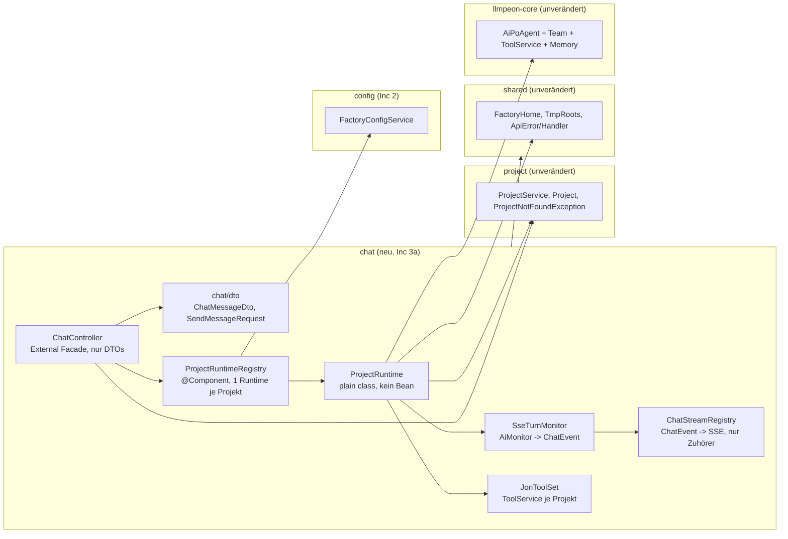
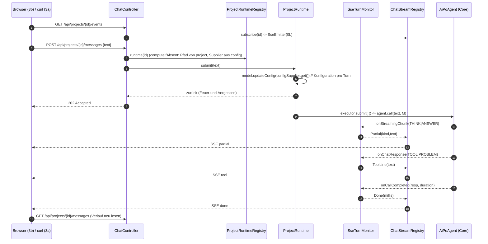
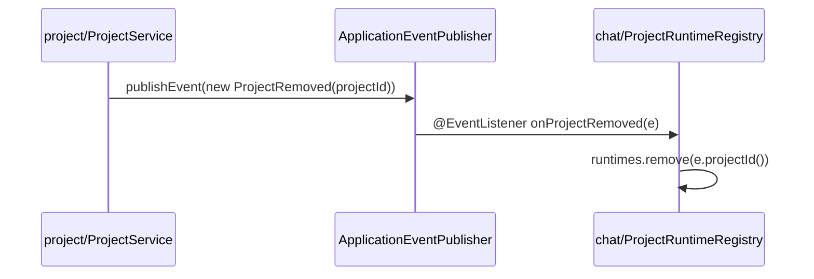

# Increment 3 — Chat mit Jon im Browser (RELEASENTWURF 2026-10-25)

> **Only this top section is the binding work order.** `aifactory/docs/**` is the SOLL and belongs to Jon:
> no agent reads-and-fixes, rewords or renames anything under it. UC/rule ids are quoted, never reworded,
> and **no agent invents an id** — the marker on a test is the doc heading's id, copied (`AGENTS-DEV.md:21-27`).
> Increment 1 and 2 are built, accepted and committed; the Inc-2 record lives in
> `aifactory/peon-plan/overview-done-2026-10-25-23-07.md` (archived evidence — read §2.1/§2.7/§2.8 there for
> the build facts and the TABU style, do not re-open it as a task list).
>
> **File rule for the dev agent:** each increment appends its own short execution log as `## 3a-E` … `## 3e-E`
> **inside this section**, directly after its own §. This file is never replaced by a build log.

Repo root `/Users/sterlp/dev/workset/peon-ai`, branch `web-factory`. Core module
`/Users/sterlp/dev/workset/peon-ai/org.sterl.llmpeon.core`, backend
`/Users/sterlp/dev/workset/peon-ai/aifactory/factory-backend`, UI
`/Users/sterlp/dev/workset/peon-ai/aifactory/factory-ui`.

## 3.0 Slice — five increments, one polarity each (all only-add)

| Inc | Polarity | Lands (running software) | UC ids carried |
|---|---|---|---|
| **3a** | only-add | Backend `chat` component: the three HTTP edges of the arch doc — `GET/POST /api/projects/{id}/messages`, `GET /api/projects/{id}/events` (SSE) — with one `ProjectRuntime` (Jon + team) per project. Provable by curl against a local `MockLlmServer`. | **UC-WP-5, UC-WP-6, UC-WP-7, UC-WP-17, UC-WP-20** (all three GIVENs) |
| **3b** | only-add | The Chat-View becomes real: history, composer, live SSE lines; opening a project opens the Chat-View. | **UC-WP-5, UC-WP-6, UC-WP-7** (the browser halves) |
| **3c** | only-add (test-led) | A second input during a running turn provably lands in the Core queue of the same Jon — no second turn on the same memory. | **UC-WP-14, UC-WP-22** |
| **3d** | only-add + **one named deviation** | The chat survives a real server restart from the Core history store; exactly one chat per project, shared by every caller; the runtime is dropped when its project is removed. | **UC-WP-15, UC-WP-16, UC-WP-21** |
| **3e** | only-add | The **next** turn uses a value changed in *Einstellungen* (config is read per turn, not per runtime) — closes the last open GIVEN of UC-WP-24. | **UC-WP-24** GIVEN 3 only |

Order: **3a → 3b → 3c → 3d → 3e**. 3a is the only hard prerequisite; 3b/3c/3d/3e are independent of each
other but all need 3a. Each increment is fully green on its own gates before the next starts.

**Not in this increment (do not touch, but do not build anything that has to be re-made later):**
UC-WP-8/9/10 write pinning = Inc 4 (3a *sets* both roots, it does not prove the denials); UC-WP-11/12/13
tiles + Clear/Compact = Inc 5 (3a builds the real team + `PoDelegateTool`, so `getTeam()` and `clear()`
already work); UC-WP-25 user name = Inc 6 (no user concept anywhere in Inc 3 — nothing in the request, DTO
or state carries one, so adding it later is additive); `askUser`, workspace memory, real plan tools, static
context text = own stories (`aifactory/docs/aifactory-architektur.md:139-151`).

**Doc ids used, verbatim from `aifactory/docs/web-prototype.md`** — heading = test name, marker is a pure ID
line on its own line above the test:

| UC | doc heading = test name | rule | increment |
|---|---|---|---|
| UC-WP-5 | `openProjectBindsWorkDir` | R-WP-3 | 3a (tool work dir) + 3b (Chat-View opens) |
| UC-WP-6 | `chatAlwaysGoesToJon` | R-WP-4 | 3a (server) + 3b (no switcher in the UI) |
| UC-WP-7 | `streamingUpdatesChatWithoutReload` | R-WP-5 | 3a (server) + 3b (browser) |
| UC-WP-14 | `secondInputDuringTurnQueues` | R-WP-10 | 3c |
| UC-WP-15 | `registryAndChatSurviveRestart` | R-WP-11 | 3d |
| UC-WP-16 | `oneChatPerProject` | R-WP-11 | 3d |
| UC-WP-17 | `allCoreToolsNoEclipseTools` | R-WP-12 | 3a |
| UC-WP-20 | `configReadFromFactoryOwnStore` | R-WP-9 | 3a (GIVEN 1+2+3) |
| UC-WP-21 | `secondUserSeesSameProjectChat` | R-WP-15 | 3d |
| UC-WP-22 | `inputOnBusyProjectQueuesNotParallel` | R-WP-15 | 3c |
| UC-WP-24 | `settingsOverrideNeverWritesSharedStore` | R-WP-16 | 3e (GIVEN 3 — "nutzt der **nächste** Turn den neuen Wert") |

## 3.1 Ground truth (read first, read-only — paths are cached, do not re-search during the build)

* `aifactory/docs/aifactory-architektur.md` — **§Turn (Sequenz)** `:51-66`, **§Chat: HTTP-Kanten und SSE**
  `:68-99` (three edges, no fourth path; the turn belongs to the project, not the connection; POST returns
  `202`; one `ProjectRuntime` per project; `ChatStreamRegistry` holds **no** messages; history is read from
  `home.stateDir(id)`; `chat` may ask `config` and `project`), **§Verantwortung und Grenzen** `:40-49`,
  **§Abbildung Core → Factory** `:102-112`, **§Invarianten** `:153-165` (one turn per project; write
  boundary at the choke point; runtime state never inside the checkout; no `org.eclipse`; keys never leave
  the server in clear text; `shared` knows no component).
* `aifactory/docs/web-prototype.md` — Ziel `:9-17`, R-WP-3 `:136`, R-WP-4 `:145`, R-WP-5 `:155`, R-WP-10
  `:237`, R-WP-11 `:246`, R-WP-12 `:264`, R-WP-15 `:298`, R-WP-9 `:205`, R-WP-16 `:312`, R-WP-13 `:278`,
  R-WP-22 `:41` (delivery), R-WP-1 `:31` (exactly three views).
* `aifactory/docs/adr/001-factory-shares-core-disk-only.md` — shared core, disk tools only, core stays
  Eclipse-free, web-only logic in the core is a violation.
* `AGENTS.md` → skill `component-architecture`; `AGENTS-DEV.md:15-60` (marker rule `:21-27`, never widen
  scope `:34-35`, doc input vs. HEAD `:36-39`, docs/ADR ride with the commit `:40-44`, root sets tested at
  the composition root `:45-50`, commit message carries the gate result `:55-59`);
  `aifactory/AGENTS-DEV.md` (aifactory build facts — pnpm on PATH, no `-parameters`, `TestRestTemplate`
  unusable offline, `spring-boot:run` needs `install` first, `gitea.sterl.co` does not resolve);
  skill `test-honesty`.

**Pre-flight (before the first line of 3a, `AGENTS-DEV.md:36-44`) — blocking:**
1. `git status --porcelain` and `git log -1 -- aifactory/docs/aifactory-architektur.md
   aifactory/docs/web-prototype.md`. The §Chat section of the architecture doc is what this increment is
   built against; if it is **uncommitted**, report both listings to the PO and stop — the doc input itself
   must not become the increment. Staging a doc file needs a fresh, explicit PO authorization for *this*
   increment; Inc 2's authorization was for 2b only and is spent.
2. `git log -1` → record HEAD in the 3a report as the "green before" baseline.
3. `mvn -f aifactory/pom.xml clean verify` (baseline from Inc 2c) and `pnpm -C aifactory/factory-ui
   test|lint|build`; both must be green **before** the first edit (`test-honesty`).
4. If a test cannot import `org.sterl.llmpeon.mock.MockLlmServer` (see §3.3 F): the artifact in `~/.m2` is
   stale → `mvn -o -pl org.sterl.llmpeon.core install -DskipTests`, then refresh. No core **source** change
   is planned or allowed in Inc 3.

## 3.2 Verified facts (read from disk 2026-10-25 — trust these, re-reading is a waste)

**Factory today (all paths under `aifactory/factory-backend/src/main/java/org/sterl/open/aifactory/`):**
* `shared/FactoryHome.java` — `stateDir(projectId)` = `<home>/state/<id>` `:65`; `configFile()` `:73`;
  the single test seam `FactoryHome.of(Path)` `:46`; property `aifactory.home`, env `AIFACTORY_HOME`.
* `shared/TmpRoots.systemTmp()` — the second write root (R-WP-13), already absolute + normalized.
* `shared/ApiError.java` + `shared/ApiExceptionHandler.java` — `@RestControllerAdvice` **without package
  scoping**: `IllegalArgumentException`→400, `IllegalStateException`→409, `ResponseStatusException`→its
  status. No Bean Validation starter on the classpath → validate by hand.
* `project/ProjectExceptionHandler.java` — also a global advice, so a `ProjectNotFoundException` thrown
  from **any** component answers 404. Reuse it; do not add a second advice.
* `project/ProjectService.find(String id)` `:90` → `Optional<Project>`; `Project(String id, String name,
  String gitUrl, Path localPath, ProjectState state)`; `remove(String)` `:153` (entry + checkout).
* `config/FactoryConfigService` — `load()` `:54` = `pin(LlmConfigLoader.load(store()))`, `pin()` `:132`
  forces `configDir = home.root()` and `diskToolsEnabled = true`; hand-written validation style with
  static, value-free hint constants (`:30-33`) — copy that style for the new turn check.
* `ui/ResourceUIConfig.java` + `ui/SpaIndexController.java` — `/ui/**` delivery, `/` → 302. Untouched.
* `pom.xml:41` comment claims the core is "used from the `agent` and `config` packages" — there is no
  `agent` package; 3a updates that comment to `config` **and** `chat`. That comment line is the only
  allowed edit to `factory-backend/pom.xml`: **no dependency is added in Inc 3** (see §3.3 E).
* Guards: `ComponentArchitectureTest` (`ApplicationModules` verify, `sharedKnowsNoComponent`,
  `onlyConfigReadsTheFactorysOwnConfig` = no dependency on `LlmConfigLoader`/`FileLlmConfigStore` outside
  `config`) and `ArchitectureGuardTest` (no `org.eclipse..`, no `Eclipse*` / `PeonAiService` /
  `SharedToolsComponent` / `AgentContextComponent` / `BuildPoAgentComponent` / `AskUserTool` /
  `WorkspaceMemoryTool` / `PlanTool` / `PlanReadTool` / `StaticContextItem` / `AgentsMdContextItem`;
  `productionClasses()` imports main only, ArchUnit arrives transitively via `spring-modulith-core`,
  `@ArchTest` is unavailable offline).
* UI today: `factory-ui/src/App.tsx` (`onOpen` sets `selected` but **stays on the projects view** — the
  3b gap), `views/ChatView.tsx` (placeholder "Noch kein Agent"), `api/client.ts` (`request<T>` +
  `ApiRequestError`), `api/projects.ts`, `api/settings.ts`, `test/` helpers, jsdom pinned to 26.1.0.

**Core seams (module `org.sterl.llmpeon.core`, package → file):**
* `poagent/AiPoAgent.java` — ctors `:50/:55/:59`; `NAME = "Peon-PO"` `:39`;
  `AiPoAgent(ConfiguredChatModel, ToolService, Path historyStateDir, List<NamedAgent> slaves)` — the
  4-arg form is Jon **with** a persistent history; `getTeam()` `:90` prepends `Da Boss`;
  `getWriteValidator()` `:105` returns `WriteValidator.DOCS` (must be overridden — see D5); `clear()` `:141`
  clears the delegate tool's plan/dev/review; `setStaticContext` `:69` forwards the naming to every slave.
* `agent/AbstractAgent.java` — `historyFile(stateDir, agentName)` `:85` = `<stateDir>/<safeName>-history.jsonl`
  and it is **protected** (the factory must not re-derive that name — see D4); `call(String, AiMonitor)`
  `:229`: `working.compareAndSet(false,true)` fails ⇒ `messageQueue.add(msg)` and **return null** — this is
  the only serialization the factory needs; `doCall` `:312` adds the user message to the memory, then
  `monitor.onCallStart`; `queuedMarker` `:307` writes `[Queued Message] (HH:mm): <text>` into the memory.
* `queuedmessages/UserMessageQueue.java` — default batch window **10 000 ms** and burst-merge up to 300
  chars ⇒ two quick sends may become **one** queue entry; `setMessageQueue` is package-private, so a test
  cannot shrink the window. Every queue test must therefore be written so it holds for merged **and**
  unmerged payloads (§3.6).
* `ai/ConfiguredChatModel.java` — `ConfiguredChatModel(LlmConfig)` `:26`; `updateConfig(LlmConfig)` `:96`
  (null → NPE, equal → nothing, changed → resets the built model) — this is the whole "next turn uses the
  new value" mechanism (3e); `modelFor(AgentConfig)` `:64` builds a **separate** model when an agent has
  its own url/apiKey — the factory file carries no `llm.agent.*` keys, so every agent stays `isBase()`.
* `ai/LlmConfig.java` — `stateDirectory()` `:110` = `configDir/state`; defaults: `model`/`url`/`apiKey`
  null, `timeout` 180 s (`LlmConfigLoader:33`), `autoCompactAfter` 80 000, `configDir` `~/.peon` (pinned
  away by `config`), `diskToolsEnabled` false (pinned to true).
* `ai/AiProvider.java` — nine names, `parse()` **silently coerces an unknown name to OLLAMA** → never use
  it; `AiProvider.valueOf` semantics via the existing `isProviderName` pattern
  (`config/FactoryConfigService.java:117`).
* `provider/OpenAiProvider.buildModel` `:35` passes `.apiKey(c.getApiKey())` straight into langchain4j, and
  `OllamaProvider.DEFAULT_BASE_URL` is `http://localhost:11434` — an unset key/url is a provider-internal
  failure, which is exactly why UC-WP-20 GIVEN 3 demands a factory-side rejection **before** the build.
  There is **no** `requiresApiKey` in the core; the two key-free providers are `OLLAMA` and `LM_STUDIO`
  (R-WP-9 / UC-WP-20 GIVEN 3 name them), so that policy is factory knowledge and lives in `config` (D7).
* `tool/ToolService.java` — `ToolService(boolean withDefaults)` `:83` registers `WebFetchTool`,
  `WebSearchTool`, `SearchAgentTool(this)`, `ShellTool`, `CompactSessionTool`; `addTool`, `getTool(Class)`,
  `removeTool`, `toolSpecifications()`, `activeNames(classFilter, nameFilter)`.
* `tool/tools/ShellTool.java:49` `setDefaultWorkingDir(Supplier<Path>)` (call-time read, R3); `isEditTool()`
  is true, so a read-only slave never sees it — Jon and Da Mek do.
* `tool/tools/DiskFileWriteTool.java:22`, `DiskFileReadTool`, `DiskGrepTool` — all take a `Path workingDir`
  in the ctor and expose `setWorkingDir`; `docslinter/DocsLinterTool(Path)` +
  `docslinter/DocsIdTool(DocsLinterTool)`; `tool/web/WebGetTool()` no-arg.
* `tool/DynamicRootsWriteValidator.java:26` `(Path configDir, Supplier<List<Path>> additionalRoots)` —
  resolves with `FileUtils.resolve`, normalizes (kills `..`), allows `configDir` or any additional root,
  otherwise throws `IllegalArgumentException` naming the roots; roots are read at **validate time**.
* `shared/AiMonitor.java` — `onStreamingChunk(OnPartialAiResponse)` (every token, default no-op),
  `onChatResponse(SimpleMessage)` (the one abstract method; `onTool`/`onProblem`/`onFileUpdate` funnel into
  it), `onCallStart(String)`, `onCallCompleted(ChatResponse, Duration)`, `onTokenUsage`,
  `onCompactCompleted`, `isCanceled()`.
* `shared/OnPartialAiResponse.java` — `record (Type type, String value, Instant startedAt, long
  tokenPhaseStart)`, `Type = START | THINK | ANSWER | TOOL | END`.
* `tool/model/SimpleMessage.java` — `record (Type role, String message)`,
  `Type = AI | USER | PROBLEM | TOOL | THINK | QUESTION | DIFF`.
* `memory/FileAgentHistoryStore.java:26 load()` is **read-only** (missing file → `List.of()`, corrupt file →
  deleted + empty); `ThreadSafeMemory(FileAgentHistoryStore)` loads in its constructor — building Jon costs
  no writes, which 3a asserts (§3.4 T6).
* Team: `AiPlanAgent`/`AiDevAgent`/`AiReviewAgent` each have a **2-arg ctor = RAM-only memory** (ADR-0024,
  and exactly R-WP-11's "sein Team beginnt leer"); `AiPlanAgent.classFilter()` drops edit tools,
  `AiReviewAgent.getWriteValidator()` is `DENY_ALL` (core parity, see Q5);
  `poagent/tools/PoDelegateTool.java:105`
  `(NamedAgent plan, NamedAgent review, NamedAgent dev, Function<NamedAgent,List<ContextItem>> ordersFor,
  IntSupplier autoCompactAfter)`; `agent/NamedAgent` is a record `(String uiName, AiAgent agent)`.
* **Test double, already in the core's `src/main`** (so it is on the factory's *test* classpath through the
  `llmpeon-core` jar, no new dependency): `mock/MockLlmServer.java` — `start()` binds port 0 and serves
  `/v1/chat/completions` (OpenAI SSE, text split into several chunks), `/v1/models`, `/v1/messages`
  (Anthropic), `/api/chat` (Ollama NDJSON); `getUrl()` = `http://127.0.0.1:<port>/v1`;
  `newConfig(String model)` → `OPEN_AI` + that url + 30 s; `queueResponse(String)` and
  `queueResponse(AiMessage)` (an `AiMessage` carrying `ToolExecutionRequest`s is answered as
  `finish_reason: tool_calls`, so a scripted tool turn needs no fake model class); `setNonStreaming(true)`;
  `getCapturedTools()` / `getCapturedTool(name)` (name + params of every tool spec the agent actually
  sent); `getLastRequestBody()` (raw JSON — contains `"model":"…"`, the proof for 3e);
  `getCapturedMessages()`; `reset()`; `stop()`. **An empty queue answers a default line instead of
  blocking**, so a sub-agent call (`SearchAgentTool`) can never hang a test.
## 3.3 Design (gilt für alle fünf Increments — Änderungen daran sind Plan-Änderungen, keine Implementierungs-Entscheidungen)

### 3.3.1 Komponenten und Abhängigkeitsrichtung

Neues Modulith-Modul `org.sterl.open.aifactory.chat`. Layout wie in Inc 2: DTOs nach `chat/dto`, der Rest
modulwurzelnahe, **keine** Sub-Package-Chain.



**Abhängigkeiten zeigen nach innen auf `chat` als Besitzer des Turn-Wissens; `project` und `config`
kennen `chat` nicht.** `chat` → `project` (Pfad, 404-Fall), `chat` → `config` (Konfiguration pro Turn),
`chat` → `shared` (Wurzeln, Fehlerformat). Kein Pfad `project → chat`, `config → chat`, `chat → LlmConfigLoader/FileLlmConfigStore`
(`ComponentArchitectureTest.onlyConfigReadsTheFactorysOwnConfig`, `:87-101`, greift bereits).

Kapselung — was jede Klasse weiß und verbirgt:

| Klasse | Weiß | Verbirgt | Warum |
|---|---|---|---|
| `ChatController` | Routen, Statuscodes, DTO-Form | dass es Agenten, Turns, Queues gibt | Arch-Doc `:45` „ProjectRuntime darf kein HTTP/JSON"; der Turn-Wechsel soll keine Route ändern |
| `ProjectRuntime` | ein Projekt, sein Pfad, sein `state/<id>`, ein `AiPoAgent`, ein `ToolService`, Serialisierung | Dateinamen des History-Stores, SSE-Formate | ein Wechsel des Core-Formats betrifft eine Klasse |
| `ProjectRuntimeRegistry` | Erzeugen/Verwerfen der Runtime je Projekt, der gemeinsame Executor | Turn-Mechanik | Lebenszyklus ≠ Turn-Ablauf; nur hier darf „wegwerfen" stehen |
| `SseTurnMonitor` | Übersetzung `AiMonitor` → `ChatEvent` | HTTP, Emitters, JSON | die Core→Chat-Tabelle ist der einzige Ort, der den Core-Callback kennt |
| `ChatStreamRegistry` | Zuhörer je Projekt, Broadcast, Aufräumen toter Emitters, SSE-Drahtformat | Agenten, Turns, Verläufe | Arch-Doc `:94-96`: hält **keine** Nachrichten |
| `JonToolSet` | welche Tools Jon + Team bekommen und mit welchem Root | Turn, Konfiguration | UC-WP-17 ist eine Aussage über diese Klasse, nicht über den Agenten |

### 3.3.2 Turn (Sequenz, konkret)



Der Turn gehört dem Projekt, nicht der Verbindung: `POST` kehrt sofort zurück, der Anrufer-Thread wird
nie für einen Turn benutzt. Kein Zuhörer ⇒ der Turn läuft trotzdem zu Ende und der Verlauf ist danach
vollständig (curl-Beweis in §3.4 T3).

### 3.3.3 Die drei Kanten und der SSE-Vertrag

| Kante | Antwort | Fehler |
|---|---|---|
| `GET /api/projects/{id}/messages` | `200 [ {role,text}, … ]` Rollen nur `user` \| `jon` | Projekt unbekannt → `ProjectNotFoundException` → 404 (`project/ProjectExceptionHandler`, global) |
| `POST /api/projects/{id}/messages` | **`202`** immer (auch bei „Jon beschäftigt" — die Core-Queue übernimmt) | `text` blank → `IllegalArgumentException` → 400 (`shared/ApiExceptionHandler`); Projekt unbekannt → 404 |
| `GET /api/projects/{id}/events` | `200`, `text/event-stream`, `SseEmitter(0L)` (0 = kein Timeout, sonst killt Tomcats Async-Timeout von 30 s jeden langen Turn), Header `Cache-Control: no-cache`, `X-Accel-Buffering: no` | Projekt unbekannt → 404 **bevor** der Emitter erzeugt wird |

`SseEmitter`-Import: `org.springframework.web.servlet.mvc.method.annotation.SseEmitter` — liegt in Boot 4
weiter in `spring-webmvc` (`spring-boot-starter-web` → `spring-boot-starter-webmvc`, `factory-backend/pom.xml:29`); **keine neue Abhängigkeit.**

SSE-Ereignisse (Namen wie im Arch-Doc `:85` „partial · tool · done"; `data` ist jeweils ein JSON-Objekt,
`id:` wird **nicht** gesetzt — es gibt kein Replay über die Leitung, §3.3.5):

| `event:` | `data` | Quelle im Core | Lebensdauer |
|---|---|---|---|
| `partial` | `{"kind":"think"\|"answer","text":"<delta>"}` | `onStreamingChunk(OnPartialAiResponse)` mit `Type.THINK`/`ANSWER` | **nur live** |
| `tool` | `{"text":"<Zeile>"}` | `onChatResponse` mit Rolle `TOOL` **und** `PROBLEM` | nur live |
| `done` | `{"millis":n}` | `onCallCompleted(resp, duration)` — **je beantworteter Eingabe**, nicht je `call(…)` (`AbstractAgent:340` im `doCall`); eine gewartete Eingabe liefert ihr eigenes `done` | nur live |
| `error` | `{"message":"…"}` | `onCallCompleted` mit `resp == null` **oder** jede Exception im Turn-Körper | nur live |

`OnPartialAiResponse.Type.START`/`END` werden verworfen (anonym, kein Wert). **Der fertige Antwort-Text ist
kein SSE-Ereignis:** nach `done` liest der Client `GET …/messages` neu — eine Wahrheit, zwei Kanäle
vermeidet der Arch-Doc-Verweis `:92-93` („Ein Browser-Reload verliert **nur** Live-Zeilen").
Konsequenz für 3b: der **eigene** Nutzereingabe-Entwurf bleibt im UI stehen, bis er im Verlauf erscheint
(`AbstractAgent.doCall:312` schreibt sie erst zu Turn-Beginn in die Memory; eine **wartende** Eingabe ist
solange nicht im Verlauf — bekannte, ehrliche Grenze, §3.6).

`ChatEvent` ist die innere Sprache zwischen `SseTurnMonitor` und `ChatStreamRegistry`, damit das Draht-
format nur das Registry kennt:

```java
// chat/ChatEvent.java  (neu, versiegelt — die vollständige Übersetzungstabelle)
sealed interface ChatEvent {
  record Partial(String kind, String text) implements ChatEvent {}   // think | answer
  record ToolLine(String text) implements ChatEvent {}               // Tool-/Problem-Zeile
  record Done(long millis) implements ChatEvent {}
  record Failed(String message) implements ChatEvent {}
}
```

### 3.3.4 Skizzen (Signatur-Ebene, mehr nicht)

```java
// chat/ChatController.java — External Facade, hält nur Registry + ProjectService
@GetMapping("/api/projects/{id}/messages")  List<ChatMessageDto> messages(@PathVariable String id)
@PostMapping(value = "/api/projects/{id}/messages", status = 202)  void send(@PathVariable String id, @RequestBody SendMessageRequest req)
@GetMapping(value = "/api/projects/{id}/events", produces = MediaType.TEXT_EVENT_STREAM_VALUE)
SseEmitter events(@PathVariable String id)

// chat/ProjectRuntimeRegistry.java — @Component; Lebenszyklus, nicht Turn-Mechanik
SseEmitter subscribe(String projectId)                 // wirft ProjectNotFoundException bei unbekanntem Projekt
void submit(String projectId, String text)             // 404 bei unbekanntem Projekt, sonst IllegalArgumentException
List<ChatMessageDto> history(String projectId)         // Filterung -> DTO
@EventListener void onProjectRemoved(ProjectRemoved e) // nur mit Q3-Beschluss, §3.7
private final Map<String, ProjectRuntime> runtimes = new ConcurrentHashMap<>();
private final ExecutorService turns = Executors.newVirtualThreadPerTaskExecutor();  // Java 21 (Root-pom.xml:13)

// chat/ProjectRuntime.java — BEWUSST kein Bean: der Konstruktor ist die Test-Naht
ProjectRuntime(String projectId, Path projectRoot, Path stateDir,
               Supplier<LlmConfig> configSupplier, ChatStreamRegistry streams, ExecutorService turns)
void submit(String text)             // updateConfig -> turns.submit(call); Exception -> ChatEvent.Failed
List<ChatMessage> history()          // jon.getHistory() — siehe D4
AiPoAgent jon()                      // für Inc 5 (Kacheln/Clear) ohne Umbau erreichbar

// chat/SseTurnMonitor.java — die Übersetzungstabelle, ein Exemplar je Projekt (nicht je Turn!)
SseTurnMonitor(String projectId, ChatStreamRegistry streams) implements AiMonitor
default String toOutput() -> ""      // onChatResponse muss nichts zurückgeben: Antwort geht an die Memory

// chat/ChatStreamRegistry.java — @Component; Draht, keine Inhalte
SseEmitter subscribe(String projectId)      // emitter.onCompletion/onTimeout/onError -> abmelden
void publish(String projectId, ChatEvent e) // pro Projekt synchronisiert; toter Emitter -> still abmelden
int listenerCount(String projectId)         // für Tests
```

Ein Monitor **je Projekt**, nicht je Turn: sonst verliert die Queue-Zusammenfassung (`UserMessageQueue:137`)
ihre Streaming-Ereignisse, weil der zweite Drain denselben Agent-Monitor weiterverwendet.

### 3.3.5 Entscheidungen (D1 … D10)

* **D1 — neues Modul `chat`, Runtime als gewöhnliche Klasse.** Nur `ChatController`, `ProjectRuntimeRegistry`
  und `ChatStreamRegistry` sind Beans; `ProjectRuntime`, `SseTurnMonitor`, `ChatEvent` und `JonToolSet` sind
  einfache Klassen. Grund: die Queue- und Neustart-Tests (§3.6, §3.7) brauchen eine Runtime mit *eigenem*,
  langsamem bzw. vorbelegtem Tool—das ist über eine Spring-Bean mit `@Autowired`-Konfiguration nicht
  erreichbar, ohne Produktionscode zu verbiegen.
* **D2 — `POST` antwortet immer 202, die Queue ist nicht die unsere.** Arch-Doc `:80` „prüft nichts über
  den Turn hinaus" + `AbstractAgent.call:229-233` (beschäftigt → `messageQueue.add`, Rückgabe `null`).
  Eine zweite Fabrik-Queue wäre ein zweiter Serialisierungsort → genau der Verstoß gegen R-WP-10/R-WP-15,
  den UC-WP-22 beweisen soll.
* **D3 — Ereignistabelle wie in §3.3.3, `ChatEvent` dazwischen.** Grund: `AiMonitor` ist Core-Sprache,
  SSE-Namen sind Browser-Vertrag; beide in einer Klasse zu verknoten macht UC-WP-7 unverfolgbar.
  Abgewichen wird bewußt von der naheliegenden Variante „fertige Antwort als SSE-Event": der Verlauf ist
  die einzige Wahrheit (Arch-Doc `:94-96`), und R-WP-11 verlangt explizit, daß nach dem Reload **keine**
  Duplikate entstehen.
* **D4 — Verlauf über die Core-Memory, nie über einen Dateinamen.** `ProjectRuntime.history()` liefert
  `jon.getHistory()` (`AbstractAgent:149`): die Memory ist beim Bau aus `FileAgentHistoryStore` geladen
  (`AiPoAgent:61-63`), der Store bleibt die einzige Persistenz — **und** `chat` kennt den Dateinamen nicht
  (`AbstractAgent.historyFile` ist `protected`, eine Rekonstruktion `Peon-PO-history.jsonl` im Fabrik-Code
  wäre ein zweiter, stiller Vertrag). Beweist UC-WP-15 ohne neuen Lese-Pfad.
  Filter: `UserMessage` → nur Textteile → `user`; `AiMessage` **ohne** Tool-Aufrufe und mit Text → `jon`;
  alles andere (`SystemMessage`, `ToolExecutionResultMessage`, `CustomMessage`, Tool-Rufe, leere Texte) →
  übersprungen. Wartende Eingaben erscheinen mit dem Core-Marker `[Queued Message] (HH:mm): ` — Tests
  prüfen `contains`, nicht Gleichheit (Q6).
* **D5 — Schreib-Wurzeln je Agent, nicht global.** `JonToolSet` setzt pro Projekt
  `new DynamicRootsWriteValidator(projectRoot, () -> List.of(TmpRoots.systemTmp()))` und Jon **und** Da Mek
  bekommen ihn per Überschreibung von `getWriteValidator()` (`AiPoAgent.java:104-107` liefert `WriteValidator.DOCS` —
  ohne Überschreibung wäre die halbe Projekt-Root tabu, R-WP-6). Da Thinka (Plan) und Da Dok (Review)
  behalten ihre Core-Validatoren: Plan filtert Editier-Werkzeuge (`AiPlanAgent.classFilter():70-72`), Review
  ist `DENY_ALL` (`AiReviewAgent.java:80-83`) — Core-Parität, Q5. Die Wurzeln sind **nicht** die
  UC-WP-8/9/10-Nachweisung (Inc 4); 3a stellt sie nur.
* **D6 — Team jetzt, Kacheln später.** `new AiPoAgent(model, tools, home.stateDir(id), List.of(new NamedAgent("Da Thinka", plan), new NamedAgent("Da Mek", dev), new NamedAgent("Da Dok", review)))`,
  die drei Slaves mit dem **2-Argument-Konstruktor** = RAM-Memory (`AiPlanAgent:21`, `AiDevAgent:17`,
  `AiReviewAgent:26`; ADR-0024) — genau R-WP-11 „sein Team beginnt leer". `PoDelegateTool(plan, review, dev, n -> List.of(), config::getAutoCompactAfter)`
  (`PoDelegateTool.java:105-112`) kommt auf den `ToolService`; benennender Kontext über
  `jon.setStaticContext(List.of(ContextItem.of("Your name is Da Boss.")))` — die Slave-Namen ergänzt der
  Core selbst (`AiPoAgent.java:68-76`), und zwar **nie** über `StaticContextItem` (ArchGuard).
  Mit `getTeam()` und `clear()` ist Inc 5 ohne Umbau möglich; die benannte Abweichung: keine Stand-Aufträge
  (`ordersFor = n -> List.of()`), weil Auftrags-Texte ein eigenes Story-Feld sind.
* **D7 — „bereit für den Turn" gehört zu `config`.** `FactoryConfigService` bekommt
  `LlmConfig loadForTurn()` : `load()` plus Prüfung, daß ein Modell gesetzt ist und ein Schlüssel existiert —
  außer `OLLAMA` und `LM_STUDIO` sind schlüsselfrei (R-WP-9 / UC-WP-20 GIVEN 3 nennen sie; im Core gibt es
  **kein** `requiresApiKey`, §3.2). Bei Verstoß: neue **einfache** Exception in `config`, deren Botschaft das
  fehlende Feld nennt; `shared/ApiExceptionHandler` bleibt unverändert (sie ist kein 400-Fall, sondern ein
  `error`-Ereignis, Q1). Der Anbietername wird nach dem vorhandenen `isProviderName`-Muster geprüft
  (`config/FactoryConfigService.java:117`), **nie** über `AiProvider.parse()` (unbekannt → still OLLAMA).
  Die Prüfung liegt **vor** `ConfiguredChatModel`/`buildModel` (`provider/OpenAiProvider.java:35`) — sonst
  scheitert der Turn im Anbieter, und GIVEN 3 ist nicht nachweisbar.
* **D8 — Jon-Werkzeuge = Core-Standard + Disk/Dokument-/Web-Werkzeuge mit Projekt-Root.**
  `new ToolService(true)` (registriert `WebFetchTool`, `WebSearchTool`, `SearchAgentTool`, `ShellTool`,
  `CompactSessionTool`), dazu je Projekt-Instanz `DiskFileReadTool(root)`, `DiskFileWriteTool(root)`,
  `DiskGrepTool(root)`, `DocsLinterTool(root)` + `DocsIdTool(linter)`, `WebGetTool()`;
  `toolService.getTool(ShellTool.class).ifPresent(t -> t.setDefaultWorkingDir(() -> root))` —
  Lieferant, also zur Aufrufzeit gelesen (`ShellTool.java:49`, R3). `isEditTool()` von `ShellTool` ist wahr,
  also bleibt es Da Thinka vorenthalten und ist Da Dok erlaubt (`AiReviewAgent.classFilter():75-78`, R-TF-1) —
  beides Core-Parität, nichts Fabrik-Eigenes. **Kein `SkillTool`, kein `AskUserTool`** (Q3).
* **D9 — eine neue ArchRegel, damit die Grenze nicht zerläuft.** In `ComponentArchitectureTest`:
  „nur `chat` darf Agenten-Instanzen halten" — keine Klasse außerhalb `..chat..` abhängig von
  `AiPoAgent`, `AiPlanAgent`, `AiDevAgent`, `AiReviewAgent`, `ConfiguredChatModel` (Arch-Doc `:99`).
  Bestehende Regeln bleiben unverändert.
* **D10 — `factory-backend/pom.xml:41` Kommentar auf `config` **und** `chat` korrigieren** (der Text nennt
  ein `agent`-Paket, das es nicht gibt). **Keine** Abhängigkeit wird hinzugefügt — siehe E.

### 3.3.6 E — Testnaht: `MockLlmServer` statt eigener Modell-Attrappe

Entschieden: Integrations-Tests schreiben in die `aifactory.home`-Test-Datei
`providerType=OPEN_AI`, `model=<name>`, `url=http://127.0.0.1:<Port>/v1` (Schlüssel: `test-key`, wo nötig)
und starten den **echten** `AiPoAgent` gegen `org.sterl.llmpeon.mock.MockLlmServer` (§3.2 unten). Alles
andere bleibt echt: Entscheidungs-Werkzeug-Schleife, Memory, History-Datei, `AiMonitor`-Kette, SSE-Leitung.

* **SSE-Leser im Test:** JDK `java.net.http.HttpClient` + `BodyHandlers.ofLines()`, Zeilen `data:`/`event:`
  zählen, `Future.get(timeout)` bzw. `assertTimeoutPreemptively` — eine SSE-Antwort endet nie von selbst.
  Verworfen: `TestRestTemplate` (offline unbrauchbar, `aifactory/AGENTS-DEV.md`), `WebTestClient`/`WebClient`
  (erfordern `spring-webflux`, nicht im Klassenpfad, offline-feindlich), nur-Registry-Tests (beweisen das
  Drahtformat nicht).
* **Abgewiesen: eigene `StreamingChatModel`-Attrappe.** Sie überspringt die Werkzeug-Schleife und die
  Queue des Cores — UC-WP-14/17/22 wären dann nicht falsifizierbar. Ebenso abgewiesen: Mockito-Stubs auf
  `AiPoAgent` (dann wird die Fabrik gegen ihre eigenen Doubles getestet, Verstöße gegen R-WP-4/10 bleiben
  unsichtbar).
* **Grenzfall, der im Plan stehen muß:** die Queue des Cores hat ein 10-s-Bündelfenster und verschmilzt
  Kurz-Texte (§3.2). Tests prüfen deshalb **nicht** die Anzahl der Queue-Einträge, sondern: genau eine
  Anfrage zur gleichen Zeit beim Anbieter, und beide Texte erreichen das Modell irgendwann (§3.6).

### 3.3.7 F — was `MockLlmServer` für die einzelnen Nachweise liefert

`queueResponse(String)` (Text), `queueResponse(AiMessage mit ToolExecutionRequest)` (Werkzeug-Turn ohne
Fake-Klasse), `getCapturedTools()` / `getCapturedTool(name)` (Welche Werkzeuge Jon wirklich sendet — UC-WP-17),
`getLastRequestBody()` (enthält `"model":"…"` — der Beweis, daß die Fabrik-Konfiguration im Modell ankam, UC-WP-20/24),
`getCapturedMessages()` (was das Modell sah), `getRequestCount()` (UC-WP-20 GIVEN 3: **0** Anfragen; UC-WP-22: genau 1),
`reset()`, `stop()`. Leere Antwort-Warteschlange liefert eine Standard-Zeile statt zu blockieren — ein
`SearchAgentTool`-Unterlauf kann keinen Test aufhängen. `model` heißt im Core-Feld `model`, in der Antwort
`"model"`; der Wert kommt unverändert an.

## 3.4 Increment 3a — Backend `chat`: drei Kanten, ein `ProjectRuntime` je Projekt

**Läuft danach:** ein Projekt kann über HTTP einen Turn mit Jon starten; der Antwort-Text und jede
Werkzeug-Zeile erscheinen live auf einer SSE-Verbindung; der Verlauf liegt danach in
`<home>/state/<id>/` und ist über `GET …/messages` lesbar. Beweisbar mit curl gegen eine lokale Fabrik —
**ohne** Browser (UI bleibt 3b, Q2). UCs: **UC-WP-5** (Werkzeug-Arbeitsverzeichnis), **UC-WP-6** (Server-Hälfte),
**UC-WP-7** (Server-Hälfte), **UC-WP-17**, **UC-WP-20** (alle drei GIVEN). Kein Nutzerbegriff, keine Kacheln,
kein Schreib-Pinning-Nachweis.

### 3.4.1 Dateien

Neu (`factory-backend/src/main/java/org/sterl/open/aifactory/chat/`): `ChatController.java`,
`ProjectRuntimeRegistry.java`, `ProjectRuntime.java`, `ChatStreamRegistry.java`, `ChatEvent.java`,
`SseTurnMonitor.java`, `JonToolSet.java`, `dto/ChatMessageDto.java`, `dto/SendMessageRequest.java` — Genau die
sieben + zwei DTOs aus §3.3.4; keine weiteren Klassen, kein Unter-Paket außer `dto`.

Geändert (nur-hinzufügen, jeweils begründet):

| Datei | Änderung | Warum |
|---|---|---|
| `config/FactoryConfigService.java` | neue Methode `LlmConfig loadForTurn()` (delegiert an `load()`, prüft dann), Feld-Konstanten statisch + wertfrei wie `:30-33` | D7; der Turn-Leser darf die Validierung nicht duplizieren |
| `config/TurnNotConfiguredException.java` (neu) | einfache `RuntimeException`, Botschaft nennt das Feld | Parität zu `project/ProjectNotFoundException`; wird **nicht** in `shared/ApiExceptionHandler` behandelt (Q1) |
| `factory-backend/pom.xml` | **nur** der Kommentar in Zeile 41: `config` **und** `chat` | D10; keine Abhängigkeit |
| `src/test/.../ComponentArchitectureTest.java` | eine Regel mehr: `onlyChatHoldsAgentInstances` | D9; bestehende Regeln bleiben unangetastet |

Unverändert: `project/**`, `shared/**`, `ui/**`, `AifactoryApplication`, jede Core-Datei.

### 3.4.2 Bauschritte (Reihenfolge, jeder Schritt kompiliert)

1. `dto` + `ChatEvent` + `ChatStreamRegistry` (+ `ChatStreamRegistryTest`, kein UC-marker).
2. `JonToolSet` (+ `JonToolSetTest`) — Werkzeugätze und Wurzeln sind unabhängig vom Turn.
3. `config.loadForTurn()` + Exception + Unit-Test in `FactoryConfigServiceTest`.
4. `SseTurnMonitor` (Tabelle aus §3.3.3) + `ProjectRuntime` (Bau von Jon + Team nach D6, `submit`, `history` nach D4).
5. `ProjectRuntimeRegistry` + `ChatController` (drei Kanten, §3.3.3).
6. `ChatTurnTest` gegen `MockLlmServer`.
7. ArchRegel D9 + `pom.xml`-Kommentar + grüne Gates.

`ProjectRuntime`-Bau (Schritt 4, exakt so): `new ConfiguredChatModel(configSupplier.get())` →
`JonToolSet.forProject(projectRoot)` → drei Slaves mit 2-Argument-Konstruktoren →
`new PoDelegateTool(new NamedAgent("Da Thinka", plan), new NamedAgent("Da Dok", review), new NamedAgent("Da Mek", dev), n -> List.of(), () -> configAutoCompactAfter)`
auf den `ToolService` → `new AiPoAgent(model, tools, stateDir, List.of(...))` als anonyme Unterklasse mit
`getWriteValidator()` nach D5 → `jon.setStaticContext(List.of(ContextItem.of("Your name is Da Boss.")))`.
Reihenfolge wichtig: `PoDelegateTool` **vor** dem Agenten registrieren, sonst sieht Jon die Delegation im
ersten Turn nicht; `autoCompactAfter` liest die **aktuelle** Konfiguration bei jedem Aufruf (kein Zwischenpuffern).
Beim Bau wird **nichts** geschrieben (`FileAgentHistoryStore.load()` liest nur, fehlende Datei ⇒ leer) — das
assertiert Schritt 4 direkt: nach dem Bau existieren weder `state/<id>/` noch Dateien darin (R-WP-11).

### 3.4.3 Tests (Marker = Doc-Überschrift, eine Zeile `// UC-WP-n` über der Methode)

| Datei | Marker | Test | THEN-Zeile des Docs — Beweis |
|---|---|---|---|
| `chat/ChatTurnTest.java` (`@SpringBootTest(RANDOM_PORT)`, `@Import(FakeGitConfig.class)`, statisches Home per `@DynamicPropertySource`, `MockLlmServer` in `@BeforeAll`, Projekt über `POST /api/projects`) | `// UC-WP-5` | `openProjectBindsWorkDir` | „… wird das Tool in diesem Verzeichnis ausgeführt": Turn 1 skriptet `shellRunCommand {"command":"pwd"}` (`ShellTool.java:67-85`), SSE-`tool`-Zeile **und** die vom Modell gesehene Werkzeug-Antwort enthalten `cwd=<absolute localPath>` (`ShellTool.java:109`); Turn 2 skriptet `diskWriteFile {"filePath":"notes/marker.txt","content":"…"}` → Datei liegt unter `<localPath>/notes/marker.txt`, `tool`-Zeile nennt den absoluten Pfad (`DiskFileWriteTool.java:81`). Zusätzlich in diesem Test: `mock.getCapturedTool("diskWriteFile")` und `("shellRunCommand")` sind vorhanden (beweist die Werkzeug-Liste auf dem Draht, §3.2) |
| ″ | `// UC-WP-6` | `chatAlwaysGoesToJon` | „… geht die Eingabe immer an Jon": `SendMessageRequest.class(recordComponents)` = genau `text` (kein Feld kann Adressat sein), zwei Turns auf zwei HTTP-Verbindungen liefern **dieselbe** Runtime und `jon().getName()` = `AiPoAgent.NAME` (= „Peon-PO"), die gesendete Nachricht enthält eine System-Nachricht (Jons Prompt) + den User-Text — kein zweiter Agent erreichbar |
| ″ | `// UC-WP-7` | `streamingUpdatesChatWithoutReload` | „… erscheinen die Antwort-Texte live im Chat, ohne die Seite neu zu laden": ein Subscriber vor dem `POST`; ≥ 2 `partial`-Ereignisse (`kind:"answer"`, der Mock zerlegt den Text), ≥ 1 `tool`-Ereignis, genau ein `done`; danach endet `GET …/messages` mit `{role:"jon",text:<Mock-Text>}`; ein **zweiter**, nach dem Turn geöffneteer Subscriber erhält von diesem Turn **nichts** (kein Replay, keine Duplikate) |
| ″ | `// UC-WP-20` | `configReadFromFactoryOwnStore` | GIVEN 1 zitiert `config/FactoryConfigServiceTest.configFileLivesInFactoryHome` (bereits grün, nicht duplizieren); GIVEN 2: `mock.getLastRequestBody()` enthält `"model":"<name aus der Home-Datei>"` ⇒ die Fabrik-Konfiguration hat das Modell erreicht, nicht `~/.peon`; GIVEN 3: Home-Datei auf `providerType=OPEN_AI` + `apiKey` leer schreiben → `POST` liefert **202**, `error`-Ereignis nennt `apiKey`, Anfragenzähler des Mocks steigt **nicht**; Kontrollzweig: `providerType=OLLAMA` + leerer Schlüssel passiert die Prüfung (Anfragenzähler steigt). **Kein Test liest oder schreibt `~/.peon`** (AGENTS-DEV-Poisoning-Regel) |
| `chat/JonToolSetTest.java` (ohne Spring, `@TempDir`) | `// UC-WP-17` | `allCoreToolsNoEclipseTools` | „Jon nutzt die Core-Werkzeuge, kein Eclipse-Werkzeug": `getTool(Class)` liefert je eine Instanz von `DiskFileReadTool`, `DiskFileWriteTool`, `DiskGrepTool`, `DocsLinterTool`, `DocsIdTool`, `WebGetTool`, `ShellTool`, `WebFetchTool`, `WebSearchTool`, `SearchAgentTool`, `CompactSessionTool`, `PoDelegateTool`; **jede** registrierte Tool-Klasse liegt in `org.sterl.llmpeon.tool`/`.docslinter`/`.tool.web` und kein Name enthält `Eclipse` oder beginnt mit `org.sterl.llmpeon.parts`; alle Root-bezogenen Werkzeuge zeigen auf den Projekt-Root (`getWorkingDir()`), `ShellTool` liefert beim Aufruf denselben Root |
| ″ | — (intern) | `writeRootsAreProjectAndTmp` | D5-Naht: Validator aus D5 erlaubt `<root>/a/b.md` und `<tmp>/x.md`, wirft `IllegalArgumentException` (nennt die Wurzeln) für `/etc/hosts` und für `<root>/../../escape` |
| `chat/ChatStreamRegistryTest.java` | — (intern) | `deadSubscriberStopsBeingAddressed` | R-WP-5-Halfte „Reload verliert nur Live-Zeilen": emitter `complete()`en bzw. `IOException` simulieren → `publish` wirft nicht nach außen, `listenerCount` fällt auf 0, ein zweiter Subscriber bleibt gemeldet |
| `ComponentArchitectureTest.java` | — (intern) | `onlyChatHoldsAgentInstances` | Arch-Doc `:99` „Niemand sonst hält Agenten-Instanzen": `noClasses().that().resideOutsideOfPackage("..chat..").should().dependOnClassesThat().areAssignableTo(...)` für `AiPoAgent`, `AiPlanAgent`, `AiDevAgent`, `AiReviewAgent`, `ConfiguredChatModel` |

**Test-Hygiene, die in diesem Increment verbindlich ist:** keine `Thread.sleep`-Taktung — Latch oder
Deadline-Schleife (max. 10 s, Vorschau 25 ms) und `@Timeout(30)` auf jeder SSE-Klasse; der SSE-Leser endet
nie von selbst, also jede Zeilenaufnahme mit `Future.get(timeout)`/`assertTimeoutPreemptively`
(`java.net.http.HttpClient` + `BodyHandlers.ofLines()`, §3.3.6); jeder Test mit eigenem Mock-`reset()`,
Reihenfolge-unabhängig; `RestTemplate` + `@LocalServerPort` + `NoOpResponseErrorHandler` für Statuscodes
(wie `config/SettingsControllerTest.java:46-…`).

### 3.4.4 Mutations-Nachweis (nur so ist der Test falsifizierbar)

| Absichtlicher Defekt | Muß fallen |
|---|---|
| `ShellTool`/Disk-Werkzeuge mit festem Root (TMP oder Prozess-CWD) | `openProjectBindsWorkDir` |
| `POST` führt den Turn synchron aus (antwortet erst nach der Antwort) | `streamingUpdatesChatWithoutReload` (kein `partial` vor dem Answer), später UC-22 |
| Fertig-Text als zusätzliches SSE-Ereignis statt Verlauf | `streamingUpdatesChatWithoutReload` (Duplikat-/Replay-Assertion) |
| Konfiguration einmal beim Runtime-Bau gelesen | `configReadFromFactoryOwnStore` GIVEN 3 (neuer, unvollständiger Wert würde durchgewinkt) |
| `AiProvider.parse()` statt `isProviderName` | GIVEN 3 mit Tippfehler-Anbieter fiele durch, ohne Fehlermeldung (stille Ollama-Umwandlung) |
| History-Dateiname in `chat` rekonstruiert statt `jon.getHistory()` | `chatAlwaysGoesToJon`/spätestens UC-15; dazu D9-Regel als mechanische Schranke |
| `getWriteValidator()` nicht überschrieben (Core `WriteValidator.DOCS`) | `writeRootsAreProjectAndTmp` und der `notes/marker.txt`-Fall aus UC-WP-5 |

### 3.4.5 Risiken und Fallen

* **SSE-Hang:** ein Test, der auf ein `done` wartet, das nie kommt (Mock-Antwort-Vorrat leer, Tool-Schleife
  läuft weiter) — jede Warteschleife hat eine Deadline und **der** Fehler ist ein roter Test, kein Hänger.
* **Zwei Advices, eine Regel:** keine `chat`-eigene `@RestControllerAdvice` (§3.2); die neue
  `TurnNotConfiguredException` wird bewußt **nicht** in `shared` behandelt (Q1), sonst wird aus einem
  Live-Fehler ein HTTP-Code, den der Arch-Doc nicht kennt.
* **Mock-Antwort-Vorrat:** ein Werkzeug-Turn braucht **zwei** `queueResponse`-Einträge (Ruf, dann Folge-Antwort),
  sonst antwortet der Mock die Standard-Zeile und der Test „beweist" etwas anderes. Vorrat pro Test leer starten.
* **`state/<id>`-Verzeichnis** wird erst beim ersten Speichern angelegt; `Files.createDirectories` ist **nicht**
  Sache von `chat` (der Core schreibt), 3a erfindet keinen Pfad.
* **Port 8080 belegt** → `mvn clean verify`-Lauf nicht parallel zum laufenden Dev-Server.

### 3.4.6 Gates 3a

1. `eclipseBuildProject factory-backend`, dann `export PATH=~/.nvm/versions/node/v22.12.0/bin:$PATH && mvn -f aifactory/pom.xml clean verify`.
2. `pnpm -C aifactory/factory-ui test` / `lint` / `build` (unverändert, aber grün).
3. `lintDocsAndTests` (Wurzeln + `idPattern` wie §3.9) und die echte `findings: N`-Zeile melden; ab jetzt tragen
   `allCoreToolsNoEclipseTools`, `configReadFromFactoryOwnStore` ihre ids in Java.
4. Laufender Nachweis: `mvn -f aifactory/pom.xml install -DskipTests`, dann
   `AIFACTORY_HOME=/tmp/aifactory-inc3a mvn -f aifactory/pom.xml -pl factory-backend spring-boot:run`;
   Projekt anlegen (`POST /api/projects`, `https://github.com/spring-projects/spring-petclinic.git`),
   Konfiguration in den Home-Ordner schreiben, dann: `curl -N -H 'accept: text/event-stream' /api/projects/<id>/events`
   in einem Terminal, `curl -i -X POST …/messages -H 'content-type: application/json' -d '{"text":"…"}'`
   ⇒ `202`, Live-Zeilen im anderen Terminal, danach `GET …/messages` mit der Jon-Antwort;
   `~/.peon` byte-identisch; Port 8080 danach frei. Ist kein erreichbares Modell konfiguriert, wird dieser
   Nachweis als **nicht gelaufen** gemeldet — kein Erfinden eines Ersatzmodells (`test-honesty`).
5. Commit: `feat(chat): HTTP-Kanten und ProjectRuntime für den Factory-Chat (UC-WP-5,6,7,17,20)` — Meldung der
   Gates im Text; `AGENTS*.md`, `CHANGELOG.md`, `aifactory/peon-plan/**` bleiben unbeteilt.

### 3a-E — Ausführungsnachweis (gebaut 2026-10-26, Commit `88de42fb`, Baseline `50a35210`)

Gelaufen und grün: `mvn -f aifactory/pom.xml clean verify` **70 Tests, 0 Fehler** (Baseline 55) ·
`pnpm -C aifactory/factory-ui test` **14** / `lint` **0** / `build` ✓ · `lintDocsAndTests` →
`UC definitions: 38/38; test IDs: 50/25; findings: 13`, **VERWAIST 0** (Baseline 18; neu belegt:
UC-WP-5, 6, 7, 17, 20; offen bleiben 8/9/10, 11/12/13, 14, 16, 18/19, 21/22, 25).
Mutationsnachweis §3.4.4 — jede Mutation einzeln rot auf dem geplanten Test: festes Arbeitsverzeichnis →
`openProjectBindsWorkDir`; synchroner Turn → `streamingUpdatesChatWithoutReload`; Fertig-Text als SSE →
derselbe Test; Konfiguration nur einmal gelesen → `configReadFromFactoryOwnStore`; `AiProvider.parse` statt
`isProviderName` → `aTurnNeverAcceptsAProviderTheCoreCannotBuild`; `getWriteValidator` nicht überschrieben →
`openProjectBindsWorkDir`. Laufender Nachweis **mit echtem Modell** (Ollama `qwen3.5:4b`, Home
`/tmp/aifactory-inc3a`): 202 ohne Body, 154 `partial`-, 3 `tool`-Zeilen (Arbeitsverzeichnis = Checkout), ein
`done{millis}`, danach `user` + `jon` in `GET …/messages`; Home enthält genau `state/<id>/Peon-PO-history.jsonl`;
Port 8080 frei; `~/.peon` byte-identisch (124 Dateien).

Abweichungen, die der Planstext noch nicht hatte (alle im Code begründet, keine ändert eine UC-Aussage):
`MockLlmServer` hat **kein** `getRequestCount()` ⇒ gezählt wird über die gefangene Roh-Anfrage (betrifft auch
3c: „genau 1 Anfrage" muß dort genauso gemessen werden); `jon.getHistory()` existiert nicht ⇒
`jon.getMemory().getCopy()` (D4 bleibt erfüllt); neues `chat/ChatLine` als Lesemodell, damit die interne Fassade
kein DTO zurückgibt (Inc-2c-Vorbild `SettingsUpdate`); `ProjectRuntime` nimmt **zwei** Konfigurations-Lieferanten
(Bau `config::load`, Turn `config::loadForTurn`) — sonst wäre UC-WP-20 GIVEN 3 ein 500 statt 202 + `error`;
Spring 7: kein `status`-Attribut an `@PostMapping` ⇒ `@ResponseStatus`; `AiMonitor` hat kein `toOutput()`;
UC-WP-17-Paketliste des Plans muß `org.sterl.llmpeon.poagent.tools` (`PoDelegateTool`) enthalten; die zitierte
Inc-2-Prüfung heißt wirklich `FactoryConfigServiceTest#configDirIsAlwaysTheFactoryHome`.
Q8 gemessen, nicht entschieden: Jons Prompt nennt weiter `docs/*.md` (`WriteValidator.JON_PATH_SCOPE_PROMPT`),
der Fabrik-Validator läßt `src/main/java/Demo.java` zu — Divergenz bestätigt, Entscheidung bleibt Inc 4.
Für 3b/3c/3d vorgemerkt: der Composer sollte nach `done` und vor dem Neu-Laden den eigenen Text **nicht**
zweifach zeigen (die Memory enthält ihn bereits — scharfe Grenze in §3.5.2); die 404-Kante nach
Projekt-Entfernen ist in 3a nur für das unbekannte Projekt bewiesen, der Rest bleibt bei 3d.

## 3.5 Increment 3b — die Chat-Ansicht wird echt (Verlauf, Eingabe, Live-Zeilen)

**Läuft danach:** Projekt öffnen ⇒ Chat-Ansicht des Projekts, Verlauf aus `GET …/messages`, Eingabe per
Composer ⇒ `POST`, Antwort-Texte wachsen live, Werkzeug-Zeilen als eigene Zeilen, `done` ⇒ Verlauf neu
gelesen. Browser-Hälften von **UC-WP-5, UC-WP-6, UC-WP-7**. Kein Nutzerbegriff, keine Kacheln, kein
Agenten-Wechsler.

### 3.5.1 Dateien

| Datei | Änderung |
|---|---|
| `factory-ui/src/api/chat.ts` (neu) | `listMessages(projectId)`, `sendMessage(projectId, text)`, `openChatStream(projectId, handlers, signal)`; Typen `ChatMessage {role:'user'\|'jon', text:string}`, `ChatStreamEvent` (`partial`/`tool`/`done`/`error`). Dieselbe Basis-URL und derselbe Fehler-Typ wie `src/api/client.ts` (`request<T>`, `ApiRequestError`) — der Stream benutzt **nicht** `request<T>` (JSON, einmalig), sondern `fetch` + `ReadableStream`; Pfad-cached: `src/api/client.ts`, `src/api/projects.ts` |
| `factory-ui/src/views/ChatView.tsx` (neu geschrieben; ersetzt den Platzhalter „Noch kein Agent") | Verlauf + Live-Zeilen + Composer; `data-testid`: `chat-log`, `chat-line-<role>`, `chat-live`, `chat-tool-line`, `chat-input`, `chat-send`, `chat-error` |
| `factory-ui/src/App.tsx` | `onOpen` bleibt zusätzlich zu `setSelected` eine Zeile: `setView('chat')` — genau die Lücke, die §3.2 als 3b notiert hat; mehr nicht |
| `factory-ui/src/test/chatView.test.tsx` (neu) | die drei Browser-Tests, Marker wie in 3a (dieselben ids, Praxis aus Inc 2: `src/test/projectView.test.tsx` trägt `settingsAreMaskedOnRead`) |

### 3.5.2 Entscheidungen 3b

* **Stream lesen per `fetch` + eigener SSE-Parser, nicht `EventSource`.** Begründung: `EventSource` ist in
  jsdom nicht vorhanden (Tests bräuchten einen Fake, und das Parsen läge im Browser, also außerhalb jeder
  Nachweisung); `fetch`/`ReadableStream` sind in Node 22 global. Parser-Regeln, die der Test abdeckt:
  Ereignis-Grenze = leere Zeile, `event:`- und mehrzeiliges `data:`, Chunk-Grenze **mitten** in einem
  Ereignis, `:comment`-Zeilen (Keep-Alive) ignorieren. Abgewichen wird bewusst von „`EventSource` wäre
  weniger Code" — die Auto-Reconnect-Fähigkeit wird unten durch eine eigene, nachweisbare Regel ersetzt.
* **Eine Regel für Verbindung und Neuladen:** `(Wieder-)Verbindung ⇒ Verlauf neu lesen; Live-Ereignisse nur
  anhängen.` Bricht der Stream ab, öffnet die View ihn nach 500 ms neu (solange sie montiert ist) und liest
  dabei den Verlauf — derselbe Code-Pfad deckt R-WP-11 („Reload verliert **nur** Live-Zeilen") und
  UC-WP-7 ab. Kein zweiter Puffer, kein Ereignis-Gedächtnis.
* **Der eigene Entwurf bleibt, bis der Verlauf ihn enthält.** `doCall:319-322` schreibt die User-Nachricht
  erst zu Turn-Beginn in die Memory, eine **wartende** Eingabe ist vor dem Drain nicht im Verlauf — sonst
  verschwände die gerade getippte Zeile. Regel im Code: Entwurf entfernen, sobald ein Verlaufseintrag mit
  gleichem Text erscheint (oder nach `done` + Neu-Laden).
* **Fehler aus dem `error`-Ereignis** erscheinen als Zeile in `chat-error` (Composer bleibt benutzbar) —
  Q1. Kein Alarm-Dialog, kein Toast.
* **Kein Agent-Auswahl-Element** im DOM (UC-WP-6, Browser-Hälfte): es gibt nichts, was man verwechseln kann.

### 3.5.3 Tests (`src/test/chatView.test.tsx`, Vitest + Testing Library, `fetch` gestubbt)

| Marker | Test | THEN — Beweis |
|---|---|---|
| `// UC-WP-5` | `openProjectBindsWorkDir` | „… öffnet die Fabrik die Chat-Ansicht des Projekts": Klick auf das Projekt ⇒ Chat-View im DOM (`chat-log` da), `fetch`-Aufruf auf `/api/projects/<id>/messages`, Eingabefeld fokussiert; die Projekt-Projektseite ist nicht mehr sichtbar |
| `// UC-WP-6` | `chatAlwaysGoesToJon` | „… geht die Eingabe immer an Jon": `POST`-Body ist exakt `{"text":"…"}` (parsen, Feldmenge vergleichen), Ziel-URL `/api/projects/<id>/messages`, und im DOM existiert kein Bedienelement zum Wechseln des Agenten (`queryByTestId('agent-switcher')` null, kein `<select>`) |
| `// UC-WP-7` | `streamingUpdatesChatWithoutReload` | „… erscheinen die Antwort-Texte live im Chat, ohne die Seite neu zu laden": vor dem Senden Stream geöffnet; zwei `partial`-Chunks (bewusst über zwei `encoder.encode()`-Aufrufe mit Grenze **mitten** im JSON verteilt) ⇒ Text wächst im DOM, **ohne** dass ein zweiter `messages`-Request läuft; `tool`-Ereignis ⇒ `chat-tool-line`; `done` ⇒ genau **ein** `messages`-Reload, die Live-Zeile verschwindet zugunsten der Verlaufszeile |
| — (intern) | `droppedStreamReopensAndReadsHistory` | Stream endet unerwartet ⇒ nach ≤ 1 s zweiter Stream-Aufbau **und** ein Verlaufs-Reload, keine Duplikate im Log (R-WP-11) |

`jsdom` bleibt auf 26.1.0 gepinnt; `AbortController` beim Unmount abbrechen (kein hängender Test,
`@testing-library`-Aufräumregel der vorhandenen `src/test/`-Helfer nutzen).

### 3.5.4 Gates 3b

`pnpm -C aifactory/factory-ui test` / `lint` / `build` (alle drei), danach `mvn -f aifactory/pom.xml clean verify`
unverändert grün; `lintDocsAndTests` melden; Laufender Nachweis wie §3.4.6 ( jetzt im Browser: Projekt öffnen ⇒
Chat, Eingabe, wachsender Text; reload während eines Turns ⇒ keine Duplikate). Commit:
`feat(ui): Chat-Ansicht liest Verlauf, sendet an Jon und folgt dem Stream (UC-WP-5,6,7)`.
### 3b-E — Ausführungsnachweis (gebaut 2026-10-26, Commit `48636970`, Baseline `88de42fb`)

Neu `factory-ui/src/api/chat.ts` (`listMessages`, `sendMessage`, `openChatStream` mit eigenem
SSE-Parser über `fetch` + `ReadableStream`), `views/ChatView.tsx` neu geschrieben (Verlauf, Live-Zeile,
Werkzeug-Zeilen, Composer, Fehlerzeile), `App.tsx` öffnet die Chat-Ansicht, `styles.css` ergänzt.
Tests: 18 (3 Dateien) grün, `lint` 0/0, `build` ✓, `mvn -f aifactory/pom.xml clean verify` 70/0/0,
`lintDocsAndTests` → `UC definitions: 38/38; test IDs: 53/25; findings: 13`, VERWAIST 0 (nach 3a 50 → 53).
Mutationen, jede einzeln rot auf dem geplanten Test: Live-Zeile weicht nicht / kein Reconnect / halbe
Zeile an der Chunk-Grenze / Projekt-öffnen lässt die Liste offen / Request nennt einen Adressaten /
Denk-Zeilen in der Antwort / `error` läuft ins Leere / `error`-Name auf dem Draht unbekannt.

Laufender Nachweis im echten Browser (headless Chrome 155 über CDP, Skript nur in `/tmp`, nichts
comittet; Fabrik mit echtem Modell Ollama `qwen3.5:4b`, Home `/tmp/aifactory-inc3b`): Projekt öffnen ⇒
Chat-View, Eingabe fokussiert, Projektliste weg; eigene Zeile sofort sichtbar, bevor der Verlauf sie
trägt; Reload **während** eines laufenden Turns ⇒ nur Live-Zeilen verloren, Eingabe genau einmal im
Verlauf, Turn liefert danach seine Antwort; zweiter Turn mit wachsendem Text (Live-Längen 18 → 40 → 61 →
91); ruhiger Zustand: sechs Zeilen, jede Eingabe genau einmal, keine Live-/Werkzeug-Reste; kein
`select`, kein Agent-Switcher, keine Zeit, kein Autorenname. Port 8080 frei, `~/.peon` byte-identisch.

Abweichungen: Browser-Tests in `src/views/ChatView.test.tsx` (Konvention der bestehenden drei
View-Tests) statt `src/test/chatView.test.tsx`; `client.ts` liest einen leeren Body als Text (ein 202
ohne `Content-Length` würde sonst beim JSON-Parsen scheitern); zwei Tests ohne id ergänzt, weil der
Plan sie als Regel nennt (Denk-Zeilen unsichtbar; `error` als Chat-Zeile bei benutzbarem Composer).

Für 3c/3d notiert: der Core schreibt bei einem Denk-only-Anlauf eine **eigene** User-Zeile in die
History („Your last response contained only internal reasoning with no output…") — im Browser sichtbar
wie in 3a entschieden (Q6: zeigen, nicht filtern); 3d muß diese Zeile bei „derselbe Verlauf nach dem
Neustart" also mitzählen dürfen. Die View merkt sich die Ansicht nicht über einen Reload (kein Routing,
R-WP-1: genau drei Ansichten) — nach einem Reload öffnet der Nutzer das Projekt erneut; die Chat-Daten
selbst sind vollständig, nur die Live-Zeilen fehlen (R-WP-11).


## 3.6 Increment 3c — zweite Eingabe während eines laufenden Turns (test-geführt)

**Läuft danach:** nachweisbar, daß eine Eingabe während eines laufenden Turns **nicht** parallel läuft und
**nicht** einen zweiten Turn auf derselben Memory erzeugt, sondern in der Queue **desselben** Jon landet und
von ihm beantwortet wird. UCs: **UC-WP-14**, **UC-WP-22**. Kein neuer Produktionscode geplant — dieser
Increment **zeigt**, was 3a schon tut; findet er einen echten Fehler, ist die Korrektur eine kleine
`chat`-Änderung, **niemals** eine Core-Änderung.

### 3.6.1 Core-Realität, gegen die getestet wird (verifiziert 2026-10-25, nicht erneut suchen)

* `AbstractAgent.call:229-277`: beschäftigt ⇒ `messageQueue.add(text)` und `return null`; der **laufende**
  `call` holt nach jedem `doCall` die nächste Queue-Eingabe (`pollNext:258`) und beantwortet sie in derselben
  Schleife — der Drain ist **kein** Timer, das 10-s-Fenster betrifft nur das **Zusammenfassen** mehrerer
  Sendungen (`UserMessageQueue:27`, `add` verschmilzt Kurz-Texte bis 300 Zeichen).
* `doCall:340` sendet `onCallCompleted` je beantworteter Eingabe ⇒ **zwei** `done`-Ereignisse bei zwei
  Eingaben, und `onCallStart:322` läuft erst **nach** dem Memory-Eintrag.
* Wirft der Turn, verschiebt `handleAbortAndDrain:280-288` die Wartenden in die Memory
  („N queued message(s) preserved …") — sie sind also auch im Fehlerfall nicht verloren. Das Fabrik-`error`
  aus §3.3.3 verdeckt sie nicht.
* `setMessageQueue` ist paketprivat (`:215`) ⇒ Fenster ist im Fabrik-Test **nicht** verkleinerbar.
  Folge: **höchstens zwei** Sendungen pro Test, deren Zahlen geprüft werden, und wo der Wortlaut geprüft
  wird, `contains` statt Gleichheit (Verschmelzung ist zulässiges Core-Verhalten).

### 3.6.2 Test `chat/ChatQueueTest.java` (`@SpringBootTest(RANDOM_PORT)`, `@Import(FakeGitConfig.class)`, `MockLlmServer`)

Langsamer Turn ohne erfundene Klasse: Turn 1 skriptet `shellRunCommand {"command":"sleep 3","timeout":20}`
(echtes Werkzeug, echtes Kind, Arbeitsverzeichnis = Projekt-Root ⇒ derselbe Nachweis wie in UC-WP-5).
Der Mock braucht für den ganzen Ablauf **drei** `queueResponse`-Einträge: (1) `tool_calls` für `sleep 3`,
(2) Folge-Antwort, die den Werkzeug-Loop beendet, (3) Antwort auf die gewartete Eingabe.

| Marker | Test | THEN — Beweis |
|---|---|---|
| `// UC-WP-14` | `secondInputDuringTurnQueues` | „… wird die zweite Eingabe gewartet und von demselben Jon beantwortet": `POST` #1 ⇒ `202`, `jon().isWorking()` wahr (Deadline 2 s), dann `POST` #2 ⇒ `202`; **während** Turn 1 läuft gilt `jon().getQueuedMessageCount() == 1` (`AiAgent:139`) und `mock.getRequestCount() == 1`; nach Ablauf (Deadline 20 s) enthält `mock.getCapturedMessages()` den Text #2, `GET …/messages` enthält **beide** User-Texte und beide Jon-Antworten, und der zweite Text kam mit dem Core-Marker `[Queued Message]` an (`contains`, nie Gleichheit — Q6) |
| `// UC-WP-22` | `inputOnBusyProjectQueuesNotParallel` | R-WP-15/UC-WP-22 sinngemäß: nicht parallel, sondern in der Queue desselben Jon — Messung des `POST` #2 `< 1000 ms` (Queue statt Blocker), während des gesamten Turn 1 **nie** zwei gleichzeitige Anfragen beim Anbieter (`getRequestCount()` wächst erst nach `done` #1), und es gibt genau **eine** Jon-Instanz je Projekt (`runtime(id)` identisch, `getName()` = `Peon-PO`) — dieselbe Memory, also kein zweiter Turn darauf |
| — (intern) | `twoSendsWhileBusyAreBothAnswered` | zwei Sendungen während eines `sleep 3`-Turns: beide Texte landen beim Anbieter (verschmolzen **oder** getrennt), `done`-Ereignisse ≥ 2, kein dritter Turn; dokumentiert die Verschmelzungs-Grenze für alle künftigen Queue-Tests |

Zeitverhalten: kein Test wartet länger als 25 s (`@Timeout(30)` an der Klasse, `@Timeout` pro Methode);
gewartet wird mit Deadline-Schleife (25 ms Vorschau) oder Latch, **nie** mit `Thread.sleep` als Synchronisation
(`sleep` ist nur der Inhalt des skripteten Shell-Kommandos).

### 3.6.3 Risiken 3c

* Fällt `getQueuedMessageCount() == 1` durch Verschmelzung oder Timing, ist der **Zeitpunkt** der zweiten
  Sendung schuld, nicht die Fabrik: erst senden, wenn `isWorking()` wahr ist (Deadline-Schleife), sonst ist
  die zweite Eingabe einfach der nächste Turn.
* Ein zweites `done` wird vom UI bereits pro beantworteter Eingabe ausgewertet (§3.5.2) — 3c ändert nichts am
  UI; würde 3c ein drittes `done` erzeugen, wäre die Annahme in §3.3.3 falsch → Plan melden, nicht Code biegen.
* Ist die Queue nach dem Turn **nicht** leer und wurde sie **nicht** beantwortet, ist das ein Core-Befund:
  melden (`test-honesty`), nicht umgehen.

### 3.6.4 Gates 3c

`mvn -f aifactory/pom.xml clean verify` (die neue Klasse zählt), `lintDocsAndTests` (ab jetzt tragen
`secondInputDuringTurnQueues` und `inputOnBusyProjectQueuesNotParallel` ihre ids), UI-Gates unverändert grün.
Laufender Nachweis: ein `curl`-Turn mit `sleep`-Werkzeug ist ohne echtes Modell nicht skriptbar — der
Nachweis wird mit zwei schnellen `curl -X POST` auf dasselbe Projekt geführt (beide `202`, Antworten
nacheinander im SSE, Verlauf enthält beide) und die **Zahlen** bleiben den Tests überlassen; das im Report
so benennen. Commit: `test(chat): Wartende Eingabe auf demselben Jon nachgewiesen (UC-WP-14,22)`.

### 3c-E — Ausführungsnachweis (gebaut 2026-10-26, Commits `e3638dce` (Core-Fix) + `683748ae` (3c), Baseline `48636970`)

**Vorweg: 3c hat einen echten Core-Defekt gefunden und – nach Freigabe des PO – repariert.**
`AbstractAgent.call` prüfte den CAS-Erfolg nur in der Warteweile (`:229-236`), das gemeinsame
`finally` setzte `working.set(false)` unbedingt (`:274-276`): eine **wartende** `call()` löschte den
Flag des **laufenden** Turns. Folge: der nächste Anrufer gewinnt den CAS und schickt einen zweiten
Anbieter-Request auf dieselbe Memory — parallel statt gewartet, ohne `[Queued Message]`-Marke
(Join-Pfad `:242-244`). `compact()` (`:407-413`) und `AbstractAgentTest:574-580` zeigen/dokumentieren
die richtige Form längst; für `call()` fehlte sie. Plugin berührt den Pfad nie (UI meldet über
`queueMessage()` an), die `AbstractAgentTest`-Queue-Tests ebenfalls nicht ⇒ jahrelang unsichtbar.
Diff-Umfang: **10 geänderte Zeilen in einer Methode** (`+7/-3`) + 59 Zeilen Test.

Gelaufen und grün: Core `mvn -f org.sterl.llmpeon.core/pom.xml clean test` **1376 Tests, 0 Fehler**
(vorher 1375, +1 neuer Test `callWhileWorkingKeepsRunningTurnsWorkingFlag`; Mutation
`acquired`-Prüfung raus ⇒ **rot in 7 ms**, kein Zeitrennen) · Fabrik `mvn -f aifactory/pom.xml
clean verify` **73 Tests, 0 Fehler** (70 → 73, zweimal hintereinander grün) · `pnpm -C
aifactory/factory-ui test` **18** / `lint` **0/0** / `build` ✓ · 3c-Klasse **dreimal hintereinander
grün** (3/3, 3/3, 3/3 — 12,67 s / 12,82 s / 12,69 s) · `lintDocsAndTests` (root = Repo, docRoots
`aifactory/docs`, testRoots backend/src/test + ui/src/test + ui/src/views,
idPattern `UC-[A-Z]+-\d+[a-z]?`) → `UC definitions: 48/48; test IDs: 55/27; findings: 21`,
**VERWAIST 0** (3b meldete 53 ids / 13 Befunde bei engerer Doc-Wurzel: **+2 ids** = UC-WP-14,
UC-WP-22; die 10 UC-JL-Befunde aus `jon-light-stories.md` zählen hier mit, sie sind nicht Inc-3-Stoff).
Laufender Nachweis mit echtem Modell (Ollama `qwen3.5:4b`, Home `/tmp/aifactory-inc3c`, **Port 8099**,
Projekt `spring-petclinic-c2cea48`): zwei schnelle POST — beide **202** in 5 ms / 2 ms; eine vorher
geöffnete SSE-Leitung zählt **162 `partial`, 1 `tool`, 2 `done` in Reihenfolge, 0 `error`**; Verlauf
danach `user APFEL` / `jon APFEL` / `user [Queued Message] (05:00): … BIRNE` / `jon BIRNE`; Home genau
`state/<id>/Peon-PO-history.jsonl`; `~/.peon` byte-identisch (124 Dateien, gleiche Sammel-Prüfsumme).
**Port 8080 ist auf dieser Maschine von der IDE belegt** (`SpringToolsForEclipse`, PID 77931) —
Nachweis lief auf 8099, IDE-Prozess nicht angefasst.

Mutationsbatterie gegen die grüne Klasse (jede einzeln): Busy-Flag ohne `acquired` (Core, wieder
eingebaut) ⇒ `twoSendsWhileBusyAreBothAnswered` rot (2/2, Marker fehlt im Anbieter-Payload) · Runtime
bei jedem Zugriff neu gebaut ⇒ alle drei rot auf „Queue desselben Jon" · `submit` meldet nur an
(`queueMessage` statt `call`) ⇒ alle drei rot auf „Jon arbeitet" · `done` nur einmal je Projekt ⇒
`secondInputDuringTurnQueues` + `twoSendsWhileBusyAreBothAnswered` rot.

Abweichungen und Funde, die der Planstext nicht hatte (keine ändert eine UC-Aussage):
* **Der Core-Defekt war die Ursache der im Vorgängerlauf gemessenen Flaky-Klasse** — nicht ein
  Timing-Test-Bug. Nach dem Fix ist die Klasse deterministisch (3× grün) und **falsifizierbar**:
  mit dem Defekt zweimal hintereinander rot.
* Die beiden **UC-Tests allein falsifizieren den Core-Defekt nicht** (zwei Sendungen erkennen ihn
  strukturell nicht). Neu aufgenommen in `twoSendsWhileBusyAreBothAnswered`: die
  `UserMessageQueue.QUEUED_MARKER_PREFIX`-Marke im Anbieter-Payload — ein überholender Turn nimmt den
  Join-Pfad **ohne** Marke. Das ist der schärfste verfügbare Beweis und ersetzt das fehlende
  `MockLlmServer.getRequestCount()`.
* **`ChatTurnTest.streamingUpdatesChatWithoutReload` (3a) hatte einen Meß-Wettlauf:** nach zwei
  `partial` wurde der Fertig-Text mit `isEqualTo` geprüft. Unter der Last der neuen Klasse lief der
  Leser hinterher (voller Reaktor rot, allein 5/5 grün). Jetzt: Präfix + „der Strom wächst" am
  Zwischenpunkt, exakter Fertig-Text am deterministischen Anker nach `done`. Keine Aussage fehlt,
  keine ist weicher; die Plan-Mutationen „POST synchron" und „Fertig-Text als SSE-Ereignis" bleiben rot.
* Surefire meldet im grünen Fabriklauf `The exit has elapsed 30 seconds after System.exit(0)` —
  ein nicht-daemon Thread aus einem der Chat-Tests verlängert den Build um 30 s. **Vorbestehend, nicht
  angefasst** (außerhalb 3c), hier nur notiert.
* Nach Projekt-Neuanlage mit gleicher URL liegt der Checkout wieder unter `<home>/projects/…` — der
  Home-Ordner enthält also den Checkout; `find <home> -type f` ist als Home-Beweis unbrauchbar,
  `find <home>/state` ist der richtige Schnitt (für 3d relevant: `restartNeedsNoSecondStore`).

Für 3d/3e vorgemerkt: `ProjectRuntimeRegistry.runtime(String)` ist **paketprivat** — 3d kann
`runtime(id)`-Identität wie hier testen, braucht dafür aber Testklassen im Paket `chat`. Der
`[Queued Message]`-Text steht jetzt auch im **Live-Verlauf** eines zweiten Nutzers (UC-WP-21: B sieht
die Marke, Q6 gilt). `updateConfig` pro Turn (3e) ist unabhängig vom Fix, aber dieselbe
`isWorking()`-Semantik gilt jetzt auch für 3e-Assertions.

## 3.7 Increment 3d — Neustart, genau ein Chat je Projekt, Chat für alle

**Läuft danach:** ein echtes Neu-Starten zeigt Projekt **und** Chat; es gibt keine zweite Möglichkeit, ein
Gespräch zu einem Projekt zu beginnen; zwei HTTP-Clients sehen und schreiben dasselbe Gespräch; wird ein
Projekt entfernt, verschwindet seine Runtime. UCs: **UC-WP-15**, **UC-WP-16**, **UC-WP-21** — plus die
**eine benannte Abweichung** dieses Increments (Entfernen wirft die Runtime weg; dafür muß `project` ein
Tatsachen-Ereignis melden).

### 3.7.1 Die benannte Abweichung: `project` meldet das Entfernen, `chat` verwirft die Runtime



* **Warum ein Ereignis und kein direkter Aufruf:** `chat` fragt `project` bereits, die Gegenrichtung ist
  verboten (Arch-Doc `:97-99`, `ApplicationModules`-Grenze). `ProjectService` publiziert eine **Tatsache über
  sich selbst** und kennt `chat` nicht.
* **Warum ein reines Spring-Ereignis:** Modulith-Events brauchen `spring-modulith-events-api` = neue
  Abhängigkeit (TABU). `ApplicationEventPublisher` ist `spring-context`, vorhanden.
* **Neue Datei, eine Zeile Nutzung:** `project/ProjectRemoved.java` — `record ProjectRemoved(String projectId)`.
  In `ProjectService.remove(String)` (`:153`) wird der Publisher-Feld + ein `publishEvent` nach erfolgreichem
  Entfernen ergänzt: **nur-hinzufügen**, kein geändertes Verhalten, keine Signatur-Änderung.
* **Was 3d ausdrücklich nicht tut:** keinen laufenden Turn abbrechen und `state/<id>` **nicht** löschen —
  `remove` nennt in R-WP-19 genau zwei Dinge (Eintrag + Checkout); ein drittes wäre erfunden (Q3).
  Die Runtime wird nur abgemeldet; ein laufender Turn schreibt seine History zu Ende, die Fabrik hält
  danach nichts mehr.

### 3.7.2 Tests

| Datei | Marker | Test | THEN aus dem Doc — Beweis |
|---|---|---|---|
| `chat/ChatRestartTest.java` (kein `@SpringBootTest` — die Klasse bootet **zwei** Kontexte selbst) | `// UC-WP-15` | `registryAndChatSurviveRestart` | „… ist das Projekt in der Liste und der Chat enthält wieder dieselben Nachrichten": `new SpringApplicationBuilder(AifactoryApplication.class).properties("aifactory.home="+HOME,"server.port=0")` ⇒ Kontext 1, Projekt anlegen (`MockLlmServer`), Turn senden, Antwort abwarten, `ctx.close()`; Kontext 2 mit **derselben** Home auf **neuem** Port ⇒ `GET /api/projects` enthält das Projekt, `GET …/messages` liefert exakt dieselben `{role,text}`-Folgen; der Mock wird dafür **nicht** mehr gebraucht (reines Lesen = die History-Datei war die Wahrheit). Danach: Team-Parität aus R-WP-11 — `runtime.jon().getTeam()` hat die vier Mitglieder und **jede** Slave-Memory ist leer („sein Team beginnt leer") |
| ″ (zweite Methode derselben Klasse) | — (intern) | `restartNeedsNoSecondStore` | Nach dem Neu-Start enthält das Home-Verzeichnis **nur** `projects.json`, `config.properties` und `state/…` — keine zweite Chat-Datei, keine Sidecar (R-WP-11 „kein zweiter Speicher") |
| `chat/OneChatPerProjectTest.java` | `// UC-WP-16` | `oneChatPerProject` | „… existiert keine Möglichkeit, ein zweites Gespräch zum selben Projekt zu beginnen": **keine** Reflection auf Methoden-Parameter-Namen (`aifactory/AGENTS-DEV.md`: kein `-parameters` — Namen wären `arg0`). Stattdessen: (a) alle Routen des Handlers aus den Annotations-Werten (`@GetMapping`/`@PostMapping`, zur Laufzeit lesbar) — im `chat` existieren genau die drei Kanten, jede mit genau **einem** `{id}` und keinem zweiten Pfad-Segment; (b) Feldmengen der `chat`-DTOs über `RecordComponent`-Namen (die stehen unabhängig von `-parameters` in der Klasse) — kein Feld heißt `chatId`/`sessionId`/`threadId`/`conversationId`; (c) `@PathVariable`-Anzahl je Handler-Methode == 1, kein `@RequestParam`; (d) zwei Subscriber auf derselben Projekt-Route teilen `runtime(id)` (identische Instanz); (e) keine Route im `chat` löscht oder legt einen Verlauf an |
| `factory-ui/src/test/chatView.test.tsx` (bestehende Datei, Erweiterung) | `// UC-WP-16` | `oneChatPerProject` | Browser-Hälfte: die View kennt kein „neues Gespräch"-Bedienelement und zeigt nach Aus- und Wiedereinblenden **dasselbe** Log (derselbe Verlaufs-Request, keine zweite Liste) |
| `chat/SharedProjectChatTest.java` | `// UC-WP-21` | `secondUserSeesSameProjectChat` | „… sieht B dieselben Nachrichten und sendet in denselben Gesprächsverlauf": zwei unabhängige `RestTemplate`-Clienten (kein Cookie, kein Nutzerbegriff) — A sendet, B liest denselben Text; B sendet, A sieht dieselben Zeilen und dieselben Jon-Antworten; `runtime(id)` beider Anfragen ist **dieselbe** Instanz, `jon().getName()` = „Peon-PO". Ein Namens-/Nutzer-Feld darf in keiner Antwort erscheinen (Feldmengen der DTOs prüfen) |
| `chat/ProjectRemovalTest.java` | — (intern, Abweichung) | `removedProjectLosesItsRuntime` | Nach `DELETE /api/projects/{id}`: `GET …/messages` ⇒ **404**, `GET …/events` ⇒ 404, `POST …/messages` ⇒ 404, `ProjectRuntimeRegistry`-Zähler 0; `state/<id>` bleibt erhalten (Q3), ein erneutes Anlegen derselben URL findet den alten Chat wieder — genau R-WP-11 „genau **ein** Chat je Projekt" |

Neue Produktionsdateien in 3d: `project/ProjectRemoved.java` + eine Zeile `publishEvent` + `@EventListener`
in `ProjectRuntimeRegistry`. **Kein** neuer Controller, kein neuer Pfad, kein neues Feld.

**Fallen 3d:** der zweite Kontext braucht `spring.main.banner-mode=off` und `logging.level.root=WARN` (sonst
liest der Report nichts); `ctx.close()` vor dem zweiten Start ist Pflicht (Port- und Lock-Freigabe);
der Test darf den TestContext-Cache nicht anfassen (deshalb kein `@SpringBootTest` in dieser Klasse);
der Pfad `HOME` ist ein **fester** Pfad unter `target/inc3d-home`, am Anfang gelöscht — **kein**
`@TempDir`, weil zwei Klassen sich eine Directory nicht teilen können (Lebensdauer, Reihenfolge).

### 3d-E — Ausführungsnachweis (gebaut 2026-10-26, Commit `565ec1b9`, Baseline `dd26ccec`, 3c = `683748ae`)

Produktionscode ist **genau** die benannte Abweichung, sonst nichts: neu
`project/ProjectRemoved.java` (record, 10 Zeilen); `ProjectService.java` Publisher-Feld + `publishEvent` in
`remove(String)` **nach** `deleteTree(checkout)`; `ProjectRuntimeRegistry.java` `@EventListener
onProjectRemoved` → `runtimes.remove(id)` (+13). Kein neuer Controller, kein neuer Pfad, kein neues Feld,
kein Core-Quellcode, keine Abhängigkeit. `state/<id>` wird **nicht** gelöscht (Q3), ein laufender Turn wird
nicht abgebrochen.

Zuordnung Test → id: UC-WP-15 `chat/ChatRestartTest#registryAndChatSurviveRestart` (zwei Kontexte
derselben Application über `target/inc3d-home`, zweiter Port) + intern `restartNeedsNoSecondStore`;
UC-WP-16 `chat/OneChatPerProjectTest#oneChatPerProject` **und** Browser-Hälfte
`views/ChatView.test.tsx#oneChatPerProject`; UC-WP-21 `chat/SharedProjectChatTest#secondUserSeesSameProjectChat`;
intern `chat/ProjectRemovalTest#removedProjectLosesItsRuntime` + `project/ProjectServiceTest#removeAnnouncesTheFactAndNothingElse`.

Gates: `mvn -f aifactory/pom.xml clean verify` → **79 Tests, 0 Fehler, 0 Fehlermeldungen, BUILD SUCCESS**
(70 → 73 → 79); der vorbestehende Hinweis „The exit has elapsed 30 seconds after System.exit(0)" bleibt
unangefasst (3c-E). `pnpm -C aifactory/factory-ui test` → **19 passed (3 files)**, `lint` → „Found 0 warnings
and 0 errors.", `build` ✓. `lintDocsAndTests` (docRoots `aifactory/docs`; testRoots backend/src/test +
ui/src/test + ui/src/views; idPattern `UC-[A-Z]+-\d+[a-z]?`) → `UC definitions: 50/50; test IDs: 59/29;
findings: 21`, **VERWAIST 0** (3c: 48/48; 55/27; 21 — **+4 ids** = UC-WP-15, UC-WP-16, UC-WP-21 und die
Browser-Hälfte von 16); mit den §3.9-Wurzeln `UC definitions: 251/251; test IDs: 59/29; findings: 222`, ebenso
VERWAIST 0. **Neu UNBELEGT: UC-WP-39, UC-WP-40** („Wer hat geschrieben?" / Team-Antworten) — Zugaben aus
Jons eigenen Doc-Edits, kein 3d-Stoff, nach §3.9.1 unangetastet (❌-Marker bleiben ihm).

Mutationsbatterie, jede einzeln rot auf dem geplanten Test, danach zurück (grep `MUTATION` = leer):
`@EventListener` weg → `removedProjectLosesItsRuntime` (runtimeCount 1 statt 0) · `state/<id>` als drittes
Löschziel → ebenda („kein drittes Ziel") · `AiPoAgent` ohne `stateDir` (RAM) → `registryAndChatSurviveRestart`
(„derselbe Chat") · History nach `home.root()/chat/<id>` → **beide** `ChatRestartTest`-Methoden · Runtime bei
jedem Zugriff neu → `oneChatPerProject` + `secondUserSeesSameProjectChat` · vierte Kante `@DeleteMapping
…/messages` → `oneChatPerProject` · `@RequestParam` am messages-Handler → `oneChatPerProject` (Meldung nennt
`arg1`, belegt zugleich die `-parameters`-Freiheit) · `publishEvent` vor die Existenzprüfung →
`removeAnnouncesTheFactAndNothingElse` (2 statt 1) · UI-Button „Neues Gespräch" → Browser-Hälfte rot
(`['Senden','Neues Gespräch']`), 18 übrigen UI-Tests grün.

Laufender Nachweis mit **echtem Modell** (Ollama `qwen3.5:4b`, Home `/tmp/aifactory-inc3d`, **Port 8099** —
8080 gehört weiter der IDE, nie angefasst; Projekt `spring-petclinic-c2cea48`): **Chat für alle** — A `POST`
202 in 0,143 s, Antwort nach 40 s, Verlauf `user`/`jon` (APFEL); B auf eigener Verbindung liest dieselben zwei
Zeilen; B `POST` 202 in 0,002 s, nach 3 s vier Zeilen (APFEL/APFEL/BIRNE/BIRNE), A sieht Bs Eingabe samt
Antwort; `state/<id>/Peon-PO-history.jsonl` = einzige Datei (858 byte, shasum `d3af498e9c65da70`).
**Echter Neustart** — Prozess getötet, Port frei, neue JVM, gleiches Home (bereit nach 6 s): Projekt READY,
`GET …/messages` **byte-identisch** (diff leer, 4 Zeilen), History-Prüfsumme unverändert (reines Lesen), Home
= `config.properties`, `projects`, `projects.json`, `state` — keine Sidecar. **Genau ein Chat** — `DELETE
…/messages` 405, `POST …/events` 405, `GET …/chat` 404, `?chat=zwei` liefert denselben Inhalt, unbekanntes
Projekt 404. **Entfernen** — `DELETE` 204, danach `GET …/messages`, `GET …/events`, `POST …/messages` je 404;
Checkout weg, `state/<id>` bleibt; gleiche URL neu angelegt → **dieselbe id** und derselbe Vier-Zeilen-Verlauf.
Danach Port 8099 frei, 8080 frei, `~/.peon` byte-identisch (124 Dateien, Quersumme `d85195f206ce723d`).

Abweichungen, keine ändert eine UC-Aussage: (a) **`ProjectService`-Konstruktor** bekam den
`ApplicationEventPublisher` — der Plan sagte „keine Signatur-Änderung", gemein war `remove`; Direct-Caller
des Konstruktors ist nur `ProjectServiceTest`. (b) Browser-Hälfte liegt in `src/views/ChatView.test.tsx`
(3b-Konvention) statt `src/test/chatView.test.tsx`. (c) `runtime()`/`runtimeCount()` bleiben paketprivat und
werden aus `chat`-Tests genutzt (3c-Vormerkung). (d) `aifactory/docs/open-points.md` und
`aifactory/docs/web-prototype.md` (Jons eigene Edits, offener Punkt 5 + UC-WP-39/40) ritten auf seine
ausdrückliche Freigabe in diesem Chat mit; `AGENTS*.md`/`CHANGELOG.md` unangetastet.

Build-Falle, gemessen, nicht vermutet: nach `eclipseBuildProject`/`eclipseEditFile` kann `target/classes`
Lombok-blankierte **Fehler-Stümpfe** enthalten — der Maven-Lauf ohne `clean` hielt sie für aktuell und der
laufende Server antwortete `POST` mit **500 „Unresolved compilation problems"** (`JonToolSet.addDelegateTool`,
`model.getConfig`). Eclipse meldet überdies **alle** Lombok-Getter von `LlmConfig`/`ConfiguredChatModel` als
„undefined" (Lombok läuft nicht in JDT) — **Maven ist die Wahrheit**, Chat-Tests immer mit `clean`.
(Doku gehöre in `AGENTS-DEV.md`, das ich nicht editiere.)

Für 3e vorgemerkt: `ProjectRuntime.submit` ruft pro Turn `model.updateConfig(configSupplier.get())` — die
3e-These ist im Code, sie fehlt nur der Beweis; `isWorking()`-Semantik seit `e3638dce` unverändert;
`ChatTurnTest`/`ChatQueueTest` laufen nur mit `clean` deterministisch. **3e nicht begonnen.**


## 3.8 Increment 3e — der **nächste** Turn nutzt den neuen Wert (UC-WP-24 GIVEN 3)

**Läuft danach:** eine Änderung in den Einstellungen wirkt auf den nächsten Turn, ohne Neustart, ohne
zweite Runtime. Das ist der letzte offene GIVEN von **UC-WP-24**; GIVEN 1 und 2 sind seit Inc 2 grün
(`configFileLivesInFactoryHome`, `configFileWinsOverEnvironment`, `settingsAreMaskedOnRead`) und werden im
Test **zitiert, nicht dupliziert**. Kein UI-Änderung, kein Produktionscode neu — der Mechanismus ist
§3.3.2 Schritt 4:
`ProjectRuntime.submit` ruft pro Turn `model.updateConfig(configSupplier.get())`
(`ConfiguredChatModel:96`: `null` ⇒ NPE, gleich ⇒ nichts, geändert ⇒ gebauter Modell-Zustand wird zurückgesetzt).

### 3.8.1 Test `chat/ChatConfigTurnTest.java` (`@SpringBootTest(RANDOM_PORT)`, `@Import(FakeGitConfig.class)`, `MockLlmServer`)

| Marker | Test | THEN aus dem Doc — Beweis |
|---|---|---|
| `// UC-WP-24` | `settingsOverrideNeverWritesSharedStore` | GIVEN 3 „… nutzt der **nächste** Turn den neuen Wert": Home-Datei trägt `model=inc3e-first` ⇒ Turn, `mock.getLastRequestBody()` enthält `"model":"inc3e-first"`; Wert **über die Einstellungs-Route** (Inc 2, `config/SettingsController`) auf `inc3e-second` gesetzt ⇒ zweiter Turn, `getLastRequestBody()` enthält `"model":"inc3e-second"`; beides **ohne** Neustart: dieselbe `ApplicationContext`, **dieselbe** `ProjectRuntime`- und `ConfiguredChatModel`-Instanz (`assertThat(after).isSameAs(before)`) — der Beweis, daß die Konfiguration **pro Turn** und nicht pro Runtime gelesen wird; dritter Turn mit unveränderter Konfiguration läuft unverändert (kein Dauer-Neubau). GIVEN 1 (Datei der Factory, Plugin-Bestand byte-identisch) bleibt beim Gate-Nachweis (`~/.peon`-Vergleich vor/nach, §3.9) und wird hier **nicht** angefaßt |

**Warum der Modellname der Beweis ist:** Jon nutzt `poAgentConfig()` und fällt ohne eigenen `llm.agent.po.model`-
Wert auf `cfg.getModel()` zurück (`AiPoAgent:126-129`); die Datei der Factory trägt keine
`llm.agent.*`-Schlüssel, also ist der gesendete `"model"`-Wert genau der geänderte. Ein zweiter Anbieter im
Test wäre ein zweiter Beweis für dieselbe Sache — weglassen.

**Fallen 3e:** Der Core prüft `updateConfig` gegen den **alten** Wert — ein Test, der die Datei von Hand
schreibt und **danach** die Einstellungs-Route nutzt, kann den Wert zweimal schreiben; Reihenfolge wie oben.
Und: die Einstellungs-Route validiert (`config`), ein leerer Modellwert wird abgewiesen — der Test setzt einen
vollständigen Wert.

### 3.8.2 Gates 3e

`mvn -f aifactory/pom.xml clean verify`; `lintDocsAndTests` — ab jetzt ist `settingsOverrideNeverWritesSharedStore`
in Java markiert und **kein** id des Increments 3 steht mehr ohne Test; UI-Gates grün (keine UI-Änderung).
Laufender Nachweis: Server starten, Modellname in den Einstellungen ändern, zweiter `curl`-Turn, im
Anbieter-Log/der Antwort sehen, daß der neue Wert benutzt wird; `~/.peon` vorher/nachher vergleichen
(`diff -r` byte-identisch) und das Ergebnis im Report nennen — das ist GIVEN 1s echtes Gegenstück, kein Test
darf diese Datei lesen. Commit: `feat(chat): Konfiguration pro Turn — der nächste Turn nutzt den neuen Wert (UC-WP-24)`.
### 3e-E — Ausführungsnachweis (gebaut 2026-10-26, Commit `eacf02ac`, Baseline `86360177`, 3d = `565ec1b9`)

**Kein neuer Mechanismus, nur der Beweis.** Der Leser pro Turn stand seit 3a in
`ProjectRuntime.submit`; neu sind genau zwei Dinge: der paketprivate Leser `ProjectRuntime.model()`
(+8 Zeilen, Vorbild `jon()`) als Test-Naht für „dasselbe Modell-Objekt", und `chat/ChatConfigTurnTest`
(1 Test, Marker `// UC-WP-24`, `settingsOverrideNeverWritesSharedStore`). Kein UI, kein neuer Pfad, kein
Core-Quellcode, keine Abhängigkeit.

Messwerte des Tests (derselbe laufende Kontext, kein Neu-Start): Turn 1 → Draht `model=inc3e-first`;
`PUT /api/settings` 200 in 11 ms mit vollständigem Wert → Antwort der Route ist der frisch gelesene Stand
(`model=inc3e-second`, `keySet=true`) und die Datei der Fabrik trägt den neuen Wert; Turn 2 → Draht
`model=inc3e-second`, `runtime` **isSameAs**, `ConfiguredChatModel` **isSameAs**, gebautes Modell
**isNotSameAs** (genau einmal getauscht); Turn 3 ohne Änderung → gleicher Wert, **dasselbe** gebaute Modell
(kein Dauer-Neubau); Verlauf sechs Zeilen in einer Reihenfolge, `runtimeCount` 1, gleiche
`ApplicationContext`. GIVEN 1+2 sind zitiert, nicht dupliziert; `~/.peon` liest kein Test.

Gates: `mvn -f aifactory/pom.xml clean verify` → **80 Tests, 0 Fehler, 0 Fehlermeldungen, BUILD SUCCESS**
(79 → 80; vorbestehender Surefire-Hinweis bleibt). `pnpm -C aifactory/factory-ui test` → **19 passed
(3 files)**, `lint` → „Found 0 warnings and 0 errors.", `build` ✓. `lintDocsAndTests` (docRoots
`aifactory/docs`; testRoots backend/src/test + ui/src/test + ui/src/views; idPattern wie §3.9) →
`UC definitions: 50 / 50; test IDs: 60 / 29; findings: 21`, **VERWAIST 0** (3d: 50/50; 59/29; 21 — **+1 id**);
mit den §3.9-Doc-Wurzeln → `UC definitions: 251 / 251; test IDs: 60 / 29; findings: 222`, ebenso VERWAIST 0.
**UC-WP-24 ist nicht mehr UNBELEGT — keine id von Increment 3 steht damit ohne Test.** Offen und nicht
Inc-3-Stoff: UC-WP-8/9/10, 11/12/13, 18/19, 25, **39/40 (= 3f, Jons Plan)**, zehn UC-JL.

Mutationsbatterie, jede einzeln rot auf dem geplanten Punkt, alle zurück (grep `MUTATION` = leer):
Konfiguration je Runtime statt je Turn (`updateConfig(model.getConfig())`) → GIVEN 3, erwartet
`inc3e-second`, erhalten `inc3e-first` · `updateConfig` weggelassen (gelesen, niemandem gegeben) → derselbe
Punkt · nach `updateConfig` `setChatModel(null)` → „kein Dauer-Neubau" (Zeile 183) · cachelose Runtime
(jeder Zugriff baut einen eigenen Jon) → „dieselbe Runtime" (Zeile 163) — **die gefährliche Mutation**, denn
eine zweite Runtime liest den neuen Wert beim Bau und ließe GIVEN 3 grün aussehen; getroffen wird sie nur
durch die Instanz-Identität · Route nimmt das Modell nicht an → Antwort der Route (Zeile 145).
**Verworfen nach Messung:** `runtimes.get(id)` verfehlt immer — bei einer `putIfAbsent`-Map keine Mutation
(die Map trifft trotzdem), sie blieb grün und zählt nicht als Nachweis.

Laufender Nachweis mit **echtem Modell** (Ollama, Home `/tmp/aifactory-inc3e`, **Port 8099**, Projekt
`spring-petclinic-c2cea48`). Gemacht sichtbar durch einen mitschreibenden Vorbeilasser auf
`127.0.0.1:11555`, der unverändert an Ollama weiterreicht und das `model`-Feld mitloggt (Skript nur in
`/tmp`, nichts comittet, er antwortet nie selbst): Turn 1 `POST` 202 in 0,22 s, Antwort nach 40 s
(„Apfel."), Anfrage `model='inc3e-alpha'` · Einstellung über die Route, `PUT` 200 in 0,012 s, DateiZeile 2
danach `llm.model=inc3e-beta`, **derselbe Prozess** (PID 47096 durchgehend, kein Neu-Start) · Turn 2 `POST`
202 in 0,004 s, Antwort nach 3,9 s („Birne"), Anfrage `model='inc3e-beta'` · Turn 3 unveränderte
Konfiguration → wieder `inc3e-beta`. Home danach `config.properties`, `projects`, `projects.json`,
`state/<id>/Peon-PO-history.jsonl` (1 691 byte); Ports 8099/11555/8080 frei; `~/.peon` byte-identisch
(124 Dateien, Sammel-Prüfsumme `eeb6ca9c88720ef4` vor dem Start = nach dem Stop). Die beiden Modell-Namen
waren Alias-Namen **eines** echten Modells (`ollama cp qwen3.5:4b`, beide wieder entfernt) — bewiesen wird
der Wert auf dem Draht, nicht ein zweiter Verstand.

Abweichungen, keine ändert eine UC-Aussage: (a) `ProjectRuntime.model()` neu — ohne diesen Leser wäre
„dasselbe `ConfiguredChatModel`" nur über Reflection ans eigene Feld prüfbar; (b) der Lauf-Nachweis braucht
einen Beobachter für das `"model"`-Feld, weil die Fabrik den Anbieter-Namen bewußt nicht nach außen gibt
(wertfreie Fehlerzeile, Q1); (c) der `~/.peon`-Gesamtwert unterscheidet sich vom 3c/3d-Wert
(`d85195f2…`) — das Plugin schreibt zwischen den Sessions daran; verglichen wird das Paar vor/nach diesem
Increment, und das ist identisch. Build-Falle wieder gemessen: `eclipseEditFile` an einer Hauptquelle
hinterläßt Lombok-Stümpfe in `target/classes` → Maven ohne `clean` läuft sie und der Server gibt POST 500
„Unresolved compilation problems"; jeder Lauf hier mit `clean`.

**Increment 3 ist damit durch (3a–3e, je eigener Commit, jedes Gate gemeldet). Nicht gebaut: UC-WP-39/40
(= 3f, auf Jons eigenen Plan wartend), UC-WP-8/9/10 (Inc 4), 11/12/13 + Kacheln/Clear (Inc 5), UC-WP-25
(Inc 6).**


## 3.9 Gates, Beweispflichten, TABU (für alle fünf Increments)

### 3.9.1 Jeder Increment, in dieser Reihenfolge

1. `eclipseBuildProject factory-backend` (nach jeder Datei-Änderungsrunde), bei UI-Änderungen zusätzlich
   `pnpm -C aifactory/factory-ui lint`.
2. `export PATH=~/.nvm/versions/node/v22.12.0/bin:$PATH && mvn -f aifactory/pom.xml clean verify`
   (Node auf dem Pfad, sonst bricht der UI-Block des Builds; `install`-Schritt nur für den Lauf-Nachweis).
3. `pnpm -C aifactory/factory-ui test` · `lint` · `build`.
4. `lintDocsAndTests` mit
   `docRoots: ["docs","org.sterl.llmpeon.core/docs","org.sterl.llmpeon/docs","aifactory/docs"]`,
   `testRoots: ["aifactory/factory-backend/src/test","aifactory/factory-ui/src/test"]`,
   `idPattern: "UC-[A-Z]+-\\d+[a-z]?"` — und die **echte** `findings: N`-Zeile in den Report (Baseline nach
   Inc 2b: 38 UC-Definitionen, 42 Test-ids, `findings: 19`, `VERWAIST` 0). Erwartung: `VERWAIST` bleibt 0,
   die Zahl der ids **ohne** Test sinkt pro Increment um die dort genannten ids.
5. Laufender Nachweis (§3.4.6 Muster) mit `AIFACTORY_HOME=/tmp/aifactory-inc3<brief>`; danach Port 8080 frei,
   `~/.peon` byte-identisch (`diff -r` vor/nach dem Increment, Ergebnis im Report).
6. Commit je Increment, Gate-Ergebnisse im Text (`AGENTS-DEV.md:55-59`). **Nie** geteilt:
   `AGENTS*.md`, `CHANGELOG.md`, `aifactory/peon-plan/**`; `aifactory/docs/**` nur mit frischer,
   ausdrücklich auf **diesen** Increment bezogener Freigabe (die Inc-2-Freigabe war für 2b und ist verbraucht).
7. **Kein `✅`/`❌` in `aifactory/docs/**` anfassen** — die Marker gehören dem PO; der Report nennt, welche ids
   jetzt einen Test haben (Q4).

### 3.9.2 Was nach 3e gelten muß

| id | Test seit |
|---|---|
| UC-WP-5, UC-WP-6, UC-WP-7 | 3a (Server) + 3b (Browser) |
| UC-WP-17, UC-WP-20 | 3a |
| UC-WP-14, UC-WP-22 | 3c |
| UC-WP-15, UC-WP-16, UC-WP-21 | 3d |
| UC-WP-24 | 3e (GIVEN 3; GIVEN 1+2 bleiben bei den Inc-2-Tests und beim `~/.peon`-Nachweis) |

Die restlichen `❌` in `web-prototype.md` (u. a. UC-WP-8/9/10, 11/12/13, 18/19, 25) sind **nicht** Gegenstand
von Inc 3 und bleiben, wie sie sind; der Schlussreport führt sie als offen auf, nicht als versagt.

### 3.9.3 TABU (bricht den Increment, nicht nur einen Test)

* Kein Core-**Quellcode** wird geändert (`org.sterl.llmpeon.core/**`); Funde im Core werden gemeldet.
* Keine neue Maven- oder npm-Abhängigkeit (kein webflux, kein Bean-Validation-Starter, kein Modulith-Events,
  kein Awaitility, kein Mockito).
* Kein Edit und kein Staging unter `aifactory/docs/**`, kein Edit von `AGENTS*.md`, `CHANGELOG.md`,
  `aifactory/peon-plan/**`.
* Kein `org.eclipse..`, kein `Eclipse*`, keine der in `ArchitectureGuardTest` verbotenen Core-Klassen;
  kein `AiProvider.parse()`; kein zweiter `@RestControllerAdvice`; kein zweiter Serialisierungsort für Turns;
  kein zweiter Speicher für Chat-Texte; kein Nutzer-/Login-Konzept; keine Kacheln, kein Clear/Compact,
  kein `askUser`, keine Jon-Light-Runtime, kein Story-/Plan-Werkzeug.
* **keine erfundene id** — Marker sind Überschriften-ids aus dem Doc, kopiert (`AGENTS-DEV.md:21-27`).
* Java 21, keine `var`-Kette in öffentlichen Signaturen neuer Beans (Konvention der bestehenden Komponenten),
  JavaDoc nur für Nicht-Selbstverständliches (`AGENTS.md:2`).

## 3.10 Offene Fragen an Jon (keine ist entschieden; jede mit Empfehlung)

| # | Frage | Empfehlung und Grund |
|---|---|---|
| Q1 | UC-WP-20 GIVEN 3: Fehlerkanal. `POST` bleibt `202`, der Fehler kommt als SSE-`error` — oder `400` auf dem Composer? | **`error`-Ereignis, `POST` bleibt 202.** Der Arch-Doc `:80` sagt „antwortet 202, prüft nichts über den Turn hinaus", und es gibt nur drei Kanten; ein `400` wäre eine vierte Bedeutungs-Ebene. Folge in 3b: der Fehler steht als Zeile im Chat (`chat-error`). |
| Q2 | Ist 3a (nur Backend, curl-beweisbar) ein eigenständiges Increment, oder muß API + UI zusammen landen? | **Getrennt lassen** (3a → 3b). Die drei Kanten sind die harte Voraussetzung für alles andere; ein Increment mit Backend **und** View ist das Doppelte und vermischt zwei Gates. |
| Q3 | `ProjectService.remove` wirft die Runtime weg (benannte Abweichung, braucht eine Zeile in `project`). Und: soll `remove` künftig auch `state/<id>` löschen? | **Runtime: ja** (sonst lebt ein Agent eines toten Projekts weiter). **`state/<id>`: behalten** — R-WP-19 zählt genau zwei Dinge auf, die `remove` löscht; die Chat-Spur eines erneut angelegten Projekts wiederzufinden, paßt zu „genau ein Chat je Projekt". Wenn der Chat mit dem Projekt sterben soll, ist das eine Doc-Entscheidung (Inc 4), kein Agent-Decree. |
| Q4 | Docs: `❌`-Marker nachziehen, und überhaupt — sind die vier `aifactory/docs/*.md` in diesem Increment zu teilen? | **Marker nicht anfassen**, ids und Gate-Ergebnisse nur melden; Docs bleiben unbeteilt, bis Jon eine neue Freigabe gibt (Inc 2 erlaubte nur 2b). |
| Q5 | Da Dok (Review) behält `DENY_ALL` und Da Thinka (Plan) bekommt keine Editier-Werkzeuge — Core-Parität, obwohl R-WP-12 „alle Core-Werkzeuge für Jon **und sein Team**" sagt? | **Core-Parität behalten.** R-WP-12 regelt die Werkzeug-Familien (`disk*`, `web*`, `shell`, `docs*`), nicht die Lese-/Schreib-Rollen; Da Dok behält `shell` (`AiReviewAgent:75-78`), Da Thinka verliert nur Editier-Werkzeuge. Zwei-Wurzel-Validator gilt für Jon und Da Mek. |
| Q6 | Der Core-Marker `[Queued Message] (HH:mm): ` steht im wiederhergestellten Verlauf — im DTO überarbeiten oder ehrlich zeigen? | **Zeigen.** Er ist Kern-Realität (Plugin zeigt ihn auch) und das Löschen wäre eine zweite, erfundene Regel über die History; für Inc 5 kann ein UI-Filter ein eigenes Feld werden. |
| Q7 | Wiederhergestellte Verlaufszeilen haben keine Zeit (die History-Datei kennt keine) — akzeptiert? | **Ja.** Eine Fabrik-seitige Zeit-Stempel-Datei wäre ein zweiter Speicher und verstößt gegen R-WP-11; Live-Zeilen bekommen die Zeit vom Browser. |
| Q8 | Jons Core-Prompt sagt weiterhin „schreibbar ist `docs/`" (`WriteValidator.JON_PATH_SCOPE_PROMPT`, `AiPoAgent:99-102`), obwohl D5 die ganze Projekt-Root erlaubt. Prompt-Text in der Fabrik übersteuern? | **Nein, nicht in Inc 3.** Der Validator ist die Grenze; eine Fabrik-seitige Prompt-Kette wäre ein neuer Kontext-Draht. Empfehlung: eigenes Mini-Story-Feld („Factory-Prompt für Jon") in Inc 4, dort mit eigenem Test. |
| Q9 | Benennung: Jon heißt im Fabrik-UI „Jon", der Core nennt ihn „Da Boss"/„Peon-PO". Sollen Verlauf und Kacheln „Jon" zeigen? | In Inc 3 ändert die Benennung nichts am Verlauf (Rollen sind `user`/`jon`); **statische Kontext-Texte** nutzen die Core-Namen (`Da Boss`, `Da Thinka`, `Da Mek`, `Da Dok` — `AiPoAgent.getTeam():90-95`). Eine Umbenennung ist UI und gehört zu Inc 5 (Kacheln) — dort mit Doc-Deckung. |

**STATUS: AWAITING_ANSWERS** — der Plan steht (Schritt 3.0–3.9), die Antwort auf mindestens Q1, Q2, Q3 und Q4
braucht der Dev-Slave, bevor 3a beginnt.

