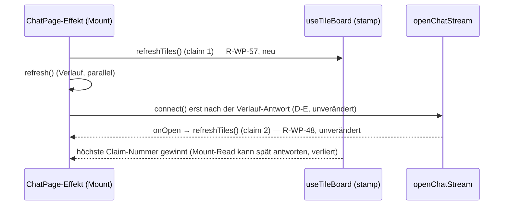

# Delta N2 — Kachel-Reihe liest ihren Roster, sobald der View steht (R-WP-57 / UC-WP-94)

**Status: GBAUT — UI grün (268/29), M8 gefahren, Lint 28 ohne `UC-WP-94`. Wartet auf Jons Review und die
Browser-Abnahme N2-A8 (§12). Ein Inkrement, ein Schritt, nur `factory-ui`.**
Regel und UC stehen in `docs/chat.md` **R-WP-57 / UC-WP-94** (Status ❌ — der Flip auf ✅ macht **nur Jon**
nach seinem Review). Stand des Plans: Branch `web-factory-4` = `8bac0386` (UI 268 Tests / 29 Dateien,
Backend 274, Backend bleibt unberührt). Vorgeschichte Inc 1–5 und Delta N1: `git log -- peon-plan/overview.md`.

## 0. Spielregeln (bindend, vom Dev als erstes zu prüfen)

- **Erster Schritt im Dev-Lauf:** `git log --oneline -5` + `git status --porcelain`. Dieser Plan schreibt ab
  dem Stand nach `8bac0386`; trägt die Spitze weitere Änderungen an `chat.page.tsx`, melden statt bauen (A14).
- Commitbar: `aifactory/factory-ui/**` und `aifactory/peon-plan/**`. **Niemals** `docs/**` (Jons Seite — auch
  `docs/memory.md` und `docs/open-points.md` nicht), nie `aifactory/pom.xml`, nie `main`, kein amend/rebase,
  kein Modell-/Tool-Name, kein `Assisted-by`-Trailer, **kein `git add -A`** (nur die Pfade aus §7).
- **Nur-UI-Änderung ⇒ nur UI-Tests.** Kein Maven-Lauf nötig (Backend unverändert).
- UI-Gate (exakt, aus `docs/memory.md`): `cd factory-ui`, PATH-Export für Node 22.12 (nvm `default`), dann
  `node -v` (≥ 22) und `pnpm -v` **vor** dem Gate belegen; `COREPACK_ENABLE_PROJECT_SPEC=0 pnpm test`,
  einzelne Fälle `pnpm test -t '<name>'` — **niemals** `pnpm test -- <datei>`; `npx tsc -b` 0,
  `npx oxlint` 0/0, `npx antd lint ./src` 0 findings.
- Rot-vor-grün und Mutation: Rückweg über `cp`-Backup + `diff` (leer), **nie** `git checkout -- <datei>`;
  niemals eine Datei aus dem Kontext neu schreiben, `git diff` nur für §7.
- Keine neuen UI-Wörter (kein `content.ts`-Eintrag), keine neuen Regel-/UC-IDs (R-WP-57/UC-WP-94 sind gesetzt),
  keine neue `.ant-*`-Assertion, keine Farb-/Layout-Behauptungen (R1: Look nimmt Jon im Browser ab).
- **Jons Sparvorgabe:** Tests **reduzieren/ersetzen**, nicht anhäufen. Dieses Inkrement baut **keinen neuen
  Test und löscht keinen** — die Zahl bleibt **268 Tests / 29 Dateien**.

## 1. Befund → Entscheidung

| # | Befund | Entscheidung |
| --- | --- | --- |
| **S2** | Der Roster-Read (`refreshTiles`) hängt allein am `onOpen` des SSE-Streams (`chat.page.tsx:378`, Kommentar `:377` und `:396` „the board is read on the stream's answer, not here (R-WP-48)"). Öffnet der Stream nicht, bleibt `ChatTiles` für immer leer (`chat.tiles.tsx:34` gibt bei `tiles.length === 0` `null`), während der Verlauf läuft (`refresh()` in `:397` ist unabhängig) | **N2** — beim Mount des Effekts (`chat.page.tsx:364-409`) geht der Roster-Read **parallel zum Verlaufs-Read** und **vor/ohne** `connect()`; `onOpen` bleibt unverändert (R-WP-48/UC-WP-84). Beweis: bestehender Test wird erweitert (§4), kein neuer Test |

**Warum genau eine Zeile im Effekt (und kein neuer Mechanismus).** Die drei Verantwortlichkeiten bleiben, wo
sie sind: die **Seite** entscheidet *wann* gelesen wird, **`chat.board.ts`** entscheidet *welcher Stand gewinnt*
(`stamp`, JavaDoc `:17-19` sagt das ausdrücklich: „the page keeps the decision of *when* to read"), der
**Stream** entscheidet *dass die Subscription steht* (`chat.stream.ts:45-49`). Es fehlt einzig ein zweiter
Auslöser auf Seiten-Ebene — alles andere (Board ändern, Read-Cache, Event-Erfindung) wäre Verantwortungs-Blut.

**Warum der Mount-Read die UC-WP-84-Garantie nicht bricht.** UC-WP-84 GIVEN 1 verlangt nicht „kein Read vor
dem Verbinden", sondern „nach dem Verbinden wird **frisch** gelesen". Der Mount-Read beansprucht `stamp = 1`,
der `onOpen`-Read `stamp = 2` — der neuere gewinnt, egal in welcher Reihenfolge die Antworten eintreffen;
ein `agents`-Schnappschuss nimmt die nächste Zahl und gewinnt gegen beide. Sichtbare Folge ist ein **nur
kurz sichtbarer** Arbeits-Zeiger aus dem Vor-Verbindungs-Schnappschuss, wenn in genau diesem Fenster ein Turn
endet; der frische Read stellt `bereit` wieder her (R-WP-57: der frische Read „ist **kein** Ersatz für die
erste Lesung" — und umgekehrt). Genau dieser Übergang WORKING → IDLE wird im erweiterten Test festgeschrieben.

**Verworfen:** (a) Read in `refresh().then()` nach dem History-Read — hängt dann an einem weiteren Round Trip
und nützt nicht, wenn die Verlauf-Antwort ausbleibt; (b) `onOpen` durch einen Timeout ersetzen — erfände eine
Zeit; (c) Board umbauen (z. B. `refreshTiles` selbst nach „einmal pro Projekt") — würde die Seite ihres
einzigen Entscheiders entheben und `stamp`-Semantik anfassen; (d) neuer Seitentest neben dem bestehenden —
Duplikat = LOW (AGENTS.md) und gegen Jons Sparvorgabe.

## 2. Commit-Biologie (Messung, read-only — ohne Code-Folgen)

**Fundstelle im Report, sonst nichts.** Befehl (Der Dev fährt sie und schreibt das Ergebnis in §12):

```
git log --oneline -- factory-ui/src/chat/chat.page.tsx
git log -p -S 'onOpen' -- factory-ui/src/chat/chat.page.tsx
git log -p -S 'refreshTiles' -- factory-ui/src/chat/chat.page.tsx
git show <hash> --stat            # für den identifizierten Commit
```

**Hypothese des Plans (aus dem Code, nicht aus dem Log):** entfernt wurde der Mount-Read im **UC-WP-84-Inkrement**
(R-WP-48-Lesefolge, `e72c6c76` bzw. dessen N1 `76d3e653`) — beide Kommentare (`chat.page.tsx:377`, `:396`)
begründen die Verschiebung mit R-WP-48, und keine frühere Regel brauchte diese Begründung.
`742293c3` ist nach `docs/memory.md:17` der R6-Skill-Loop und damit **unwahrscheinlich**; C-7 (Blick live)
trägt eine andere Hash.

**Zwei Belege, dass der Mount-Read der ursprüngliche Entwurf war und die Doku ihn bis heute beschreibt**
(deshalb dort **nichts** ändern — nach dem Fix stimmen die Sätze wieder):

- `chat.agents.client.ts:31` — „The roster of this project's team — **re-read on mount** and after every action".
- `chat.tiles.tsx:9` — „from the **read on mount** or from an `agents` event, never merged".

## 3. Der Fix (alleinige Code-Änderung)

`factory-ui/src/chat/chat.page.tsx`, im Effekt `:364-409`, direkt **vor** `void refresh()...` (`:397`):

```tsx
// the roster is read as soon as the view stands: a stream that never opens may not leave the row empty
// (R-WP-57, UC-WP-94). It races the history read on purpose and never waits for `connect` — the fresh read
// on the answer below stays what retires it after a turn ended (R-WP-48, UC-WP-84)
void refreshTiles()
```

Dazu **nur** Kommentar-/JavaDoc-Pflege (keine weitere Logik):

- `:395-396` (der D-E-Kommentar): der Halbsatz „the board is read on the stream's answer, not here (R-WP-48)"
  **raus** — die Aussage trifft nicht mehr zu. Der D-E-Grund (Stream erst nach dem History-Read) bleibt stehen.
- `:377` (`onOpen`): „the board is read on the answer, **never before the subscription stands**" umschreiben auf:
  der frische Read **nach** der Subscription ist der, der einen Turn-End-Stand über den Mount-Read stellt
  (R-WP-48, UC-WP-84; der Mount-Read oben ist die erste Lesung, kein Ersatz).
- Klassen-JavaDoc `:82-85`: „read once the stream stands" → „read once the view stands, and again on every
  (re)connect". Weiterhin ein Satz zur Lesefolge (`useTileBoard`), keine Regel-Wiederholung.
- **Nicht** geändert: `chat.board.ts` (nur verifizieren, §5), `chat.stream.ts`, `chat.agents.client.ts`,
  `chat.tiles.tsx`, `content.ts`, alle Seiten/Aufrufer.

**Größen Grenze:** `chat.page.tsx` steht bei **589 Zeilen** (AGENTS.md:8-10 ⇒ 600er-Schwelle). Netto-Ausbau
des Inkrements ≤ 10 Zeilen: umformulieren statt anhängen.



## 4. Tests — ersetzen statt anhäufen (netto 0 neue Tests)

**Bühne:** `test/chat/chat.page.stub.ts` hat alles schon (`deferNextStreamOpen()` `:196`,
`deferNextAgentsRead()` `:220`, `countOf()` `:188`, `tile()` `:58`, `flush()` `:77`). **Kein Stub-Umbau.**

### 4.1 `test/chat/chat.read.page.test.tsx`

**(a) `aTurnEndingBeforeTheStreamStandsLeavesNoWaitingTile` (`:86-108`) — der Wirt für UC-WP-94 GIVEN 1.**
Er hält den Stream schon offen zu, ist also die Bühne, in der die Reihe heute **leer** steht. Die
Alte-Polaritäts-Assertions werden **ersetzt**, nicht daneben gestellt:

- `:97` `expect(chat.countOf('/agents','GET'), 'no roster read while the connection does not stand').toBe(0)`
  → ersetzt durch den Beweis selbst:

  ```tsx
  // UC-WP-94 GIVEN 1: the answer of the stream is still out — and the row already stands. The roster read is
  // not waiting for a subscription, so a stream that never opens cannot empty the head of the view
  expect(chat.countOf('/agents', 'GET'), 'the row read its roster while the stream has not answered').toBe(1)
  expect(screen.getByTestId('tile-state-Jon')).toHaveTextContent(content.tiles.state.WORKING)
  ```

  (`:96` `countOf('/events','GET') === 1` bleibt: der Stream ist gefragt, steht aber nicht.)
- `:107` `… 'exactly the one roster read the standing connection allows').toBe(1)` → `toBe(2)` mit Grund:
  erste Lesung des Views **plus** der frische Read der stehenden Verbindung (UC-WP-84). Der Rest des Tests
  (`open.resolve()` → `IDLE`) bleibt unverändert und ist damit der UC-WP-84-Teil desselben Beweises.
- ID-Kommentare am Test: bestehende `// UC-WP-84` behalten, `// UC-WP-94` ergänzen (Muster im Repo:
  mehrere ID-Zeilen über einem Test, z. B. `chat.read.page.test.tsx:488-489`). Name bleibt — er beschreibt
  weiterhin das Ergebnis; der zusätzliche Beweis steht im Kommentar.

**(b) `aStaleRosterAnswerNeverOverwritesTheEndSnapshot` (`:131-152`) — Zahlen nachziehen.**
`deferNextAgentsRead()` hält jetzt den **Mount**-Read; der `onOpen`-Read antwortet regulär (WORKING), dann
überholt der `agents`-Schnappschuss den gehaltenen Mount-Read — die Regel (UC-WP-84 GIVEN 3) gilt weiterhin,
der Fall ist jetzt **realistischer**. `:140` `toBe(1)` → `toBe(2)`, `:151` `toBe(1)` → `toBe(2)`; Kommentar
`:132-133` um den Zusatz, dass der gehaltene Read die erste Lesung des Views ist. Assertions `:143`, `:147-150`
unverändert (IDLE vor und nach dem späten Antworten).

**(c) `theReconnectReadsTheRosterFresh` (`:111-128`) — unverändert.** Zählt relativ (`rosterReads` nach dem
Mount, dann `+1`); mit dem Mount-Read ist `rosterReads` 2 statt 1, die Aussage bleibt. Nur laufen lassen.

### 4.2 `test/chat/chat.page.test.tsx`

**(d) `clearOnATileNamesThatTileAndARefusalIsALine` — `:369` `toBe(1)` → `toBe(2)`** mit Grund im Kommentar:
die zwei Reads, die der View immer macht (erste Lesung + stehende Verbindung); die abgelehnte Aktion hat
**keinen** hinzugefügt. Das ist die eigentliche Aussage des Tests, sie bleibt scharf.

**(e) `tileStateFollowsTheStream` (`:332-350`) — Jons Kandidat: passt unverändert.** Geprüft (Lesen, nicht
Raten): er zählt relativ (`rosterReads` nach Mount+Flush, danach `toBe(rosterReads)`) und setzt keine Folge
voraus. Der Dev bestätigt das durch den Lauf (§6 Schritt 3).

**(f) `stopOnAFinishedTurnIsSilent` (`:411-427`) — unverändert** (relativ: `rosterReads + 1` nach dem Stop).

**Nicht gebaut (bewusste Lücke, gemeldet):** UC-WP-94 **GIVEN 3** (Roster-Read scheitert → Reihe bleibt leer,
Fehler als Seiten-Fehler). Der Stub kann ein `GET …/agents` nicht ablehnen (`chat.page.stub.ts` kennt nur
`refuseActions` für `POST`, `deferNextAgentsRead` hält zurück) — ein `refuseRosterRead`-Helfer wäre ein
neuer Test samt Stub-Bau, und den will Jon hier nicht. Das Verhalten ist unverändert vorhanden und
ungedeckt wie vorher: `chat.board.ts:37` → `onFailure` → `chat.page.tsx:179` → `chat-error` (`:563-567`).
Siehe D28.

**Nicht betroffen (verifiziert, nicht angefasst):** `chat.insight.test.tsx` filtert auf `/agents/`
(`:169`, `:366`) — der Roster-Pfad `/agents` fällt nicht hinein; `chat.read.page.test.tsx`
(`oneChatPerProject`, `:246-321`) behauptet keinen Roster-Zähler, `test/app/app.shell.test.tsx:87` liest die
Reihe tolerant über `findByTestId`;
`test/project/project.files.test.tsx` und `test/shared/app.harness.tsx` beantworten `/agents` nur. Kein Test
behauptet eine leere Kachel-Reihe (grep auf `chat-tiles`: nur `chat.read.page.test.tsx:271`).

## 5. Verifikation von `chat.board.ts` (nichts ändern)

Mount-Read (`stamp` 1) + `onOpen`-Read (`stamp` 2) + optionaler `agents`-Schnappschuss (nächste Zahl) laufen
über genau den einen Zähler, den UC-WP-84 GIVEN 3 bereits prüft. Nachzuweisen ist das **nicht neu**, sondern
durch die angepassten Zahlen in §4.1(b): der späte Mount-Read verliert gegen den Schnappschuss. Wird (b) nach
dem Fix rot mit einem **WORKING** am Ende, ist die Lesefolge gebrochen → **melden**, nicht das Board ändern.

## 6. Reihenfolge (rot-vor-grün, jeder Schritt für sich grün)

1. **Biologie (§2)** fahren, Fundstelle notieren.
2. **Rot:** §4-Teständerungen (a)–(d) schreiben. `pnpm test -t 'aTurnEndingBeforeTheStreamStandsLeavesNoWaitingTile'`
   → rot (erwartet: `tile-state-Jon` nicht gefunden, `countOf` 0 ≠ 1). Wortlaut protokollieren. Dann die beiden
   anderen betroffenen Fälle einzeln (`-t 'aStaleRosterAnswerNeverOverwritesTheEndSnapshot'`,
   `-t 'clearOnATileNamesThatTileAndARefusalIsALine'`) → ebenfalls rot (1 ≠ 2). **Erwartete rote Menge vor dem
   Fix: genau diese drei.**
3. **Grün:** §3 umsetzen. Dieselben drei Fälle grün, dann `COREPACK_ENABLE_PROJECT_SPEC=0 pnpm test`
   → **268 Tests / 29 Dateien** (Zahl **unverändert** — kein Test hinzu, keiner weg), `npx tsc -b` 0,
   `npx oxlint` 0/0, `npx antd lint ./src` 0. Wird ein anderer Test rot, der hier nicht genannt ist: **melden**
   (vermutlich eine weitere Alte-Polaritäts-Assertion), nicht still umschreiben.
4. **M8 (Mutation, Pflicht):** `cp`-Backup der Datei, die Zeile `void refreshTiles()` im Effekt **wegnehmen**,
   dieselben drei Fälle laufen lassen → **erneut rot** (derselbe Grund wie in Schritt 2; beweist, dass die
   Assertions an der neuen Zeile hängen). Zurück per `cp`, `diff` gegen das Backup **leer**, Gates aus Schritt 3
   erneut. Protokoll in §12.
5. **Lint:** `lintDocsAndTests` mit `docRoots: ["docs"]`,
   `testRoots: ["factory-ui/test","factory-ui/src","factory-backend/src/test"]`, **ohne** `idPattern`.
   Erwartung: **28 findings** (vorher 29) und **`UNBELEGT UC-WP-94` ist weg** — das ist der Beleg, dass die
   ID jetzt an einem benannten Test hängt. Weiterhin unbelegt: `UC-WP-91` (Nachweis M1/M2, Bestand) und die
   `UC-CR-*`/`UC-PC-*`-Reihen (Bestand, nicht unsere Seite).
6. **Commit + Push** (Branch `web-factory-4`): ein Commit für `factory-ui` (Test + Seite), dieses
   `peon-plan/overview.md` mit §12 im selben oder einem zweiten Commit. `git add` nur §7-Pfade.
7. **Jon:** Browser-Abnahme (N2-A8) und erst danach der Doc-Flip ❌ → ✅.

## 7. Betroffene Dateien

- ändern: `factory-ui/src/chat/chat.page.tsx` (eine Aussage im Effekt `:364-409` + Kommentare `:377`,
  `:395-396`, JavaDoc `:82-85`),
  `factory-ui/test/chat/chat.read.page.test.tsx` (`:86-108`, `:131-152`),
  `factory-ui/test/chat/chat.page.test.tsx` (`:369`),
  `peon-plan/overview.md` (§12 Messergebnisse)
- **nicht** geändert: `chat.board.ts`, `chat.stream.ts`, `chat.agents.client.ts`, `chat.tiles.tsx`,
  `chat.client.ts`, `chat.composer/edge/insight/log/pending/scroll/status/timeline/trace/waiting`,
  `content.ts`, `chat.page.stub.ts`, `app.harness.tsx`, `docs/**` (inkl. `memory.md`, `open-points.md`),
  `AGENTS*.md`, `.agents/**`, `factory-backend/**`, `aifactory/pom.xml`, alle übrigen Tests.

## 8. Regeln & Grenzen (Ownership)

- **Seite** = wann gelesen wird (Mount, `onOpen`, `done`, nach Stop/Aktion). **Board** = welcher Stand gewinnt.
  **Stream** = ab wann die Subscription steht. Keine neue Abstraktion, kein Cache, kein Event, kein zweiter
  Speicher, kein Read im Backend.
- Der Verlauf bleibt die einzige Wahrheit für fertigen Text; die Kacheln werden ersetzt, nie gemerged (R-WP-7).
- Fehler eines Roster-Reads bleiben Seiten-Fehler über `showBoardFailure` (`chat.page.tsx:179`) — keine neue
  Fehlerbehandlung, kein `content.ts`-Wort.
- Kompatibilität: kein Draht-Wechsel, kein DTO-Wechsel. `GET …/agents` antwortet unverändert; R-WP-57 sagt,
  eine leere Liste heiße im UI „Read nie angekommen" — genau deshalb darf die Reihe nicht am Stream hängen.

## 9. Abnahmekriterien (jede Zeile ein benannter, laufbarer Test)

| # | GIVEN | WHEN | THEN | Nachweis |
| --- | --- | --- | --- | --- |
| **N2-A1** (UC-WP-94 GIVEN 1) | Chat-View geöffnet, Stream-Antwort bleibt aus (`deferNextStreamOpen`), `/agents` antwortet | View zeichnen | die Reihe **steht** (ein `tile-state-Jon`, Wort = `content.tiles.state.WORKING`), genau **ein** Roster-Read, der Stream ist gefragt, steht aber nicht | `chat.read.page.test.tsx.aTurnEndingBeforeTheStreamStandsLeavesNoWaitingTile` (erweitert, UC-WP-94) — **rot vor dem Fix** |
| **N2-A2** (UC-WP-94 GIVEN 2 / UC-WP-84 GIVEN 1) | dasselbe Bild, dann Stream-Antwort | `open.resolve()` | **zweiter** Roster-Read, Reihe wechselt auf `IDLE` (kein Warte-Zustand aus dem Vor-Verbindungs-Schnappschuss) | derselbe Test, zweiter Block (`toBe(2)`) |
| **N2-A3** (UC-WP-84 GIVEN 2) | Stream fällt, Turn endet in der Lücke | Reconnect | Roster-Read nochmal (`rosterReads + 1`), Reihe `IDLE` | bestehend `chat.read.page.test.tsx.theReconnectReadsTheRosterFresh` (unverändert grün) |
| **N2-A4** (UC-WP-84 GIVEN 3) | Roster-Read (erste Lesung) auf dem Draht, `agents`-Schnappschuss überholt ihn | späte Antwort | Schnappschuss bleibt stehen (`IDLE`), genau **zwei** Reads, kein Jagd-Read | bestehend `aStaleRosterAnswerNeverOverwritesTheEndSnapshot` (Zahlen angepasst) |
| **N2-A5** | abgelehnte Tile-Aktion (409) | Klick auf Clear | kein zusätzlicher Roster-Read über die zwei des Views hinaus, Verlauf-Read 1 | bestehend `chat.page.test.tsx.clearOnATileNamesThatTileAndARefusalIsALine` (`:369` → 2) |
| **N2-A6** | Verlaufs-Read gehalten | View mounten | kein `/events` vor der Verlaufs-Antwort (D-E unverändert); die Roster-Lesung wartet nicht darauf | bestehend `chat.read.page.test.tsx.theStreamOpensAfterTheFirstHistoryRead` (unverändert grün) |
| **N2-A7** | Suite + Statische | Gates | **268** Tests / 29 Dateien grün (Zahl unverändert), `tsc -b` 0, `oxlint` 0/0, `antd lint ./src` 0, `lintDocsAndTests` 28 findings ohne `UC-WP-94` | §6 Schritt 3 + 5 |
| **N2-A8** | Pauls Fall im Browser (Stream öffnet nicht / Server startet neu) | Chat öffnen | Kachel-Reihe sichtbar, Chat benutzbar; kein Flackern der Reihe beim ersten `agents`-Schnappschuss | **Jon (R1)** — kein Test; Doc-Flip ❌→✅ allein bei Jon |
| **N2-A9** (UC-WP-94 GIVEN 3) | Roster-Read schlägt fehl | Reihe zeichnen | Reihe leer, Fehler als Seiten-Fehler | **nicht gebaut** — nicht erfunden nach Jons Vorgabe; Verhalten vorhanden, weiterhin ungedeckt (§4.1f, D28) |

**Mutation (Pflicht):** **M8**, nach dem grünen Stand — `void refreshTiles()` im Effekt entfernen.
Erwartung: **drei** Tests rot (`aTurnEndingBeforeTheStreamStandsLeavesNoWaitingTile`,
`aStaleRosterAnswerNeverOverwritesTheEndSnapshot`, `clearOnATileNamesThatTileAndARefusalIsALine`) —
dieselben wie in Schritt 2. Rückweg `cp` + `diff` leer, Gates neu. Zusätzlich ist Schritt 2 selbst der
Rot-vor-grün-Nachweis (alte Regel erfüllt UC-WP-94 GIVEN 1 nicht).

## 10. Annahmen

- **A14** — Head nach `8bac0386` trägt keine weiteren Änderungen an `chat.page.tsx`/den zwei Testdateien;
  der Dev prüft es mit `git log`/`git status` (§0).
- **A15** — die drei `countOf('/agents','GET')`-Stellen (read.page `:97/:107/:140/:151`, page `:369`) sind die
  einzigen absoluten Roster-Zähler im Bestand (grep-belegt); alle übrigen zählen relativ oder filtern `/agents/`.
- **A16** — `deferNextStreamOpen()` genügt als Bühne: ein ausbleibender Stream ist exakt „kein `onOpen`"
  (`chat.stream.ts:45-49` ruft `onOpen` erst nach der Antwort). Ein Ablehnen des Streams wäre dieselbe Beweislage.
- **A17** — Tests laufen ohne `StrictMode`; `main.tsx:12` verdoppelt Effekt und damit die Reads **nur im Dev-
  Build** — gilt heute schon für `refresh()` und den Stream, ändert nichts an der Art (R13).

## 11. Risiken, benannte Abweichungen, Nicht gebaut

- **R11 (neue Sichtbarkeit eines Vor-Verbindungs-Stands)** — zwischen Mount-Read und `onOpen`-Read kann eine
  Kachel kurz „Working" zeigen, deren Turn in diesem Fenster endete. Bewusst so (R-WP-57); der frische Read
  gewinnt über `stamp`, der Übergang ist in N2-A1/A2 festgeschrieben. Für Jon: R-WP-48 formuliert „nie aus
  einem Schnappschuss **vor** dem Verbinden" — die Schärfung dieser Formulierung ist **Jons Seite**, nicht unsere.
- **R12 (ein Read mehr je Öffnung)** — pro Projekt-Öffnung zwei Roster-Reads (Mount + `onOpen`), plus je
  `done`/Stop/Aktion wie bisher. Bewusst; GET ohne Server-Neuerung, durch die gezählten Tests belegt (2).
- **R13 (StrictMode)** — im Dev-Build zwei Mount-Reads durch doppelten Effekt; Tests nicht betroffen (A17).
- **R1** bleibt: jsdom misst kein Layout — N2-A8 ist Jons Browser-Abnahme.
- **D27** — der Beweis zu UC-WP-94 GIVEN 1 lebt **im bestehenden** UC-WP-84-Test statt in einem neuen; die
  Alte-Polaritäts-Assertion (`toBe(0)` mit Grund „no roster read while the connection does not stand") ist
  **ersetzt**, nicht ergänzt — sonst bewiese der Bestand weiterhin den Defekt. Testzahl bleibt 268.
- **D28** — UC-WP-94 GIVEN 3 wird nicht getestet (Stub kann `GET …/agents` nicht ablehnen; Jons Vorgabe:
  nichts erfinden). Wer die Abdeckung will, braucht einen `refuseRosterRead`-Helfer im Stub — Folge-Inkrement,
  hier ausdrücklich nicht gebaut. UC-WP-94 bleibt deshalb ❌, bis Jon Review **und** Browser-Abnahme durch sind.
- **Nicht gebaut:** alles an `chat.board.ts`/`chat.stream.ts` (nur verifiziert, §5), `docs/**`,
  `docs/memory.md`-Stand, `open-points.md`-Marker, Skill-/AGENTS-Dateien, Backend, Round-7-Look-Story, C-2a,
  C-1 TurnClaim-Timeout, F9/F10, M2b.

## 12. Ergebnis (Dev, gebaut 2026-11-10)

- **A14-Prüfung (Abweichung, gemeldet):** HEAD ist `37a385c6 Web factory 4 (#176)` auf **`main`** — `web-factory-4`
  ist gemerged (PR #176) und nicht mehr Spitze. Der Baum von `main` ist **identisch** zu `web-factory-4`
  (`git diff HEAD web-factory-4` leer) und `chat.page.tsx` sowie beide Testdateien sind identisch zum Plan-Stand
  `8bac0386` (`git diff 8bac0386 HEAD -- <die drei Dateien>` leer). Kein Fremdeingriff in die Inkrement-Dateien —
  nur die Branch-Annahme des Plans ist überholt. Arbeitsbaum vor dem Bauen: nur `docs/**` und dieses Planfile
  geändert (Jons Hand, unangetastet geblieben).
- **Rot vor dem Fix** (§6 Schritt 2, genau diese drei, alle übrigen 265 unverändert):
  - `aTurnEndingBeforeTheStreamStandsLeavesNoWaitingTile` —
    `AssertionError: the row read its roster while the stream has not answered: expected +0 to be 1`
    (`test/chat/chat.read.page.test.tsx:100`)
  - `aStaleRosterAnswerNeverOverwritesTheEndSnapshot` —
    `AssertionError: the held first reading of the view plus the fresh read of the standing connection: expected 1 to be 2`
  - `clearOnATileNamesThatTileAndARefusalIsALine` — `AssertionError: expected 1 to be 2` (`chat.page.test.tsx:370`)
- **M8 (Mutation, Pflicht):** `cp`-Backup von `chat.page.tsx`, die Zeile `void refreshTiles()` im Effekt
  entfernt → **dieselben drei** rot, **derselbe Wortlaut** wie oben (beweisend, dass die Assertions an der
  neuen Zeile hängen). Zurück per `cp`, `diff` gegen das Backup **leer**, Backup gelöscht, Gates erneut gefahren.
- **Zahlen (grün, nach M8-Rückweg):** `pnpm test` → **268 Tests / 29 Dateien** bestanden (Zahl unverändert),
  `npx tsc -b` Exit 0, `npx oxlint` **0 Warnungen / 0 Fehler** (98 Dateien), `npx antd lint ./src`
  **0 findings** (55 Dateien). `lintDocsAndTests` → **28 findings**, **`UNBELEGT UC-WP-94` ist weg**
  (Rest: `UC-CR-1..14`, `UC-PC-1..14`). Nebenbefund: `UC-WP-91` steht ebenfalls nicht mehr auf der Liste —
  es war schon vor diesem Inkrement belegt, §6 Schritt 5 war an der Stelle überholt (Zahl 29 → 28 stimmt trotzdem).
- **Commit-Biologie (Hypothese §2 bestätigt):** `e72c6c76` —
  *„R-WP-48: the roster is read once the stream stands, not beside the mount (UC-WP-84)"* (Paul Sterl,
  2026-11-09). Hunk in `factory-ui/src/chat/chat.page.tsx`: `-    void refreshTiles()` am Ende des
  Mount-Effekts, `+ onOpen: () => void refreshTiles()` im Stream, JavaDoc umgestellt auf
  „only while a stream stands … (R-WP-48)". `--stat`: 6 Dateien (chat.md, chat.client.ts, chat.page.tsx,
  chat.stream.ts, chat.page.stub.ts, chat.read.page.test.tsx). Folgeberichtigung `76d3e653` (N1) ergänzte den
  Stale-Read-Fall. `742293c3` ist unbeteiligt — die Fundstelle ist eindeutig `e72c6c76`.
- **N2-A9 / UC-WP-94 GIVEN 3:** weiterhin ungedeckt (D28, nicht erfunden).
- **Browser-Abnahme Jon (N2-A8):** offen — Doc-Flip ❌ → ✅ bleibt bei Jon.
