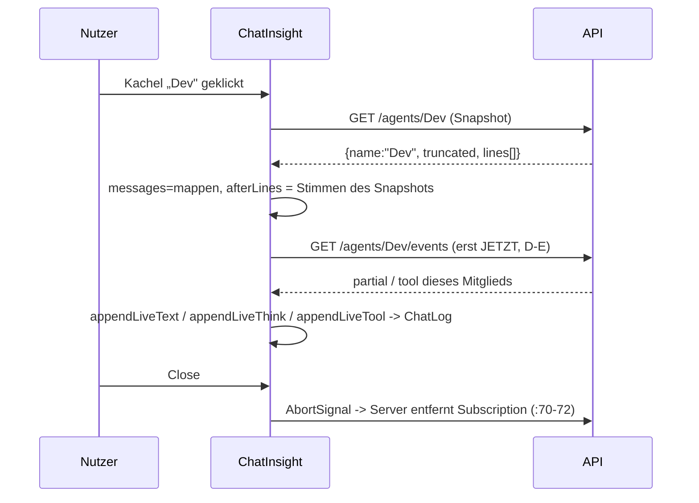

# C-7 — Der Blick lebt im selben Chat-Widget (live)

SOLL: `aifactory/docs/chat.md` R-WP-26 (`:252-264`, ✅), UC-WP-49 (`:266-273`, ✅), **R-WP-53 (`:275-284`, ❌), UC-WP-89 (`:286-292`, ❌), UC-WP-90 (`:294-300`, ❌)**.
Status laut `docs/open-points.md`: C-7 „spezifiziert und in Arbeit". **Kein Core-Eingriff** (`llmpeon-core` wird nicht angefasst).

**Stand 2026-11-09: alle drei Inkremente gebaut** — Ink 1 `e99774e5`, Ink 2 `16784501`, Ink 3 im selben Commit-Zyklus dieses Plans. Die ❌/✅ der Doks dreht der Dok-Besitzer.

---

## 0. Rahmen und Spielregeln (gelten für alle Inkremente)

- **Branch:** `web-factory-4` (Git-Root ist `/Users/sterlp/dev/workset/peon-ai` = Eclipse-Projekt `llmpeon-parent`; `aifactory` liegt darin unter `aifactory/`). Nie auf `main`.
- **Commit-Pfade (abschließend):** `aifactory/factory-backend/**`, `aifactory/factory-ui/**`, `aifactory/AGENTS-DEV.md`, `aifactory/peon-plan/**`.
  **Nie** `aifactory/docs/**` (Jons Docs committet er selbst), nie `llmpeon-*`, nie `aifactory/peon-plan/review-findings.md` (nicht-editieren).
  In Inkrement 1 zusätzlich `git add aifactory/peon-plan/f8-survey.md` (liegt unversioniert herum, soll mit).
- **Kein** `amend`/`rebase` an Commits mit Jons Arbeit, **keine** AI-/Modellnamen in Message oder Trailern. Push ist erlaubt.
- **AntD-CLI-Gate (Jon, 2026-11-09, AntD-CLI 1.6.1)** — Pflicht in jedem UI-Inkrement, Skill `/Users/sterlp/.peon/skills/antd/SKILL.md` vorher lesen:
  - vor jedem AntD-Code: `antd info <component>`, `antd doc <component> --keyword <…> --lines <n>`; bei Regelfragen `antd rule <id>`; bei Suche im Code `antd search <pattern>`, `antd usage <component> --project <pfad>`; Versionsfragen `antd doctor`.
  - **letzter Schritt jedes UI-Inkrementes: `antd lint ./factory-ui/src` → 0 Befunde.**
  - Begründung: Web-Recherche ist für AntD tabu. (Der Plan-Modus hat keine Shell; das Gate ist Dev-DoD.)
- **UI-Qualität:** `npx tsc -b` und `npx oxlint` mit 0 Fehlern / 0 Warnungen. UI-Worte ausschließlich in `factory-ui/src/shared/content.ts` (Englisch), Code und Kommentare Englisch, Doks Deutsch.
- **Zeilenbudget:** > 600 Zeilen muss gesplittet werden. `factory-ui/src/chat/chat.page.tsx` steht bei **591** Zeilen → dort nur **löschen/verschieben**, nie anbauen. Testdateien ≤ 1000 Zeilen.
- **Spring (harte Regel):** genau **ein** Kontext pro Build — alle Integrations-Tests erben `FactorySpringTest`, kein eigenes `@DynamicPropertySource`, kein `@DirtiesContext`, kein MockMvc-Nebenpfad. Wächter `SingleContextGuardTest`; Kontext-`missCount = 1`.
- **Tests ausführen:** UI `pnpm test -t '<testname>'` (niemals `pnpm test -- <datei>` — jsdom bricht dann mit `Could not parse CSS stylesheet`), Backend `mvn clean test` in `aifactory/factory-backend`.
- **Bestands-Tests:** grün halten oder **benannt** anpassen (§6). Still lockern ist verboten. Neue Tests nur für neue Funktionalität, Marker-Kommentar `// R-WP-53` bzw. `// UC-WP-89` / `// UC-WP-90`.

---

## 1. Kontext und Nutzerwert

Heute ist der Agenten-Blick ein eigenes, statisches Aufzählungs-Widget (`chat.insight.tsx`, 98 Zeilen): eigene Markup-Welt (`insight-line`/`insight-kind`), eigener CSS-Block, **keine** Live-Leitung — der Blick wächst nicht, während das Mitglied arbeitet. Paul hat entschieden (chat.md `:275-284`): Der Blick zeigt dasselbe Gespräch **im selben Widget** wie der Haupt-Chat — dieselbe Log-Pipeline (Markdown + Streaming R-WP-28, Werkzeug-Zeilen als Timeline R-WP-40) — und zwar **live**, gespeist aus RAM-Snapshot **plus** einem Stream genau dieses Agenten. Read-only bleibt: kein Composer, kein Senden, kein Stop. Jons Verlauf und die Kacheln dürfen dabei **nicht** neu geladen werden (UC-WP-90, `:299-300`).

**Warum das ein Backend braucht:** Mitglied-Zeilen verlassen den Server heute gar nicht — `SseTurnMonitor.onStreamingChunk:112-116` und `onChatResponse:132-134` verwerfen alles, was nicht Jon ist (UC-WP-40 hält Jons Chat frei). Ohne neuen Kanal gibt es nichts, was der Blick live zeichnen könnte.

---

## 2. Bestand (in dieser Sitzung an der Datei verifiziert)

**Backend** (`factory-backend/src/main/java/org/sterl/open/aifactory/chat/`)

| Fakt | Stelle |
|---|---|
| `subscribe(projectId)` / Test-Naht `subscribe(projectId, emitter)` | `ChatStreamRegistry.java:62-75` |
| `publish(projectId, event)` → alle Abonnenten des Projekts | `:82-89` |
| `listenerCount(projectId)`, `projectCount()` | `:91-98` |
| `closeProject` / `closeAll` / `remove` (Projekt-Lebenszyklus) | `:101-110`, `:119-125`, `:146-155` |
| `deliver` je Verbindung, `toSse`, `toolLineEvent` (`origin` nur wenn vorhanden) | `:127-144`, `:176-198`, `:202-207` |
| `Subscription` (eigene bounded Outbox, `offer`, `close`) | `:218-237` |
| Jon-Filter `isJon(origin)` (`origin == null ∥ AgentNames.isJon`) | `SseTurnMonitor.java:205-207` |
| Streaming: nur Jon → `Partial("think"/"answer")` | `:112-124` |
| `onChatResponse`: `Agents(roster)` **vor** dem Filter, dann nur Jon → `ToolLine` | `:126-139` |
| `onFileUpdate` → `Diff`/`ToolLine(.., null)` ohne Urheber | `:146-159` |
| Delegation → Jon-Kanal | `:182-187` |
| Gate der Blick-Lesung: `tileNamed` + `TRANSCRIPT`-Prüfung | `ProjectRuntime.java:249-255`, `:258-265` |
| `ProjectRuntimeRegistry.subscribe` / `.transcript` / `runtime()` / `onProjectRemoved` | `:60-63`, `:102-104`, `:138-150`, `:121-125` |
| SSE-Route mit `no-cache` + `X-Accel-Buffering: no` | `ChatController.java:99-105` |
| Blick-Lesung `GET /api/projects/{id}/agents/{name}` | `ChatController.java:136-140` |

**Routen-Wächter** `factory-backend/src/test/java/.../OneChatPerProjectTest.java`: `TILE_PATH:110`, `TILE_ROUTES:112-115`, Konversations-Set `:170-181`, Platzhalter-Regel `:189-203`, `annotatedWithSomethingElse` verbietet nur `@RequestParam/@RequestHeader/@CookieValue` (`:438-449`) — ein `HttpServletResponse`-Parameter ist erlaubt (Beleg: `ChatController.events:100`), Modell-Typ-Liste `:205-211`.

**Backend-Testbasis:** `ChatStreamRegistryTest` (reine Emitters, `RecordingEmitter:180`, `listenerCount`-Assertions `:66-67,:90,:126`), `SseTurnMonitorTest` (kein Spring, `registry`+`wire:56-64`, `endTheTurn()`-Marker, Urheber-Stempel über `new OwnerMonitor("Dev", monitor):91`, Diff-Test `everyProducerOfTheTurnShowsItsDiff:88-98`), `AgentInsightTest extends FactorySpringTest` (echte Delegation gegen `MockLlmServer`, `:64-75`). SSE über HTTP wird in Backend-Tests mit `java.net.http.HttpClient` gelesen (`TeamInternalsTest:8-10`, `ChatQueueTest`, `AgentStopTest`, `DelegatedAnswerTest` — alle importieren `java.net.http.*`). UC-WP-40-Wächter, der grün bleiben muss: `TeamInternalsTest`.

**UI** (`factory-ui/src/`)

| Fakt | Stelle |
|---|---|
| Blick-Komponente: Name + Props `projectId/name/onClose`, Head-Testids | `chat/chat.insight.tsx:7-13`, `:52-61`, `:89-93` |
| Eigenes Zeilen-Markup (entfällt): `insight-list/insight-line/insight-kind` | `:75-87` |
| Leerer Zustand mit eigenem Wort `insight.empty` | `:70-73` |
| `ChatLog`-Props (inkl. `openTurn`, `logRef`, `onScroll`) | `chat/chat.log.tsx:18-34` |
| `data-testid="chat-log"` fest gesetzt; leerer Zustand `content.chat.noMessages` | `:122-128`, `:174` |
| User-Autor-Fallback `content.chat.you` (outgoing + gelesen) | `:114`, `authorOf:304-310` |
| Anker-Regel „Voices, nie Schritte" | `:180-186`, `chat.live.ts:10-45` |
| Live-Append-Helfer `appendLiveText/appendLiveTool/appendLiveThink` | `chat.live.ts:77-120` |
| Follow-Bottom-Hook | `chat.scroll.ts:20-68`, Benutzung `chat.page.tsx:180-187` |
| `(re-)connect ⇒ erst lesen, dann streamen` (Regel **D-E**) | `chat.page.tsx:398-404`, Reconnect-Form `:367-412`, `RECONNECT_MS = 500:65` |
| Blick wird rechts gerendert | `chat.page.tsx:578` |
| `openChatStream(projectId, handlers, signal)`, Pfad-Bau, `toEvent` | `chat.stream.ts:11-16`, `:56-110` |
| Draht-Typen `ChatMessage` (`user/jon/error/tool`), `ChatStreamEvent` | `chat.client.ts:19-23`, `:45-57` |
| Snapshot-DTO `AgentTranscript{name,truncated,lines[{kind,text}]}`, `kind: user/agent/tool` | `chat.agents.client.ts:51-78` |
| CSS des alten Blicks | `styles.css:979-1050` (`-list:1019`, `-line:1027`, `-kind:1041`) |
| Wörter des alten Blicks | `shared/content.ts:121-131` (`kind:124-128`, `empty:129`) |
| Stream-Stubs erkennen `path.endsWith('/events')` | `test/chat/chat.insight.test.tsx:69`, `test/chat/chat.page.stub.ts:117`, `test/shared/app.harness.tsx:71`, `test/project/project.files.test.tsx:85` |

**Bestands-UI-Tests, die den Blick öffnen:** `test/chat/chat.insight.test.tsx` (`insightShowsTheMembersOwnConversation:127-154` pinnt `insight-line` + `data-kind` + `content.insight.kind.tool`; `insightHasNoWriteControl:157-176`; `tileIsNotClickableForSearch:179-194`; `closingTheInsightThenOpeningAnotherTileReadsAgain:197-218`; Helfer `transcriptReads:109-111`), `test/app/app.routes.test.tsx:224-263`. `chat.tiles.test.tsx:183` liest nur die Kachel-Front (öffnet nicht). Kein Test prüft `.chat-insight-list/-line/-kind` oder `insight-empty` (Grep über `test/`), aber **40+** Stellen nutzen `screen.getByTestId('chat-log')` (u. a. `chat.read.page.test.tsx:303,312`, `chat.page.test.tsx:566,677-684`, `chat.markdown.test.tsx:39,120-121`) → Testid-Kollision muss vermieden werden.

---

## 3. Entscheidungen

**E1 — Neuer Kanal im `ChatStreamRegistry`, nicht `origin` auf dem Jon-Draht.**
`Subscription` (`:218-237`) bekommt ein finales Feld `String channel` (`null` = Jon-Kanal). `publish(projectId, event)` liefert nur an `channel == null`; neu `publishAgent(projectId, agentName, event)` liefert nur an `channel.equals(agentName)`. Projekt-Lebenszyklus (`closeProject`, `closeAll`, `remove`, `deliver`, Outbox) bleibt **unverändert**, weil weiterhin nach Projekt gruppiert wird. Der Agenten-Kanal trägt **nur** `partial` und `tool`; `diff`, `agents`, `delegation`, `done`, `error` bleiben auf dem Jon-Kanal.
*Verworfen:* `origin` auf `Partial` setzen und im Browser filtern — ändert Jons Draht (bricht `toSse:176-198`-Vertrag und `SseTurnMonitorTest`-Payload-Assertions) und verlagert UC-WP-40 („Jons Chat zeigt keine Mitglieder-Interna") in den Client. *Verworfen:* zweiter Registry — verdoppelt Lifecycle, Outbox und Cleanup.
*Nebenbedingung:* Die Jon-Leitung ändert **kein Byte** — Mitglied-Zeilen werden heute bereits verworfen (`SseTurnMonitor:114,:132`), `publishAgent` ist reine Zusatz-Kommunikation. `TeamInternalsTest` (UC-WP-40) bleibt grün.

**E2 — Urheber der Auftrags-Zeile: gar keiner (Prop `userAuthor`).**
`ChatLog` fällt bei `user` auf `content.chat.you` zurück (`:114`, `:304-310`). „You" im Mitglieder-Blick wäre falsch: Die `user`-Zeile ist der Auftrag, den das Mitglied bekam — niemand hat ihn in diesem Widget getippt. `askedBy` im Snapshot-DTO ist **verworfen**: `JonToolSet.addDelegateTool` hängt `PoDelegateTool` in den **gemeinsamen** Tool-Service, den auch Plan/Review/Dev bekommen (`ProjectRuntime.java:113-127`), ein Mitglied kann also delegieren — „Jon" wäre eine Erfindung. Lösung: eine optionale Prop `userAuthor?: string | null` (Default `content.chat.you`), der Blick setzt `null` ⇒ keine Autoren-Zeile, nichts erfunden (R-WP-4).

**E3 — Reihenfolge: erst Snapshot-Read, dann Stream (Regel D-E).**
Kopierrahmens aus `chat.page.tsx:398-404`: „the stream opens only once the history has been read". Damit ist der Anker (`afterLines`) vor dem ersten Event bekannt und es gibt keine Duplikate. Kein Re-Anchoring, kein Puffer, **kein** erneuter Read während der Blick steht (UC-WP-90 `:299-300`). Reconnect = **Re-Read, dann Re-Subscribe** in der Form von `chat.page.tsx:367-412`.

**E4 — Der Blick zeichnet durch `ChatLog`; Komponentenname und Props bleiben.**
`ChatInsight({projectId, name, onClose})` (`:7-13`) behält Name, Props, Datei, Head und die Testids `insight-panel/insight-agent/insight-close/insight-error/insight-truncated`; der Körper wird `ChatLog`. `chat.page.tsx:578` bleibt damit unverändert. `insight-list/insight-line/insight-kind` + `insight-empty` entfallen.
*Verworfen:* neue zweite Log-Komponente („InsightLog") — genau die „eigene Markup-Welt", die R-WP-53 abschaffen will. *Verworfen:* Daten-Hook `chat.view.ts` als eigenes Modul — die Komponente bleibt mit ≈180 Zeilen klar unter 600; ein Modul ohne zweiten Verbraucher wäre eine Spekulation.

**E5 — `ChatLog` bekommt zwei optionale Props, keine Aufspaltung.**
`testId?: string` (Default `'chat-log'`, gesetzt bei `:125`) → der Blick nutzt `insight-log`; alle 40+ Bestandsassertionen bleiben gültig, `chat.read.page.test.tsx:312` (`getAllByTestId('chat-log')` = 1) bleibt wahr.
*Verworfen:* `within(panel)`-Scoping in Seiten-Tests — Churn in fremden Tests ohne Nutzen.
Snapshot-Mapping (nur Fakten aus dem DTO, `chat.agents.client.ts:51-57`): `tool → {role:'tool', text}` (Timeline-Eintrag, zählt nicht als Stimme), `agent → {role:'jon', text, origin: transcript.name}` (Namens-Chip = der aufgelöste Core-Name aus dem DTO), `user → {role:'user', text}` ohne Urheber.
`openTurn = null`: Der Agenten-Kanal führt kein Turn-Ende, also darf kein Indikator „Arbeit läuft" behaupten (Regel `chat.live.ts:122-130`: offen ist `turn === openTurn`).

**E6 — Auto-Follow im Blick, aber kein Scroll-Button.**
`useFollowBottom` (`chat.scroll.ts:20-68`) wird wie in `chat.page.tsx:180-187` benutzt: neue Zeilen ziehen nach, solange der Nutzer am Ende steht; wer hochliest, bleibt in Ruhe. Der `ScrollBottomButton` wird **nicht** gerendert — `insightHasNoWriteControl:172-174` verlangt sonst den Nachweis „Close ist der einzige Button", und R-WP-53 sagt: kein Bedienelement im Blick. (Nachweis der Adjazenz-Regel aus workspace-memory #15: der Blick-Test assertet zusätzlich, dass der Log das letzte Kind des `aside` ist, falls CSS per Geschwister-Kombinator greift.)

**E7 — Stream-Pfad durch optionale Agent-Komponente.**
`openChatStream(projectId, handlers, signal, agentName?)`: `agentName` → `/api/projects/{id}/agents/{name}/events`, sonst wie bisher `/events` (`chat.stream.ts:16`). `toEvent:56-110` bleibt unangetastet — gleiches Event-Vokabular, keine neuen Felder. `RECONNECT_MS` wandert von `chat.page.tsx:65` nach `chat.stream.ts` und wird geteilt (senkt `chat.page.tsx`).

**E8 — Gate geteilt, nicht doppelt.**
`ProjectRuntime.subscribeAgent(name)` zieht dieselbe Prüfung wie `transcript(name)` (`:249-255`): eigener Private-Helfer `AiAgent insightTileOf(String name)` (Körper aus `:250-253`, gleiche 400-Texte `no tile named …` / `… offers no insight`), den `transcript` **und** `subscribeAgent` benutzen. `ProjectRuntimeRegistry.subscribeAgent(projectId, name)` = `runtime(projectId).subscribeAgent(name)` ⇒ 404 für unbekanntes Projekt wie bei `transcript` (`:102-104`, `:138-150`). Emitters werden erst **nach** dem Gate erzeugt.

---

## 4. Architektur

```mermaid
componentDiagram
  direction LR
  block:backend
    CORE[llmpeon-core AiMonitor] --> STM[SseTurnMonitor]
    STM -->|"publish(projectId, e)  channel null"| REG[ChatStreamRegistry]
    STM -->|"publishAgent(projectId, agent, e)"| REG
    RT[ProjectRuntime  Gate: tileNamed + TRANSCRIPT] --> REG
    REG --> RC[ProjectRuntimeRegistry]
    RC --> CC[ChatController]
  end
  CC -->|GET /events| JL[Jon-Chat chat.page.tsx]
  CC -->|GET /agents/{name}/events| IN[Blick chat.insight.tsx]
  CC -->|GET /agents/{name} Snapshot| IN
  IN --> LOG[ChatLog chat.log.tsx]
  JL --> LOG
```

Abhängigkeitsrichtung bleibt: Controller → Registry → Runtime → Kanal-Registry; der Kanal kennt weder Kacheln noch HTTP, der Runtime-Betreiber kennt nur Namen. `ChatLog` ist die gemeinsame Zeichenschicht (DOM) und kennt keinen Transport.

**Neue Route (eine einzige):**

```java
@GetMapping(value = "/api/projects/{id}/agents/{name}/events", produces = MediaType.TEXT_EVENT_STREAM_VALUE)
public SseEmitter agentEvents(@PathVariable("id") String projectId,
        @PathVariable("name") String name, HttpServletResponse response) { ... }   // Header wie events():99-105
```

```java
// ChatStreamRegistry — neue, schmale API
public SseEmitter subscribeAgent(String projectId, String agentName)                  // -> subscribeAgent(..., new SseEmitter(0L))
SseEmitter subscribeAgent(String projectId, String agentName, SseEmitter emitter)     // Test-Naht, analog :67
public void publishAgent(String projectId, String agentName, ChatEvent event)
int listenerCount(String projectId, String channel)                                    // channel == null => Jon-Kanal
// listenerCount(String projectId) bleibt: alle Abonnenten des Projekts (Dok-Zeile ergänzt)
```

**Draht — unveränderte Payloads (`toSse:176-207`, keine neuen Felder):**

| Event | Jon-Kanal (`channel == null`) | Agenten-Kanal (`channel == Name`) |
|---|---|---|
| `partial {kind,text}` | nur Jon (unverändert) | Think/Answer **dieses** Mitglieds (neu) |
| `tool {text,origin?}` | Jon + namenlose (unverändert) | TOOL/PROBLEM dieses Mitglieds, `origin` = er (neu) |
| `diff {file,diff}` | unverändert (R-WP-36) | **nie** (`AiFileUpdate` nennt keinen Urheber, `:146-159`) |
| `agents {tiles}` | unverändert | **nie** ⇒ UC-WP-90 G3 „Kacheln werden nicht neu geladen" |
| `delegation`, `done`, `error` | unverändert | **nie** |

**Sequenz des Blick-Öffnens (E3):**



---

## 5. Inkremente

### Inkrement 1 — Backend: Agenten-Kanal, Route, Gate (UC-WP-90, R-WP-53)

**✅ FERTIG (2026-11-09):** Kanal (`Subscription.channel`, `subscribeAgent`, `publishAgent`, `listenerCount(projectId, channel)`), geteiltes Gate `insightTileOf`, Route `GET …/agents/{name}/events`. `mvn clean test` 264/0 (vorher 257), `missCount = 1`, Jon-Draht unverändert (`TeamInternalsTest`, `SseTurnMonitorTest`, `ChatTurnTest` ohne Inhaltsänderung grün). Rot vorher dokumentiert (`subscribeAgent`/`publishAgent` fehlten). Abweichungen A6/A7 in §6. Neue Test-Utility `LiveStreamProbe` (SSE über `java.net.http`, Deadline-Warten) statt SSE-Kopie in `AgentInsightTest` — hält die Klasse klein und `TeamInternalsTest` unangetastet.

**Scope:** Nur Server. Kein UI, keine Doks.

**Dateien (ändern):**
- `factory-backend/.../chat/ChatStreamRegistry.java` — `Subscription.channel`, `subscribeAgent` (public + Test-Naht), `publishAgent`, `publish` filtert `channel == null`, `listenerCount(projectId, channel)`; JavaDoc nur dort, wo der Kanal eine neue Invariante erklärt (2 Zeilen, Verweis auf dieses Inkrement statt Doppelung).
- `factory-backend/.../chat/SseTurnMonitor.java` — `:112-124`: Nicht-Jon-Chunks → `publishAgent(projectId, chunk.origin(), Partial("think"/"answer"))`; Jon unverändert. `:126-139`: `Agents(roster)` bleibt **vor** dem Filter (`:131`); Nicht-Jon `TOOL|PROBLEM` → `publishAgent(projectId, origin, ToolLine(text, origin))`. `onFileUpdate`, `publishDelegation`, `onCompactCompleted`, `isJon` **unverändert**.
- `factory-backend/.../chat/ProjectRuntime.java` — Helfer `insightTileOf(String)` aus `:250-253`, `transcript` nutzt ihn, neu `subscribeAgent(String name)` → Gate, dann `streams.subscribeAgent(projectId, agent.getName())`.
- `factory-backend/.../chat/ProjectRuntimeRegistry.java` — `subscribeAgent(projectId, name)` = `runtime(projectId).subscribeAgent(name)` (JavaDoc: liest, kann nichts öffnen/schreiben/starten; Link auf `transcript:97-104`).
- `factory-backend/.../chat/ChatController.java` — Handler `agentEvents` (Skizze §4), beide Header wie `:102-103`; JavaDoc 2 Zeilen + Link auf `events():92-98`.

**Dateien (Tests):** `ChatStreamRegistryTest.java`, `SseTurnMonitorTest.java`, `OneChatPerProjectTest.java`, `AgentInsightTest.java`.

**Neue/geänderte Tests:**
- `ChatStreamRegistryTest` (kein Spring):
  - `// R-WP-53 agentChannelReachesOnlyItsOwnAgent` — `subscribeAgent(p,"Dev")`, `subscribeAgent(p,"Plan")`, `subscribe(p)`; `publishAgent(p,"Dev",Partial)` landet **nur** beim Dev-Emitter; `listenerCount(p,"Dev")==1`, `listenerCount(p)==3`.
  - `// UC-WP-90 jonChannelNeverCarriesAnAgentLine` — `publishAgent(...)` erreicht den Jon-Emitter nicht; `publish(...)` mit `Diff`, `Agents`, `Done` erreicht den Agenten-Emitter nicht.
  - `// R-WP-53 removedProjectClosesTheAgentChannel` — `closeProject(p)` schließt beide Kanäle: `listenerCount(p)==0`, `projectCount()==0`, nachfolgendes `publishAgent` stellt nichts zu.
- `SseTurnMonitorTest`:
  - `// R-WP-53 memberThinkingAndAnswerArriveOnHisOwnChannel` — zweiter `RecordingEmitter` auf `registry.subscribeAgent(PROJECT,"Dev",emitter)`; `new OwnerMonitor("Dev", monitor)` mit THINK- und ANSWER-Chunks; `endTheTurn()`; Dev-Draht = `partial, partial, done`-Marker, Jon-Draht = nur `agents` + `done`.
  - `// R-WP-53 memberToolLineGoesToHisChannelWithHisName` — `OwnerMonitor("Dev", monitor).onChatResponse(TOOL, …)`: Dev-Draht trägt `tool` mit `origin == "Dev"`, Jon-Draht trägt `agents` (Roster bleibt vor dem Filter) und **kein** `tool`.
  - `everyProducerOfTheTurnShowsItsDiff:88-98` wird **ergänzt** (nichts entfernt): ein Agenten-Emitter auf „Dev" erhält den Diff **nicht** (Diff bleibt Jon-Kanal). → §6 A3.
- `OneChatPerProjectTest` (benannte Abweichung §6 A1): `TILE_ROUTES` (`:112-115`) erhält `Route(GET, "/api/projects/{id}/agents/{name}/events")`; `TILE_PATH` (`:110`) wird auf `^/api/projects/\{id\}/agents(/\{name\}(/events)?)?$` erweitert. **Unverändert:** Konversations-Set `:173-177`, Platzhalter-Regel `:189-203`, `modelFields` `:205-211` (kein neuer DTO).
- `AgentInsightTest` (Spring, geteiltes `FactorySpringTest`-Kontext; SSE wie `TeamInternalsTest` mit `java.net.http.HttpClient`, keine MockMvc):
  - `// UC-WP-90 theMemberStreamCarriesHisOwnLiveLines` — echte Delegation gegen `MockLlmServer`; gleichzeitige Zuhörer auf `/events` und `/agents/Dev/events`; der Dev-Strom liefert `tool` mit `origin:"Dev"` und mindestens ein `partial`; der Jon-Strom liefert in derselben Zeit **kein** `partial` aus der Mitglied-Arbeit (UC-WP-40-Parität). Ende über Deadline auf Endzustand, kein `Thread.sleep`.
  - `// UC-WP-90 theMemberStreamRefusesWhatIsNoInsight` — `400` für `Jon` und für einen Namen ohne Kachel, `404` für ein unbekanntes Projekt; danach funktioniert der reguläre Blick-Read noch (es wurde kein Emitter vor dem Gate erzeugt).

**DoD:** `mvn clean test` grün, Spring-Kontext genau einmal (`SingleContextGuardTest`), Jon-Draht unverändert (`TeamInternalsTest`, `SseTurnMonitorTest`, `ChatTurnTest` grün ohne Inhalt-Änderung außer den zwei ergänzten Assertions). Commit: `feat(chat): live channel for one agent's own lines` (+ `aifactory/peon-plan/f8-survey.md`).

---

### Inkrement 2 — UI: Der Blick zeichnet durch `ChatLog` und wächst live (UC-WP-89, UC-WP-90)

**✅ FERTIG (2026-11-09):** `ChatLog` zeichnet den Blick (`testId`, `userAuthor`), der Blick öffnet seinen eigenen Strom **nach** dem Snapshot-Read und wächst aus ihm; `RECONNECT_MS` und der Pfadbau leben in `chat.stream.ts`, `chat.page.tsx` nur gelöscht (587 Zeilen). UI-Suite **250/0** in 27 Dateien (vorher 246), `tsc -b` und `oxlint` 0/0, `antd lint ./src` = „No issues found" (AntD-CLI 1.6.1; `antd info Timeline` vor der Berührung der Timeline-Zeichenschicht). Rot vorher gefahren und dokumentiert: `agentName` am Strom-Fenster weggelassen → `theAgentViewGrowsWhileTheMemberWorks` **und** `openingTheViewReadsOnlyThisAgent` rot; `userAuthor={null}` weggelassen → `theAgentViewRendersInTheSharedChatWidget` rot (`YOU` auf der Auftrags-Zeile). Abweichungen A2 (erweitert) und A8. Kein CSS, keine Wörter gelöscht — das ist Inkrement 3.

**Dateien (ändern):**
- `factory-ui/src/chat/chat.stream.ts` — `export const RECONNECT_MS = 500`; `openChatStream(projectId, handlers, signal, agentName?)` mit Pfad `…/agents/{name}/events` (`encodeURIComponent`), sonst wie bisher (`:16`); `toEvent` unverändert.
- `factory-ui/src/chat/chat.log.tsx` — Props `testId?: string` (Default `'chat-log'`, ersetzt das feste Attribut bei `:125`) und `userAuthor?: string | null` (Default `content.chat.you`, benutzt in `:114` und in `authorOf(message, userAuthor)` `:304-310`); JavaDoc `:88-90` um 2 Zeilen ergänzt: die gemeinsame Unterhaltung nennt den Verfasser, ein Blick auf ein Mitglied nennt niemanden.
- `factory-ui/src/chat/chat.insight.tsx` — Daten- und Stream-Logik neu, Markup-Kopf bleibt (E4): Snapshot lesen → `messages` mappen (§3 E5) → `useFollowBottom` + Follow-Effekt wie `chat.page.tsx:180-187` → Stream **nach** dem Read öffnen (E3) → Events über `appendLiveText`/`appendLiveThink`/`appendLiveTool` mit konstantem Anker `afterLines = Stimmen des Snapshots` (`user`+`agent`, `tool` nicht mitgezählt — `chat.live.ts:10-13`, `chat.log.tsx:180-186`) anreichern → `onEnd(retry)`: Live-Liste leeren, Snapshot erneut lesen, nach `RECONNECT_MS` neu abonnieren (Form `chat.page.tsx:367-412`). Render: identischer Kopf, darunter `<ChatLog messages live outgoing={[]} openTurn={null} testId="insight-log" userAuthor={null} logRef onScroll />`, darunter der `insight-truncated`-Hinweis (`:89-93`). Kein `ScrollBottomButton`, kein Eingabefeld, kein `input/textarea/select`. Auf dem Agenten-Kanal unmögliche Events (`diff`, `delegation`, `agents`, `done`, `error`) bekommen **keinen** Zweig (kein toter Code), nur einen Kommentar.
- `factory-ui/src/chat/chat.page.tsx` — **nur** `RECONNECT_MS`-Definition (`:64-65`) löschen und aus `chat.stream` importieren. Ergebnis ≤ 591 Zeilen.

**Dateien (Tests):** `test/chat/chat.insight.test.tsx`, `test/chat/chat.log.test.tsx`.

**Neue/geänderte Tests:**
- `test/chat/chat.insight.test.tsx` (Struktur bleibt, Helfer werden korrigiert — §6 A2):
  - Stub `:58-106`: alle offenen Stream-Controller in einem Array sammeln, `closeStream()` schließt **jeden** (der Blick öffnet einen zweiten Strom).
  - Helfer `transcriptReads:109-111` nimmt Pfade mit `/events` **aus** (sonst verschluckt er den neuen Strom-Pfad).
  - `// UC-WP-89 theAgentViewRendersInTheSharedChatWidget` (Nachfolger von `insightShowsTheMembersOwnConversation:127-154`): Panel enthält `insight-log`; die Auftrags-Zeile als `chat-line-user` **ohne** `chat-line-author`; die Mitglieder-Antwort als Markdown (`.chat-markdown`, Muster `chat.markdown.test.tsx:39`); das Mitglieder-Kommando steht im `chat-timeline` des Panels (Zugriff wie `chat.timeline.test.tsx:74,232`); `content.insight.readOnly` bleibt sichtbar; Adjazenz: `panel.lastElementChild` ist der Log (CSS-Lesbarkeit, workspace-memory #15); `queryByTestId('insight-line')` ist `null`.
  - `// UC-WP-89 theAgentViewHasNoWriteControl` (umbenannt von `insightHasNoWriteControl:157-176`): Warte statt auf `insight-line` auf `chat-line-user`/`chat-line-jon`; die beiden Guards bleiben wörtlich („Close ist der einzige Button", kein `input/textarea/select`).
  - `// UC-WP-89 anAgentWithoutConversationShowsOnlyTheHead`: leerer Snapshot ⇒ kein `chat-line-*` im Panel, der Log zeigt seinen eigenen leeren Hinweis (`content.chat.noMessages`, `chat.log.tsx:174`), kein `content.insight.empty`, kein `insight-empty`.
  - `// UC-WP-90 theAgentViewGrowsWhileTheMemberWorks`: Stream bleibt offen; ein `partial`(answer) und ein `tool` werden eingespielt; das Panel wächst (neues `chat-live`/Timeline-Eintrag), `transcriptReads` bleibt bei genau **einem** `/agents/Dev`, die Zahl der `/messages`-Reads des Jon-Chats ändert sich nicht.
  - `// UC-WP-90 openingTheViewReadsOnlyThisAgent`: Pfad-Menge nach dem Öffnen = Snapshot-Read `/agents/Dev` + Strom `/agents/Dev/events`, kein zweiter `/agents/…`, kein zusätzliches `/messages`; Stream-Zählung mit **exaktem** Pfadvergleich (`/${id}/events` vs. `/agents/Dev/events` — `endsWith('/events')` alone zählt beide).
  - `closingTheInsightThenOpeningAnotherTileReadsAgain:197-218` und `tileIsNotClickableForSearch:179-194` bleiben inhaltlich, dürfen aber die neuen Pfade nicht einfangen (Helfer-Korrektur oben).
- `test/chat/chat.log.test.tsx`: ein neuer Test `// R-WP-53 theLogTakesAnotherTestIdAndNoUserAuthor` deckt beide neuen Props gemeinsam ab (Log hat `insight-log`, eine `user`-Zeile ohne `origin` trägt kein `chat-line-author`) — **ein** Test, keine Prop-Einzeltests (AGENTS.md: keine trivialen Tests).
- `test/app/app.routes.test.tsx:224-263` erwartet keine Änderung (Stub bedient `endsWith('/events')`). Wird dort ein einzelner Stream-Controller gehalten, gilt dieselbe Sammel-Korrektur wie in `test/shared/app.harness.tsx:71` → dann als §6 A2 melden.

**DoD:** `npx tsc -b`; `npx oxlint` 0/0; jeder neue/geänderte Test einzeln grün (`pnpm test -t '<name>'`); komplette UI-Suite grün (inkl. `chat.read.page.test.tsx:312`, `chat.page.test.tsx:566,677-684`); `chat.page.tsx` ≤ 591 Zeilen; **AntD-CLI-Gate**: `antd info`/`antd doc --keyword` vor AntD-Berührung, Abschluss `antd lint ./factory-ui/src` = 0 Befunde. Commit: `feat(chat): the agent view lives in the shared chat widget`.

---

### Inkrement 3 — Aufräumen: CSS und Wörter des alten Blicks (R-WP-53, Refactoring)

**✅ FERTIG (2026-11-09):** `.chat-insight-list/-line/-kind` und `content.insight.kind`/`insight.empty` sind weg (Grep über `src`, `test`, `docs`: keine Verbraucher mehr). Neu ist **eine** Layout-Klammer: `.chat-insight { display: flex; flex-direction: column }` — die Grundregeln von `.chat-log` bleiben unangetastet, denn `flex: 1; min-height: 0; overflow-y: auto` stehen schon dort, und nur so bekommt der Log im Slide-out eine Höhe, an der er folgen kann (R-WP-35). `AGENTS-DEV.md` erhielt den Eintrag „Der Blick hat keine eigene Zeichenschicht". `tsc -b` 0, `oxlint` 0/0, Suite **250/250**, `antd lint ./src` = „No issues found". **Keine Testdatei geändert** (Diff zeigt nur `styles.css`, `content.ts`, `AGENTS-DEV.md`); die `declarations('.chat-log')`-/`block('.chat-log')`-Wächter lesen weiterhin die erste Regel bei `styles.css:320`. Kein eigenes CSS-Testbild: Höhe und Folge-Verhalten sind Look und in jsdom nicht messbar (AGENTS-DEV) — Abnahme am Browser steht aus.

**Reines Aufräumen, keine neue Funktionalität (daher kein Use-Case-Test nötig; Abdeckung liegt bei Inkrement 2).**

- `factory-ui/src/styles.css` — `.chat-insight-list` (`:1019`), `.chat-insight-line` (`:1027`), `.chat-insight-kind` (`:1041`) und `.chat-insight-text` löschen; `.chat-insight` (`:979`), `-head` (`:990`), `-agent` (`:998`), `-readonly` (`:1004`), Kopf-Button (`:1009`), `-error` (`:1047`) bleiben. Neu **nur** die Layout-Klammer, die der Log im Slide-out braucht (z. B. `.chat-insight .chat-log { min-height: 0; flex: 1; }`) — als verschachtelter Selektor, damit `declarations('.chat-log')` in `chat.page.test.tsx:566,677-684` und `chat.markdown.test.tsx:120-121` unverändert die Grundregeln sehen.
- `factory-ui/src/shared/content.ts` — `insight.kind` (`:124-128`) und `insight.empty` (`:129`) löschen (nach Inkrement 2 ohne Verbraucher; verifiziert per Grep: nur `chat.insight.tsx:72,:83` und `chat.insight.test.tsx:153`). `title`, `readOnly`, `truncated` bleiben.
- `aifactory/AGENTS-DEV.md` — **eine** Zeile: Der Blick zeichnet ausschließlich über `ChatLog`; eigenes Blick-Markup ist verboten (Link auf `docs/chat.md` R-WP-53). Keine Episoden-Notizen (workspace-Memory #11).
- Kein Test pinnt die gelöschten Klassen (Grep über `test/` leer) — falls `oxlint`/Suite doch etwas findet, ist das eine **benannte Abweichung**, kein stilles Wegwerfen.

**DoD:** `npx tsc -b`; `npx oxlint` 0/0; UI-Suite komplett grün; `antd lint ./factory-ui/src` = 0 Befunde; keine CSS-Testdatei wurde abgeschwächt (Diff zeigen). Commit: `refactor(chat): drop the insight's own markup and words`.

---

## 6. Benannte Abweichungen (bewusst — jede im PR-Text zu nennen)

- **A1 — Routen-Katalog wächst:** `OneChatPerProjectTest.TILE_ROUTES`/`TILE_PATH` bekommen die GET-Route `…/agents/{name}/events`. Der Katalog wird **erweitert, nicht gelockert**: Konversations-Kanten (`:173-177`), Platzhalter-Regel (`:189-203`) und Modell-Typ-Liste (`:205-211`) bleiben bitgenau so stehen wie heute.
- **A2 — Test-Infrastruktur der Streams (erweitert umgesetzt):** `chat.insight.test.tsx` sammelt die offenen Stream-Controller jetzt **nach Pfad** (`Map<path, controller>`) und `closeStream()` schließt jeden davon; über `wire.stream(path)` schreibt ein Test gezielt auf der Mitglieder-Leitung — nötig, weil `endsWith('/events')` auf beide Drähte passt und ein einzelner Handle UC-WP-90 nicht beweisen könnte (fehlender Draht wirft laut statt still an einem `waitFor` zu zeitigen). `test/shared/app.harness.tsx:48,71,105` hält ebenfalls ein Array und schließt in `closeAppStream()` alle — sonst verschluckt der zweite Strom des Blicks den Jon-Controller und der Leser bleibt offen. Helfer `transcriptReads` schließt `/events` aus.
- **A3 — Zwei Bestands-Assertions werden erweitert, nie entfernt:** `SseTurnMonitorTest.everyProducerOfTheTurnShowsItsDiff:88-98` (+ Agenten-Emitter bleibt leer) und `chat.insight.test.tsx` (`insight-line`/`data-kind`/`content.insight.kind.tool` → positive Gegenstücke in der gemeinsamen Log-Pipeline, siehe Inkrement 2). Das alte SOLL war grüner Bestand und pinnt genau das Widget, das R-WP-53 ablöst.
- **A4 — `content.insight.kind`/`insight.empty` und drei CSS-Blöcke entfallen** (Wörter und Markup des alten Blicks). Kein Dokument, kein anderer Verbraucher nutzt sie (Grep-Belege §2).
- **A5 — `ChatLog`-Signatur wächst um zwei optionale Props** (`testId`, `userAuthor`). Bestandsaufrufer bleiben gültig; Defaults verhalten sich exakt wie heute.
- **A6 — Der `done`-Marker bestellt den Agenten-Kanal nicht** (Inkrement 1, umgesetzt statt „Dev-Draht = partial, partial, done"): `done` gehört per §4-Tabelle auf den Jon-Kanal, also wird der Mitglieder-Draht in `SseTurnMonitorTest` über seine eigene Zeilenzahl bestellt (Deadline; Ordnung je Verbindung). Der Jon-Draht bleibt über `endTheTurn()` bestellt. Kein geändertes Verhalten, nur ein anderer Endzustands-Anker im Test.
- **A7 — Gate-Ablehnung wird über die JSON-Verhandlung gemessen** (Inkrement 1, `theMemberStreamRefusesWhatIsNoInsight`): mit `Accept: text/event-stream` (das die UI tatsächlich schickt, `chat.stream.ts:19`) antwortet **jede** abgelehnte SSE-Kante 500 statt 400/404, weil der gemeinsame `ApiExceptionHandler` sein JSON nicht verhandeln kann (`HttpMediaTypeNotAcceptableException`). Der Test prüft die Gate-Codes über den verhandelbaren Pfad und beweist zusätzlich, dass die neue Kante gegen die bestehende `/events`-Kante **gleich** antwortet. Behebung gehört nicht zu C-7 — Jon entscheidet.
- **A8 — Marker und Doc-Lint (Inkrement 2):** Die drei Nachfolger-Tests der umbenannten Blick-Tests tragen **zusätzlich** `// UC-WP-49` (sie beweisen weiterhin: genau ein Read, seine Zeilen, kein Schreibbedienelement, erneuter Read bei anderer Kachel) — sonst fiele das bereits ✅ UC-WP-49 im Doc-Lint auf „erledigt, unbelegt". Der Marker `// R-WP-53` in `chat.log.test.tsx` folgt dem Hausstil der UI-Tests (`R-WP-29`, `R-WP-38`, `R-WP-11`), die Dok-Überschrift schreibt jedoch `RWP-53` ohne Bindestrich: unter dem empfohlenen `idPattern` (`UC-WP-\d+|RWP-\d+`) bleibt er ungeprüft gemessen (kein Befund), nur unter einem Muster mit Bindestrich erschiene er als `VERWAIST` — dann für alle diese Marker gleich, kein erfundener Bezeichner (`docs/chat.md:275` = `### RWP-53`). **Doc-Lint-Stand nach Ink 2/3** (empfohlenes Muster, `factory-ui/test` komplett): 22 Findings, **keines** aus C-7; UC-WP-89/90 sind belegt, UC-WP-49 bleibt belegt.

---

## 7. Teststrategie

- **Backend Unit (kein Spring):** `ChatStreamRegistryTest`, `SseTurnMonitorTest` — Muster beibehalten: `RecordingEmitter` sammelt `event.build()`, Turn-Ende über `done`-Marker abwarten, nie fix schlafen; Urheber über `new OwnerMonitor("<Name>", monitor)`.
- **Backend Integration:** ausschließlich in `AgentInsightTest` (geerbtes `FactorySpringTest`, **ein** Kontext). Warten ist immer Deadline auf einen Endzustand (`@Timeout` der Klasse bleibt). SSE-Lesen wie in `TeamInternalsTest`/`ChatQueueTest` mit `java.net.http.HttpClient`; MockMvc ist tabu (zweiter Kontext).
- **UI:** Vitest + jsdom; echtes SSE gibt es nicht → fetch-Stub mit offener `ReadableStream` (Bestandsmuster `chat.insight.test.tsx:58-106`, `chat.page.stub.ts:117`). Jeder neue Test einzeln ausführen (`pnpm test -t '<name>'`), nie mit Datei-Argument.
- **Reihenfolge der Ausführung pro Inkrement:** erst die neuen/geänderten Tests, dann die komplette Suite des Moduls, dann Backend-/UI-DoD aus §5.
- **Zu löschende/überflüssige Tests:** keine neuen Duplikate; `insightShowsTheMembersOwnConversation` wird **ersetzt** (nicht zusätzlich geschrieben). Nach Inkrement 3 ist zu prüfen, ob `content.insight.kind`-Assertions noch irgendwo vorkommen (müssen sie nicht).

---

## 8. Annahmen, Risiken, Verworfenes

**Annahmen**
1. Der Agenten-Kanal braucht kein Turn-Ende: R-WP-53 verlangt wachsende Zeilen, kein „fertig"-Abzeichen. Deshalb `openTurn = null` (E5) — kein Indikator, der Arbeit behauptet.
2. Eine verlorene Live-Zeile im Millisekunden-Fenster zwischen Snapshot-Antwort und Strom-Antwort ist der von R-WP-5/„ein Live-Line darf verloren gehen" (`ChatStreamRegistry:84-87`) gedeckte Ausfall; der nächste Reconnect heilt ihn über den Re-Read.
3. Mitglieder-Diffs bleiben im Jon-Kanal und erscheinen im Blick **nicht** (Begründung im Code `SseTurnMonitor:156-158`: dieser Callback nennt keinen Urheber). Das ist bewusste Grenze dieses Inkrementes, kein Versehentliches.
4. Kein Search-Blick (R-WP-26 `:255-256`) — unverändert, die `TRANSCRIPT`-Prüfung entscheidet.

**Risiken**
- **R1 CSS-Regression:** `.chat-log` in einem festen Slide-out kann Breite/Overflow verändern. Gegenmaßnahme: nur verschachtelte Selektoren (Inkrement 3), die bestehenden `declarations('.chat-log')`-Tests bleiben als Wächter grün.
- **R2 zwei offene Ströme pro Blick:** Cleanup ist über `closeProject`/`closeAll`/`remove` (`:101-155`) und den `AbortSignal` des Browsers (`chat.stream.ts:19`) abgedeckt; `removedProjectClosesTheAgentChannel` beweist es.
- **R3 Testid-/Testauswahl-Kollisionen** durch die zweite Log-Instanz: durch `testId="insight-log"` entschärft (E5); `chat.read.page.test.tsx:312` bleibt wahr.
- **R4 Zeilenbudget `chat.page.tsx` (591/600):** Inkrement 2 ändert die Datei nur löschend; jede Erweiterung dort ist ein Planverstoß.

**Explizit verworfen:** `origin` auf `Partial` + Client-Filter (E1), zweiter `ChatStreamRegistry`, eigene `InsightLog`-Komponente (E4), `askedBy` im Snapshot-DTO (E2), `within()`-Scoping statt `testId` (E5), Re-Anchoring/Puffer zwischen Read und Subscribe (E3), Scroll-Button im Blick (E6).

**Außerhalb des Auftrags, nur gemeldet:** `JonToolSet.addDelegateTool` (`ProjectRuntime.java:113-127`) registriert die Delegations-Werkzeug im **gemeinsamen** Tool-Service aller Agenten — Mitglieder können einander delegieren, obwohl die Doks Delegation als Jons Werkzeug behandeln. Nicht Gegenstand von C-7; separat mit Jon zu entscheiden.

---

## 9. Offene Fragen

**none.** (Alle inhaltlichen Punkte E1–E8 sind entschieden; Jons Freigaben F1–F3 sind in diesem Plan umgesetzt: C-7 als Ziel, AntD-CLI als DoD-Gate je UI-Inkrement, „C-9" gibt es nicht.)
