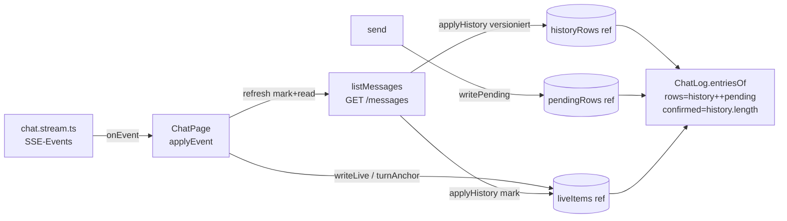
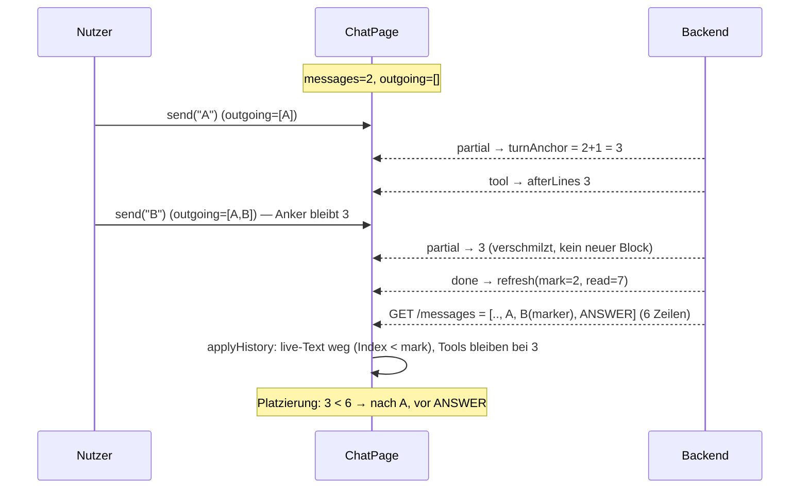

# C-5 — Verlauf out of order / gestreamte Antwort verschwindet

Branch `web-factory-mvp-2`. **Reiner UI-Fix** — die Ursache liegt im Merge von Live-Liste und
Verlaufs-Read, nicht im Backend. Backend bleibt unangetastet.

## 1. Kontext

Paul nutzt den Chat live: bei längerer Konversation ist der Verlauf „total defekt" — Zeilen in
falscher Reihenfolge, eine von Jon gestreamte Antwort verschwand, Reload repariert. Das
Referenz-Frontend (`/Users/sterlp/dev/workset/ai-schulung/app/frontend`) hat dasselbe Problem
nicht.

### 1.1 Was die Referenz anders macht (gelesen, nicht vermutet)

`app/frontend/src/pages/chat/`:

| Referenz | Datei:Zeile | Wirkung |
|---|---|---|
| **Eine** Liste `messages` je Thread ist die einzige Wahrheit | `useChatSessions.ts:17-33` | kein Merge zweier Listen |
| `send` hängt Nutzerzeile **und** eine leere Assistenten-Zeile an *dieselbe* Liste | `useChatSessions.ts:143-148` | die laufende Antwort ist eine Zeile des Verlaufs, kein Sonderfall |
| Tokens hängen an der letzten Assistenten-Zeile, Tools an deren `toolGroup` | `messages.ts:19-47` | Reihenfolge ist **strukturell**, kein Index |
| `done` stempelt nur die Dauer, **liest den Verlauf nicht** | `useChatSessions.ts:205-226` | kein Race zwischen Read und Stream |
| Verlauf wird nur beim Öffnen/Reload gelesen; `seed` überschreibt nie einen laufenden Stream | `useChatSessions.ts:83-93` | Read kann Live-Zeilen nicht wegwerfen |

**Nicht 1:1 übernehmbar:** unser `done`-Read ist nötig, weil die **finale Team-Antwort**
(Werkzeug-Ergebnis, ADR-0078 Entscheidung 6) und die **Fehlerzeile** (R-WP-34) ausschließlich im
Verlauf existieren und bewusst nie als Live-Zeile reisen (`SseTurnMonitor.java:36-40`). Unser
Done-Read bleibt also — repariert wird der **Merge**, nicht der Read.

### 1.2 Tatsächliche Ursache (drei Defekte in `chat.page.tsx` / `chat.log.tsx`)

**U1 — Der Live-Anker ist eine Zeilenzahl, die vorläufige eigene Zeilen mitzählt.**
`shownRows = messages.length + outgoing.length` (`chat.page.tsx:126-128`) ist der Anker jedes
Live-Items (`chat.page.tsx:171/175/180/200`). Sendet der Nutzer **während** des Turns eine zweite
Eingabe, wächst `outgoing` → alle weiteren Chunks bekommen einen **neuen** Anker → `appendLiveText`
verschmilzt nicht mehr (`chat.live.ts:19-25`) → die Antwort **zerfällt in Blöcke**, und ihr Schwanz
steht **unter** der gerade getippten nächsten Frage. Genau Pauls „Reihenfolge stimmt nicht", und
zwar genau bei längeren Gesprächen, weil man dort tippt, während Jon arbeitet.

**U2 — Die bestätigte eigene Zeile wird am Text erkannt; eine gequeuete Zeile trägt aber den
Core-Marker.**
`withoutSent` (`chat.page.tsx:444-459`) entfernt eine vorläufige Zeile nur, wenn ein
**textgleicher** Nutzer-Eintrag im Verlauf steht. Eine während des Turns gesendete Eingabe geht in
die Core-Queue und landet als `[Queued Message] (14:32): <text>` im Memory
(`UserName.java:96-104`, `ProjectRuntime.java:460-462`; Q6: der Marker bleibt sichtbar) → Text ist
nie gleich → **die Zeile bleibt für immer** stehen, **doppelt** neben ihrer Verlaufszeile, am Ende
des Logs, und hebt `shownRows` dauerhaft an. Mit jeder gequeueten Eingabe wächst der Müll.
**Reload baut `outgoing` leer neu → repariert** (Pauls Beobachtung).

**U3 — Der `done`-Read wirft Live-Text weg, den er nicht kennt, und Reads sind ungeordnet.**
`applyHistory` ruft unbedingt `setLive(liveLinesAfterHistory)` (`chat.page.tsx:142-146`,
`chat.live.ts:59-61`) — der Live-Text verschwindet **im Moment der Antwort**, nicht im Moment ihres
Eintreffens. Streamt zu diesem Zeitpunkt schon der **nächste** Turn (der Read ist ein echter
Netzwerk-Roundtrip und wächst mit dem Verlauf, weil `GET /messages` den kompletten Speicher
abbildet — `ChatController.java:56-61`), ist dessen Text fort; da Chunks **Deltas** sind
(`SseTurnMonitor.java:115-116`), fehlt der Kopf bis zum nächsten Read. Zusätzlich hat `refresh()`
keine Reihenfolge: eine ältere, langsamere Antwort kann eine neuere überschreiben (`messages`
springt zurück). **Reload repariert**, weil der Verlauf die vollständige Zeile hat.

Alle drei Symptome (Reihenfolge, verschwundene Antwort, Reload heilt) sind damit erklärt; der
Backend-Pfad ist korrekt geordnet (Memory vor Event: `ProjectRuntime.java:355-358`, `:406-409`).

## 2. SOLL-Check gegen `docs/chat.md`

| Regel | Wirkung des Fixes |
|---|---|
| R-WP-5 / UC-WP-7 (Antworten laufen mit) | U3-Fix stellt sicher, dass ein Verlaufs-Read nur wegnimmt, was er kennt → **stärker** |
| R-WP-11 (Verlauf = Wahrheit für fertigen Text) | bleibt: fertiger Text kommt weiter aus dem Read. U3 verschiebt nur den **Zeitpunkt des Weggebens** |
| R-WP-28 / UC-WP-54 (Tool-Zeilen inline an ihrer Stelle, bleiben sichtbar) | U1-Fix macht die Stelle erst richtig; bestehender Test `toolLinesSurviveTheDoneRefresh` (Tool vor Antwort) bleibt grün |
| R-WP-31 / UC-WP-65 (Warte-Rahmen endet mit dem Turn) | unberührt |
| R-WP-34 / UC-WP-64 (Fehlerzeile aus dem Verlauf) | unberührt (Fehlerzeile wird weiter vom Folge-Read ersetzt) |
| R-WP-35 (Scroll folgt nur am Ende) | unberührt |
| R-WP-10 / UC-WP-14 (Eingabe während des Turns wird gequeued) | unberührt; **aber** die Anzeige der eigenen gequeueten Zeile ist nicht geregelt → **SOLL-Lücke**, s. §8 Q1 |

Kein Widerspruch zwischen einem Fix und einer bestehenden Regel gefunden.

## 3. Design-Entscheidungen

**D-A — Anker ist eine Zahl in *Verlaufs*-Koordinaten, pro Turn eingefroren.**
Ein Live-Item trägt den Anker „so viele Zeilen standen, als es ankam" — aber gerechnet **einmal
je Turn** und **inklusive der damals vorläufigen eigenen Zeilen**. Der Wert bleibt für alle Items
des Turns derselbe (auch wenn danach eine weitere Eingabe gequeued wird), weil die vorläufigen
Zeilen beim Read **1:1 an denselben Indizes** zu Verlaufszeilen werden (Verlauf ist append-only).
Damit gilt vor *und* nach dem Read dieselbe Zahl, und die Antwort zerfällt nicht mehr.
Eingefroren wird im Ref `turnAnchor`; zurückgesetzt bei `done`, `error` und `setLive([])`.

**D-B — Alle Live-Schreibvorgänge laufen über je eine Schreibfunktion mit Ref.**
`historyRows`, `pendingRows`, `liveItems` sind Refs, die zusammen mit dem State über
`writeHistory` / `writePending` / `writeLive` gesetzt werden. Grund: der Event-Handler braucht den
Wert **synchron** (State in `applyEvent` ist durch `useCallback([projectId, refresh, refreshTiles])`
nicht lesbar, und die Deps dürfen sich nicht pro Chunk ändern), und ein Effekt-Ref hinkt einen
Render nach — genau der Fehler, den wir beheben. Refs werden nur in Event-Handlern/Read-Callbacks
geschrieben, nie im Render und nie in einem State-Updater (StrictMode ist aktiv,
`main.tsx:9`; React Compiler ist aktiv, `vite.config.ts:10`).

**D-C — Ein Verlaufs-Read gibt nur Live-Items auf, die er kennen kann.**
`refresh()` merkt sich beim Start `mark = liveItems.current.length` und eine laufende Nummer;
`applyHistory(loaded, mark, read)` (a) ignoriert Antworten, die älter sind als die zuletzt
angewandte, und (b) wirft `text`/`error` nur unter den ersten `mark` Items weg. `tool`/`diff`
bleiben unverändert (R-WP-11/UC-WP-54, live-only).

**D-D — Die eigene vorläufige Zeile wird über Position, nicht über Text bestätigt** (Inc 3,
blockiert, s. §8 Q1). Jede vorläufige Zeile merkt sich, wie viele Verlaufszeilen beim Senden
standen; bestätigt wird sie von der ersten noch nicht verbrauchten **Nutzer**-Zeile an dieser
Position oder dahinter. Das kennt kein Format (Core-Marker, `[User …]:`), ist O(n) und behebt
nebenbei die im Code dokumentierte Grenze „derselbe Text zweimal hintereinander". Die Logik
kommt als reines Modul `chat.pending.ts`, damit sie ohne React testbar ist.

**D-E — Stream erst nach dem ersten Verlaufs-Read öffnen.**
`connect()` läuft im Mount-Effekt erst nach `refresh()` (Promise-Kette). Nur so ist der Anker
beim ersten Event eine wahre Aussage über den Verlauf; heute kann ein Event bei noch leerem
`messages` ankern und landet nach dem Read **über** dem ganzen Verlauf.

**Nicht getan:** kein Umzug der Live-Zeilen in die Verlaufsliste (Referenz-Muster), kein Entfall
des Done-Reads, keine Backend-Änderung, kein neuer Event-Typ.

## 4. Architektur

Anteile und Abhängigkeitsrichtung: `chat.page.tsx` besitzt **allen** Zustand (Verlauf, eigene
vorläufige Zeilen, Live-Liste, Anker); `chat.live.ts` bleibt reine Listen-/Anker-Funktionen;
`chat.log.tsx` entscheidet **nur** über die Platzierung beim Zeichnen und kennt weder Read noch
Anker-Ref; `chat.pending.ts` (neu) ist eine reine Wertfunktion ohne React.





### Code-Skizze (Signaturniveau)

```ts
// chat.live.ts — Semantik präzisiert, Typname bleibt (20 Tests hängen an den Handles)
export type LiveItem = { kind: 'text'|'tool'|'error'|'diff'; …; afterLines: number }

// chat.page.tsx — drei Fakten, je eine Schreibstelle
const historyRows = useRef(0)
const pendingRows = useRef(0)
const liveItems   = useRef<LiveItem[]>([])
const turnAnchor  = useRef<number | null>(null)
function writeLive(next: LiveItem[], after: number | null): void  // setzt liveItems + setLive
function anchorOf(): number  // turnAnchor.current ??= historyRows.current + pendingRows.current
function refresh(): Promise<void>  // read = ++reads.current; mark = liveItems.current.length
function applyHistory(loaded: ChatMessage[], mark: number, read: number): void

// chat.log.tsx
function entriesOf(rows: Row[], live: LiveItem[], confirmed: number): Entry[]
//   at = run[0].afterLines >= confirmed ? rows.length : run[0].afterLines

// chat.pending.ts (Inc 3)
export interface PendingLine { text: string; afterHistory: number }
export function withoutConfirmed(pending: PendingLine[], history: ChatMessage[]): PendingLine[]
```

## 5. Betroffene Dateien

| Datei | Änderung |
|---|---|
| `factory-ui/src/chat/chat.page.tsx` | Refs + Schreibfunktionen, eingefrorener `turnAnchor`, `refresh()` mit `mark`/`read`, `applyHistory(loaded, mark, read)`, `confirmed = messages.length` an `ChatLog`, `connect()` nach `refresh()`; Inc 3: `PendingLine[]` statt `string[]`, `withoutSent` entfällt |
| `factory-ui/src/chat/chat.log.tsx` | `entriesOf(rows, live, confirmed)` + Platzierungsregel; Prop `confirmed` (oder aus `messages.length` ableiten) |
| `factory-ui/src/chat/chat.live.ts` | nur Doc-Kommentar zu `afterLines` („Anker des Turns"); **Signaturen unverändert** |
| `factory-ui/src/chat/chat.pending.ts` | **neu** (Inc 3): `PendingLine`, `withoutConfirmed` |
| `factory-ui/test/chat/chat.page.test.tsx` | `stubChat` um `deferNextHistoryRead()` erweitern (Promise, das der Test auflöst — kein `sleep`); neue Tests |
| `factory-ui/test/chat/chat.log.test.tsx` | Platzierungstests für `entriesOf` |
| `factory-ui/test/chat/chat.pending.test.ts` | **neu** (Inc 3) |
| `docs/chat.md` | **nur Jon/docs-Besitzer**: fehlende Regel (§8 Q1). Dev fasst docs **nicht** an |
| Backend | **keine Änderung** |

Unverändert bleiben: `chat.stream.ts`, `chat.client.ts`, `shared/sse.client.ts`, `chat.tools.tsx`,
`chat.diff.tsx`, `chat.waiting.tsx`, alle Backend-Klassen.

## 6. Regeln & Randbedingungen

- **Keine neuen Draht-Handles umbenennen**: `chat-live`, `chat-tool-line`, `chat-line-jon`,
  `chat-line-user`, `chat-diff*` sind Griffe bestehender Tests (AGENTS-DEV.md:175-177).
- **Kein State in Refs schreiben, die im Render gelesen werden**; Refs nur in Handlern/Callbacks.
- **Keine Sleeps in Tests**; asynchrone Reads werden über aufgelöste Promises gesteuert, jeder
  neue Test bleibt unter dem Vitest-Default (5 s) — kein `vi.useFakeTimers` nötig.
- Der bestehende Test `toolLinesSurviveTheDoneRefresh` (Tool **vor** der Antwort,
  `chat.page.test.tsx:794-819`) ist der Vertrag von UC-WP-54 und bleibt unverändert grün; er darf
  nicht umformuliert werden.
- Bauprüfung: `cd factory-ui && COREPACK_ENABLE_PROJECT_SPEC=0 pnpm test`, `npx tsc -b`,
  `pnpm lint` (AGENTS-DEV.md:778-781).

## 7. Inkremente (je einzeln grün lauffähig)

### Inc 1 — Live-Zeilen bleiben, wo sie hingehören (U1 + D-A + D-E) — **GEBAUT 2026-11-05, grün**
`turnAnchor`/`historyRows`/`pendingLines`-Refs + `anchorOf()`, `writeHistory`/`writePending`, `connect()`
nach dem ersten `refresh()`, Tests 1–3 neu (Mutationsproben belegt). UI 137 Tests / 17 Dateien, tsc +
oxlint 0/0, Doc-Lint 1 Finding (UC-WP-69 unbelegt = Inc 3).
**Abweichung:** `entriesOf(rows, live, confirmed)` nicht gebaut — die Klammer `afterLines >= confirmed ?
rows.length : afterLines` setzt die Antwort hinter die eben getippte zweite Frage und widerspricht §7 Test 1
wie D-A; Platzierung bleibt `Math.min(afterLines, rows.length)`, `confirmed` hätte keine Wirkung.
`deferNextHistoryRead()` schon in Inc 1 (Test 3 braucht es).
Kein sichtbarer Text ändert sich, nur die Reihenfolge.
- `chat.page.tsx`: `turnAnchor`-Ref, `historyRows`/`pendingRows`-Refs, `anchorOf()`; `refresh()`
  vor `connect()` im Mount-Effekt.
- `chat.log.tsx`: `entriesOf(rows, live, confirmed)`.

**BDD / Tests** (`factory-ui/test/chat/`):
1. `aLiveAnswerKeepsItsAnchorWhenAnInputIsQueuedMidTurn` — GIVEN Turn streamt WHEN eine zweite
   Eingabe gesendet wird und weitere Chunks kommen THEN steht die Antwort als **ein** `chat-live`-
   Block und **vor** der zweiten Eingabe. (R-WP-28, UC-WP-54)
2. `aLiveTraceStaysBetweenItsInputAndTheAnswer` — GIVEN Verlauf `[frage]`, Turn mit Tool-Zeilen
   WHEN `done` den Verlauf `[frage, sendung, antwort]` liefert THEN steht die Tool-Box nach
   `sendung` und vor `antwort` (`chat.log.test.tsx`, Platzierungsregel). (UC-WP-54)
3. `theStreamOpensAfterTheFirstHistoryRead` — GIVEN Mount mit vorhandenem Verlauf WHEN der
   Verlauf geliefert ist THEN öffnet sich `…/events` erst danach (Reihenfolge in `chat.calls`).
4. Bestehend: `toolLinesStayInlineInOrder`, `toolLinesSurviveTheDoneRefresh`,
   `aFileChangeIsLiveAndDoesNotOutliveTheReload` bleiben unverändert grün.

### Inc 2 — Die gestreamte Antwort verschwindet nicht mehr (U3 + D-C)
- `refresh()`: `read = ++reads.current`, `mark = liveItems.current.length`;
  `applyHistory(loaded, mark, read)` verwirft veraltete Reads und gibt nur Items `< mark` auf.
- `chat.page.tsx`: Live-Schreibvorgänge über `writeLive`.

**BDD / Tests:**
5. `aLaterTurnKeepsStreamingWhileAnEarlierReadIsInFlight` — GIVEN der `done`-Read des vorigen
   Turns ist offen WHEN die Antwort des nächsten Turns streamt THEN steht der gestreamte Text
   weiterhin im Log und fehlt nach dem Auflösen des Reads nicht. (R-WP-5, UC-WP-7)
6. `anOlderHistoryReadNeverOverwritesANewerOne` — GIVEN zwei Reads WHEN der ältere zuletzt
   antwortet THEN bleibt der neuere Verlauf stehen (kein Rücksprung, keine verschwundene Antwort).
   (R-WP-11)
7. Bestehend: `droppedStreamReopensAndReadsHistory`, `aFileChangeIsLiveAndDoesNotOutliveTheReload`,
   `toolLinesSurviveTheDoneRefresh` bleiben grün.

### Inc 3 — Eine gequeuete Eingabe steht genau einmal (U2 + D-D) — **BLOCKIERT durch §8 Q1**
Erst nach der Doc-Regel bauen.
- `chat.pending.ts` neu; `chat.page.tsx` hält `PendingLine[]`, `applyHistory` ruft
  `withoutConfirmed`.
- `chat.log.tsx`/`ChatPage`: `outgoing` wird zu `PendingLine[]` (Text unverändert gezeichnet).

**BDD / Tests:**
8. `theQueuedInputStandsOnceInTheLog` — GIVEN Eingabe während des Turns gesendet WHEN `done` den
   Verlauf mit `[Queued Message] (14:32): <text>` liefert THEN steht die Frage **einmal** und die
   vorläufige Zeile ist weg. (R-WP-10, UC-WP-14, R-WP-11)
9. `theSameTextTwiceIsConfirmedTwice` — GIVEN derselbe Text zweimal gesendet WHEN der Verlauf beide
   Zeilen trägt THEN sind beide vorläufigen Zeilen weg (behebt die heute dokumentierte Grenze).
   (UC-WP-57)
10. `chat.pending.test.ts`: `aLaterUserLineConfirmsAnEarlierPendingLine`,
    `aUserLineBeforeTheWatermarkConfirmsNothing`,
    `aQueuedMarkerLineConfirmsItsPendingLine` (Format-Unkenntnis: der Marker wird nicht geparst).

**Teststrategie allgemein:** jede Symptomklasse bekommt genau einen Test, der ohne den Fix rot ist
(Mutationsprobe je Inkrement: Anker zurück auf `messages+outgoing` → Test 1 rot; `applyHistory`
ohne `mark` → Test 5 rot; ohne `read`-Vergleich → Test 6 rot; `withoutConfirmed` auf Textvergleich
zurück → Tests 8/9 rot). `ChatPage`-Tests laufen weiter über den bestehenden `stubChat`-Harness;
das neue `deferNextHistoryRead()` liefert ein `resolve()`, damit ein Read im Flug gehalten und
deterministisch aufgelöst wird.

## 8. Offene Fragen (an Jon — blockieren Inc 3)

**Q1 — SOLL-Lücke: die eigene Zeile erscheint genau einmal, auch als gequeuete.**
`docs/chat.md` regelt Queue-Verhalten (R-WP-10/UC-WP-14), den Verlauf als Wahrheit (R-WP-11) und
den Absender-Namen (R-WP-25/UC-WP-48) — aber nirgends, dass eine eigene Eingabe **genau einmal**
im Verlauf steht und dass die bestätigte Zeile die vorläufige **ersetzt**. Genau diese Regel
entscheidet den Fix von U2, deshalb gehört sie ins Doc, bevor gebaut wird.
Vorschlag (deutsch, in `docs/chat.md` als eigener Absatz bei R-WP-10, plus eine UC):

> **Eine eigene Eingabe steht genau einmal im Verlauf.** Solange der Verlauf sie nicht trägt,
> zeigt der Chat sie als vorläufige Zeile; sobald der Verlaufs-Read sie liefert, ersetzt diese
> Zeile die vorläufige **an ihrer Stelle** — auch dann, wenn der Core sie als gequeuete Eingabe
> mit seinem Marker `[Queued Message] (hh:mm): ` schreibt (Q6: der Marker bleibt sichtbar).
> Dieselbe Eingabe zweimal ist zwei Zeilen.
> - GIVEN eine Eingabe, die während eines Turns gesendet wurde WHEN `done` den Verlauf liest
>   THEN steht sie genau einmal im Log.
> - GIVEN dieselbe Eingabe zweimal WHEN der Verlauf beide trägt THEN sind beide bestätigt.

**Q2 — Sichtbare Textänderung in Inc 3:** Nach dem Fix zeigt die eigene gequeuete Zeile den
Marker des Cores (`[Queued Message] (14:32): …`) statt des getippten Texts. Das ist Q6-konform,
aber eine sichtbare Änderung. Empfehlung: **ja, Marker zeigen** (er ist Realität, R-WP-11), nicht
in der UI wegschneiden.

**Q3 — Scope-Bestätigung:** Inc 1 + Inc 2 sind unabhängig von der Doc-Lücke und adressieren Pauls
zwei Symptome (Reihenfolge, verschwundene Antwort). Empfehlung: **sofort bauen**, Inc 3 nach der
Regel. Kein Backend-Eingriff.

STATUS: AWAITING_ANSWERS
