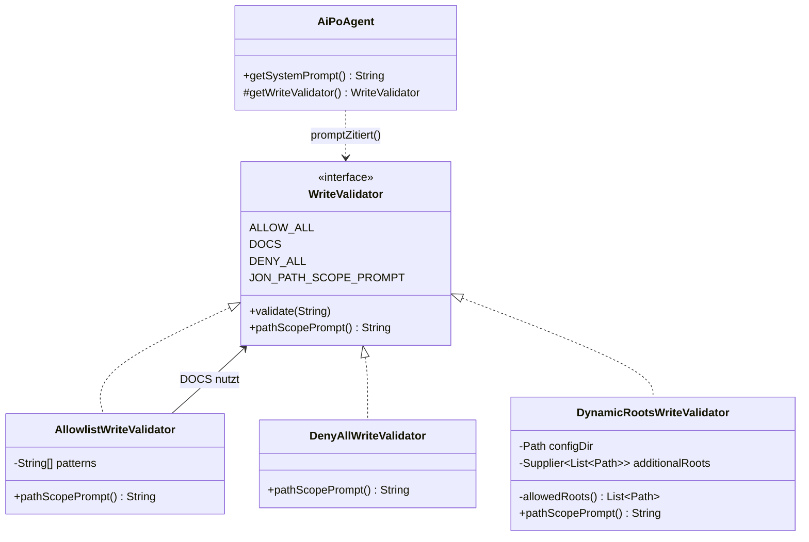
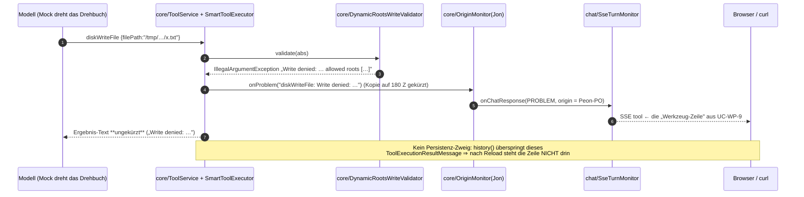
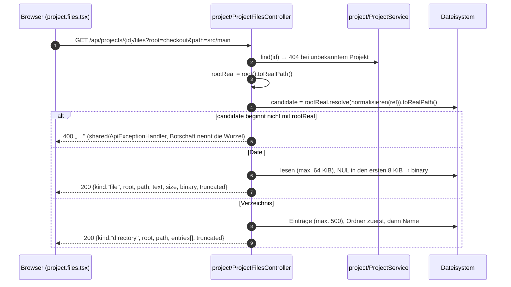

# Increment 4 — Schreib-Pinning und der Datei-Bereich (nur der aktive Zyklus)

> **Diese Datei trägt nur den laufenden Zyklus.** Inc 3f (3a–3e, 3-H1/H2, 3f-1…3f-5-H, 3f-Review — gebaut,
> abgenommen, committed) liegt vollständig in `peon-plan/overview-inc3f-done-2026-10-26.md`, der Zyklus davor in
> `peon-plan/overview-done-2026-10-25-23-07.md`. Beides ist read-only-Beleg, keine Zeile davon wird bearbeitet.
> Grund der Trennung: der Plan-Agent bekommt diese Datei als Standing Order — ist sie zu groß, ist keine
> Planung mehr möglich (Context-Grenze, es wird nie gekürzt).
> **Stand dieses Kopfs:** Entwurf 2026-10-26; Abnahmefragen §4.11 **beantwortet 2026-10-26 (Jon)**, nichts
> offen. Dieser Kopf ist der einzige Einstieg der Datei und trägt die **einzige H1**.
> Baselines vor dem ersten Edit: Core **1386/0/0**, Fabrik **96/0/0**, UI **22 Tests / 3 Dateien**, lint 0/0,
> `lintDocsAndTests` (`UC-WP-\d+`) **UC 42/42; test IDs 67/32; findings 10**, VERWAIST 0. Branch `web-factory`.

> **Only this section is the binding work order for Inc 4.** `aifactory/docs/**` is the SOLL and belongs to
> Jon: no agent reads-and-fixes, rewords or renames anything under it; UC/rule ids are quoted, never reworded;
> **no agent invents an id** — the marker on a test is the doc heading's id, copied (`AGENTS-DEV.md:21-33`).
> **Archive is not in this file.** Inc 3f (`## 3.0` … `## 3f-Review` — 3a–3e, 3-H1/H2, 3f-1…3f-5-H,
> 3f-Review) is built, accepted, committed and lives read-only in `peon-plan/overview-inc3f-done-2026-10-26.md`;
> the cycle before it in `peon-plan/overview-done-2026-10-25-23-07.md`. Neither file is edited — not one line.
> **File rule:** each increment appends its own short execution log as `### 4a-1-E` … `### 4b-2-E` **directly
> after its own §**, inside this section. This file is never replaced by a build log.
> **Planner scope:** only `aifactory/peon-plan/*`. **Dev-agent scope:** core (only-add, R6), factory
> backend + UI as listed below; commit per increment with the actually-run gate numbers (`AGENTS-DEV.md:55-59`).

Repo root `/Users/sterlp/dev/workset/peon-ai`, branch `web-factory`. Core
`/Users/sterlp/dev/workset/peon-ai/org.sterl.llmpeon.core`, plugin `org.sterl.llmpeon` +
`org.sterl.llmpeon.test`, backend `/Users/sterlp/dev/workset/peon-ai/aifactory/factory-backend`, UI
`/Users/sterlp/dev/workset/peon-ai/aifactory/factory-ui`. Baseline HEAD = `ab1966ad` + `### 3f-5-E`
(Härtung). Green before the first edit: core **1386 tests / 0 Fehler**, factory **96 / 0 / 0 BUILD SUCCESS**,
UI **22 tests / 3 files**, lint „Found 0 warnings and 0 errors." (20 files),
`lintDocsAndTests` (`UC-WP-\d+`) **gemessen 2026-10-26:** `UC definitions: 42/42; test IDs: 67/32;
findings: 10`, **VERWAIST 0**. (Der Stand ist ein Befund, keine Zahl aus dem 3f-Archiv: das Doc hat seit
3f-5-E eine weitere UC-Definition bekommen, und `aifactory/docs/adr/002-origin-in-core-display-in-factory.md`
ist neu, nimmt am Lint aber nicht teil — kein `idPrefix`. Die zehn UNBELEGT sind UC-WP-**8, 9, 10, 18, 19,
42** (= Inc 4) und UC-WP-11/12/13 + UC-WP-25 (`web-prototype.md:416`) (= Inc 5/6).)

**What this increment is about:** R-WP-6 (Schreib-Pinning auf Projekt-Root + TMP) und R-WP-13 (TMP ist
Arbeitsverzeichnis, kein Unterordner je Projekt) sind im Core seit Inc 3 **gebaut**, aber **unbelegt**;
R-WP-14 (Datei-Bereich: Checkout und TMP lesbar, Ausbruchsversuch abgewiesen) ist gar nicht gebaut. Dazu ist
die Core-Regel **R6** in `org.sterl.llmpeon.core/docs/write-path-validator.md:118-134` die einzige dort noch
mit ❌ stehende Regel: der Pfad-Scope im System-Prompt kommt aus einer Konstanten, nicht vom Validator.
Dieses Increment schließt **UC-WP-8, UC-WP-9, UC-WP-10, UC-WP-18, UC-WP-19, UC-WP-42** und **R6**.

## 4.0 Slice — fünf Schritte, je eine Polarität

| Schritt | Polarität | Läuft danach (laufende Software) | UC-ids / Regeln |
|---|---|---|---|
| **4a-1** | **nur Messung**, kein Produktionscode | Eine Tabelle „Was ist heute schon dicht?" — gemessen gegen `MockLlmServer`, nicht vermutet. Ihr Ergebnis entscheidet, was 4a-3 wirklich beweisen muß. | — (Nachweis, keine neue id) |
| **4a-2** | core **nur-hinzufügen** + **eine** ersetzte Zeile | Der Validator sagt selbst, welcher Pfad-Scope gilt; Jons Prompt nennt ihn daraus. Plugin-Prompts bleiben **byte-identisch**. | Core **R6** (Core-Docs tragen keine UC-ids) |
| **4a-3** | factory nur-hinzufügen + **eine** Verschärfung | Jon **und** Da Mek können nur noch in Projekt-Root und System-TMP schreiben; **Jons** Ablehnung ist eine Werkzeug-Zeile und steht **nicht** im wiederhergestellten Verlauf, die eines Mitglieds endet beim Modell (A1). | **UC-WP-8, UC-WP-9, UC-WP-10, UC-WP-18** |
| **4b-1** | factory nur-hinzufügen | `GET /api/projects/{id}/files?root=checkout\|tmp&path=…` liest Verzeichnis oder Datei; `..`, absolute Pfade und ausbrechende Symlinks werden abgewiesen; Schreiben gibt es nicht. | **UC-WP-19, UC-WP-42** (Server-Hälfte) |
| **4b-2** | ui nur-hinzufügen | Im Chat öffnet ein Knopf den Datei-Bereich als Slide-Over mit Checkout/TMP-Umschalter; ein Ausbruchsversuch zeigt einen Text statt Inhalt. | **UC-WP-19, UC-WP-42** (Browser-Hälften) |

Reihenfolge **4a-1 → 4a-2 → 4a-3 → 4b-1 → 4b-2**. 4a-1 ist Voraussetzung für 4a-3 (es liefert die Wahrheit,
gegen die getestet wird). 4b-1 und 4b-2 sind unabhängig von 4a, brauchen aber ein grünes 4a-3 (Gate-Stand).

**Zwei Verschärfungen sind Teil des Auftrags und hier ausdrücklich benannt** (sie sind keine stillen
Nebenwirkungen): (1) die eine Prompt-Bau-Zeile in `AiPoAgent.getSystemPrompt()` wird **ersetzt**, nicht
dazugeschrieben — R6 verlangt genau das; (2) **Da Mek wird festgenagelt** — heute hat er gar keinen Validator
(`AiDevAgent` überschreibt `getWriteValidator()` **nicht** ⇒ `ALLOW_ALL`, `agent/AiAgent.java:75-77`), kann
also überallhin schreiben. UC-WP-8/9 schreiben „Jon **oder ein Team-Mitglied**" ⇒ ohne diese Zeile ist die
Regel nicht erfüllbar. Siehe A3.

**Nicht in diesem Increment (nicht bauen, nichts bauen, was später umgemacht werden muß):** Kacheln /
Clear / Compact / per-Agent-Transkripte = Inc 5 (UC-WP-11/12/13); Nutzer-Name auf `user`-Zeilen = Inc 6
(UC-WP-25); `askUser`, Jon-Light, Story-/Plan-Werkzeuge = eigene Geschichten. Der Datei-Bereich bekommt
**keinen** Schreibknopf, keinen Editor, keinen Download und keinen Download-Pfad (R-WP-14 nennt nur *lesen*).

## 4.1 Ground truth (zuerst lesen, nur-lesend — Pfade sind gecacht, nicht erneut suchen)

* `aifactory/docs/web-prototype.md` — **R-WP-6** `:207` (Schreib-Zugriffe nur Projekt-Root + TMP, **kein
  neuer Mechanismus**, dieselbe Wurzel für Jon und sein Team, Scope steht im Prompt) mit **UC-WP-8** `:213`,
  **UC-WP-9** `:217`, **UC-WP-10** `:221`; **R-WP-13** `:321` mit **UC-WP-18** `:327`; **R-WP-14** `:331` mit
  **UC-WP-19** `:336` und **UC-WP-42** `:341`; **R-WP-11** `:289-296` (Werkzeug-Zeilen **nur live**, **kein
  zweiter Speicher**); **R-WP-4** / **UC-WP-40** (Interna eines Mitglieds sind **nie** sichtbar).
* `aifactory/docs/aifactory-architektur.md:113-141` — „**Datei-Bereich: eine Lese-Kante im `project`, kein
  vierter Chat-Pfad (Design für Inc 4b)**": Kante, Wurzel-Regel, Guard in der Fassade, **kein**
  `WriteValidator` im Leseweg, UI-Komponente `project.project.files` + `files.client`, **Slot aus `app` in
  die Chat-Seite**, `chat` importiert nichts aus `project`. Diese Zeilen sind bindend, nicht negotiierbar.
* `org.sterl.llmpeon.core/docs/write-path-validator.md` — **R6 `:118-134`** (❌ offen): `pathScopePrompt()`
  als `default` mit leerem Text; `DOCS` liefert den bisherigen Text; `DENY_ALL` sagt „nur lesen";
  `DynamicRootsWriteValidator` nennt **seine** Wurzeln zur Prompt-Zeit; `AiPoAgent` benutzt **nur** diesen
  Text; `ALLOW_ALL` ⇒ **kein** Scope-Absatz, Plugin-Agenten unverändert. R1–R5, R7–R10 sind ✅ (nicht
  umzubauen). Core-Docs tragen **keine** UC-ids ⇒ Core-Tests bekommen **keine** Marker.
* `AGENTS.md` → skill `component-architecture`; `AGENTS-DEV.md` — **`:17-20` Plugin-Gate nach jeder
  Core-Änderung** (`mvn -o -pl org.sterl.llmpeon,releng/llmpeon-target -am package -DskipTests`, danach
  `org.sterl.llmpeon` **und** `org.sterl.llmpeon.test` refreshen + bauen), `:21-33` Marker- und
  Lint-Regeln, `:34-35` Umfang niemals still erweitern, `:55-59` Gate-Zahlen im Commit;
  `aifactory/AGENTS-DEV.md` (pnpm auf dem Pfad, **kein** `-parameters`, `TestRestTemplate` offline
  unbrauchbar, `spring-boot:run` braucht vorher `install`); skills `test-honesty`, `peon-build-test`,
  `repo-api-traps`.

**Pre-flight ( vor der ersten Zeile von 4a-1) — blockierend:**
1. `git status --porcelain`, `git log -1 -- aifactory/docs/web-prototype.md
   aifactory/docs/aifactory-architektur.md` und `git log -1 --
   org.sterl.llmpeon.core/docs/write-path-validator.md`. Liegen die zitierten Doc-Zeilen **uncommittet** im
   Arbeitsbaum: beide Listings melden und **stoppen** — die Doc-Eingabe darf nicht das Increment werden.
   Staging einer Doc-Datei braucht eine frische, ausdrücklich **diesen** Increment nennende Freigabe.
2. `git log -1` → HEAD als „green before" in den 4a-1-Report.
3. `~/.peon`: rekursive Prüfsumme **vor** dem Increment; der Report nennt das Paar (byte-identisch erwartet;
   kein Test darf diese Datei lesen oder schreiben).
4. Baselines laufen lassen und Zahlen melden: core `clean test` (1386/0/0), factory `clean verify`
   (96/0/0), UI `test|lint|build` (22/3), `lintDocsAndTests` (**10** Befunde, VERWAIST 0 — die sechs
   Inc-4-ids darunter).
5. Build-Falle (mehrfach gemessen): nach Eclipse-Editaten liegen Lombok-blankierte Fehler-Stümpfe in
   `target/classes` ⇒ **jeder** Maven-Lauf mit `clean`; nach jeder Core-Änderung
   `mvn -o -pl org.sterl.llmpeon.core install -DskipTests` **vor** dem Fabrik-Bau.

## 4.2 Verifizierte Fakten (2026-10-26 von Platten gelesen — vertrauen, Nachlesen ist Verschwendung)

**Core** (`org.sterl.llmpeon.core/src/main/java/org/sterl/llmpeon/`):

* `tool/WriteValidator.java` — `JON_PATH_SCOPE_PROMPT` **`:9-10`** (Text über `docs/…`, `*.md`);
  `void validate(String)` **`:15`** (einzige abstrakte Methode ⇒ funktionales Interface);
  `ALLOW_ALL` **`:18`** (Lambda); `DOCS = new AllowlistWriteValidator("*/docs/*","*.md")` **`:21`**;
  `DENY_ALL` **`:24-27`** (Lambda). ⇒ `default String pathScopePrompt()` ist **nur-hinzufügen** und läßt alle
  Lambda-Implementierungen unverändert kompilieren; `DENY_ALL` muß eine kleine benannte Implementierung
  werden, damit es den Text liefern kann.
* `tool/AllowlistWriteValidator.java:13-31` — **einzige** Baustelle im ganzen Repo ist
  `WriteValidator.java:21` (das Plugin baut keine) ⇒ der Scope-Text darf hier einziehen.
* `tool/DynamicRootsWriteValidator.java:21-61` — Ctor `(Path configDir, Supplier<List<Path>> additionalRoots)`;
  `validate` **`:32-39`** wirft `IllegalArgumentException` mit
  `„Write denied: '<eingabe>' resolves to '<ziel>' which is outside this agent's allowed roots [<wurzeln>].
  You may only write to those roots."`; `private allowedRoots()` **`:52-57`** = `configDir` +
  `additionalRoots.get()`, **zur Aufrufzeit** gelesen ⇒ `pathScopePrompt()` muß dieselbe Quelle benutzen
  (sonst wäre der Prompt eine zweite, abweichende Wahrheit).
* `poagent/AiPoAgent.java` — `getSystemPrompt()` **`:97-102`** = `BASE_PROMPT` + NL + NL +
  `WriteValidator.JON_PATH_SCOPE_PROMPT` + NL + `DELEGATION_PROMPT`; `getWriteValidator()` **`:104-107`** =
  `DOCS`; `NAME = "Peon-PO"`; `getTeam()` `:90-95`. **Kein Core-Test referenziert
  `JON_PATH_SCOPE_PROMPT`** (grep = leer) ⇒ das Paritäts-Pin ist neu, nichts muß umgeschrieben werden.
* `agent/AiAgent.java:75-77` — `default getWriteValidator() = ALLOW_ALL`; `agent/AiDevAgent.java` — **keine**
  Überschreibung ⇒ **Da Mek schreibt heute überallhin**. `agent/AbstractAgent.java:339` liest
  `.writeValidator(getWriteValidator())` in `doCall` ⇒ **pro Turn**, eine Überschreibung genügt.
  `ai/AiScaffoldAgent.java:54` nutzt `ALLOW_ALL` und bleibt unbeteiligt.
* `tool/component/SmartToolExecutor.java:37-67` — der Lauf fängt die `IllegalArgumentException` des
  Validators, `reportProblem` **`:63-67`** kürzt die **Nutzer-Kopie auf 180 Zeichen + „…"** und ruft
  `monitor.onProblem(name + ": " + msg)`; **das an das Modell zurückgegebene Ergebnis ist ungekürzt**.
  `shared/AiMonitor.java:90-100` — `onProblem` baut eine `PROBLEM`-`SimpleMessage` ⇒ `onChatResponse` ⇒
  Fabrik bildet sie auf die SSE-`tool`-Zeile ab. **Der Ablehnungs-Text ist also live sichtbar, und die
  Lange der Zeile ist nicht der volle Text** — Assertions nur am stabilen Präfix
  `diskWriteFile: Write denied:`.
* `shared/FileUtils.java:83-88` — `resolve(base, path)`: absolut **und bereits vorhanden** ⇒ absolut
  normalisiert übernommen, sonst `base.resolve(path)` + `normalizeSegments` (`:29-45`). Die
  `Files.exists`-Bedingung im Absolut-Zweig ist überraschend, ist aber für die Traversal-Betrachtung ohne
  Gewinn: `normalizeSegments` entfernt `..` vor dem Vergleich.
* **`ShellTool` ruft den Validator nicht auf.** Aufrufer von `validateWrite` sind
  `DiskFileWriteTool.resolve`, `WebGetTool` und `EclipseWorkspaceWriteFileTool` — **nicht** `ShellTool`.
  ⇒ R-WP-6 ist über die Shell **nicht** dicht; ein Kern-Fix wäre eine Verhaltensänderung fürs Plugin
  (PR-3) ⇒ **melden, nicht bauen** (A2). `tool/tools/AgentsTool.java:33` bleibt „Paul WIP — don't touch".

**Fabrik** (`aifactory/factory-backend/src/main/java/org/sterl/open/aifactory/`):

* `project/` **existiert** und trägt schon `ProjectController` (`@RequestMapping("/api/projects")`, nur
  `GET`/`POST`/`DELETE`), `Project(String id, String name, String gitUrl, Path localPath, ProjectState state)`,
  `ProjectService.find(String) : Optional<Project>`, `ProjectNotFoundException` +
  `ProjectExceptionHandler` (global ⇒ 404), `ProjectRemoved`, `dto/`. ⇒ 4b-1 legt `ProjectFilesController`
  **in dieses Paket**, kein vielter Chat-Pfad, kein neues Paket.
* `shared/ApiExceptionHandler.java` — `IllegalArgumentException`→400, `IllegalStateException`→409,
  `ResponseStatusException`→sein Status; **kein** zweiter Advice erlaubt. `shared/TmpRoots.systemTmp()`
  `:14-16` = `java.io.tmpdir`, absolut + normalisiert, **pro Aufruf** gelesen.
* `chat/ProjectRuntime.java:62-98` — `JonToolSet.forProject(root)` → Plan/Review/**Dev ohne Validator** →
  `addDelegateTool` → anonyme `AiPoAgent`-Unterklasse mit `getWriteValidator()` (**nur Jon**) →
  `AgentNames` → `SseTurnMonitor`; `history()` überspringt **jedes** `ToolExecutionResultMessage` ohne
  Delegations-Attribute ⇒ **eine Schreib-Ablehnung ist live-only und erscheint nie im wiederhergestellten
  Verlauf** — genau R-WP-11, und genau das, was 4a-1 mißt.
* `chat/JonToolSet.java:43-78` — `forProject` baut
  `new DynamicRootsWriteValidator(root, () -> List.of(TmpRoots.systemTmp()))`, `writeValidator()` `:76`;
  **JavaDoc `:71-75` behauptet, der Validator gelte „for Jon and Da Mek" — das ist seit der ersten Zeile
  halb wahr** und wird in 4a-3 mit der Da-Mek-Zeile wahr (oder die Zeile wird korrigiert).
* Test-Vorbilder, pfadgecacht (`aifactory/factory-backend/src/test/java/org/sterl/open/aifactory/`):
  `project/FakeGitConfig.java` (`@TestConfiguration`, `@Primary GitService`, legt `<target>/.git` an,
  merkt `cloneTargets`) — Projekte werden in Tests über `POST /api/projects` angelegt;
  `chat/ChatTurnTest.java` (Drehbuch-Werkzeug-Turn, `RestTemplate` + `@LocalServerPort` +
  `NoOpResponseErrorHandler`, JDK-`HttpClient` für SSE), `chat/DelegatedAnswerTest.java`
  (`twoDelegationsInOneTurnProduceOneLineEach` = ein `AiMessage` mit **zwei** `ToolExecutionRequest`s —
  das Vorbild für „Mitglied schreibt"), `chat/ChatRestartTest.java` (zwei selbst gebootete Kontexte,
  festes Home unter `target/`, **kein** `@TempDir`), `ArchitectureGuardTest.java`,
  `ComponentArchitectureTest.java`, `chat/OneChatPerProjectTest.java`, `chat/SharedProjectChatTest.java`.

**UI** (`aifactory/factory-ui/`): `src/app/app.shell.tsx:30` rendert `<ChatPage project={selected}/>`
(genau hier sitzt der `files`-Slot); `src/chat/chat.page.tsx` hält den Zustand und leert in `applyHistory`
`live`, `toolLines`, `teamAnswers`; `src/project/project.client.ts` benutzt `shared/api.client`
(`request<T>`, `errorMessage`); `src/project/project.page.tsx` ist die Projektseite; Tests in
`test/{chat,config,project,shared}/` mit `test/shared/fixtures.ts` (`project()`-Helfer) und `test/setup.ts`;
CSS in `src/styles.css`. Ein `test/app/` existiert nicht (der UC-WP-1-Test rendert die Shell aus einem
anderen Ordner) — 4b-2s UC-WP-19-Test rendert die **Shell** aus `test/project/`.

**`MockLlmServer` (Core `src/main`, im Fabrik-Testklassenpfad):** `queueResponse(String)`,
`queueResponse(AiMessage)` (`AiMessage` mit `ToolExecutionRequest` ⇒ `finish_reason: tool_calls`),
`getCapturedMessages()` (nur Rollen `user`/`tool`, **nie** `system`/`assistant`), `getCapturedTools()`,
`getLastRequestBody()`, `reset()`, `stop()`; **`getRequestCount()` gibt es nicht**; leere Warteschlange
antwortet eine Standard-Zeile statt zu blockieren.

## 4.3 Design (Änderungen daran sind Plan-Änderungen, keine Implementierungs-Entscheidungen)

### 4.3.1 Grundregel: der **Validator** ist die Wahrheit, der **Prompt** zitiert sie

R6 ist keine Schönheitskorrektur, sondern die Beseitigung einer zweiten Wahrheit: heute steht der erlaubte
Pfad-Bereich an zwei Stellen — hart im `WriteValidator` und als Konstante im Prompt. Die Fabrik weiß das
schon heute nicht anders zu bauen (`JonToolSet` weiß die Wurzeln, der Core-Prompt rät). Also:



* `default String pathScopePrompt()` liefert **`""`** ⇒ `ALLOW_ALL` und jede Plugin-Implementierung (16
  Monitor-, mehrere Validator-Nutzer) bleiben unangetastet; die Schnittstelle behält genau **eine**
  abstrakte Methode (PR-3).
* `AllowlistWriteValidator` trägt den bisherigen `JON_PATH_SCOPE_PROMPT`-Text **wortgleich** ⇒ `DOCS`
  verhält sich bitgenau wie heute (GIVEN „Plugin-Agenten unverändert").
* `DENY_ALL` wird eine kleine benannte Implementierung mit „read-only"-Hinweis (Lambda kann keinen Text
  tragen). **Kein** Aufrufer ändert sich, weil das Feld gleich bleibt.
* `DynamicRootsWriteValidator` rendert **seine** Wurzeln aus `allowedRoots()` — dieselbe Methode, dieselbe
  Supplier-Quelle, also auch dieselbe Frische pro Turn.
* `AiPoAgent.getSystemPrompt()` **ersetzt** die Konstante durch `getWriteValidator().pathScopePrompt()` und
  läßt den Absatz **bei leerem Text ganz weg** (kein Leerblock ⇒ `ALLOW_ALL`-Prompt unverändert).
  Der Text wird **nicht** umgeschrieben, nicht übersetzt, nicht gekürzt.

**Warum nicht „Prompt-Text ins Fabrik-Statische-Kontext-Feld"?** Das wäre ein dritter Ort für dieselbe
Tatsache und ein zweiter, stiller Vertrag über Jons Prompt — genau das, was R6 schließen will.

### 4.3.2 Der Weg einer Ablehnung (gemessen, nicht angenommen)



Drei Tatsachen, die 4a-3 zusammennimmt und die 4a-1 **zuerst mißt**: (1) die Ablehnung erreicht den Monitor
als `PROBLEM`-Zeile und wird auf dem Draht zu `tool`; (2) sie erreicht **das Modell ungekürzt** — der Modell-
Text ist der scharfe Beweis, nicht die Live-Zeile (180-Zeichen-Kürzung!); (3) sie ist **nicht** im
wiederhergestellten Verlauf. UC-WP-9 sagt „steht als Tool-Zeile im Chat" — die Fabrik-Realität ist
**live**, gedeckt durch R-WP-11 („Werkzeug-Zeilen nur live"); der Test prüft beide Hälften und erfindet
keine Persistenz. Für ein **Mitglied** gilt zusätzlich R-WP-4/UC-WP-40: seine Ablehnung wird gefiltert und
darf **nicht** als Zeile erscheinen — **A1 beantwortet 2026-10-26:** zweistufig, zwei Tests in §4.6.

### 4.3.3 Die Lese-Kante des Datei-Bereichs (4b)



**Die `macOS`-Falle ist durch die Reihenfolge entschieden, nicht durch einen Trick:** verglichen wird
**ausschließlich** `candidate.toRealPath()` gegen `root.toRealPath()` — **beide** aufgelöst, niemals ein
roher Root gegen einen echten Pfad. Damit ist `/var → /private/var` auf dem Mac symmetrisch und die
Gleichheit behauptet nirgends einen echten Pfad. Der Test beweist die Richtung mit **zwei** `@TempDir`-
Bäumen (`root` und `outside`) plus **einem** Symlink **in** `root`, **nach** `outside` zeigend: der muß
abgewiesen werden; **ein zweiter** Symlink in `root` auf eine Datei **innerhalb** von `root` muß **erfolgreich**
lesen (Sonst wäre der Guard ein Fehlalarm-Generator, und ein Test, der nur das Scheitern prüft, ist nicht
falsifizierbar). Der **System-TMP wird nie als Ausbruch-Ziel** benutzt (er ist selbst eine Wurzel).

**Vertrag der Kante** (Arch-Doc `:113-141`, DTO-Namen sind Fabrik-Entscheidung, das Feld `kind` ist der
Diskriminator):

| Kante | Antwort | Fehler |
|---|---|---|
| `GET /api/projects/{id}/files?root=checkout\|tmp&path=<relativ>` | `200` genau **eine** von zwei Formen: `directory {kind,root,path,entries[{name,directory,size}],truncated}` oder `file {kind,root,path,text,size,binary,truncated}` | Projekt unbekannt → 404; Datei/Verzeichnis fehlt → 404 (`ResponseStatusException`); `path` bricht aus / `root` unbekannt / `path` absolut → 400 (`IllegalArgumentException` über `shared/ApiExceptionHandler`) |
| `PUT`/`POST`/`PATCH`/`DELETE` auf dieselbe Route | **405** (assertiert, nicht behauptet) | — |

Grenzen: `MAX_ENTRIES = 500` (dann `truncated = true`), `MAX_TEXT_BYTES = 65536` (dann `truncated = true`),
`binary = true` bei `NUL` in den ersten 8 KiB (dann `text = null`). **Die Antwort enthält ausschließlich
relative Namen** — ein neuer Leck-Kanal für absolute Pfade wäre eine neue Fläche (UC-WP-42 dreht genau
daran). Kein `WriteValidator` im Leseweg (Arch-Doc), kein Cache, kein zweiter Speicher.

### 4.3.4 UI-Slot: `app` weiß von beiden, `chat` von keinem

```mermaid
flowchart LR
  APP["app/app.shell.tsx<br/>kennt project UND chat"]
  PF["project/project.files.tsx<br/>Slide-Over, eigener Knopf"]
  FC["project/files.client.ts<br/>readFiles(projectId, root, path)"]
  CP["chat/chat.page.tsx<br/>files?: ReactNode"]
  SH["shared/api.client.ts"]
  APP -->|„files als Prop"| CP
  APP --> PF
  PF --> FC --> SH
  CP -.->|zeichnet nur, importiert nichts aus project| PF
```

`ChatPage` bekommt **ein** optionales `ReactNode` und malt es; er importiert **nichts** aus `project`
(Abhängigkeitsrichtung: `app → project`, `app → chat`, `chat ↛ project`). Der Datei-Bereich ist **kein**
vierte Ansicht (R-WP-1: genau drei Ansichten), sondern ein Slide-Over innerhalb der Chat-Ansicht, und er
hat **kein** Schreib-Bedienelement. Der `files-open`-Knopf gehört zur Komponente selbst — sonst müßte
`chat` einen Knopf für `project` erfinden.

### 4.3.5 Entscheidungen (D1 … D8)

* **D1 — R6 als `default`-Methode, nicht als neue abstrakte.** 62 `AiMonitor`-, viele Validator-Nutzer;
  eine abstrakte Ergänzung bricht das Plugin (PR-3). Leerer Default = „kein Scope zu sagen".
* **D2 — `DENY_ALL` wird eine benannte Implementierung.** Ein Lambda kann `pathScopePrompt()` nicht
  Override-en; verworfen: „DENY_ALL bleibt Lambda, Text kommt aus einer Konstanten" = genau der Fehler,
  den R6 heilt. Feld-Typ und -Name bleiben, kein Aufrufer ändert sich.
* **D3 — `AiPoAgent` läßt den leeren Scope-Absatz **komplett** weg.** Sonst bekäme `ALLOW_ALL` einen
  Geisterblock (Leerzeile) und GIVEN 3 („Plugin-Agenten unverändert") wäre nicht meßbar erfüllt.
* **D4 — Da Mek bekommt denselben Zwei-Wurzeln-Validator wie Jon** (anonyme `AiDevAgent`-Unterklasse,
  Muster `ProjectRuntime.java:81-87`; `AbstractAgent.java:339` liest ihn pro Turn). Da Thinka hat keine
  Editier-Werkzeuge (`AiPlanAgent.java:69-72`), Da Dok ist `DENY_ALL` (`AiReviewAgent.java:80-83`) ⇒
  **deren** Verhalten bleibt, Core-Parität (Q5 aus Inc 3).
* **D5 — Ablehnung wird dreifach bewiesen, nicht einmal.** Live-`tool`-Zeile am Präfix, voller
  „Write denied"-Text im **nächsten** Anbieter-Payload (`mock.getCapturedMessages()`), Datei existiert
  **nicht** auf der Platte — plus die Gegenprüfung „kein Verlaufseintrag nach `done`". Einzeln wäre jede
  Aussage halb (180-Zeichen-Kürzung, R-WP-11, Tool-Erfolg ≠ Datei).
* **D6 — Der Datei-Guard vergleicht nur reate Pfade beider Seiten** und lehnt mit `IllegalArgumentException`
  über die **bestehende** Fassade (400), Botschaft nennt die **Wurzel**, nie den aufgelösten Ziel-Pfad.
  Verworfen: eigener Advice (TABU), 403 (erfordert ein Nutzer-/Rollen-Konzept, das es nicht gibt),
  stilles Leeren der Antwort (verschleiert UC-WP-42).
* **D7 — Datei-Bereich als Slot, nicht als vierte Ansicht und nicht als Chat-Import.** Der Arch-Doc gibt
  Richtung und Ort vor; `chat` bleibt unabhängig von `project`, `app` verdrahtet.
* **D8 — Der Shell-Bypass wird gemeldet, nicht gebaut.** `ShellTool` ruft den Validator nicht auf; ein
  Kern-Fix wäre ein Verhaltenswechsel für Plugin-Nutzer (PR-3) und gehört in eine eigene Geschichte mit
  eigener Doc-Regel. 4a-3 pinnt **nur** den `disk*`-Pfad und sagt das im Test-JavaDoc.

## 4.4 Schritt 4a-1 — erst gemessen, dann gebaut (kein Produktionscode)

**Freigabe-Bindung:** dieser Schritt läuft **vor** jeder Änderung an einer Hauptquelle. Er schreibt nur
Test-Klassen und den Report.

**Läuft danach:** eine Tabelle „heute schon dicht?" mit gemessenen Zahlen statt Vermutung, und die
Ablehnungs-Realität ist dokumentiert (Jon live ja, **Mitglied live nein**, Verlauf nein, 180-Zeichen-Kürzung ja).

**Bauschritte:**
1. Baselines nach Pre-flight 4 — Zahlen in den Report.
2. Neuanlage `chat/WritePinningProbeTest.java` (**paketprivat, gleiche Klasse wie 4a-3 oder eigene; sie wird
   in 4a-3 zur eigentlichen Testklasse ausgebaut — keine Wegwerf-Klasse, kein zweiter Satz Drehbücher**):
   `@SpringBootTest(RANDOM_PORT)`, `@Import(FakeGitConfig.class)`, `aifactory.home` per
   `@DynamicPropertySource` auf ein `@TempDir`, ein `MockLlmServer` je Klasse, Projekt über
   `POST /api/projects`; Werkzeug-Turn per `queueResponse(AiMessage` mit
   `ToolExecutionRequest("diskWriteFile", {"filePath":…, "content":…}))`, danach Folge-Antwort.
3. **Fünf Messungen, jede mit dem echten Ergebnis im Report (auch wenn sie anders ausfällt als erwartet):**
   * (M1) relative Datei innerhalb der Projekt-Root ⇒ Datei da? (`UC-WP-8`-Halbheit Jon)
   * (M2) absolute Datei **außerhalb** beider Wurzeln ⇒ Live-`tool`-Zeile? voller Text im nächsten
     Anbieter-Payload? Datei **nicht** da? Verlauf nach `done`? (`UC-WP-9`)
   * (M3) `../../`-Pfand und absolute Datei unter einer **dritten** Wurzel ⇒ abgewiesen? (`UC-WP-10`)
   * (M4) absolute Datei direkt unter `TmpRoots.systemTmp()` ⇒ liegt sie **direkt** im System-TMP und
     **nicht** unter einem Projekt-Unterordner? (`UC-WP-18`) — Datei im `finally` löschen.
   * (M5) **Mitglieds-Ablehnung (A1, beantwortet 2026-10-26):** Delegation per `askDev`, das Mitglied ruft
     `diskWriteFile` außerhalb beider Wurzeln ⇒ erscheint **irgendeine** Zeile auf dem Draht? (erwartet:
     **nein**, R-WP-4/UC-WP-40 filtern) Liegt der volle `Write denied …`-Text **ungekürzt** im nächsten
     Provider-Payload? Fehlt die Datei? Steht sie im wiederhergestellten Verlauf? — das ist die Wahrheit,
     gegen die 4a-3s Mitglieds-Hälfte behauptet; fällt sie anders aus, wird sie gemeldet (A1-Beweis wäre
     dann umzustellen, nicht die Messung).
4. Report-Tabellenzeile je Messung: erwartet / gemessen / Tests, die es schon zeigen / Lücke.

**Harte Regel für diesen Schritt:** fällt eine Messung **anders** aus als hier angenommen, wird sie
**gemeldet**, nicht der Test passend gebogen (`test-honesty`). Eine M2-Messung „Ablehnung steht doch im
Verlauf" wäre ein Fund über `history()` und wäre zu melden, kein Testumbau.

**Konsequenz:** 4a-2 ist unabhängig von den Messwerten (R6 steht in den Core-Docs); 4a-3 baut nur die
Lücken, die 4a-1 gezeigt hat — vorhandene, scharfe Tests werden **zitiert, nicht dupliziert**.

**Commit:** keiner — **A6 beantwortet 2026-10-26:** 4a-1 bleibt ein eigener Schritt **ohne** Commit (nur
Testentwurf, wenn überhaupt grün); sein Report gehört in den Commit-Text von 4a-3.

### 4a-1-E — Ausführungs-Log (gemessen 2026-10-26, HEAD `acab5b20`, Branch `web-factory`)

Kein Commit (A6). Kein Produktionscode berührt; neu allein
`factory-backend/src/test/java/org/sterl/open/aifactory/chat/WritePinningProbeTest.java` (5 Tests — sie bleibt
liegen und wird in 4a-3 zur `WritePinningTest` ausgebaut). Fabrik `clean verify`: **101 Tests / 0 Fehler /
0 Fehlermeldungen** = 96 Baseline + 5 Probe. `~/.peon` vorher/nachher identisch. Kern- und UI-Gates nicht
gelaufen (kein Kern-, kein UI-Touch).

| Messung | Befund |
|---|---|
| M1 Jon relativ im Projekt-Root | grün: Datei da, Inhalt korrekt, keine Ablehnung — Jon ist auf dem `disk*`-Pfad **schon dicht** (`ChatTurnTest#openProjectBindsWorkDir:175-187`) |
| M2 Jon absolut außerhalb beider Wurzeln | grün: Draht-Zeile `Write denied` (209 Zeichen JSON, innerer Text 180 + `…`), **Modell-Payload 437 Zeichen voll** inkl. `allowed roots [...]`, Datei fehlt, **kein** „Write denied" im wiederhergestellten Verlauf → D5-Prämisse gemessen bestätigt |
| M3 `..` + absolute Datei unter dritter Wurzel | absolute Datei außerhalb TMP: abgewiesen, Datei fehlt ✓. **Meßfund macOS:** das Test-Projekt liegt selbst **unter** `java.io.tmpdir`, also bleibt `..` innerhalb einer erlaubten Wurzel → `..` ist in dieser Konfiguration **nicht trennscharf** |
| M4 Direktwrite unter `TmpRoots.systemTmp()` | grün: `getParent() == systemTmp()`, kein `state/<id>/tmp`, keine Ablehnung |
| M5 Mitglied (Da Mek) schreibt außerhalb beider Wurzeln | **Gap bestätigt (F1):** Datei **existiert**, keine Ablehnung auf Draht/Verlauf/Modell, nur `Da Mek start:` / `Da Mek done.` — Da Mek ist `ALLOW_ALL` |
| Abweichung | `@TempDir` taugt auf macOS nicht als „außerhalb" (liegt selbst im TMP); outside-Wurzel war `TmpRoots.systemTmp().resolveSibling(…)` |

**Für 4a-3 mitzunehmen** (deshalb Vorbedingung in §4.6): die Probe setzt `aifactory.home` auf `@TempDir` — in
4a-3 umstellen auf `target/inc4-home` **außerhalb** von `java.io.tmpdir`; outside-Wurzel bleibt
`TmpRoots.systemTmp().resolveSibling(…)` bzw. `target/inc4-outside`, **kein** `@TempDir` als outside.

## 4.5 Schritt 4a-2 — Core R6: der Validator sagt seinen Pfad-Scope

**Freigabe-Bindung (PO 2026-10-26):** Kern-Gates laufen **vor** den Fabrik-Gates; danach
`install -DskipTests`; das **Plugin-Gate aus `AGENTS-DEV.md:17-20` ist Pflicht** und seine Zahl im Report —
„das Plugin ist unberührt" soll gemessen sein, nicht behauptet (Da Doks Punkt E/9 aus dem 3f-Review).

**Läuft danach:** Jons System-Prompt nennt den Schreibbereich aus dem Validator; jeder Validator sagt selbst,
was er zuläßt; `ALLOW_ALL` sagt nichts.

**Dateien (alle `org.sterl.llmpeon.core/src/`):**

| Datei | Änderung |
|---|---|
| `main/.../tool/WriteValidator.java` | **nur-hinzufügen**: `default String pathScopePrompt()` ⇒ `""`; `DENY_ALL` bekommt eine benannte Implementierung (Feldname/-typ bleiben) |
| `main/.../tool/AllowlistWriteValidator.java` | `pathScopePrompt()` liefert den bisherigen `JON_PATH_SCOPE_PROMPT`-Text **wortgleich** |
| `main/.../tool/DynamicRootsWriteValidator.java` | `pathScopePrompt()` rendert **seine** Wurzeln aus `allowedRoots()` (dieselbe Quelle wie `validate`) |
| `main/.../poagent/AiPoAgent.java` | **eine ersetzte Zeile** in `getSystemPrompt()` (`:97-102`): Validator-Text statt Konstante, Absatz **nur bei nicht-leerem** Text |
| `test/.../tool/WriteValidatorPathScopePromptTest.java` | **neu** |
| `test/.../poagent/AiPoAgentPromptParityTest.java` | **neu** (Paritäts-Pin, scharf auf exakter Konkatenation) |

**Nicht angefaßt:** `JON_PATH_SCOPE_PROMPT` bleibt als Feld erhalten (`DOCS`-Text-Quelle, Referenz der
Paritäts-Tests); `AiScaffoldAgent`, `AiDevAgent`, `AiReviewAgent`, `AiPlanAgent`; jede Plugin-Datei; jede
Signatur. JavaDoc nur für den Nicht-Selbstverständlichen Grund („Prompt zitiert den Validator, damit die
Erlaubnis eine Quelle hat") — `AGENTS.md:2`.

**Tests (Kern-Tests tragen **keine** UC-id — `AGENTS-DEV.md:21-33`):**

| Test | Behauptung |
|---|---|
| `WriteValidatorPathScopePromptTest#allowAllSaysNothing` | `ALLOW_ALL.pathScopePrompt()` ist leer |
| `…#denyAllNamesItsReadOnlyScope` | `DENY_ALL.pathScopePrompt()` nennt „read only", **keinen** beschreibbaren Pfad |
| `…#docsValidatorKeepsTheKnownText` | `DOCS.pathScopePrompt()` **isEqualTo** `JON_PATH_SCOPE_PROMPT` (wortgleich) |
| `…#dynamicRootsNamesExactlyItsOwnRoots` | der Text nennt **genau** die beiden Wurzeln dieses Exemplars und **keine** weiteren; eine **andere** Supplier-Lieferung ändert den Text (Pro-Turn-Frische) |
| `AiPoAgentPromptParityTest#pluginPromptIsByteIdentical` | `getSystemPrompt()` eines Agenten mit `DOCS` == exakte alte Konkatenation (`BASE + NL + NL + JON_PATH_SCOPE_PROMPT + NL + DELEGATION`) — Pin auf Gleichheit, kein `contains` |
| `…#allowAllPromptHasNoScopeParagraph` | Validator mit `ALLOW_ALL` ⇒ Prompt **ohne** den `DOCS`-Satz und **ohne** zusätzlichen Leerbblock (Anzahl der `\n\n`-Fugen verglichen) |

**Mutations-Nachweis (je einzeln, danach zurück):** `DynamicRootsWriteValidator` gibt `""` zurück ⇒
`dynamicRootsNamesExactlyItsOwnRoots` rot · die Wurzel-Liste wird hart kopiert statt aus `allowedRoots()`
gelesen ⇒ derselbe Test rot (Frische-Zweig) · `AiPoAgent` hängt den Text auch bei leerer Zeichenkette an ⇒
`allowAllPromptHasNoScopeParagraph` rot · `AiPoAgent` nutzt weiter die Konstante ⇒ `pluginPromptIsByteIdentical`
**grün und damit wertlos** — deshalb prüft der Test zusätzlich einen `DynamicRoots`-Träger (Prompt nennt die
beiden Wurzeln, die Konstante kann das nicht) — **die scharfe Form, sie ist Pflicht**.

**Gates:** `mvn -f org.sterl.llmpeon.core/pom.xml clean test` (Baseline 1386, +neue Tests) →
`mvn -o -pl org.sterl.llmpeon.core install -DskipTests` → **Plugin-Gate**
`mvn -o -pl org.sterl.llmpeon,releng/llmpeon-target -am package -DskipTests` + Eclipse-Refresh/+Build von
`org.sterl.llmpeon` und `org.sterl.llmpeon.test` → erst danach Fabrik-Gates (§4.8) — die müssen
**unverändert grün** sein.

**Commit:** `feat(core): Pfad-Scope des Prompts kommt vom Validator (R6)` — Gate-Zahlen inkl. Plugin-Gate.

### 4a-2-E — Ausführungs-Log (gebaut 2026-10-26, Commit `dc5343ee`, Branch `web-factory`)

Gebaut wie beschrieben; Kern **1393/0/0 BUILD SUCCESS** (1386 + 7 neue), `install -DskipTests` grün,
**Plugin-Gate BUILD SUCCESS** (4 Module, Plugin-Jar gebaut), Fabrik `clean verify` **101/0/0** gegen das
neue Core-Artefakt. `~/.peon`: keine Datei mit mtime heute (neueste 2026-10-25 11:09) — kein Test liest
oder schreibt dort. Kern-Docs `write-path-validator.md` + `index.md` **unverändert committet** (Jons
Freigabe für diesen Commit), **R6 steht weiter auf ❌**.

| Punkt | Befund |
|---|---|
| Kern-Tests | `WriteValidatorPathScopePromptTest` 4/0/0 · `AiPoAgentPromptParityTest` 3/0/0 (dritter Test `dynamicRootsCarrierNamesItsOwnRootsInThePrompt` = die vom Plan verlangte scharfe Form, als eigener Test statt als Teil von `pluginPromptIsByteIdentical`) |
| Mutation M1 (`pathScopePrompt()` ⇒ `""`) | rot: `dynamicRootsNamesExactlyItsOwnRoots` **und** `dynamicRootsCarrierNamesItsOwnRootsInThePrompt` |
| Mutation M2 (Wurzeln hart kopiert) | rot: `dynamicRootsNamesExactlyItsOwnRoots` (Frische-Zweig greift) |
| Mutation M3 (Prompt weiter Konstante) | `pluginPromptIsByteIdentical` **grün und wertlos** — die anderen beiden rot; M3 ist damit als Pflichtform belegt |
| Mutation M4 (Absatz auch bei leerem Text) | rot: `allowAllPromptHasNoScopeParagraph` — **während der Entwicklung real aufgetreten und gemessen**, nicht nur nachgestellt |
| Abweichung 1 | §4.5 will für `allowAllPromptHasNoScopeParagraph` die „Anzahl der `\n\n`-Fugen verglichen". **Gemessen:** `BASE_PROMPT` endet selbst auf einen Zeilenumbruch, diese Zählung ist dort blind (sie zählte Gleichheit, wo ein Geisterblock stand). Der Test prüft **exakte Gleichheit** mit `BASE + NL + DELEGATION` — die schärfere Form desselben Beweises; die Fugen-Zählung ist entfallen. |
| Abweichung 2 | §4.5/§4.9 verlangen Eclipse-Refresh/+Build von `org.sterl.llmpeon` **und** `org.sterl.llmpeon.test`: **nicht gelaufen** — beide Projekte sind in diesem Workspace nicht geöffnet (`eclipseList`: `llmpeon-parent`, `llmpeon-core`, `aifactory-parent`, `factory-backend`, `factory-ui`). Compile-Beweis für PR-3 ist der Maven-Plugin-Gate. |
| Abweichung 3 | Versuch, das Plugin-**Test**modul per Maven zu bauen (`mvn -o -pl org.sterl.llmpeon.test -am package -DskipTests`): scheitert im Tycho `validate-classpath` an der p2-Referenz `download.eclipse.org/releases/2026-09` (offline nicht gecacht). Per Stash **bisectiert**: identischer Fehler ohne meinen Diff ⇒ umgebungsbedingt, nicht die Folge dieses Commits. |

**Für 4a-3 mitzunehmen:** Jons Prompt nennt jetzt, was `JonToolSet.writeValidator()` wirklich erlaubt —
`jonsPromptNamesBothRootsNotTheDocsSentence` kann direkt auf `jon().getSystemPrompt()` prüfen, der
`DOCS`-Satz ist im Core nicht mehr hartverdrahtet.

## 4.6 Schritt 4a-3 — die Fabrik nagelt Jon **und** Da Mek fest

**Läuft danach:** UC-WP-8, UC-WP-9, UC-WP-10 und UC-WP-18 sind durch laufende Software belegt; ein
Team-Mitglied schreibt nicht mehr außerhalb der beiden Wurzeln; Jons Prompt nennt beide Wurzeln und keinen
`docs/`-Satz (schließt Q8 aus Inc 3).

**Vorbedingung aus 4a-1-E — blockierend, keine Fußnote:** das Fabrik-Home aller 4a-3-Tests liegt **nicht**
unter `java.io.tmpdir`, gesetzt auf `<factory-backend>/target/inc4-home` (von `mvn clean` mitgenommen).
Begründung ist gemessen, nicht vermutet: lag die Projekt-Root unter TMP (4a-1 mit `@TempDir`), bleibt jede
`..`-Variante **innerhalb** einer erlaubten Wurzel und **UC-WP-10 ist nicht beweisbar**. Mit Home außerhalb
TMP gilt `<home>/projects/<name>/..` → `<home>/projects` = außerhalb beider Wurzeln ⇒ der `..`-Fall ist der
**scharfe** Beweis; der absolute Dritt-Wurzeln-Pfad bleibt als zweiter Fall daneben.

**Polarität — 4a-3 pinnt, es baut nichts an Jon um (M1/M2/M4 sind grün gemessen):** UC-WP-8/9/10/18 halten für
**Jons** `disk*`-Pfad bereits heute; 4a-3 legt die **Tests** darüber, weil die ids sonst unbelegt bleiben, und
erfindet kein Jon-Verhalten neu — kein zweiter Jon-Pfad, keine zweite Jon-Hälfte, keine Umbauten an
`JonToolSet` (JavaDoc ausgenommen). Neu entsteht **allein**: (a) Da Mek wird festgenagelt, (b) **M5 dreht
sich um** — heute existiert die Mitglieds-Datei und es gibt keine Ablehnung, danach existiert sie nicht,
(c) R6 aus 4a-2 macht Jons Prompt erst wahr. Zeigt eine 4a-1-Probe dieselbe Aussage schon, wird sie **zur**
4a-3-Test umgebaut (`WritePinningProbeTest.java` → `WritePinningTest.java`), nicht dupliziert.

**Dateien (Fabrik, `factory-backend/src/main/java/org/sterl/open/aifactory/chat/`):**

| Datei | Änderung |
|---|---|
| `ProjectRuntime.java` | Da Mek wird wie Jon gebaut: anonyme `AiDevAgent`-Unterklasse mit `getWriteValidator() → toolSet.writeValidator()` (Muster `:81-87`). **Kein** neuer Pfad, **keine** Abhängigkeit |
| `JonToolSet.java` | **nur JavaDoc** `:71-75` — der Satz wird wahr statt halb |

**Tests** — `chat/WritePinningTest.java` (aus der 4a-1-Probe `WritePinningProbeTest.java` herausgebaut,
`@SpringBootTest(RANDOM_PORT)`, `@Import(FakeGitConfig.class)`, Home auf `target/inc4-home` **außerhalb** von
`java.io.tmpdir` — Vorbedingung oben, `@TempDir` verbietet sich, es liegt auf dem Mac unter TMP;
`MockLlmServer`, `@Timeout(30)`, Deadline-Schleife
25 ms / max. 10 s, **kein** `Thread.sleep` als Synchronisation; Kurzpfade, damit das 180-Zeichen-Präfix
überlebt — M2 hat die Kürzung auf dem Draht gemessen, Assertions bleiben am Präfix):

| Marker | Test | THEN aus dem Doc — Beweis |
|---|---|---|
| `// UC-WP-8` | `writeInsideProjectRootAllowed` | Jon ruft `diskWriteFile {"filePath":"notes/marker.txt"}` (relativ) ⇒ Datei liegt unter `<localPath>/notes/marker.txt`, ihr Inhalt ist der geschickte Text, die Live-`tool`-Zeile nennt den Schreibvorgang, und der nächste Anbieter-Payload enthält **kein** „Write denied". **Zweite Hälfte (Team):** dasselbe Drehbuch mit Delegation — `AiMessage` mit `ToolExecutionRequest("askDev", …)`, im Mitglieder-Call `diskWriteFile`; gemessen wird die Datei unter der Projekt-Root und Jons `delegated`-Zeile mit der Mitglieder-Antwort; die Mitglieder-**Werkzeug**-Zeile erscheint bewusst **nicht** (R-WP-4/UC-WP-40, A1) |
| `// UC-WP-9` | `writeOutsideBothRootsRejected` | **A1-Stufe 1 (Jons eigene Zeile):** absolute Datei außerhalb beider Wurzeln ⇒ **drei** Behauptungen aus D5: (a) Live-`tool`-Zeile beginnt mit `diskWriteFile: Write denied:`, (b) der nächste Anbieter-Payload enthält den vollen Hinweis `… allowed roots …` (Länge > 180 ⇒ beweist zugleich, dass die Modell-Kopie ungekürzt ist), (c) die Datei existiert **nicht**; **und** nach `done` + `GET …/messages` steht **keine** Zeile mit „Write denied" im Verlauf (R-WP-11, Gegenprüfung gegen erfundene Persistenz) |
| `// UC-WP-9` | `memberRejectionStopsAtTheModel` | **A1-Stufe 2 (beantwortet 2026-10-26):** ein Mitglied schreibt per Delegation außerhalb beider Wurzeln ⇒ **keine** `tool`-Zeile auf dem Draht (Zählung über die ganze gesammelte SSE-Leitung; R-WP-4/UC-WP-40), der volle `Write denied … allowed roots …`-Text liegt **ungekürzt** im nächsten Provider-Payload, die Datei existiert **nicht**, und nach `done` steht **keine** Ablehnungs-Zeile im wiederhergestellten Verlauf — er wartet **nicht** auf Jons Nachschärfung des UC-WP-9-Wortlauts, sondern belegt beide jetzt geltenden Doc-Aussagen, ohne ein Mitglieds-Internum durch den Filter zu reichen |
| `// UC-WP-10` | `traversalDoesNotEscapePinning` | zwei Pfade: `"../../escape-<marker>.txt"` (wirkt **nur** mit Home außerhalb TMP — Vorbedingung oben, M3 ist mit TMP-Home nicht trennscharf) und eine absolute Datei unter einer **dritten** Wurzel (`target/inc4-outside` bzw. `TmpRoots.systemTmp().resolveSibling(…)`, **kein** `@TempDir` — das liegt unter TMP, 4a-1-E) ⇒ beide abgewiesen, **keine** Datei an beiden Orten, weder unter `<root>` noch außerhalb; die Live-Zeile nennt die Wurzeln |
| `// UC-WP-18` | `tmpWritesLandInSystemTempDir` | absolute Datei **direkt** unter `TmpRoots.systemTmp()` mit eindeutigem Markernamen ⇒ Datei liegt **in** `TmpRoots.systemTmp()` (Prüfung über `getParent`-Gleichheit, nicht über einen umständlich aufgebauten Pfad) und **nicht** unter `<localPath>`; keine `<home>/state/<id>/tmp`-Spur; Datei im `finally` gelöscht, Lösch-Erfolg behauptet |
| — (intern) | `memberWritesArePinnedToo` | der Da-Mek-Festnagel-Test **ohne** Umweg über die Delegation: `runtime.jon()`-Team ansprechen oder direkt über den skripteten Mitglieder-Turn ⇒ Schreiben außerhalb beider Wurzeln abgewiesen; ohne die `ProjectRuntime`-Zeile **rot** (die scharfe Seite von D4) |
| — (intern) | `jonsPromptNamesBothRootsNotTheDocsSentence` | `jon().getSystemPrompt()` nennt die Projekt-Root **und** `TmpRoots.systemTmp()`, enthält **nicht** den `DOCS`-Satz und enthält beide Wurzeln **nach einer Konfigurationsänderung** nicht veraltet (Pro-Turn-Lesen, R6-GIVEN 2) |

**MockDrehbuch (wird mehrfach gebraucht, deshalb hier):** 1) `AiMessage` mit `ToolExecutionRequest(name,
argumentsJson)`; 2) Folge-Antwort (Text) beendet den Werkzeug-Loop; Delegation = `askDev` +
Mitglieder-Antwort. Der Mitglieds-Call geht an **denselben** Mock (die Fabrik-Datei trägt keine
`llm.agent.*`-Schlüssel). Zahlen über `getCapturedMessages()` / `getLastRequestBody()`, nie über ein
nicht existentes `getRequestCount()`.

**Mutations-Nachweis:** Da-Mek-Überschreibung weglassen ⇒ `memberWritesArePinnedToo` rot (und die
Team-Hälfte von `writeInsideProjectRootAllowed` bleibt grün — der Test ist also nicht dekorativ) ·
`DynamicRootsWriteValidator` durch `ALLOW_ALL` ersetzt ⇒ UC-WP-9/10 rot · Wurzel-Lieferant liefert
`List.of()` ⇒ UC-WP-18 rot (TMP fiele aus den Wurzeln) · `TmpRoots`-Wurzel durch `<home>/state/<id>` ersetzt
⇒ UC-WP-18 rot (die Datei läge im Projekt-Unterordner — genau der UC-WP-18-Fehlerfall) ·
`validate` **vor** `normalizeSegments` ⇒ UC-WP-10 **grün und wertlos** ⇒ deshalb prüft der Test den
`..`-Pfand **und** den absoluten Pfad; die `..`-Variante ist die, die ohne Normalisierung durchrutscht. · Mitglieds-Filter (R-WP-4) aus ⇒
`memberRejectionStopsAtTheModel` rot (die Ablehnung erschiene live auf dem Draht — genau A1s Verbot).

**Konsequenzen:** R-WP-6 ist für die `disk*`-Werkzeuge dicht und gemessen; über die Shell bleibt die Lücke
(A2). R-WP-13 ist erfüllt für Schreib-Pfade. R-WP-4 bleibt 🚧 (Inc 5).

**Commit:** `feat(chat): Schreib-Pinning für Jon und sein Team — Wurzeln Projekt und TMP (UC-WP-8,9,10,18)`.

### 4a-3-E — Ausführungs-Log (gebaut 2026-10-26, Commit `d9f38eb1`, Branch `web-factory`)

Produktionscode (Fabrik, zwei Dateien): `chat/ProjectRuntime.java` — Da Mek wird als anonyme
`AiDevAgent`-Unterklasse mit `getWriteValidator() → toolSet.writeValidator()` gebaut (dasselbe
Validator-Exemplar wie Jon, keine neue Abhängigkeit, kein neuer Pfad); `chat/JonToolSet.java` — nur
JavaDoc. Tests: die 4a-1-Probe ist **zur** `chat/WritePinningTest.java` ausgebaut (Probe gelöscht, kein
zweiter Drehbuch-Satz), 7 Tests — `writeInsideProjectRootAllowed` (`// UC-WP-8`, Jon-Hälfte +
Team-Hälfte über `askDev`), `writeOutsideBothRootsRejected` (`// UC-WP-9`, A1-Stufe 1: live-Präfix,
voller Text > 180 Z im Anbieter-Payload inkl. beider Wurzeln, Datei fehlt, keine Zeile im Verlauf),
`memberRejectionStopsAtTheModel` (`// UC-WP-9`, A1-Stufe 2: keine Zeile auf der ganzen Leitung, voller
Text ungekürzt beim Modell, Datei fehlt, kein Verlaufseintrag), `traversalDoesNotEscapePinning`
(`// UC-WP-10`, `../../` **und** absolute Dritt-Wurzel in einem `AiMessage`-Zwillings-Call),
`tmpWritesLandInSystemTempDir` (`// UC-WP-18`, `getParent`-Gleichheit, kein `state/<id>/tmp`, `finally`
mit Lösch-Behauptung), `memberWritesArePinnedToo` (intern, direkter Call an Da Mek **ohne** Delegation,
plus Gegenprüfung „innerhalb der Wurzel schreibt er"), `jonsPromptNamesBothRootsNotTheDocsSentence`
(intern, beide Wurzeln, **kein** `JON_PATH_SCOPE_PROMPT`, Frische nach `java.io.tmpdir`-Änderung).
Home: `target/inc4-home`, outside: `target/inc4-outside` — beide außerhalb `java.io.tmpdir`, kein
`@TempDir` (Vorbedingung §4.6, erfüllt).

| Punkt | Befund |
|---|---|
| Gate-Reihenfolge | Kern `clean test` **1393/0/0** (keine Kern-Änderung, trotzdem gelaufen) → `install -DskipTests` → **Plugin-Gate BUILD SUCCESS** (4 Module) → Fabrik `clean verify` **103/0/0** (96 Baseline + 7 neue, Probe-5 hinaus) → UI **22/3**, lint **0/0**, build grün → `lintDocsAndTests` |
| `lintDocsAndTests` | `UC definitions: 42/42; test IDs: **72**/36; findings: **6**`, VERWAIST 0. Gegen die Baseline 67/10 sind das **+5** Marker ⇒ das Werkzeug zählt **id↔Test**, nicht id↔Datei (A1-Nachtrag: gelaufene Zahl 72, erwartet 71 oder 72). Offen: UC-WP-11/12/13/19/42/25 |
| Mutation A (Pin-Zeile in `ProjectRuntime` entfernt) | **genau zwei** rot: `memberWritesArePinnedToo`, `memberRejectionStopsAtTheModel`. UC-WP-8 und UC-WP-18 bleiben grün ⇒ die Tests sind nicht zu weit |
| Mutation B (`DynamicRootsWriteValidator.pathScopePrompt()` ⇒ `""`, Core installiert) | **genau einer** rot: `jonsPromptNamesBothRootsNotTheDocsSentence`; danach Core zurück und `clean install -DskipTests` erneut |
| Mutation C (beide Wurzeln auf `/` entschärft) | fünf rot: `writeOutsideBothRootsRejected`, `memberRejectionStopsAtTheModel`, `traversalDoesNotEscapePinning`, `memberWritesArePinnedToo`, `jonsPrompt…`; UC-WP-8/18 bleiben grün (Schreiben ist ja gerade erlaubt) |
| Live-Nachweis (Ollama `qwen3.5:4b`, Fabrik-Port **8099**, Home `target/aifactory-inc43` **nicht** unter TMP, Projekt `spring-petclinic-c2cea48`) | **Turn 1 (UC-WP-8):** `POST` 202 in 0,12 s; Leitung 347 Ereignisse (343 `partial`, 3 `tool`, 1 `done`), Zeile `Created file: …/notes/inc4-marker.txt`, **0×** „Write denied", Datei liegt im Checkout (13 Bytes) · **Turn 2 (UC-WP-9 Stufe 1):** `POST` 202 in 0,012 s; live `diskWriteFile: Write denied: '…inc4-live-outside/inc4-escape.txt' resolves to '…` (bei 180 Z gekürzt + `…`), Datei **existiert nicht**, `GET …/messages` zählt **0×** „Write denied"; die Dritt-Wurzel `target/inc4-live-outside` wurde nie angelegt · **Turn 3 (UC-WP-18):** `POST` 202 in 0,008 s; `Created file: /var/folders/…/T/inc4-tmp-<epoch>.txt`, `getParent() == java.io.tmpdir` (python-belegt `True`), beide TMP-Dateien gelöscht |
| Home und `~/.peon` | Home trägt nur `config.properties`, `projects`, `projects.json`, `state`; `state/<id>/` genau eine Datei `Peon-PO-history.jsonl`, kein TMP-Unterordner, kein Sidecar · `~/.peon`-Prüfsumme vor/nach **identisch** `d85195f206ce723d880b458e88d8ad50d1157dfb` · Port 8099 nach dem Lauf frei, 8080 nie angefasst |

**Abweichungen (gemeldet, nicht nachgebogen):**

1. **UC-WP-10: „die Live-Zeile nennt die Wurzeln" ist auf dem Draht nicht beweisbar.** Die
   180-Zeichen-Kürzung (`SmartToolExecutor:65`) frisst die Wurzel-Liste: bei einer 88-Zeichen-Projekt-
   Wurzel stehen die Wurzeln erst ab Zeichen ~167. Behauptet wird die Live-Zeile am Präfix und die
   **Wurzel-Liste im Anbieter-Payload** (D5b, ungekürzt gemessen). Das Doc verlangt die Wurzeln auf der
   Zeile nicht (UC-WP-10 THEN nennt nur „wird abgelehnt").
2. **Dritter Live-Prompt: `/tmp` ist auf macOS nicht `java.io.tmpdir`.** Der Plan schrieb
   `/tmp/inc4-<marker>.txt`; `/tmp → /private/tmp` liegt außerhalb beider Wurzeln und wäre **abgelehnt**
   worden. Genutzt wurde der System-TMP dieser Instanz (`/var/folders/…/T/`), also genau das, was
   R-WP-13 meint.
3. **Zweiter Live-Prompt: Ausbruchsziel war beschreibbar** (`target/inc4-live-outside`) statt `/etc/…` —
   sonst bewiese die fehlende Datei nur eine OS-Rechte-Absage statt des Validators.
4. **`@Timeout` 60 s je Test statt 30 s** (§4.6): ein delegierter Drehbuch-Turn braucht vier Anbieter-
   Rundläufe; die Deadline-Schleife bleibt wie geplant 25 ms / **10 s**, gemessen laufen alle Tests in
   3,8 s für sieben Tests.
5. **Frische-Behauptung vergleicht die normalisierte TMP-Form**: `java.io.tmpdir` endet auf `/`,
   `TmpRoots.systemTmp()` nicht — die erste Fassung prüfte die rohe Form und scheiterte daran (nicht am
   Prompt). Wiederherstellung des Property-Werts aus dem rohen Wert, im `finally`.
6. **`JonToolSet`-JavaDoc:** der Satz „for Jon and Da Mek" stand schon da und war nur halb wahr — nötig
   war keine Richtigstellung des Satzes, sondern nur der Zusatz, dass der Core ihn auch zur **Prompt-Zeit**
   liest. Kein anderer Text geändert.
7. **Nebeneffekt Turn 2, nur gemeldet:** nach Jons eigener Ablehnung wählte das 4B-Modell selbständig
   `/var/folders/…/T/inc4-escape.txt` und durfte schreiben (zweite Wurzel) — UC-WP-18 im Live-Betrieb,
   keine Lücke; Datei gelöscht.
8. **F1 ist damit geschlossen:** Da Mek war ungenagelt (4a-1 M5: Datei existierte), heute fehlt sie und
   die Ablehnung endet beim Modell. **A2 bleibt stehen:** `ShellTool` ruft `validateWrite` nie auf —
   Lücke steht im Klassen-JavaDoc von `WritePinningTest` und hier, sonst nirgends.


## 4.7 Schritt 4b-1 — die Lese-Kante im `project`

**Läuft danach:** `GET /api/projects/{id}/files` liefert Verzeichnis oder Datei aus Checkout oder System-TMP;
jeder Ausbruch ist abgewiesen; schreiben kann die Kante nicht.

**Dateien (`factory-backend/src/main/java/org/sterl/open/aifactory/project/`):**

| Datei | Änderung |
|---|---|
| `ProjectFilesController.java` | **neu**, paketprivat oder `@RestController` im `project`-Paket; **nur** `GET`; Guard in der Methode (D6) |
| `dto/ProjectEntryDto.java`, `dto/ProjectDirectoryDto.java`, `dto/ProjectFileDto.java` | **neu**, `record`s; Diskriminator `kind`; **nur** relative Namen |
| `dto/ProjectFileRoot.java` | **neu** (oder enum-artige Konstanten-Klasse): `checkout` \| `tmp` — unbekannter Wert ⇒ `IllegalArgumentException` |

Nicht angefaßt: `chat/**`, `shared/**` (auch `ApiExceptionHandler` nicht), `ProjectController`,
`ProjectService`, jede Core-Datei, jede UI-Datei. **Kein** neuer Advice, **kein** neuer Pfad unter `chat`,
**keine** Abhängigkeit, **kein** `WriteValidator` im Leseweg.

**Tests** — `project/ProjectFilesTest.java` (`@SpringBootTest(RANDOM_PORT)`, `@Import(FakeGitConfig.class)`,
`RestTemplate` + `@LocalServerPort` + `NoOpResponseErrorHandler`;Checkout-Inhalt schreibt der Test selbst in
`project.localPath()`, weil `FakeGitConfig` nur `.git` anlegt):

| Marker | Test | THEN — Beweis |
|---|---|---|
| `// UC-WP-19` | `fileAreaReadsCheckoutAndSystemTmp` | Checkout: `GET ?root=checkout` ⇒ `kind:"directory"`, die angelegten Ordner mit `directory:true`, `path` relativ (`""` oben); `GET ?root=checkout&path=<datei>` ⇒ `kind:"file"`, `text` == Inhalt, `binary:false`; TMP: eine vom Test zuvor angelegte Markendatei erscheint unter `?root=tmp`, dieselbe Datei ist **nicht** unter `root=checkout` sichtbar (zwei getrennte Wurzeln, keine Mischung) |
| `// UC-WP-42` | `fileAreaNeverEscapesItsRoot` | **vier** Pfade: `../<outside>`, `src/../../<outside>`, absolut auf die `outside`-Datei, **Symlink innerhalb** des Checkouts **nach außerhalb** ⇒ alle **400**, die Botschaft nennt die **Wurzel** und enthält **nicht** den aufgelösten Pfad der `outside`-Datei; **Gegenprüfung gegen den Fehlalarm:** ein Symlink innerhalb des Checkouts **auf eine Datei desselben Checkouts** liest erfolgreich **200**; zusätzlich `?root=etwasanderes` ⇒ 400 |
| — (intern) | `fileAreaIsReadOnlyAndBounded` | `PUT`/`POST`/`PATCH`/`DELETE` auf die Route ⇒ **405**; 600 Einträge ⇒ `entries.length == 500` und `truncated:true`; eine Datei > 64 KiB ⇒ `truncated:true` und `text.length() <= 65536`; eine Binärdatei (NUL in den ersten Bytes) ⇒ `binary:true`, `text == null`; unbekanntes Projekt ⇒ 404; fehlende Datei ⇒ 404; **die ganze Antwort enthält keinen absoluten Pfad** (Assertion über die rohe JSON-Zeichenkette — kein Eintrag darf mit `/` beginnen und kein Feld darf den `localPath`-Präfix enthalten) |

**Fallen:** `@TempDir` für die `outside`-Wurzel ist richtig, der **System-TMP als Ausbruchsziel falsch** (er
ist selbst eine Wurzel); `toRealPath()` **beider** Seiten (D6, macOS `/var`); `Files.walkFileTree` statt
rekursivem `Files.list`-Sortieren ist nicht nötig — flache Verzeichnisse reichen dem Vertrag (Arch-Doc
nennt „Einträge eines Verzeichnisses", nicht „ganzen Baum"), **ein** Ebene pro Aufruf, Navigation durch
erneutes `GET`.

**Commit:** `feat(project): Lese-Kante für Checkout und TMP mit Ausbruch-Guard (UC-WP-19,42)`.

### 4b-1-E — Ausführungs-Log (gebaut 2026-10-26, Commit `beffbfc0`, Branch `web-factory`)

Produktionscode (Fabrik, **nur neue Dateien im `project`-Paket**, keine angefaßt): `project/ProjectFilesController.java`
(nur `@GetMapping("/{id}/files")`; Guard in der Methode; `MAX_ENTRIES 500` / `MAX_TEXT_BYTES 65536` /
`BINARY_PROBE_BYTES 8192`) und `project/dto/{ProjectFileRoot,ProjectEntryDto,ProjectDirectoryDto,ProjectFileDto}.java`
(`record`s, Diskriminator `kind`, **nur** relative Namen). Kein `WriteValidator` im Leseweg, kein neuer Advice, kein
`chat`-Pfad, keine Abhängigkeit, kein Speicher für Datei-Inhalte. Test: `project/ProjectFilesTest.java`, 3 Tests
(`// UC-WP-19 fileAreaReadsCheckoutAndSystemTmp`, `// UC-WP-42 fileAreaNeverEscapesItsRoot`,
`fileAreaIsReadOnlyAndBounded` intern) — `@SpringBootTest(RANDOM_PORT)` + `FakeGitConfig` + Home `target/inc4b-home`
(außerhalb TMP), `outside` als `@TempDir` (hier richtig, §4.7-Falle), Checkout-Inhalt schreibt der Test selbst.

| Punkt | Befund |
|---|---|
| Gates | Fabrik `clean verify` **106/0/0 BUILD SUCCESS** (103 Baseline + 3) · UI **22/3**, lint **0/0**, Vite-Build grün (kein UI-Touch) · `eclipseBuildProject factory-backend` 0 Fehler 0 Warnungen · Core nicht angefaßt (1393/0/0) |
| `lintDocsAndTests` | `UC definitions: 42/42; test IDs: **74**/38; findings: **4**`, VERWAIST 0. Offen: UC-WP-11/12/13/25. Gegen §4.9 (erwartet 73) ist das **+1 aus 4a-3** (Werkzeug zählt id↔Test, 4a-3-E), die `findings`-Zahl ist exakt vorhergesagt |
| Guard-Aufbau | relativ-zwingend → lexikalische Containschaft **nach** Normalisierung (davon **vor** der Existenzprüfung ⇒ Traversal ist **400**, nicht 404) → `candidate.toRealPath()` gegen `root.toRealPath()` (**beide** aufgelöst, D6) → Inhalt. Botschaften nennen die **Wurzel** („… below the checkout root"), **niemals** das Ziel |
| Mutationen (je einzeln, alle zurück, danach 3/3 grün) | lexikalische Prüfung aus ⇒ UC-WP-42 rot (`../secret.txt` → 404 statt 400) · reale Prüfung aus ⇒ UC-WP-42 rot (**200 durch den Symlink**, Inhalt durchgesickert) · Wurzel roh statt `toRealPath` ⇒ **UC-WP-19 rot** (TMP-Lesen schlägt fehl — die macOS-Falle ist tragend, nicht Theorie) · `@RequestMapping` statt `@GetMapping` ⇒ 405-Zweig rot (PUT 200) · `truncated=false` ⇒ intern rot · `binary=false` ⇒ intern rot |
| Live (Ollama `qwen3.5:4b`, Port **8099**, Home `target/aifactory-inc4b` **nicht** unter TMP, Projekt `spring-petclinic-c2cea48`) | `?root=checkout` listet den Checkout (Ordner zuerst, `directory:true`), `src/main` ⇒ `[java, resources, scss]`, `pom.xml` ⇒ `kind:file` 15955 B `binary:false` · TMP: Markendatei direkt in `java.io.tmpdir` erscheint unter `?root=tmp` und liest ihren Text, dieselbe Datei ist unter `root=checkout` **404** (zwei getrennte Wurzeln); TMP-Liste liefert real **500** Einträge mit `truncated:true` (Grenze im echten Betrieb gesehen) · **Ausbruch:** `../../../../etc/passwd`, `src/../../../../etc/passwd`, absolut `/etc/passwd`, `root=etwasanderes` ⇒ je **400** mit Begründung, unbekanntes Projekt und fehlende Datei ⇒ **404** · **Symlink in den Checkout nach `/etc/passwd` ⇒ 400**, Symlink auf `pom.xml` desselben Checkout ⇒ **200** (kein Fehlalarm), Zielpfad taucht in keiner Antwort auf · `PUT`/`POST`/`PATCH`/`DELETE` ⇒ **405** · **zwei Kanten, ein Sachverhalt:** ein echter Turn schrieb `notes/inc4b-marker.txt` (live-Zeile `Created file: …`, 0× „Write denied"), der Datei-Bereich listete `notes/` und las den Inhalt `inc4b-gelesen-und-geschrieben` zurück |
| Home und `~/.peon` | Home trägt nur `projects`, `projects.json`, `state` (`config.properties` fehlt, weil LLM über `AIFACTORY_LLM_*`-Env kam) · `state/<id>/` genau eine Datei `Peon-PO-history.jsonl`, **kein** Sidecar und kein Datei-Cache · `~/.peon`-Prüfsumme vor/nach **identisch** `e5843e6b926af061c5284cf29ffd5c1d1fc80f00` · 8099 nach dem Lauf frei, 8080 nie angefaßt |

**Abweichungen (gemeldet, nicht nachgebogen):**

1. **`RestTemplate` kann kein `PATCH`** — `HttpURLConnection` wirft `ProtocolException: Invalid HTTP method`.
   Der 405-Nachweis läuft deshalb für `PATCH` (und der Vollständigkeit halber für alle vier Methoden) über
   `java.net.http.HttpClient`. §4.7 verlangt keinen Client; der Weg ist Fabrik-Entscheidung, gemerkt für künftige
   Methoden-Tests (`AGENTS-DEV.md`).
2. **Antwortform: zwei `record`s ohne gemeinsame Schnittstelle**, Controller gibt `Object` zurück. §4.7 zählt genau
   vier DTO-Dateien auf; eine versiegelte Oberklasse oder ein Verzeichnis-Vater wäre eine fünfte, nicht verlangte
   Datei. `kind` bleibt der Diskriminator, die Test-Assertions sitzen an den Feldern.
3. **Die 400-Botschaft nennt die Wurzel als absoluten Pfad** (z. B. `…/projects/spring-petclinic`). Das ist die von
   D6 verlangte Wurzel, **nicht** das Ziel; der Test verbietet den `localPath`-Präfix in **Einträgen** und im
   `path`-Feld, nicht in der Begründung. Ein Leck neuer Art wäre ein Ziel-Pfad — gemessen: keiner.
4. **`eclipseBuildProject factory-backend` meldete während der Entwicklung Lombok-Getter-Fehler-Stümpfe**
   (`AGENTS-DEV.md:50-57`); Maven mit `clean` ist grün, Eclipse danach ebenfalls. Kein Code-Eingriff.

**Für 4b-2 mitzunehmen:** die Kante ist fertig und gemessen; `files.client.ts` braucht nur `readFiles(projectId,
root, path)` auf `shared/api.client.request<T>` mit `FilesResponse`-Diskriminator `kind`; die UI muß die
`truncated`- und `binary`-Hinweise zeigen (beide sind real erreichbar, TMP läuft über 500) und darf **kein**
Schreib-Bedienelement haben; `chat.page.tsx` erhält den Slot als `ReactNode` und importiert nichts aus `project`.


## 4.8 Schritt 4b-2 — der Datei-Bereich im Chat

**Läuft danach:** In der Chat-Ansicht öffnet ein Knopf das Slide-Over; es zeigt den Checkout, auf Wunsch den
TMP, ein Verzeichnis nach dem anderen, eine Datei als Text; ein Ausbruch zeigt einen Text statt Inhalt; es
gibt nichts zu schreiben.

**Dateien (`factory-ui/`):**

| Datei | Änderung |
|---|---|
| `src/project/files.client.ts` | **neu**: `readFiles(projectId, root, path)` über `shared/api.client.request<T>`; Typ `FilesResponse = DirectoryResponse \| FileResponse` (Diskriminator `kind`) |
| `src/project/project.files.tsx` | **neu**: selbstständige Komponente `{ project }` — eigener Knopf `files-open`, Umschalter Checkout/TMP (Checkout ist Standard), Verzeichnisliste (Ordner zuerst), Datei-Ansicht mit Zurück, Fehlerzeile, `truncated`-Hinweis, **kein** Schreib-Bedienelement |
| `src/chat/chat.page.tsx` | **ein** optionales Prop `files?: ReactNode`, gemalt am Ende der Seite — **kein** Import aus `../project` |
| `src/app/app.shell.tsx` | übergibt `files={<ProjectFiles project={selected}/>}` |
| `src/styles.css` | **ein** Block `.chat-files…` (Slide-Over, Liste, Fehlerzeile) |

Kein neuer Zustand außerhalb der Komponente, kein vierter Tab, kein Router, keine Abhängigkeit.

**Tests** — `test/project/project.files.test.tsx` (Vitest + Testing Library, `fetch` gestubbt,
`test/shared/fixtures.ts`):

| Marker | Test | THEN — Beweis |
|---|---|---|
| `// UC-WP-19` | `fileAreaShowsCheckoutAndTmp` | **auf AppShell-Ebene** (Shell rendern, Projekt öffnen ⇒ Chat): kein Datei-Inhalt sichtbar, bis `files-open` geklickt wird ⇒ `fetch` auf `…/files?root=checkout` (Standard), Ordnerliste erscheint; Umschalter ⇒ zweite Anfrage mit `root=tmp`; **jede** getätigte `fetch`-Anfrage hat `method` `GET` oder fehlt (kein Body) und **keine** Methode `POST`/`PUT`/`DELETE` ist dabei; kein Bedienelement zum Schreiben/Löschen im DOM |
| `// UC-WP-42` | `fileAreaNeverEscapesItsRoot` | Stub antwortet 400 mit der Server-Botschaft ⇒ die Fehlerzeile zeigt den Text (`errorMessage`), **kein** Verzeichnis- oder Datei-Inhalt wird gezeichnet, der Knopf bleibt benutzbar (kein Alarm-Dialog) |
| — (intern) | `fileAreaNavigatesAndMarksBounds` | Klick auf Ordner ⇒ `path=src/main` und Liste wechselt, „Zurück" kehrt zurück; `binary:true` ⇒ Hinweis statt Inhalt; `truncated:true` ⇒ Hinweis sichtbar; Klick auf Datei ⇒ `kind:"file"`-Text erscheint |

**Mutations-Nachweis:** `root`-Umschalter sendet immer `checkout` ⇒ UC-WP-19 rot · Komponenten-Knopf wird
ein vierter Tab bzw. eine vierte Ansicht ⇒ UC-WP-19 rot **und** das bestehende 3b-Netz `showsExactlyThreeViews`
(UC-WP-1) rot (dieses Netz greift nachweislich, 3f-4-E M4) · 400 wird wie ein leeres Verzeichnis behandelt ⇒
UC-WP-42 rot · `chat.page.tsx` importiert `project.files` direkt statt Slot ⇒
`ComponentArchitectureTest`/`ArchitectureGuardTest` **grün** (die Regeln kennen UI-Importe nicht) — deshalb
prüft 4b-2 das per **Test** nicht und verlässt sich auf die Regel D7 plus Code-Review; das ist ehrlich
benannt, keine erfundene Abdeckung.

**Commit:** `feat(ui): Datei-Bereich als Slide-Over im Chat — Checkout und TMP lesbar (UC-WP-19,42)`.

### 4b-2-E — Ausführungs-Log (gebaut 2026-10-26, Branch `web-factory`)

Neu: `factory-ui/src/project/files.client.ts` (`readFiles(projectId, root, path)`, Diskriminator `kind`,
400 ⇒ Wurf mit dem Server-Text, kein Retry), `factory-ui/src/project/project.files.tsx` (eigener
`files-open`-Knopf, Slide-Over, Checkout als Standard, Umschalter, eine Ebene pro Lesen, Zurück, Fehlerzeile,
`truncated`- und `binary`-Hinweis, **kein** Schreib-Bedienelement), `factory-ui/test/project/project.files.test.tsx`
(3 Tests, **auf AppShell-Ebene**). Geändert: `chat/chat.page.tsx` (ein Prop `files?: ReactNode`, gemalt **nach**
der Chat-`section`), `app/app.shell.tsx` (verdrahtet den Slot, `key` je Projekt), `styles.css` (ein Block
`.chat-files`). Kein vierter Tab, kein Router, kein Zustand außerhalb der Komponente, keine Abhängigkeit.

| Punkt | Befund |
|---|---|
| Gates | UI `pnpm test` **25 Tests / 4 Dateien** grün (Baseline 22/3 + 3 neue) · `lint` **0 Warnungen / 0 Fehler** (23 Dateien) · `build` grün (`tsc -b` + Vite, CSS 5,60 kB) · Fabrik `mvn -o -f aifactory/pom.xml clean verify` **106/0/0 BUILD SUCCESS** (unverändert — Backend nicht angefaßt, Kante mitgenutzt) · Core nicht angefaßt |
| `lintDocsAndTests` | `UC definitions: 42/42; test IDs: **77**/38; findings: **4**`, VERWAIST 0; offen UC-WP-11/12/13/25. Gegen Baseline 74 sind das **+3** (`// UC-WP-19` ×2, `// UC-WP-42` ×1). **Jons Freigabe erwartete 74 unverändert** („UI-Tests tragen keine UC-id") — §4.8 und §4.9 Punkt 5 setzen die Marker dagegen **auf genau diese Tests**; die Marker-Regel (`AGENTS-DEV.md:21-33`) ist hier erfüllt, `findings` bleibt wie vorhergesagt **4** |
| Slot-Richtung | `chat.page.tsx` importiert weiterhin nichts aus `project` (nur `ReactNode`); `app` kennt beide Seiten. `ArchitectureGuardTest`/`ComponentArchitectureTest` prüfen Java, **nicht** UI-Importe (F7) — die Richtung ist hier Bauart + Review, nicht mechanisch gedeckt |
| Bestehendes Netz greift | `oneChatPerProject` (UC-WP-16) behauptet: die Chat-`region` hat genau **einen** Knopf („Senden"). Der Slot hängt deshalb **außerhalb** der `section aria-label="Chat"` — die Aussage bleibt unverändert grün, es mußte nichts umgeschrieben oder gelockert werden |
| Mutation (einzeln, zurückgenommen) | `selectRoot('checkout')` statt `selectRoot(option.value)` — der TMP-Umschalter zeigt also auf die Checkout-Wurzel ⇒ **genau** `fileAreaSwitchesToSystemTmp` rot, die anderen beiden grün; danach wieder grün |
| Browser-Nachweis (A5, **kein Ersatz**) | Headless **Chrome 155** über CDP (Port 9222, Profil `/tmp/inc4b2-chrome`, Skript `/tmp/inc4b2-cdp.mjs`), Fabrik auf **8099**, `AIFACTORY_HOME=…/target/aifactory-inc4b2` (nicht unter TMP), Projekt `spring-petclinic-c2cea48` (echt geklont), `qwen3.5:4b` konfiguriert, kein Turn nötig. Gesehen: **genau drei** Ansichten (`Projekte/Chat/Einstellungen`) · nach Projekt-Öffnen Chat da, `files-panel` **nicht** da, `files-open` da (Bild `01`) · Klick ⇒ `checkout · /`, Ordner zuerst (`.devcontainer/ .git/ … `) (Bild `02`) · Umschalter ⇒ `tmp · /` mit der zuvor angelegten `inc4b2-tmp-marker.txt`, `truncated`-Hinweis sichtbar, **500** Einträge, **kein** Checkout-Eintrag dazwischen (Bild `03`) · `src/` → `main/` → `resources/` ⇒ 8 Einträge mit Größen · `banner.txt (709 B)` ⇒ `files-text` mit der ersten Bannerzeile `«    |\      _,,,--,,_»`, Länge 709, Liste verschwunden (Bild `04`) · „Zurück" ⇒ `checkout · /src/main/resources`, Liste wieder da · Knöpfe im Bereich **nur** `Checkout TMP Schließen <einträge> Zurück`, **0** `input/textarea/select/contenteditable` · danach immer noch genau drei Ansichten, Chat unverändert · **alle 8** Anfragen an die Kante waren `GET` (CDP-`Network`-Protokoll, keine POST/PUT/PATCH) |
| Aufgeräumt | TMP-Marker gelöscht, Chrome und Fabrik beendet, **8099/9222/8080 frei** · `~/.peon`-Prüfsumme vor/nach **identisch** `e5843e6b926af061c5284cf29ffd5c1d1fc80f00` · Home trägt **nur** `projects`, `projects.json` — **kein** `state/` (es entstand keins, weil kein Turn lief) und kein Datei-Cache: die Lese-Kante legt nachweislich nichts ab · Screenshots in `/tmp/inc4b2-0*.png`, nichts davon committet |

**Abweichungen (gemeldet, nicht nachgebogen):**

1. **`files-entry`-Texte tragen die Größe** (`app.tsx (12 B)`), deshalb prüfen die Tests auf
   Rollen-Namen statt auf rohe Test-Ids — die Id allein hätte die Zwei-Eintrag-Ambiguität nicht gehalten.
2. **Der State-Reset zog von der Komponente in die Verdrahtung um:** erste Fassung setzte `setOpen(false)` u. a.
   in einem `useEffect` auf `project.id` — oxlint (`react-hooks/set-state-in-effect`, 2 Warnungen) und die
   Baseline „lint 0/0" verbieten das. Jetzt steckt der Wechsel in `app.shell` (`key={selected.id}` ⇒
   Remount pro Projekt), die Komponente hält nur noch echten eigenen Zustand. Gemessen: lint wieder **0/0**.
3. **`URLSearchParams` kodierte jedes `/` zu `%2F`** (`path=src%2Fmain`). Der Client baut die Query jetzt
   Segment für Segment, damit die Trenner lesbar bleiben und kein Proxy eine zweite Regel über die
   Server-Guard-Lesart legt. Der Browser schickt `path=src/main/resources/banner.txt`.
4. **Der Slot malt außerhalb der Chat-`section`** (§4.3.4 sagt nur „am Ende der Seite"). Grund ist das
   bestehende UC-WP-16-Netz, das der Chat-Region genau einen Knopf zugesteht; ein Knopf *in* der Region hätte
   eine bestehende Aussage gelockert. Die R-WP-1-Lesart („der Datei-Bereich ist eine Projekt-Komponente im
   Chat-View") bleibt erfüllt: er ist in der Chat-**Ansicht**, nicht als vierte Ansicht.
5. **Kein Modell-Turn im Browserlauf** — UC-WP-19 ist eine Aussage über die Ansicht; das Schreiben hat 4a-3
   live belegt. Der Home ohne `state/` ist deshalb keine Lücke, sondern der Beleg, daß Lesen nichts speichert.

**Für Inc 5 mitzunehmen:** der Slot ist ein `ReactNode` — jede weitere Projekt-Komponente (Kacheln,
per-Agent-Transkripte) geht denselben Weg und darf `chat ↛ project` nicht brechen; der `files-open`-Knopf sitzt
in der Komponente, ein dritter Knopf im Chat bräche UC-WP-16.


## 4.9 Gates, Beweispflichten, TABU (je Schritt, in dieser Reihenfolge)

1. `eclipseBuildProject factory-backend` (nach jeder Datei-Runde), bei UI-Änderungen zusätzlich
   `pnpm -C aifactory/factory-ui lint`. Bei Core-Änderung zusätzlich `eclipseRefreshProject
   org.sterl.llmpeon.core` — Eclipse meldet Lombok-Getter trotzdem als „undefined", Maven ist die Wahrheit.
2. **Bei Core-Änderung zuerst** (4a-2): `mvn -f org.sterl.llmpeon.core/pom.xml clean test`
   (Baseline **1386** Tests, 0 Fehler) → `mvn -o -pl org.sterl.llmpeon.core install -DskipTests` →
   **Plugin-Gate `AGENTS-DEV.md:17-20`**:
   `mvn -o -pl org.sterl.llmpeon,releng/llmpeon-target -am package -DskipTests`, danach
   `eclipseRefreshProject` + `eclipseBuildProject` für **`org.sterl.llmpeon` UND `org.sterl.llmpeon.test`** —
   beide Zahlen im Report. Ohne dieses Gate gilt PR-3 als **unbewiesen**.
3. `export PATH=~/.nvm/versions/node/v22.12.0/bin:$PATH && mvn -o -f aifactory/pom.xml clean verify`
   (Baseline **seit 4a-1-E: 101** Tests = 96 + 5 Probe, 0 Fehler, 0 Fehlermeldungen; **jeder** Lauf mit `clean`).
4. `pnpm -C aifactory/factory-ui test` · `lint` · `build` (Baseline **22** Tests / 3 Dateien, lint 0/0).
5. `lintDocsAndTests` mit `root: /Users/sterlp/dev/workset/peon-ai`, `docRoots: ["aifactory/docs"]`,
   `testRoots: ["aifactory/factory-backend/src/test","aifactory/factory-ui/test"]`,
   `testGlobs: ["**/*Test.java","**/*.test.ts","**/*.test.tsx"]`, `idPattern: "UC-WP-\\d+"` — die **echte**
   `findings:`-Zeile und die VERWAIST-Zahl melden. Erwartung gegenüber der **gemessenen** Baseline
   (`42/42; 67/32; findings: 10`, VERWAIST 0): nach 4a-3 `test IDs` **+4** (71) und `findings` **6**
   (UC-WP-8/9/10/18 belegt), nach 4b-1 `test IDs` **+2** (73) und `findings` **4**, nach 4b-2 `test IDs`
   **+2** (75, dieselben ids UC-WP-19/42 = zweite Hälfte) und `findings` bleibt **4**
   (offen: UC-WP-11/12/13, UC-WP-25). Weicht eine Zahl ab, wird die Abweichung **gemeldet**, nicht das
   Muster nachgebogen. **A1-Nachtrag:** der zweite `// UC-WP-9`-Marker (`memberRejectionStopsAtTheModel`)
   sitzt in **derselben** Datei `WritePinningTest.java`; zählt das Werkzeug id↔Datei, bleibt 4a-3 bei **+4**,
   zählt es id↔Test, wird es **+5** — in beiden Fällen die gelaufene Zahl melden.
6. **Laufender Nachweis** (je Schritt, echtes Modell Ollama `qwen3.5:4b`, **Port 8099** — 8080 gehört der
   IDE, nie anfassen), `AIFACTORY_HOME=aifactory/factory-backend/target/aifactory-inc4<nr>` und **nicht**
   `/tmp/…`: ein Home unter TMP macht die Projekt-Root zur TMP-Wurzel, damit wäre UC-WP-10 unbeweisbar
   (4a-1-E) — dieselbe Vorbedingung gilt für die 4a-3-Tests (§4.6). Projekt
   `https://github.com/spring-projects/spring-petclinic.git`, Prompt **zum Schreiben zwingen**
   („Schreibe genau die Datei `notes/inc4-marker.txt` im Projekt mit dem Inhalt …"), dann mit `curl` belegen:
   `POST` 202; die vorher geöffnete SSE-Leitung zeigt die Schreib-Zeile und **keine** „Write denied"; die
   Datei liegt im Checkout; zweiter Prompt schreibt `/etc/inc4-escape.txt` ⇒ **live** eine
   `tool`-Zeile `diskWriteFile: Write denied: …`, Datei existiert nicht, und `GET …/messages` danach enthält
   **keine** Ablehnungs-Zeile (UC-WP-9 wird hier an **Jons** Zeile belegt — A1-Stufe 1; eine
   **Mitglieds**-Ablehnung wird live nicht verlangt, ihr Nachweis ist gerade „keine Zeile" und bleibt im Test
   — A1-Stufe 2); dritter Prompt schreibt `/tmp/inc4-<marker>.txt` ⇒ Datei direkt im System-TMP,
   nicht im Projekt (`ls`-Ausdruck im Report, danach gelöscht). 4b: `GET …/files?root=checkout` liefert die
   Checkout-Ordner, `?root=tmp` die TMP-Dateien, `?path=../../../../etc/passwd` und ein absoluter Pfad
   liefern **400** mit Begründung, `PUT` liefert **405**; `state/<id>/` bleibt die einzige Chat-Datei, Home
   ohne Sidecar; `~/.peon` vorher/nachher byte-identisch; Ports danach frei. 4b-2 zusätzlich — **A5 beantwortet 2026-10-26: ja, Browser zusätzlich** — im echten
   Browser (headless Chrome über CDP, Skripte nur in `/tmp`, nichts comittet): Projekt öffnen ⇒ Chat ⇒
   `files-open` ⇒ Checkout-Inhalt, TMP-Umschalter, Ordner-Navigation, kein Schreib-Knopf, **genau drei**
   Ansichten. Ist kein erreichbares Modell vorhanden, wird der Nachweis als **nicht gelaufen** gemeldet;
   kein Ersatzmodell erfunden (`test-honesty`).
7. Commit je Schritt mit den **tatsächlich gelaufenen** Gate-Ergebnissen (`AGENTS-DEV.md:55-59`). **Nie**
   geteilt: `AGENTS*.md`, `CHANGELOG.md`, `aifactory/peon-plan/**`; `aifactory/docs/**`,
   `org.sterl.llmpeon.core/docs/**` und `aifactory/proposals/**` nur mit frischer, ausdrücklich **diesen**
   Increment nennender Freigabe; **kein** `✅`/`❌`/`⏳` in irgendeinem Doc anfassen — der Report nennt,
   welche ids jetzt einen Test haben (auch R6 in den Core-Docs: Status **melden**, nicht ändern).

**TABU (bricht den Schritt):** keine neue Maven-/npm-Abhängigkeit; kein `org.eclipse..`, kein `Eclipse*`,
keine verbotene Core-Klasse; kein zweiter `@RestControllerAdvice`; kein zweiter Serialisierungsort; **kein
zweiter Speicher** für Chat-Texte und keiner für Datei-Inhalte; kein Nutzer-/Login-Konzept; keine Kacheln,
kein Clear/Compact, kein `askUser`, keine Jon-Light-Runtime; **kein** Schreib-Zugriff im Datei-Bereich;
**keine** vierte Ansicht und **kein** vierter Chat-Pfad; **keine erfundene id**; Core-Änderungen
**nur-hinzufügen** außer der einen benannten Prompt-Zeile (PR-3: keine Signatur entfernen, kein
Plugin-Verhalten ändern); `AgentsTool.java` (WIP) und `aifactory/proposals/**` nicht editieren; Java 21,
keine `var`-Kette in öffentlichen Signaturen, JavaDoc nur für Nicht-Selbstverständliches (`AGENTS.md:2`).

## 4.10 Befunde aus der Recherche (Fund, nicht Scope — im Report nennen)

* **F1 — Da Mek war ungenagelt.** `AiDevAgent` überschreibt `getWriteValidator()` nicht ⇒ `ALLOW_ALL`;
  `ProjectRuntime.java:74` baute ihn plain. UC-WP-8/9 verlangen „oder ein Team-Mitglied" ⇒ 4a-3 nagelt ihn
  fest (D4). Der Kern bleibt, wie er ist: ein `AiDevAgent` im Plugin behält `ALLOW_ALL` (Parität, PR-3).
* **F2 — `JonToolSet.java:71-75`JavaDoc war halb wahr** („for Jon and Da Mek"), obwohl nur Jon genagelt war.
  4a-3 macht die Aussage wahr; der Satz wird nicht entfernt.
* **F3 — Shell-Bypass.** `ShellTool` ruft den Validator nicht auf; R-WP-6 ist über die Shell nicht erfüllt.
  Kern-Fix = Plugin-Verhaltensänderung ⇒ eigene Geschichte mit eigener Doc-Regel (A2).
  **A2 beantwortet 2026-10-26:** kein Kern-Fix in Inc 4, Jon legt den Punkt als eigenen ab. Der Fund war hier
  schon vollständig geführt; ergänzt ist nur der Status und die Bindung — die Lücke steht im Test-JavaDoc von
  `WritePinningTest` und im Report, sonst nirgends.
* **F4 — R5-Asymmetrie ist meßbar.** `SmartToolExecutor` kürzt die Monitor-Kopie auf 180 Zeichen, die
  Modell-Kopie nicht (D5b); ein Test, der den vollen Text auf dem Draht behauptet, wäre falsch.
* **F5 — `MockLlmServer.stop()`** fährt seinen `cachedThreadPool` nicht herunter (3-H2-Fund, eine Zeile
  `executor.shutdownNow()`); weiterhin offen, nicht Inc 4.
* **F6 — Da Doks Empfehlung aus dem 3f-Review §E/9 ist hier eingelöst:** das Plugin-Gate steht in §4.9
  Punkt 2 und ist Bedingung für 4a-2, nicht Freiwilligkeit.
* **F7 — `ArchitectureGuardTest`/`ComponentArchitectureTest` prüfen nur Java,** nicht UI-Importe. Die
  Regel „`chat` importiert nichts aus `project`" (Arch-Doc) ist im UI also **nicht mechanisch** geschützt;
  4b-2 verlässt sich auf Bauart + Review und meldet das (kein erfundener Wächter).

## 4.11 Abnahmefragen an Jon — jede mit Empfehlung · **beantwortet 2026-10-26 (Jon)**

| # | Frage | Empfehlung und Grund |
|---|---|---|
| **A1** | **UC-WP-9 sagt „Jon **oder ein Team-Mitglied** … die Ablehnung steht als Werkzeug-Zeile im Chat", aber R-WP-4/UC-WP-40 (seit 3f gebaut) verbieten, dass **irgendwas** von einem Mitglied live im Chat erscheint. Ein Mitglied kann also gar keine Ablehnungs-Zeile im Chat hinterlassen. Wie wird UC-WP-9 erfüllt? | **Zweistufig beweisen:** UC-WP-9 für **Jons** eigene Zeile im Chat (das ist der nach R-WP-4 sichtbare Fall), und die **Mitglieds**-Ablehnung auf ihrer eigenen Ebene — Werkzeug-Ergebnis beim Modell + keine Datei + **keine** Zeile auf dem Draht. Die Regel folgt dem Doc, nicht der Code dem Test: beide Doc-Aussagen bleiben erhalten, es gibt keinen Widerspruch im Verhalten, nur in der Lesart. Alternative (nicht empfohlen): Mitglieder-Ablehnungen durch den Filter reichen = R-WP-4-Verstoß. |
| **A2** | **Shell-Bypass:** `ShellTool` prüft keinen Schreib-Validator, kann also außerhalb beider Wurzeln schreiben. R-WP-6 sagt „kein neuer Mechanismus", deckt das aber nicht ab. Kern-Fix erwünscht (Plugin-Verhaltensänderung) oder eigene Geschichte? | **Melden, eigene Geschichte.** Der Fix ändert Plugin-Verhalten (PR-3) und braucht eine Doc-Regel im Kern (`write-path-validator.md` wäre ❌-ärmer, gehört aber dir). 4a pinnt nur den `disk*`-Pfad und benennt die Lücke im Test-JavaDoc und im Report. |
| **A3** | **Da Mek festnageln** ist eine **Verhaltensverschärfung** in einem sonst nur-hinzufügenden Schritt (§4.0). Freigabe erteilt? Und darf die JavaDoc-Zeile in `JonToolSet` mit? | **Ja bauen.** Ohne diese Zeile ist UC-WP-8/9 („oder ein Team-Mitglied") unerfüllbar; sie ist Fabrik-seitig, der Kern bleibt für das Plugin unverändert. JavaDoc-Korrektur ist Kommentar-only und macht eine bestehende Aussage wahr. |
| **A4** | **Vertrag der Lese-Kante:** 500 Einträge, 64 KiB Text, `binary`-Marker bei `NUL` in den ersten 8 KiB, **nur relative Namen** in der Antwort, Ausbruch mit **400** (nicht 403) über die bestehende Fassade. Rechte so? | **Ja.** 403 setzt ein Rollen-/Nutzer-Konzept voraus, das es nicht gibt (TABU); eine neue Fehler-Bedeutung wäre ein neuer Vertrag. Die Zahlen sind Schutz gegen eine 200-MB-Antwort, nicht Produktversprechen — sie stehen im Code, nicht im Doc, und dürfen später mit eigenem Test geändert werden. |
| **A5** | **Nachweis 4b im echten Browser** gegen den echten spring-petclinic-Checkout (CDP, headless), oder reicht der Server-Nachweis + Vitest? | **Browser zusätzlich.** UC-WP-19 ist eine Aussage über die **Ansicht** („öffnet … und zeigt …"), und 3f-4 hat gezeigt, dass nur der Browserlauf die Slot-Verdrahtung erwischt. |
| **A6** | **4a-1 vor 4a-2:** der Mess-Schritt erzeugt einen Zwischenstand ohne Produktwert. OK, oder soll 4a-1 in den 4a-3-Commit hineinlaufen? | **Getrennt lassen, ohne Commit.** Erst die Wahrheit, dann der Beweis; sonst ist nicht mehr entscheidbar, ob ein grüner Test die Lücke je gezeigt hat. Der Report von 4a-1 ist Teil des 4a-3-Commit-Textes. |

**Antworten 2026-10-26 (Jon)** — die Langform oben in der Tabelle bleibt stehen; je eine Zeile die Entscheidung:

* **A1** — **zweistufig, wie empfohlen:** UC-WP-9 wird für **Jons** eigene Ablehnung als Chat-Zeile bewiesen
  (die drei Belege aus D5, Test `writeOutsideBothRootsRejected`) **und** für das Mitglied auf dessen eigener
  Ebene (Test `memberRejectionStopsAtTheModel`: Werkzeug-Ergebnis **ungekürzt** im nächsten Provider-Payload,
  Datei fehlt, **keine** Zeile auf dem Draht, **keine** Zeile im wiederhergestellten Verlauf). Kein
  Mitglieds-Internum wird durch den Filter gereicht — **R-WP-4 bleibt unangetastet**. **Jons Doc-Zusage:** er
  schärft den Wortlaut von UC-WP-9 **selbst** nach (Klarstellung, keine Bedeutungsänderung: die sichtbare
  Zeile ist Jons, die Mitglieds-Ablehnung endet beim Modell). Kein Agent fasst diese Doc-Änderung an; die
  Tests laufen schon gegen den jetzigen Stand. Folge: Jons edit kann die **Zeilenangabe** von UC-WP-9 in
  `web-prototype.md` (`:217`) verschieben — die id bleibt; Pre-flight §4.1 Punkt 1 meldet uncommittete
  Doc-Änderungen ohnehin.
* **A2** — **melden, eigene Geschichte**, kein Kern-Fix in Inc 4: der Shell-Bypass (`ShellTool` ruft
  `validateWrite` nie) bleibt benannte Lücke im Test-JavaDoc und im Report; Jon legt ihn als eigenen Punkt ab.
* **A3** — **freigegeben:** Da Mek wird festgenagelt (anonyme `AiDevAgent`-Unterklasse in `ProjectRuntime`),
  die `JonToolSet`-JavaDoc-Zeile geht mit. Begründung bleibt: ohne sie sind UC-WP-8/9 („oder ein
  Team-Mitglied") unerfüllbar; fabrikseitig, der Kern bleibt für das Plugin unverändert.
* **A4** — **Vertrag freigegeben:** 500 Einträge / 64 KiB Text / `binary` bei `NUL` in den ersten 8 KiB /
  **nur relative Namen** / Ausbruch mit **400** über die bestehende Fassade. Die Zahlen bleiben Code, kein
  Produktversprechen.
* **A5** — **Browser zusätzlich:** UC-WP-19 ist eine Aussage über die Ansicht, Server-Nachweis plus Vitest
  reichen nicht (§4.9 Punkt 6).
* **A6** — **4a-1 bleibt getrennt und ohne Commit;** sein Report geht in den 4a-3-Commit-Text.

**STATUS: ANSWERED 2026-10-26 (Jon)** — nichts offen, §4.0 … §4.11 sind bindend. **4a-1 ist gelaufen**
(`### 4a-1-E`, HEAD `acab5b20`, kein Commit nach A6). **4a-2 ist gelaufen und committed** (`### 4a-2-E`,
Commit `dc5343ee`; Kern 1393/0/0, Plugin-Gate BUILD SUCCESS, Fabrik 101/0/0, R6 bleibt ❌ bis zum Review).
**4a-3 ist gelaufen und committed** (`### 4a-3-E`, Commit `d9f38eb1`; Kern 1393/0/0, Plugin-Gate BUILD
SUCCESS, Fabrik **103**/0/0, UI 22/3, lint 0/0, `lintDocsAndTests` 72/36 mit findings **6**, VERWAIST 0;
Live-Nachweis an `qwen3.5:4b` auf Port 8099 gedreht; UC-WP-8/9/10/18 haben Tests, Marker bleiben ❌).
**4b-1 ist gelaufen und committed** (`### 4b-1-E`, Commit `beffbfc0`; Fabrik **106**/0/0, UI 22/3, lint 0/0,
`lintDocsAndTests` 74/38 mit findings **4**, VERWAIST 0; Live-Nachweis auf Port 8099 inkl. Symlink-beider-Richtungen
und echtem Schreib-Turn mit afterwards lesbare Datei). **4b-2 ist gelaufen** (`### 4b-2-E`; UI **25**/4 Dateien,
lint 0/0, Build grün, Fabrik unverändert **106**/0/0, `lintDocsAndTests` 77/38 mit findings **4**, VERWAIST 0;
Browser-Nachweis mit headless Chrome über CDP auf Port 8099). Damit ist **Inc 4 durchgebaut** — UC-WP-8/9/10/18/19/42
und R6 haben Tests und laufende Software, **kein Marker ist geflippt**. Nächster Schritt ist **Jons Review**
über den ganzen Increment; danach entscheidet er über Inc 5 (UC-WP-11/12/13) und Inc 6 (UC-WP-25).
Kein Doc wird von einem Agenten angefasst; R6- und UC-Status werden nur **gemeldet** —
UC-WP-9-Textschärfe ist Jons eigene Doc-Änderung, nicht Aufgabe des Dev-Agenten.
**Nebeneffekt, nur gemeldet:** Jons Doc-Edits haben die Zeilenangaben im `lintDocsAndTests`-Befund
verschoben — UC-WP-10 `:225`, UC-WP-18 `:331`, UC-WP-19 `:340`, UC-WP-42 `:345`, UC-WP-25 `:420`
(Plan-Kopf §4.1 nennt noch die älteren Zahlen; die ids sind unverändert).
