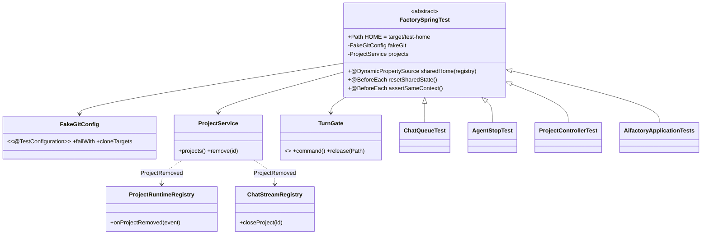
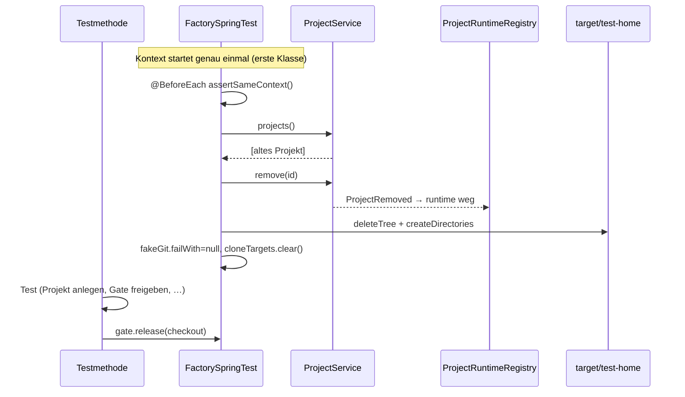

# Plan F6/F7 — Build-Geschwindigkeit `factory-backend`

Stand: 2026-11-03 · Ziel-Commit-Basis: `aifactory-parent` @ HEAD (`/Users/sterlp/dev/workset/peon-ai/aifactory`)

## 1 Kontext (warum)

Jons harte Regel (2026-11-03, gilt für alle Spring-Projekte): **Im Test startet der Spring-Kontext
genau EINMAL pro Build.** Aktuell startet er sehr oft, die Suite läuft ~2 Minuten.

**Befund aus den vorhandenen Surefire-Reports** (`factory-backend/target/surefire-reports`, Lauf
2026-11-03T12:43, 42 Klassen, 208 Tests, Summe der Klassenzeiten **80,9 s**):

* **23 Klassen tragen `@SpringBootTest`** und **jede deklariert ihre eigene `@DynamicPropertySource`**
  (`aifactory.home`, je `@TempDir`) → **23 verschiedene Kontext-Cache-Keys**. Belegt:
  `DynamicPropertiesContextCustomizer.equals/hashCode` = Menge der `Method`-Objekte
  (spring-test 7.0.10, `org.springframework.test.context.support`) — zwei Klassen mit eigener
  Methode sind nie gleich. Zusätzlich splittet `webEnvironment` (MOCK vs RANDOM_PORT) und
  `@AutoConfigureMockMvc`.
* Der Effekt ist im Repo schon dokumentiert: `aifactory/AGENTS-DEV.md:343-344` — „der Kontext-Key
  enthält die Dynamic-Properties, also startet jede Klasse ihren eigenen Server (~3 s)".
  23 × 3 s ≈ **69 s reine Startzeit**, plus 4 weitere Starts aus den beiden Neustart-Tests
  (`ChatRestartTest`, `DelegatedAnswerRestartTest` booten je 2 Apps).
* **Zweiter Kostentreiber: feste Wartezeiten.** Von den 80,9 s Testzeit sind ca. 40 s
  `shellRunCommand`-Tools mit `sleep 3` / `sleep 6` (AgentStopTest 18,0 s · ChatQueueTest 9,5 s ·
  TurnFailureTest 9,3 s · ProjectStatusTest 8,7 s) — der Turn wird künstlich „beschäftigt".
* Kein `@DirtiesContext`, kein `@MockBean/@MockitoBean`, keine `@ActiveProfiles`, keine
  `@TestPropertySource` im Projekt — die einzige Ursache ist die per-Klasse-DPS.

**Ziel:** Suite `< 60 s` Wanduhr, **1** geteilter Kontext (+ die Neustart-Beweise, s. Q2), keine
Änderung an Produktionscode, kein Test verliert Beweiskraft.

## 2 Messprotokoll (Increment 0 — Pflicht, vor jeder Code-Änderung)

```bash
export PATH=~/.nvm/versions/node/v22.12.0/bin:$PATH     # pnpm für factory-ui (AGENTS-DEV.md:3)
time mvn -o -pl factory-backend clean test \
  -Dlogging.level.org.springframework.test.context.cache=DEBUG 2>&1 | tee /tmp/baseline.log
```

Zu protokollieren (in `peon-plan/overview.md` §2 als Tabelle nachtragen, nicht raten):

| Kennzahl | Wie | Baseline | Ziel |
|---|---|---|---|
| Kontexte erzeugt | `grep -o "missCount = [0-9]*" /tmp/baseline.log \| tail -1` | **23** | ≤ 5 (1 geteilt + 4 Neustart) |
| Boot-Zeilen | `grep -cE "Started [A-Za-z]+ in [0-9.]+ seconds"` — **nicht** `Started AifactoryApplication`: ein `@SpringBootTest`-Kontext nennt seine Testklasse, die Anwendungs-Zeile gibt es genau einmal | **23** | ≤ 5 |
| Surefire-Summe | Summe der `testsuite time` über 42 Reports | **80,3 s** | |
| Wanduhr `clean test` | `time` | **118 s** (Maven `Total time 01:57 min`) | < 60 s |
| Tests | `Tests run:` Zeile | **208** (0 Failures, 0 Errors) | 208 |

**Nachtrag Inc 0 (gemessen 2026-11-03, `/tmp/baseline.log`, Exit 0):** Gate erfüllt — `missCount` 23 > 3,
die DPS-Analyse hält. Zeitbild der teuersten Klassen (Surefire): `AgentStopTest` 17,9 · `ChatQueueTest`
9,5 · `TurnFailureTest` 9,2 · `ProjectStatusTest` 8,6 · `AgentActionTest` 7,5 · `ChatUserMessageTest` 3,6 ·
`ChatTurnTest` 1,7 — zusammen **58,0 s von 80,3 s**, und das sind genau die Schlaf-Klassen. Die
Boot-Zeilen selbst sind billig (0,15–2,5 s, Summe ≈ 8 s): der Rest der 118 s − 80,3 s ist Maven-/Fork-
Vorlauf und bleibt von diesem Zyklus unberührt.

**Gate:** Wenn `missCount` schon ≤ 3 ist, ist die DPS-Analyse falsch — dann **stop und melden**,
Increment 2/3 werden nicht gebaut (dann ist nur F7 offen). Wenn Baselines fehlen, wird nichts
umgebaut: die Zahlen sind der Beweis des Inkrements, nicht der Gefühlswert.

## 3 Entscheidungen

* **D-1 · Geteilter Kontext über eine Basisklasse.** `@SpringBootTest(webEnvironment = RANDOM_PORT)`,
  `@Import(FakeGitConfig.class)` und **die eine** `@DynamicPropertySource` stehen nur noch in
  `org.sterl.open.aifactory.FactorySpringTest` (abstract). Spring findet geerbte DPS-Methoden über
  `MethodIntrospector.selectMethods` — das `Method`-Objekt ist für alle Subklassen **dasselbe**, also
  ist der Cache-Key gleich. Unterklassen deklarieren **nichts** davon selbst.
* **D-2 · Ein Test-Home für den ganzen Build, Reset je Testmethode.** `factory-backend/target/test-home`
  (Projekt-relativ, **nicht** `@TempDir` — AGENTS-DEV.md:31-36: `@TempDir` liegt in `java.io.tmpdir`
  und ist damit eine der beiden Schreibwurzeln). Muster ist bereits im Repo:
  `ProjectFilesTest:60/84-90` (`target/inc4b-home`, `deleteTree` + `createDirectories` +
  `fakeGit`-Reset). Dieses Muster wird in die Basisklasse gehoben.
* **D-3 · Reset über Produktionspfade, keine Produktions-Änderung.** Reihenfolge je Test:
  1. `projects.projects()` → je `projects.remove(id)` (publiziert `ProjectRemoved` →
     `ProjectRuntimeRegistry.onProjectRemoved` löscht den Runtime, `ChatStreamRegistry.closeProject`)
  2. Home-Baum löschen und neu anlegen
  3. `fakeGit.failWith = null`, `fakeGit.cloneTargets.clear()`
  Schritt 1 **vor** Schritt 2, weil `remove` den Checkout löscht und `requireOwnCheckout` ihn
  braucht. Wird ein Runtime nicht gedroppt (gleicher Projekt-Id in einer späteren Klasse), ist der
  Beweis rot ⇒ **melden, nicht durch einen Produktions-Hook lösen**.
* **D-4 · Feste Schlaf-Wartezeiten werden zu einem freigegebenen Gate.** Ein echtes
  `shellRunCommand`, das bis zur Freigabe läuft:
  `while [ ! -f .turn-gate ]; do sleep 0.1; done` — der Turn ist **wirklich** in einem laufenden
  Werkzeug (Beweis unverändert), aber die Dauer bestimmt der Test. Der Stop-Beweis wird sogar
  stärker: solange das Gate zu ist, kann der Test „läuft noch" behaupten; Freigabe beendet den Turn.
  **Nicht** angefasst wird `AgentActionTest:345` (`DelayedModel(SUMMARY, 2_500)`): 2500 ms > dem
  1500-ms-Prüfschritt des Kerns ist eine **semantische** Zahl, keine Wartezeit.
* **D-5 · Alle Spring-Tests laufen im selben Modus (RANDOM_PORT).** `ProjectControllerTest`
  (MockMvc, `@AutoConfigureMockMvc`) wird auf echten HTTP-Client umgestellt — Vorlage
  `ProjectFilesTest`/`ProjectStatusTest`; Methoden-Matrix (405) mit `java.net.http.HttpClient`, weil
  `RestTemplate` kein PATCH kann (AGENTS-DEV.md:49-53).
* **D-6 · Env-Startwerte über System-Properties, nicht über DPS.** `SettingsControllerTest`
  registriert heute `EnvFallbackLlmConfigStore.ENV_NAMES` als Dynamic Properties. System-Properties
  sind Teil der `Environment` (die Klasse liest `environment.getProperty(name)`) und **nicht** Teil
  des Cache-Keys → gleiche Beweiskraft, ein Kontext weniger.
* **D-7 · Guard mechanisch, nicht per Disziplin.** Ein ArchUnit-Test hält die Regel:
  (a) jede Klasse mit `@SpringBootTest` (direkt oder über Meta-Annotation) muss
  `FactorySpringTest` beerben oder in einer kurzen, kommentierten Ausnahmeliste stehen
  (nur die beiden Neustart-Klassen); (b) keine Testklasse außer der Basis deklariert
  `@DynamicPropertySource`, `@DirtiesContext`, `@MockitoBean`, `@TestPropertySource`,
  `@ActiveProfiles` oder `@SpringBootTest(properties=…)`. Zusätzlich prüft die Basisklasse in
  `@BeforeEach`, dass sie **dieselbe** `ApplicationContext`-Instanz sieht wie alle Subklassen
  (static `WeakReference`, `assertSame`) — das schlägt sofort fehl, sobald ein zweiter Kontext
  entsteht, unabhängig von der Testreihenfolge.
* **D-8 · Keine Produkt-Doku-Änderung.** `docs/*.md` beschreiben das WAS (Regeln/UCs); dieser
  Zyklus fasst keine UC an. Die Bau-Fakten und Messzahlen gehören nach `aifactory/AGENTS-DEV.md`
  (deutsch, wie die Datei).

### Architektur (Test-Infrastruktur)



Ablauf eines Tests (eine Klasse, ein Kontext, ein Server):



### Skizzen

```java
// src/test/java/org/sterl/open/aifactory/FactorySpringTest.java
@SpringBootTest(webEnvironment = SpringBootTest.WebEnvironment.RANDOM_PORT)
@Import(FakeGitConfig.class)
public abstract class FactorySpringTest {
    public static final Path HOME = Path.of("target", "test-home").toAbsolutePath();

    @Autowired protected ApplicationContext context;
    @Autowired protected ProjectService projects;
    @Autowired protected FakeGitConfig fakeGit;

    @DynamicPropertySource
    static void sharedHome(DynamicPropertyRegistry registry) {
        registry.add(FactoryHome.HOME_PROPERTY, () -> HOME.toString());
    }

    @BeforeEach
    void resetSharedState() { /* remove → wipe → reset fake git */ }
}
```

```java
// src/test/java/org/sterl/open/aifactory/chat/TurnGate.java
final class TurnGate {
    static final String FILE = ".turn-gate";
    /** Ein echtes, laufendes Shell-Werkzeug — kein Schlaf: es endet, wenn der Test es freigibt. */
    static String command() { return "while [ ! -f " + FILE + " ]; do sleep 0.1; done"; }
    static void release(Path checkout) throws IOException { Files.writeString(checkout.resolve(FILE), ""); }
}
```

## 4 Inkremente (jedes für sich grün)

Build-Kommando überall: `mvn -o -pl factory-backend clean test` (bei Einzeltest zusätzlich
`-Dtest='Klasse' -Dsurefire.failIfNoSpecifiedTests=false`, Trenner ist das Komma, nicht `+` —
AGENTS-DEV.md:284).

| # | Inhalt | Beweis | erwartete Wirkung |
|---|---|---|---|
| **0** | Messung nach §2, Zahlen in diesen Plan eintragen | `missCount`, Boot-Zeilen, Wanduhr | Befund, keine Änderung |
| **1** | `TurnGate` + Umstellung der festen Schlaf-Tools (`ChatQueueTest:99`, `AgentStopTest:83`, `TurnFailureTest:55/61`, `ProjectStatusTest:87`, `AgentActionTest:100`, `ChatUserMessageTest:69`, `ChatTurnTest:254`); `TurnGateTest` (pur) | alle betroffenen Klassen grün, `TurnGateTest` grün | −25…−30 s |
| **2a** | `FactorySpringTest` + Reset + Umzug der 4 „ruhigen" Klassen (`ProjectFilesTest`, `ProjectFilesTest`-Muster, `ChatConfigTurnTest`, `TeamInternalsTest`, `WritePinningTest`) | 4 Klassen grün, `missCount` sinkt um 3 | Muster bewiesen |
| **2b** | restliche 12 RANDOM_PORT+FakeGit-Klassen der Chat-Gruppe | ganze Suite grün | 16 → 1 Kontext |
| **3** | MOCK-Klassen + G4 (`AifactoryApplicationTests`, `OneChatPerProjectTest`, `ProjectWorkStateTest`, `UiDeliveryTest`, `AgentSettingsTest`, `SettingsControllerTest`) auf die Basis; `SettingsControllerTest` auf System-Properties (D-6) | Suite grün, `missCount` = 5 | 8 → 2 Kontexte |
| **4** | `ProjectControllerTest` MockMvc → echter HTTP-Client (D-5) | Suite grün, `missCount` = 5 → 1 | 1 Kontext |
| **5** | Guard-Test (D-7) + Messzahlen/Regel in `AGENTS-DEV.md` | Guard grün, Gegenprobe: DPS in einer Unterklasse ⇒ Guard rot | Regel hält mechanisch |
| **6** *(optional)* | `@Timeout`-Obergrenzen auf testwürdige Werte (180 → 60 s) | Suite grün | nur Fehlerfall schneller |

**Reihenfolge-Begründung:** 1 zuerst — reine Testmechanik, keine Strukturänderung, sofort messbar.
2/3/4 bauen aufeinander auf; 4 ist der teuerste Schritt und bringt am wenigsten (ein Kontext), daher
zuletzt. Nach jedem Inkrement: `missCount` + Wanduhr in §2 nachtragen.

## 5 Betroffene Dateien

**Neu**
* `factory-backend/src/test/java/org/sterl/open/aifactory/FactorySpringTest.java`
* `factory-backend/src/test/java/org/sterl/open/aifactory/chat/TurnGate.java`
* `factory-backend/src/test/java/org/sterl/open/aifactory/chat/TurnGateTest.java`
* `factory-backend/src/test/java/org/sterl/open/aifactory/SingleContextGuardTest.java`

**Geändert (Increment 1 — Gate)**
* `chat/ChatQueueTest.java` (auch `:458-464` „Running: `sleep 3`")
* `chat/AgentStopTest.java` (`:66-70`, `:83`, `:152/204/277/337`)
* `chat/TurnFailureTest.java` (`:55/61`)
* `project/ProjectStatusTest.java` (`:87`)
* `chat/AgentActionTest.java` (`:100`)
* `chat/ChatUserMessageTest.java` (`:69`)
* `chat/ChatTurnTest.java` (`:254`)

**Geändert (Increment 2/3 — Basisklasse)**
* `AifactoryApplicationTests`, `ui/UiDeliveryTest`
* `chat/`: ChatQueueTest, AgentStopTest, AgentTurnsFailureTest→`ChatTurnFailureTest`,
  OneChatPerProjectTest, AgentActionTest, TeamInternalsTest, ChatTurnTest, ChatConfigTurnTest,
  WritePinningTest, DelegatedAnswerTest, ProjectRemovalTest, AgentInsightTest, SharedProjectChatTest,
  ChatFirstTouchTest, ProjectWorkStateTest, ChatUserMessageTest
* `config/`: AgentSettingsTest, SettingsControllerTest
* `project/`: ProjectFilesTest, ProjectStatusTest

**Geändert (Increment 4)**
* `project/ProjectControllerTest.java`

**Geändert (Increment 5)**
* `aifactory/AGENTS-DEV.md` (Abschnitt „Build-Geschwindigkeit / Test-Kontext", deutsch)

**Unberührt:** `src/main/**` (keine Produktions-Änderung), `factory-ui/**`, `llmpeon-core/**`,
`docs/**`.

## 6 Regeln & Randbedingungen

* **Keine Produktions-Änderung.** Braucht ein Schritt einen Produktions-Seam (z. B. „alle Runtimes
  droppen"), wird **gemeldet und gestoppt**, nicht gebaut.
* Testcode-Kommentare: englisch; Plan/AGENTS-DEV: deutsch (AGENTS.md).
* Klassen-Testreihenfolge bleibt **sequenziell** (kein `junit.jupiter.execution.parallel`): ein
  Home + ein Server ⇒ geteilte Zustände sind nur sequenziell resetbar.
* Formulierungen, die die Beweiskraft betreffen („a real three seconds", „slowed down by a real
  sleep 3"), werden bei D-4 **mitgeändert** — ein Kommentar, der eine 3-Sekunden-Pause behauptet,
  die es nicht mehr gibt, ist ein Fehler.
* `@TempDir` bleibt für Checkouts/Außenseiten erlaubt; **nur** `aifactory.home` wird fix
  (`target/test-home`), weil es in `java.io.tmpdir` liegen darf (AGENTS-DEV.md:31-36).
* Kein `@DirtiesContext`, kein `@MockitoBean` als „Lösung" — die Regel sagt: gar nicht.

## 7 BDD-Akzeptanz

Kein UC wird berührt (reine Test-Infrastruktur; es gibt keine Story-UC für Build-Zeit). Die
Test-IDs der bestehenden 208 Tests bleiben unverändert — **kein** `// UC-WP-…`-Kommentar wird
entfernt oder verschoben.

| GIVEN / WHEN / THEN | Test (Klasse#Methode) |
|---|---|
| GIVEN ein Gate-Befehl, WHEN er gestartet und 300 ms **nicht** freigegeben ist, THEN läuft er noch; WHEN freigegeben, THEN endet er < 2 s | `TurnGateTest#theGateRunsUntilItIsReleased` |
| GIVEN ein Gate-Befehl ohne Freigabe, WHEN das `timeout` greift, THEN ist er beendet (kein hängender Prozess) | `TurnGateTest#anUnreleasedGateEndsWithItsTimeout` |
| GIVEN eine vorige Testmethode hat Projekt + Home hinterlassen, WHEN `resetSharedState` läuft, THEN ist `projects()` leer, `target/test-home` leer und `fakeGit` neutral | `FactorySpringTestResetTest#aPreviousTestLeavesNothingBehind` |
| GIVEN zwei Spring-Testklassen, WHEN beide laufen, THEN sehen sie dieselbe `ApplicationContext`-Instanz | Basisklasse `assertSameContext` (in jedem `@BeforeEach`) |
| GIVEN eine neue Testklasse mit eigenem `@DynamicPropertySource`, WHEN die Suite baut, THEN ist der Guard rot | `SingleContextGuardTest#noTestDeclaresItsOwnContextConfiguration` |
| GIVEN eine neue `@SpringBootTest`-Klasse ohne Basisklasse, WHEN die Suite baut, THEN ist der Guard rot | `SingleContextGuardTest#everySpringTestSharesTheOneContext` |
| GIVEN die volle Suite, WHEN `clean test`, THEN `Tests run: 208, Failures: 0, Errors: 0`, `missCount ≤ 5`, Wanduhr < 60 s | Messprotokoll §2 |
| GIVEN `ProjectControllerTest`, WHEN über HTTP statt MockMvc, THEN dieselben Status/Bodies wie vorher (405-Matrix inklusive) | `ProjectControllerTest` (12 Tests, unveränderte Assertions) |

## 8 Teststrategie

* **Umstellung statt Neuschreiben:** In Increment 1–4 ändern sich Assertions nicht, nur das
  Zeit-Gerät bzw. die Client-Technik. Jede Zeile, die eine Assertion ändert, wird im Report benannt
  (Ausnahme: die Gate-Befehls-Zeichenkette in „Running: …"-Prüfungen).
* **Gegenprobe (Mutations-Probe) je Inkrement:** (1) Gate nie freigeben ⇒ genau die betroffenen
  Tests fallen in ihre Deadline; (2) `@DynamicPropertySource` zurück in eine Unterklasse ⇒ Guard rot
  und `missCount` steigt; (3) Reset-Schritt „remove" weglassen ⇒ der Isolations-Test rot.
* **Reihenfolge-Risiko:** Ein geteilter Kontext macht Klassen-Reihenfolge sichtbar. Deshalb
  Increment 2a klein (4 Klassen, zwei davon schreiben/löschen Projekte) und die volle Suite als
  Beweis. Surefire darf die Reihenfolge ändern (`runOrder`) — ein zweiter Lauf mit
  `-Dsurefire.runOrder=reversealphabetical` ist Teil des Abschluss-Beweises.
* **Kein Test wird schneller durch „mehr Polling"**: Poll-Intervalle (25 ms) bleiben; nur die
  festen Blockaden werden zu Gates.
* **F1 (Timeouts) ehrlich beantworten:** Deadlines (20–30 s) kosten im grünen Lauf **nichts** — sie
  greifen nur im Fehlerfall. Der Zeitfresser sind ausschließlich feste Wartezeiten. Deshalb:
  Deadlines bleiben (Flake-Schutz), `@Timeout`-Obergrenzen werden nur dort gesenkt, wo sie
  offensichtlich zu hoch sind (180 s bei < 3 s Laufzeit). Das ist Increment 6, optional.

## 9 Offene Punkte für den Dev (melden, nicht entscheiden)

* Wenn `ProjectRuntimeRegistry` nach `remove()` noch einen Runtime hält (Id-Kollision zwischen
  Klassen) → **melden**; dann ist D-3 nicht tragfähig und der Reset braucht eine andere Form.
* Wenn `ProjectControllerTest` über HTTP einen Fall nicht 1:1 abbildet (z. B. MockMvc-spezifische
  405/415-Antwort) → Fall benennen, Test **nicht** stillschweigend löschen.

## 10 Status der Messung

| Kennzahl | Baseline (2026-11-03) | nach Inc 1 | nach Inc 2b | nach Inc 4 (Ziel) |
|---|---|---|---|---|
| `missCount` (Kontexte) | **23** | 23 — Inc 1 öffnet keine Kontexte | | ≤ 5 |
| Boot-Zeilen | **23** | 23 | | ≤ 5 |
| Surefire-Summe | **80,3 s** (42 Reports, Lauf 16:36) | **35,7 s** (43 Reports) | | |
| Wanduhr `clean test` | **118 s** | **73 s** | | < 60 s |
| Tests | **208** / 0 Fehler | **210** / 0 Fehler (`TurnGateTest` +2) | | 208 |

**Inc 0 — erledigt (2026-11-03):** gemessen wie in §2, Gate bestanden (`missCount` 23 > 3).

**Inc 1 — erledigt (2026-11-03):** `TurnGate` + `TurnGateTest` (2 Tests, 0,8 s), alle sieben Schlaf-Klassen
umgestellt. Zeitbild nachher (Surefire): `AgentStopTest` 17,9 → **3,0** · `TurnFailureTest` 9,2 → **0,4** ·
`ChatQueueTest` 9,5 → **0,7** · `ProjectStatusTest` 8,6 → **2,7** · `ChatUserMessageTest` 3,6 → **0,7** ·
`ChatTurnTest` 1,7 → **0,8**; `AgentActionTest` 7,5 → **4,5** (der `DelayedModel(2_500)` bleibt — D-4).
Gegenproben: (a) Freigabe in `ChatQueueTest#secondInputDuringTurnQueues` und
`AgentStopTest#stopEndsTheTurnAndEndsItAsAnEnd` entfernt ⇒ genau diese zwei Tests rot auf ihrer eigenen
Deadline (30,4 s / 33,6 s); (b) Ticks-Obergrenze des Gates entfernt ⇒ genau
`TurnGateTest#anUnreleasedGateEndsWithItsTimeout` rot. Beide Proben zurückgenommen; Zertifikatslauf
`/tmp/inc1-cert.log`: 210 Tests, 0 Fehler, 73 s, `missCount` 23.

Benannte Abweichungen von der Skizze (§3 D-4 / §5):

1. `TurnGate` ist **public** mit public-Helfern — `ProjectStatusTest` liegt im Paket `project` und braucht
   das Gerät; die Skizze war paketprivat.
2. Der Gate-Befehl ist **selbst begrenzt** (`i < 450` × 0,1 s ≈ 45 s) statt nackter `while`-Schleife, und die
   Werkzeug-Zeit ist **60 s** statt 20 s: beides absichtlich **über** den Test-Deadlines (30 s), damit eine
   vergessene Freigabe rot wird und nicht „nur langsam". Die Obergrenze ist der Gegenstand des zweiten
   BDD-Falls (§7 „das `timeout` greift") — billig bewiesen, ohne 45 s zu warten.
3. Zwei Tests warten jetzt **auf die Queue**, bevor sie freigeben
   (`AgentStopTest#stopWithAQueuedInputStillStopsTheOneTurn`, `ChatUserMessageTest#aQueuedInputKeepsItsName`):
   das Gate liefert kein 3-Sekunden-Fenster mehr, auf das die Probe sich bisher verlassen konnte. Das ist
   eine Verschärfung — keine Assertion ist weggefallen.
4. Texte, die eine Pause behaupteten, sind mitgezogen (§6): `SLEEP_TOOL`/`HOLD_TOOL` → `GATE_TOOL`,
   `call_sleep` → `call_gate`, „Schlaf drei Sekunden" → „hält das Werkzeug", „fertig nach dem schlaf" →
   „fertig nach dem werkzeug".
5. `ProjectStatusTest.createProject` liefert `CreatedProject(id, localPath)` (vorher nur die Id) — der
   Checkout ist die Tür zum Gate. Nebenbefund: `Path.of(JsonPath.read(…))` bindet an
   `Path.of(URI, String…)`, also typisierte lokale Variable.

