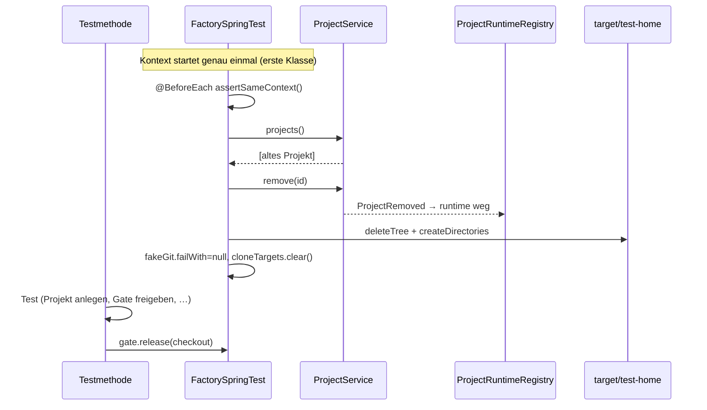

# Plan F6/F7 — Build-Geschwindigkeit `factory-backend`

Stand: 2026-11-03 · Ziel-Commit-Basis: `aifactory-parent` @ HEAD (`/Users/sterlp/dev/workset/peon-ai/aifactory`)

## 1 Kontext (warum)

Jons harte Regel (2026-11-03, gilt für alle Spring-Projekte): **Im Test startet der Spring-Kontext
genau EINMAL pro Build.** Aktuell startet er sehr oft, die Suite läuft ~2 Minuten.

**Befund aus den vorhandenen Surefire-Reports** (`factory-backend/target/surefire-reports`, Lauf
2026-11-03T12:43, 42 Klassen, 208 Tests, Summe der Klassenzeiten **80,9 s**):

* **23 Klassen tragen `@SpringBootTest`** und **jede deklariert ihre eigene `@DynamicPropertySource`**
  (`aifactory.home`, je `@TempDir`) → **23 verschiedene Kontext-Cache-Keys**. Belegt:
  `DynamicPropertiesContextCustomizer.equals/hashCode` = Menge der `Method`-Objekte
  (spring-test 7.0.10, `org.springframework.test.context.support`) — zwei Klassen mit eigener
  Methode sind nie gleich. Zusätzlich splittet `webEnvironment` (MOCK vs RANDOM_PORT) und
  `@AutoConfigureMockMvc`.
* Der Effekt ist im Repo schon dokumentiert: `aifactory/AGENTS-DEV.md:343-344` — „der Kontext-Key
  enthält die Dynamic-Properties, also startet jede Klasse ihren eigenen Server (~3 s)".
  23 × 3 s ≈ **69 s reine Startzeit**, plus 4 weitere Starts aus den beiden Neustart-Tests
  (`ChatRestartTest`, `DelegatedAnswerRestartTest` booten je 2 Apps).
* **Zweiter Kostentreiber: feste Wartezeiten.** Von den 80,9 s Testzeit sind ca. 40 s
  `shellRunCommand`-Tools mit `sleep 3` / `sleep 6` (AgentStopTest 18,0 s · ChatQueueTest 9,5 s ·
  TurnFailureTest 9,3 s · ProjectStatusTest 8,7 s) — der Turn wird künstlich „beschäftigt".
* Kein `@DirtiesContext`, kein `@MockBean/@MockitoBean`, keine `@ActiveProfiles`, keine
  `@TestPropertySource` im Projekt — die einzige Ursache ist die per-Klasse-DPS.

**Ziel:** Suite `< 60 s` Wanduhr, **1** geteilter Kontext (+ die Neustart-Beweise, s. Q2), keine
Änderung an Produktionscode, kein Test verliert Beweiskraft.

## 2 Messprotokoll (Increment 0 — Pflicht, vor jeder Code-Änderung)

```bash
export PATH=~/.nvm/versions/node/v22.12.0/bin:$PATH     # pnpm für factory-ui (AGENTS-DEV.md:3)
time mvn -o -pl factory-backend clean test \
  -Dlogging.level.org.springframework.test.context.cache=DEBUG 2>&1 | tee /tmp/baseline.log
```

Zu protokollieren (in `peon-plan/overview.md` §2 als Tabelle nachtragen, nicht raten):

| Kennzahl | Wie | Baseline | Ziel |
|---|---|---|---|
| Kontexte erzeugt | `grep -o "missCount = [0-9]*" /tmp/baseline.log \| tail -1` | **23** | **1** (der geteilte; `ProjectControllerTest` ist Inc 4) |
| Boot-Zeilen | `grep -cE "Started [A-Za-z]+ in [0-9.]+ seconds"` — **nicht** `Started AifactoryApplication`: ein `@SpringBootTest`-Kontext nennt seine Testklasse, die Anwendungs-Zeile gibt es genau einmal | **23** | **1** |
| Surefire-Summe | Summe der `testsuite time` über 42 Reports | **80,3 s** | |
| Wanduhr `clean test` | `time` | **118 s** (Maven `Total time 01:57 min`) | < 60 s |
| Tests | `Tests run:` Zeile | **208** (0 Failures, 0 Errors) | 208 |

**Nachtrag Inc 0 (gemessen 2026-11-03, `/tmp/baseline.log`, Exit 0):** Gate erfüllt — `missCount` 23 > 3,
die DPS-Analyse hält. Zeitbild der teuersten Klassen (Surefire): `AgentStopTest` 17,9 · `ChatQueueTest`
9,5 · `TurnFailureTest` 9,2 · `ProjectStatusTest` 8,6 · `AgentActionTest` 7,5 · `ChatUserMessageTest` 3,6 ·
`ChatTurnTest` 1,7 — zusammen **58,0 s von 80,3 s**, und das sind genau die Schlaf-Klassen. Die
Boot-Zeilen selbst sind billig (0,15–2,5 s, Summe ≈ 8 s): der Rest der 118 s − 80,3 s ist Maven-/Fork-
Vorlauf und bleibt von diesem Zyklus unberührt.

**Gate:** Wenn `missCount` schon ≤ 3 ist, ist die DPS-Analyse falsch — dann **stop und melden**,
Increment 2/3 werden nicht gebaut (dann ist nur F7 offen). Wenn Baselines fehlen, wird nichts
umgebaut: die Zahlen sind der Beweis des Inkrements, nicht der Gefühlswert.

## 3 Entscheidungen

* **D-1 · Geteilter Kontext über eine Basisklasse.** `@SpringBootTest(webEnvironment = RANDOM_PORT)`,
  `@Import(FakeGitConfig.class)` und **die eine** `@DynamicPropertySource` stehen nur noch in
  `org.sterl.open.aifactory.FactorySpringTest` (abstract). Spring findet geerbte DPS-Methoden über
  `MethodIntrospector.selectMethods` — das `Method`-Objekt ist für alle Subklassen **dasselbe**, also
  ist der Cache-Key gleich. Unterklassen deklarieren **nichts** davon selbst.
* **D-2 · Ein Test-Home für den ganzen Build, Reset je Testmethode.** `factory-backend/target/test-home`
  (Projekt-relativ, **nicht** `@TempDir` — AGENTS-DEV.md:31-36: `@TempDir` liegt in `java.io.tmpdir`
  und ist damit eine der beiden Schreibwurzeln). Muster ist bereits im Repo:
  `ProjectFilesTest:60/84-90` (`target/inc4b-home`, `deleteTree` + `createDirectories` +
  `fakeGit`-Reset). Dieses Muster wird in die Basisklasse gehoben.
* **D-3 · Reset über Produktionspfade, keine Produktions-Änderung.** Reihenfolge je Test:
  1. `projects.projects()` → je `projects.remove(id)` (publiziert `ProjectRemoved` →
     `ProjectRuntimeRegistry.onProjectRemoved` löscht den Runtime, `ChatStreamRegistry.closeProject`)
  2. Home-Baum löschen und neu anlegen
  3. `fakeGit.failWith = null`, `fakeGit.cloneTargets.clear()`
  Schritt 1 **vor** Schritt 2, weil `remove` den Checkout löscht und `requireOwnCheckout` ihn
  braucht. Wird ein Runtime nicht gedroppt (gleicher Projekt-Id in einer späteren Klasse), ist der
  Beweis rot ⇒ **melden, nicht durch einen Produktions-Hook lösen**.
* **D-4 · Feste Schlaf-Wartezeiten werden zu einem freigegebenen Gate.** Ein echtes
  `shellRunCommand`, das bis zur Freigabe läuft:
  `while [ ! -f .turn-gate ]; do sleep 0.1; done` — der Turn ist **wirklich** in einem laufenden
  Werkzeug (Beweis unverändert), aber die Dauer bestimmt der Test. Der Stop-Beweis wird sogar
  stärker: solange das Gate zu ist, kann der Test „läuft noch" behaupten; Freigabe beendet den Turn.
  **Nicht** angefasst wird `AgentActionTest:345` (`DelayedModel(SUMMARY, 2_500)`): 2500 ms > dem
  1500-ms-Prüfschritt des Kerns ist eine **semantische** Zahl, keine Wartezeit.
* **D-5 · Alle Spring-Tests laufen im selben Modus (RANDOM_PORT).** `ProjectControllerTest`
  (MockMvc, `@AutoConfigureMockMvc`) wird auf echten HTTP-Client umgestellt — Vorlage
  `ProjectFilesTest`/`ProjectStatusTest`; Methoden-Matrix (405) mit `java.net.http.HttpClient`, weil
  `RestTemplate` kein PATCH kann (AGENTS-DEV.md:49-53).
* **D-6 · Env-Startwerte über System-Properties, nicht über DPS.** `SettingsControllerTest`
  registriert heute `EnvFallbackLlmConfigStore.ENV_NAMES` als Dynamic Properties. System-Properties
  sind Teil der `Environment` (die Klasse liest `environment.getProperty(name)`) und **nicht** Teil
  des Cache-Keys → gleiche Beweiskraft, ein Kontext weniger.
* **D-7 · Guard mechanisch, nicht per Disziplin.** Ein ArchUnit-Test hält die Regel:
  (a) jede Klasse mit `@SpringBootTest` (direkt oder über Meta-Annotation) muss
  `FactorySpringTest` beerben oder in einer kurzen, kommentierten Ausnahmeliste stehen
  (nur die beiden Neustart-Klassen); (b) keine Testklasse außer der Basis deklariert
  `@DynamicPropertySource`, `@DirtiesContext`, `@MockitoBean`, `@TestPropertySource`,
  `@ActiveProfiles` oder `@SpringBootTest(properties=…)`. Zusätzlich prüft die Basisklasse in
  `@BeforeEach`, dass sie **dieselbe** `ApplicationContext`-Instanz sieht wie alle Subklassen
  (static `WeakReference`, `assertSame`) — das schlägt sofort fehl, sobald ein zweiter Kontext
  entsteht, unabhängig von der Testreihenfolge.
* **D-8 · Keine Produkt-Doku-Änderung.** `docs/*.md` beschreiben das WAS (Regeln/UCs); dieser
  Zyklus fasst keine UC an. Die Bau-Fakten und Messzahlen gehören nach `aifactory/AGENTS-DEV.md`
  (deutsch, wie die Datei).

### Architektur (Test-Infrastruktur)


Ablauf eines Tests (eine Klasse, ein Kontext, ein Server):



### Skizzen

```java
// src/test/java/org/sterl/open/aifactory/FactorySpringTest.java
@SpringBootTest(webEnvironment = SpringBootTest.WebEnvironment.RANDOM_PORT)
@Import(FakeGitConfig.class)
public abstract class FactorySpringTest {
    public static final Path HOME = Path.of("target", "test-home").toAbsolutePath();

    @Autowired protected ApplicationContext context;
    @Autowired protected ProjectService projects;
    @Autowired protected FakeGitConfig fakeGit;

    @DynamicPropertySource
    static void sharedHome(DynamicPropertyRegistry registry) {
        registry.add(FactoryHome.HOME_PROPERTY, () -> HOME.toString());
    }

    @BeforeEach
    void resetSharedState() { /* remove → wipe → reset fake git */ }
}
```

```java
// src/test/java/org/sterl/open/aifactory/chat/TurnGate.java
final class TurnGate {
    static final String FILE = ".turn-gate";
    /** Ein echtes, laufendes Shell-Werkzeug — kein Schlaf: es endet, wenn der Test es freigibt. */
    static String command() { return "while [ ! -f " + FILE + " ]; do sleep 0.1; done"; }
    static void release(Path checkout) throws IOException { Files.writeString(checkout.resolve(FILE), ""); }
}
```

## 4 Inkremente (jedes für sich grün)

Build-Kommando überall: `mvn -o -pl factory-backend clean test` (bei Einzeltest zusätzlich
`-Dtest='Klasse' -Dsurefire.failIfNoSpecifiedTests=false`, Trenner ist das Komma, nicht `+` —
AGENTS-DEV.md:284).

| # | Inhalt | Beweis | erwartete Wirkung |
|---|---|---|---|
| **0** | Messung nach §2, Zahlen in diesen Plan eintragen | `missCount`, Boot-Zeilen, Wanduhr | Befund, keine Änderung |
| **1** | `TurnGate` + Umstellung der festen Schlaf-Tools (`ChatQueueTest:99`, `AgentStopTest:83`, `TurnFailureTest:55/61`, `ProjectStatusTest:87`, `AgentActionTest:100`, `ChatUserMessageTest:69`, `ChatTurnTest:254`); `TurnGateTest` (pur) | alle betroffenen Klassen grün, `TurnGateTest` grün | −25…−30 s |
| **2a** | `FactorySpringTest` + Reset + Umzug der 4 „ruhigen" Klassen (`ProjectFilesTest`, `ProjectFilesTest`-Muster, `ChatConfigTurnTest`, `TeamInternalsTest`, `WritePinningTest`) | 4 Klassen grün, `missCount` sinkt um 3 | Muster bewiesen |
| **2b** | restliche 12 RANDOM_PORT+FakeGit-Klassen der Chat-Gruppe | ganze Suite grün | 16 → 1 Kontext |
| **3** | MOCK-Klassen + G4 (`AifactoryApplicationTests`, `OneChatPerProjectTest`, `ProjectWorkStateTest`, `UiDeliveryTest`, `AgentSettingsTest`, `SettingsControllerTest`) auf die Basis; `SettingsControllerTest` auf System-Properties (D-6) | Suite grün, `missCount` = 5 | 8 → 2 Kontexte |
| **4** ✅ | `ProjectControllerTest` MockMvc → echter HTTP-Client (D-5) | Suite grün, `missCount` = 5 → 1 (real 2 → **1**) | 1 Kontext — erreicht |
| **5** ✅ | Guard-Test (D-7) + Messzahlen/Regel in `AGENTS-DEV.md` | Guard grün, Gegenproben: `@ActiveProfiles`/`@SpringBootTest` an einer Unterklasse ⇒ Guard rot; Eintrag ohne Boot ⇒ rot | Regel hält mechanisch |
| **6** ✅ | `@Timeout`-Obergrenzen auf testwürdige Werte (Formel statt Accumulation, s. §10 Inc 6) | Suite grün, Gegenlauf grün, Probe: Obergrenze an einer Methode beißt | nur Fehlerfall schneller (grün unverändert 42,8 s) |
| **7** ✅ | Freigabe-Nachtrag §9: Deadline des 90/90-Falls auf 60 s + Lifecycle-Netz `junit-platform.properties` (120 s) | Suite grün, Gegenlauf grün, Probe: `@BeforeAll` mit 5 s Schlaf bei Netz 2 s ⇒ `TimeoutException` | nur Fehlerfall schneller (grün 43,1 s) |

**Reihenfolge-Begründung:** 1 zuerst — reine Testmechanik, keine Strukturänderung, sofort messbar.
2/3/4 bauen aufeinander auf; 4 ist der teuerste Schritt und bringt am wenigsten (ein Kontext), daher
zuletzt. Nach jedem Inkrement: `missCount` + Wanduhr in §2 nachtragen.

## 5 Betroffene Dateien

**Neu**
* `factory-backend/src/test/java/org/sterl/open/aifactory/FactorySpringTest.java`
* `factory-backend/src/test/java/org/sterl/open/aifactory/chat/TurnGate.java`
* `factory-backend/src/test/java/org/sterl/open/aifactory/chat/TurnGateTest.java`
* `factory-backend/src/test/java/org/sterl/open/aifactory/SingleContextGuardTest.java`

**Geändert (Increment 1 — Gate)**
* `chat/ChatQueueTest.java` (auch `:458-464` „Running: `sleep 3`")
* `chat/AgentStopTest.java` (`:66-70`, `:83`, `:152/204/277/337`)
* `chat/TurnFailureTest.java` (`:55/61`)
* `project/ProjectStatusTest.java` (`:87`)
* `chat/AgentActionTest.java` (`:100`)
* `chat/ChatUserMessageTest.java` (`:69`)
* `chat/ChatTurnTest.java` (`:254`)

**Geändert (Increment 2/3 — Basisklasse)**
* `AifactoryApplicationTests`, `ui/UiDeliveryTest`
* `chat/`: ChatQueueTest, AgentStopTest, AgentTurnsFailureTest→`ChatTurnFailureTest`,
  OneChatPerProjectTest, AgentActionTest, TeamInternalsTest, ChatTurnTest, ChatConfigTurnTest,
  WritePinningTest, DelegatedAnswerTest, ProjectRemovalTest, AgentInsightTest, SharedProjectChatTest,
  ChatFirstTouchTest, ProjectWorkStateTest, ChatUserMessageTest
* `config/`: AgentSettingsTest, SettingsControllerTest
* `project/`: ProjectFilesTest, ProjectStatusTest

**Geändert (Increment 4)**
* `project/ProjectControllerTest.java`

**Geändert (Increment 5)**
* `aifactory/AGENTS-DEV.md` (Abschnitt „Build-Geschwindigkeit / Test-Kontext", deutsch)

**Unberührt:** `src/main/**` (keine Produktions-Änderung), `factory-ui/**`, `llmpeon-core/**`,
`docs/**`.

## 6 Regeln & Randbedingungen

* **Keine Produktions-Änderung.** Braucht ein Schritt einen Produktions-Seam (z. B. „alle Runtimes
  droppen"), wird **gemeldet und gestoppt**, nicht gebaut.
* Testcode-Kommentare: englisch; Plan/AGENTS-DEV: deutsch (AGENTS.md).
* Klassen-Testreihenfolge bleibt **sequenziell** (kein `junit.jupiter.execution.parallel`): ein
  Home + ein Server ⇒ geteilte Zustände sind nur sequenziell resetbar.
* Formulierungen, die die Beweiskraft betreffen („a real three seconds", „slowed down by a real
  sleep 3"), werden bei D-4 **mitgeändert** — ein Kommentar, der eine 3-Sekunden-Pause behauptet,
  die es nicht mehr gibt, ist ein Fehler.
* `@TempDir` bleibt für Checkouts/Außenseiten erlaubt; **nur** `aifactory.home` wird fix
  (`target/test-home`), weil es in `java.io.tmpdir` liegen darf (AGENTS-DEV.md:31-36).
* Kein `@DirtiesContext`, kein `@MockitoBean` als „Lösung" — die Regel sagt: gar nicht.

## 7 BDD-Akzeptanz

Kein UC wird berührt (reine Test-Infrastruktur; es gibt keine Story-UC für Build-Zeit). Die
Test-IDs der bestehenden 208 Tests bleiben unverändert — **kein** `// UC-WP-…`-Kommentar wird
entfernt oder verschoben.

| GIVEN / WHEN / THEN | Test (Klasse#Methode) |
|---|---|
| GIVEN ein Gate-Befehl, WHEN er gestartet und 300 ms **nicht** freigegeben ist, THEN läuft er noch; WHEN freigegeben, THEN endet er < 2 s | `TurnGateTest#theGateRunsUntilItIsReleased` |
| GIVEN ein Gate-Befehl ohne Freigabe, WHEN das `timeout` greift, THEN ist er beendet (kein hängender Prozess) | `TurnGateTest#anUnreleasedGateEndsWithItsTimeout` |
| GIVEN eine vorige Testmethode hat Projekt + Home hinterlassen, WHEN `resetSharedState` läuft, THEN ist `projects()` leer, `target/test-home` leer und `fakeGit` neutral | `FactorySpringTestResetTest#aPreviousTestLeavesNothingBehind` |
| GIVEN zwei Spring-Testklassen, WHEN beide laufen, THEN sehen sie dieselbe `ApplicationContext`-Instanz | Basisklasse `assertSameContext` (in jedem `@BeforeEach`) |
| GIVEN eine neue Testklasse mit eigenem `@DynamicPropertySource`, WHEN die Suite baut, THEN ist der Guard rot | `SingleContextGuardTest#noTestDeclaresItsOwnContextConfiguration` |
| GIVEN eine neue `@SpringBootTest`-Klasse ohne Basisklasse, WHEN die Suite baut, THEN ist der Guard rot | `SingleContextGuardTest#onlyTheBaseDeclaresTheSpringBootTest` |
| GIVEN die volle Suite, WHEN `clean test`, THEN `Tests run: 208, Failures: 0, Errors: 0`, `missCount ≤ 5`, Wanduhr < 60 s | Messprotokoll §2 |
| GIVEN `ProjectControllerTest`, WHEN über HTTP statt MockMvc, THEN dieselben Status/Bodies wie vorher (405-Matrix inklusive) | `ProjectControllerTest` (12 Tests, unveränderte Assertions) |

## 8 Teststrategie

* **Umstellung statt Neuschreiben:** In Increment 1–4 ändern sich Assertions nicht, nur das
  Zeit-Gerät bzw. die Client-Technik. Jede Zeile, die eine Assertion ändert, wird im Report benannt
  (Ausnahme: die Gate-Befehls-Zeichenkette in „Running: …"-Prüfungen).
* **Gegenprobe (Mutations-Probe) je Inkrement:** (1) Gate nie freigeben ⇒ genau die betroffenen
  Tests fallen in ihre Deadline; (2) `@DynamicPropertySource` zurück in eine Unterklasse ⇒ Guard rot
  und `missCount` steigt; (3) Reset-Schritt „remove" weglassen ⇒ der Isolations-Test rot.
* **Reihenfolge-Risiko:** Ein geteilter Kontext macht Klassen-Reihenfolge sichtbar. Deshalb
  Increment 2a klein (4 Klassen, zwei davon schreiben/löschen Projekte) und die volle Suite als
  Beweis. Surefire darf die Reihenfolge ändern (`runOrder`) — ein zweiter Lauf mit
  `-Dsurefire.runOrder=reversealphabetical` ist Teil des Abschluss-Beweises.
* **Kein Test wird schneller durch „mehr Polling"**: Poll-Intervalle (25 ms) bleiben; nur die
  festen Blockaden werden zu Gates.
* **F1 (Timeouts) ehrlich beantworten:** Deadlines (20–30 s) kosten im grünen Lauf **nichts** — sie
  greifen nur im Fehlerfall. Der Zeitfresser sind ausschließlich feste Wartezeiten. Deshalb:
  Deadlines bleiben (Flake-Schutz), `@Timeout`-Obergrenzen werden nur dort gesenkt, wo sie
  offensichtlich zu hoch sind (180 s bei < 3 s Laufzeit). Das ist Increment 6, optional.

## 9 Offene Punkte für den Dev (melden, nicht entscheiden)

* Wenn `ProjectRuntimeRegistry` nach `remove()` noch einen Runtime hält (Id-Kollision zwischen
  Klassen) → **melden**; dann ist D-3 nicht tragfähig und der Reset braucht eine andere Form.
* Wenn `ProjectControllerTest` über HTTP einen Fall nicht 1:1 abbildet (z. B. MockMvc-spezifische
  405/415-Antwort) → Fall benennen, Test **nicht** stillschweigend löschen.
* **Erledigt (Inc 7, Jons Entscheidung 2026-11-03):** die 90/90-Kollision trug `aQueuedInputIsCounted`
  (der Name `afterARestartEveryProjectIsFree` in diesem Punkt war falsch, §10 Inc 6/3 berichtigt): Deadline
  auf **60 s** gesenkt, `@Timeout(90)` bleibt das Netz darüber (+30 s) — nach der Senkung ist eine Obergrenze
  von 120 s nicht nötig und wäre eine Lockerung ohne Grund.
* **Erbaut (Inc 7):** `junit.jupiter.execution.timeout.lifecycle.method.default=120s` in
  `factory-backend/src/test/resources/junit-platform.properties` — begrenzt jetzt auch
  `@BeforeAll`/`@BeforeEach` (Context-Start, Home-Reset der Basis). Probe: `@BeforeAll` mit 5 s Schlaf bei
  Netz 2 s ⇒ `Timeout … timed out after 2 seconds`.

## 10 Status der Messung

| Kennzahl | Baseline (2026-11-03) | nach Inc 1 | nach Inc 2a | nach Inc 2b | nach Inc 3 | nach Inc 4 | nach Inc 5 | nach Inc 6 | nach Inc 7 |
|---|---|---|---|---|---|---|---|---|---|
| `missCount` (Kontexte) | **23** | 23 — Inc 1 öffnet keine Kontexte | **20** (−3, wie vorhergesagt) | **9** (−11) | **2** (−7) | **1** (erreicht — Regel erfüllt) | **1** | **1** | **1** |
| Boot-Zeilen | **23** | 23 | **20** | **9** | **2** | **1** (`Started UiDeliveryTest` = der geteilte) | **1** | **1** | **1** |
| Surefire-Summe | **80,3 s** (42 Reports, Lauf 16:36) | **35,7 s** (43 Reports) | **35,2 s** (44 Reports) | **33,5 s** (44 Reports) | **32,7 s** (44 Reports) | **32,1 s** (44 Reports) | **33,7 s** (45 Klassen, Guard +1,4 s) | **33,2 s** (45 Klassen; XML 33,1 s) | **33,6 s** (45 Reports) |
| Wanduhr `clean test` | **118 s** | **73 s** | **72,8 s** (Maven 01:11 min) | **51,1 s** (Maven 50,1 s) | **41,9 s** (Maven 41,2 s) | **41,5 s** — Ziel < 60 s **erreicht** | **43,4 s** | **42,8 s** (Gegenlauf 42,8 s) | **43,1 s** (Maven 42,1 s; Gegenlauf 43,7 s) |
| Tests | **208** / 0 Fehler | **210** / 0 Fehler (`TurnGateTest` +2) | **212** / 0 Fehler (`FactorySpringTestResetTest` +2) | **212** / 0 Fehler | **212** / 0 Fehler | **212** / 0 Fehler | **216** / 0 Fehler (`SingleContextGuardTest` +4) | **216** / 0 Fehler | **216** / 0 Fehler |

**Nach Inc 2b gemessen (2026-11-03):** Die Wanduhr ist von 72,8 s auf **51,1 s** gefallen — die Kontexte
kosteten also deutlich mehr als die Summe ihrer Boot-Zeilen (6,1 s): die Boot-Zeile misst nur die
Anwendung, nicht Context-Refresh, Web-Server und Modulith-Verdrahtung. Damit ist auch Jons korrigiertes
Ziel (~65 s) unterschritten und das ursprüngliche (< 60 s) erreicht. zweiter Lauf mit
`-Dsurefire.runOrder=reversealphabetical`: 212 Tests, 0 Fehler, `missCount` 9, 50,5 s — die Reihenfolge
ändert nichts. Verbleibende 9 Kontexte: 1 geteilter + `ProjectStatusTest` (Neustart-Beweis, s. Ausnahmen)
+ `AifactoryApplicationTests` + `OneChatPerProjectTest` + `ProjectWorkStateTest` + `UiDeliveryTest` +
`AgentSettingsTest` + `SettingsControllerTest` (Inc 3) + `ProjectControllerTest` (Inc 4).

**Ziel-Korrektur (Jon, 2026-11-03, zweiter Nachtrag — gilt):** Wanduhr-Ziel bleibt **< 60 s**, die
65-s-Korrektur ist hinfällig; Inc 3 ist bei 41,9 s angekommen. Die 69-s-Startzeit-Annahme bleibt
falsifiziert (Boot-Summe der 23 Kontexte = 6,1 s), aber die Kontexte kosteten eben doch 21 s pro elf
Stück (Context-Refresh, Web-Server, Modulith — nicht die Boot-Zeile). Der Maven-Vorlauf von ~37 s
(clean, zwei Compile-Läufe, Fork) wird in diesem Zyklus **nicht** angefasst.

**Inc 0 — erledigt (2026-11-03):** gemessen wie in §2, Gate bestanden (`missCount` 23 > 3).

**Inc 1 — erledigt (2026-11-03):** `TurnGate` + `TurnGateTest` (2 Tests, 0,8 s), alle sieben Schlaf-Klassen
umgestellt. Zeitbild nachher (Surefire): `AgentStopTest` 17,9 → **3,0** · `TurnFailureTest` 9,2 → **0,4** ·
`ChatQueueTest` 9,5 → **0,7** · `ProjectStatusTest` 8,6 → **2,7** · `ChatUserMessageTest` 3,6 → **0,7** ·
`ChatTurnTest` 1,7 → **0,8**; `AgentActionTest` 7,5 → **4,5** (der `DelayedModel(2_500)` bleibt — D-4).
Gegenproben: (a) Freigabe in `ChatQueueTest#secondInputDuringTurnQueues` und
`AgentStopTest#stopEndsTheTurnAndEndsItAsAnEnd` entfernt ⇒ genau diese zwei Tests rot auf ihrer eigenen
Deadline (30,4 s / 33,6 s); (b) Ticks-Obergrenze des Gates entfernt ⇒ genau
`TurnGateTest#anUnreleasedGateEndsWithItsTimeout` rot. Beide Proben zurückgenommen; Zertifikatslauf
`/tmp/inc1-cert.log`: 210 Tests, 0 Fehler, 73 s, `missCount` 23.

Benannte Abweichungen von der Skizze (§3 D-4 / §5):

1. `TurnGate` ist **public** mit public-Helfern — `ProjectStatusTest` liegt im Paket `project` und braucht
   das Gerät; die Skizze war paketprivat.
2. Der Gate-Befehl ist **selbst begrenzt** (`i < 450` × 0,1 s ≈ 45 s) statt nackter `while`-Schleife, und die
   Werkzeug-Zeit ist **60 s** statt 20 s: beides absichtlich **über** den Test-Deadlines (30 s), damit eine
   vergessene Freigabe rot wird und nicht „nur langsam". Die Obergrenze ist der Gegenstand des zweiten
   BDD-Falls (§7 „das `timeout` greift") — billig bewiesen, ohne 45 s zu warten.
3. Zwei Tests warten jetzt **auf die Queue**, bevor sie freigeben
   (`AgentStopTest#stopWithAQueuedInputStillStopsTheOneTurn`, `ChatUserMessageTest#aQueuedInputKeepsItsName`):
   das Gate liefert kein 3-Sekunden-Fenster mehr, auf das die Probe sich bisher verlassen konnte. Das ist
   eine Verschärfung — keine Assertion ist weggefallen.
4. Texte, die eine Pause behaupteten, sind mitgezogen (§6): `SLEEP_TOOL`/`HOLD_TOOL` → `GATE_TOOL`,
   `call_sleep` → `call_gate`, „Schlaf drei Sekunden" → „hält das Werkzeug", „fertig nach dem schlaf" →
   „fertig nach dem werkzeug".
5. `ProjectStatusTest.createProject` liefert `CreatedProject(id, localPath)` (vorher nur die Id) — der
   Checkout ist die Tür zum Gate. Nebenbefund: `Path.of(JsonPath.read(…))` bindet an
   `Path.of(URI, String…)`, also typisierte lokale Variable.

**Inc 2a — erledigt (2026-11-03, Commit `55648e79`):** `FactorySpringTest` (abstract, Basis für alle
Spring-Klassen) mit der einen `@DynamicPropertySource` auf `target/test-home`, `@Import(FakeGitConfig)`,
`assertSameContext` + `resetSharedState` (remove → wipe → FakeGit-Reset). Umgezogen: `ProjectFilesTest`,
`ChatConfigTurnTest`, `TeamInternalsTest`, `WritePinningTest` (+ neu `FactorySpringTestResetTest`, 2 Tests).
Beweis: Teilmenge 5 Klassen grün bei `missCount = 1` / 1 Boot; volle Suite 212 Tests / 0 Fehler,
`missCount` 20, 72,8 s. Gegenprobe §8(3): `projects.remove(…)` im Reset entfernt ⇒ genau
`aPreviousTestLeavesNothingBehind` rot (Zeile „frischer Verlauf" — der alte Runtime antwortet noch),
Probe zurückgenommen. Die 4 Klassen sind die 4 Namen der Skizze; der Doppel-Eintrag
„`ProjectFilesTest`-Muster" in §4 ist als `ProjectFilesTest` selbst gelesen (4 Klassen ⇒ `missCount` −3 ✓).

Benannte Abweichungen Inc 2a:

1. Die Basis deklariert `classes = AifactoryApplication.class` explizit (Skizze ließ es weg) — sonst hängt
   der Cache-Key an der Paket-Suchläufe jeder Unterklasse; explizit ist er für alle identisch.
2. Kontext-Identität über `AtomicReference` statt `WeakReference` — der Kontext lebt in der Spring-Cache-
   Statik ohnehin bis zum JVM-Ende, ein Weak-Reference gewinnt nichts.
3. Die Basis prüft zusätzlich `environment.getProperty("aifactory.home") == HOME`: eine Unterklasse, die
   ihr eigenes Home registriert, fällt damit sofort und nicht erst als Id-Kollision.
4. `assertThat(HOME).isEmpty()` gibt es in dieser AssertJ-Version nicht (`AbstractPathAssert` ohne
   `isEmpty`) — die Leer-Probe liest `Files.list(HOME)`.

**Inc 2b — erledigt (2026-11-03, Commit `a2bd2554`):** elf Klassen der Chat-Gruppe auf
`FactorySpringTest` (`AgentActionTest`, `AgentInsightTest`, `AgentStopTest`, `ChatFirstTouchTest`,
`ChatQueueTest`, `ChatTurnFailureTest`, `ChatTurnTest`, `ChatUserMessageTest`, `DelegatedAnswerTest`,
`ProjectRemovalTest`, `SharedProjectChatTest`) — pro Klasse: `@SpringBootTest`/`@Import`/`@TempDir
static Path home`/eigene DPS weg, `home.resolve(…)` → `HOME.resolve(…)`, eigenes `ProjectService`-Feld
weg (die Basis liefert es). **Keine Assertion geändert**, kein UC-Kommentar bewegt.**
Beweis: Teilmenge 11 Klassen = 45 Tests grün bei `missCount` 1; volle Suite 212 / 0 Fehler,
`missCount` 9, 51,1 s; Gegenprobe §8(2) ist Inc 5 (Guard).

**Benannte Abweichung Inc 2b (melden statt entscheiden — von Jon in Inc 3 aufgehoben):** §4 zählte für 2b
**12** Klassen.
`ProjectStatusTest` blieb eigener Kontext: sein Fall `afterARestartEveryProjectIsFree` (UC-WP-47) liest
`workStates.current()` und verlangt `isNotEmpty()` — „die Projekte der Tests vorher sind registriert"
(javadoc-begründet: nur ein Projekt, das *gearbeitet hat*, macht „frei nach dem Neustart" zur Aussage).
Der Reset des geteilten Homes löscht genau diese Projekte vor jeder Testmethode, also wäre der Fall auf
der Basis entweder rot oder nur mit Uminterpretation grün (§6 verbietet beides still). Er war damit als
**dritte dokumentierte Ausnahme** neben `ChatRestartTest`/`DelegatedAnswerRestartTest` vorgeschlagen;
Jon hat abgelehnt (Reihenfolge-Kopplung ist ein latenter Fehler) — Inc 3 macht den Fall selbsttragend,
die Ausnahme entfällt. Die beiden Neustart-Klassen booten per `SpringApplicationBuilder` und erscheinen
damit nie im Context-Cache (`ChatRestartTest`/`DelegatedAnswerRestartTest` haben bewusst kein
`@SpringBootTest`). Ihre zweiten Apps bleiben zusätzliche Boots, sind aber nicht Teil der Kennzahl.

**Inc 3 — erledigt (2026-11-03):** sechs Klassen auf `FactorySpringTest` (`AifactoryApplicationTests`,
`ui/UiDeliveryTest`, `chat/OneChatPerProjectTest`, `chat/ProjectWorkStateTest`, `config/AgentSettingsTest`,
`config/SettingsControllerTest`) **und** `project/ProjectStatusTest` — nach Jons Entscheidung statt der
vorgeschlagenen Ausnahme: `afterARestartEveryProjectIsFree` legt sein Projekt jetzt **selbst** an und hält
es bis zum Neustart in einem echten Tool, statt die Projekte der Methoden vorher zu lesen. Beweis: Teilmenge
7 Klassen = 31 Tests grün bei `missCount` 1 / 1 Boot; volle Suite **212 / 0 Fehler, `missCount` 2,
41,9 s** (`/tmp/inc3-cert.log`); Gegenlauf `reversealphabetical` 212 / 0 Fehler, `missCount` 2, 41,9 s.
Damit ist die **dritte Ausnahme vom Tisch**: verbleibende 2 Kontexte = 1 geteilter +
`ProjectControllerTest` (Inc 4). D-6 erfüllt: `SettingsControllerTest` führt seine Env-Startwerte über
**System-Properties** zu (`@AfterEach` räumt sie — sie wirken auf die ganze JVM, ein Leak wäre eine
zweite Antwort auf `AIFACTORY_LLM_*` in einer fremden Klasse), die eigene DPS ist weg.
Gegenproben: (a) D-6 — `System.setProperty` für den Key auskommentiert ⇒ genau
`configFileWinsOverEnvironment` (`keySource` ENV→NONE) und `removeKeyDeletesItAndRefreshesTheStatus` rot;
(b) Neustart-Fall — Erwartung auf `working=true` gesetzt ⇒ genau `afterARestartEveryProjectIsFree` rot;
(c) Grundlage geschwächt (`ProjectWork.free` statt `working`) ⇒ derselbe Fall rot. Alle Proben zurückgenommen.

Benannte Abweichungen Inc 3:

1. **`ProjectStatusTest` ist keine Ausnahme mehr** (Jons Auftrag): der Neustart-Fall ist selbsttragend und
   damit **strenger** als vorher — vorher war die Grundlage „die Projekte der Tests vorher sind registriert"
   (alle längst frei), jetzt ist das eigene Projekt im Moment des Neustarts **arbeitend**, und die
   Erwartung ist `containsExactly(ProjectWork.free(…))` statt einer aus `before` abgeleiteten Menge.
   `@TestMethodOrder`/`@Order` sind entfallen (keine Reihenfolge-Abhängigkeit mehr); der Fall wartet nach
   dem Beweis auf das Ende des eigenen Turns, damit kein laufendes Werkzeug in den Reset des nächsten
   Methods läuft.
2. `AgentSettingsTest.emptyHome` → `talkToTheRunningServer`: der Home-Wipe ist Aufgabe der Basis, ein
   `@BeforeEach`, der einen leeren Home behauptet, während die Basis ihn schon geleert hat, wäre ein
   zweiter, unsichtbarer Besitzer desselben Zustands. Ebenso `SettingsControllerTest.emptyHomeWithoutStartValues`
   → `withoutStartValues` (+ `@AfterEach forgetTheStartValues`).
3. `OneChatPerProjectTest` schreibt seine Factory-Config jetzt im `@BeforeEach` statt im `@BeforeAll`
   (nur `MODEL.start()` bleibt Klassenarbeit): der geteilte Home wird je Methode geleert, eine im
   `@BeforeAll` geschriebene Config wäre vor dem ersten Test weg.
4. Nachziehen aus Inc 1 (§6): die beiden Tool-Call-Ids `call_sleep` in `ProjectStatusTest` heißen
   `call_gate`; Inc 1 hatte die Umbenennung gemeldet, diese Klasse aber nicht erwischt.
5. `AifactoryApplicationTests` prüft weiterhin „kein `~/.aifactory`", jetzt gegen das geteilte
   `target/test-home`; sein eigener `createTempDirectory`-Home und der `@AfterAll`-Wipe sind entfallen.

**Inc 4 — erledigt (2026-11-03):** `ProjectControllerTest` von MockMvc auf echten HTTP-Client umgestellt —
`extends FactorySpringTest`, `@LocalServerPort`, `java.net.http.HttpClient`; `@SpringBootTest`,
`@AutoConfigureMockMvc`, `@Import`, eigener Temp-Home, `emptyHome`, `@AfterAll` und die eigene
`@DynamicPropertySource` sind weg. Damit hat **keine Testklasse** des Projekts noch eine eigene
Context-Konfiguration. Beweis: Teilmenge `ProjectControllerTest` + `ProjectFilesTest` = 15 Tests grün bei
`missCount` 1 / 1 Boot; volle Suite **212 / 0 Fehler, `missCount` 1, 1 Boot, 41,5 s**
(`/tmp/inc4-cert.log`); Gegenlauf `reversealphabetical` 212 / 0 Fehler, `missCount` 1, 41,45 s
(`/tmp/inc4-rev.log`). §4 erwartete für Inc 4 „`missCount` 5 → 1"; nach Inc 2b/3 waren es real 2 → **1**.
Die beiden Neustart-Beweise (`ChatRestartTest`, `DelegatedAnswerRestartTest`) booten per
`SpringApplicationBuilder` und erscheinen im Context-Cache nie — sie sind und bleiben keine Kontexte der
Kennzahl.

Benannte Abweichungen Inc 4:

1. **Nur der Draht hat sich geändert.** Status, JSON-Pfade, `fakeGit`- und Dateibeweise aller 12 Tests sind
   unverändert; die MockMvc-Matcher sind durch AssertJ auf `statusCode()` bzw. den Body ersetzt.
   `jsonPath("$").isArray()` existiert über HTTP nicht — die Array-Form wird am Body geprüft
   (`rows(…)` verlangt `[` am Anfang), sonst wäre daraus still eine Objekt-Assertion geworden.
2. **§7/D-5 schreibt dieser Klasse eine „405-Matrix" zu — die gibt es dort nicht.** Die Methoden-Matrix
   (`PUT`/`POST`/`PATCH`/`DELETE` ⇒ 405) liegt in `ProjectFilesTest` und bleibt dort; nichts ist dafür
   neu erfunden oder als Fall gestrichen worden. Der JDK-Client ist trotzdem richtig
   (`RestTemplate` kann kein PATCH — AGENTS-DEV.md:49-53).
3. **`finally`-Räumer in `removeNeverDeletesOutsideProjectDir`** (Jons Freigabe): die Klasse schreibt eine
   handgemachte, vergiftete `projects.json`; schon deren **Lesen** wirft `IllegalStateException`
   (`StoredProject.toProject`), und auf dem geteilten Home zerlegt das den Reset **jeder** folgenden
   Klasse. Gegenprobe (Räumer entfernt, `/tmp/inc4-probe-cleanup.log`): 10 Fehler — 4 spätere Methoden der
   Klasse selbst und je 3 in `ProjectFilesTest` und `ProjectStatusTest`. Der Zweig gehört zum Test, weil
   der Zustand ihm gehört; die Basis bleibt streng (Beweiskraft §8(3) unverändert).
4. Zwei Formen ohne Beweiskraft-Änderung: `sameUrlReusesExistingClone` prüft nach dem Array-Beweis
   `isNotEmpty()` (folgt ohnehin aus dem Zugriff auf `$[0].id`); die Leser sind typisiert
   (`text`/`number`/`rows`), weil ein generisches `<T>` direkt in `assertThat` für javac mehrdeutig ist
   (`assertThat(Predicate)` vs. `assertThat(IntPredicate)`).
5. Home ist jetzt das geteilte `target/test-home`; `victim` bleibt ein eigener `@TempDir` — es ist die
   Ausbruch-Seite außerhalb beider Wurzeln, nicht das Home (AGENTS-DEV.md:31-36).
6. **Offen für Inc 5:** `aifactory/AGENTS-DEV.md:343-344` („pro Settings-Klasse ein eigener
   `@SpringBootTest`-Kontext … ~3 s") beschreibt den alten Stand und wird mit dem Bau-Abschnitt von Inc 5
   korrigiert — in Inc 4 bewusst nicht angefasst.

**Inc 5 — erledigt (2026-11-03):** `SingleContextGuardTest` (4 Regeln, ArchUnit auf Bytecode, ohne eigenen
Kontext) und der Bau-Abschnitt „Build-Geschwindigkeit / Test-Kontext" in `aifactory/AGENTS-DEV.md`; die
veraltete Aussage „pro Settings-Klasse ein eigener `@SpringBootTest`-Kontext … (~3 s)" ist ersetzt (sie hing
als Rest an einem Slot-Bullet). Beweis: volle Suite **216 / 0 Fehler, `missCount` 1, 1 Boot, 43,4 s**
(`/tmp/inc5-cert.log`; der Guard selbst kostet 1,4 s). Gegenproben, alle zurückgenommen und diff-geprüft:
(a) §7-Fall — `@DynamicPropertySource`-Methode in `ProjectFilesTest` ⇒ genau
`noTestDeclaresItsOwnContextConfiguration` rot, Nenner nennt die Methode
(`/tmp/inc5-probe-dps.log`); dasselbe für `@ActiveProfiles` an einer Unterklasse
(`/tmp/inc5-probe-a.log`); (b) `@SpringBootTest` an einer Unterklasse ⇒ genau
`onlyTheBaseDeclaresTheSpringBootTest` **und** `theSharedContextIsTheOneAndTheSameEverywhere` rot, weil die
`webEnvironment` dann nicht gesetzt ist (`/tmp/inc5-probe-b.log`); (c) Ausnahmeliste um eine Klasse ohne
zweiten Boot erweitert ⇒ genau `theRestartProofsStayTheOnlySecondBoots` rot
(`/tmp/inc5-probe-c.log`).

Benannte Abweichungen Inc 5:

1. **Die Ausnahmliste führt drei Klassen, nicht zwei.** `ProjectStatusTest` bootet seit Inc 3 (Jons
   Entscheidung gegen die dritte Ausnahme) seine eigene zweite App für UC-WP-47 — dieselbe Ausnahme-Form wie
   `ChatRestartTest`/`DelegatedAnswerRestartTest`. Für die **Kontext-Kennzahl** ist es keine Ausnahme: es
   erbt die Basis und deklariert kein eigenes `@SpringBootTest` (`missCount` bleibt 1). Die Liste ist die
   Regel für *zweite Boots* und prüft in beide Richtungen — ein neuer Boot ist rot, ein überflüssiger
   Eintrag auch.
2. **ArchUnit ja, aber ohne `@ArchTest`** — gleiches Muster wie `ArchitectureGuardTest`: das Artefakt
   `archunit-junit5` liegt offline nicht bei, `com.tngtech.archunit:archunit` kommt über `spring-modulith`
   und reicht für `ArchRule.check` bzw. eigene Auswertung über `JavaClasses`.
3. **Regel (a) ist strenger als formuliert:** statt „erbt die Basis oder steht auf der Liste" gilt „nur die
   Basis *deklariert* `@SpringBootTest`". Das erwischt auch eine Unterklasse, die die Annotation erneut
   erklärt (geerbte Annotationen ändern den Cache-Key nicht, ein anderer `webEnvironment` täte es).
   Zusätzlich geprüft: `properties=` nirgends, `webEnvironment` der Basis = `RANDOM_PORT`, und
   Boot-Slices (`@WebMvcTest`, `@WebFluxTest`, `@DataJpaTest`, `@JsonTest`) sind kontext-splitlend — D-7
   nannte sie nicht. `@MockitoBean`/`@MockitoSpyBean` werden auf Klasse, Methode **und** Feld geprüft, denn
   dort stehen sie.
4. **„bootet außerhalb" wird über `SpringApplicationBuilder` gemessen**, nicht über Annotationen: ein
   Neustart-Beweis trägt bewusst keine Spring-Test-Annotation, ein Annotationsscan sähe ihn nicht.

**Inc 6 — erledigt (2026-11-03):** `@Timeout`-Obergrenzen auf **eine Formel** gebracht (17 Klassen,
26 Zeilen; **keine** Deadline und keine Assertion geändert): klassenweit = größte methodenweite Obergrenze
der Klasse + 30 s; methodenweit 60 s, wo die größte Await-Deadline ≤ 30 s; Klassen ohne methodenweite
Obergrenze 60 s; die beiden Restart-Klassen 90 s (zweite App ≈ 2,5 s); `ProjectStatusTest` 120 s (Deadline
90 s). Wirksam: 180 → 90/120, 120 → 90/60, 90 → 60. Beweis: volle Suite **216 / 0 Fehler, `missCount` 1,
1 Boot, 42,8 s** (`/tmp/inc6-cert.log`), Gegenlauf `reversealphabetical` 216 / 0 Fehler, `missCount` 1,
42,8 s (`/tmp/inc6-rev.log`). Die grüne Wanduhr ändert sich nicht — wie §8 sagt: Obergrenzen kosten im
grünen Lauf nichts, die Wirkung liegt im Fehlerfall.

Benannte Abweichungen Inc 6:

1. **`@Timeout` auf der Klasse ist eine Methoden-Obergrenze, keine Container-Grenze** (JUnit-Javadoc:
   „the same effect as applying it to all testable methods … **but not to its lifecycle methods**").
   Gegenprobe 1 — `@Timeout(1)` an `DelegatedAnswerRestartTest`: **grün**, 7,5 s Klassenlauf. Gegenprobe 2 —
   dieselbe Obergrenze an `ProjectStatusTest#afterARestartEveryProjectIsFree`:
   `TimeoutException: … timed out after 1 second` (`/tmp/inc6-probe-timeout.log`). Beide Proben
   zurückgenommen. Folgen: (a) kein Wert ist toter Schmuck, jede Klassen-Obergrenze gilt pro Methode;
   (b) **Lifecycle-Methoden sind unbegrenzt** — `@BeforeAll`/`@BeforeEach`, also auch der Home-Reset der
   Basis und der Context-Start. Ein hängender Reset wäre nur über
   `junit.jupiter.execution.timeout.lifecycle.method.default` zu fassen — **Vorschlag, nicht gebaut**.
2. **§4 schrieb „180 → 60 s"** — bei korrekter Semantik wäre 60 s für die Restart-Klassen und für die
   Klasse mit 90-s-Deadline falsch. Gebaut ist die Formel oben (180 → 90 bzw. 120), nicht die Zahl.
3. **Nachträglich berichtigt (Inc 7):** die hier gemeldete Kollision „Deadline = Obergrenze" trägt **nicht**
   `afterARestartEveryProjectIsFree` (deren Wartepunkte: 15 s / 15 s / 60 s bei Obergrenze 90 s), sondern
   `aQueuedInputIsCounted` (Deadline 90 s bei `@Timeout(90)`). Inc 7 hat dort die Deadline auf 60 s gesenkt.

**Inc 7 — erledigt (2026-11-03, Freigabe-Nachtrag zu §9):** beide offenen Punkte gebaut, **keine**
Assertion geändert.

1. **Die 90/90-Kollision liegt in `aQueuedInputIsCounted`, nicht in `afterARestartEveryProjectIsFree`**
   (die Namensangabe in §9 und hier bei Inc 6 war falsch, unten berichtigt). Nach Jons Prinzip — Deadline =
   ehrliche Erwartung, Obergrenze = Netz darüber — ist dort die **Deadline 90 s → 60 s**: dieselbe Zahl, die
   der Nachbarfall `theListShowsWorkingAndFreeAfterTheTurn` für denselben „frei"-Übergang schon vorher
   verlangte. Die Klasse misst 2,5 s für drei Tests, die Erwartung ist also gut zwanzigfach die Realität.
   Damit ist `@Timeout(90)` wieder ein Netz von +30 s über der Deadline; **eine Anhebung auf 120 s ist nicht
   nötig und wäre eine Lockerung ohne Grund** (Zahlen unten, §9 berichtigt).
2. **Lifecycle-Netz gebaut:** `factory-backend/src/test/resources/junit-platform.properties` (neu, erste
   Test-Ressource des Moduls) setzt `junit.jupiter.execution.timeout.lifecycle.method.default=120s`
   (JUnit **6.0.3**; Name am Jar belegt: `org.junit.jupiter.engine.Constants.
   DEFAULT_LIFECYCLE_METHOD_TIMEOUT_PROPERTY_NAME`). Trifft `@BeforeAll`/`@BeforeEach`/`@AfterEach`/
   `@AfterAll` — also auch den Context-Start (`SpringExtension.beforeAll`) und den Home-Reset der Basis, die
   kein `@Timeout` der Welt erreichte (Inc 6/1). 120 s ≈ 50× der beobachteten Boot-Zeit (2,4 s).
   **Probe:** provisorische Klasse mit `@BeforeAll { Thread.sleep(5_000) }` bei Netz **2 s** ⇒
   `Timeout holdsTheLifecycleMethod() timed out after 2 seconds`; Nebenbefund: der Schlaf wurde
   **unterbrochen** (`InterruptedException` als unterdrückte Exception) — die Grenze wirkt also auch im
   Default-Thread-Modus. Probe und 2-s-Wert zurückgenommen.

Beweis: volle Suite **216 / 0 Fehler, `missCount` 1, 1 Boot, 43,1 s** (`/tmp/inc7-cert.log`), Gegenlauf
`reversealphabetical` 216 / 0 Fehler, `missCount` 1, 43,7 s (`/tmp/inc7-rev.log`); Surefire-Summe 33,6 s
über 45 Reports.

Benannte Abweichungen Inc 7:

1. Die zwei Zahlen der Freigabe (90→60 und 90→120) gehörten **nicht an dieselbe Methode**: 60 s ist die
   Deadline von `aQueuedInputIsCounted`, und dort braucht keine Obergrenze 120 s (Punkt 1 oben).
   `afterARestartEveryProjectIsFree` bleibt, wie es ist: 60-s-Deadline, 90-s-Obergrenze.
2. Die neue Ressourcendatei ist der erste Eintrag unter `src/test/resources` — geprüft im Gegenlauf:
   dieselbe Datei wird geladen, `missCount` bleibt 1, kein Test läuft in die neue Grenze.


