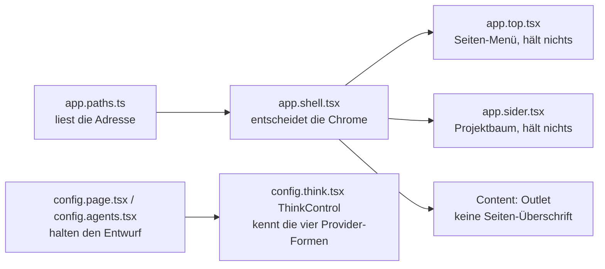

# Look-Story Runde 7 — Punkte 1–3 (UI-only), Branch `web-factory-5`

Quelle der drei Punkte: `aifactory/docs/open-points.md:12-21` (Runde 7, Pauls Wortlaut).
Punkt 4 („Send/Clear/Compact nur als Icons", `docs/open-points.md:27-31`) ist von Paul geparkt — **nicht geplant, nicht gebaut** (§14).

Repo `/Users/sterlp/dev/workset/peon-ai/aifactory`, Branch **web-factory-5**, Stand `ccd62bd4`.
Baseline (gemessen, `docs/memory.md:17-18`, `peon-plan/review-findings.md:13-14`): **UI 268 Tests / 29 Dateien**, `npx tsc -b` 0, `npx oxlint` 0/0, `npx antd lint ./src` 0.

---

## 0. Kontext / Ziel

Drei Look-Befunde aus Pauls Browser-Runde 7, alle Fabrik-UI, kein Backend, kein Core:

1. **Überschriften im Main-Panel raus** — „die Überschriften kleben open, können raus im main panel — wir haben es ja im Top-Menü." (`docs/open-points.md:12-14`)
2. **„Chats" zurück ins Top-Menü** — Top-Menü wieder **Projekte · Chat · Settings**; der Sider bleibt, ist aber **nur bei Chats sichtbar** (`docs/open-points.md:15-18`). Widerspricht R-WP-43 — Regel wird umgeschrieben (Jons Doc-Arbeit), **nicht still**.
3. **Reasoning-Effort-Feld (Think) ist ein Select ohne eigene Eingabe** — „ich kann nichts selber eingeben" (`docs/open-points.md:19-21`).

Wert für den Nutzer: eine Fläche, die den Seitenamen nicht zweimal sagt; ein Weg zurück in den Chat ohne Umweg über die Projektliste; ein Think-Feld, das auch einen Wert bekommt, den die Provider-Liste nicht kennt.

**Harte Rahmen:** `docs/**` ist Jons Eigentum — Planner und Dev fassen es **nie** an. Der Plan nennt pro Inkrement, welche Doc-Regeln **vor dem Bau** auf ❌ gehören (§6). Browser-Abnahme ist **Jons Schritt** (§11). Kein neuer Test, keine neue Testdatei: **268 Tests / 29 Dateien bleiben es in allen vier Inkrementen** (Ersetzen/Umbauen statt Anhäufen, Pauls Sparvorgabe).

## 1. Was die Docs verlangen (wörtlich, mit Fundstelle)

| Doc-Stelle | Wortlaut (relevant) | Folge für diese Story |
|---|---|---|
| `docs/ui.md:157-163` (R-WP-43) | „Das **Header** trägt Marke, das horizontale **Top-Menü** … Die Menü-Einträge sind die globalen Seiten **Projekte · Settings** … **„Chat" steht nicht im Top-Menü**: der Chat ist nur über den Sider erreichbar" | Punkt 2 dreht diese Regel — **Jon schreibt sie um**, bevor L2 gebaut wird |
| `docs/ui.md:164-166` | „auf einer **Chat-Adresse** bleibt der Kopf unmarkiert (… der Sider markiert allein)" | UC-WP-76 GIVEN 3 ist die Gegenprobe zu L2 — muss umgeschrieben werden |
| `docs/ui.md:177-183` (UC-WP-76) | GIVEN 1 „… Menü mit genau **Projekte · Settings**"; GIVEN 3 „… Menü-Markierung folgt der Adresse" | beide GIVENs betroffen |
| `docs/ui.md:44-46` (R-WP-1) | „Der Chat selbst ist nur über den Sider erreichbar" | Gegenprobe zu L2 (Chat im Top-Menü) — umschreiben |
| `docs/ui.md:98-105` (R-WP-38) | „Die Navigation besteht aus dem **Top-Menü im Header** und einem **Sider** links." | L3 macht den Sider adressabhängig — Regel muss das hergeben |
| `docs/ui.md:210-235` (R-WP-44 / UC-WP-78) | Sider = Projektbaum mit Klapp-Gruppen, **Griff ist der Text-Button oben links im Header**, „ein Sider ohne Projekte ist **leer**" | L3: auf Nicht-Chat-Adressen kein Sider **und** kein Griff — Regel ergänzen |
| `docs/ui.md:14-30` (Look-Absatz) | „Design-Änderungen ändern **keine** UI-Tests … Abgenommen wird **am Browser** — jsdom beweist nur Verhalten" | L1/L2/L3 sind Look/Verdrahtung: **keine neuen Tests**, nur umbauen + je eine Negativ-Assertion in bestehenden Tests (§8) |
| `docs/config.md:143-150` (R-WP-23) | „**Think ist die Form des Basis-Providers**, nie Freitext: Toggle · Values · FreeString · None … Ein gespeicherter Wert außerhalb der Liste **bleibt verbatim** (ADR-0064); leer erbt den Default (R-THINK-10)" | L4 macht Values/Toggle editierbar — „nie Freitext" muss umgeschrieben werden |
| `docs/config.md:171-180` (UC-WP-67) | GIVEN 1 „THEN ist Think eine Auswahl aus leer / `true` / `false` — **kein Freitext-Feld**"; GIVEN 2 verbatim | GIVEN 1 + 2 betreffen L4 |
| `docs/config.md:189-201` (R-WP-49) | „Think (Default) … **dieselbe Form des Basis-Providers** … ein gespeicherter Wert außerhalb der Liste bleibt verbatim" | gilt auch für das Default-Feld in L4 |
| `docs/config.md:203-211` (UC-WP-85) | GIVEN 1 „THEN ist „Think (Default)" eine Auswahl aus der Werte-Liste des Providers — **kein Freitext**" | GIVEN 1 betrifft L4 |
| `docs/config.md:213-234` (R-WP-50/UC-WP-86) | „Die Modell-Felder … sind **AutoComplete** — Auswahl … **oder freie Eingabe**" | Vorbild und Paritätsanker für L4 |
| `docs/chat.md` (Kopf des Chats) | **keine** Regel, die einen `h1` im Chat-Kopf verlangt; `chat.md:31` „Plugin zeigt sie als Überschrift" betrifft das **Plugin**, nicht unsere Fläche | L1 ist chat-seitig regelfrei — bleibt trotzdem stehen (§2 D2) |

**Fundstellen-Konflikt (gemeldet, nicht entschieden):** `docs/open-points.md:21` zitiert für Punkt 3 „F8, **R-WP-51**". Die Regel, die das Feld tatsächlich beschreibt, ist **R-WP-23 (`:143-150`) + R-WP-49 (`:189-201`)** mit **UC-WP-67 / UC-WP-85**; R-WP-51 (`:236-253`) handelt Max Tokens/Query-/Header-Params. Der Plan baut gegen R-WP-23/49 und nennt Jon diese Zeilen zur Umschreibung (§6) — keine eigene Regel-Umdeutung.

## 2. Entscheidungen

**D1 — L1 umfasst genau die zwei Seiten-`h1` des Main-Panels.** `project.page.tsx:115` (`<h1>{content.projects.title}</h1>` = „Projects") und `config.page.tsx:221` (`<h1>{content.config.title}</h1>` = „Settings"). Beide sagen dasselbe wie der Top-Menü-Eintrag, den der Nutzer gerade geklickt hat. **Verworfen:** auch den Chat-Kopf leeren (D2), auch den `h2` „Agents" (`config.agents.tsx:215`) entfernen — der ist Abschnittsüberschrift **innerhalb** einer Seite und steht in keinem Menü.

**D2 — Der Chat-Kopf bleibt (`chat.page.tsx:545-547`).** Er zeigt den **Projektnamen**, und den sagt das Top-Menü gerade **nicht** (es sagt nur „Chat"); der Sider kann zugeklappt sein (§ R-WP-44) und fällt unter dem Breakpoint ganz weg. Zudem beweisen fünf bestehende Assertionen den Namen als Anker (`app.routes.test.tsx:134,165,294,317,335`, `chat.page.test.tsx:65`, `project.files.test.tsx:391` „the name stands once, in the chat head"). Ihn zu entfernen wäre ein Behavior-Wechsel mit Test-Rodung — **Annahme ⏳, §13 Q1**, von Jon am Browser abzusegnen.

**D3 — Die Region behält ihren Namen.** `project.page.tsx:114` / `config.page.tsx:220` (`<section className="view" aria-label=…>`) bleiben unverändert: die Seite heißt weiterhin so viel wie das Menü sagt, nur ohne Sicht-Duplikat. existing pattern: der Chat wird über genau diesen Mechanismus gefunden (`getByRole('region', { name })`, 25 Stellen in `factory-ui/test/app|chat|project`).

**D4 — „Chat"-Eintrag = `chatRoot` als Schlüssel, Klick führt auf `/chat`.** `app.menu.ts:25-27` (`entry(key,label,active)`) unverändert benutzen; `app.paths.ts:121-131` (`pageKeyOfPathname`) liefert für **jede** Chat-Adresse `chatRoot` — **keine Änderung in `app.paths.ts`**. Der Klick landet auf `/chat` → `LastChatRoute` (`app.routes.tsx:96-99`) entscheidet schon heute: letztes Projekt, sonst Projektliste (UC-WP-51, UC-WP-76 GIVEN 2). Kein neuer String: `content.nav.chat = 'Chat'` existiert (`content.ts:21-22`).

**D5 — Sider-Sichtbarkeit hängt an der Adresse, nicht an einem Zustand.** `app.shell.tsx` rechnet **einmal** `const page = pageKeyOfPathname(pathname)` und entscheidet damit beides: `AppTop active={page}` und `{page === chatRoot && (<AppSider …/>)}`; der Griff `AppSiderToggle` (`app.shell.tsx:82`) verschwindet mit dem Sider — ein Griff für einen Baum, den es nicht gibt, ist ein toter Knopf. **Abgewichen:** eigener Zustand / Menü-Zustand (wäre eine zweite Antwort neben der URL, widerspricht R-WP-1/UC-WP-52); `navKeyOfPathname(pathname) !== null` (funktioniert ebenfalls, wäre aber ein zweiter Lesevorgang für dieselbe Frage — `pageKeyOfPathname` ist schon der Lesevorgang des Headers). `/chat/x/files` ist Chat-Seite → Sider bleibt (UC-WP-70: Einheiten wechseln, Baum bleibt).

**D6 — L4: `AutoComplete` statt `Select` in **beiden** Choose-Formen.** Begründung ist die Plugin-Entscheidung (memory-Regel: Grundsatzentscheidungen stehen im Plugin), belegt:
- `org.sterl.llmpeon.core/src/main/java/org/sterl/llmpeon/provider/ThinkValueSupport.java:15-19` — „Toggle → **editable combo** `[\"\", \"true\", \"false\"]` … Values → **combo** of the provider's actual values … stored value = displayed value (verbatim)".
- `org.sterl.llmpeon/src/org/sterl/llmpeon/parts/config/widgets/AgentModelConfigSection.java:183-188` — `new Combo(this, SWT.BORDER)` für Toggle, `buildThink()` für Values ebenso.
- `…/ModelConfigWidget.java:300-302` — `readThink(): … return thinkCombo.getText(); // both render in the (editable) combo`.
⇒ Web-Äquivalent = **ein** editierbares Feld mit Angebot: **VALUES und TOGGLE**, an **beiden** Orten (Default-Seite `config.page.tsx:271-276`, Agent-Sektionen `config.agents.tsx:261-266`). FREE/UNKNOWN bleibt `Input`, NONE bleibt Hinweis (`config.think.tsx:35-41,62-70`) — unverändert.

**D7 — Leeres Feld heißt weiter „erbt" (R-THINK-10).** Angebot bleibt ersten Eintrag `{ value: '', label: content.agents.inheritOption }`; zusätzlich `allowClear` und `placeholder = content.agents.inheritOption`. Freie Eingabe geht **verbatim** durch die Basis (R-WP-50/UC-WP-86 „kein Anhängen" gilt für die *Liste*, ADR-0064 für den *Wert*); **kein** `canonicalModel`-Äquivalent (Denkstufen sind keine Server-Ids). Fallback gemessen in §9/L4-Schritt 1: sollte AntDs `AutoComplete` die Option mit leerem Wert nicht wählbar machen, bleibt `allowClear` + Platzhalter als Leer-Weg und `defaultThinkClearsIndependentlyOfSendThinking` liest dann den Clear-Knopf — benannte Abweichung, weiter 0 neue Tests.

**D8 — Kein neuer Test, keine neue Datei, Zahl bleibt 268/29.** L1 ergänzt **zwei** Negativ-Assertions in bestehenden Tests (`showsEmptyStateWhenRegistryIsEmpty`, `settingsShowsMaskedConfig`) — nötig für Rot-vor-grün und um die Entscheidung dauerhaft zu pinsen; der Look-Absatz (`docs/ui.md:27-29`) verbietet *neue* Look-Tests, nicht eine Behauptung im bestehenden Test. L2–L4 bauen bestehende Tests um (`§8`), ohne einen hinzuzufügen.

**Verworfen (gesamt):** neuer Test/neue Datei; `Select mode="tags"` (mehrwertig, falsches Modell für ein Einzelwert-Feld); `Select` + `showSearch` (kann keine eigene Eingabe übernehmen); Sider nur per CSS verstecken (`aria`-Landmarke bliebe im Baum, Tests würden ihn weiter finden — und R-WP-44 will keinen leeren Baum); `docs/open-points.md` punktuell abarbeiten (Docs sind Jons Seite).

## 3. Architektur / Verantwortungen



* **`app.paths.ts`** = einziger Leser der Adresse (`pageKeyOfPathname` für die Seite, `navKeyOfPathname` für die Einheit). **Unverändert** in L2 und L3 — die neue Polarisierung ist eine *Entscheidung*, keine neue Lesung.
* **`app.shell.tsx`** = besitzt die einzige Antwort „welche Chrome zeigt diese Adresse" (Seite → Menü-Markierung, Sider + Sichtbarkeit des Griffs). `collapsed` bleibt hier (R-WP-44). Kein Kind erhält einen Zustand, den die Adresse schon sagt.
* **`app.top.tsx`** = zeigt drei Seiten, hält keine Auswahl (Signatur bleibt `Props { active: string|null; onNavigate }`).
* **`app.sider.tsx`** = unverändert; er weiß nichts davon, *wann* er gezeigt wird — das ist ausschließlich Sache der Shell.
* **Seiten (`project.page.tsx`, `config.page.tsx`)** = tragen keinen Seitentitel mehr, aber weiter die benannte `view`-Region (D3). Der Chat-Kopf behält den Projektnamen (D2).
* **`config.think.tsx`** = bleibt der **einzige** Ort, der die Provider-Form kennt (R-WP-46: ein Widget, zwei Ebenen). Die Ebenen ändern nichts an ihrer Benutzung (`config.page.tsx:271`, `config.agents.tsx:261`).
* **Tests** = Bühne (`test/shared/*`), keine Produktionslogik in Tests.

Skizze der neuen Shell-Entscheidung (Signaturebene, keine Implementierung):

```tsx
// app.shell.tsx
const page = pageKeyOfPathname(pathname)      // bereits vorhanden, jetzt einmal
const onChatPage = page === chatRoot          // neu: eine Zeile, die einzige Entscheidung
// Header: {onChatPage && <AppSiderToggle … />}      → <AppTop active={page} …/>
// Body:   {onChatPage && <AppSider … />}
```

## 4. Betroffene Dateien

**L1 — Überschriften raus**
| Datei | Änderung |
|---|---|
| `factory-ui/src/project/project.page.tsx` | Zeile 115 löschen (`<h1>{content.projects.title}</h1>`); JavaDoc der Seite um eine Zeile ergänzen (kein Seitentitel, Region trägt den Namen, R-WP-43) |
| `factory-ui/src/config/config.page.tsx` | Zeile 221 löschen (`<h1>{content.config.title}</h1>`); JavaDoc wie oben |
| `factory-ui/test/project/project.page.test.tsx` | in `showsEmptyStateWhenRegistryIsEmpty` (:127): Region vorhanden, `heading` „Projects" **nicht** |
| `factory-ui/test/config/config.page.test.tsx` | in `settingsShowsMaskedConfig` (:27): Region vorhanden, `heading` „Settings" **nicht** |
| unverändert | `chat.page.tsx` (Kopf), `config.agents.tsx:215` (`h2` „Agents"), `index.css:113-121` (globale `h1`-Regel, weiter für Markdown/Agents nötig), `styles.css:224-239` (`.chat-head`/`.chat-title`, weiter benutzt) |

**L2 — „Chat" ins Top-Menü**
| Datei | Änderung |
|---|---|
| `factory-ui/src/app/app.top.tsx` | Eintrag `entry(chatRoot, content.nav.chat, active === chatRoot)` zwischen Projects und Settings (:27-30); `chatRoot` importieren; JavaDoc :13-24 neu fassen (drei Seiten, Kopf markiert auf Chat-Adresse) |
| `factory-ui/src/app/app.shell.tsx` | JavaDoc :26-27 („the two pages" → drei) |
| `factory-ui/test/app/app.shell.test.tsx` | `theHeaderCarriesTheBrandThePagesAndTheName` (:102), `theTopMarkFollowsAnAddressNobodyClicked` (:189), `theTopMarkAndTheTreeMarkAgreeInOneRender` (:221) — polarity ersetzt |
| `factory-ui/test/app/app.routes.test.tsx` | `chatOpensTheLastActiveProject` (:374) — Klick auf den neuen Eintrag statt Direktadresse als erster Schritt |
| unverändert | `app.paths.ts`, `app.menu.ts`, `content.ts`, `app.sider.tsx`, `theme.test.ts` (CSS-Wache, liest nur `.app-header`/`.app-top`-Deklarationen), `app.sider.test.tsx` (mountet den Sider ohne Router) |

**L3 — Sider nur auf Chat-Adressen**
| Datei | Änderung |
|---|---|
| `factory-ui/src/app/app.shell.tsx` | `page`/`onChatPage` (§3), Bedingtes Rendern von `AppSider` (:89-96) **und** `AppSiderToggle` (:82); JavaDoc :25-38 (Chrome folgt der Adresse); `chatRoot`-Import |
| `factory-ui/test/app/app.shell.test.tsx` | Helfer `treeNav()` (`queryByRole`), dann: `theFrameShowsTheProjectTree` (:53), `theUiSpeaksEnglish` (:67), `theSettingsEntryIsCurrentOnSettings` (:150), `theFrameFoldsTheTreeAndTheHandleOfTheBandReachesItAgain` (:280, jetzt `CHAT_PATH`) |
| `factory-ui/test/app/app.routes.test.tsx` | Helfer `treeNav()`; `theMvpPagesAreReachable` (:81), `anUnknownAddressShowsTheApp` (:357), `chatWithoutAProjectGoesToProjects` (:388), `aProjectThatIsGoneLeadsToTheList` (:400) — `markedEntries()).toEqual([])` wird zu `treeNav()).toBeNull()` (stärker: kein Baum, nichts zu markieren) |
| unverändert | `app.sider.tsx`, `app.sider.toggle.tsx`, `app.paths.ts`, `styles.css`/`index.css` (kein Selektor entfällt: `.app-sider` bleibt auf Chat-Seiten), `chat.page.test.tsx:169,209` und `chat.read.page.test.tsx:328` (arbeiten auf Chat-Adressen bzw. Settings-Eintrag) |

**L4 — Think-Feld: Auswahl und Eingabe**
| Datei | Änderung |
|---|---|
| `factory-ui/src/config/config.think.tsx` | VALUES/TOGGLE-Zweig (:43-60): `Select` → `AutoComplete` (Optionen wie bisher: Erbe-Eintrag + Liste + gespeicherter Wert verbatim, `:44-47` bleibt), `allowClear`, `placeholder={content.agents.inheritOption}`, `onChange(value ?? '')`; JavaDoc :21-31 und :73-76 neu (editierbar, Parität zum Plugin-Combo) |
| `factory-ui/test/config/config.agents.test.tsx` | `thinkFieldFollowsProviderForm`-Test `thinkFieldFollowsTheProviderForm` (:219): `shownChoice` → `toHaveValue`, **freie Eingabe `ultra`** ergänzt; `storedThinkStaysVerbatim` (:277, :291) Lesart angepasst |
| `factory-ui/test/config/config.page.fields.test.tsx` | `defaultThinkShowsTheProviderFormAndSaves` (:31, :47), `defaultThinkClearsIndependentlyOfSendThinking` (:64, :71), `defaultThinkIsDisabledForAProviderWithoutThinking` (:88, :95) — Lesart `toHaveValue` |
| `factory-ui/test/config/config.page.test.tsx` | `agentThinkFollowsTheProviderOfTheForm` (:238, :269), `savingTheDefaultThinkShowsTheNewValueInTheDevSlot` (:287, :307, :323) — Lesart `toHaveValue` |
| unverändert | `config.client.ts:12-23` (`ThinkInput`), `shared/server-api.ts:41-42,106` (`ThinkForm`), `config.model.tsx` (Vorbild), `test/shared/choices.ts` (`openChoice`/`chooseOption` funktionieren für `AutoComplete` — belegt durch `config.page.model.test.tsx:37,56`), `test/shared/config.stub.ts` (`valueOf` wird für Think **nicht** benutzt; `PROVIDER_ANSWER:28-53` liefert `VALUES [minimal,low,medium,high]`, `TOGGLE []`, `NONE`), Backend (Feld und Wire unverändert) |

## 5. Regeln und Constraints

* **Docs:** kein Edit an `docs/**` (Jon), `docs/open-points.md` bleibt uncommittet (Paul). Doc-Vorarbeit je Inkrement: §6.
* **Kein Backend, kein Core, kein `src/`-Zugriff in L1–L3 über die genannten Dateien hinaus.** Kommentar-Deltas aus dem letzten Review (`chat.page.tsx:395-400`, `:82-84`) sind **nicht** Teil dieser Story (§14).
* **Testbudget:** 0 neue Testdateien, 0 neue Tests, Zahl bleibt **268 / 29** in jedem Inkrement.
* **Rot-vor-grün** je Inkrement (§9). **Mutation nur** wo es keinen sinnvollen Negativ-Test gibt — hier: **in keinem der vier Inkrete nötig**, weil jede Änderung eine Behauptung hat, die vorher rot ist (§9).
* **Gates je Inkrement** (`docs/memory.md:49-54`, Node-Pflicht): `cd factory-ui` → PATH-Export nvm-`default` 22.12 → `node -v` (≥22) und `pnpm -v` belegen → `COREPACK_ENABLE_PROJECT_SPEC=0 pnpm test` (**268/29**) → `npx tsc -b` 0 → `npx oxlint` 0/0 → `npx antd lint ./src` 0 (Skill `~/.agents/skills/antd`, AntD nie aus dem Gedächtnis: `antd info` zu `AutoComplete` vor L4). Kein Einzel-Datei-Lauf (`pnpm test -- file`), nur `pnpm test -t '<name>'` (`docs/memory.md:72`).
* **Doc-Lint:** `lintDocsAndTests` mit `docRoots:["docs"]`, `testRoots:["factory-backend/src/test","factory-ui/test","factory-ui/src"]`, **ohne** `idPattern` → Baseline **28 Findings**; in L1–L4 darf **keine** der behandelten IDs (`UC-WP-76/77/78`, `UC-WP-67`, `UC-WP-85`) neu auf der Liste erscheinen.
* **Dateigröße:** alle vier Inkrete bleiben weit unter 600 Zeilen/Datei (`app.shell.tsx` 103, `app.top.tsx` 43, `config.think.tsx` 85 Zeilen).
* **Git:** Commit je Inkrement auf `web-factory-5`, push; **kein** `git add -A`; keine Modell-/Tool-Namen, keine `Assisted-by`-Trailer; nie `docs/**`; nie amend/rebase auf Pauls Commits; Restore nur per `cp` + `diff -q`.
* **Comments/Code:** englisch, Docs deutsch (`AGENTS.md:12-15`); Kommentare knapp — Regelverweis `(R-WP-43)` statt Regeltext (Letztes Review: L1/L2-Fundstellen waren Duplikat-Kommentare).

## 6. Reihenfolge + Jons Doc-Vorarbeit (❌ **vor** dem jeweiligen Bau)

| # | Inkrement | Was Jon vorher setzt | danach |
|---|---|---|---|
| — | **L1** Überschriften raus | `docs/ui.md` R-WP-43 (:157-175): ein Satz „Das Main-Panel trägt **keine Seiten-Überschrift**; der Name der Seite steht im Top-Menü, die `view`-Region bleibt benannt." Auf **❌** (Regelteil). **Kein neuer UC-id** — reines Look-Delta an einer bestehenden Regel, Beweise laufen in bestehenden UC-getaggten Tests | nach Browser-Abnahme ✅ |
| — | **L2** Chat ins Top-Menü | R-WP-43 (:155-166 incl. Klammer „Menü seit 2026-11-08 **ohne „Chat"**"): Menü = **Projekte · Chat · Settings**, Markierung folgt der Adresse **auch auf der Chat-Adresse**; **UC-WP-76** GIVEN 1 + GIVEN 3; **R-WP-1** (`:44-46` „nur über den Sider erreichbar") | ✅ nach L2 + Browser |
| — | **L3** Sider nur bei Chats | R-WP-43 + **R-WP-44** (:210-235: Sider **und** sein Header-Griff existieren nur auf Chat-Adressen; auf `/projects` und `/settings` kein Baum) + **R-WP-38** (:98-105 „Top-Menü **und** Sider") + **UC-WP-77/UC-WP-78** (Sider-Zeichen nur auf Chat-Adressen) | ✅ nach L3 + Browser |
| — | **L4** Think editierbar | **R-WP-23** Think-Aufzählung (:143-150), **UC-WP-67** GIVEN 1 (+ GIVEN 2 Wortlaut „Auswahl"), **R-WP-49** (:192-196), **UC-WP-85** GIVEN 1: Values/Toggle = **Auswahl aus der Provider-Liste oder eigene Eingabe** (Parität: editierbares Combo im Plugin), Wert immer verbatim, leer = erbt. Wortlaut „nie Freitext"/“kein Freitext-Feld" muss weg | ✅ nach L4 + Browser |

**Stand nach L3 (2026-11-10):** L1, L2 und **L3 gebaut** (`web-factory-5`, L3 = `4f404fd9`) — die
Doc-Häkchen ❌ L1/L2/L3 bleiben bei Jon stehen, bis die Browser-Abnahme (§11) sie auf ✅ setzt.
Jons Doc-Fassung von R-WP-44 / UC-WP-78 GIVEN 5 (`docs/ui.md:219-224`, `:261-262`) deckt sich genau mit
D5 (Sider **und** Griff nur auf Chat-Adressen). L4 ist nicht gebaut.

Reihenfolge L1 → L2 → L3 → L4: kleinste Wirkung zuerst; L2 vor L3, weil L2 die Kopf-Polarität setzt, die L3 in den Tests mitliest; L4 ist unabhängig (nur `config.*`) und kann bei Jons Zuruf auch zuerst oder allein laufen.

## 7. Acceptance-Kriterien (je Kriterium ein laufbarer Test)

**L1**
* **L1-A1** — GEGEN die Projektliste WHEN sie zeichnet THEN trägt die `view`-Region den Namen „Projects" **und** es gibt **keine** Überschrift „Projects". → `project.page.test.tsx::showsEmptyStateWhenRegistryIsEmpty`
* **L1-A2** — GIVEN die Settings-Seite WHEN sie zeichnet THEN Region „Settings", **keine** Überschrift „Settings". → `config.page.test.tsx::settingsShowsMaskedConfig`
* **L1-A3** — GIVEN der Chat WHEN er öffnet THEN bleibt der Projektname als Überschrift stehen (unveränderte Behauptung). → `chat.page.test.tsx` (:65) + `app.routes.test.tsx::aDeepLinkShowsTheSameState`
* **L1-A4** — Bestand: 268/29 grün, `tsc -b` 0, `oxlint` 0/0, `antd lint` 0, Doc-Lint 28.

**L2**
* **L2-A1** — GIVEN die App WHEN sie zeichnet THEN trägt der Header das dunkle horizontale Menü mit genau **Projekte · Chat · Settings** (Reihenfolge). → `app.shell.test.tsx::theHeaderCarriesTheBrandThePagesAndTheName`
* **L2-A2** — GIVEN eine Chat-Adresse, die niemand klickt WHEN der Rahmen zeichnet THEN markiert der Header **Chat** und der Baum die Chat-Einheit. → `app.shell.test.tsx::theTopMarkFollowsAnAddressNobodyClicked` + `::theTopMarkAndTheTreeMarkAgreeInOneRender`
* **L2-A3** — GIVEN der Nutzer klickt **Chat** im Top-Menü WHEN ein Projekt zuletzt aktiv war THEN öffnet dessen Chat-Adresse; ohne letztes Projekt die Projektliste. → `app.routes.test.tsx::chatOpensTheLastActiveProject` (Klick-Bein) + `::chatWithoutAProjectGoesToProjects`
* **L2-A4** — GIVEN `/settings` WHEN die Seite lädt THEN markiert der Header **Settings** und genau ein Eintrag trägt `aria-current`. → `app.shell.test.tsx::theSettingsEntryIsCurrentOnSettings`
* **L2-A5** — Bestand + Gates wie L1-A4.

**L3**
* **L3-A1** — GIVEN eine Chat-Adresse WHEN der Rahmen zeichnet THEN stehen Baum **und** Griff auf der Bühne, ein Projekt als Gruppe, die Chat-Einheit markiert. → `app.shell.test.tsx::theFrameShowsTheProjectTree`
* **L3-A2** — GIVEN dieselbe Mount, der Nutzer wechselt auf **Projekte** (oder **Settings**) WHEN der Rahmen zeichnet THEN gibt es **keine** `navigation` „Views" **und keinen** `sider-toggle`. → `app.shell.test.tsx::theFrameShowsTheProjectTree` (zweiter Addresschritt) + `::theSettingsEntryIsCurrentOnSettings`
* **L3-A3** — GIVEN `/projects` mit Projekten WHEN die Liste zeigt THEN ist der Chat über die Liste erreichbar (ein Klick, Chat-Region da, Baum erst danach da). → `app.routes.test.tsx::theMvpPagesAreReachable`
* **L3-A4** — GIVEN eine Adresse, die ins Leere läuft (unbekannte Route, unbekanntes Projekt, `/chat` ohne Projekt) WHEN die Umleitung auf der Liste landet THEN ist der Baum nicht auf der Bühne. → `app.routes.test.tsx::anUnknownAddressShowsTheApp`, `::aProjectThatIsGoneLeadsToTheList`, `::chatWithoutAProjectGoesToProjects`
* **L3-A5** — GIVEN ein Fenster unter dem Breakpoint auf einer Chat-Adresse WHEN der Rahmen zeichnet THEN faltet der Griff den Baum zu (250 px ↔ 0 px) und wieder auf. → `app.shell.test.tsx::theFrameFoldsTheTreeAndTheHandleOfTheBandReachesItAgain`
* **L3-A6** — Bestand + Gates wie L1-A4.

**L4**
* **L4-A1** — GIVEN ein `VALUES`-Provider WHEN das Think-Feld geöffnet wird THEN bleibt die Liste des Providers Angebot (Erbe-Eintrag zuerst), und die gespeicherte Stufe steht im Feld. → `config.agents.test.tsx::thinkFieldFollowsTheProviderForm`, `config.page.fields.test.tsx::defaultThinkShowsTheProviderFormAndSaves`
* **L4-A2** — GIVEN dasselbe Feld WHEN der Nutzer **`ultra` eintippt** THEN zeigt das Feld `ultra` (keine Ablehnung, keine Auswahl erzwungen). → `config.agents.test.tsx::thinkFieldFollowsTheProviderForm` (neue Assertion im bestehenden Test)
* **L4-A3** — GIVEN ein gespeicherter Wert außerhalb der Liste WHEN die Seite lädt THEN bleibt er verbatim stehen und wird verbatim gespeichert. → `config.agents.test.tsx::storedThinkStaysVerbatim`
* **L4-A4** — GIVEN `TOGGLE`-Provider WHEN das Feld geöffnet wird THEN Angebot `true`/`false`, und eigene Eingabe bleibt möglich. → `config.agents.test.tsx::thinkFieldFollowsTheProviderForm` (zweiter Block)
* **L4-A5** — GIVEN ein leer gewähltes Think-Feld und „Send thinking" an WHEN gespeichert wird THEN geht `think: ''` und `sendThinking: 'true'` unabhängig. → `config.page.fields.test.tsx::defaultThinkClearsIndependentlyOfSendThinking`
* **L4-A6** — GIVEN ein Provider ohne Think-Eingang WHEN die Seite lädt THEN bleibt es beim Hinweis, kein Feld, gespeicherter Wert wird mitgesendet. → `config.page.fields.test.tsx::defaultThinkIsDisabledForAProviderWithoutThinking`, `config.agents.test.tsx::thinkFieldFollowsTheProviderForm`-Nachbar `::thinkFieldIsHiddenForNone`
* **L4-A7** — GIVEN das Default-Feld WHEN es speichert THEN liest die Dev-Slot-Zeile den neuen Wert (ein Wert, zwei Orte). → `config.page.test.tsx::savingTheDefaultThinkShowsTheNewValueInTheDevSlot`
* **L4-A8** — Bestand + Gates wie L1-A4.

## 8. Teststrategie

* **Ersetzen statt anhäufen:** jeder umbaute Test behält **seinen Namen** und seine UC-Tags; nur die Behauptung folgt der neuen Regel. Kein Test wird gelöscht, keiner kommt hinzu (268/29 in allen vier Inkreten).
* **Zwei Helfer** (in den bestehenden Dateien, keine neue Datei): `treeNav()` in `app.shell.test.tsx` und `app.routes.test.tsx` = `screen.queryByRole('navigation', { name: content.nav.views })`. Nötig, weil `nav()` (:16-18/:18-20) eine Landmarke **verlangt** und dort, wo der Baum bewusst fehlt, wirft statt rot zu behaupten.
* **Lesart des editierbaren Think-Felds:** `toHaveValue` am Feld (Muster `config.page.model.test.tsx:75,102`), `openChoice`/`chooseOption` bleiben für das Angebot (`test/shared/choices.ts:22-46`; `<id>_list` + `.ant-select-dropdown` stellt die Basis auch beim `AutoComplete` bereit — belegt durch die grünen Modell-Tests). Betrifft 10 `shownChoice(...think...)`-Lesarten: `config.agents.test.tsx:234,237,246,291`; `config.page.test.tsx:269,307,323`; `config.page.fields.test.tsx:47,71,95`.
* **Keine Mutation** in L1–L4: jedes Inkrement hat eine Behauptung, die vorher rot ist (§9). Der Negativ-Test ist jeweils selbst der Beweis.
* **Timeouts:** keine neuen Wartezeiten; bestehende `waitFor`-Fristen bleiben. Kein `act()`-Rauschen wegstubs (`docs/memory.md:70-71`).
* **Was der Test nicht beweist** (in den Commit-Text/§12): Reihenfolge und Farben des Menüs, ob der Kopf „zu leer" wirkt, ob 250 px passen, ob der `AutoComplete`-Dropdown im echten Browser gut aussieht — alles Browser-Abnahme (§11).

## 9. Rot-vor-grün je Inkrement (Dev führt es so aus)

* **L1:** Assertions zuerst schreiben → `pnpm test -t 'showsEmptyStateWhenRegistryIsEmpty'` und `-t 'settingsShowsMaskedConfig'` sind **rot** („Found a multiple elements"/heading exists, konkret: `heading "Projects"` wird gefunden). Dann die zwei `<h1>` löschen → grün. **Stopp + Report**, falls eine *andere* Testdatei die Überschrift behauptet (ist beim Stand dieses Plans nirgends der Fall; Grep über `getByRole('heading'` traf nur Chat-Kopf-Stellen).
* **L2:** Tests zuerst umstellen → `theHeaderCarriesTheBrandThePagesAndTheName` rot (Eintragsliste hat zwei statt drei), `theTopMarkFollowsAnAddressNobodyClicked` und `theTopMarkAndTheTreeMarkAgreeInOneRender` rot (nichts markiert auf Chat-Adresse). Dann `app.top.tsx` ändern → grün. **Stopp + Report** bei einem rot bleibenden Test, der die Dreiheit nicht durchlässt (z. B. `[aria-current]`-Zähler): erst melden, dann entscheiden — keine Erwartung „anpassen".
* **L3:** Tests + `treeNav()` zuerst → die vier `app.routes`-Tests und die vier `app.shell`-Tests sind rot, solange der Baum auf jeder Adresse steht (`treeNav()` nicht null). Dann die zwei Bedschaltungen in `app.shell.tsx` → grün. **Stopp + Report** mit der exakten Liste weiterer Rotfälle, falls ein hier nicht genannter Test `nav()` auf einer Nicht-Chat-Adresse benutzt.
* **L4:** Think-Tests zuerst umstellen (Lesart + `ultra`-Eingabe) → `thinkFieldFollowsTheProviderForm` rot (ein `Select` nimmt keine Eingabe an: `toHaveValue('ultra')` schlägt fehl), Clear-/Verbatim-Tests rot über die Lesart. Dann `config.think.tsx` → grün. **Zusatzmessung vor dem Umbau:** `antd info AutoComplete` + ein Lauf, der belegt (a) `document.getElementById('settings-think')` ist das `<input>` (sonst Fallback: Leseart über `..._list`-Combobox, Meldung an Jon), (b) die leere Erbe-Option wählbar bleibt (sonst Fallback D7).

## 10. Risiken / Annahmen

* **R1 (L1):** Das Weglassen von Überschriften ist Optik — jsdom beweist nur die Abwesenheit; ob der Kopf „zu leer" wirkt, entscheidet Jon am Browser.
* **R2 (L3, am größten):** `nav()`-Helfer werfen, statt rot zu behaupten. Alle bekannten Stellen sind in §4 benannt; bleibt ein unbekannter Rotfall, gilt: **melden, nicht umbiegen** (Arbeitsregel: Assertions nur da ändern, wo die Regel sich ändert).
* **R3:** Auf `/chat` (ohne Projekt) rendert die Shell einen Frame mit Baum, bevor die Umleitung greift (`LastChatRoute`, `app.routes.tsx:96-99`). Bewusst hingenommen: ein Redirect ist kein Ziel-Zustand, und die Markierung folgt in dem Frame korrekt „Chat".
* **R4 (L4):** `AutoComplete`-Eigenheiten (leere Option, `id`-Ziel, Filterung) sind nicht aus dem Gedächtnis zu behandeln — Messung vor Umbau (§9), Fallback definiert (D7).
* **R5:** Kein Test abgedeckt: Back-End-Verhalten des Think-Werts (unverändert, R-WP-49/`SettingsControllerTest`) — diese Story ändert nur das Feld.
* **Annahme ⏳ (an Jon, Q1):** Chat-Kopf und `h2` „Agents" bleiben; nur die beiden Seiten-`h1` entfallen.

## 11. Browser-Abnahme (Jons Schritt, am Ende je Inkrement oder gesammelt)

`mvn -o -f aifactory/pom.xml -pl factory-backend spring-boot:run -Dspring-boot.run.arguments=--server.port=8099` → `http://localhost:8099/ui/` (Frischbau-Regel `docs/memory.md:55-59` beachten: UI vorher `pnpm build`, sonst kommt die alte SPA).
Abzunehmen: (1) Seiten ohne Überschrift, genug Luft oben? (2) Top-Menü Projekte · Chat · Settings — Reihenfolge, Markierung auf Chat-Adresse, Klick auf „Chat" landet im letzten Chat; (3) Sider + Griff nur im Chat (auch `/chat/x/files`), auf Projekten/Settings weg — passt die Fläche ohne Baum? (4) Think-Feld: eigene Eingabe möglich, Vorschlag nutzbar, „leer = erbt" erkennbar?

## 12. Ergebnisfelder (Dev füllt das hier aus, pro Inkrement)

* **L1 — gebaut 2026-11-10:** `pnpm test` = **268 Tests / 29 Dateien** grün, `npx tsc -b` **0**, `npx oxlint`
  **0 Warnungen / 0 Fehler** (98 Dateien), `npx antd lint ./src` **0 findings** (55 Dateien), Doc-Lint
  **28 findings** (Baseline gehalten; `UC-WP-76/77/78`, `UC-WP-67`, `UC-WP-85` erscheinen nicht neu).
  * **Rotation (§9 L1):** beide Negativ-Assertions zuerst — rot mit
    `AssertionError: expected <h1></h1> to be null` (`project.page.test.tsx::showsEmptyStateWhenRegistryIsEmpty`,
    `config.page.test.tsx::settingsShowsMaskedConfig`), jeweils nachdem die Region-Assertion schon grün war.
    Nach dem Löschen der zwei `<h1>` (JavaDoc je eine Zeile) grün. **Kein weiterer Test behauptete eine der
    beiden Überschriften** — der §9-Stoppunkt ist damit erfüllt; die Chat-Kopf-Überschrift bleibt grün
    (L1-A3: `chat.page.test.tsx:65`, `app.routes.test.tsx:134,165,294,317,335`, `project.files.test.tsx:391`),
    `h2` „Agents" und `config.agents.tsx:215` unangetastet. Diff = genau die vier §4-L1-Dateien.
  * **Beobachtung, gemeldet (nicht geändert, nicht Teil von L1):** ein einzelner Suite-Lauf, direkt nach zwei
    `pnpm test -t`-Läufen im selben Shell-Befehl, meldete `app.routes.test.tsx::openingAProjectChangesTheUrl`
    und `chat.page.test.tsx::aRunningTurnSurvivesTheUnitClick` rot. **Vier** folgende Läufe — darunter exakt
    derselbe Befehlsablauf — sind grün, beide Fälle einzeln ebenfalls; keiner der beiden Tests behauptet eine
    Überschrift, beide warten zu Beginn auf `findByRole('button', …)` der Projektliste (1-s-Default).
    Deutung: Last-/Zeitflattern des Bestands (29 Worker), kein L1-Effekt. Der Wortlaut ging in dem Lauf nicht
    mit — bei Bedarf gezielt nachmessen; hier bewusst **nicht** geändert und **keine** Erwartung angepasst.
  * **Was der Test nicht beweist (§8):** ob der Kopf ohne Überschrift genug Luft hat / „zu leer" wirkt —
    Browser-Abnahme (§11.1), Annahme ⏳ Q1 (Chat-Kopf und `h2` bleiben) weiter offen.
  * **Commit:** siehe `git log` auf `web-factory-5` (`L1: …`), Push auf `origin/web-factory-5` gefahren.
* **L2 — gebaut 2026-11-10:** `pnpm test` = **268 Tests / 29 Dateien** grün (drei Läufe auf Node
  v22.12.0, zwei auf v22.23.4), `npx tsc -b` **0**, `npx oxlint` **0/0** (98 Dateien),
  `antd lint ./src` **0 findings** (55 Dateien), Doc-Lint **28 findings** (Baseline gehalten;
  nur `UC-CR-*`/`UC-PC-*`, keine der behandelten IDs neu). Gate-Werkzeug-Hinweis: `npx antd lint`
  schlägt fehl (`could not determine executable`) — der CLI liegt global unter Node **v22.23.4**
  (`antd lint ./src`), unter dem nvm-default 22.12 gibt es kein `antd`-Binary.
  * **Rotation (§9 L2):** vier Tests zuerst umgestellt, alle vier rot aus dem erwarteten Grund —
    `AssertionError: expected [ 'Projects', 'Settings' ] to deeply equal [ 'Projects', 'Chat',
    'Settings' ]` (`theHeaderCarriesTheBrandThePagesAndTheName`),
    `a chat address marks the chat page of the header: expected [] to deeply equal [ 'Chat' ]`
    (`theTopMarkFollowsAnAddressNobodyClicked`), je
    `TestingLibraryElementError: Unable to find an accessible element with the role "menuitem" and
    name "Chat"` (`theTopMarkAndTheTreeMarkAgreeInOneRender`, `chatOpensTheLastActiveProject`).
    Polarisierung ersetzt in genau **4** Tests (erwartet 4): die drei `app.shell`-Tests oben +
    `app.routes.test.tsx::chatOpensTheLastActiveProject` (erster Schritt jetzt der Klick auf den
    neuen Eintrag statt der Direktadresse `/chat`; Behauptung „ohne Klick bleibt die Liste" dadurch
    erhalten, dass die Mount auf `/projects` steht). Danach `app.top.tsx` (Eintrag zwischen Projects
    und Settings, `chatRoot` als Schlüssel) + JavaDoc `app.top.tsx`/`app.shell.tsx` → grün.
  * **Bestands-Flattern, bisectiert (kein L2-Effekt):** vor der Umsetzung meldeten drei Läufe je 1–2
    Rotationen (`theTreeExpandsALevel`, `theWideTabRidesTheEdgeOfTheWidePanel`, je
    `Unable to find role="button" and name "demo"`). Gegenprobe auf `HEAD` (7fa3f429, Änderungen per
    `git stash` weg, Dateien vorher nach `/tmp/l2-backup` kopiert): **Baseline flackert ebenfalls** —
    Lauf 1 `theViewerCanAlwaysBeClosed` rot, Lauf 2 **sieben** Tests rot
    (`theTopMarkFollowsAnAddressNobodyClicked` 9.9 s, `stopOnAFinishedTurnIsSilent` 9.2 s,
    `oneChatPerProject` 10.3 s, `theTabOpensTheUnitAddressAndBack` 9.8 s,
    `fileAreaShowsTheRejectionInsteadOfContent` 10.8 s, `aLevelThatLeavesItsRootIsRefusedWhereItStands`,
    `aListedLinkSaysLinkAndNoByteCount`), Lauf 3 grün. Deutung: Last-/Zeitflattern des Bestands
    (29 Worker, `findBy`-Default 1 s, Einzelfall-Dauern bis 4.5 s), unabhängig von dieser Story —
    **keine** Erwartung angepasst, **kein** Test geändert. Bei Bedarf eigenes Inkrement für die
    Fristen; hier nur gemessen und gemeldet.
  * **Was der Test nicht beweist (§8):** Reihenfolge und Aussehen des Dreier-Menüs im echten Browser,
    ob das Menü bei schmaler Breite in die `…`-Überlauf-Klappe läuft (jsdom misst 0 px — die Basis
    baut dort schon heute eine `aria-hidden`-Ellipsis, die die Rollen-Queries nicht trifft) —
    Browser-Abnahme (§11.2).
  * **Commit:** `L2: …` auf `web-factory-5`, Push auf `origin/web-factory-5`. Diff = genau die vier
    §4-L2-Dateien (`app.top.tsx`, `app.shell.tsx`, `app.shell.test.tsx`, `app.routes.test.tsx`).
* **L3 — gebaut 2026-11-10:** `pnpm test` = **268 Tests / 29 Dateien** grün (zwei Läufe direkt
  nacheinander, beide komplett grün — kein Flackern), `npx tsc -b` **0**, `npx oxlint` **0/0**
  (98 Dateien), `antd lint ./src` **0 findings** (55 Dateien), Doc-Lint **28 findings** (Baseline
  gehalten; nur `UC-CR-*`/`UC-PC-*`, keine der behandelten IDs neu). Node v22.23.4, pnpm 10.28.0.
  * **Rotation (§9 L3):** Tests zuerst umgestellt. **Erwartet 8, tatsächlich rot: 6** —
    `theFrameShowsTheProjectTree`, `theSettingsEntryIsCurrentOnSettings` (`app.shell.test.tsx`),
    `theMvpPagesAreReachable`, `anUnknownAddressShowsTheApp`, `chatWithoutAProjectGoesToProjects`,
    `aProjectThatIsGoneLeadsToTheList` (`app.routes.test.tsx`), jeweils
    `AssertionError: expected <nav aria-label="Views">… to be null`. Nicht rot, obwohl umgebaut:
    `theFrameFoldsTheTreeAndTheHandleOfTheBandReachesItAgain` (Mount auf `CHAT_PATH` — der Baum stand
    vorher überall, also grün vor **und** nach der Tat) und die zwei unten genannten Zusatztests
    (sie fragen nach dem Umbau nicht mehr nach dem Baum auf `/projects`; ohne ihren Umbau wären sie
    die Rotfälle). **Zusätzliche Rotfälle, die der Plan nicht nannte (gemeldet, nicht umgebogen):**
    `app.routes.test.tsx::theChatAddressUsesTheProjectName` und `::aNewProjectAppearsInTheSider` —
    beide lasen `nav()` auf `/projects`. Umbau statt Erwartungsbruch: Ersterer startet jetzt auf der
    **Datei-Einheit** derselben Adresse und klickt den Chat-Eintrag (sonst wäre der Klick ein No-op —
    AGENTS-DEV „Ein Klick-Test braucht eine Behauptung, die der Nicht-Klick nicht erfüllt"; Muster
    übernimmt `chat.page.test.tsx::aRunningTurnSurvivesTheChatUnitClick`), Letzterer wechselt für das
    Formular auf die Liste und für den Baum zurück auf die Chat-Adresse (`lastProject` schreibt
    `ChatRoute`, `app.routes.tsx:144-148`). Beide Verhaltensbehauptungen (Name statt Id im Pfad; ein
    Read für Baum und Liste) sind unverändert dieselben.
  * **Umgesetzte Tat:** `app.shell.tsx` — ein `page = pageKeyOfPathname(pathname)`,
    `onChatPage = page === chatRoot`, davon bedingt gerendert: `AppSiderToggle` **und** `AppSider`;
    `chatRoot` importiert; JavaDoc um den Absatz „tree and its handle are drawn on a chat address"
    ergänzt. `app.paths.ts`, `app.sider.tsx`, `app.sider.toggle.tsx`, `styles.css`/`index.css`
    unangetastet (kein Selektor entfällt; `.app-body`-CSS kennt kein `has-sider`).
  * **Neue Helfer wie geplant (keine neue Datei, kein neuer Test):** `treeNav()` in beiden
    Testdateien, zusätzlich `treeHandle()` in `app.shell.test.tsx` (der Griff ist die zweite Behauptung
    von L3-A2; `queryByTestId`, weil `getByTestId` wirft statt rot zu behaupten).
  * **Was der Test nicht beweist (§8):** ob die Fläche ohne Baum auf Projekten/Settings passt, ob der
    Übergang Chat → Projekte im echten Browser nicht flackert, und ob die Ketten-Navigation in
    `aNewProjectAppearsInTheSider` (Chat → Liste → anlegen → Chat) sich flüssig anfühlt — Browser-Abnahme
    (§11.3). Annahme ⏳ Q1 (Chat-Kopf und `h2` bleiben) weiter offen.
  * **Commit:** `4f404fd9` auf `web-factory-5`, Push auf `origin/web-factory-5`. Diff = genau drei
    Dateien (`app.shell.tsx`, `app.shell.test.tsx`, `app.routes.test.tsx`).
* L4: dito, plus: `antd info AutoComplete` Messung (a)/(b) und ob der Fallback aus D7 nötig war: __
* Abweichungen vom Plan (Regel, Grund, Auswirkung): **L1 keine** — Umfang D1/D2/D3 genau so gebaut. Einzige
  Randnotiz: `project.page.tsx` hatte bisher **kein** JavaDoc am exportierten Baustein (nur `Props`), die
  JavaDoc-Zeile des Plans (§4 L1) ist dort ein dreizeiliger Block geworden; `config.page.tsx` erhielt genau eine
  Zeile. Suite-Flattern siehe L1-Beobachtung.
  **L2 keine** — drei Einträge in `app.top.tsx`, Markierung über das bestehende `entry(...)`,
  `app.paths.ts`/`app.menu.ts`/`content.ts` unangetastet. Randnotiz: `chatOpensTheLastActiveProject`
  trug den Kommentar `INC-5A-D2` („the trigger is the address now — R-WP-38 removed the Chat entry"),
  der durch L2 falsche Aussagen macht; er ist durch die UC-Tags `UC-WP-51` + `UC-WP-76` ersetzt.
  Testname, UC-Getaggte Zahl und Testbudget (268/29) unverändert.
  **L3 — eine Abweichung, gemeldet:** §4 L3 nannte 8 umbauende Tests, nötig waren **10** — zusätzlich
  `theChatAddressUsesTheProjectName` und `aNewProjectAppearsInTheSider` (beide lasen den Baum auf
  `/projects`). Grund: §4 hatte übersehen, dass diese beiden `nav()` auf einer Nicht-Chat-Adresse
  benutzen. Auswirkung: Startadresse bzw. Navigationskette dieser Tests geändert, **Behauptungen
  unverändert** (Name statt Id im Pfad; ein Read für Liste und Baum); dritter Helfer `treeHandle()` in
  `app.shell.test.tsx`. Kein Test gelöscht, keiner hinzu — 268/29 gehalten.

## 13. Offene Fragen (Stand dieses Plans — alle mit Empfehlung)

1. **Umfang Punkt 1:** nur die Seiten-`h1` von Projekten und Settings raus; Chat-Kopf (Projektname) und `h2` „Agents" bleiben? **Empfehlung: ja** (Begründung D2).
2. **Punkt 2, Achse der Sider-Sichtbarkeit:** Adresse entscheidet (`/chat/…` und `/chat/…/files` = sichtbar), und der Header-Griff verschwindet mit dem Baum? **Empfehlung: ja** (D5).
3. **Punkt 2, Klick auf „Chat":** führt auf `/chat` → UC-WP-51 (letztes Projekt, sonst Projektliste), keine neue Regel nötig? **Empfehlung: ja** (D4).
4. **Punkt 3, Umfang:** `AutoComplete` für **beide** Formen (VALUES **und** TOGGLE) an **beiden** Orten, freie Eingabe verbatim, leer = „inherits the default"? **Empfehlung: ja** — Parität zum Plugin (§2 D6, Plugin nutzt für beide ein editierbares Combo).
5. **Doc-Vorarbeit:** setzt Jon die in §6 genannten Regeln je Inkrement **vor dem Bau** auf ❌ und nach der Browser-Abnahme auf ✅? (Docs sind Jons Seite; Planner/Dev fassen sie nicht an.)
6. **Testbudget:** 268/29 in allen vier Inkrementen, nur §7-L1 ergänzt zwei Assertions in bestehenden Tests — ok?

## 14. Nicht gebaut (bewusst außerhalb)

* **Punkt 4** der Runde-7-Liste: Send/Clear/Compact nur als Icons (`docs/open-points.md:27-31`) — von Paul geparkt, auf Jons Zuruf eigenes Inkrement.
* **Kommentar-Deltas** aus dem letzten Review: `chat.page.tsx:395-400` (dreizeiliger Kommentar dupliziert R-WP-57) und `chat.page.tsx:82-84` (JavaDoc dupliziert `chat.board.ts:6-19`) — diese Story fasst `src/chat/` nicht an; bleibt auf Zuruf.
* **Review-Fundstellen L1/L2 der Kachel-Story** (Banner räumt nicht auf nach erfolgreichem Read; leere Kachel-Liste ohne Signal) — unverändert offen, in `peon-plan/review-findings.md`; nichts davon gehört in eine Look-Story.
* **„Kachel-Status wirkt verzögert"** (`docs/open-points.md:22-26`) — erst messen, dann Regel; kein Blindfix, nicht Teil dieser Story.
* **`AGENTS*.md`:** kein Änderungsvorschlag aus dieser Story (kein Dauerwissen neu entstanden; Episodisches gehört in `peon-plan/`).
* **Kein Doc-Edit, keine Core-/Backend-Änderung, kein neuer String im Catalog** (`content.nav.chat` existiert bereits, `content.agents.inheritOption` wird weiter benutzt).

## 15. Memory-Schutz

`peon-plan/review-findings.md` (Findings der Kachel-Story) bleibt erhalten und wird von diesem Inkrement **nicht** angefasst — Plan-Archive werden gelöscht, nie committet (`docs/memory.md:5-7`). `peon-plan/overview.md` (diese Datei) ist die einzige Schreibstelle des Planners; Dev schreibt seine Messungen in §12.
