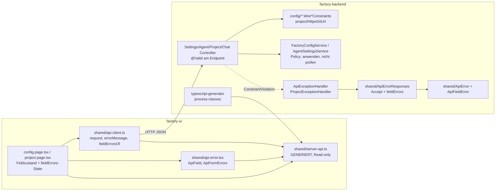

# API-Fehler — Server-Fehler sichtbar am Feld (R-WP-54/55/56, UC-WP-91/92/93, C-8)

Plan für den Dev. Read-only erarbeitet; jede `datei:zeile` ist in **dieser** Plan-Sitzung mit einem
Direktwerkzeug gelesen. Inkremente bauen einzeln grün.

## 0. Spielregeln (bindend)

- Doku ist das goldene WAS: `aifactory/docs/api-errors.md` (Regel-/UC-IDs), `docs/open-points.md:279-283`
  (C-8). Regeln hier **nicht** umschreiben, nur IDs referenzieren.
- AntD-Skill Pflicht (`skill: antd`): CLI **vor** Web-Recherche — `antd info <comp>`, `antd doc <comp>
  --keyword …`, `antd lint ./src`, `usage <comp> --project <pfad>`. In dieser Plan-Sitzung gab es keine
  Shell; das CLI-Gate ist DoD des Dev.
- UI-Gates: `npx tsc -b`, `npx oxlint` (0/0), einzelne Fälle mit `pnpm test -t '<name>'` — **niemals**
  `pnpm test -- <datei>` (`AGENTS-DEV.md:101-103`). `oxlint react(only-export-components)`: eine Datei mit
  Komponenten-Export exportiert **keine** Funktionen/Hooks (`AGENTS-DEV.md:98-100`).
- Spring: **ein** Kontext pro Build. Neue Tests erben `FactorySpringTest` (`FactorySpringTest.java:48-51,
  83-86`), kein eigenes `@DynamicPropertySource`, kein `@DirtiesContext`. Echte HTTP-Tests mit
  `@LocalServerPort` + `java.net.http.HttpClient` + `com.jayway.jsonpath.JsonPath`
  (`ProjectControllerTest.java:32-44`). Kein neuer `SpringApplicationBuilder`-Boot (Ausnahmliste
  `SingleContextGuardTest.java:83-87`, Guard prüft beide Richtungen `:166-175`).
- Maven immer mit `clean`; `pnpm` auf dem PATH (`AGENTS-DEV.md:12-18`).
- UI-Texte nur in `src/shared/content.ts` — dieser Inkrement-Zug bringt **keine** neuen UI-Wörter (der
  Fehler ist Server-Wortlaut).
- `chat.page.tsx` (588 Zeilen) wird **nicht** angefasst (Jons Anweisung).
- Committen: `aifactory/factory-backend/**`, `aifactory/factory-ui/**`, `aifactory/AGENTS-DEV.md`,
  `aifactory/peon-plan/**`. Nie `docs/**`, nie `aifactory/pom.xml` (Aggregator), nie `main`, kein
  amend/rebase, keine AI-Namen im Commit.
- JavaDoc: nur Nicht-Selbstverständliches, sonst verlinken (`AGENTS.md`).

## 1. SOLL (nur IDs, Wortlaut steht in der Doku)

| ID | Ort | Kurzfassung für die Zerlegung |
| --- | --- | --- |
| R-WP-54 / UC-WP-91 | `docs/api-errors.md:17,29` | API-Typen des Clients generiert → `factory-ui/src/shared/server-api.ts`, `jackson2`, `outputKind: module`, Datei ist Build-Produkt und wird committet |
| R-WP-55 / UC-WP-92 | `docs/api-errors.md:35,48` | Bean Validation an den Request-DTOs, `ApiError` + `fieldErrors[{field,message}]`, „Spring default error view" wird gemessen |
| R-WP-56 / UC-WP-93 | `docs/api-errors.md:58,70` | **ein** wiederverwendbares Error-Widget (AntD zuerst), Feldfehler am Feld, sonst Alert mit Server-Wortlaut |
| C-8 | `docs/open-points.md:279-283` | `Accept: text/event-stream` macht aus 400/404 einen 500 — Negotiation im Fehler-Handler lösen |

Muster-Skill (existiert schon): `aifactory/.agents/skills/api-types-and-error-widget/SKILL.md:9-15` (Generator),
`:19-24` (Fehlervertrag), `:28-34` (Widget), `:38-45` (Fallstricke). Schärfen am Ende von Inc 5 (Text an Jon,
`.agents/**` ist nicht in Jons Commit-Liste — siehe A1).

## 2. Bestand (verifiziert)

### 2.1 Maven-Geometrie

- `aifactory/pom.xml:15` Aggregator (`packaging pom`), `:21-24` Modules **factory-ui vor
  factory-backend**, `:28-34` importiert `spring-boot-dependencies:4.1.2`. Datei ist **nicht commitbar**.
- `factory-backend/pom.xml:36-40` hängt von `factory-ui` ab → die Reactor-Reihenfolge ist erzwungen;
  **der `pnpm build` von factory-ui läuft vor der Generierung**. Folge: `server-api.ts` kommt in den
  UI-Bau wie committet, nicht wie gerade generiert. (Risiko R2.)
- `factory-backend/pom.xml:34-94` hat **kein** Validation-Start; `:107-155` Build mit
  `spring-boot-maven-plugin` + `maven-compiler-plugin` (Lombok/`configuration-processor` in
  `default-compile`/`default-testCompile`) — eine neue Plugin-Zeile im `<plugins>` ist konfliktfrei.
- Referenzmuster Generator: `spring-persistent-tasks-root/core/pom.xml:123-170`
  (`cz.habarta.typescript-generator:typescript-generator-maven-plugin:3.2.1263`, Phase `process-classes`,
  `jackson2`, `noFileComment`, `outputKind module`, `outputFileType implementationFile`,
  `optionalAnnotations` über `jakarta.annotation.Nullable`, `org.springframework.lang.Nullable`,
  `org.jspecify.annotations.Nullable`, `outputFile` **relativ**).
- Mojo-Parameter (Doku 4.2.1, `generate-mojo.html`): `mapEnum` **Default `asUnion`** (Zeile 104),
  `optionalAnnotations` (:124), `optionalProperties` Default `useSpecifiedAnnotations` (:125),
  `optionalPropertiesDeclaration` Default `questionMark` (:126), `noFileComment` (:111),
  `outputFileType` (:128), Default-Phase `process-classes` (:36).
- Lokales Repo: `spring-boot-starter-validation` nur 3.5.9/4.1.0/4.1.1, `spring-boot-validation` nur
  4.1.0/4.1.1, `hibernate-validator` 8.0.3/9.1.0/9.1.3 → **4.1.2 fehlt**, ein Netzwerkzugriff nötig (R3).

### 2.2 Backend-Fehlerkanal

- `shared/ApiError.java:7` — `record ApiError(int status, String error, String message)`, kein `fieldErrors`.
- `shared/ApiExceptionHandler.java:24` IAE→400, `:29-32` `HttpMessageNotReadableException`→400
  (feste Textzeile), `:35` ISE→409, `:40-45` `ResponseStatusException`, `:47-50` `body(...)` setzt immer
  einen JSON-Body. Kein Handler für Validierung, keine `Accept`-Behandlung.
- `project/ProjectExceptionHandler.java:18-23` — 404 für `ProjectNotFoundException`, ebenfalls fester Body.
- SSE-Kanten: `chat/ChatController.java:100-106` (`/api/projects/{id}/events`,
  `produces = TEXT_EVENT_STREAM`), `:149` (Agent-Blick), `project/ProjectStatusController.java:45`.
  Unbekanntes Projekt dort: `chat/ProjectRuntimeRegistry.java:60-63` → `requireProject` → `:175-177`
  `ProjectNotFoundException` ⇒ heute **500** statt 404 (C-8).

### 2.3 Validierungsregeln heute (alle `IllegalArgumentException`, Wert-frei)

- `config/FactoryConfigService.java:45` `PROVIDER_HINT`, `:46` `TOKEN_WINDOW_HINT`, `:47` `TIMEOUT_HINT`,
  `:48` `SEND_THINKING_HINT`, `:50-51` `MAX_TOKENS_HINT`, `:52` `QUERY_PARAMS_HINT`, `:53`
  `HEADER_PARAMS_HINT`, `:59` `KEY_INTENT_HINT`; Call `:189` in `update(...)` (`:186-206`), Regeln
  `:213-240`, JavaDoc `:208-212` („Hand-written because this module has no Bean Validation starter").
  Provider-Name zusätzlich in `ModelListService` (teilt `PROVIDER_HINT`), Helfer
  `FactoryConfigService.isProviderName` (`:435`).
- `config/AgentSettingsService.java:29` `SLOT_HINT`, `:30` `TEMPERATURE_HINT`, `:31` `EXTRA_BODY_HINT`.
- `project/ProjectService.java:67` `HTTPS_ONLY_HINT`, `:71` `CREDENTIAL_HINT`, `:106-122` `add(...)`
  (blank/`https`/Name/Klon), `:236-244` `requirePublicHttpsUrl` (paketprivat statisch).
- Request-DTOs sind **komplett String-basiert** (Drei-State R-WP-16): `config/dto/SettingsUpdateRequest.java:21-24`
  (11× String + `Boolean removeApiKey`), `config/dto/AgentSettingsUpdateRequest.java:14-16`,
  `config/ModelListRequest.java:22`, `project/dto/AddProjectRequest.java:4`.
  ⇒ Standard-Jakarta-Annotationen (`@Positive`, `@Min`) passen nicht; eigene Constraints nötig.
- Response-DTOs: `config/dto/SettingsDto.java:13-15` (`Integer maxTokens`, `KeySource keySource`),
  `config/dto/ProviderDefaultsDto.java:13-14` (`ThinkForm thinkForm`, `List<String> thinkValues`),
  `project/dto/ProjectDto.java:6` (alles String/Primitive). `KeySource`, `ThinkForm` sind Enums im
  `config`-Paket.

### 2.4 UI heute

- `shared/api.client.ts:2-6` handgeschriebenes `interface ApiError`; `:29-36` `ApiRequestError`
  (trägt `apiError`); `:56-61` `errorMessage()` = Server-Wortlaut.
- `shared/dto.ts:6-23` handgeschrieben `Project`, `ProjectWork` (Duplikate von `ProjectDto`,
  `project/dto/ProjectWorkDto.java:9`).
- `config/config.client.ts:4` `type KeySource`, `:11-25` `Settings`, `:36-44` `Provider`, `:50`
  `type ThinkForm`, `:53-56` `ThinkInput`, `:63-65` `thinkInputOf`, `:81-87` `ModelQuery`, `:108-113`
  `ConfigPatch`, `:124-135` `SettingsPatch`, `:150-162` `trimBody` (Body-Former; drei States).
- `config/config.agents.client.ts:9-21` `AgentSettings`, `:29-36` `AgentPatch`.
- `config/config.page.tsx:2` importiert `Alert, Button, Card, Input, Select` (kein `Form`); `:212`
  `<Alert type="error" title={message}>` (Ladefehler), `:215` **natives** `<form className="settings-form">`,
  `:216` `<dl className="settings">`, `:217-228` Feld als `<div><dt/><dd><Select id="settings-provider">`,
  `:229-235` `<Alert type="error" title={saveMessage}>` zwischen den Feldern. Rein gesteuerte Inputs,
  kein AntD `Form`, keine `data-testid`, Felder über `id`/`aria-label`.
- `config/config.agents.tsx:2` importiert `Alert` (Ausgabestellen beim Umbau neu lesen),
  `project/project.page.tsx:2` importiert `Alert`.
- **AntD 6.7.0** (`node_modules/.pnpm/antd@6.7.0…`): `form/Form.d.ts:38-58` — `FormProps` kennt **kein
  `component`-Prop** mehr (AntD 5 hatte `component={false}`); `form/Form.js` erzeugt kein eigenes
  `<form>`-Element, das DOM-`<form>` kommt aus `@rc-component/form`. ⇒ `Form.Item` braucht ein `Form`.
- `@rc-component/form@1.8.6/lib/Form.js:25` — `component: Component = 'form'` (Default), `:131-133`
  `if (Component === false) return wrapperNode` **kann AntD nicht erreichen** (kein Prop in `FormProps`),
  `:134-140` rendert das `<form>` mit `onSubmit` = `preventDefault()` + `formInstance.submit()` ⇒ ein
  `htmlType="submit"`-Button im `Form` löst die Validierung und danach `onFinish` aus (`Form.js:77-82`,
  `hooks/useForm.js:889-895`). **Ohne** `name`-registrierte Felder ist die Validierung leer und `onFinish`
  läuft trotzdem — die Formulare bleiben kontrolliert (`value`/`onChange` wie heute), das `Form` liefert
  nur das `<form>`-Element und den Feld-Kontext.
- `antd/lib/form/Form.js:128-134,209` — das übergebene `className` landet mit den AntD-Klassen
  (`ant-form`, `ant-form-vertical`) auf dem gerenderten `<form>`-Element ⇒ `.settings-form`
  (`styles.css:1045`) und `.add-project` (`styles.css:114`) gelten weiter, brauchen aber eine
  Spezifizitäts-Stütze gegen `.ant-form` (beide 0,1,0; AntD injiziert sein CSS zur Laufzeit, siehe R1).
- `antd/lib/form/FormItem/index.d.ts:19,30` + `FormItemInput.d.ts:17` — `validateStatus?: 'success' |
  'warning' | 'error' | 'validating' | ''` und `help?: ReactNode` sind an `Form.Item` verfügbar, **ohne**
  `name` (reine Anzeige). `FormItem/ItemHolder.js:78,91` — `className` sitzt am Wurzel-`div`
  (`.ant-form-item`), `:95-96` — unbekannte Props gehen an den `…-row` (Verlass darauf **nicht**, §4.5).
- `antd/lib/input/Input.js:103-109,179` — ein `Input` im `Form.Item` mit `validateStatus="error"` bekommt
  den Status **nur als Klasse** (`getStatusClassNames`), kein `aria-invalid`. „Feld ist rot" ist in jsdom
  ausschließlich über `.ant-form-item-has-error` messbar ⇒ eine `.ant-*`-Assertion, und zwar **nur** in
  `test/shared/api.error.test.tsx` (§7).
- `@rc-component/form@1.8.6/lib/FieldContext.js:14-49` — ohne `Form` wirft der Default-Kontext keine
  Exception, aber jede Feld-Registrierung loggt `Can not find FormContext. Please make sure you wrap
  Field under Form.` (Console-Lärm in jedem Mount-Test).
- Drei native `<form>` im Bestand (`onSubmit`-Grep): `chat/chat.composer.tsx:101` (bleibt, E7/D5),
  `config/config.page.tsx:215`, `project/project.page.tsx:109` (die beiden werden zu `Form`).
  `config/config.agents.tsx` hat **kein** Formular: Speichern je Slot über `onClick`
  (`config.agents.tsx:355-361`), Felder in `<div className="config-agents-fields">` (`:226`), Label über
  `<label htmlFor>` (`:230,241,249,255,270,283,326`) — deshalb dort eine `Form` **ohne** Submit (D7).
- Bestand, der beim Umbau grün bleiben muss: Tests drücken Speichern fast alle über
  `fireEvent.click(getByRole('button', {name: …save}))` aus (`config.page.test.tsx:105,131,152,161,190,311,342,362,385,437`,
  `config.page.fields.test.tsx:75,105,133,166,190`, `project.page.test.tsx:141,162,179,199`) — funktioniert
  mit `htmlType="submit"` im `Form` weiter; Felder werden über `getByLabelText` gefunden, die Config-Felder
  über ihr `aria-label` (`config.page.tsx:222,277,293,304,316,339,349,360,372`), die Slot-Felder über
  `<label htmlFor>` ⇒ `<dt>`/`<dd>`-Struktur und `id`/`aria-label` bleiben unverändert.
- `config.page.test.tsx:310` nimmt `document.querySelector('form')` und erwartet das **Basis**-Formular
  („the default form's is the one being pressed"). Die Settings-`Form` steht im DOM vor dem
  `<Agents>`-Block (`config.page.tsx:213-399` vor `:407`) ⇒ bleibt grün, solange keine `Form` **vor** der
  Settings-`Form` eingeführt wird (Chat-Seite ist eine andere Route).

## 3. Entscheidungen

**E1 — Eigene Constraints statt Jakarta-Standard-Annotationen.** Alle Drahtfelder sind Strings
(Drei-State). Neue Constraints im respective Paket (`config`/`project`), Default-Message = **die
bestehende HINT-Konstante** (wortgleich, `static final` ⇒ als Annotation-`message` verwendbar).
Verworfen: `@Positive`/`@Min` (passen nicht auf Strings); Regex-only (`@Pattern`) für
`queryParams`/`extraBody` (liest sich nicht, versteckt die Regel).

**E2 — ENT-SCHIEDEN (Jon, 2026-11-09): Variante (a) — natives `<form>` wird durch echte AntD `Form`-Hülle
ersetzt.** `config.page.tsx:215` und das Add-Formular `project.page.tsx:109` werden zu AntD `Form`, damit
`validateStatus="error"` + `help=<message>` aus `docs/api-errors.md:61-63` wörtlich gelten. Verworfen:
eigener Help-Mechanismus (`status="error"` am Input + eigene Zeile) — erfüllt die Doku nicht wörtlich.
Faktische Grenze (gemessen, §2.4): AntD 6.7.0 hat kein `component={false}`, `Form` rendert **immer** ein
DOM-`<form>` ⇒ die Hülle wird ersetzt, nie ergänzt (verschachteltes `<form>` ist ungültig). Bindung der
Felder: `ApiField` **umschließt** die fertige Feld-Markierung an der Aufrufstelle, kein gemeinsamer Helfer
(`Field`, `ModelField`, `ThinkControl`) bekommt neue Props — Details §4.5, Schritte §5 Inc 5.

**E3 — `ApiError.message` bleibt lesbar, `fieldErrors` trägt die Struktur.** `message` = erste
Violation-Nachricht, `fieldErrors` = **alle** Violations. Halt: die grünen Bestands-Tests pinnen
`$.message` (z. B. `SettingsControllerTest` „unknownProvider…", `FactoryConfigServiceTest:556`
„NamesTheField"); eine generische Sammel-Message würde sie brechen, ohne UC-WP-92 zu erfüllen
(UC-WP-92 verlangt „nicht **nur** im `message`"). Verworfen: generische Message („validation failed").

**E4 — Validierung wandert wirklich vom Service zum Draht-DTO.** `FactoryConfigService.validate()`
(`:213-240`) und `AgentSettingsService.validate()` werden **gelöscht**; `@Valid` sitzt am Endpoint.
Begründung: Jons Regel in `docs/api-errors.md:35` und `SKILL.md:19-24`; zwei Quellen derselben
Satz-Zeile wäre der nächste Wartungsfehler. Folge: Service-Tests ziehen ins HTTP-Layer um (§8).
Verworfen: Validation im Service per `Validator` (Regel hängt dann am internen Record, nicht am
Request-DTO); doppelte Validation (doppelter Wortlaut).

**E5 — `field`-Pfad = Property-Name des Draht-DTOs, klassenweite Constraints melden das Feld.**
Ein klassenweiter Constraint (`@KeyIntent`) meldet über
`buildConstraintViolationWithTemplate(msg).addPropertyNode("apiKey")` ⇒ `field = "apiKey"`. Begründung:
UC-WP-92 will das Feld benannt, und das UI mappt flach (`SKILL.md:44-45`). Verworfen: leerer Pfad
(„kein Feld") — dann wäre die Regel im UI wieder Fließtext.

**E6 — Kein `@Valid` auf Pfad-Platzhaltern.** `AgentSlots.knows(id)`, Projekt-IDs bleiben
`IllegalArgumentException`/`ProjectNotFoundException` ohne `fieldErrors` (`AgentSettingsTest:178`
`anUnknownSlotIsRefusedAndNothingIsWritten` bleibt, wie sie ist). Ein Pfad-Platzhalter ist kein
Formularfeld.

**E7 — Chat bleibt, wie er ist.** `chat.page.tsx` behält seine Fehlerzeilen (Jon: 588 Zeilen, nicht
anfassen); R-WP-56 gilt für **Server-Formulare** — Config und Projekt sind die zwei Seiten aus
UC-WP-93 G3. Benannte Abweichung D5 (§8), Entscheidung liegt bei Jon.

**E8 — Generator in `factory-backend/pom.xml`, Ausgabe relativ.** `<outputFile>
${project.basedir}/../factory-ui/src/shared/server-api.ts</outputFile>` funktioniert aus Backend und
Aggregator; `aifactory/pom.xml` bleibt unberührt (nicht commitbar). `mapEnum` explizit auf `asUnion`
(Default, aber fest geschrieben, damit ein Upgrade nichts umstellt) ⇒ `KeySource`/`ThinkForm` werden
TS-String-Unions wie heute von Hand (`config.client.ts:4,50`). `optionalAnnotations` wie im
Referenzpom + `org.springframework.lang.Nullable` an den nullbaren Drahtfeldern, und
`optionalPropertiesDeclaration = questionMarkAndNullableType` ⇒ `model?: string | null` entspricht dem
handgeschriebenen `model: string | null` ohne Aufruch-Churn. Verworfen: `.d.ts`
(`declarationFile`) — die Referenz und `import type`-Nutzung wollen `.ts`; `mapEnum asEnum` — bricht
die bestehenden Unions.

**E9 — `ApiErrorResponses` ist der einzige Weg nach draußen.** Neue statische Helper-Klasse in
`shared`, benutzt von `ApiExceptionHandler` **und** `ProjectExceptionHandler`: entscheidet über Body
gegen `Accept` (C-8) und setzt `fieldErrors`. Richtung bleibt erlaubt (Component → `shared`);
`shared` kennt weiterhin keinen Component (`ApiExceptionHandler.java:16-18`).

**E10 — Messung „Spring default error view" ohne zweiten Boot.** Eine Anfrage an eine
nicht gemappte `/api/`-Kante im geteilten Kontext liefert den Body von Springs `/error`. Kein
`SpringApplicationBuilder`, kein Eingriff in `SingleContextGuardTest.java:83-87`. Ergebnis als ⏳-Text
an Jon (Doku darf ich nicht committen, A1).

## 4. Architektur

### 4.1 Grenzen und Abhängigkeiten



Eigentum: **Server** besitzt Feldnamen und Regelwortlaut; `server-api.ts` ist eine projective Ansicht
davon (niemals von Hand edited); das **Widget** besitzt einzig die Anzeige-Regel (Feld oder Alert); die
**Seite** besitzt nur den Fehler-Zustand. `shared` kennt weiterhin keinen Component
(`ApiExceptionHandler.java:16-18`).

### 4.2 Fehlervertrag

```java
// shared/ApiFieldError.java (neu)
public record ApiFieldError(String field, String message) {}

// shared/ApiError.java:7  (vierte Komponente, nullbar -> optionales TS-Feld, E8/optionalAnnotations)
public record ApiError(int status, String error, String message,
        @org.springframework.lang.Nullable List<ApiFieldError> fieldErrors) {}

// shared/ApiErrorResponses.java (neu, public final, privater Ctor)
static ResponseEntity<ApiError> json(HttpStatusCode status, String message, WebRequest request)
static ResponseEntity<ApiError> invalidFields(List<ConstraintViolation<?>> violations, WebRequest request)
static ResponseEntity<ApiError> none(HttpStatusCode status, WebRequest request)   // kein Body
```

`none(...)` = C-8: lässt der `Accept`-Header kein JSON zu (`text/event-stream` ohne `*/*`, kein
`application/json`), antwortet der Handler mit Status **ohne Body** — ohne Body gibt es keine
Content-Negotiation, `HttpMediaTypeNotAcceptableException` kann den echten Status nicht mehr ersetzen.
Körperlos heißt für die UI „kein Feldfehler, kein Wortlaut" — der SSE-Client wertet dort ohnehin den
Status (`SKILL.md:38-40`).

`ApiExceptionHandler` (neu:) `@ExceptionHandler(MethodArgumentNotValidException.class)` →
`invalidFields(e.getBindingResult().getFieldErrors …)`. Sortierung: Reihenfolge der Violations bleibt,
wie der Validator sie liefert; **ein** Eintrag je Feld (E5: Klassenziele melden über
`addPropertyNode`, damit nie zwei Violations desselben Feldes ohne Grund entstehen — falls doch, bleibt
der erste). `ProjectExceptionHandler` ruft ebenfalls `ApiErrorResponses` (C-8 für `/events`).

### 4.3 Constraints (config-Paket, verschachtelter Validator = eine Datei je Constraint)

Muster (kompakt gehalten, AGENTS „no premature fragmentation"):

```java
package org.sterl.open.aifactory.config;

@Documented @Retention(RUNTIME) @Target({FIELD, PARAMETER, METHOD})
@Constraint(validatedBy = WireIntegerText.Validator.class)
public @interface WireIntegerText {
    String message() default WireValidationHints.TOKEN_WINDOW_HINT;
    long min() default 1;
    long max() default Long.MAX_VALUE;
    Class<?>[] groups() default {};
    Class<? extends Payload>[] payload() default {};

    class Validator implements ConstraintValidator<WireIntegerText, String> { /* null/blank = gesendet? nein: gültig */ }
}
```

Drei-State-Regel in **jedem** Validator: `null` oder blank ⇒ erfüllt (das Feld wurde nicht gesendet bzw.
gelöscht, R-WP-16). Die Wortlaut-Konstanten ziehen um nach `config/WireValidationHints.java`
(`public final`, private Ctor, alles `static final String` Compile-Time-Konstanten — damit
`message = WireValidationHints.PROVIDER_HINT` als Annotationwert funktioniert): `PROVIDER_HINT`
(`FactoryConfigService.java:45`), `TOKEN_WINDOW_HINT` (`:46`), `TIMEOUT_HINT` (`:47`),
`SEND_THINKING_HINT` (`:48`), `MAX_TOKENS_HINT` (`:50`), `QUERY_PARAMS_HINT` (`:52`),
`HEADER_PARAMS_HINT` (`:53`), `KEY_INTENT_HINT` (`:59`), `TEMPERATURE_HINT`
(`AgentSettingsService.java:30`), `EXTRA_BODY_HINT` (`:31`). Nicht umziehen: `SLOT_HINT` (`:29`, kein
Drahtfeld — E6), `TURN_MODEL_HINT` (`FactoryConfigService.java:61`, kein Request-Pfad).
`ModelListService` importiert `WireValidationHints.PROVIDER_HINT` (Richtung Dienst → Konstanten-Blatt).

| Constraint | Felder | Message |
| --- | --- | --- |
| `@WireProviderName` | `SettingsUpdateRequest.provider`, `ModelListRequest.provider` | `PROVIDER_HINT` (nutzt `FactoryConfigService.isProviderName`, `:435`) |
| `@WireIntegerText(min,max)` | `tokenWindow` (1…`Integer.MAX_VALUE`), `timeoutSeconds` (1…`Long.MAX_VALUE`) | `TOKEN_WINDOW_HINT` / `TIMEOUT_HINT` |
| `@WireIntegerText(min=0,…)` | `maxTokens` | `MAX_TOKENS_HINT` (0 = Provider-Default, `FactoryConfigService.java:49`) |
| `@WireBooleanText` | `sendThinking` | `SEND_THINKING_HINT` |
| `@WireParamListText` | `queryParams`, `headerParams` | `QUERY_PARAMS_HINT` / `HEADER_PARAMS_HINT` |
| `@WireNumberText` | `temperature` | `TEMPERATURE_HINT` |
| `@WireJsonObjectText` | `extraBody` | `EXTRA_BODY_HINT` (Regel wie `AgentSettingsService.isJsonObject`) |
| `@WireKeyIntent` (TYPE) | `SettingsUpdateRequest`, `AgentSettingsUpdateRequest` | `KEY_INTENT_HINT`, gemeldetes Feld `apiKey` (E5) |
| `@NotBlank` + `@HttpsGitUrl` (project) | `AddProjectRequest.gitUrl` | neues `ProjectService.GIT_URL_HINT` = „gitUrl must not be empty" (`:107`) / `HTTPS_ONLY_HINT` `:67`, `CREDENTIAL_HINT` `:71`; Validator ruft `ProjectService.requirePublicHttpsUrl` (`:236-244`) |

Endpoints bekommen `@Valid`: `SettingsController.update` (`:50`), `SettingsController.models` (`:60`),
`AgentSettingsController` (`:40`, `@PutMapping("/{id}")`), `ProjectController.add` (`:40`).
`ProjectController.add` behält `required = false` (`:40`) — ein leerer Body bleibt 400, aber über die
Service-Zeile (`ProjectService.java:106-108`), nicht über eine Violation eines nicht vorhandenen Körpers.

`@JsonIgnoreProperties(ignoreUnknown = true)` an beiden Update-DTOs (`SettingsUpdateRequest.java:21`,
`AgentSettingsUpdateRequest.java:14`) bleibt: ein unbekanntes Feld ist kein Feldfehler (UC-WP-36/37).

### 4.4 Generator (Inc 4, `factory-backend/pom.xml`, direkt vor `spring-boot-maven-plugin`)

```xml
<plugin>
  <groupId>cz.habarta.typescript-generator</groupId>
  <artifactId>typescript-generator-maven-plugin</artifactId>
  <version>3.2.1263</version> <!-- Referenzmuster core/pom.xml:126 -->
  <executions><execution><id>generate</id><goals><goal>generate</goal></goals>
    <phase>process-classes</phase></execution></executions>
  <configuration>
    <jsonLibrary>jackson2</jsonLibrary>
    <noFileComment>true</noFileComment>
    <outputKind>module</outputKind>
    <outputFileType>implementationFile</outputFileType>
    <mapEnum>asUnion</mapEnum>                       <!-- Default, hier fest (E8) -->
    <optionalPropertiesDeclaration>questionMarkAndNullableType</optionalPropertiesDeclaration>
    <optionalAnnotations>
      <annotation>jakarta.annotation.Nullable</annotation>
      <annotation>org.springframework.lang.Nullable</annotation>
      <annotation>org.jspecify.annotations.Nullable</annotation>
    </optionalAnnotations>
    <classPatterns>
      <pattern>org.sterl.open.aifactory.shared.ApiError</pattern>
      <pattern>org.sterl.open.aifactory.shared.ApiFieldError</pattern>
      <pattern>org.sterl.open.aifactory.config.dto.*</pattern>
      <pattern>org.sterl.open.aifactory.config.ModelListRequest</pattern>
      <pattern>org.sterl.open.aifactory.project.dto.*</pattern>
    </classPatterns>
    <outputFile>${project.basedir}/../factory-ui/src/shared/server-api.ts</outputFile>
  </configuration>
</plugin>
```

`@Nullable` (Spring) wird gesetzt an: `ApiError.fieldErrors`, `SettingsDto.model/think/url/maxTokens/
queryParams/headerParams` (`SettingsDto.java:13-14`), `ProviderDefaultsDto.defaultUrl` (`:13`),
`AgentSettingsDto.model/url/think/temperature/extraBody/tools`, **alle** Felder der drei Update-Request-
DTOs und `ModelListRequest` (Drei-State = immer optional). Die `enum`-Typen `KeySource`, `ThinkForm`
erscheinen als `type KeySource = "FILE" | "ENV" | "NONE"` usw. ⇒ die handgeschriebenen Unions
(`config.client.ts:4,50`) werden **gelöscht** und importiert.

Reihenfolge-Acceptance (Inc 4): Datei wird committet; `mvn -o -pl factory-backend process-classes`
erzeugt sie neu; ein von-Hand-Änderungsversuch verschwindet im nächsten Maven-Lauf (UC-WP-91 G2,
Nachweis §9).

**Generator-Risiko seit Inc 3 (D14-Folge, in Inc 4 zu prüfen):** inzwischen implementieren **beide**
Update-Bodies (`SettingsUpdateRequest`, `AgentSettingsUpdateRequest`) die Schnittstelle
`KeyIntentRequest`, damit die Key-Regel eine Regel bleibt. Ein Generator zieht aufgenommene Klassen
typischerweise mit ihren Supertypen hoch — `server-api.ts` soll dadurch **kein** `KeyIntentRequest`
bekommen (die Schnittstelle ist ein Implementations-Detail des Validators, kein Drahttyp). Dann das
Muster bzw. die ausgeschlossenen Klassen eingrenzen (Parameter-Namen in Inc 4 an `generate-mojo.html`
nachschlagen, nicht erraten), statt die Schnittstelle aufzugeben. Nachweis: generierte Datei nach Inc 4
lesen; `npx tsc -b` muss unverändert grün bleiben.

### 4.5 Widget und Formular-Hüllen (Inc 5)

```tsx
// src/shared/api.error.tsx — exportiert NUR Komponenten (oxlint react(only-export-components))
export function ApiField({ field, errors, children }:
    { field: string, errors: ApiFieldError[], children: ReactNode }): ReactElement
export function ApiFormErrors({ error, fields }:
    { error: unknown, fields: readonly string[] }): ReactElement | null
```

**`ApiField`** — ein `Form.Item` **ohne** `name` (reine Anzeige, §2.4), das die vorhandene Feld-Markierung
der Seite **umschließt**; es braucht ein `Form` als Vorfahr (sonst Console-Warnung je Mount, §2.4):

```tsx
const hit = errors.find(entry => entry.field === field)
return (
  <Form.Item
    className={'api-field' + (hit ? ' api-field-error' : '')}
    validateStatus={hit ? 'error' : undefined}
    help={hit ? <span data-testid={`field-error-${field}`}>{hit.message}</span> : undefined}
  >
    {children}
  </Form.Item>
)
```

- Wortlaut kommt **vom Server** (`hit.message`) — keine UI-Texte, kein `content.ts`-Eintrag (§0).
- Kein Treffer: `validateStatus`/`help` sind `undefined`, das Feld bleibt unangetastet (UC-WP-93 G1);
  gerendert wird das `Form.Item` trotzdem (ein Wrapper mehr, kein anderer Zustand).
- **Kein** `data-*` am `Form.Item` erwartet: `className` sitzt an der Wurzel, fremde Props an der
  `…-row` (`ItemHolder.js:78,91,95-96`). Marker sind einzig die eigenen Klassen `api-field` /
  `api-field-error` und die Hilfe-Zeile mit `data-testid={'field-error-' + field}`.
- `ApiField` bekommt **keine** Label-/Steuerungs-Props; `Field` (`config.agents.tsx:75-94`), `ModelField`,
  `ThinkControl`, `ThinkField` bleiben unverändert — die Umschließung passiert an der Aufrufstelle.

**`ApiFormErrors`** — `<Alert type="error" title={errorMessage(error)}>` **nur**, wenn der Fehler keinen
Feldbezug trägt, den die Seite selbst zeigt: `fieldErrorsOf(error).length === 0` **oder** mindestens ein
gemeldetes Feld liegt außerhalb von `fields` (= die Namen, die die Seite mit `ApiField` einfasst).
Sonst `null` — die Zeile wiederholt keinen Feldfehler. Ohne die `fields`-Regel fiele ein Wortlaut für ein
Feld, das die Seite nicht anfasst, ins Leere (A22/A23/A23b). Die `fields`-Liste steht direkt über dem
Formular der jeweiligen Seite (eine Zeile, ko-lokal mit den `ApiField`-Aufrufen) — R8.

**Datenfluss (ein Besitzer, kein zweiter Zustand):** die Seite hält **nur** das Fehler-Objekt.

```tsx
const [saveError, setSaveError] = useState<unknown>(null)   // ersetzt saveMessage (config.page.tsx)
const errors = fieldErrorsOf(saveError)                     // im render, kein zweiter useState
// catch: setSaveError(error) · Erfolg: setSaveError(null)
```

`fieldErrorsOf(error: unknown): ApiFieldError[]` steht in `shared/api.client.ts` (bei `errorMessage`,
`:29-61`), **nie** in der Komponenten-Datei. Der Draft wird im Fehlerfall **nicht** zurückgesetzt ⇒
Eingabe bleibt (UC-WP-93 G1). Die Ladefehler-Zeile `config.page.tsx:212` bleibt, wie sie ist.

**Drei Hüllen, eine `Form` je Formular, nie verschachtelt:**

| Ort | heute | danach |
| --- | --- | --- |
| `config.page.tsx:215` | `<form className="settings-form" onSubmit=…>` | `<Form className="settings-form" onFinish={() => void save()}>`; `save(event)` (`:153-154`) verliert `event` + `preventDefault()` (rc erledigt beides, `@rc-component/form Form.js:136-140`); Save-Button `:394` bleibt `htmlType="submit"`; `<dl className="settings">` `:216` und alle `dt`/`dd`/`id`/`aria-label` bleiben; der `saveMessage`-Alert `:229-235` wird durch `<ApiFormErrors error={saveError} fields={SETTINGS_ERROR_FIELDS} />` ersetzt |
| `project.page.tsx:109-120` | `<form className="add-project">` mit Input + Button | `<Form className="add-project" layout="inline" onFinish={() => void submit()}>` mit `<ApiField field="gitUrl" errors={errors}><Input …/></ApiField>` und Button `htmlType="submit"`; `submit(event)` (`:74-75`) verliert `event` + `preventDefault()`; `message` (`:27,31`) wird zu `saveError: unknown`, `problem` (`:104`) bleibt für `listError`, Feld-freie Fehler gehen an `ApiFormErrors` |
| `config.agents.tsx:226` | `<div className="config-agents-fields">` | `<Form className="config-agents-fields">` **ohne** `onFinish` — Speichern bleibt `onClick` am Button `:355-361`, der **außerhalb** der `Form` steht (D7); `ApiField` um `temperature` (`:254-260`), `extraBody` (`:268-280`), `apiKey` (`:325-351`); Fehler-State `Record<string, unknown>` je Slot; der Section-Alert `:210` wird zu `ApiFormErrors` mit der Slot-Fehlerliste |

CSS-Begleitregeln in `src/styles.css` (jsdom misst kein Layout ⇒ Browser-Abnahme Jon, R1):
Selektor `.settings-form` (`:1045`) → `.settings-form.ant-form`, `.add-project` (`:114`) →
`.add-project.ant-form` (Spezifizitäts-Stütze gegen das laufzeit-injizierte `.ant-form`, §2.4);
neu `.settings dd .api-field`, `.config-agents-fields .api-field`, `.add-project .api-field` mit
`margin-bottom: 0` und `min-width: 0`, plus `width: 100%` für das Eingabefeld **im** `.api-field`
(`.settings input`/`.ant-select` `:1080-1083` greifen nicht mehr direkt, das Feld sitzt jetzt in den
`…-row`-Blöcken des `Form.Item`). Look und Höhen nimmt Jon im Browser ab.

## 5. Inkremente

### Inc 1 — Fehlerkanal: `fieldErrors` + SSE-Status (C-8) — ✅ FERTIG (2026-11-09)

Gebaut wie gelistet; Backend-Suite 267 Tests grün, `missCount = 1`, 43 s (M5). M3/M4 in §9 protokolliert.
Abweichungen D9 (`none(...)` nicht gebaut) und D10 (Violations-Dedupe erst in Inc 2).

- `factory-backend/pom.xml`: `spring-boot-starter-validation` als `dependency` (Netz nötig, R3).
- `shared/ApiFieldError.java` (neu), `shared/ApiError.java` (vierte Komponente, `@Nullable List`),
  `shared/ApiErrorResponses.java` (neu, inkl. Accept-Entscheidung), `shared/ApiExceptionHandler.java`
  (Handler für `MethodArgumentNotValidException`, alle Antworten über den Helper),
  `project/ProjectExceptionHandler.java` (Helper).
- Noch **keine** `@Valid`/Constraints: Produzenten von `fieldErrors` kommen in Inc 2/3.
- Tests (neue Klassen, erben `FactorySpringTest`): `shared/ApiErrorContractTest`
  (`anSseEdgeKeepsItsRejectedStatus`, `withoutOurAdviceSpringAnswersItsOwnErrorBody`,
  `aPlainErrorBodyCarriesNoFieldErrors`).
- Green: komplette Backend-Suite grün, `missCount = 1`, kein Eintrag in
  `SingleContextGuardTest.java:83-87` nötig.

### Inc 2 — Settings-Ebene validiert am Draht (R-WP-55, UC-WP-92) — ✅ FERTIG (2026-11-09)

Gebaut wie gelistet, plus D10 (Dedupe „ein Eintrag je Feld" in `ApiExceptionHandler`, erster Grund gewinnt —
A5 grün). Abweichungen D12 (`@Target(FIELD)` statt FIELD/PARAMETER/METHOD), D13 (toString-Hälfte bleibt im
Service-Test), D14 (neue Schnittstelle `KeyIntentRequest`). Zusätzlicher Test `clearingAFieldIsNeverAFieldError`
sichert R6 (leer ⇒ „gelöscht", nie Feldfehler) über die HTTP-Kante. Suite: 273 Tests grün, `missCount = 1`,
45 s; Doc-Lint: UC-WP-92 ist jetzt belegt, keine neuen Findings.

- Neu: `config/WireValidationHints.java`, `config/WireProviderName`, `config/WireIntegerText`,
  `config/WireBooleanText`, `config/WireParamListText`, `config/WireKeyIntent` (je mit verschachteltem
  `Validator`); `@Valid` an `SettingsController.update`/`models`; Annotationen an
  `SettingsUpdateRequest`, `ModelListRequest`; `FactoryConfigService.validate()` löschen (`:208-240`) +
  JavaDoc-Kommentar anpassen; `ModelListService` auf `WireValidationHints` umstellen.
- Tests: neu `config/SettingsFieldErrorsTest` (UC-WP-92, §6); **umziehen** (Namen bleiben) aus
  `FactoryConfigServiceTest`: `nonPositiveTokenWindowOrTimeoutIsRejectedAndNothingIsWritten` (`:290`),
  `anUnknownProviderIsRejectedWithoutTouchingTheFile` (`:319`), `aKeyIsNeverSetAndRemovedAtOnce` (`:409`),
  `aNonNumericMaxTokensIsRefusedAndNamesTheField` (`:556`),
  `aParamSegmentWithoutEqualsIsRefusedAndNamesTheField` (`:580`),
  `headerParamsNeverAppearInALogOrInAHint` (`:608`) — alle sechs prüfen die Datei-Unversehrtheit weiter,
  jetzt über die HTTP-Kante. `unknownProviderIsRejectedAndTheKeyNeverAppears` in
  `SettingsControllerTest:263` bleibt grün (E3: `message` = erste Violation) und bekommt die
  `fieldErrors`-Assertion.

### Inc 3 — Agenten- und Projekt-Ebene (R-WP-55, UC-WP-92) — ✅ FERTIG (2026-11-09)

Gebaut wie gelistet. Suite: **274 Tests grün**, `missCount = 1` (hitCount 1597), 45 s — ein Kontext, keine
Verlangsamung gegen Inc 2 (273 / 45 s). A14–A18 sitzen als `fieldErrors`-Assertions in den bestehenden
Tests; zusätzlich A17 explizit gepinnt und ein Leer-/Fehlbody-Fall für `gitUrl` (D15, D16).

- Neu: `config/WireNumberText`, `config/WireJsonObjectText`; Annotationen an
  `config/dto/AgentSettingsUpdateRequest.java:15-16`; `@Valid` an der Agent-Kante;
  `AgentSettingsService.validate()` löschen (Hints `:30-31` umziehen, `SLOT_HINT` bleibt);
  `project/HttpsGitUrl` (neu, ruft `requirePublicHttpsUrl`), `@NotBlank` + `@Valid` an
  `ProjectController.add:40`, `ProjectService.GIT_URL_HINT` als Konstante für `:107`.
- Tests: `AgentSettingsTest` — `anAgentKeyCannotBeSetAndRemovedAtOnce:189`,
  `aTemperatureThatIsNotANumberIsRefused:200`, `anExtraBodyThatIsNotAJsonObjectIsRefused:308` bekommen
  die `fieldErrors[].field`-Assertion (`apiKey`, `temperature`, `extraBody`);
  `anUnknownSlotIsRefusedAndNothingIsWritten:178` bleibt unangetastet (E6).
  `ProjectControllerTest` — `credentialUrlRejectedAndNothingStored:203` und
  `nonHttpsUrlRejectedNothingStored:219` bekommen `fieldErrors[0].field == "gitUrl"`.

### Inc 4 — Generierte API-Typen (R-WP-54, UC-WP-91) — ✅ FERTIG (2026-11-09)

Gebaut wie gelistet. `shared/server-api.ts` (108 Zeilen) ist erzeugt und committet; das §4.4-Risiko ist
eingetreten und gelöst: ohne `excludeClasses` erschien `KeyIntentRequest` als **leeres** Interface mit zwei
`extends`-Zeilen, jetzt ausgeschlossen (D17). Gates: Backend **274 Tests grün**, `missCount = 1`
(hitCount 1597), 45,2 s — unverändert gegen Inc 3; UI `npx tsc -b` grün, `npx oxlint` **0/0** (94 Dateien),
`pnpm test` **252 Tests / 27 Dateien grün**, `pnpm build` grün. Doc-Lint: keine neuen Findings, **UC-WP-91
bleibt UNBELEGT** — §6 sieht dafür bewusst keinen Suite-Test vor, Nachweis ist M1/M2 (§9). Abweichungen
D17, D18, D19. R4 abgeglichen: die generierten Unions sind wort- und Reihenfolge-gleich mit den
handgeschriebenen — `KeySource = "FILE" | "ENV" | "NONE"`, `ThinkForm = "TOGGLE" | "VALUES" | "FREE" | "NONE" |
"UNKNOWN"` ⇒ kein Nachziehbedarf.

- `factory-backend/pom.xml` nach §4.4; `server-api.ts` erzeugen und committen.
- `@Nullable` an den in §4.4 genannten Drahtfeldern (nur Annotation + Import, keine Verhaltensänderung).
- `shared/api.client.ts:2-6` löschen und `import type { ApiError, ApiFieldError } from './server-api'`
  setzen; `fieldErrorsOf()` kommt hierhin **erst in Inc 5** (sonst ungenutzt). Gebaut: nur `ApiError`
  importiert — ein ungenutzter Typ-Import wäre ein oxlint-Finding (D19); `ApiFieldError` kommt mit
  `fieldErrorsOf()` in Inc 5.
- `config/config.client.ts`: `KeySource` (`:4`), `Settings` (`:11-25`), `Provider` (`:36-44`),
  `ThinkForm` (`:50`), `ModelQuery` (`:81-87`), `ConfigPatch`/`SettingsPatch` (`:108-135`) durch
  Importe aus `server-api` ersetzen; `ThinkInput`/`thinkInputOf`/`trimBody` bleiben handgeschrieben
  (Hilfstypen, Doku `api-errors.md:25-26`). Namen der generierten Typen: `SettingsDto`,
  `ProviderDefaultsDto`, `SettingsUpdateRequest`, `ModelListRequest` — die Client-Funktionen behalten
  ihre Namen (`getSettings` usw.), nur die Typ-Namen folgen Java (benannte Abweichung D3). Gebaut:
  `ConfigPatch` ist weg, `trimBody` ist auf die beiden Request-Typen typisiert; `AgentPatch` bleibt als
  abgeleiteter Typ (`AgentSettingsUpdateRequest & { overridden: boolean }`) — D18.
- `config/config.agents.client.ts:9-21,29-36` und `shared/dto.ts` (löschen; `Project`/`ProjectWork` →
  `ProjectDto`, `ProjectWorkDto`) ebenso; Aufrufer in `app/`, `project/`, `chat/` anpassen —
  **Typ-Importe**, kein Verhalten, `chat.page.tsx` bleibt inhaltlich unangetastet (nur Import-Zeile,
  falls nötig: sonst `chat`-Typen in Inc 5 nachziehen).
- Green: `npx tsc -b`, `npx oxlint`, `pnpm test` (Suite, nicht Datei), Backend-Suite unverändert.

### Inc 5 — Standard-Error-Widget auf AntD `Form` (R-WP-56, UC-WP-93) + Aufräumen

Bindung entschieden (E2, Jon): echte AntD `Form`-Hüllen. Fünf kleine Schritte, **jeder** für sich grün;
jeder Schritt schreibt zuerst den **roten** Test und lässt ihn laufen, bevor Code entsteht.
Reihenfolge: 5.1 → 5.5, kein Schritt wartet auf einen späteren.

**5.1 — Widget + Helper (nur `shared`, noch keine Seite).**
Rot: `test/shared/api.error.test.tsx` mit A19–A23 (Test-Hülle: `<Form>{ApiField …}</Form>` im Test selbst —
ein `Form.Item` ohne `Form` loggt je Mount, §2.4) und `test/shared/api.client.test.ts` mit A27.
Dann: `shared/api.client.ts` um `fieldErrorsOf()` erweitern (`:29-61`, Typ aus `server-api`),
`shared/api.error.tsx` neu (`ApiField`, `ApiFormErrors`, §4.5).
Grün: A19–A23, A27; `npx tsc -b`, `npx oxlint` 0/0; die übrige Suite unverändert (noch niemand nutzt das).

**5.2 — Projekt-Add-Formular → `Form` (kleinstes Formular zuerst).**
Rot: A26 in `test/project/project.page.test.tsx` (Stub antwortet 400 mit `fieldErrors[gitUrl]`; erwartet
`data-testid=field-error-gitUrl` am Feld **und** den erhaltenen Eingabewert) + A28b
`theAddFormIsOneAntdFormAndItsSubmitSaves` (das `form`-Element trägt `ant-form`, ein Klick auf
`content.projects.add` speichert genau einmal).
Dann: `project.page.tsx:109-120` nach §4.5 umhängen, `message` → `saveError`, `.add-project`-CSS anpassen.
Grün: A26, A28b + die bestehenden `project.page.test.tsx:141,162,179,199` (Klick auf den Add-Button)
unverändert; Browser-Check der Zeilenhöhe (R1).

**5.3 — Config-Basisformular → `Form`.**
Rot: A24, A25, A23b in `test/config/config.page.test.tsx` (A23b: Feldfehler auf einem Feld, das die Seite
**nicht** einfasst ⇒ Alert, nichts verschwindet).
Dann: `config.page.tsx:215` → `Form` (`onFinish`), `save()` ohne Event, `saveMessage` → `saveError`,
`SETTINGS_ERROR_FIELDS` über dem Formular, `ApiField` um `provider`, `tokenWindow`, `timeoutSeconds`,
`sendThinking`, `maxTokens`, `queryParams`, `headerParams`, `apiKey` (die acht Feld-Regeln aus §4.3 —
`model`, `url`, `think` haben keine Regel und bekommen **kein** `ApiField`), Alert `:229-235` ersetzen,
`.settings-form`-CSS anpassen.
Grün: A24, A25, A23b + die zehn bestehenden Save-Klicks in `config.page.test.tsx` und die fünf in
`config.page.fields.test.tsx` unverändert; `config.page.test.tsx:310` (`querySelector('form')` = Basis-
Formular) bleibt grün (§2.4).

**5.4 — Agenten-Sektion → `Form` je Slot (ohne Submit, D7).**
Rot: A28c in `test/config/config.agents.test.tsx` — `aRejectedSlotSaveMarksOnlyThatSlotsFieldAndItsOwnCard`
(Slot `dev` antwortet 400 mit `fieldErrors[temperature]`: Hilfe nur in der dev-Karte, andere Karte ohne
Marker, Wert bleibt).
Dann: `config.agents.tsx:226` → `<Form className="config-agents-fields">`, Fehler-State je Slot,
`ApiField` um `temperature`, `extraBody`, `apiKey`, Section-Alert `:210` → `ApiFormErrors`, CSS-Zeile.
Grün: A28c + die bestehenden Slot-Speicher-Klicks (`config.agents.test.tsx:71,95,119,145`,
`config.agents.body.test.tsx:37,59,92,115`) unverändert — der Button bleibt `onClick` **außerhalb** der
`Form` (sonst Speichern beim Enter im Feld, ein anderes Verhalten als heute).

**5.5 — Aufräumen und Übergeben.**
Doppelte Meldungs-Pfade löschen, wo das Widget sie ersetzt (`config.page.tsx:229-235` erledigt in 5.3;
`:212` Ladefehler bleibt). `project.files.tsx` (Drawer, kein Formular) und `chat/**` bleiben (A4/D5).
Text-Vorschläge nach `peon-plan/api-error-notes.md`: (i) Schärfung
`.agents/skills/api-types-and-error-widget/SKILL.md` §Widget um die AntD-6-Fakten (§2.4: kein
`component={false}`, `Form.Item` ohne `Form` loggt, Status nur als Klasse), (ii) ⏳-Absätze für C-8 und
die default-error-view-Messung (M3/M4). `AGENTS-DEV.md` erhält zwei Regeln: (a) `server-api.ts` ist
Build-Produkt, nie von Hand edited, `mvn -o -pl factory-backend process-classes` erzeugt sie neu;
(b) Wire-Regeln sitzen als Constraints an den Request-DTOs, Services prüfen nicht mehr nach.
Gate: `antd info Form`, `antd doc Form --keyword validateStatus`, `antd doc Form --keyword help`,
`antd lint ./src`, `antd usage Form --project <factory-ui>` **vor** 5.1 (Skill-Pflicht, §0).

## 6. Abnahmekriterien (jede Zeile = ein laufbarer Test)

Backend (erbt `FactorySpringTest`, HTTP über `HttpClient` + `@LocalServerPort`, Muster
`ProjectControllerTest.java:32-44`):

| # | GIVEN | WHEN | THEN | Test |
| --- | --- | --- | --- | --- |
| A1 | `Accept: text/event-stream`, Projekt unbekannt | `GET /api/projects/<unbekannt>/events` | Status **404**, kein Body, kein 500 | `ApiErrorContractTest.anSseEdgeKeepsItsRejectedStatus` (C-8) |
| A2 | normaler 400 ohne Feldfehler | `PUT /api/settings` mit kaputtem Body | Body trägt `status/error/message`, `fieldErrors` null/leer | `ApiErrorContractTest.aPlainErrorBodyCarriesNoFieldErrors` |
| A3 | Advice außer Zustand (nicht gemappte `/api/`-Kante) | `GET /api/`-Kante ohne Handler | Spring-eigener Body **ohne** `fieldErrors` ⇒ Advice bleibt nötig; Ergebnis notiert (§9) | `ApiErrorContractTest.withoutOurAdviceSpringAnswersItsOwnErrorBody` |
| A4 | `maxTokens: "abc"` | `PUT /api/settings` | 400, `fieldErrors[0].field == "maxTokens"`, `fieldErrors[0].message == MAX_TOKENS_HINT`, Datei unverändert | `SettingsFieldErrorsTest.aRejectedFieldNamesItselfInTheAnswer` (UC-WP-92 G1) |
| A5 | `maxTokens: "abc"`, `tokenWindow: "0"`, `sendThinking: "vielleicht"` | dasselbe | 400, **drei** `fieldErrors` mit genau diesem Feldern, je einer | `SettingsFieldErrorsTest.everyWrongFieldIsNamedOnceInOneAnswer` (G2) |
| A6 | zwei verletzte Felder | dasselbe | `message` ist exakt die **erste** Violation (keine aneinandergereihte Feldliste, kein Parsen nötig) | `SettingsFieldErrorsTest.aFieldReasonIsNotBuriedInTheMessage` (G3) |
| A7 | `apiKey` gesetzt **und** `removeApiKey: true` | `PUT /api/settings` | 400, `fieldErrors[0].field == "apiKey"`, Datei unverändert | `SettingsFieldErrorsTest.aKeyIsNeverSetAndRemovedAtOnce` (umgezogen, Name bleibt) |
| A8 | `provider: "irgendwas"` | `PUT /api/settings` | 400, `field == "provider"`, Datei bytegleich | `SettingsFieldErrorsTest.anUnknownProviderIsRejectedWithoutTouchingTheFile` (umgezogen) |
| A9 | `tokenWindow: "0"` bzw. `timeoutSeconds: "-3"` | `PUT /api/settings` | 400, `field` je Regel, Datei bytegleich | `SettingsFieldErrorsTest.nonPositiveTokenWindowOrTimeoutIsRejectedAndNothingIsWritten` (umgezogen) |
| A10 | `maxTokens: "1.5"` | `PUT /api/settings` | 400, `field == "maxTokens"` | `SettingsFieldErrorsTest.aNonNumericMaxTokensIsRefusedAndNamesTheField` (umgezogen) |
| A11 | `queryParams: "a; b=2"` | `PUT /api/settings` | 400, `field == "queryParams"` | `SettingsFieldErrorsTest.aParamSegmentWithoutEqualsIsRefusedAndNamesTheField` (umgezogen) |
| A12 | `headerParams: "X=s` mit Wert`"` | `PUT /api/settings` | weder Hint noch Log wiederholen den Wert (AGENTS-DEV.md:5-8) | `SettingsFieldErrorsTest.headerParamsNeverAppearInALogOrInAHint` (umgezogen) |
| A13 | `provider: "irgendwas"` im Modell-Lookup | `POST /api/settings/models` | 400, `field == "provider"`, Wortlaut `PROVIDER_HINT` | `SettingsFieldErrorsTest.aModelListConnectionNamesItsProviderField` |
| A14 | Slot: `temperature: "heiß"` | `PUT /api/settings/agents/<slot>` | 400, `field == "temperature"`, Datei unverändert | `AgentSettingsTest.aTemperatureThatIsNotANumberIsRefused` (erweitert) |
| A15 | Slot: `extraBody: "[1,2]"` | dito | 400, `field == "extraBody"` | `AgentSettingsTest.anExtraBodyThatIsNotAJsonObjectIsRefused` (erweitert) |
| A16 | Slot: `apiKey` + `removeApiKey` | dito | 400, `field == "apiKey"` | `AgentSettingsTest.anAgentKeyCannotBeSetAndRemovedAtOnce` (erweitert) |
| A17 | Slot-Id unbekannt (Pfad, kein Body-Feld) | dito | 400 ohne `fieldErrors` (E6) | `AgentSettingsTest.anUnknownSlotIsRefusedAndNothingIsWritten` (unverändert) |
| A18 | `gitUrl: "ssh://…"`, bzw. `https://user:pw@…` | `POST /api/projects` | 400, `field == "gitUrl"`, nichts geklont/registriert, Wortlaut wertfrei | `ProjectControllerTest.nonHttpsUrlRejectedNothingStored` + `credentialUrlRejectedAndNothingStored` (erweitert) |

Frontend (`pnpm test -t '<name>'`; Hooks über `data-*`, `.ant-*` nur in `test/shared/api.error.test.tsx` (§2.4: „rot" ist sonst nicht messbar); Widget mountet immer in einem echten `Form`):

| # | GIVEN | WHEN | THEN | Test |
| --- | --- | --- | --- | --- |
| A19 | Widget mit `errors=[{field:"maxTokens",…}]`, zwei Felder | rendern | nur das `maxTokens`-`Form.Item` trägt `api-field-error` (= `.ant-form-item-has-error`), die Hilfe `data-testid=field-error-maxTokens` zeigt den Server-Wortlaut; zweites Feld ohne Klasse und ohne Hilfe | `api.error.test.tsx.aFieldErrorMarksExactlyItsOwnField` (UC-WP-93 G1) |
| A20 | dasselbe | DOM prüfen | Hilfezeile und Eingabe sitzen **im selben** `Form.Item`-Wrapper (`help.closest('.api-field') === input.closest('.api-field')`; Adjazenz bewiesen, kein CSS-Sibling-Beweis) | `api.error.test.tsx.aFieldErrorSharesOneFormItemWithItsControl` |
| A21 | `ApiRequestError` ohne `fieldErrors` (409/git-Output) | rendern | `Alert` mit exakt dem Server-Text, kein Feld markiert | `api.error.test.tsx.anErrorWithoutFieldShowsTheServerTextAsAnAlert` (G2) |
| A22 | `ApiRequestError` **mit** `fieldErrors` | rendern | kein Alert (`null`) — die Zeile wiederholt keinen Feldfehler; Vorbedingung: jedes gemeldete Feld steht in `fields` | `api.error.test.tsx.anAlertNeverRepeatsAFieldError` |
| A23 | `fieldErrors=[{field:"unbekanntFeld",…}]` | rendern | kein Feld markiert, der Text erscheint als Alert (`fields` nennt das gemeldete Feld nicht, nichts verschwindet still) | `api.error.test.tsx.anUnwrappedFieldErrorStillShowsTheServerText` |
| A24 | Config-Seite, Save antwortet 400 mit `fieldErrors[maxTokens]` | Save auslösen | Hilfe `field-error-maxTokens` im `dd` des Max-Tokens-Feldes, Hilfetext = Server-Satz, **getippter Wert bleibt**, keine andere Hilfe-Zeile da | `config.page.test.tsx.aRejectedSaveMarksTheMaxTokensFieldAndKeepsTheTypedValue` (G1 seite) |
| A25 | Config-Seite, Save antwortet 409 | Save auslösen | Alert mit Server-Text, keine Hilfe-Zeile am Feld | `config.page.test.tsx.aConflictWithoutFieldStillShowsTheAlert` (G2 seite) |
| A26 | Projekt-Seite, `POST /api/projects` 400 mit `fieldErrors[gitUrl]` | Add auslösen | Feldmarkierung **über dasselbe Widget** Hilfe `field-error-gitUrl` am Feld, getippte URL bleibt | `project.page.test.tsx.aRejectedGitUrlMarksTheUrlFieldThroughTheSharedWidget` (G3) |
| A27 | `ApiRequestError` mit/ohne Body | Helper aufrufen | `fieldErrorsOf` liefert Liste bzw. `[]` | `api.client.test.ts.fieldErrorsComeFromTheServerErrorBody`, `…aTransportErrorHasNoFieldErrors` |
| A23b | Config-Seite, Save antwortet 400 mit `fieldErrors[think]` (Feld ohne `ApiField`) | Save auslösen | Alert mit Server-Satz, keine Hilfe am Feld, Eingabe bleibt | `config.page.test.tsx.anUnwrappedFieldErrorStillReachesTheScreen` (A23 auf der Seite) |
| A28a | Config-Seite geladen | DOM prüfen | genau ein `form` vor dem Agenten-Abschnitt, es trägt `settings-form` **und** `ant-form`, `#settings-provider` liegt darin | `config.page.test.tsx.theSettingsFormIsOneAntdForm` (E2) |
| A28b | Projekt-Seite | auf `content.projects.add` klicken | `form` trägt `add-project` + `ant-form`; `addProject` läuft genau einmal (Submit-Kette des `Form` trägt, kein zweiter Pfad) | `project.page.test.tsx.theAddFormIsOneAntdFormAndItsSubmitSaves` (E2) |
| A28c | Agenten-Sektion, Slot `dev` antwortet 400 mit `fieldErrors[temperature]` | Speichern in `dev` | Hilfe nur in der `dev`-Karte (`within`), andere Karte ohne Hilfe, Wert bleibt; Speichern bleibt ein Klick (kein Formular-Submit, D7) | `config.agents.test.tsx.aRejectedSlotSaveMarksOnlyThatSlotsFieldAndItsOwnCard` |
| A28d | zwei Slots nacheinander abgelehnt | Speichern | jeder Slot zeigt seinen eigenen Fehler, keiner überschreibt den anderen | `config.agents.test.tsx.eachSlotKeepsItsOwnFieldError` |

UC-WP-91 hat **keinen** Suite-Test (Build-Produkt, kein Laufzeitverhalten); Nachweis §9 M1/M2 —
bewusst kein „Die Datei existiert"-Test (AGENTS.md: trivial/implanationsgekoppelt = LOW).

## 7. Teststrategie

- **Kein neuer Spring-Kontext, kein zweiter Boot** (Inc 1–3 laufen komplett im geteilten Kontext;
  A3 ist ein einzelner Request, kein Umbau). `SingleContextGuardTest.java:83-87` bleibt unverändert.
- Backend-Tests: echte HTTP-Kante + `JsonPath` (`ProjectControllerTest.java:22,41`), Datei-Vergleich wie
  in `FactoryConfigServiceTest` (bytegleiche Datei nach Ablehnung).
- Die sechs umgezogenen Service-Tests behalten ihre Namen und ihre Datei-Assertionen; sie ziehen nach
  `SettingsFieldErrorsTest` (HTTP). Kein Test wird ersatzlos gelöscht, keiner „gelockert": die
  `$.message`-Assertions bleiben, `fieldErrors` kommt **dazu** (E3).
- UI: Mount über `test/shared/app.harness.tsx` (hält Theme/`AppRoot`), Stub-Typen in
  `test/shared/config.stub.ts:4` (`Settings`) und `test/shared/fixtures.ts:1` (`Project`) folgen den
  Import-Namen aus Inc 4. Farb-/Layout-Behauptungen sind verboten (`AGENTS-DEV.md:69-81`); Look nimmt
  Jon im Browser ab.
- Vitest nie über Dateipfad (`AGENTS-DEV.md:101-103`); UI-Gates `npx tsc -b` + `npx oxlint` 0/0; AntD-CLI
  `antd lint ./src` + `antd info Form`/`Form.Item` **vor** Schritt 5.1 (Skill-Pflicht).
- Neue UI-Testdatei: `test/shared/api.error.test.tsx` (Widget) und `test/shared/api.client.test.ts`
  (`fieldErrorsOf`). Das Widget wird **immer** in einem echten `Form` gemountet — sonst loggt
  `@rc-component/form` je Mount `Can not find FormContext` (§2.4), und ein Test, der das schluckt, beweist
  die Hülle nicht. Die einzige `.ant-*`-Assertion der Suite (`ant-form-item-has-error`) lebt in dieser
  Datei; Seiten-Tests benutzen `data-testid=field-error-<feld>`, die Klassen `api-field`/`api-field-error`
  und `within(...)`; Adjazenz wird per `closest` bewiesen, nie über CSS-Kombinatoren.
- Rot-vor-grün ist je Schritt 5.1–5.4 Pflicht: Test schreiben, laufen sehen (rot), dann Code (grün).
- Kein Timeout-Injection-Test nötig; keine neuen Wartezeiten.

## 8. Benannte Abweichungen (Dem Jon vorlegen, nie still)

- **D1 — sechs Tests ziehen vom Service ins HTTP-Layer um** (Namen gleich, Assertions gleich +
  `fieldErrors`): Folge von E4, weil `validate()` verschwindet. Kein Beweis geht verloren; der Ort
  wechselt dorthin, wo die 400 jetzt entsteht.
- **D2 — `message` bleibt die erste Violation** statt generischem Text (E3): erhält die grünen
  `$.message`-Assertions (`SettingsControllerTest` unknownProvider, `FactoryConfigServiceTest:556`),
  erfüllt UC-WP-92 G3 über das zusätzliche `fieldErrors`.
- **D3 — TS-Typnamen folgen den Java-Namen** (`SettingsDto`, `ProviderDefaultsDto`,
  `SettingsUpdateRequest`, `ProjectDto`, `ProjectWorkDto`) statt `Settings`/`Provider`/`Project`:
  „ein Feldname existiert genau einmal" heißt hier auch „ein Typname". `dto.ts` wird gelöscht
  (`shared/dto.ts:6-23`), `KeySource`/`ThinkForm` bleiben als generierte Unions.
- **D4 — Config-/Agent-/Projekt-Formulare bleiben Drei-State-Strings**, die Validierung erkennt
  „nicht gesendet" an `null`/blank; Jakarta-Standard-Annotationen (`@Positive`, `@Min`) werden bewusst
  nicht verwendet (E1).
- **D5 — Chat-Seite nutzt das Widget nicht** (`chat.page.tsx`, 588 Zeilen, Jons Anweisung): ihr Fehler
  ist eine Verlaufs-/Statuszeile, kein Formularfeld. UC-WP-93 G3 ist mit Config- und Projekt-Seite
  erfüllt. Wenn Jon Parität will, ist das ein eigenes Inkrement.
- **D6 — Doku- und Skill-Texte schreibe ich nicht fest**: `docs/**` und `.agents/**` stehen nicht in
  Jons Commit-Liste. Der ⏳-Text für C-8/default-error-view und die Skill-Schärfung kommen als
  fertige Absätze in `peon-plan/api-error-notes.md` zur Übernahme.
- **D7 — Agenten-Sektion bekommt eine `Form` ohne Submit**: `config.agents.tsx` hat heute **kein**
  `<form>` (Speichern per `onClick`, `:355-361`). Weil `ApiField` ein `Form` als Vorfahr braucht
  (`Form.Item` ohne `Form` loggt je Mount, §2.4), wird der Feldblock (`:226`) zur `Form` **ohne**
  `onFinish`; der Save-Button bleibt `onClick` **außerhalb** der `Form` — sonst wäre Speichern
  plötzlich ein Enter-im-Feld (neues Verhalten).
- **D8 — CSS-Anpassung für die `Form`-Hüllen**: `.settings-form` → `.settings-form.ant-form`
  (`styles.css:1045`), `.add-project` → `.add-project.ant-form` (`:114`), weil AntD sein `.ant-form`
  erst zur Laufzeit injiziert (beide Selektoren Spezifizität 0,1,0); zusätzlich `width: 100%` für das
  Eingabefeld **im** `.api-field` (`:1089-1102` und `.ant-select` greifen nicht mehr direkt).

- **D9 — `ApiErrorResponses.none(...)` (§4.2) ist nicht gebaut**: in Inc 1 hat keine der drei Kanten einen
  Wortlaut-losen Fehler — alle antworten über `json(...)`/`invalidFields(...)`, die bodylose Antwort steckt
  bereits in `answer(...)` als Konsequenz der `Accept`-Entscheidung. Ein dritter öffentlicher Helper ohne
  Aufrufer wäre toter Code. Bedarf entsteht spätestens mit Inc 2/3, dann mit Test.
- **D10 — Violations-Dedupe („ein Eintrag je Feld", §4.2) kommt in Inc 2**: ohne Produzenten ist die Regel
  in Inc 1 nicht messbar (A5 „drei Felder, je einer" entsteht erst mit den Constraints). Der Handler mappt
  deshalb heute 1:1; die Regel wird mit ihrem Test gezogen, nicht vorher.
- **D11 — `docs/api-errors.md` und `docs/index.md` sind mit Inkrement 1 committet** (Jons Zuruf vom
  2026-11-09). Damit ist A1/D6 für **diese beiden** Dateien aufgehoben; `docs/open-points.md` (C-8-Zeile,
  M3-⏳) und `.agents/**` bleiben außerhalb meiner Commit-Liste.

- **D12 — Wire-Constraints tragen nur `@Target(FIELD)`** (im Plan-Beispiel §4.3 standen FIELD, PARAMETER,
  METHOD): eine Annotation auf einer Record-Komponente wird auf **jedes** passende Ziel übertragen — mit
  METHOD und PARAMETER stünde dieselbe Regel auf Feld, Accessor **und** kanonischem Konstruktor, also drei
  Antworten auf einen falschen Wert, genau gegen UC-WP-92 G2 (D10). Gemessen:
  `SettingsFieldErrorsTest.everyWrongFieldIsNamedOnceInOneAnswer` liefert pro Feld genau einen Eintrag.
  Grund steht einmal in `WireValidationHints`.
- **D13 — die `toString`-Hälfte von `headerParamsNeverAppearInALogOrInAHint` bleibt im Service-Test**: der
  umgezogene Test beweist auf der HTTP-Kante, dass ein Hint keinen Wert wiederholt; dass die Textdarstellung
  des Snapshot sauber bleibt, ist kein Drahtverhalten und lebt als eigener Test
  `FactoryConfigServiceTest.snapshotToStringNeverRepeatsTheParamFields` weiter. Kein Beweis verloren, der
  umgezogene Test behält seinen Namen.
- **D14 — neue Schnittstelle `config/KeyIntentRequest`** (stand nicht in der Datei-Liste von §5 Inc 2):
  `@WireKeyIntent` ist **eine** Regel für beide Update-Bodies (Config jetzt, Agent in Inc 3) — ohne die
  gemeinsame Schnittstelle bräuchte der Validator `Object` + Reflection oder eine Kopie pro Level. Seit
  Inc 3 trägt sie **auch** der Agent-Body — das Generator-Risiko für Inc 4 steht jetzt in §4.4.
- **D15 — `anUnknownSlotIsRefusedAndNothingIsWritten` ist verstärkt, nicht unangetastet**: der Plan ließ
  den Test unverändert (E6), die §6-Zeile A17 verlangt aber „400 **ohne** `fieldErrors`". Eine Assertion
  mehr, keine weniger: ein Pfad-Platzhalter meldet kein Feld. Gleiches gilt für die drei Agent-Tests, die
  jetzt zusätzlich ihr Feld nennen (Namen und bisherigen Assertions unverändert).
- **D16 — ein neuer Fall mehr, und eine Messung für Inc 4/5**: `ProjectControllerTest.anEmptyUrlNamesItsFieldButAMissingBodyNamesNothing`
  steht nicht im Plan, sichert aber die in §4.3 getroffene Trennung — `{"gitUrl":"   "}` ⇒ 400 **mit**
  `fieldErrors[gitUrl]`, ein **fehlender** Body ⇒ 400 über die Service-Zeile, **ohne** Feld. Gemessen dabei:
  ein `ApiError`-Body ohne Feldfehler antwortet `"fieldErrors":null` (null wird serialisiert, nicht
  weggelassen) ⇒ `fieldErrorsOf()` in Inc 5 muss `null` wie `[]` behandeln, und die Java-Felder bleiben wie
  in §4.4 geplant `@Nullable` (TS: `fieldErrors?: ApiFieldError[] | null`).

- **D17 — Generator: `project.dto.*` eingegrenzt, `KeyIntentRequest` ausgeschlossen** (Risikoeintrag §4.4,
  in Inc 4 gemessen): das Muster `project.dto.*` zog auch `ProjectFileDto`/`ProjectDirectoryDto`/
  `ProjectEntryDto`/`ProjectFileRoot` in die Datei — Typen, die die UI **nicht** binden darf, weil das
  Datei-Gebiet `kind` auf ein Literal und `root` auf die Kleinschreib-Namen von `ProjectFileRoot.wireName()`
  einengt (`files.client.ts:4-39`), und weil `ProjectFileDto.text` dort nicht-nullbar gestanden wäre, obwohl
  der Server für eine binäre Datei `null` liefert. Muster jetzt: die drei Formen, die die UI wirklich bindet
  (`AddProjectRequest`, `ProjectDto`, `ProjectWorkDto`). Dazu `excludeClasses` für
  `config.KeyIntentRequest`: ohne ihn erschien die Schnittstelle als **leeres** `interface KeyIntentRequest`
  mit zwei `extends`-Zeilen — Validator-Detail (D14), kein Drahttyp. Die Feldnamen beider Update-Bodies
  bleiben vollständig in ihren eigenen Interfaces (gemessen: `apiKey` und `removeApiKey` stehen je Request).
- **D18 — `ConfigPatch` gestrichen, `AgentPatch` bleibt als abgeleiteter Typ.** `ConfigPatch` war die
  Schnittmenge beider Level und hätte vier Feldnamen ein zweites Mal geschrieben; `trimBody` steht jetzt auf
  `SettingsUpdateRequest | AgentSettingsUpdateRequest` — gleiche Wirkung: ein Feld, das der Server nicht
  kennt, bleibt ein Build-Fehler. `AgentPatch` = `AgentSettingsUpdateRequest & { overridden: boolean }`: der
  Draht liest ein fehlendes Flag als „überschreibt nicht", die Seite muss es bei jedem Speichern sagen
  (UC-WP-45) — die Schnittmenge hält das compileit, ohne ein Feld zu wiederholen. `ModelQuery` →
  `ModelListRequest` wie geplant.
- **D19 — `api.client.ts` importiert nur `ApiError`** (der Plan nannte `ApiError, ApiFieldError`): ein
  ungenutzter Typ-Import ist ein oxlint-Finding; `ApiFieldError` kommt mit `fieldErrorsOf()` in Inc 5.

## 9. Messaufträge (Ergebnis nach `peon-plan/api-error-notes.md`)

- **M1 — UC-WP-91 G1**: in `SettingsUpdateRequest` ein Feld provisorisch umbenennen (`maxTokens` →
  `maxTokensX`), `mvn -o -pl factory-backend process-classes`, `npx tsc -b` → **rot**, dann Rückgängig.
  Beweis: ein Java-Feldumbruch bricht den UI-Bau statt stumm nichts zu ändern.
  **Ergebnis (2026-11-09, gemessen):** `maxTokens` → `maxTokensX` in `SettingsUpdateRequest`,
  `mvn -o clean process-classes -pl factory-backend` ⇒ `server-api.ts` trägt `maxTokensX?: string | null`
  (`SettingsDto.maxTokens` bleibt) ⇒ `npx tsc -b` **rot**:
  `src/config/config.page.tsx(76,5): error TS2561: Object literal may only specify known properties, but
  'maxTokens' does not exist in type 'SettingsUpdateRequest'. Did you mean to write 'maxTokensX'?`
  Zurückgesetzt (Kopier-Rückweg, nicht `git checkout` — die Datei trug ungeänderte Inc-4-Annotationen),
  neu erzeugt: Datei wieder bytegleich (md5 `d5af29a7cf18b3751507103531593781`), `tsc -b` wieder grün.
- **M2 — UC-WP-91 G2**: `server-api.ts` von Hand ändern, `mvn -o -pl factory-backend process-classes` →
  Änderung weg; `git diff --stat` danach leer.
  **Ergebnis (2026-11-09, gemessen):** `server-api.ts` um zwei Zeilen von Hand erweitert (110 Zeilen),
  `mvn -o clean process-classes -pl factory-backend` ⇒ „Writing declarations to …/factory-ui/src/shared/
  server-api.ts", BUILD SUCCESS, Datei wieder 108 Zeilen und md5-identisch mit dem Stand vor dem Eingriff
  (`d5af29a7cf18b3751507103531593781`) — die Datei ist Build-Produkt, kein Hand-Weg. (Vor dem ersten Commit
  zeigt `git diff` sie naturgemäß noch als untracked; der Beleg ist die Prüfsumme.)
- **M3 — R-WP-55 „Spring default error view"**: A3 messen, den konkreten Body (Feldnamen, Status,
  `problem+json`?) protokollieren; Ergebnis als ⏳-Formulierung für `docs/open-points.md` (D6).
  **Ergebnis (2026-11-09, gemessen):** `GET /api/nothing-is-mapped-here` mit `Accept: application/json` →
  **404** und Body `{"timestamp":"2026-11-09T14:31:13.212Z","status":404,"error":"Not Found",
  "path":"/api/nothing-is-mapped-here"}` — **kein** `message`, **kein** `fieldErrors`, kein `problem+json`.
  ⇒ Springs eigene Falschmeldung ist am Feld unbrauchbar, unser Advice bleibt nötig; der Fall ist als
  `ApiErrorContractTest.withoutOurAdviceSpringAnswersItsOwnErrorBody` gepinnt.
- **M4 — C-8**: A1 vor dem Fix (500) und nach dem Fix (404) protokollieren, damit die Doku-Zeile
  `open-points.md:279-283` belegbar schließbar ist.
  **Ergebnis (2026-11-09, gemessen):** `GET /api/projects/<unbekannt>/events` mit
  `Accept: text/event-stream` — **vor** dem Fix **500**, **nach** dem Fix **404 mit leerem Body**
  (`ApiErrorContractTest.anSseEdgeKeepsItsRejectedStatus`). C-8 ist damit behoben und messbar; die
  Doku-Zeile kann auf ✅ (Doku-Inhalt = Jon).
- **M5 — Kontext-Disziplin**: `mvn clean test -Dlogging.level.org.springframework.test.context.cache=DEBUG`
  → `missCount = 1` für den ganzen Build; Suite-Dauer protokollieren (Darf nicht steigen).
  **Ergebnis (2026-11-09):** `missCount = 1` (hitCount 1462), 267 Tests grün, BUILD SUCCESS **43.3 s**
  (Vorher-Messung 44 s) — Kontext startet weiterhin genau einmal, Suite nicht langsamer.

## 10. Annahmen und offene Fragen

**Offene Fragen: none.** Q1 ist entschieden (§3 E2, Jon 2026-11-09).

**Q1 (ENTSCHIEDEN — Jon, 2026-11-09, Variante (a); Umsetzung §4.5 + Inc 5):** Welchen Bindungs-Mechanismus fürs Widget?
Gewählt: **Variante (a)** — natives `<form>` der Server-Formulare (`config.page.tsx:215`,
Add-Formular der Projekt-Seite) durch AntD `Form` ersetzen, damit die Doku wörtlich gilt
(`validateStatus="error"`, `help=<message>`, `api-errors.md:61-63`). Alternative **(b)**: eigener Help-
Mechanismus (`status="error"` am Input + eigene Hilfezeile) ohne AntD `Form`. Fakten: AntD 6.7.0 hat
kein `component={false}` (`form/Form.d.ts:38-58`), das `<form>`-Element kommt aus `@rc-component/form`,
ein `Form` **im** bestehenden `<form>` wäre verschachteltes, ungültiges Markup; ein `Form.Item` ganz ohne
`Form` loggt bei jedem Mount eine Warnung (`@rc-component/form/lib/FieldContext.js:14-49`). Sie wurde vor
Inc 5 nötig; das Widget-API (§4.5) ist in beiden Fällen identisch, der Wechsel betrifft nur
`api.error.tsx` und die Formular-Hülle.

- **A1** — `docs/**` und `.agents/**` sind nicht committbar (Jons Liste); Texte gehen als Vorschlag nach
  `peon-plan/api-error-notes.md` (D6).
- **A2** — Ein Netzwerkzugriff für `spring-boot-starter-validation:4.1.2` ist möglich (im lokalen Repo
  liegen nur 4.1.0/4.1.1, `spring-boot-validation` ebenso). Ist der Rechner offline, **stoppen** und
  melden — nicht auf `hibernate-validator` allein ausweichen: in Boot 4 steckt die Auto-Konfiguration im
  Modul `spring-boot-validation`, ohne das `@Valid` am Body still nicht ausgeführt wird.
- **A3** — Reaktor: factory-ui läuft vor factory-backend (§2.1, durch `factory-backend/pom.xml:36-40`
  erzwungen). `pnpm build` sieht deshalb die committete `server-api.ts`. Akzeptiert, weil die Datei
  committet wird und Eclipse `pnpm` nie ausführt; der Frischbau-Nachweis ist M1/M2.
- **A4** — `project.files.tsx` (Drawer) und die Chat-Fehlerzeilen sind keine Server-Formulare und bleiben
  in dieser Serie unberührt.
- **A6 —** Felder ohne Wire-Regel (`model`, `url`, `think`) bekommen **kein** `ApiField`; jede Seite führt
  die Liste ihrer `ApiField`-Felder als Konstante direkt über dem Formular (z. B. `SETTINGS_ERROR_FIELDS`),
  damit `ApiFormErrors` gemeldete Fremdfelder erkennt und als Alert zeigt (A23b, R8).
- **A7 —** Drei Server-Formulare: Config-Basis, Projekt-Add, Agenten-Slot-Block (je Slot eine `Form`, ohne
  Submit — D7). `project.files.tsx` (Drawer) und die Chat-Zeilen bleiben reiner Draht-Zustand.
- **A5** — Die Hint-Texte bleiben wortgleich; die Bestands-Tests, die Satzfragmente prüfen, müssen
  unverändert grün bleiben.

## 11. Risiken

- **R1 (Widget-Layout)**: `Form.Item` bringt eigene Wrapper und Ränder in `<dl className="settings">`
  (`config.page.tsx:216`). jsdom sieht das nicht ⇒ Browser-Abnahme durch Jon (Höhe der Feldzeilen,
  Alert-Position). Gegenmaßnahme: die CSS-Regeln in §4.5 (`.api-field` mit `margin-bottom: 0` + `min-width: 0`, `width: 100%`
für das Feld **im** `.api-field`;Selektoren gemessen: `styles.css:114` `.add-project` (inline), `:1045`
`.settings-form`, `:1051-1084` `.settings dl`/`dd`, `:1089-1102` `.settings input, .settings textarea` —
das Eingabefeld sitzt künftig in den `…-row`-Blöcken des `Form.Item`, die direkten Treffer greifen nicht
mehr; D8). Feld-IDs bleiben unverändert, Browser-Check je Teilschritt.
- **R2 (Reaktor)**: siehe A3 — erste `server-api.ts` muss per `mvn -o -pl factory-backend
  process-classes` erzeugt und committet werden, sonst scheitert ein Frischbau von factory-ui.
- **R3 (Auflösung Validation-Starter)**: siehe A2.
- **R4 (Enum-Generierung)**: `mapEnum` default `asUnion` gilt für das referenzierte Plugin 3.2.1263;
  trotzdem nach Inc 4 die generierten Unions für `KeySource`/`ThinkForm` mit `config.client.ts:4,50`
  **abgleichen** (Wortlaut der Literal-Union). weicht sie ab → nicht nachziehen, melden.
- **R5 (Violations-Reihenfolge)**: die Reihenfolge der Violations ist nicht contractualisiert; A6
  vergleicht deshalb die **Menge** der Felder und die Message nur gegen die erste — keine Test-Reihenfolge
  erfinden.
- **R6 (Drei-State-Falle)**: ein Validator, der `""` ablehnt, macht „Feld löschen" unmöglich
  (R-WP-16/UC-WP-46). Jeder `Wire*`-Validator behandelt `null`/blank als erfüllt; A9/A11 prüfen genau
  das mit `0`/`-3` und `a; b=2` — kein Test darf das umdrehen.
- **R7 (Wert-Wiederholung)**: Violation-Nachrichten müssen wertfrei bleiben (AGENTS-DEV.md:5-8,
  `headerParamsNeverAppearInALogOrInAHint`); niemals `String.format` mit eingetipptem Wert.
- **R8 (ApiField-Liste driftet)**: die `fields`-Konstante einer Seite (`SETTINGS_ERROR_FIELDS`,
  Projekt-/Slot-Liste) kann von den tatsächlich gewrappten Feldern abweichen. Folge ist **kein**
  stummer Verlust: meldet der Server ein Feld außerhalb der Liste, zeigt `ApiFormErrors` den Wortlaut
  als Alert (A23/A23b). Pflege-Regel: Liste und `ApiField`-Aufrufe ko-lokal in derselben Datei
  (§4.5); neuer Fall in der Seite ⇒ Liste im selben Schritt ergänzen.

## 12. Hygiene am Ende jeder Inkrement-Serie

- `git status` / `git diff` nur für die geplanten Dateien; niemals eine Quelldatei aus dem Kontext neu
  schreiben (`AGENTS-DEV.md:156-158`), neue Dateien mit absolutem Pfad anlegen (`:162-165`).
- Commits: kleine Schritte, keine AI-Namen, kein amend/rebase an Jons Commits, Push wie abgesprochen.
- This plan file: Abweichungen und Messergebnisse (M1–M5) eintragen, bevor das nächste Inkrement startet.


