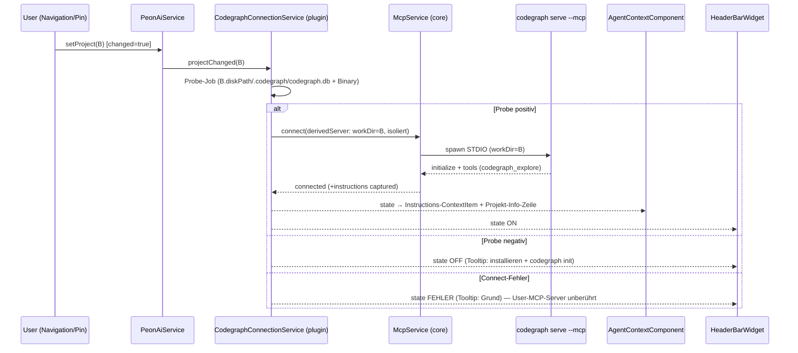

# Codegraph Architektur

> **Status:** ❌ (Design 2026-10-17, vor Planung angelegt)   **Fachdoc:** [codegraph.md](codegraph.md)
>   **ADRs:** folgen (Built-in-Enable + Failure-Isolation als eigener Connect-Pfad)

## Verantwortung & Abgrenzung

- **Zweck:** Codegraph als **Built-in-Feature** verfügbar machen — aktives Projekt mit
  `.codegraph/codegraph.db` + installierter Binary → STDIO-MCP-Server (`codegraph serve --mcp`,
  workDir = Projekt-Disk-Path) wird automatisch verbunden, für alle Agenten; unabhängig vom
  MCP-Toggle und von der User-MCP-Config, **Failure-isoliert**.
- **In-Scope:** Probe (Binary + Index-Erkennung), Server-Factory, Lifecycle am aktiven Projekt,
  isolierter Connect-Pfad, Context-Injektion (Projekt-Info-Zeile + Server-Instructions),
  Header-Indikator.
- **Out-of-Scope (v1):** UI-Config (Checkbox/Command/Env — R-CG-5), Init/Index-Trigger (R-CG-9),
  Telemetry-Override (R-CG-10), Pfad-Translation/Wrapper-Tool S2, weitere Codegraph-Tools.

## Schnittstellen & Abhängigkeiten

| Richtung | Gegenüber | Wofür |
|---|---|---|
| nutzt | `McpService` (core) | STDIO-Connect (`workingDirectory`-Feld), `client.instructions()` |
| nutzt | `UserContext` / `PeonAiService` | aktives Projekt + Projekt-Wechsel-Events |
| nutzt | `AgentContextComponent` | Context-Injektion (Supplier-Pattern, wie die übrigen Dummies) |
| nutzt | `HeaderBarWidget` | Icon-Zustand (State-Callback, UI-Thread) |
| genutzt von | Alle Agent-Registries | `codegraph_explore` als normales MCP-Tool |
| extern | `codegraph`-Binary/Daemon | Peon startet nie den Daemon selbst; max. 1 Peon-`serve --mcp` pro workDir |

Input: Projekt-Wechsel/Pin-Events, Workspace-Start. Output (API/Events): MCP-Tools in den
Registries, Context-Items, Icon-State, Log.

## Diagramme

**Wer BESITZT den Vorgang:** `CodegraphConnectionService` (plugin) besitzt den Codegraph-Lifecycle
— Probe-State × Connect-State × Fehler-State sind seine Invarianten; `McpService` bleibt der
generische MCP-Mechanismus (Connect/Disconnect/Instructions), `McpConnectionService` bleibt
Ausschließlichkeit des User-MCP-Apply-Pfads (R-MCP1). Kein zweiter Code für „ein MCP-Tool
verbinden“ — Codegraph nutzt `McpService` direkt, um die Koppelung an den User-MCP-Toggle
strukturell unmöglich zu machen.

## Architektur-Check

- [x] Keine Komponenten-Zyklen (core-Primitives sind Eclipse-frei, plugin klebt)
- [x] Klare Verantwortung — Lifecycle-Fragen haben genau einen Ort (CodegraphConnectionService)
- [x] Encapsulation: Probe/Factory im core, rein Path-basiert, JUnit5-testbar
- [x] Single Responsibility, keine Duplizierung (McpService generisch weitergenutzt)
- [x] Composable: Context/Icon per Supplier/Callback (bestehende Patterns)
