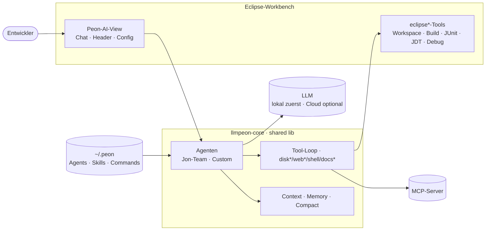

# Product Vision — Peon AI (Eclipse-Plugin)

> Abgestimmt 2026-10-27 (Paul). Max. 100 Zeilen. Zweites Produkt (AI Factory, Web-App) hat eine
> eigene Vision; die geteilte Lib regeln die [Core Ground Rules](../org.sterl.llmpeon.core/docs/ground-rules.md).

## Vision

Peon AI ist ein schlankes **Agenten-System** direkt in der Eclipse-Workbench: Agenten kennen deinen
Workspace und arbeiten **mit** den Werkzeugen der IDE — Dateien, Build, Tests, Code-Navigation,
Debugger, MCP — statt an ihnen vorbei. **Local first, cloud second:** er läuft mit dem LLM deiner Wahl, zuerst mit
lokalen Modellen. Für größere Aufgaben übernimmt Jon als Product Owner mit seinem Team.

## Zusammenfassung

Ein Eclipse-View mit Chat. Der Entwickler fragt, der Agent liest, sucht, baut, testet und ändert im
Workspace — sichtbar und nachvollziehbar. Einfache Fragen beantwortet ein einzelner Agent; Features
plant und baut das Jon-Team (PO · Plan · Dev · Review) docs-first. Erweiterbar über eigene Agenten,
Skills, Commands und MCP — ohne Code.

## Kernfunktionen

1. **Chat mit Workspace-Kontext** — markiert Dateien/Selektion, Markdown/Code-Rendering, Voice.
2. **IDE-Werkzeuge** — `eclipse*`-Tools: Dateien, Build, JUnit, JDT-Navigation, Debugger.
3. **Local first** — Ollama, LM Studio u. a. lokal; Cloud-Provider (OpenAI, Anthropic, Gemini,
   Mistral, Copilot) als Option.
4. **Agenten** — Jon-Team, Custom Agents (`AGENT.md`), Skills, Commands, MCP, Codegraph.
5. **Lange Sessions** — Workspace-Memory, Compact, persistente History.

## Ist / ist nicht

| Peon AI **ist** | Peon AI **ist nicht** |
|---|---|
| ein Agenten- bzw. Agenten-System-Tool: Agenten mit Tools, MCP, Delegation | ein Code-Completion-Tool (Inline-Vorschläge beim Tippen) |
| ein Assistent **in** Eclipse, der IDE-Werkzeuge nutzt | ein eigener Editor oder Ersatz für die IDE |
| lauffähig mit kleinen lokalen Modellen (local first) | abhängig von einem Frontier- oder Cloud-Modell |
| transparent: jeder Tool-Call und jede Änderung im Chat sichtbar | ein Black-Box-Autopilot, der still ändert |
| Agent auf Anfrage: der Entwickler stößt an und behält die Kontrolle | ein Hintergrund-Bot, der ungefragt committet oder pusht |
| erweiterbar ohne Code (Agenten, Skills, Commands, MCP) | eine Plattform, für die man Java-Plugins schreiben muss |
| docs-first im Jon-Modus: das SOLL steht in Markdown im Repo | ein Ticketsystem oder Projektmanagement-Tool |

## Komponenten

