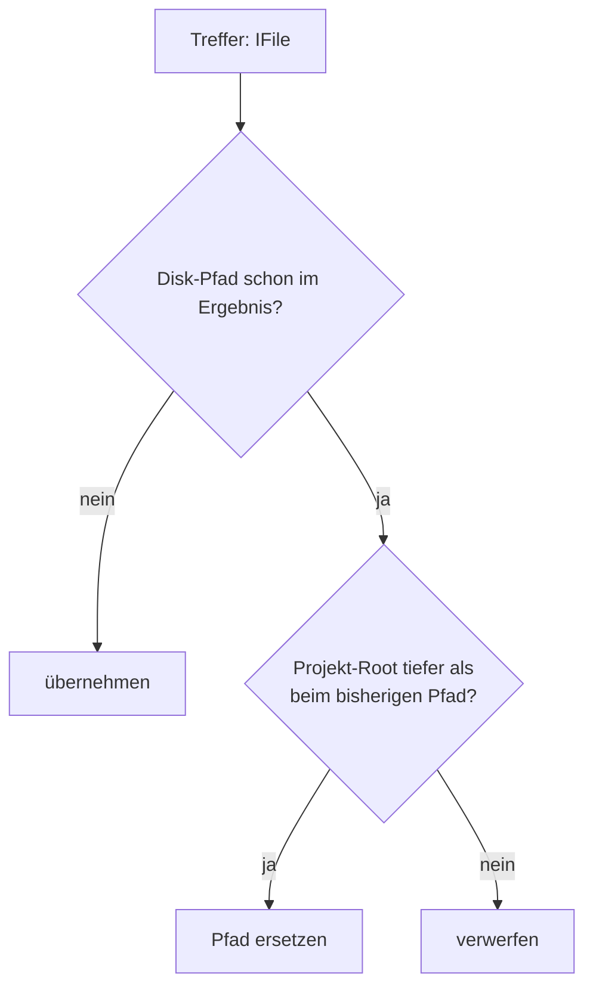

# Workspace-Sicht — verschachtelte Eclipse-Projekte

> **Status:** ✅ done (2026-10-19, 2.14.1) · **Architektur:** keine neue Komponente —
> Erweiterung von `EclipseUtil` + `EclipseWorkspaceReadFileTool`/`EclipseGrepTool`

## Ziel

Ein Aggregator-Projekt liegt im selben Ordner wie seine Module: `llmpeon-parent` zeigt den Repo-Root,
`llmpeon-core`, `org.sterl.llmpeon`, … liegen physisch darunter. Eclipse führt beide Ebenen als
Projekte — **eine Disk-Datei, zwei Workspace-Pfade**. Der Agent darf daraus nie zwei Dateien machen:
jede Datei erscheint genau einmal, unter dem **spezifischsten** Projekt, und die Projekt-Info erklärt,
warum es den zweiten Pfad überhaupt gibt.



## R-WN-1 — Dedup: der spezifischste Projekt-Pfad gewinnt (✅ done)

GIVEN eine Datei ist über zwei Projekte sichtbar (`/llmpeon-core/src/A.java` und
     `/llmpeon-parent/org.sterl.llmpeon.core/src/A.java` — gleicher Disk-Pfad)
WHEN `eclipseSearchFiles` oder `eclipseGrepFiles` diese Datei trifft
THEN wird sie **einmal** geliefert, unter dem Pfad des Projekts mit dem **tiefsten** Projekt-Root
     (längster Disk-Prefix) — also `/llmpeon-core/src/A.java`.

- Unabhängig von Scan-Reihenfolge und gewähltem Projekt; das gewählte Projekt bestimmt weiterhin nur
  die **Reihenfolge** der Treffer (R4a1 in [eclipse-read-tools.md](eclipse-read-tools.md)).
- **Bei erreichtem Ergebnis-Limit bleibt die Scan-Reihenfolge maßgeblich:** ein bereits gelieferter
  Duplikat-Eintrag wird dann nicht mehr auf die tiefere Sicht umgeschrieben. Die Datei zählt weiterhin
  nur **einmal**, und das Limit ist im Ergebnis benannt.
- Gleich tiefe Projekte (kein Nesting) → wie bisher: der zuerst gefundene Pfad bleibt. Praktisch
  betrifft das nur eine Datei, die über **denselben** Ordner zweimal sichtbar ist (gleicher
  Disk-Pfad); ein anderer Disk-Pfad ist eine andere Datei und kein Dedup-Fall.
- **Ein expliziter Scope bleibt maßgeblich:** `path=/llmpeon-parent` liefert Parent-Pfade — dort wurde
  gesucht. Keine Rückübersetzung außerhalb des angefragten Scopes, sonst liefert das Tool Pfade, die
  der Agent nicht angefragt hat.

## R-WN-2 — Grep zählt Disk-Pfade, nicht Workspace-Pfade (✅ done)

GIVEN dieselbe doppelt sichtbare Datei enthält drei Treffer
WHEN `eclipseGrepFiles` workspace-weit sucht
THEN erscheinen die drei Treffer **einmal** (unter dem spezifischsten Pfad), und die Datei zählt
     **einmal** gegen das Datei-Limit (`MAX_GREP_FILES`).

## R-WN-3 — Projekt-Info nennt die Verschachtelung (✅ done)

GIVEN das aktive Projekt ist Teil einer Verschachtelung — ein offenes Projekt ist Vorfahr seines
     Ordners, oder sein Ordner ist Vorfahr offener Projekte
WHEN die Projekt-Info den Turn-Kontext bildet
THEN steht dort **eine** zusätzliche Zeile je Richtung.

Modul:
```
Nested in Eclipse project /llmpeon-parent — the same files are also visible under
/llmpeon-parent/org.sterl.llmpeon.core/…; tools return the most specific project path.
```
Aggregator:
```
Contains Eclipse projects: llmpeon-core, llmpeon-feature, org.sterl.llmpeon, … — their files are
also visible under this path; tools return the most specific project path.
```

- Nur bei echter Verschachtelung (kein Token-Aufwand im Normalfall), nur **offene** Projekte,
  Vergleich über die kanonischen Projekt-Ordner (nicht über Projektnamen).
- **WEIL:** ohne die Zeile wundert sich der Agent über einen Pfad, der nicht die Projektwurzel ist,
  die er im Kopf hat — und über eine Datei, die er „schon gesehen" hat.

## Offene Punkte

| Punkt | Status |
|---|---|
| Zwei Disk-Pfade, eine Datei (Symlink/Workspace-Link) | ❓ nicht abgedeckt — Dedup bleibt der textuelle Disk-Pfad |

## Umsetzung

- Ein Helfer (plugin, `EclipseUtil`) entscheidet „spezifischster Pfad" gegen den bestehenden Eintrag
  anhand der Projekt-Ordner; `eclipseSearchFiles` und `eclipseGrepFiles` rufen denselben Helfer auf
  (eine Semantik, kein Copy-Paste — „one behaviour, one implementation").
- Projekt-Info: `EclipseUtil.projectInfo` ergänzt die Zeile(n) aus den offenen Projekten
  (`getLocation()`, normalisiert).
