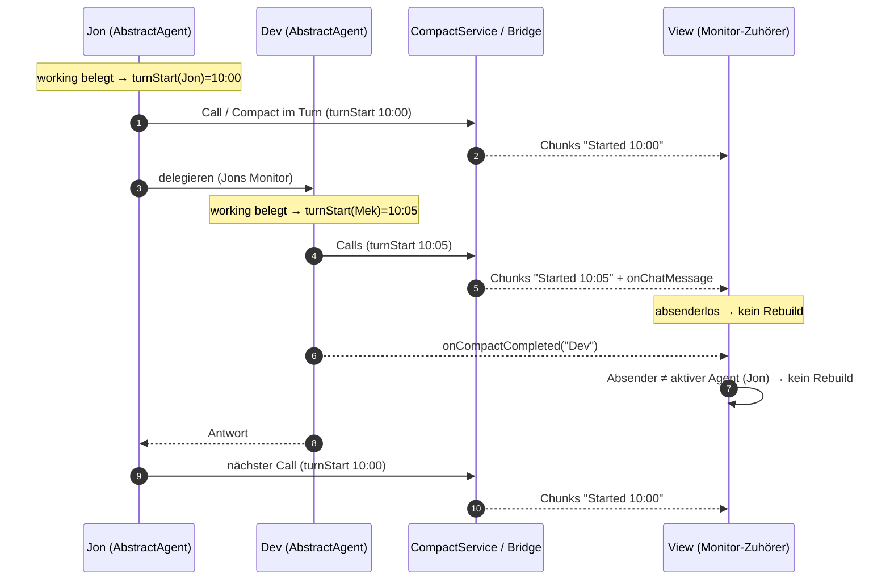
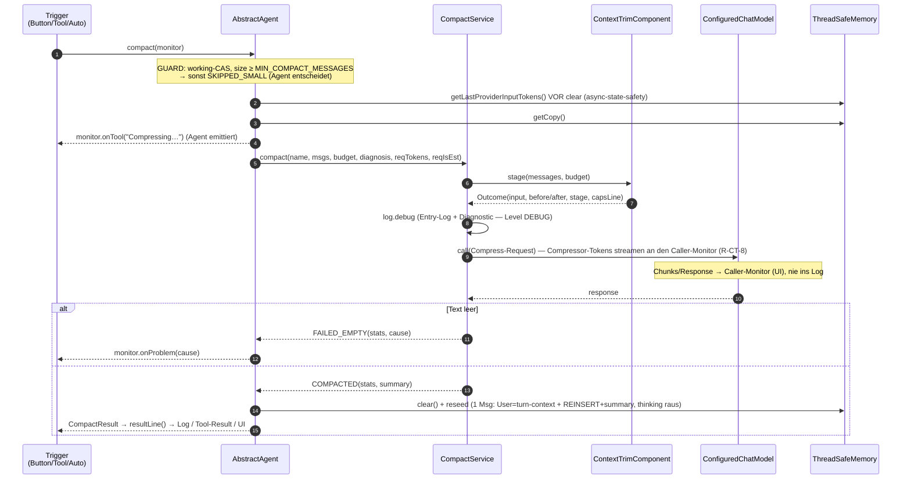

# Compact Architektur

> **Status:** ✅ (2026-09-26, Review) ·
> **Δ 2026-10-18:** R-CC-18 ✅ done (2026-10-28, Revision „zustandslos"; Tool-Loop-Entscheidung, Abschnitt „Tool-Loop-Auslöser" unten) ·
> **Δ 2026-10-24:** R-CT-8 ✅ done (Paul-Smoke) — Compressor-Streaming an den Caller-Monitor
> (UI, nie Log), log-only-Monitor-Konzept entfallen ·
> **Δ 2026-10-25:** Reseed-Form (R-CC-9, [ADR-0076](../../docs/adr/0076-compact-reseed-marker-in-user-message.md)) —
> **eine** UserMessage: Turn-Context-Blöcke zuerst, als **letzter** TextContent der Marker
> `Session compacted:` + Summary (die AiMessage-Form ist verworfen) ·
> **Δ 2026-10-28 (❌ specified):** Direkt-Compact im Tool-Loop **zustandslos** — Compressor-Call über
> die Turn-`ApiRetry`, jedes Nicht-`COMPACTED` beendet den Turn (R-CC-18.5, UC-CC-2) ·
> **Δ 2026-10-27:** (2) die **Turn-Startzeit gehört dem Agenten**, ein Compact im Turn
> erbt sie ([streaming-display R20](../../org.sterl.llmpeon/docs/streaming-display.md)) · (3) Chat-Rebuild
> nach Compact allein über `onCompactCompleted(agentName)`, nicht über `DEFERRED`/`onCallStart`
> ([R-CT-7](compact-lock.md)) — Abschnitt „Turn-Zeit & Chat-Rebuild" unten ·
> **Fachdocs:** [compact.md](compact.md) (R-CC-1…14, R-CC-18) · [compact-input-budget.md](compact-input-budget.md) (R-CIB-1…6) ·
> **ADRs:** [ADR-0055](../../docs/adr/0055-context-counter-input-not-cost.md) · [ADR-0056](../../docs/adr/0056-compact-component-and-render-modes.md) · [ADR-0070](../../docs/adr/0070-compact-decision-in-one-component.md)

## Verantwortung & Abgrenzung

- **Zweck:** Kompaktiert die Chat-History eines Agenten budgetiert per LLM („Compact") — Stufenkürzung
  des Inputs (R-CIB), Compressor-Call, Ehrliches `CompactResult` (R-CC-3), Diagnose-Dreiklang (R-CC-10).
- **In-Scope:** Trigger-Funnel, Guard/Policy, Staging, LLM-Call, Stats/Result, Log, Token-Diagnose-Format.
- **Out-of-Scope:** Live-Context (kein Think-Stripping im laufenden Turn), UI-State (Lock/Queue →
  [compact-lock.md](compact-lock.md)), Retry/Fehlerklassen (R-CC-7 🚧, mit ApiRetry-Tabelle),
  Context-Pollution an den Quellen ([open-points.md](../../docs/open-points.md)).
- **Keine Überschneidung mit:** `StreamingBridge` (Chat-Streaming, nur Call-Timer — keine Turn-Zeit), `ChatMessageUtil`
  (nur generische Token-Mathe), Plugin-UI (rendert model-Values, rechnet nichts).

## Kernprinzip (Ownership)

**Der Agent entscheidet und setzt zurück, der Service führt aus, das Component kürzt, das Result spricht.**

| Komponente | BESITZT |
|---|---|
| `AbstractAgent` (core `agent`) | die **Turn-Startzeit** (gesetzt mit dem `working`-Flag, an jeden Call/Compact im Turn weitergegeben); den Vorgang: Guard/Policy (`working`-CAS, `MIN_COMPACT_MESSAGES`, Staging-Budget = rohe `autoCompactAfter`), `requestTokens`-Capture **vor** `clear()`, clear+reseed, Monitor-Emission (`onTool`/`onProblem`); den **Pre-Turn-Check** vor der frischen User-Message (R-CC-20, rohes Budget, kein Faktor) — kein Agent-Faktor ([ADR-0071](../../docs/adr/0071-compact-policy-owned-by-delegation.md)); das frühe Compacten von Jons Sklaven besitzt `PoDelegateTool` |
| `HandleToolLoopCompactComponent` (core `compact`) | **die Compact-Entscheidung — beide Fronten, ein Ort:** im Tool-Loop (R-CC-18) `used > Budget` → `agent.compact()` direkt · `used > 95 %` → Hint (R-CC-4) · sonst nichts; und die Pre-Turn-Schwelle (R-CC-20: `used > 95 %`, Compact statt Hint — vor dem Turn wissen wir, was wichtig ist: die frische Message). Statische Regeln (`overRawBudget`/`overHintBand`), zustandslos (R-CC-18.5), die Folgen jedes Compacts (`reevaluateTokens` + Static-Rebuild) am Ausführenden. Ein Zustand, ein Wert (95 %), zwei Zeitpunkte — kein Ereignis-Gate. |
| `ToolService.executeLoop` (core `tool`) | den Loop — und **nichts** über Compact: kein `ranTool(compactSession)`, kein Turn-Merker, keine Hint-Verdrahtung. Es ruft nur `HandleToolLoopCompactComponent` vor dem Call. |
| `CompactService` (core `compact`) | die LLM-Transformation: Compressor-Prompt, Call mit Caller-Monitor-Streaming (Chunks → Caller-Monitor, nie Log — R-CT-8), „genau EIN debug-Log", `Stats` |
| `ContextTrimComponent` (core `compact`) | die Stufenkürzung: Stage-Caps (Think 9000 front, Tool-Results 6000, letzte UserMessage voll, dynamisches Per-Message-Cap), Presets — pure, kein LLM/Memory |
| `CompactResult` (core `model`) | die Antwort: `summary`, `Stats`, `resultLine()` — eine Implementierung für Log + Tool-Result + UI |
| `ThreadSafeMemory` | die Token-Zahlen (`totalTokenUsed`, `tokenIsEstimate`, `lastProviderInputTokens`) + deren Format `tokenDiagnosis()` (R-CC-10) |
| `ChatMessageUtil` | nur die generische Mathe (`chars/3`, 1× zentral) |

**Emissions-Regel:** Jede Komponente emittiert nur an den Besitzer ihres Pfads — Agent am Monitor,
Service spiegelt die Compressor-Events (Request-Start R-CT-5, Streaming R-CT-8) an den
übergebenen Caller-Monitor. Niemand anderes spricht zum User.

## Schnittstellen & Abhängigkeiten

| Richtung | Gegenüber | Wofür |
|---|---|---|
| nutzt | `ThreadSafeMemory` (Agent-seitig) | getCopy, Capture vor clear, tokenDiagnosis |
| nutzt | `CompactService` → `ContextTrimComponent` | stage(input, budget) → Outcome |
| nutzt | `CompactService` → `ConfiguredChatModel` | Compressor-Call (Streaming an den Caller-Monitor — R-CT-8) |
| nutzt | `CompactService` → `ChatMessageUtil` | `estimateTokens` (Formel) |
| genutzt von | Trigger: AIChatView-Button, `CompactSessionTool`, `PoDelegateTool`, Auto-Compact | alle funneln `AiAgent.compact(monitor)` |
| genutzt von | Plugin `AIChatView`/`AiAgentStatusModel` | lesen nur `CompactResult` (model) |

Input: `List<ChatMessage>` + Budget + `tokenDiagnosis`-String + `requestTokens/requestIsEstimate` ·
Output: `CompactResult` (model) — Plugin sieht **keinen** core-`compact`-Typ.

## Tool-Loop-Auslöser (R-CC-18, Δ 2026-10-18; Turn-Start zurück als R-CC-20, 2026-10-19)

**Wer besitzt diesen Vorgang?** Die Entscheidung „vor dem nächsten Call compacten" — nicht der Loop,
nicht der Agent. Zwei Zeitpunkte, eine Komponente (dieselbe `used > budget`-Regel), kein Sonderfall:

- **Turn-Start:** `AbstractAgent.doCall`, **vor** `renderTurnContext` und **vor** der frischen
  User-Message (R-CC-20). Ein Versuch pro Turn, kein Hint — die Meldung darf nie im Compact
  verschwinden. Gilt für jeden Turn, auch für jede gequeute Message (`call()` schickt sie als
  eigenen `doCall`-Durchlauf).
- **Jede weitere Runde:** `HandleToolLoopCompactComponent` am Ende einer Tool-Runde —
  **zustandslos** (kein Feld, kein Turn-Merker; R-CC-18.5). Ein gescheiterter Direkt-Compact
  endet als Fehler aus dem Loop, genau wie ein gescheiterter Modell-Call.

Die Folgen eines Compacts (`reevaluateTokens`, Static-Rebuild) hängen **am Ausführenden**: der
Direkt-Pfad in der Komponente, der Tool-Pfad in `CompactSessionTool`. Deshalb fällt der Turn-Merker
`isCompactedThisTurn` samt `ranTool(...)`-Verzweigung ersatzlos weg — ein Ereignis-Merker für eine
Zustandsfrage.

```mermaid
sequenceDiagram
    autonumber
    participant L as ToolService.executeLoop
    participant D as HandleToolLoopCompactComponent
    participant A as AiAgent
    participant M as ThreadSafeMemory

    loop jede Runde
        L->>A: call(request)
        A-->>L: response (Text oder Tool-Calls)
        L->>L: Tools ausführen
        L->>D: handle(req)
        D->>M: getTotalTokenUsed()
        alt used > autoCompactAfter (rohe Config; und size > MIN_COMPACT_MESSAGES)
            D->>A: compact(monitor)
            Note over A: Compressor-Call mit der ApiRetry des Turns (API-Fehler → Retry)
            A-->>D: CompactResult
            alt COMPACTED
                D->>M: reevaluateTokens()
                D->>A: buildStaticMessages() → req.staticMessages
                Note over D: zustandslos — erneuter Überlauf im Turn → erneut direkt (UC-CC-2)
            else alles andere oder Retry erschöpft
                D-->>L: Fehler → Turn endet, User sieht ihn (R-CC-18.5)
            end
        else used > 95 % des Budgets
            D->>M: Hint vorhanden? nein → COMPACT_HINT als UserMessage
        else
            Note over D: nichts (R-CC-18.3)
        end
    end
```

## Turn-Zeit & Chat-Rebuild (Δ 2026-10-27)

**Wer besitzt die Turn-Startzeit?** Der **Agent** — Turn = seine `working`-Phase. Er setzt die Zeit,
wenn er das Flag belegt, und gibt sie jedem AI-Call dieses Turns mit (Tool-Loop, Compact im Turn,
Such-Unterloop). **Nicht** die Bridge (lebt pro Request/Call, kennt keinen Turn — eine frische Bridge im
Compact brachte eine fremde Zeit) und **nicht** der Monitor (bei Delegation geteilt: ein Wert für zwei
Agenten). Die Bridge besitzt nur noch Call-Timer (PP/Token/Think → tok/s).

**Wer entscheidet den Chat-Rebuild?** Die **View** (Plugin `AIChatView`, später Web), allein an
`onCompactCompleted(agentName, …)`: Absender == angezeigter Agent und Compact erfolgreich → sofort neu
aufbauen, innerhalb wie außerhalb eines Turns. Der Core liefert keine Zeitpunkt-Policy mehr (`DEFERRED`
entfällt). **Der Agent besitzt den Zeitpunkt des Events:** er feuert es erst, wenn sein Memory den
anzuzeigenden Stand hat (Pre-Turn: nach dem Anfügen der frischen Frage). Absenderlose Events
(`onCallStart`, `onChatMessage`) lösen nie einen Rebuild aus.



## Diagramm (Sequenz)



## Architektur-Check

- [x] Keine Komponenten-Zyklen (Abhängigkeiten nur „eine Richtung": Agent→Service→Trim→Util)
- [x] Klare Verantwortung, deckt die Regeln des Fachdocs ab (R-CC-11…14)
- [x] Kapselung: Service kennt keinen Agent-/Memory-/Plugin-Typ (nur Strings + Values); Plugin
      importiert nur `CompactResult`
- [x] Single Responsibility, keine Duplizierung (Formel 1×, resultLine 1×, Entry-Log 1×)
- [x] Composable: Service pure & monitor-frei — Tests brauchen kein LLM/keinen Monitor
- [x] **Der Loop kennt keinen Compact** (Δ 2026-10-18): Entscheidung in einer Komponente, Folgen beim
      Ausführenden, kein Turn-Merker/kein `ranTool`-Sonderfall in `executeLoop`
