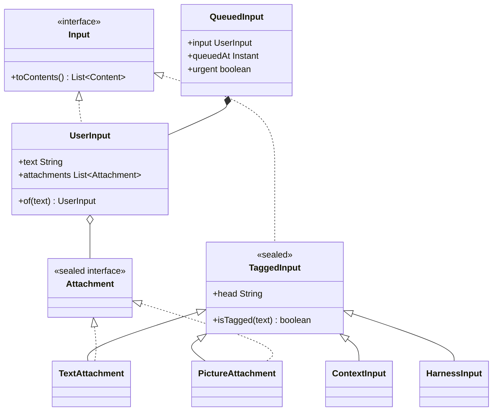
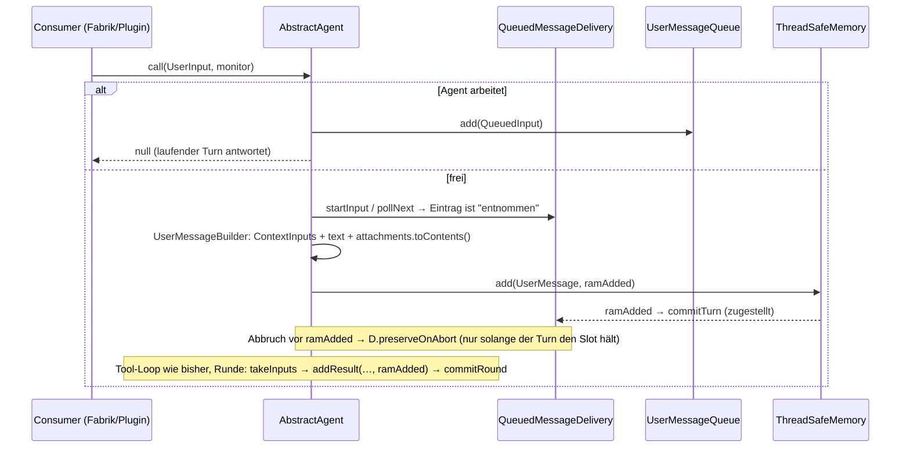

# Input-Modell — Architektur

> **Status:** ✅ (Paul 2026-11-12, gebaut 2026-11-12)   **Fachdoc:** [tagged-results.md](tagged-results.md) R-TR-10…12 ·
> [queued-user-messages.md](queued-user-messages.md) Regel 13 · [read-picture-tool-architektur.md](read-picture-tool-architektur.md)
>
> **Technische Heimat:** core `org.sterl.llmpeon.agent.model` (alle Input-Typen), `queuedmessages`
> (`UserMessageQueue` hält `QueuedInput`), `agent.UserMessageBuilder` (baut die User-Message),
> `agent.QueuedMessageDelivery` (Zustellung aus der Queue bis ins Arbeitsgedächtnis),
> `shared.ChatMessageUtil` + `compact.ContextTrimComponent` (lesen am Tag); Consumer: Plugin
> `PeonAiService`/`AskUserTool`/`ContextItem`s, Fabrik `ProjectRuntime`/`ConversationRestore`.

## Verantwortung & Abgrenzung

- **Ein Paket besitzt das Modell:** `agent/model` hält `Input`, `UserInput`, `TaggedInput` (sealed) und
  seine vier Untertypen, `Attachment`, `QueuedInput`. Niemand sonst baut `TextContent`/`ImageContent` für
  Nutzer-, Kontext- oder Harness-Blöcke — einziger Weg ist `Input.toContents()`.
- **`UserInput` ist kein `TaggedInput`:** der getippte Text bleibt ungetaggt (= Anweisung des Menschen),
  alles Getaggte kommt vom Harness oder ist ein Anhang. Nur `file:`-Blöcke sind ausdrücklich Daten, keine
  Anweisung; Kontext wie `AGENTS.md` bleibt gewollte Anweisung ([tagged-results.md](tagged-results.md)
  R-TR-12). Die Signatur `UserInput(text, List<Attachment>)` verhindert, dass Kontext oder
  Harness als Nutzer-Anhang hineinrutscht.
- **Der Agent besitzt die Message:** `AbstractAgent.call(UserInput, AiMonitor)` lässt `UserMessageBuilder`
  **genau eine** langchain4j-`UserMessage` bauen: Turn-Kontext (`ContextInput`s) → Text → Anhänge.
  `call(String, …)` delegiert.
- **Die Zustellung besitzt `QueuedMessageDelivery`** (eine je Agent): sie hält entnommene, noch nicht
  zugestellte Einträge (Turn und Werkzeug-Runde) und ist die **einzige** Stelle, die sie bei Abbruch
  erhält (`preserveOnAbort`). Bestätigt wird erst, wenn `ThreadSafeMemory` das Arbeitsgedächtnis geändert
  hat (Callback `ramAdded`, vor dem History-Schreiben) — ein History-Fehler danach erhält nicht doppelt.
  Ein Turn, der seinen Slot übergeben hat, ruft die Erhaltung nicht mehr
  ([queued-user-messages.md](queued-user-messages.md) Regel 10/13).
- **Der Tag ist die Wahrheit nach dem Speichern:** im Memory existieren nur `TextContent`/`ImageContent`.
  Erkennen (Compact, Restore, Render) läuft über **eine** Stelle, die den Kopf liest
  (`TaggedInput`-statische Prüfungen, R-TR-2) — keine zweite Klassifikation über `instanceof`, kein
  `CustomMessage`, kein Memory-Umbau.
- **Bilder** (`PictureAttachment`, Werkzeug-Bild als `HarnessInput`) laufen über `PictureFile` (Laden,
  Cap) und `toContents()`. Ein Bild im Tool-Ergebnis gibt es nicht
  (langchain4j) — der Tool-Loop hängt es als eigene User-Message an (R-RP-1).
- **Queue:** `UserMessageQueue` hält `QueuedInput` (= `UserInput` + `queuedAt` + `urgent`). Batching nur
  für Einträge ohne Anhänge; `urgent` trägt nie Anhänge (Invariante im Konstruktor).
- **Out-of-Scope:** Absender (`[User X]`) bleibt Fabrik-Protokoll im Text; PDF/Office; Bild im Tool-Result.

## Typen

## Turn mit Anhängen (Sequenz)

## Compact (Lesen am Tag)

| Teil im Memory | erkannt an | Compact-Input |
|---|---|---|
| `ContextInput`-Block | reiner Block, Kopf ≠ `file:` | entfällt (R-TR-9), kommt frisch wieder |
| `TextAttachment`-Block | Kopf `file: ` | **bleibt**, wird zusammengefasst (R-TR-12) |
| Bild (jede Herkunft) | `ImageContent` | Platzhalter (R-RP-4) |
| Nutzer-Text | ungetaggt | bleibt |

## Architektur-Check

- [x] Ein Paket (`agent/model`) besitzt alle Input-Typen; `shared/Picture*` bleibt Laden, nicht Bauen
- [x] Genau ein Bau-Pfad (`toContents()`), genau ein Lese-Pfad (Kopf-Prüfung)
- [ ] Kein Consumer baut `TextContent`/`ImageContent` für Inputs selbst (Plugin ✅, Fabrik offen bis Büroklammer)
- [x] `call(String, …)` bleibt quellkompatibel — Plugin kompiliert ohne Änderung an den Aufrufern
- [x] Genau eine Erhaltungsstelle (`QueuedMessageDelivery.preserveOnAbort`), Bestätigung nur nach RAM-Änderung
- [ ] Fallstrick: `ChatMessageUtil.extractMessages` ruft `text()` — eine Multi-Content-UserMessage darf dort nie
      `text()` auf der Message rufen (wirft bei >1 Content), nur je `TextContent`
- [ ] Fallstrick: Fabrik-`UserName.parse` erkennt den Absender nur am Anfang des **ersten** Text-Teils —
      Reihenfolge Text vor Anhängen ist Pflicht (R-TR-11)
