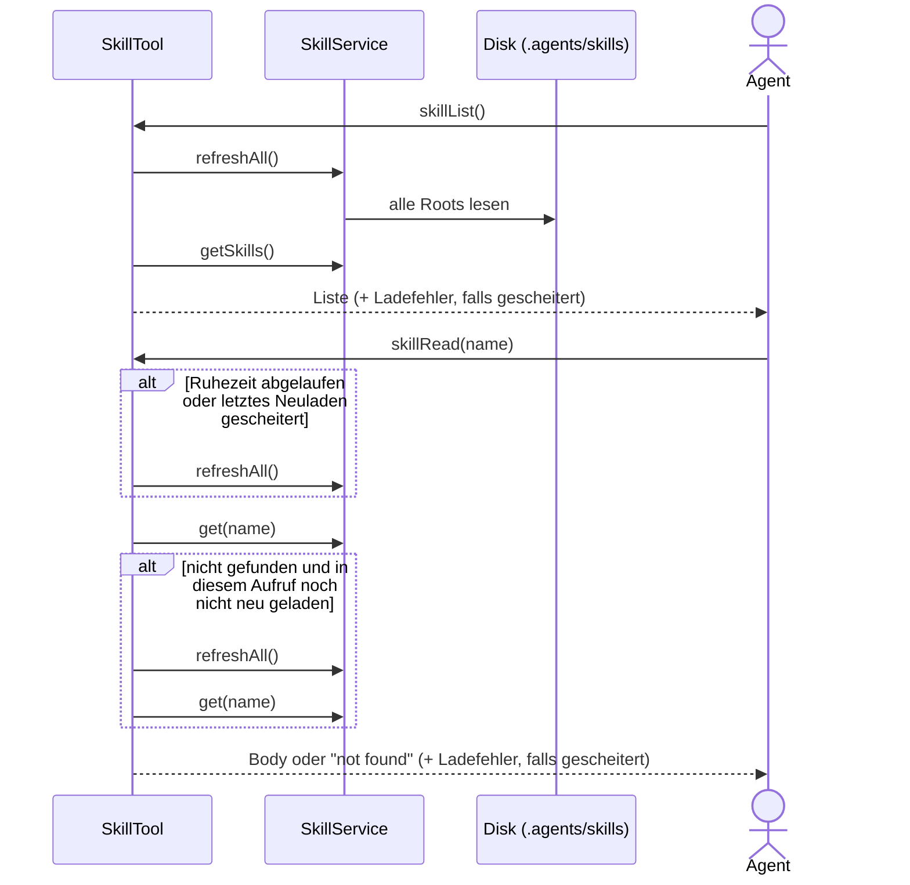

# Project Skills Architektur

> **Status:** ✅ (R18, 2026-11-09)   **Fachdoc:** [project-skills.md](project-skills.md)   **ADRs:**
> [ADR-0042](../../docs/adr/0042-project-skill-slot.md)
> **Technische Heimat:** `org.sterl.llmpeon.tool.tools.SkillTool`, `org.sterl.llmpeon.skill.SkillService`
> (llmpeon-core). Angelegt 2026-11-09 für R18 — beschreibt nur die angefasste Stelle, nicht den
> Bestand (Slots/Override/Scaffold stehen im Fachdoc).

## Verantwortung & Abgrenzung

- **Zweck:** Agenten bekommen über das Skill-Tool den Platten-Stand der Skills, ohne dass jemand
  manuell neu lädt (R18).
- **Besitzer des Vorgangs „Wann wird neu geladen?":** der `SkillTool` — er ist die einzige Stelle,
  an der Agenten Skills lesen, und hält dafür den Zeitpunkt des letzten Neuladens + die Ruhezeit.
  Der `SkillService` bleibt unverändert: er kann neu laden (`refreshAll`, R3/R5/R5a), entscheidet
  aber nie selbst, wann.
- **In-Scope:** Neuladen bei `skillList`, nach Ablauf der Ruhezeit, bei unbekanntem Namen;
  Offenlegung eines Ladefehlers in der Tool-Ausgabe.
- **Out-of-Scope:** UI (Statuszeile, Autocomplete, Menü) liest weiter den letzten geladenen Stand
  derselben Service-Instanz; kein File-Watcher; kein Änderungsdatum-Cache je Datei; keine
  Preference/Config für die Ruhezeit.
- **Hotfix-Charakter:** bewusst minimal am Tool. Soll die UI ebenfalls aktuell sein, wandert die
  Entscheidung in den Service — dann neuer Zyklus.

## Schnittstellen & Abhängigkeiten

| Richtung | Gegenüber | Wofür |
|---|---|---|
| nutzt | `SkillService.refreshAll()` | alle Roots neu laden (atomarer Swap je Component, R5/R5a) |
| nutzt | `SkillService.get/getSkills/skillNames` | Lookup in der effektiven View |
| genutzt von | alle Agenten (geteilte Instanz via `SharedToolsComponent`, Jon R16, Scaffold) | `skillList`, `skillRead`, `skillReadFile` |

Input: Ruhezeit per Konstruktor (Default 10 min, 0 = immer). Bestehender Konstruktor behält seine
Signatur und nutzt den Default. Uhr per Konstruktor injizierbar, damit Tests die Ruhezeit ohne
Warten prüfen.

Nebenläufigkeit: eine `SkillTool`-Instanz wird von mehreren Agenten-Threads geteilt. Das Neuladen
durch das Tool läuft serialisiert (ein Neuladen zur Zeit je Instanz) — sonst könnte ein langsamer,
früher gestarteter Ladevorgang seinen älteren Platten-Stand nach einem neueren veröffentlichen.
Andere Auslöser (Projektwechsel, Scaffold, Config-Reload) koordiniert das Tool nicht — Bestand,
außerhalb dieses Hotfixes. Der Zeitstempel des letzten **erfolgreichen** Neuladens ist
thread-sicher; ein gescheitertes Neuladen setzt ihn zurück, damit der nächste Aufruf es erneut
versucht.

## Diagramme

## Architektur-Check

- [x] Keine Komponenten-Zyklen (Tool → Service, nie zurück)
- [x] Eine Verantwortung je Stelle: Tool entscheidet *wann*, Service *wie* geladen wird
- [x] Kein zweiter Ladepfad — nur `refreshAll()`
- [x] Kein neuer Cache (Zeitstempel ist kein Cache; Service-Maps bleiben die einzige Ablage)
