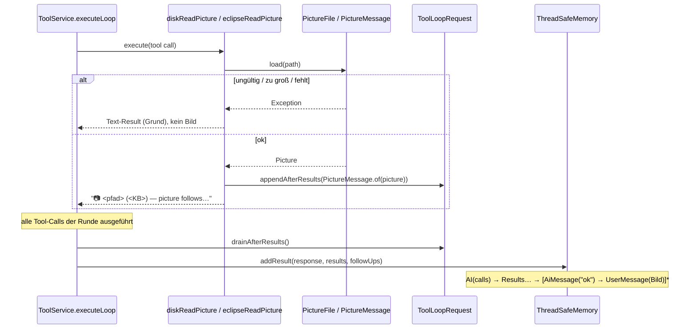

# Read Picture Tool Architektur

> **Status:** ✅   **Fachdoc:** [read-picture-tool.md](read-picture-tool.md)   **ADRs:** —
>
> **Technische Heimat:** core `org.sterl.llmpeon.shared` (`PictureFile`, `PictureMessage`),
> `org.sterl.llmpeon.tool` (`AbstractTool`, `ToolService`, `DiskFileReadTool`),
> `ThreadSafeMemory`, `ChatMessageUtil`; plugin `EclipseWorkspaceReadFileTool`.

## Verantwortung & Abgrenzung

- **Zweck:** Ein Read-Tool lädt ein Bild und der Tool-Loop hängt es als eigene User-Message nach den
  Tool-Results der Runde an — gültig für jeden Provider (R-RP-1).
- **Besitzer der Memory-Sequenz:** `ToolService.executeLoop` — er schreibt die Runde atomar über
  `ThreadSafeMemory.addResult(response, results, followUps)`:
  `AI(tool calls) → Results… → [AiMessage("ok") → UserMessage(Bild)]*`. Tools schreiben **nie** selbst
  ins Memory; sie legen das Bild nur auf dem Request ab.
- **Transport Tool → Loop:** `ToolLoopRequest.appendAfterResults(UserMessage)` (generisch benannt),
  der Loop leert die Liste mit `drainAfterResults()` je Runde. Die Liste gehört dem Request — ein
  Sub-Agent-Loop (`toBuilder()`) bekommt eine eigene, teilt sie nie mit dem Parent.
- **Geteilte Lade-/Prüflogik:** `PictureFile.load(Path)` (Endung, 4-MB-Cap vor dem Lesen, Meldungen
  aus R-RP-2/3; Fehler = Exception → Text-Result durch den bestehenden Executor, keine Bild-Sequenz).
  `PictureMessage` baut die Bild-User-Message (getaggter Kopf mit Pfad + Bild) **und** liest den Pfad
  zurück — Bau und Parser in einer Klasse.
- **Tools:** `AbstractTool.attachPicture(Path)` ist der eine Weg für beide Familien;
  `diskReadPicture` / `eclipseReadPicture` lösen nur den Pfad auf (wie ihr Read-Geschwister) und
  delegieren. Keine eigenen Tool-Klassen.
- **Compact/Schätzung:** `ChatMessageUtil` (einziger Renderer) ersetzt Bilder durch
  `[picture removed for compact: <Pfad>]` und zählt je Bild pauschal 4.800 Zeichen (R-RP-4).
- **Persistenz:** unverändert — der langchain4j-Codec serialisiert die Bild-User-Message (R-RP-5).
- **Out-of-Scope:** Bild im Tool-Result (Provider-abhängig), Downscale, Vision-Erkennung.

## Schnittstellen & Abhängigkeiten

| Richtung | Gegenüber | Wofür |
|---|---|---|
| nutzt | `ToolLoopRequest` | Bild für die laufende Runde ablegen |
| nutzt | `ThreadSafeMemory` | Runde inkl. Follow-ups atomar anhängen + persistieren |
| genutzt von | `DiskFileReadTool`, `EclipseWorkspaceReadFileTool` | `attachPicture(Path)` |
| genutzt von | Compact (`ContextTrimComponent` über `ChatMessageUtil`) | Platzhalter statt Bild |

## Diagramm

## Architektur-Check

- [x] Keine Komponenten-Zyklen (Tool → Request ← Loop → Memory)
- [x] Genau ein Pfad: Sequenz nur im Loop, Laden nur in `PictureFile`, Rendern nur in `ChatMessageUtil`
- [x] Tools ohne Memory-Zugriff; Plugin nur Pfad-Auflösung
- [x] Core-Logik ohne Eclipse testbar
- [ ] Fallstrick: kein Compact-Pfad darf rohe Bild-Messages behalten — Test über den echten
      Compact-Weg, danach 0 Bilder im Memory
- [ ] Fallstrick: die Bild-User-Message ist **keine** echte User-Eingabe — die Compact-Stufenkürzung
      („letzte echte User-Message voll", R-CIB) muss sie überspringen, sonst geht die echte Frage verloren
- [ ] Fallstrick: `compactSession` in derselben Runde wie ein Bild → Bild-Sequenz hängt nach dem
      Compact an (gewollt)
