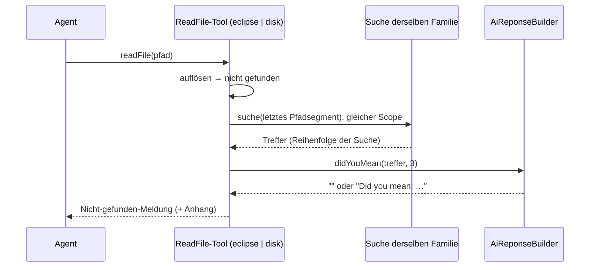

# Read Tools Architektur — „Did you mean" bei Datei nicht gefunden

> **Status:** ✅   **Fachdoc:** [read-tools.md](read-tools.md) (R-RT-1)   **ADRs:** —
> **Technische Heimat:** core `org.sterl.llmpeon.tool` (`DiskFileReadTool`, `AiReponseBuilder`) ·
> plugin `EclipseWorkspaceReadFileTool`

Beschreibt nur den Teil, den R-RT-1 anfasst — nicht den Bestand der Read-Tools.

## Verantwortung & Abgrenzung

- **Zweck:** Ein Lese-Tool, das einen Pfad nicht findet, besitzt auch den Vorschlag: es fragt die
  Suche **seiner eigenen Familie** nach dem Dateinamen und hängt die Treffer an seine
  Nicht-gefunden-Meldung.
- **In-Scope:** `eclipseReadFile`, `diskReadFile`.
- **Out-of-Scope:** `*ReadPicture`, `*List*`, `eclipseOpenFileInEditor`, Write-Tools; automatisches
  Lesen eines Treffers; eine neue/dritte Suchlogik.

## Schnittstellen & Abhängigkeiten

| Richtung | Gegenüber | Wofür |
|---|---|---|
| nutzt | Suche der eigenen Familie (`eclipseSearchFiles` bzw. `diskSearchFiles`) — **dieselbe** Implementierung, nicht kopiert | Treffer für den Dateinamen im heutigen Scope |
| nutzt | `AiReponseBuilder` (core) | einziges Format des `Did you mean:`-Anhangs, max. 3, für beide Familien |
| nutzt | `EclipseUtil.unresolvedHint` | R-WN-5-Diagnose bleibt unverändert vor dem Anhang |

Input: angefragter Pfad · Output: unveränderte Nicht-gefunden-Meldung (eclipse: String, disk:
Exception-Message) + optional `Did you mean:` mit ≤ 3 Pfaden im Format der Familie.

## Ablauf

## Invarianten

- **Eine Suche je Familie:** `searchFiles` und der Miss-Pfad von `readFile` rufen denselben Code;
  Scope, Matching und Dedup können nicht auseinanderlaufen.
  Das schließt bei eclipse den Refresh-on-empty der Suche (R4) ein — bewusst: kostet nur, wenn der
  Name nirgends existiert, und vermeidet einen zweiten, schwächeren Suchpfad.
- **Eine Vorschlags-Policy:** Segmentbildung, Leer-Segment-Regel, Fehler-/Abbruch-Behandlung und
  Format leben einmal im core; die Tools liefern nur ihre Suche (und eclipse seine
  Abbruch-Erkennung, z.B. `OperationCanceledException`) hinein. Ein Abbruch wird immer
  durchgereicht, nie als Suchfehler angehängt.
- **Ein Format:** der Anhang entsteht nur in `AiReponseBuilder`; leere Trefferliste → kein Anhang.
- **Nie lesen:** der Miss-Pfad liefert nie Dateiinhalt.

## Architektur-Check

- [x] Keine Komponenten-Zyklen (Tool → eigene Suche / core-Builder)
- [x] Klare Verantwortung: das Tool, das nicht findet, besitzt den Vorschlag
- [x] Keine Duplizierung: Suche wiederverwendet, Policy + Format einmal im core
