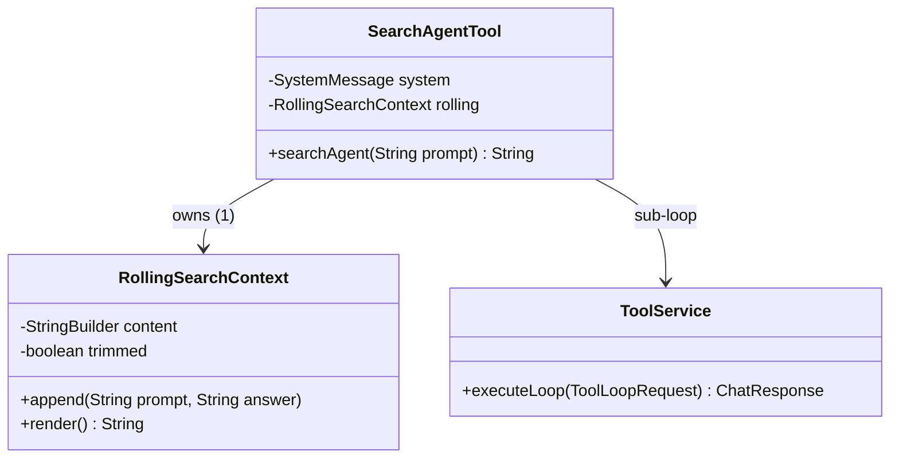

# Search Agent Tool — Architektur

> Verantwortung, Abgrenzung und Interaktion von `SearchAgentTool` (Da Sniffa) inkl. dem
> rollenden Hot-Kontext `last-search-rolling`. SOLL/Fachliches: [search-agent-tool.md](search-agent-tool.md) ·
> Trim-Entscheidung: [ADR-0075](../../docs/adr/0075-last-search-rolling-rohschnitt.md).

## Verantwortung

| Komponente | Besitzt |
|---|---|
| `SearchAgentTool` | den Sub-Loop (Werkzeugfilter, SEARCH-Modell-Slot), die Entscheidung „Ergebnis vollständig?“ (R-LSR-1/2) und die Injektion des Hot-Blocks (R-LSR-5) — Orchestrator |
| `RollingSearchContext` (package-private) | den Hot-Block: Paar-Format, 10k-Cap auf Paar-Inhalt (roher Tail-Schnitt), Disclosure nur bei Kappung, Thread-Safety (`synchronized`) — deep module, kennt weder LLM noch Tool |
| `ToolService` | unverändert: merged alle Static Messages zu EINER SystemMessage (`toOneSystemMessage`) |

**Prüffrage „Wer besitzt den Vorgang?“:** Der Hot-Block gehört der `SearchAgentTool`-Instanz
(= ein Chat-View, alle Agents der View teilen ihn, R-LSR-6). Der Sub-Loop besitzt nichts — er
bekommt den Block als Static Message und schreibt nie zurück; nur der Orchestrator appendet.

## Komponenten-Interaktion



```mermaid
sequenceDiagram
    participant P as Parent-Agent (ToolLoop)
    participant S as SearchAgentTool
    participant R as RollingSearchContext
    participant T as ToolService
    P->>S: searchAgent("q2")
    S->>R: render()
    R-->>S: "//-- Start last-search-rolling …" (q1/a1) | ""
    S->>S: staticMessages = "" ? [system] : [system, SystemMessage(block)]
    S->>T: executeLoop(subRequest)   %% agent(null), frisches Memory
    T-->>S: response
    S->>S: answer = text; result = answer | Fallback
    alt answer vorhanden && !canceled
        S->>R: append("q2", answer)
    end
    S--->P: result (unverändert)
```

## Abgrenzung

- **Kein ContextItem:** der Sub-Loop hat die ContextItem-Mechanik nicht (`agent(null)`, frisches
  Memory) — der Block ist eine Static Message mit TaggedResult-ähnlichem Header, erklärt in
  `prompts/search-agent.md`.
- **Kein Memory-Kontakt:** `ThreadSafeMemory` bleibt frisch je Aufruf (R3); der Parent-Memory wird
  nie angetastet.
- **Kein Compact-Kontakt:** der Block ist von Natur aus bounded (10k-Cap), es gibt nichts zu kompakten.
- **Bekannte Folge (bewusst akzeptiert):** der Block wird vom Sub-Loop mit `search-agent.md` zu EINEM
  System-Prompt gemergt (`ToolService.toOneSystemMessage`) — der System-Prompt ändert sich je Suche,
  ein Provider-Prompt-Cache kann über Such-Aufrufe hinweg nicht wiederverwendet werden. Sub-Loops sind
  one-shot (frisches Memory), daher ist der verlorene Cache-Reuse der Preis für die Kontinuität.
- **webSearch bleibt unberührt:** der Hook liegt in `searchAgent()` nach `executeLoop` — nicht im
  `WebSearchTool`, das von allen Agents direkt genutzt wird.