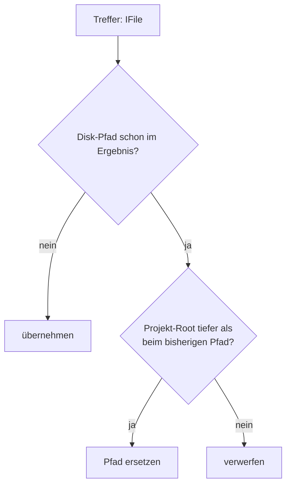

# Workspace-Sicht — verschachtelte Eclipse-Projekte

> **Status:** ✅ done (2026-10-19, 2.14.1) · Δ 2026-10-24 (T-5/I-4): R-WN-4 Pfad-Vertrag + R-WN-5 Diagnose ✅ done · **Architektur:** keine neue Komponente —
> Erweiterung von `EclipseUtil` + `EclipseWorkspaceReadFileTool`/`EclipseGrepTool`

## Ziel

Ein Aggregator-Projekt liegt im selben Ordner wie seine Module: `llmpeon-parent` zeigt den Repo-Root,
`llmpeon-core`, `org.sterl.llmpeon`, … liegen physisch darunter. Eclipse führt beide Ebenen als
Projekte — **eine Disk-Datei, zwei Workspace-Pfade**. Der Agent darf daraus nie zwei Dateien machen:
jede Datei erscheint genau einmal, unter dem **spezifischsten** Projekt, und die Projekt-Info erklärt,
warum es den zweiten Pfad überhaupt gibt.



## R-WN-1 — Dedup: der spezifischste Projekt-Pfad gewinnt (✅ done)

GIVEN eine Datei ist über zwei Projekte sichtbar (`/llmpeon-core/src/A.java` und
     `/llmpeon-parent/org.sterl.llmpeon.core/src/A.java` — gleicher Disk-Pfad)
WHEN `eclipseSearchFiles` oder `eclipseGrepFiles` diese Datei trifft
THEN wird sie **einmal** geliefert, unter dem Pfad des Projekts mit dem **tiefsten** Projekt-Root
     (längster Disk-Prefix) — also `/llmpeon-core/src/A.java`.

- Unabhängig von Scan-Reihenfolge und gewähltem Projekt; das gewählte Projekt bestimmt weiterhin nur
  die **Reihenfolge** der Treffer (R4a1 in [eclipse-read-tools.md](eclipse-read-tools.md)).
- **Bei erreichtem Ergebnis-Limit bleibt die Scan-Reihenfolge maßgeblich:** ein bereits gelieferter
  Duplikat-Eintrag wird dann nicht mehr auf die tiefere Sicht umgeschrieben. Die Datei zählt weiterhin
  nur **einmal**, und das Limit ist im Ergebnis benannt.
- Gleich tiefe Projekte (kein Nesting) → wie bisher: der zuerst gefundene Pfad bleibt. Praktisch
  betrifft das nur eine Datei, die über **denselben** Ordner zweimal sichtbar ist (gleicher
  Disk-Pfad); ein anderer Disk-Pfad ist eine andere Datei und kein Dedup-Fall.
- **Ein expliziter Scope bleibt maßgeblich:** `path=/llmpeon-parent` liefert Parent-Pfade — dort wurde
  gesucht. Keine Rückübersetzung außerhalb des angefragten Scopes, sonst liefert das Tool Pfade, die
  der Agent nicht angefragt hat.

## R-WN-2 — Grep zählt Disk-Pfade, nicht Workspace-Pfade (✅ done)

GIVEN dieselbe doppelt sichtbare Datei enthält drei Treffer
WHEN `eclipseGrepFiles` workspace-weit sucht
THEN erscheinen die drei Treffer **einmal** (unter dem spezifischsten Pfad), und die Datei zählt
     **einmal** gegen das Datei-Limit (`MAX_GREP_FILES`).

## R-WN-3 — Projekt-Info nennt die Verschachtelung (✅ done)

GIVEN das aktive Projekt ist Teil einer Verschachtelung — ein offenes Projekt ist Vorfahr seines
     Ordners, oder sein Ordner ist Vorfahr offener Projekte
WHEN die Projekt-Info den Turn-Kontext bildet
THEN steht dort **eine** zusätzliche Zeile je Richtung.

Modul:
```
Nested in Eclipse project /llmpeon-parent — the same files are also visible under
/llmpeon-parent/org.sterl.llmpeon.core/…; tools return the most specific project path.
```
Aggregator:
```
Contains Eclipse projects: llmpeon-core, llmpeon-feature, org.sterl.llmpeon, … — their files are
also visible under this path; tools return the most specific project path.
```

- Nur bei echter Verschachtelung (kein Token-Aufwand im Normalfall), nur **offene** Projekte,
  Vergleich über die kanonischen Projekt-Ordner (nicht über Projektnamen).
- **WEIL:** ohne die Zeile wundert sich der Agent über einen Pfad, der nicht die Projektwurzel ist,
  die er im Kopf hat — und über eine Datei, die er „schon gesehen" hat.

## R-WN-4 — Pfad-Vertrag: ein gelieferter Pfad ist wieder lesbar ✅ done (2026-10-24, T-5/I-4, Commits b2d30906; Da-Mek-Messung S1–S5)

Jedes `eclipse*`-Tool liefert Workspace-Pfade der Form `/projekt/…` (nie Disk, nie relativ), und
jedes `eclipse*`-Tool, das einen Pfad konsumiert, akzeptiert **jede** Form, die ein `eclipse*`-Tool
geliefert haben kann — ein Round-Trip `eclipseSearchFiles → eclipseReadFile` darf nie scheitern.
Der Resolver löst als letzten Versuch über die **Disk-Lokation** (`resolveByLocation`: Projekt aus
Segment 1 → `getRawLocation()` + Rest → `deepestResourceAt`, tiefster `fullPath` gewinnt, `.exists()`
filtert Phantom-Ressourcen geschlossener Projekte), damit auch Aggregator-Ordner-Pfade
(`/llmpeon-parent/org.sterl.llmpeon.core/…`, Segment 2 ist ein
Ordnername, nicht der Projektname) und Zustände mit geschlossenen Projekten lesbar bleiben.
Bei abweichender Auflösung offen gelegt: „resolved via <pfad>".

### UC-WN-4 — searchReadRoundTrip ✅ done
- GIVEN der Aggregator (oder das Projekt, dessen Ordner-Form der Agent hält) ist **geschlossen**,
  die Module darunter offen — die Aggregator-Ordner-Form `/root/mid/leaf/…` ist dann nicht über den
  Baum auflösbar (S4-Matrix, Da-Mek-Messung 2026-10-24) WHEN `eclipseReadFile` mit diesem Pfad
  aufgerufen wird THEN die Datei wird über die Disk-Lokation aufgelöst und gelesen, mit Disclosure
  „resolved via <pfad>", wenn die Auflösung von der angefragten Form abweicht.

## R-WN-5 — Diagnose statt nacktem „not found" ✅ done (2026-10-24, T-5/I-4, Commits 0a3ab0c9/b2d30906)

Ein fehlgeschlagener `eclipse*`-Pfad-Aufruf mit **absolutem Workspace-Pfad** benennt den **Grund**,
nie nur „not found": Projekt
existiert, ist aber **geschlossen**; oder (bei offenem Projekt) Datei liegt auf Disk, ist aber nicht
im Workspace-Baum (→ Hinweis auf `eclipseRefreshProject`); sonst unbekanntes Projekt/generisch.
**Projekt-relativer Scope** (kein führendes `/`) bekommt nur den generischen Satz — der Scope ist
dem Resolver nicht als Projekt bekannt, eine closed-/disk-only-Diagnose wäre geraten.
Eine lesbarere Sicht derselben Datei ist keine Diagnose mehr, sondern die **Auflösung** selbst
(`resolved via <pfad>`, R-WN-4). `findOpenProject` matcht **exakt** (Name oder `/name`) — kein
Substring-Fehltarget (`llmpeon-core` darf nicht `llmpeon-core-extra` treffen); ein importiertes,
aber geschlossenes Projekt bekommt eine eigene „exists but is closed"-Meldung statt „not found".

### UC-WN-5 — eclipsePathFailureNamesTheCause ✅ done
- GIVEN ein `eclipse*`-Tool erhält einen Pfad, der auch über die Disk-Lokation nicht auflösbar ist,
  in einem geschlossenen Projekt WHEN die Auflösung scheitert THEN die Meldung nennt „project … is
  closed" (nicht „not found").
- GIVEN ein Projekt `llmpeon-core-extra` ist offen WHEN `findOpenProject("llmpeon-core")` aufgerufen
  wird THEN kein Substring-Match — exakter Name oder `/name` gewinnt, sonst leer.

## Offene Punkte

| Punkt | Status |
|---|---|
| Zwei Disk-Pfade, eine Datei (Symlink/Workspace-Link) | ❓ nicht abgedeckt — Dedup bleibt der textuelle Disk-Pfad |
| `src/`-Magic im Resolver (kann falsch-positiv treffen: gleicher Relativpfad unter `src/` eines anderen Projekts) | ⏳ Entfernen = eigener Follow-up, erst Inventar wer davon abhängt |

## Umsetzung

- Ein Helfer (plugin, `EclipseUtil`) entscheidet „spezifischster Pfad" gegen den bestehenden Eintrag
  anhand der Projekt-Ordner; `eclipseSearchFiles` und `eclipseGrepFiles` rufen denselben Helfer auf
  (eine Semantik, kein Copy-Paste — „one behaviour, one implementation").
- Projekt-Info: `EclipseUtil.projectInfo` ergänzt die Zeile(n) aus den offenen Projekten
  (`getLocation()`, normalisiert).
