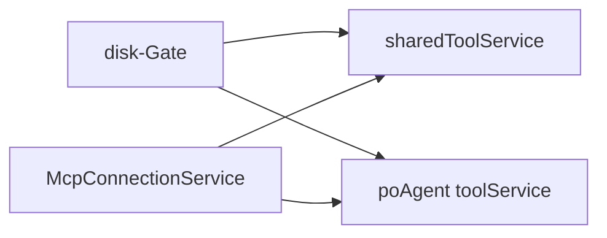

# Night-Cycle 4 (Teil 1) — Theme-NPE, Cap-Test, Zwei-Registry-Wiring (disk-Gate + MCP)

> Plan für Da Mek (Dev-Agent). Paul ist weg — STOP-AND-ASK geht an **Jon** (askDev-Kanal). Alle
> Design-Entscheidungen sind unten fest; keine offenen SOLL-Fragen. SOLL-Grundlage (alle von JON
> am 2026-10-15 geschrieben — docs-first damit erfüllt): `docs/agenten-status-im-header.md`,
> `docs/test-setup.md` (R6), `docs/po-agent-jon.md` (R20),
> `docs/adr/0067-two-registry-dynamic-tool-families.md`.

## STOP-AND-ASK — zuerst lesen
- Compile-Fehler ohne Lösung, nicht-grün-bekommende Tests oder IST-Widerspruch zu diesem Plan →
  AKTIV Jon fragen (askDev-Kanal); nie still workarounden, nie SOLL ändern. Einzige autorisierte
  Inline-Entscheidung: Inc2-Fallback-Kette (§4) — jeder benutzte Schritt wird im Zyklus-Bericht
  gemeldet.
- Branch **`story/agent-tool-config` bleibt** (kein Wechsel, Paul-Order). Vor Start: Git-Zustand
  selbst prüfen.
- Commit nach jeder von Jon abgenommenen grünen Iteration (Scope = Inkrement-Dateien + Story-Docs,
  §9) + push auf origin.
- Kein line-based Replace ohne Re-Read; große Rewrites = ganze Datei schreiben.
- VOR jedem PDE-Testlauf: `eclipseBuildProject` über `org.sterl.llmpeon` + `org.sterl.llmpeon.test`
  (stale Bundle-Klassen → ClassNotFoundException). GANZE Plugin-Suite laufen lassen, keine
  Einzelklassen.

## Progress (Da Mek)
- [x] **Inc1** — resolveTheme null-safe + `EclipseUiUtilTest` 5/5 (rot→grün) + `HeaderRosterStructureTest` Theme-Pin. Gate grün 2026-10-15 (Plugin 344/0, Core 1110/0, SOLL-3 Grep: 1 Prod-Call-Site). Abgenommen (Jon), commit `a4859e4a` + push.
- [x] **Inc2** — Cap-Test: 3 Seed-Dateien × 40 Error-Zeilen (Fallback **(a)** — bevorzugte 1×120 rot: „got 100", Root Cause JDT `maxProblemsPerUnit=100`, ECJ-Source verifiziert). Gate grün 2026-10-15 (Plugin 344/0, Core 1110/0, N=120). Abnahme/commit ausstehend.
- [x] **Inc3** — disk-Gate toggelt beide Registries: `diskGatedRegistries`-Liste + `registerDiskGatedRegistry`, `updateActiveDiskTools` loopt über alle (gleiche Guards, 4 Instanzen atomar), PeonAiService registriert `poAgent.getToolService()`. Rot→Grün: 2 neue Tests (`diskGateTogglesPoRegistryToo`, `poRegistryDiskWriteOutsideDocsRejected`), Gate 2026-10-15 (Plugin 346/0, Core 1110/0). Abnahme/commit ausstehend.
- [x] **Inc4** — MCP verbindet beide Registries: `toolServices`-Liste (List.copyOf) + `connectServers()`-Test-Seam (synchron), `connect()`/`disconnect()` loopen über alle, PeonAiService wiret `List.of(shared, poAgent.getToolService())`. Rot→Grün: 2 neue Tests rot (po: `null` / nicht disconnected) → grün. Gate 2026-10-15 (Plugin 348/0, Core 1110/0). Homepage line 66 (Jon via eigene Registry). Abweichungen im Zyklus-Bericht (connectServers public statt protected; Open-Item-3: kein `Job.create(String, IScheduleRule)`-Overload; Homepage-Wording). Abgenommen (Jon), commit `bb55d5f1` + push.

## 1. Context — 4 kleine vertikale Inkremente, je für sich grün, **keine Core-Änderungen**

| # | Befund | Fix | Module |
|---|---|---|---|
| Inc1 | NPE: `resolveTheme` guardt die Engine, nicht das nullable `getActiveTheme()` | Null-Guard → light + Test-Isolation | plugin, test |
| Inc2 | Cap-Test rotet in degradiertem Workspace (120 Dateien) | Deterministisch >100 Marker mit 1 Seed-Datei | test |
| Inc3 | disk-Gate toggled nur `sharedToolService`, nicht Jons po-Registry | Beide Registries togglen | plugin, test |
| Inc4 | MCP connect/disconnect nur an `sharedToolService` | Beide Registries | plugin, test, homepage |

## 2. Architektur — zwei Registries nach ADR-0067
Zwei agent-facing Registries: **shared** (dev/plan/custom + Jons Slaven) und **po** (Jon,
kuratiert). Beide Familien bekommen die Registry-Liste — kein Copy-Paste. Slaven sitzen auf
`sharedToolService` → unberührt. Keine weitere agent-facing Registry (Voll-Grep §7);
`AiScaffoldAgent` hat eigene config-scoped disk-Tools (eigene Instanzen — bewusst nicht Teil des
disk-Gates).

- **Inc3:** `SharedToolsComponent` ist Owner (hält die disk-Tool-Instanzen), führt die Liste,
  `updateActiveDiskTools` bleibt der eine Choke-Point — alle 4 disk-Tools atomar (inkl. `webGet`).
- **Inc4:** `McpConnectionService` hält selbst die Liste. **R3-Write-Validation braucht KEIN neues
  Wiring:** `AbstractAgent` setzt pro Request `writeValidator(getWriteValidator())`
  (AbstractAgent.java:354); `DiskFileWriteTool.resolve()` validiert vor I/O — dieselbe geteilte
  Instanz in der po-Registry wird automatisch mit `WriteValidator.DOCS` geprüft. Kein MCP-
  Filter-Change (leere Allowlist = alle).

## 3. Inc1 — resolveTheme null-safe
Docs (mit Inc1-Commit): `docs/agenten-status-im-header.md`. Kein Homepage-Change.

**`EclipseUiUtil.java`** (plugin, parts/shared), `resolveTheme(IEclipseContext)` :46-55:
- `activeTheme = themeEngine.getActiveTheme()` (nullable!); nur wenn
  `activeTheme != null && DARK_THEME_ID.equals(activeTheme.getId())` → dark; alle anderen Fälle
  (kein Context / keine Engine / kein Theme) → light. Neuer Import
  `org.eclipse.e4.ui.css.swt.theme.ITheme`.
- `private` → **package-private** (visible for tests; Javadoc: missing context/engine/theme →
  light). Öffentliche `resolveTheme()` + `addThemeChangeListener` unverändert.

**NEU `EclipseUiUtilTest.java`** (Test-Bundle, Package `org.sterl.llmpeon.parts.shared` —
Präzedenz `FileDropSupportTest.java`): JUnit 4, keine AssertJ, headless (kein Display/Workbench).
Context via `EclipseContextFactory.INSTANCE.get()`. 5 Tests:
1. Theme null → light — **roter Regressionstest** (vor Fix: NPE)
2. activeTheme = dark-Id → dark (unchanged behavior)
3. activeTheme = `DEFAULT_THEME_ID` → light
4. leerer Context (keine Engine) → light
5. null Context → light

FakeThemeEngine implements `IThemeEngine`: nur `getActiveTheme()` relevant, andere 11 Methoden →
`UnsupportedOperationException`; `ITheme` als anonyme Klasse (getId/getLabel);
`@SuppressWarnings("restriction")` auf der Klasse.

**`HeaderRosterStructureTest.java`** — Theme vor dem Widget-Bau explizit pinnen: im `ui(...)`-
Lambda `engine.setTheme(IThemeEngine.DEFAULT_THEME_ID, false)`; `Assume.assumeTrue(engine != null)`
**vor** dem ui-Call (kein AssumptionViolatedException im Lambda). Helper `themeEngine()`:
PlatformUI → IEclipseContext → IThemeEngine.

**SOLL 3 (melden, nicht fixen):** VOLL-Grep `getActiveTheme` (workspace, .java) bei Inc1 —
Erwartung: exakt 1 Production-Call-Site (`EclipseUiUtil.java:50`); mehr → nur melden.

## 4. Inc2 — Cap-Test ohne 120 Seed-Dateien
Docs (mit Inc2-Commit): `docs/test-setup.md` (R6). **Eine Datei:** `EclipseBuildToolTest.java`.

**Mechanik:** eine Seed-Datei `src/org/sterl/fixture/cap/CapSeed.java` mit **120 Zeilen** à
`int e<i> = missing<i>;` — JDT: ein Marker pro Zeile (cannot be resolved to a variable) →
deterministisch >100 Marker unabhängig vom Recovery-State. Kein 120-Datei-Ballast.

Struktur (Name, UC-Tags, Assertions, timeout=180000 UNVERÄNDERT):
- GIVEN: `eclipseWriteFile(CapSeed.java, 120 error lines)`
- WHEN: `tool.eclipseBuildProject(PROJECT_NAME)`
- THEN: `n = findMarkers(PROBLEM) > 100`; Result enthält `showing 100 of ` + n; exakt 100 Zeilen
  matching `.* @ line .* @ file .*`
- finally: `deleteMarkers` auf CapSeed.java (Marker vor Datei; Base after() löscht die Datei)

Bestätigt: Marker-Format `EclipseBuildTool.markerToAiString` :292-298; Cap-Pfad
`readProjectWide(projectRef, MAX_BUILD_MARKERS=100)` → `AiReponseBuilder.buildMarkers`.

**Genehmigte Fallback-Kette (nur wenn rot, melden welcher Schritt nötig war):**
(a) JDT dedupliziert in einer Datei → 3 Dateien × 40 Zeilen
(b) immer noch ≤100 → direktes Marker-Seeding: Build laufen lassen, danach 120 Marker via
`file.createMarker(IMarker.PROBLEM, ...)` (Präzedenz `addMarker` :56-63); Report lesen über
`tool.eclipseReadProjectProblems(PROJECT_NAME, null, null)` (gleicher Cap-Pfad). Assertion
`n > 100` wird **NIE** abgeschwächt.

## 5. Inc3 — disk-Gate toggelt beide Registries
Docs (mit Inc3-Commit): `docs/po-agent-jon.md` (R20) + `docs/adr/0067-two-registry-dynamic-tool-families.md`. Kein Homepage-Change.

**`SharedToolsComponent.java`:**
- Neues Feld `List<ToolService> diskGatedRegistries`; Konstruktor ergänzt `sharedToolService`
- Neue `public void registerDiskGatedRegistry(ToolService registry)`
- `updateActiveDiskTools(LlmConfig)` (Signatur unverändert) loopt über beide Registries, gleiche
  Idempotenz-Guards pro Registry, gleiche 4 Instanzen atomar

**`PeonAiService.java`** Konstruktor: nach `agentService.addPersistentAgent(poAgent)` (:198), vor
`updateConfig(...)` (:208): `sharedTools.registerDiskGatedRegistry(poAgent.getToolService())`.
`poAgent.getToolService()` = `AbstractAgent.getToolService()` (:448) — kein neuer Accessor.
Persistent-Instanz (überlebt clearAgents/Reloads) → stabile Referenz.

**Tests** (erweitern `SharedToolsComponentTest.java`, JUnit 4, kein Display):
1. `diskGateTogglesPoRegistryToo`: po = `new ToolService(false)`, registered; disabled → keine
   disk-Tools in po; enabled → alle 4 present + `assertSame` mit shared (gleiche Instanzen);
   double-enable → keine Duplikate; disabled → alle weg
2. `poRegistryDiskWriteOutsideDocsRejected`: po-Registry + disk enabled; `DiskFileWriteTool` mit
   `ToolLoopRequest(writeValidator=DOCS)` (Request-Muster core `DiskFileWriteToolTest.docsRequest()`
   :125-132) → `diskWriteFile("outside/notes.txt")` → `IllegalArgumentException` containing
   "Write denied". Kein Model-Call, keine I/O (Validator feuert in `resolve()` vor I/O)

## 6. Inc4 — MCP verbindet beide Registries
**Homepage (mit Inc4-Commit, user-visible):** `homepage/src/setup/mcp-configuration.md` line 66.
Docs landen bereits mit Inc3.

**`McpConnectionService.java`:**
- Feld `ToolService` → `List<ToolService> toolServices` (`List.copyOf`); Ctor
  `McpConnectionService(List<ToolService>, Consumer<Boolean> onStateChange)`
- NEU `protected IStatus connectServers()` = extrahierter Job-Body (**Test-Seam, synchron**);
  `connect()`: `Job.create("Connecting MCP servers", m -> connectServers()).schedule()`
- `connectServers`: Loop `ts.connectMcp(servers)` über alle Registries; State/Semantik
  unverändert — `connected.get()` VOR `onStateChange` capturen (async state safety)
- `disconnect()`: synchroner Loop `ts.disconnectMcp()` (wie heute); `applyConfig`/`toggle`
  unverändert (lastApplied-Dedup bleibt)

**`PeonAiService.java`** :200: `new McpConnectionService(List.of(sharedToolService,
poAgent.getToolService()), mcpStateChange)`.

**Tests** (erweitern `McpConnectionServiceTest.java`): `RecordingService` `super(null, ...)` →
`super(List.of(), enabled -> {})`. NEU `RecordingToolService extends ToolService(false)`:
override `connectMcp` (Liste recorden) + `disconnectMcp` (bool recorden).
1. `givenTwoRegistries_whenConnected_thenBothReceiveSameServerList`: `givenMcpConfig(c1, true)`;
   `new McpConnectionService(List.of(shared, po), state -> {})`; `service.connectServers()`;
   `assertEquals(c1, shared.connectedServers)` **UND** `assertEquals(c1, po.connectedServers)` —
   die übergebene Liste wird capturert (nicht nur "ein Call kam", beide Richtungen)
2. `givenTwoRegistries_whenDisconnected_thenBothCleared`: `service.disconnect()`; beide
   disconnectMcp-Recorded

**Homepage line 66:**
- ALT: "MCP tools are exposed directly to the **developer agent**. The planner agent does not
  receive them directly — ..."
- NEU: "MCP tools are exposed to every agent built on the shared registry — **developer, planner,
  Peon-PO (Jon)** and custom agents — and to the search sub-agent (which does include them)."

## 7. Grep-Befunde (Plan-Autor, 2026-10-15, VOLL-Grep)
| Muster | Ergebnis |
|---|---|
| `getActiveTheme` (workspace, .java) | 1 Production: `EclipseUiUtil.java:50` |
| `new McpConnectionService` | 1 Production: `PeonAiService.java:200`; 1 Test: `RecordingService` super() |
| `updateActiveDiskTools` (Production) | 1 Aufruf: `PeonAiService.java:264` (privater Delegat → `SharedToolsComponent:82`) |
| `connectMcp`/`disconnectMcp` (Production) | je 1 Caller: `McpConnectionService` :80/:96 → `ToolService:291/301` |

## 8. BDD-Acceptance
- GIVEN Engine liefert kein aktives Theme / WHEN `resolveTheme` / THEN light (keine NPE) — Inc1 Test 1
- GIVEN aktives Theme gesetzt / WHEN `resolveTheme` / THEN registrierter Theme-Wert (unchanged) — Inc1 Tests 2-3
- GIVEN Fixture mit deterministisch >100 Markern (1 Datei, 120 Error-Zeilen) / WHEN Build-Report gelesen / THEN exakt 100 Einträge + Disclosure `showing 100 of N` — Inc2
- GIVEN `diskToolsEnabled=false`, po-Registry registered / WHEN toolSpecifications / THEN keine disk-Tools in po; AND bei true → Familie present (gleiche Instanzen wie shared); AND Write außerhalb docs → Validator-Rejection — Inc3 Tests 1-2
- GIVEN MCP-Server konfiguriert, beide Registries verdrahtet / WHEN `connectServers()` / THEN beide haben die Liste erhalten; WHEN `disconnect` → beide `disconnectMcp` — Inc4 Tests 1-2

## 9. Reihenfolge, Commits, Gate
Reihenfolge: **Inc1 → Inc2 → Inc3 → Inc4** (streng, jedes Gate grün).
**Gate je Inkrement:** Plugin-Compile grün + **GANZE Plugin-Suite** (OSGi PDE-JUnit) grün + `mvn
test` im Core als billiger Regression-Check.

Docs-Mapping (co-committed mit dem jeweiligen Inkrement):
| Inc1 | `docs/agenten-status-im-header.md` | — |
| Inc2 | `docs/test-setup.md` (R6) | — |
| Inc3 | `docs/po-agent-jon.md` (R20) + ADR-0067 | — |
| Inc4 | (Docs bereits mit Inc3) | `homepage/src/setup/mcp-configuration.md` |

Status-Flips ❌→✅ sind **Jons Aufgabe** nach Review — Da Mek flippt NICHT.

**IST-Evidenz vor DONE-Meldung:**
- Inc1: `EclipseUiUtilTest` 5/5 grün (Report-Zitat) + `HeaderRosterStructureTest` grün + Grep-Befund im Bericht
- Inc2: `buildReportCappedAt100WithDisclosure` grün (Report-Zitat mit N); keine 120 Dateien, nur `CapSeed.java`
- Inc3: 2 neue Tests grün + bestehende `SharedToolsComponent`-Tests grün
- Inc4: 2 neue Tests grün + bestehende `McpConnectionService`-Tests grün; Homepage-Diff im Commit

## 10. Test-Honesty & PDE-Hygiene
- Stub-Tests beide Richtungen: `RecordingToolService` capturert die übergebene Server-Liste;
  disk-Gate-Test `assertSame` auf Instanzen
- Headless: `EclipseUiUtilTest` / `SharedToolsComponentTest` / `McpConnectionServiceTest` brauchen
  kein Display; `HeaderRosterStructureTest` + `EclipseBuildToolTest` brauchen Workspace
  (Assume-Skip headless, laufen im PDE-Runner)
- Integration-Tests: Fixture VOR SUT-Build, Cleanup in finally — nie auf persistierten State aus
  früheren Runs
- Erster PDE-Lauf hängt (Workspace-Trust-Dialog, Paul weg): NICHT parallel nachstarten, PID
  abwarten, im Zyklus-Bericht melden

## 11. Offene Punkte
1. Inc2: verwendeter Fallback-Schritt (falls einer) MANDATORI im Zyklus-Bericht melden
2. Inc1: OSGi-Import-Problem mit `IThemeEngine`/`ITheme` (restricted) → STOP-AND-ASK (Erwartet:
   keines — Plugin requires `org.eclipse.e4.ui.css.swt` bereits)
3. Inc4: Job-API erwartet andere Signatur → STOP-AND-ASK (Erwartet: `Job.create(String,
   IScheduleRule)` passt)

STATUS: COMPLETE

## Da-Dok-Review — Night-Cycle 4 Teil 1 (2026-10-15, Da Dok)

**Verdict: CONCERNS** — keine Blocker. Alle 4 Inkremente vollständig gegen Plan (a) und Docs (b/c)
umgesetzt; Abweichungen sind legitim bzw. abgenommen. Unabhängig re-verifiziert: Build plugin+test
grün, **ganze Plugin-Suite 348/0 (0 skipped)** (Re-Run 2026-10-15 11:07). Core im Cycle unverändert
(Gate-Claim 1110/0 nicht neu gelaufen — nichts Core-seitiges changed).

### Verifiziert (Plan↔Code, Docs↔Code)
- **Inc1:** Null-Guard `EclipseUiUtil.java:52-62` (package-private, Javadoc, `ITheme`-Import) exakt
  wie Plan §3; `EclipseUiUtilTest` 5/5 (Test 1 = roter Regressionstest, 2-5 = Behavior-Pins);
  `HeaderRosterStructureTest` pinnt Theme im ui()-Lambda, Assume VOR ui-Call — funktional nötig:
  `AbstractSwtUiTest.ui()` wrapt eine AssumptionViolatedException sonst in AssertionError (Skip → Failure).
  SOLL-3 Grep selbst verifiziert: exakt 1 Production-Call-Site `getActiveTheme` (`EclipseUiUtil.java:56`).
- **Inc2:** 3×40 Seeds (`EclipseBuildToolTest.java:223-264`), Assertions/timeout=180000/finaly-
  deleteMarkers unverändert wie Plan §4; Datei-Cleanup via Base-`after()` (toDelete-Tracking,
  `AbstractIntegrationTest`). Fallback (a) benutzt und gemeldet (Test-Kommentar + R6 test-setup.md +
  memory.md). Cap-Mechanik im Re-Run grün (Test lief, nicht skipped).
- **Inc3:** `SharedToolsComponent` (`:41` Liste, `:58` ctor, `:93` register, `:102-120` Loop mit
  gleichen Guards, 4 Instanzen atomar); Wiring `PeonAiService.java:202` — nach `addPersistentAgent`
  (:198), VOR erstem `updateConfig` (:213) → initialer Gate-State erreicht beide Registries.
  2 neue Tests wie Plan §5.
- **Inc4:** `McpConnectionService` (`:21` Liste + `List.copyOf`, `:79-97` connectServers-Seam,
  `:107-111` disconnect-Loop), `applyConfig`/`toggle` + lastApplied-Dedup unverändert;
  `PeonAiService.java:205` `List.of(shared, po)`. 2 neue Tests + RecordingService-Update wie Plan §6.
  Homepage line 66 geändert.
- **Docs:** Alle 4 SOLL-Docs co-committed; Status-Flips ✅ (uncommitted im Working Tree, Jons
  Aufgabe) referenzieren die korrekten Commits; ADR-0067 + adr/index + docs/index konsistent.
- **R20-BDDs:** MCP connect/disconnect beide Registries ✓ (Wiring-Tests, Liste bidirektional
  captured); disk toggle on/off/double ✓; Validator-Rejection ✓ (`AiPoAgent.getWriteValidator()=DOCS`
  :104, `AbstractAgent.java:354` setzt pro Request, `AllowlistWriteValidator.validate` →
  "Write denied" in `resolve()` vor I/O).
- **OSGi-Klarstellung:** Test-Bundle ist **Fragment** (`Fragment-Host: org.sterl.llmpeon` in
  `org.sterl.llmpeon.test/META-INF/MANIFEST.MF`) → gleicher ClassLoader wie Host → package-private
  `resolveTheme` aus `EclipseUiUtilTest` ist legal (erklärt die "Präzedenz FileDropSupportTest"
  aus dem Plan; Cross-Bundle-Split-Package-Problem greift hier nicht).

### Abweichungen (klassifiziert)
1. `EclipseContextFactory.create()` statt Plan `.INSTANCE.get()` — **legitim**: API-Prüfung
   (readTypeSource) bestätigt: `EclipseContextFactory` hat weder `INSTANCE`-Feld noch `get()`
   (nur `create()`, `create(String)`, `getServiceContext(...)`, `createServiceContext(...)`).
   Plan-Erwartung war schlicht falsch.
2. `connectServers()` public statt protected — **abgenommen (Jon)**; pragmatisch (neue Tests rufen
   die Seam aus fremdem Package auf einer normalen Instanz auf). Protected + Subclass wäre möglich
   gewesen (RecordingService-Präzedenz), aber nicht besser.
3. `Job.create(String, IJobFunction)`-Block-Lambda statt Plan-Erwartung `Job.create(String,
   IScheduleRule)` — **legitim**: dieser Overload existiert nicht (API-Prüfung); der Code behält
   das Pre-Cycle-Pattern unverändert bei.
4. Homepage-Wording "via his own registry" — **legitime Verbesserung**: Jon korrekterweise aus der
   shared-Registry-Liste herausgenommen; der Plan-Entwurf hatte ihn dort vermischt.

### CONCERNS (nicht blockierend — Input für Reparatur-/Hygiene-Plan)
1. **Wiring-Test fehlt für die Produktionsstelle (höchstes Rest-Risiko):** `PeonAiService.java:202`
   und `:205` sind die einzigen Stellen, die Jons Registry den beiden Familien anmelden — kein Test
   deckt sie ab (alle neuen Tests injizieren synthetische Registries in Component/Service). Wird
   :202/:205 regressiert, bleibt jede Test grün — exakt die Bug-Klasse, die dieser Cycle fixt
   (Registry still umgangen → "Tool existiert nicht"). `PeonAiServiceTest` konstruiert PeonAiService
   ohnehin (`PeonAiServiceTest.java:88`) → dort asserten: gebautes PoAgent `getToolService()` trägt
   bei `diskToolsEnabled=true` die 4 disk-Tools (und/oder MCP-Service-Liste enthält beide Registries).
2. **Cap-Test hängt am Workspace-Build-Zustand** — R6-SOLL "nicht vom Zustand des Runtime-
   Workspaces abhängt" nur teilweise erfüllt: `eclipseBuildProject` macht `deleteMarkers` +
   CLEAN_BUILD + FULL_BUILD (`EclipseBuildTool.java:209-212`), daher werden alle 3 CUs zuverlässig
   kompiliert — aber wenn nur 2 von 3 CUs liefern, fallen 80 Marker <100 → rot. Fallback (b)
   (direktes Marker-Seeding ohne Compiler) wäre die volle Entkopplung — als Eskalationspfad
   notieren, falls der Test in degradierten Recovery-States erneut rotet.
3. **`poRegistryDiskWriteOutsideDocsRejected` (SharedToolsComponentTest.java:206-224) assertet
   nicht, dass KEIN I/O stattfand:** nur die IAE wird geprüft. Ein "erst schreiben, dann
   reject"-Regression (Validator nach dem I/O) würde grün bleiben und `outside/notes.txt` im
   Workspace erzeugen. Core-Pendant `DiskFileWriteToolTest.write_rejectedOutsideDocs` zeigt das
   Muster (`assertFalse(Files.exists(...))`) — ergänzen.
4. **Doku-Pointer falsch:** `docs/agenten-status-im-header.md:137` verweist auf
   `EclipseUiUtilTest.resolveThemeFallsBackToLightWhenThemeNull` — existiert nicht; gebauter Test
   heißt `themeNullResolvesToLight`. ("core/Plugin nach Modulzuordnung" zusätzlich irreführend:
   der Test liegt im Plugin-Test-Bundle, Package `org.sterl.llmpeon.parts.shared`.)
5. **Geteilte Tool-Instanzen tragen per-Call mutable State** (`AbstractTool.request`;
   `SmartToolExecutor.run:37-58` setzt vor dem Call, `finally` nullt): Inc3 weitet den
   Instanz-Pool um Jon (po-Registry trägt dieselben disk-Tool-Instanzen wie der shared-Service)
   auf. Im Single-Active-Agent-Modus kein konkretes Race; beim Paul-Async-Interface (parallele
   Turns) würde ein fremder Request Jons `writeValidator` überschreiben bzw. das `finally`
   `request=null` setzen → `validateWrite` no-op = **unvalidierter Write** (R3-Schreibfläche
   umgangen). Beim Async-Merge-Check die Request-Reichenweite (Parameter/ThreadLocal statt
   Instance-Feld) mit auf die Prüfliste.
6. **Stale Javadoc:** `McpConnectionServiceTest.java:152-153` (RecordingService) sagt noch
   "ToolService is null — the recorder never references it" — Feld ist jetzt `List<ToolService>`
   (class-level Javadoc :19-22 ist schon upgedated).
7. **Rule-of-three (Struktur, keine Aktion)**: `docsRequest()`-Builder jetzt 3× — core
   `DiskFileWriteToolTest:125`, core `WebGetToolTest:139`, Plugin `SharedToolsComponentTest:290`.
   Durch OSGi-Bundlegrenze getrennt (Test-Utilities nicht ohne Shared-Test-Bundle/-test-jar
   teilbar); präexistierendes Muster, dieser Cycle legt die 3. Instanz. Nur notiert.

### Test-Review (Paul-Order: alle Tests nötig? besser schreibbar?)
- **EclipseUiUtilTest:** alle 5 Tests nötig. Nur Test 1 ist rot-grün (wie geplant), 2-5 sind
  günstige Behavior-Pins (dark/default/leerer Context/null Context), die den Unchanged-Behavior
  nach dem Refactor fixieren — vertretene Charakterisierung, kein Trim nötig. `FakeThemeEngine`
  (11× `UnsupportedOperationException`) ist durch die 12-Methoden-Interface-Form gezwungen;
  headless, kein Display, frischer Context pro Test — saubere Isolation.
- **EclipseBuildToolTest (Cap):** Assertions stark (`n>100`, exakte Disclosure mit echtem N,
  exakt 100 Marker-Zeilen) und robust gegen Warnings/Extra-Marker (Disclosure trägt echtes N).
  Lesbarkeits-Option (Kosmetik): Seed-Bau in Helper `capSeed(char)` ziehen, `CAP_SEEDS`-Konstante
  statt der doppelten `List.of(CAP_SEED_A, B, C)` (:232/:256).
- **SharedToolsComponentTest:** `diskGateTogglesPoRegistryToo` gegen Old-Code rot (falsifiable
  in beide Richtungen: po-ignorieren → rot; nur remove-loochen → rot) ✓. Validator-Test s.
  CONCERNS 3. Bestehende Tests unverändert/konsistent. (Das "no duplicates"-Assert in
  `test_updateActiveDiskTools_togglesDiskTools:142-147` ist schwach/tautologisch, aber
  präexistent — Duplicate-Add wirft per `ToolService.addTool:313-316` ohnehin.)
- **McpConnectionServiceTest:** beide neuen Tests falsifiable (einseitiges Wiring → rot);
  bidirektionale Liste-Capture nach Test-Honesty-Regel (AGENTS-DEV) ✓; Job-Pfad bewusst untested
  (thin Lambda über der Seam, asynchron). Bestehende 3 R-MCP1-Tests konsistent.
- **HeaderRosterStructureTest:** Theme-Pin wirkt global auf den Test-Workbench ohne Restore —
  kein anderer Test hängt am Theme, akzeptabler Side-Effekt. `themeEngine()`-Helper
  (PlatformUI → IEclipseContext → IThemeEngine) spiegelt den Production-Pfad.
- **Redundanz:** keine überflüssigen Tests gefunden. `poRegistryDiskWriteOutsideDocsRejected`
  überlappt den Core-Validator-Test nur im registrierungsspezifischen Kontext (legitim:
  getestet wird die Gate-Registry, nicht der Validator).

### Plan-coverage gap (Docs↔Plan)
Keine. Der Plan deckt alle 4 SOLLs vollständig ab; die Test-Auswahl entspricht den
"→ Tests"-Punkten der Docs; R6 3×40 = genehmigte Fallback-Kette (kein Verstoß).

### Skill/Instruktions-Gap (niedrig, Empfehlung)
Test-Bundle hat kein Modul-AGENTS.md; das Fragment-Host-Package-Private-Access-Muster (warum
Test-Klassen Plugin-Packages spiegeln, z. B. `EclipseUiUtilTest` in
`org.sterl.llmpeon.parts.shared`) war nur per "Präzedenz" erkennbar und musste hier erneut
hergeleitet werden. Ein Satz in `org.sterl.llmpeon/AGENTS.md` (Test-Bundle = Fragment-Host →
package-private Access zu Host-Klassen legal) vermeidet die Re-Erfindung.

### Mikro-Notizen (kein Handlungsbedarf)
- Plan-Progress :25/:26 "Abnahme/commit ausstehend" ist veraltet — Inc2/Inc3 sind abgenommen und
  committet (`9cec5945`, `5369372a`); Docs-Flips + memory.md hängen noch uncommitted im Working
  Tree (Jon).
- `EclipseUiUtil.java:44-51`: zwei aufeinanderfolgende Kommentarblöcke (Design-Note + Javadoc) —
  Kosmetik.

### Risiko-Zeile
**Most likely reason this breaks later:** die Produktions-Wiring (`PeonAiService.java:202/:205`)
ist das einzige ungetestete Glied der Kette — ein Regress dort entfernt Jons MCP/disk-Tools
still und die komplette Suite bleibt grün (die teuerste Fehlerklasse dieses Codebases, AGENTS.md).
**Change that most reduces that risk:** CONCERNS 1 — Wiring-Assertion in `PeonAiServiceTest`.