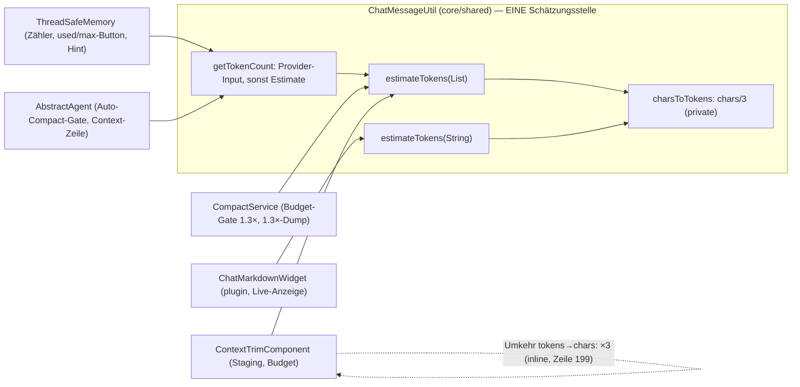

# Plan — Estimator chars×2/7 → chars/3 (Nachtzyklus 5)

**Branch:** `story/night-5-2026-10-16` · **Modul:** `llmpeon-core` (Eclipse-Pfad `/llmpeon-core`, Git-Pfad `org.sterl.llmpeon.core/`)
**Scope:** 1 Inkrement, ~3 Main-Dateien + 6 Test-Dateien. **Kein Docs-Write** (Jon), keine Homepage.

## 0. STOP-AND-ASK (zuerst lesen, memory 26)
Compile-Fehler ohne Lösung / nicht grün werdender Test / IST-Widerspruch zu diesem Plan → **Blocker an Jon melden (askDev), nicht workarounden, SOLL nicht ändern.**

## 1. Context
- SOLL: `docs/token-usage.md` R1 sagt `chars / 3` (konservativ für Deutsch); der Code war die Abweichung (`(chars*2)/7` ≈ /3.5, unterschätzt ~110k statt ~120k gemessen).
- Grund (open-points.md, Nachtzyklus 5): zu niedrige Schätzung ist für die Kontext-Anzeige (Compact-Button used/max) die gefährliche Richtung (Overflow-Risiko); zu hoch nur kosmetisch. Paul-Idee /3, Jon entschieden.
- `ThreadSafeMemory.java:79` kommentiert bereits „chars/3" — die Kommentar-SOLLs sind also teils weiter als die Formel.
- **Keine Use-Case-IDs betroffen** (Formel-/Konstanten-Änderung, keine UC-Doku geändert) → Inkrement ohne ID ok.

## 2. Design-Entscheidungen
1. **Formel:** `charsToTokens` = `chars / 3` (Integer-Division, Floor — wie bisher). Floor-Regel `len <= 5 ? 1` in `estimateTokens(String)` bleibt **unverändert**.
2. **⚠️ SCOPE-NOTE (Pflicht, darüber hinaus zur Auftragszeile):** Die **Umkehrfunktion** des Estimators sitzt inline in `ContextTrimComponent.perMessageCap` (`ContextTrimComponent.java:199`, `(long) restTokens * 7 / 2 / n` = tokens→chars mit ×7/2). Sie ist die exakte Umkehr von ×2/7. Wird nur der Estimator geändert, bricht die **Terminationsgarantie R-CIB-4.4**: final-stage-Cap 248 Chars → Estimate 335/3 = 111 > Budget 100 → Test `finalStage_estimateStaysWithinBudget_guaranteed` rot (SOLL-Test, nicht umschreibbar). Mit ×3: alle Budgets 100/500/1000/4000 verifiziert ≤ Budget (Grenzfälle exakt = Budget, Floor schützt). → **Änderung `* 7 / 2` → `* 3` an derselben Stelle ist Teil dieses Inkrements.** (Alternativen — ×7/2 beibehalten oder SOLL-Test lockern — sind ausgeschlossen: AGENTS.md „One behaviour, one implementation" + SOLL-Test.)
3. **Kein neues API** für die Umkehr (kein `tokensToChars` in ChatMessageUtil): Minimal-Inkrement, eine Call-Site, Javadoc verweist auf den Estimator. Zentralisierung beider Richtungen = optionales Folge-Inkrement (Open Q1).
4. **Javadoc-/Kommentar-Hygiene:** Alle `×2/7`- bzw. `7/2`-Erwähnungen in Main **und** Test-Kommentaren auf chars/3 bzw. ×3 setzen. Verifikation: Voll-Grep `2/7` und `7 / 2` über core main+test → **0 Treffer** nach dem Inkrement. (Die Task-Notiz „3 Javadoc-Stellen" ist unvollständig: `estimateTokens(List)` hat kein Javadoc; die tatsächlichen Stellen sind §4.1/§4.2/§4.3 — alle aufführen, sonst bleibt SOLL-Doku stale.)

## 3. Architektur (Stellung im System)

Abhängigkeitsrichtung unverändert: Alle Konsumenten gehen durch `ChatMessageUtil`; die Umkehr bleibt lokal in `ContextTrimComponent` (verweist per Javadoc auf den Estimator).

## 4. Affected files (exakt)
### 4.1 `org.sterl.llmpeon.core/src/main/java/org/sterl/llmpeon/shared/ChatMessageUtil.java`
| Zeile | Vorher | Nachher |
|---|---|---|
| 54 (getTokenCount-Javadoc) | „the chars×2/7 estimate of the messages" | „the chars/3 estimate of the messages" |
| 85 (estimateTokens(String)-Javadoc) | „{@code length × 2 / 7}. A coarse chars×2/7 (~3.5 chars per token)" | „{@code length / 3}. A coarse chars/3 (~3 chars per token)" |
| 94 (charsToTokens-Javadoc) | „The central chars×2/7 estimator (~3.5 chars per token)" | „The central chars/3 estimator (~3 chars per token)" |
| 96 (Formel) | `return (chars * 2) / 7;` | `return chars / 3;` |

### 4.2 `org.sterl.llmpeon.core/src/main/java/org/sterl/llmpeon/compact/ContextTrimComponent.java`
| Zeile | Vorher | Nachher |
|---|---|---|
| 27 (Class-Javadoc) | „estimate (chars×2/7, R-CIB-1)" | „estimate (chars/3, R-CIB-1)" |
| 30 (Class-Javadoc) | „per-message cap = restTokens×7/2/n" | „per-message cap = restTokens×3/n" |
| 109 (Kommentar) | „per-message cap = restTokens×7/2/n" | „per-message cap = restTokens×3/n" |
| 191 (perMessageCap-Javadoc) | „tokens→chars with the ×2/7 estimator" | „tokens→chars with the ×3 estimator" |
| 199 (Formel) | `(long) restTokens * 7 / 2 / n` | `(long) restTokens * 3 / n` |

### 4.3 `org.sterl.llmpeon.core/src/main/java/org/sterl/llmpeon/memory/ThreadSafeMemory.java`
- Zeile 63 (tokenDiagnosis-Javadoc): „estimate=<chars×2/7>" → „estimate=<chars/3>".
- Zeile 79: bereits „chars/3" — **unverändert** (wird mit der Formel korrekt).

### 4.4 Test-Änderungen (jeweils mit Begründung des Erwartungswert-Wechsels)
Render-Fakten (Linux `nl` = 1 Char; für die Rechnungen): `USER:\ntext\n` = 7+len, `AI:\ntext\n` = 5+len, `AI:\ntext\nThink: …$ t\n` = 16+len(t), Tool-Render = 49+len. Anchor `…$ ` = 3 Chars. Stage1-AI-Render (think-Cap 9000): „result"→9022, „a"→9017, „ok"→9018, „a1"→9018.

**A. `src/test/java/org/sterl/llmpeon/shared/ChatMessageUtilTest.java`** — 3 Tests:
| Test (alte Zeile) | Vorher | Nachher | Begründung |
|---|---|---|---|
| `estimates_32_chars_to_9` (128) | Name „to_9", Kommentar „(32 * 2) / 7 = 9", assert 9 | `estimates_32_chars_to_10`, „32 / 3 = 10", assert **10** | 32÷3 = 10 (Floor) |
| `estimates_26_chars_to_7` (137) | Name „to_7", assert 7 | `estimates_26_chars_to_8`, „26 / 3 = 8", assert **8** | 26÷3 = 8 |
| `boundary_six_chars_is_one` (164) | Name „is_one", Kommentar „(6 * 2) / 7 = 1", assert 1 | `boundary_six_chars_is_two`, „6 / 3 = 2", assert **2** | erste Länge über der 5-Char-Floor |
- Unverändert: `estimates_short_snippet_to_one` (147), `boundary_five_chars_is_one` (155), `empty_string_counts_zero` (173), `null_counts_zero` (182) — Floor-Regel und Empty-Regel bleiben.

**B. `src/test/java/org/sterl/llmpeon/memory/ThreadSafeMemoryTest.java`**
- `constructorEstimatesTokenCountFromLoadedMessages` (157–175): 5×5000-Char-Seed → gerendert 25031 Chars → 25031/3 = **8343**. Zeile 173 Kommentar → „estimateTokens = chars/3 (≈25000/3 ≈ 8333 + Overhead → 8343)"; Zeile 174 `isBetween(7100, 7200)` → `isBetween(8300, 8400)`.
- `test_reevaluateTokens_usesActualMemoryEstimate` (85–105): **unverändert** (self-referenziell; neu ≈2008 < 9100 ✓).

**C. `src/test/java/org/sterl/llmpeon/compact/ContextTrimComponentTest.java`**
| Test | Änderung | Begründung (neue Estimate-Rechnung) |
|---|---|---|
| Class-Javadoc (23) | „chars×2/7" → „chars/3" | Stale-Formel-Ref |
| `stage1_capsThinkingTo9000KeepingTheEnd` (93) | Budget 3000→**3200** (Z100), `isLessThanOrEqualTo(3000)`→**(3200)** (Z107) | Stage1-Render 9022 → 3007 ≤ 3200; uncapped 30029 → 10009 > 3200 → Stage 1 gewinnt weiter |
| `stage1_earlierUserMessagesRenderStateOnly` (128) | Budget 3000→**3200** (Z138) | Stage1-Join 9068 → 3022 ≤ 3200 < uncapped 5027 |
| `stage1_hintIsNeverTreatedAsRealUserText` (146) | Budget 3000→**3500** (Z155) | Stage1-Join 10041 → 3347 ≤ 3500 < uncapped ≈5458 |
| `stage1_noUserMessageWithRealText_noUserReduction` (163) | Budget 4000→**4200** (Z169) | Stage1-Join 12068 → 4022 ≤ 4200 < uncapped 6021 |
| `finalStage_capsEachMessageToRestTokensTimes7Over2OverN` (204) | Rename → `finalStage_capsEachMessageToRestTokensTimes3OverN`; Kommentar (213) „restTokens×7/2/n"→„restTokens×3/n"; Z218 `contains("T".repeat(1000))`→`contains("T".repeat(900))` | cap = 971 Chars (1000−29 disclosure → ×3/3) → T-Run = 971−16 = 955 ≥ 900; `doesNotContain(2000)`-Checks bleiben gültig |
| `finalStage_estimateStaysWithinBudget_guaranteed` (221) | Nur Kommentar (229): „mutation ×7/2→×7 or ×2/7" → „mutation of the ×3 inverse (e.g. back to ×7/2) must turn this red" | Alle Budgets (100/500/1000/4000, multi+single) mit ×3 verifiziert ≤ Budget — Garantiertest bleibt der selbe |
| `stage2_capsToolResultsToolArgumentsAndThinkingTo6000` (178), `stage1_keepsOnlyLastRealUserMessageFull` (110), `finalStage_*` (244), dedup/underBudget/zeroBudget (48–89, 259–305) | **unverändert** | Stage-Zuordnung bleibt identisch (Stage2 @7000: 6031 ≤ 7000, Stage1 dort 11032 > 7000; alle übrigen Margen ≥ 300) |

**D. `src/test/java/org/sterl/llmpeon/compact/CompactServiceTest.java`**
| Test | Änderung | Begründung |
|---|---|---|
| `resultLogLevelMatchesStage` (163) | Z177 `resultLevel(stage1, 3000)` → `resultLevel(stage1, 3200)` | Stage1 9017 → 3005 ≤ 3200 → INFO; uncapped 5004 > 3200. stage2 @7000 (WARN) und final @1000 (ERROR) **unverändert** |
| `noDumpBetweenLimitAnd130Percent` (510) | Seed Z515 `"y".repeat(4_375)` → `"y".repeat(3_600)`; Kommentar (512) „~1.25 x budget" → „~1.2 x budget" | Render 3607 → Estimate **1202** ∈ (1000, 1300): über Budget, unter 1.3×-Gate (Z517-Prämisse bleibt grün) |
| `biggestMessageDumpedWhenOverLimitBy30Percent` (469), `noBiggestMessageDumpUnderLimit` (496), `tieBreakDumpsFirstOfLargest` (526), Entry/Result-Log-Tests (62–215) | **unverändert** | 10k/5k-Char-Seeds bleiben weit über dem 1.3×-Gate (3353/3366 > 1300); Dump-Text ist self-referenziell (`estimateTokens(expected)`) |

**E. Kommentar-only-Updates (Assertionen unverändert):**
- `src/test/java/org/sterl/llmpeon/agent/ContextCounterDisplayTest.java` Z27: „chars×2/7" → „chars/3".
- `src/test/java/org/sterl/llmpeon/memory/ThreadSafeMemoryInputTokenCountTest.java` Z19 + Z50: „chars×2/7" → „chars/3".

**F. Explizit NICHT betroffen (Voll-Grep-Ergebnis, je 1 Zeile Begründung):**
| Datei | Warum grün |
|---|---|
| `tool/ToolServiceCompactHintTest.java` | Hint-Trigger immer Provider-Usage (153000/80211 exakt) oder 0.95×160000-Schwelle via exaktem Zähler; Seeds winzig |
| `tool/tools/CompactSessionToolTest.java` | Provider-Usage; 100k-Seed → neu 33335 > 20000 (alt 28573) — Richtung gleich |
| `tool/tools/SearchAgentToolTest.java` | `autoCompactAfter(1)` → Schwelle 0.95; Estimate ≫ Schwellenwert in beiden Formeln |
| `tool/ToolServiceCompactResultTest.java`, `agent/AbstractAgentCompactResultTest.java`, `agent/AbstractAgentTest.java` | Provider-Usage 260000/80211 exakt bzw. winzige Seeds (Default-Budget 80000 nie erreicht) |
| `model/CompactResultTest.java` | Stats direkt mit Konstanten gebaut, kein Estimator-Durchlauf |
| `agent/AiAgentStatusModelTest.java`, `poagent/tools/PoDelegateToolTest.java` | Exakte Rows / `~\d+`-Regex — faktorunabhängig |
| `shared/TokenStatsTest.java`, `tool/TokenUsageAccumulationTest.java` | „no estimate"-Pfade, Provider-only |
| `streaming/StreamingBridgeTest.java` | „token" = Token-Phase-Timing, nicht Estimator |
| Plugin-Test-Modul `org.sterl.llmpeon.test` | Grep `estimate`/`estimateTokens`: **0 Treffer** |
| Plugin-UI `ChatMarkdownWidget` (main, kein Test) | Nur Anzeige; läuft durch denselben Estimator |

## 5. Regeln & Constraints
- Nur `llmpeon-core` anfassen; Plugin-/Tycho-Projekte unangetastet.
- Keine neuen öffentlichen APIs, keine Namensänderungen außer den 4 Test-Renames (Name trug den alten Wert — Rename ist Teil der Ehrlichkeit, memory 30).
- Integer-Mathematik: Floor-Division beibehalten; `Math.min(Integer.MAX_VALUE, …)`-Clamp in `perMessageCap` bleibt.
- Log OR throw; Secrets: keine neuen Logs.
- Keine Docs/Homepage-Edits (Jon). **Nach** grünem Gate: `grep -rn "×2/7\|2/7" docs/` — verbleibende Treffer dürfen nur Historie sein (Kalibrier-Historie `streaming-display.md:209` ist legitime Historie); Rest = Jons Docs-Zyklus, nicht dieses Inkrement.
- Re-read nach jeder line-basierten Edit (AGENTS.md); ganze Datei neu schreiben bei größeren Umbauten.

## 6. BDD-Akzeptanz (kein UC-ID-Besatz — siehe §1)
| # | GIVEN / WHEN / THEN | Test |
|---|---|---|
| 1 | 32-Char-Text → `estimateTokens` → **10** | `ChatMessageUtilTest#estimates_32_chars_to_10` |
| 2 | 26-Char-Text → **8** | `ChatMessageUtilTest#estimates_26_chars_to_8` |
| 3 | ≤5 Chars → **1** (Floor unverändert); 6 Chars → **2** | `#boundary_five_chars_is_one`, `#boundary_six_chars_is_two` |
| 4 | empty/null → **0** | `#empty_string_counts_zero`, `#null_counts_zero` |
| 5 | 5×5000-Char-History → Counter ≈ **8343** | `ThreadSafeMemoryTest#constructorEstimatesTokenCountFromLoadedMessages` |
| 6 | Final-Stage-Staging, beliebiges Budget (100/500/1000/4000) → `estimateAfter ≤ budget` (Terminationsgarantie R-CIB-4.4) | `ContextTrimComponentTest#finalStage_estimateStaysWithinBudget_guaranteed` |
| 7 | Final-Stage-Cap = restTokens×3/n (T-Run 955 @ Budget 1000) | `ContextTrimComponentTest#finalStage_capsEachMessageToRestTokensTimes3OverN` |
| 8 | Staging-Budgets 3200/3200/3500/4200 → **genau** Stage 1 gewinnt | die 4 `stage1_*`-Tests (C) |
| 9 | Estimate ∈ (Budget, 1.3×Budget) → **kein** biggest-message-Dump; > 1.3× → genau 1 Dump | `CompactServiceTest#noDumpBetweenLimitAnd130Percent`, `#biggestMessageDumpedWhenOverLimitBy30Percent` |
| 10 | Stage-Log-Level: Stage1=INFO @3200, Stage2=WARN @7000, Final=ERROR @1000 | `CompactServiceTest#resultLogLevelMatchesStage` |

## 7. Test-Strategie & Gate
1. `eclipseBuildProject llmpeon-core` → nur bekannte Warnings (Baseline: 369 markers, 0 Errors).
2. Iterativ: `eclipseRunJavaTests` an den 6 geänderten Test-Klassen (Suite läuft ~13 s total — schnell genug für Voll-Suite pro Iteration).
3. **Gate (Ground Truth):** Maven Surefire über `llmpeon-core` (memory 1: Surefire zählt korrekt) → **1146 Tests, 0 Failures** (Baseline 2026-10-16: 1146 / 0 Fail / 19 Skipped / 13 s). Renames ändern die Count nicht.
4. **Stale-SOLL-Grep:** `2/7` und `7 / 2` in core main+test → **0 Treffer**.
5. OSGi-Plugin-Tests (`org.sterl.llmpeon.test`) **nicht** ausführen — dort keine Abhängigkeit (Grep 0 Treffer); nur, wenn Jon es will.
6. Commit auf `story/night-5-2026-10-16`: **nur** die 9 Dateien aus §4 (3 main + 6 test); WIP-Verzeichnisse bleiben untracked (Task-Order).

## 8. Open Questions
1. **Zentralisierung der Umkehr:** inline `* 3` (entschieden, Minimal-Inkrement) vs. später `tokensToChars()` in ChatMessageUtil (Doku-SOLL „Token-Mathe zentral in ChatMessageUtil", docs/index.md R-CC-11…14). Empfehlung: Folge-Inkrement entscheiden, jetzt nicht. → Jon/Paul können ablehnen; bis dahin gilt der Plan.
2. Sonst: none.

## 9. Status (Dev, 2026-10-16 Nacht)
- **§4 DONE** (Branch `story/night-5-2026-10-16`): alle 9 Dateien umgesetzt; Surefire llmpeon-core **1127 / 0 F / 0 E / 0 S** (BUILD SUCCESS); Stale-SOLL-Grep `2/7`+`7 / 2` = 0 Treffer; Eclipse-Build 369 markers / 0 Errors (Baseline).
- **Deviation D1 (Plan-Inventar-Lücke):** 2 Tests, die §4.4 C als „unverändert" listet, waren rot — `ContextTrimComponentTest#disclosure_appendedOnceAtEnd_whenCapped` (Stage1-Estimate 3005 > Budget 3000) und `#reinsertedSummaryAndMarkerAreStateNeverRealUserText` (3684 > 3500). Mechanische Budget-Anhebung 3000→3200 / 3500→4000 (Muster §4.4 C, gleiche Stages bleiben), keine Assertion geändert. (Memory 33: „alle Margen ≥ 300"-Claim des Plans galt nicht für diese zwei.)
- **Deviation D2 (Gate-Zahl):** Plan erwartet 1146 Tests (Baseline „1146 / 19 Skipped"); gemessene Baseline auf diesem Tree (vorher UND nachher) = **1127 / 0 Skipped**. Differenz 19 = exakt der Plan-Skipped-Wert → Plan-Baseline vermutlich Stale-Surefire-Report-Artefakt (AGENTS-DEV.md warnt explizit). Count durch das Inkrement unverändert (nur Renames), 0 Failures.

## 10. PO-Review — Da Dok (2026-10-16, branch `story/night-5-2026-10-16`)

**Verdict: CONCERNS** — Code vollständig grün, keine Code-Rework; die Gaps sind Doku-/Plan-Hygiene (nicht blockierend).

### Verifiziert (IST-Evidenz)
- **Inc 1 (`bc3b70b5`):** exakt 2 Dateien. `toK` = `(tokens / 1000) + "k"`, Javadoc beider Overloads korrigiert. Neuer Test `toK_noThousandsSeparator` (5 Asserts) ist gegen den alten Code rot (alt: `"1.234k"`) → ehrlicher Test; Red-First-Ordering selbst ist im Squash-Commit nicht nachprüfbar. Alle Call-Sites konsumieren `toK` unverändert: core `AiAgentStatusModel:56`, `StringUtil:106`, `CompactResult:55-57`; Plugin `TokenHeaderWidget:55-57`, `ActionsBarWidget:124/126` (kein Test pinnt das alte Format; `"1.234k"` nur im Javadoc des neuen Tests). SOLL `token-usage.md` R5a == IST ✓.
- **Inc 2 (`fbe2866f`):** exakt die 9 Dateien aus §4, zeilengetreu §4.1–4.4 (inkl. D1-Nachzügler 3200/4000). Terminations-Test `finalStage_estimateStaysWithinBudget_guaranteed` Body-unverändert, grün. SOLL == IST: `token-usage.md` R1 (chars/3), `compact-input-budget.md` R-CIB-1 (ein Estimator, chars/3) + R-CIB-4 (capChars = restTokens×3/n, `compact-input-budget.md:100`), `compact.md` R-CC-13 (Formel zentral in ChatMessageUtil, Trim in ContextTrimComponent), `compact-architektur.md:29` (chars/3 1× zentral) ✓.
- **Gate unabhängig nachgerechnet (Surefire, Ground Truth): 1127 / 0 F / 0 E / 0 S** — D2-IST-Behauptung bestätigt; Gate-Substanz (0 Failures) erfüllt, Count durchs Inkrement stabil.
- **Grep-Hygiene:** `2/7` + `7 / 2` in core main+test = 0 Treffer (der eine `×7/2` in `ContextTrimComponentTest:229` ist wörtlich Plan-Eigen-Formulierung = bewusster Mutation-Pointer). `×2/7` in allen src-Modulen = 0. `docs/`: verbleibende Treffer = ADR-Update-Notes (0055:50, 0056:53 — korrekt), open-points/memory (Änderung selbst beschreibend), `streaming-display.md:209` (Kalibrier-Historie, legitim) — s. Befund F1 für 2 Index-Überreste.
- **WIP-Docs Sanity:** `output-trim-service.md` + `async-agents.md` — 🚧-Statusmarker ✓, Links auflösend (`feature-request-ShellTool.md`, `long-shell.log`, `shell-tool.md`, `tool-output-disclosure.md`, `async-agent-tools-proposal.md`, `po-agent-jon.md`) ✓, IST-Claim `ShellTool.MAX_OUTPUT_LENGTH=3000` begrenzt Zeilen ✓ (`ShellTool.java:38,275`), WIP-Code untracked wie deklariert ✓.
- **Lint (lintDocsAndTests, docs + core-Tests):** 92 Findings — **keines** in Doku/Tests dieses Inkrements (alle Pre-Existing: 80× UNBELEGT_ERLEDIGT in agent-tool-config/default-inheritance/docs-linter/java-debugger-tool/model-config-widget/project-problems-tool/tool-output-disclosure/tool-time-disclosure/user-context; 2× VERWAIST UC-TF-1/2 in `AiReviewAgentTest` = alte Agent-Tool-Filter-Story; 9 UNBELEGT, 11 MANUELL). → PO-Backlog, kein Inkrement-Blocker.

### Befunde (nicht blockierend)
- **F1 — Stale-Formel-Fragmente in Doku-Indexzeilen (Jons uncommitteder Docs-Cycle):** `docs/index.md:70` sagt noch „dynamisches Per-Message-Cap `restTokens×7/2/n`" (Rule-Doku `compact-input-budget.md:100` korrekt `×3/n`; Zeile 71 direkt darunter notiert die Änderung bereits) und `docs/adr/index.md:64` noch „Schätzung nur noch estimateTokens ×2/7" (ADR 0056 trägt die Update-Note, die Indexzeile nicht). → im Docs-Commit nachziehen.
- **F2 — Plan-Daten (D2):** §7.3-Gatezahl (1146/19 Skipped) war stale — unabhängig nachgemessen 1127/0 Skipped, Count inkrementstabil. In §9 korrekt offengelegt.
- **F3 — D1 (Plan-Inventar):** 2 Tests, die §4.4 C als „unverändert" listet, waren rot (Marge < 300, Plans-Claim nicht gehalten). Mechanisch nach dem §4.4-C-Muster aufgelöst (Budgets 3200/4000, keine Assertion geändert), Jon akzeptiert → korrekte STOP-AND-ASK-Handling, keine Rework.
- **F4 — Plan coverage gap: none.** Alle SOLL-Regeln der vier Feature-Docs sind im Plan abgedeckt; Umkehr-Zentralisierung ist bewusste Verzögerung (§2.3, Open Q1), kein Gap.

### Mutation-Check (Item 8)
Bereits durch SOLL+Test gedeckt: `compact-input-budget.md:161` („Mutation: Divisor/Konvertierung mutieren → rot") = `finalStage_estimateStaysWithinBudget_guaranteed` (Budgets 100/500/1000/4000, Grenzfälle exakt = Budget, grün im Gate-Run). Keine Zusatz-Empfehlung.

### Risk line
**Most likely reason this breaks later:** die inline-×3-Umkehr in `ContextTrimComponent.perMessageCap` (Zentralisierung = Open Q1, verschoben) driftet bei einer künftigen Estimator-Änderung wieder vom `chars/3`-Estimator ab — exakt die Bug-Form, die dieses Inkrement fixt. **Change that most reduces that risk:** das Open-Q1-Inkrement (`tokensToChars()` in `ChatMessageUtil`) als das nächste estimator-betreibende Inkrement buchen, nicht offen lassen.
