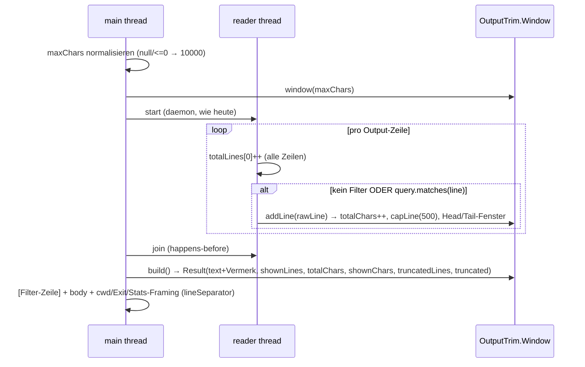

# Output-Trim-Service — Slice 1 (Trim-Komponente + Shell `maxChars` + Grep-Migration)

## 0. STOP-AND-ASK (bindend, vor jeder Iteration prüfen)

Bei: Compile-Fehler ohne Lösung · nicht grün werdendem Test · IST-Widerspruch zum Plan (Zahlen/
Strings weichen von §3/§6 ab) · Unklarheit im Scope → **STOP und Jon fragen (askDev)**.
Nie still workarounden, nie SOLL ändern. TABU-Liste (§5) ist bindend: keine Edits, keine Commits
in TABU-Dateien — auch kein „harmloser" One-Liner dort. (AGENTS-DEV „Test honesty".)

**Setup-Check zuerst:** `git branch --show-current` muss `story/night-5-2026-10-16` sein,
Working Tree ohne fremde Änderungen. Surefire-Baseline (core) vor dem Start notieren
(erwartet: 1146 green nach Token-Usage-Inkrement — Zahl aufnehmen, nicht annehmen).

## 1. Context

**Warum:** Ein Agent hat sich mit einem `shellRunCommand` (`grep|awk` über `backend/src/test`)
eine minifizierte Zeile mit **3.217.746 Zeichen** in den Kontext geholt — Session unbrauchbar
(`long-shell.log`: ~1.02M geschätzte Tokens, Stage `tool results 6000`). Die alte Ausgabe-Kontrolle
war zeilenbasiert (`tailLines`, Hard-Cap 3000 **Zeilen**) — eine einzige Zeile war unbegrenzt.
Grep hatte ein Zeilenlängen-Cap (2000, R-OD-6), aber kein Gesamt-Cap (100 Zeilen × 2000 ≈ 210 kB).

**SOLL:** `docs/output-trim-service.md` (❌ specified, 2026-10-16, Paul abgestimmt) — 9 Punkte,
6 BDDs (§6). Paul-Entscheidungen aus der Task-Nachricht (erledigen die 2 „Offen"-Punkte des Docs):
- Grep-Je-Zeile-Cap = **500** (Shell-Wert), ersetzt R-OD-6-Cap 2000 — „500 überall".
- **filter zuerst, dann Trim** — die Disclosure nennt **beides** (Filter-Zeile + Trim-Vermerk).

**Out of Scope (explizit):** Temp-File (Slice 2 = `docs/temp-file-tool.md`), Read-Tools-Migration
(Clamp), Hard-Cap auf `maxChars` (kommt erst mit TempFileTool, wenn die volle Ausgabe erreichbar
ist), BoundedLruCache (`docs/bounded-caches.md`), **keine docs/**-Writes (Docs-Zyklus = Jon;
dazu gehören die `tailLines`-Reste in `shell-tool.md`/`index.md`/`tool-descriptions-inventory.md`
und die R-OD-6-Statusflips 2000→500 in `tool-output-disclosure.md`).

**Branch:** `story/night-5-2026-10-16` (läuft weiter). Commits pro grünem Inkrement inkl.
Story-Docs-Änderungen — hier: keine (Jon), aber homepage-Änderung (Inc 2) gehört zum Commit.

## 2. Design-Entscheidungen (final — nicht re-designen)

**D1 — Komponente `OutputTrim`** in `org.sterl.llmpeon.core/.../shared/` (neben `FileLines`/
`SearchQuery`), statischer Helper-Stil, final, **kein Service mit Lifecycle** (SOLL #1).
EINER Stelle für: Je-Zeile-Cap + Total-Zeichen-Fenster (Kopf+Ende) + Disclosure.
Konstanten (Single Source of Truth): `DEFAULT_MAX_CHARS = 10_000`, `MAX_LINE_CHARS = 500`.

**D2 — Kopf/Ende-Split: head = `maxChars/3`, tail = `maxChars - head` (2/3).** „Ende zuerst"
(SOLL #2: Fehler stehen hinten in Build-Logs) → Tail bekommt das größere Budget. Deterministisch,
kein Parameter. Zeilengranular: Head nimmt ganze Zeilen solange das Budget reicht (die erste
Zeile immer, auch wenn sie das Head-Budget sprengt); Tail = Ring (ArrayDeque, wirft älteste
Zeile weg bis ≤ Budget, hält mindestens die neueste).

**D3 — Disclosure-Vermerk (Format FIX von SOLL #2):** `… (truncated: <totalChars> chars total, <shownChars> shown)`
- `<totalChars>` = **rohe** Zeichen aller an die Komponente gefütterten Zeilen (Σ `line.length()+1`)
  → bei Shell ohne Filter = komplette Roh-Ausgabe (3-Mio.-Fall zeigt 3000001). Mit Filter:
  rohe Zeichen der **gematchten** Zeilen (der Filter-Disclosure nennt die Gesamt-Zeilenanzahl
  separat — beides ehrlich, javadoc-dokumentiert).
- `<shownChars>` = Zeichen von Kopf+Ende (inkl. Separator, exkl. Vermerk).
- **Platzierung:** Mitteldrop → Vermerk zwischen Kopf und Tail (markiert die Lücke).
  Nur Zeilen-Cap (kein Drop) → Vermerk ans Ende. Nichts gekürzt → kein Vermerk.

**D4 — Filter läuft am Read (Shell-Reader-Thread), VOR dem Fenster** (Paul: filter zuerst).
Damit sieht der Filter den **gesamten** Stream (kein Falsch-Negativ durch Fensterung) und
`showing N of M` bleibt exakt (M = alle gelesenen Zeilen, N = shown im Fenster). `SearchQuery`
bleibt in ShellTool (Komponente bleibt filter-frei; Grep hat keinen Filter).

**D5 — Reader-Memory-Bound (SOLL #7):** ungebundene `LinkedList` weg. `window.addLine` cappt
jede Zeile **vor** dem Fenster (≤ 500 + Marker ≈ 520 Zeichen) → Peak pro Call ≈ Head+Tail ≈
10–11k Zeichen Ausgabe-Daten, egal wie groß der Stream.

**D6 — Trennzeichen:** Körper-Zusammensetzung in der Komponente = **literal `"\n"`**
(plattformunabhängig, deterministisch; Trim/Tail-Reassembly-Entscheidung 2026-09-29,
dokumentiert in `Result`-Javadoc). Shell-Framing (`cwd=`, `Exit code:`, Stats, Filter-Zeile)
und Grep-Suffix-Assembly behalten `System.lineSeparator()` wie heute. (Windows: vermischt —
bewusst akzeptiert, LLM-Logik-Newlines.)

**D7 — Grep-Je-Zeile-Cap trifft die komplette geredenderte Zeile** (`file:line: text`),
nicht nur den Hit-Text. Einheitliche Regel (eine Funktion, zwei Tools); lange Pfade fressen
vom 500er-Budget weg (ehrlich via `…(+N chars)` disclosed); volle Zeile immer via Read
erreichbar (Doc-Offen-Punkt: „verifizierbar über Read").

**D8 — Grep-Pipeline (Reihenfolge FIX):** Hits → `MAX_GREP_LINES`(100, Zeilen-Cap, UNVERÄNDERT)
→ rendern `file:line: text` → `OutputTrim.trim(rendered, DEFAULT_MAX_CHARS)` (Zeilen-Cap 500
+ Kopf/Ende 10k + Vermerk im Körper) → Suffix-Block (Reihenfolge wie heute): Mode-Hint →
`showing N of M matched lines — narrow your search` (nur `total > maxLines`) → Type-Filter-Hint
(0 Hits) → File-Cap → **`N line(s) truncated at 500 chars`** (aus `Result.truncatedLines()`;
ersetzt die 2000er-Zeile). Alle Caps benannt (Repo-Vertrag). `MAX_GREP_FILES`(100) UNVERÄNDERT.

**D9 — `MAX_OUTPUT_LENGTH` → `MAX_OUTPUT_CHARS` (SOLL #6):** Realisiert als **Verlagerung in die
Komponente**: `MAX_OUTPUT_LENGTH` verschwindet aus `ShellTool` (Grep-Gate §7: 0 Treffer in
Core-Main), der Wert 10.000 lebt EINMAL als `OutputTrim.DEFAULT_MAX_CHARS` (Shell- und
Grep-Default, SOLL #1 „eine Stelle"). Kein Shell-lokaler Alias (kein doppelter Default).

**D10 — `maxChars`-Semantik (SOLL #3):** optional Integer; `null` **oder `<= 0`** →
`DEFAULT_MAX_CHARS`; **größer erlaubt, KEIN Clamp** (Paul: Default, kein Hard-Cap).
@P-Text nennt Default + `0 or negative = default` + no hard cap.

**D11 — onTool-Zeilen (R-RS-1 bleibt):** Success: `… reading <shownLines> lines … (N chars)`
(N = `Result.shownLines()`, wie heute post-Filter/-Trim). Timeout: `<totalLines> lines captured`
(alle gelesenen Zeilen, wie heute).

**D12 — `commandUsesShellTail`-Hint (Timeout ohne Output):** Detektion UNBERÜHRT, nur Text:
verweist nicht mehr auf `tailLines` → „Don't pipe through `tail`/`head` — the tool trims output
itself (maxChars). Consider a longer timeout."

**D13 — Tool-Beschreibung schärfen (SOLL #8):**
`@Tool` → `Run a shell command — only for build, test and git. Reading or searching files → use the Read/Grep tools. Output is trimmed beyond maxChars (default 10000 chars, head + tail excerpt; lines over 500 chars cut).`
(Englisch wie die anderen @Tool-Strings; Wortung kann Paul im Review zurechtstutzen.)

**D14 — Thread-Safety:** Klassen-level stateless (static + Konstanten). `Window` = 1 Instanz
pro Call, 1 Writer-Thread (Reader), Reads nach `join()` (happens-before, wie heute bei der
Liste) — in Javadoc dokumentiert. `trim(List,…)` = pure Funktion (Grep).

## 3. Architektur

### 3.1 Komponenten (Abhängigkeiten zeigen nach innen → shared)

```mermaid
flowchart LR
  subgraph plugin
    EGT[EclipseGrepTool]
    SAT[SharedToolsComponent<br/>Wiring UNBERÜHRT]
  end
  subgraph core
    DGT[DiskGrepTool]
    ARB[AiReponseBuilder.grepComplete<br/>render + Suffix]
    ST[ShellTool<br/>@Tool + reader thread<br/>filter: SearchQuery]
    subgraph shared
      OT["OutputTrim (NEU)<br/>capLine · window() · trim()<br/>DEFAULT_MAX_CHARS=10000<br/>MAX_LINE_CHARS=500"]
      SQ[SearchQuery<br/>UNBERÜHRT]
    end
  end
  ST -->|addLine pro gematchter Zeile<br/>build() nach join| OT
  DGT --> ARB
  EGT --> ARB
  ARB -->|trim(rendered, 10000)| OT
  ST -.->|filter vor dem Fenster (D4)| SQ
```

### 3.2 Shell-Sequence (alle 4 Pfade: Success / Timeout / IOException / InterruptedException)



### 3.3 API-Skizze (Signature-Level — Implementierung frei innerhalb)

```java
public final class OutputTrim {
    public static final int DEFAULT_MAX_CHARS = 10_000;
    public static final int MAX_LINE_CHARS = 500;

    /** One-Shot über eine vorhandene Zeilenliste (Grep). = window + addLine* + build. */
    public static Result trim(List<String> lines, int maxChars);

    /** Streaming-Fenster für eine Zeilenquelle (Shell-Reader). 1 Instanz pro Call,
     *  addLine vom Reader-Thread, build() nach join. */
    public static Window window(int maxChars);

    /** Je-Zeile-Cap: >500 → erste 500 + "…(+N chars)". <=500 → unverändert. */
    public static String capLine(String line);

    public static final class Window {
        public void addLine(String line);   // raw; cappt + zählt roh + fenstert
        public Result build();
        public boolean isEmpty();           // totalLines == 0 (Timeout-Hint-Zweig)
    }

    /** text: Körper, "\n"-getrennt (D6), Vermerk drin wenn gekürzt.
     *  totalChars: Σ rohe Zeilen+1 (D3). shownChars: Head+Tail exkl. Vermerk. */
    public record Result(String text, int shownLines, int totalLines,
                         long totalChars, int shownChars, int truncatedLines, boolean truncated) {}
}
```

`Window`-Interne: `head` (List, ≤ maxChars/3, erste Zeile immer) · `tail` (ArrayDeque,
≤ maxChars−head, min. 1 Zeile) · `droppedLines` · `truncated = droppedLines>0 || truncatedLines>0`.
Build: `droppedLines>0` → `head + \n + VERMERK + \n + tail`; `nur truncatedLines>0` →
`head+tail + \n + VERMERK`; sonst `head+tail` (== alle, unverändert, kein Vermerk).
`lineCount==0` → `""`.

### 3.4 ShellTool-Diff-Orte (Zeilen = Stand 2026-10-16)

| Ort | Heute | Neu |
|---|---|---|
| :38 `MAX_OUTPUT_LENGTH=3000` | Zeilen-Hard-Cap | **weg** (D9) |
| :39 `DEFAULT_TAIL_LINES=60` | Default | **weg** (→ `OutputTrim.DEFAULT_MAX_CHARS`) |
| :71 `@Tool`-value | alte Beschreibung | D13 |
| :79-80 `@P tailLines` | Integer | `@P maxChars` (D10, Default im Text) |
| :91 Default-Zuweisung | 60 | `null/<=0 → DEFAULT_MAX_CHARS` |
| :124 `LinkedList lines` | ungebunden | `Window` + `int[] totalLines` (Kommentar: Writer=Reader, Read nach join) |
| :137-148 Reader | `lines.add(line)` | D4: Zählen + Filter + `addLine` |
| :160-167 Timeout-Partial | `lines.isEmpty()` / Hint / `formatOutput` | `window.isEmpty()` / D12 / `buildOutput` |
| :178 Success | `formatOutput` | `buildOutput` (+ `shownLines` für onTool) |
| :194/:199 IOException/Interrupt | `formatOutput` | `buildOutput` |
| :257-268 `formatOutput` | Filter+Tail | `buildOutput(window, query, totalLines)` = Filter-Disclosure (Format **wie heute**: `filter: X (regex\|literal, showing N of M lines)`) + `Result.text()` |
| :270-286 `FormattedOutput/Tail/tail` | | **weg** (Komponente ersetzt) |

## 4. Betroffene Dateien (VOLL-Grep-Inventar 2026-10-16; Duplikat-Workspace `/llmpeon-core`
= gleicher Disk-Pfad wie `/llmpeon-parent/org.sterl.llmpeon.core` — einmal gezählt;
`opencode/`, `github-copilot-for-eclipse/` = fremde Projekte, ignoriert)

### 4.1 Ändern (Main)
| Datei | Inkrement | Änderung |
|---|---|---|
| `org.sterl.llmpeon.core/src/main/java/org/sterl/llmpeon/shared/OutputTrim.java` | **NEU** I1 | Komponente (D1-D6, D14) |
| `org.sterl.llmpeon.core/src/main/java/org/sterl/llmpeon/tool/tools/ShellTool.java` | I2 | §3.4-Diff-Tabelle komplett |
| `org.sterl.llmpeon.core/src/main/java/org/sterl/llmpeon/tool/AiReponseBuilder.java` | I3 | `grepComplete(GrepHit,…)` :84-117 → D8; `MAX_GREP_LINE_CHARS` :16 **entfernen** (Ref-Check Grep: nur :80/:93/:94/:114 innerhalb der Datei) |

### 4.2 Ändern (Tests)
| Datei | Inkrement | Tests |
|---|---|---|
| `org.sterl.llmpeon.core/src/test/java/org/sterl/llmpeon/tool/OutputTrimTest.java` | **NEU** I1 | §6/§7 — 8 Tests |
| `org.sterl.llmpeon.core/src/test/java/org/sterl/llmpeon/tool/ShellToolTest.java` | I2 | 4 Rewrites + 3 Neue (§6); 15 Tests UNBERÜHRT (alle mit `null` im 4. Arg: mvn/echo/exit/R3×5/UC-TD-2×3/filterMatch/filterNoMatch/filterInvalidRegexLiteralFallback/filterInErrorPath/nonZeroExit/emptyCommand/invalidWorkingDir/nullWorkingDir) |
| `org.sterl.llmpeon.core/src/test/java/org/sterl/llmpeon/tool/AiReponseBuilderTest.java` | I3 | 1 Rewrite (`grepClampsMinifiedLine` :174-191) + 1 Neu; **UNBERÜHRT:** `grepCompleteFormatsMatchesModeAndCap`, `grepCompleteReportsNoMatchesAndMode`, `grepCompleteEmptyResultLeaksNoFileContent` (0 Hits), `grepCompleteManyHitsAreCappedAndDisclosed` (100×~30 B ≈ 3 kB < 10k), `grepLineCapDisclosesShowingOfM` (~2.8 kB), `searchComplete*`×2, `grepUnderCapShowsAllNoDisclosure` (50×~10 B), `grepNormalLinesUntouched` (UC-OD-8, <500 B), `grepNoMatchesUnchanged` (UC-OD-9), `buildMarkers*`×4 |
| `org.sterl.llmpeon.core/src/test/java/org/sterl/llmpeon/tool/DiskGrepToolTest.java` | I3 | +1 Neu (BDD-5 e2e); alle 11 Bestehenden UNBERÜHRT (kleine Fixtures) |
| `org.sterl.llmpeon.test/src/org/sterl/llmpeon/test/EclipseGrepToolTest.java` (OSGi, JUnit 4!) | I3 | 1 Rewrite (`longLineIsClampedAndDisclosed` :152-167); **UNBERÜHRT:** `manyMatchesAreCappedAndDisclosed` (100×~35 B ≈ 3.5 kB < 10k — payload-Bound-Assert `< 15000` bleibt grün), `validRegexReportsRegexMode`, `selectedProjectComesFirst`, `findsFileWrittenOutsideEclipse`, übrige |

### 4.3 Ändern (Homepage — user-visible, AGENTS-Regel: same increment)
| Datei | Inkrement | Änderung |
|---|---|---|
| `homepage/src/setup/custom-agents.md:188` | I2 | Shell-Zeile der Tool-Gruppen-Tabelle: `` | `shell` | `shellRunCommand` (run a shell command — mvn, npm, git; not for file I/O). | `` → `` | `shell` | `shellRunCommand` (run a shell command — mvn, npm, git; only for build/test/git, not for file I/O — output is trimmed beyond `maxChars`, default 10 000 chars). | `` |

`.vitepress/dist` ist **gitignored** (`.gitignore:1`) — nicht anfassen, kein Rebuild.
Weitere Homepage-Files: Grep `tail|truncat|output|grep` über `homepage/src` → nur die eine
Zeile betroffen (Gruppen-Zeilen :181/:185 nennen keine Caps).

### 4.4 UNBERÜHRT verifiziert (0 relevanten Referenzen — Voll-Grep)
- `tailLines`: Main nur ShellTool (4.1); Tests nur ShellToolTest (4.2); Prompts
  (`org.sterl.llmpeon.core/src/main/resources/**`): **0 Treffer**; Plugin-Code: 0.
  Docs (Jon): `index.md:62,93`, `output-trim-service.md:23`, `shell-tool.md` (R1),
  `tool-descriptions-inventory.md:59`, `feature-request-ShellTool.md:17,32` (Input-Doc,
  deren `MAX_OUTPUT_LINES`-Idee ist vom SOLL-Doc überholt — nicht implementieren).
- `MAX_OUTPUT_LENGTH`: nur ShellTool :38/:79/:275 (+Docs/Peon-Plan-Historie).
- `MAX_GREP_LINE_CHARS`: nur AiReponseBuilder (4.1) + die 2 Test-Pins „2000 chars"
  (AiReponseBuilderTest:190, EclipseGrepToolTest:166) — beide in 4.2.
- `grepComplete(GrepHit)`: genau 2 Aufrufstellen — `DiskGrepTool.java:72`,
  `EclipseGrepTool.java:82` (kein Code-Change nötig; beide profitieren automatisch).
- `shellRunCommand(`-Aufrufer: **nur Tests**, alle positional, 4. Arg `null` oder int →
  Plugin-Tests (`PeonAiServiceTest` :152/:171/:188, `ShellApprovalServiceTest` ×7,
  `AgentToolConfigTest`, `AiReviewAgentTest`) **kompilieren + laufen unverändert**.
- `"lines skipped"`-Pins: nur ShellToolTest (4.2). `"No output captured"`: 0 Test-Pins.
- `ToolResultSizeTest` (nutzt DiskGrepTool): 1-Hit-Fixture (5 B) → **UNBERÜHRT**.
- `WebFetchToolTest`/`WebGetToolTest` (Task-Erwähnung „Nachbarn"): 0 Referenzen auf
  tailLines/Line-Cap/Trim → **UNBERÜHRT** (eigene 500-Zeilen-Paginierung R-OD-3, Out of Scope).
- `LogExcerpt`/`EclipseConsoleLogTool` (line-basiertes Console-Tail, anderes Cut):
  **UNBERÜHRT** — bewusste Trennung (Zeilen vs. Zeichen), im Plan-Review sichtbar.

## 5. Regeln & Constraints

- **Namen/Strings (FIX, Tests pinnen sie):** Vermerk `… (truncated: <n> chars total, <m> shown)`;
  Zeilen-Marker `…(+<n> chars)`; Grep-Disclosure `<n> line(s) truncated at 500 chars`;
  Filter-Zeile `filter: <q> (regex|literal, showing <n> of <m> lines)` (Format wie heute);
  `showing <n> of <m> matched lines — narrow your search` (wie heute); `… result capped at
  <n> files. Narrow your search path.` (wie heute).
- **Gates (Grep, nach je Inkrement):** `tailLines` → 0 in core main+test + homepage/src;
  `MAX_OUTPUT_LENGTH` → 0 in core main; `truncated at 2000` → 0 in core+plugin tests;
  `MAX_GREP_LINE_CHARS` → 0 in core main (Konstante weg).
- **Kein Falsch-Negativ (Repo-Vertrag AGENTS.md):** jede Kürzung/Filter im Output benannt;
  Filter sieht den ganzen Stream (D4); `showing N of M` exakt; leer = ehrlich (kein stilles Leere).
- **API-Vertrag:** `shellRunCommand(String, String, Integer, Integer, String)` positional
  UNVERÄNDERT (nur 4. Parameter heißt jetzt maxChars); @P-`name` `tailLines`→`maxChars`
  (Schema-Change = Clean Break, SOLL #3). Grep-Tools: **keine** neuen @Tool-Parameter.
- **Test-Technik:** Core = JUnit 5 + AssertJ; Plugin = JUnit 4, **keine** externen Assertion-Libs
  (`assertTrue/assertContains`-Stil der Klasse beibehalten). UC-IDs: `// UC-OD-7`/`// UC-OD-8`/
  `// UC-OD-9`-Marker bleiben an den (neu geschriebenen) R-OD-6-Tests — reine ID-Zeilen
  (docs-linter-Vollmatch). Neue BDD-Tests: **keine** UC-ID (SOLL-Doc hat keine IDs),
  Kommentar `// BDD-n (docs/output-trim-service.md)` auf eigener Zeile.
- **Build-Reihenfolge I3** (AGENTS-DEV): Core-Änderungen sind für den Plugin-Build unsichtbar
  (core jar in `lib/`) → vor Eclipse-Plugin-Build/OSGi-Tests:
  `mvn -o -pl org.sterl.llmpeon,releng/llmpeon-target -am package -DskipTests`
  (releng/target muss in -pl bleiben) → `eclipseBuildProject` `org.sterl.llmpeon` +
  `org.sterl.llmpeon.test`.
- **Lombok/m2e-Falle (AGENTS-DEV):** vor dem Surefire-Gate-Run nach core-Edits
  `mvn -pl org.sterl.llmpeon.core clean test` (nie nur `test` — m2e-Autobuild ohne Lombok
  vergiftet `target/classes`).
- **Surefire = Ground Truth** für Testzahlen (nie eclipseRunJavaTests für Reports).

## 5a. TABU (bindend)
- **docs/** komplett (alle Dateien), `feature-request-ShellTool.md`, `long-shell.log` — kein Write.
- Code: `LogExcerpt`, `EclipseConsoleLogTool`, `FileLines`, `SearchQuery`, `FileUtils`,
  `StringUtil`, `TextFileTypes`, `ChatMessageUtil`, `GrepHit`, `CallStats`, `TokenStats`,
  `ThreadSafeMemory`, Compact-Stack (`ContextTrimComponent`, `CompactService`, …), Web-Tools
  (`WebFetchTool`, `WebGetTool`), Read/Write-Tools (disk+eclipse), `ShellApprovalService` +
  Confirmation-Logik, R3-cwd-Logik, `commandUsesShellTail`-Detektion (nur Hint-Text!),
  `MAX_GREP_FILES`/`MAX_GREP_LINES`/`MAX_BUILD_MARKERS` (Werte + Disclosures),
  `SearchQuery.CACHE`, `AbstractTool`, Plugin-Wiring (`SharedToolsComponent`, `PeonAiService`).
- **Keine** neuen public-APIs außer `OutputTrim` (+ verschachtelte `Window`/`Result`).
  **Kein** Temp-File, **kein** Hard-Cap, **keine** Read-Tools-Migration (Out of Scope).
- Homepage: NUR `custom-agents.md:188`; nie `.vitepress/dist`.
- Git: kein Branch-Wechsel, Commits nur eigene Dateien, pro grünem Inkrement 1 Commit.

## 6. BDD-Akzeptanz (SOLL-Doc §BDD — je BDD ein Test; Namen FIX)

| BDD | Test (Klasse) | Assertions-Kern (falsifizierbar) |
|---|---|---|
| **BDD-1** 3-Mio.-Zeile → ≤10k + Vermerk mit Gesamtlänge | `ShellToolTest.runOsCommand_minifiedLineCapped` (I2, e2e) | Unix `head -c 3000000 /dev/zero \| tr '\0' a` / Win `powershell -NoProfile -Command "[Console]::Out.Write(('a' * 3000000))"` → `result.length() <= 10_100`; enthält `truncated:` + `chars total` (Zahl ≥ 3000000 via Regex) + `…(+`; erste 500 `a` vorhanden. Komponenten-Zwilling: `OutputTrimTest.threeMillionLineBounded` (I1) |
| **BDD-2** 100×80 Zeichen → unverändert, ohne Vermerk | `OutputTrimTest.underCapUnchanged` (I1) | 100 Zeilen × 80 B (Total 8099 ≤ 10000) → `text` **bit-identisch** zu `join(input,"\n")`, `truncated=false`, kein `truncated:`. e2e-Guard: `ShellToolTest.runOsCommand_defaultMaxCharsKeepsSmallOutputWhole` (I2, 100 Short-Lines via seq: line 1 an Index 1, line 100, kein `truncated`) |
| **BDD-3** `maxChars=500`, Output 2000 Zeichen → Kopf+Ende + Disclosure | `ShellToolTest.runOsCommand_maxCharsHeadTailExcerpt` (I2) | 100 Zeilen × ~24 B (`line $i padding-padding` ≈ 2400 B), `maxChars=500` → erste Zeile `line 1` vorhanden, letzte `line 100` vorhanden, Mitte `line 50` **abwesend**, `truncated:` + `chars total` + `shown` vorhanden; Body ≤ ~560 B (Mutation „Tail-only/alt-Verhalten" → rote erste Zeile; Split-Flip 3/1 → rote Tail-Zeilen) + `OutputTrimTest.headTailExcerpt` (I1, exakt 2000 B: pinnt head=1/tail=3 = 4 shown Lines + Zeile 18 vorhanden → pinnt Tail=2/3) |
| **BDD-4** Timeout bei übergroßer Ausgabe → dieselben Grenzen | `ShellToolTest.runOsCommand_timeout_partialOutputUsesSameTrim` (I2) | `{ head -c 15000 /dev/zero \| tr '\0' a; sleep 5; }` (Win: powershell Write + `Start-Sleep`), `timeout=1` → `Command timed out after 1s` + `Partial output` + `truncated:`-Vermerk + `result.length() <= 10_100` (gleicher Pfad wie Success — Mutation „Timeout ohne Trim" → rot) |
| **BDD-5** Grep >10k → gleiche Kürzung + Disclosure | `DiskGrepToolTest.grepOversizedOutputIsTrimmedWithDisclosure` (I3, e2e) | 1 File, 100 Zeilen `needle ` + `x`×120 (~13.3 kB) → `truncated:`-Vermerk + Ergebnis < ~10.3k + Hit 1 & Hit 100 vorhanden, Hit 50 abwesend + **kein** `matched lines — narrow your search` (total == maxLines → Zeilen-Cap-Trigger nicht erfüllt — ehrlich). + `AiReponseBuilderTest.grepOversizedOutputTrimmedWithDisclosure` (I3, 150 Hits × 120 B: `showing 100 of 150 …` + Vermerk + Kopf/Ende) |
| **BDD-6** minifizierte 500k-Zeile → 500 + `…(+N chars)` | `OutputTrimTest.minifiedLineCapped` (I1) | 500_000 `a` → Zeile exakt `a`×500 + `…(+499500 chars)`, `truncatedLines=1`, Vermerk am Ende, `totalChars=500_001`, `shownChars=516`. + Grep-Seite: `AiReponseBuilderTest.grepClampsMinifiedLine` (I3, REWRITE, `// UC-OD-7` bleibt): Hit `bundle.js:1: `+`a`×20_000 → Rendered-Zeile exakt `a`×487 nach 13er-Präfix + Marker (500 gesamt) + `1 line(s) truncated at 500 chars` + Vermerk `20014 chars total, 501 shown` + `EclipseGrepToolTest.longLineIsClampedAndDisclosed` (I3, REWRITE): Hit-Line-Länge = 500 + Marker-Länge, `substring(500)` matcht `…\(\+\d+ chars\)`, Disclosure `truncated at 500` |
| **(Task) filter + maxChars** | `ShellToolTest.runOsCommand_filterRunsBeforeTrim` (I2) | 120 Zeilen: 100× `noise $i` + 20× `ERROR $i` (~1080 B), `filter="ERROR"`, `maxChars=300` → **alle 20** `ERROR`-Zeilen vorhanden, **kein** `truncated:` (Gefiltertes 180 B < 300), `filter: ERROR (regex, showing 20 of 120 lines)`. Mutation „Trim vor Filter" → rote ERROR-Zeilen + roter Vermerk. (Disclosure nennt beides — hier der Fall ohne Trim; der Fall mit Trim = BDD-3+filter: `runOsCommand_maxCharsHeadTailExcerpt` kombiniert optional `filter` — nicht Pflicht) |
| **(Paul) kein Hard-Cap** | `ShellToolTest.runOsCommand_maxCharsLargerThanOutputNoTrim` (I2) | 100 Zeilen, `maxChars=100000` → alle vorhanden (line 1 an Index 1), **kein** `truncated:` — `maxChars` ist Default, nicht Cap |

**UC-IDs:** kein neuer UC im SOLL-Doc → keine neuen ID-Marker; Bestehende UC-OD-7/8/9
bleiben an den Grep-Tests (Doku-Statusflips = Jon). Kein anderes Use-Case-Doc berührt.

## 7. Inkremente, Gates, Test-Strategie

### I1 — Komponente `OutputTrim` (core, NEU, grün allein)
1. `OutputTrim.java` (Main) nach §3.3. 2. `OutputTrimTest.java` — 8 Tests:
   `underCapUnchanged` · `totalEqualsMaxCharsNoNote` (exakter Rand: Total == maxChars →
   alles im Fenster, kein Vermerk; Mutation Off-by-One → rot) · `headTailExcerpt` ·
   `minifiedLineCapped` · `threeMillionLineBounded` · `emptyInput` · `batchTrimEqualsStreaming`
   (gleiche Eingabe via `trim()` vs. `window()+addLine*+build()` → identische `Result` —
   codiert „one behaviour, one implementation" für Grep/Shell) · `degenerateTinyBudget`
   (`maxChars=100`, 50×50 B → begrenzt + Vermerk; Mutation „unbegrenzt" → rot).
3. **Gate:** `mvn -pl org.sterl.llmpeon.core clean test` grün (Baseline + 8). Commit I1.

### I2 — Shell-Switch (core + homepage, grün allein; abhängig I1)
1. `ShellTool.java` nach §3.4 (alle 4 Pfade + D10-D13). 2. `ShellToolTest`: Rewrites
   `tailLinesDefaultIs60 → runOsCommand_defaultMaxCharsKeepsSmallOutputWhole`,
   `tailLinesPositive → runOsCommand_maxCharsHeadTailExcerpt`,
   `tailLinesMinusOneReturnsAll → runOsCommand_maxCharsLargerThanOutputNoTrim`,
   `tailLinesAllHardCap → runOsCommand_defaultTotalCapTrimsLargeOutput` (4000 Zeilen ≈ 28 kB,
   Default → Vermerk + line 1 & 4000 vorhanden, line 2000 abwesend, ≤ ~10.3k) + Neu
   `runOsCommand_minifiedLineCapped` (BDD-1, 3 Mio.) + `runOsCommand_timeout_partialOutputUsesSameTrim`
   (BDD-4) + `runOsCommand_filterRunsBeforeTrim`. 3. Homepage `custom-agents.md:188` (§4.3).
4. **Gate:** Surefire core grün (Baseline + I1 + 3) + Grep-Gates §5 (tailLines/MAX_OUTPUT_LENGTH
   → 0 in core main+test + homepage/src). Optional-Compile-Check: `mvn -o -pl
   org.sterl.llmpeon,releng/llmpeon-target -am package -DskipTests` + `eclipseBuildProject`
   (kein OSGi-Run nötig — Plugin-Tests unverändert). Commit I2.

### I3 — Grep-Migration (core + plugin + OSGi, grün allein; abhängig I1)
1. `AiReponseBuilder.grepComplete` nach D8; `MAX_GREP_LINE_CHARS` entfernen.
2. Tests: `grepClampsMinifiedLine` Rewrite (BDD-6) + `grepOversizedOutputTrimmedWithDisclosure`
   Neu (BDD-5) + `DiskGrepToolTest.grepOversizedOutputIsTrimmedWithDisclosure` Neu (BDD-5) +
   `EclipseGrepToolTest.longLineIsClampedAndDisclosed` Rewrite (BDD-6, JUnit 4-Stil).
3. **Gate:** Surefire core grün (Baseline + I1 + I2 + 2) → jar-Re-Copy
   `mvn -o -pl org.sterl.llmpeon,releng/llmpeon-target -am package -DskipTests` →
   `eclipseBuildProject` `org.sterl.llmpeon` + `org.sterl.llmpeon.test` →
   **OSGi: komplette Suite `org.sterl.llmpeon.test`** (einmaliger Workspace-Trust deckt den Lauf;
   keine neuen Test-Klassen → kein neues Trust-Dialog-Risiko; erster Lauf in der Session: bei
   Trust-Hang User informieren + auf konkrete PID warten, nie parallel nachstarten — memory 13;
   Testzahl aufnehmen, nicht annehmen). Grep-Gates §5 (truncated at 2000 / MAX_GREP_LINE_CHARS → 0).
   Commit I3.

### Test-Strategie & Falsifizierbarkeit (AGENTS-DEV Test honesty)
- **Echte Prozesse** in ShellToolTest (Muster der Klasse): große Outputs via `head -c`/
  `tr`/powershell (kein Python — macOS-Stub-Prompt). Timeout-Test mit `sleep 5` + `timeout=1`
  (deterministisch rot bei „Timeout ohne Trim").
- **Beide Richtungen** (Send+Receive) bei den e2e-Tests: Parameter `maxChars=500`/`100000`
  wirksam (kleines/ungeschnittenes Ergebnis) UND Output-Inhalt (Kopf-/Tail-Zeilen, Marker,
  exakte Disclosure-Strings).
- **Exakte Zahlen** in den Komponententests (deterministisch: 500/516/500001/3000001/20014/501)
  — jede Pin nennt die Mutation, die sie rot macht (in Test-Kommentar, je 1 Zeile).
- **Bit-Identität-Regression** für den Nicht-kürzenden Grep-Pfad: `grepNormalLinesUntouched`,
  `grepUnderCapShowsAllNoDisclosure`, `grepCompleteManyHitsAreCappedAndDisclosed` laufen
  unverändert weiter grün → D8-Körper-Form im Nicht-Trimmt-Fall unverändert.
- Kein „green before the change"-Claim für neue Tests (sie sind neu an der NEUEN
  Komponente gekoppelt — swap-falsifizierbar per Konstruktion).

### Surefire-Zusammenfassung (macOS, AGENTS-DEV)
`perl -ne 'if (/Tests run: (\d+), Failures: (\d+), Errors: (\d+), Skipped: (\d+)/)
{$t+=$1;$f+=$2;$e+=$3;$s+=$4} END {print "Tests=$t F=$f E=$e S=$s\n"}' target/surefire-reports/*.txt`

## 8. Offene Fragen
**Keine.** Alle SOLL-Punkte sind mit Paul abgestimmt (`output-trim-service.md` ❌ specified);
die 2 Doc-Offen-Punkte sind via Task-Nachricht entschieden (Grep 500; filter zuerst).
Design-Freiheiten sind in §2 als final fixiert (Split 1/3-2/3, Vermerk-Platzierung,
`maxChars<=0`→Default, Komponente besitzt den Default-Wert statt Shell-alias, Grep-Cap auf
der geredenderten Zeile). Komponenten-Name `OutputTrim` = Doc-Vorschlag (Paul-Veto möglich
im Review, Rename wäre 1-Find-Replace).

## 9. PO-Review — Da Dok (2026-10-17, `story/night-5-2026-10-16`, Commits f277446e/22a91fed/dc4a5594/c97b5c19)

**Verdict: CONCERNS** — Code der 4 Inkremente vollständig grün und plan-/SOLL-konform (keine
Code-Rework); offene Gaps = Jons laufender Docs-Cycle (3 stale Doku-Files, F1–F3) + 1 SOLL-Wortung
(F4) + Plan-Daten-Notizen (P1–P3) + Ledger-Zeile (S1).

### Verifiziert (IST-Evidenz, unabhängig nachgemessen)
- **I1 `f277446e`:** exakt 2 Dateien. `OutputTrim` = API-1:1 zu §3.3 (Konstanten 10 000/500,
  `trim`/`window`/`capLine`/`Window{addLine,build,isEmpty}`/`Result`-Record, Field-Set identisch),
  D2-Split head=1/3·tail=2/3, D3-Vermerk `… (truncated: <n> chars total, <m> shown)` exakt,
  D5 Memory-Bound (capLine vor dem Fenster), D6 literal `\n`, D14-Happens-Before in Javadoc.
  8 Tests §7-I1 namentlich + arithmetisch verifiziert (z. B. `totalEqualsMaxCharsNoNote`:
  333+667=1000 exakt; `minifiedLineCapped`: 500/516/500001; `threeMillionLineBounded`: 3000001/517).
  `batchTrimEqualsStreaming` pinnt „one behaviour, one implementation" Grep↔Shell.
- **I2 `22a91fed`:** exakt 3 Dateien (§3.4-Diff-Tabelle Punkt für Punkt: Konstanten weg, @Tool D13
  via Konstanten, @P `maxChars` D10, 4 Pfade via `buildOutput`, D12-Hint-Text nur Text, D11
  onTool `shownLines`/`totalLines`, `formatOutput/Tail` weg). Homepage `custom-agents.md:188`
  Wort-für-Wort §4.3. Tests: 5 Rewrites (4 geplant + `filterWithTail→filterWithMaxChars` =
  genehmigte Plan-Lücke, Jon-OK) + 3 Neue (BDD-1/4 + Task filterRunsBeforeTrim), 17 Tests
  byte-identisch (Diff = genau 2 Hunks).
- **I3 `dc4a5594`:** exakt 4 Dateien. D8-Pipeline-Reihenfolge erhalten (Mode-Hint → showing N of M
  → Type-Hint → File-Cap → `N line(s) truncated at 500 chars`), `MAX_GREP_LINE_CHARS` weg,
  D7-Cap auf geredenderte Zeile, Body als 1 Element via `grepComplete(List.of(trim.text()))`
  (D6-konform). UC-OD-7/8/9-Marker an den korrekten Tests geblieben. `EclipseGrepToolTest`-Rewrite
  JUnit-4-Stil (assertTrue/assertEquals/assertContains, keine externen Libs) ✓.
- **inc-7 `c97b5c19` (AskDev, außerhalb Plan):** `toK` = `< 1M → (n/1000)+"k"` (kein Locale, max
  999k, keine Gruppierung) / `≥ 1M → NumberFormat.getDefaultLocale, max 2 FractionDigits + "M"`.
  SOLL `token-usage.md` R5a (Paul/Jon-adjustiert) == IST, inkl. Edge 999 999 999 → `1.000M`(DE)/
  `1,000M`(US). 4 neue Tests pinnen BEIDE Locales (DE+US, `withLocale` mit finally-Restore) —
  gegen den alten Code rot (1 000 000 → alt „1000k" ≠ „1M") → ehrlich. AiReponseBuilderTest-Hunk
  = Kommentar-only („< 2000" → „< 500 chars"). StringUtil steht zwar in §5a TABU — hier
  explizit durch Jon als AskDev-Auftrag außerplan autorisiert.
- **Gate (§5, nachgemessen):** `tailLines` 0 in core main+test+homepage/src · `MAX_OUTPUT_LENGTH` 0
  in core main · `MAX_GREP_LINE_CHARS` 0 in core main · `truncated at 2000` 0 in core+plugin Tests.
  **Surefire core (selbst gelaufen, `clean test`, incl. Pauls WIP-Compile — WIP ist rein
  rename/@P-Text, testneutral): 1144 / 0 F / 0 E / 0 S, BUILD SUCCESS** — Claim bestätigt
  (ShellToolTest 25, OutputTrimTest 8, AiReponseBuilderTest 16, DiskGrepToolTest 12).
  OSGi 351/0 = Jons Report, nicht neu gelaufen (Workspace-Trust, memory 13); einziger OSGi-Delta =
  1 in-place-Rewrite, inspektiert ✓.
- **Kapselung (explizit geprüft):** Cap+Trim+Disclosure existiert NUR in `OutputTrim`;
  ShellTool (committed) ohne substring/Trim-Logik (Grep: nur OutputTrim-Referenzen),
  AiReponseBuilder nur via `OutputTrim.trim`/Konstanten. Filter bleibt ShellTool (D4,
  filter-freie Komponente — bewusst), Read-Clamp/Web-Tools/LogExcerpt = andere, dokumentierte
  Verhaltensweisen (Out of Scope §1). Keine Duplizierung.
- **Docs↔Code (SOLL-Files):** `output-trim-service.md` 9/9 SOLL-Punkte + 6/6 BDD mit Test(en)
  (BDD-1: 2 Tests, BDD-2: 2, BDD-3: 2, BDD-4: 1, BDD-5: 2, BDD-6: 3) ✓. `token-usage.md` R5a ✓.
- **Lint:** 54 Findings, **keines** in Doku/Tests dieses Inkrements (alle Pre-Existing:
  41× UNBELEGT_ERLEDIGT UC-DL in docs-linter.md, UC-TF-VERWAIST in AiReviewAgentTest/PeonAiServiceTest
  = alte Agent-Tool-Filter-Story, UC-CT/MANUELL wie vor Zyklus). Neu gescannt wurde diesmal auch
  der OSGi-Test-Root (daher die PeonAiServiceTest-Einträge) — kein Zuwachs durch dieses Inkrement.

### Befunde — Docs-Cycle (Jon, uncommitted, Plan §1 hat sie ihm zugewiesen)
- **F1 (muss vor Docs-Commit):** `docs/shell-tool.md` beschreibt **komplett das alte Verhalten**
  (R1 :11-16 `tailLines`/Default 60/Hard-Cap 3000/`N lines skipped`; BDD :21-35; Regel :101) —
  vom committed Code nicht mehr existent (Clean Break). SOLL widerspricht IST direkt; R1+BDD
  sind zu schreiben (maxChars, 10 000-Default, kein Hard-Cap, 500-Zeilen-Cap, neue Disclosure).
- **F2:** `docs/tool-output-disclosure.md` R-OD-6 (:64 ff.) steht noch auf „2000 Zeichen ✅ done
  (d7cf6578)" + Muster `truncated at 2000 chars` → Flip auf 500/OutputTrim (Plan §1: „R-OD-6-
  Statusflips 2000→500" = Jon).
- **F3:** `docs/tool-descriptions-inventory.md:59` — alter @Tool-Text + „tailLines to cap output"
  → Zeile auf I2-@Tool-Text/`maxChars` aktualisieren (Plan §1).
- **F4 (Wortung, non-blocking):** SOLL #6 `output-trim-service.md:31` verspricht den Namen
  `MAX_OUTPUT_CHARS` — existiert im Code nicht (0 Referenzen); D9 (final) realisierte es als
  Verlagerung in `OutputTrim.DEFAULT_MAX_CHARS` (keine Shell-Konstante, kein dritter Name).
  Intent (keine lügende Konstante, eine Stelle) ist erfüllt — die Doku-Zeile sollte „als
  Verlagerung in OutputTrim.DEFAULT_MAX_CHARS realisiert" notieren, damit SOLL keinen
  nicht-existenten Namen verspricht.
- **F5 (Erinnerung):** `docs/temp-file-tool.md` + `docs/bounded-caches.md` (Slice-2/3-WIP) sind
  untracked und werden von `output-trim-service.md` gelinkt → mit dem Docs-Commit committen
  (AGENTS.md: Docs reisen mit dem Cycle).

### Abweichungen (klassifiziert)
- **A1 (legitim, genehmigt):** 5. Rewrite `runOsCommand_filterWithMaxChars` (Plan listete 4) —
  Jon-OK; kombiniert Filter+Trim („optional" im Plan §6), Mutation „Trim vor Filter" → rot.
- **A2 (legitim, genehmigt):** BDD-6-Pin `515 shown` statt Plan-`501` — Plan-Arithmetik war falsch,
  Code folgt der D3-Definition (shownChars = Kopf+Ende inkl. Separator, exkl. Vermerk;
  500 + 15er-Marker − 1).
- **A3 (legitim, außerplan):** inc-7 via AskDev (SOLL R5a heute justiert) — siehe oben.
- **A4 (legitim):** D9-Verlagerung statt SOLL-#6-Rename — s. F4.

### Plan coverage gap / Plan-Daten (Da Thinka, nicht Da-Mek-Rework)
- **P1:** §6 BDD-6-Zahl „501 shown" arithmetisch falsch (→ A2).
- **P2:** §4.2-Testinventar übersehen `filterWithTail` als 5. tailLines-Test (→ A1).
  Fangnetz hat gegriffen: String-Gate `tailLines → 0` hätte ihn NICHT erfasst (Name/Body frei von
  dem String), der rot werdende Assert (`80 lines skipped`) → STOP-AND-ASK → Jon-OK.
- **P3:** §4.2 „15 Tests UNBERÜHRT" ≠ IST (17 byte-identisch; die eigene Namensliste im Plan summiert
  sich nicht zu 15) — Diff-Hunk-Analyse belegt exakt die 8 geänderten Tests, IST unbeeinträchtigt.
  **Gemeinsames Muster P1–P3:** Inventar-Tabellen nicht per VOLL-Grep entstanden (memory 33/37);
  hier überdacht vom Red-Test-Gate — siehe S1.

### Skill-Evolution-Outcome + Evidence (Item 9)
- **S1 — Kein Skill-/Instruktions-File fehlte oder widersprach** (AGENTS-DEV „Test honesty",
  memory 26/33/37 vorhanden und wirksam: beide Plan-Lücken per STOP-AND-ASK geklärt, nicht
  still workaroundt). **Ledger-Zeile fehlt** für Nachtzyklus-5/Trim-Slice in
  `.agents/skills/wiki/skill-impact.md` (letzte Zeile = 2026-10-15) — AGENTS.md: „the ledger
  rides with the cycle". Vorschlag für die Zeile (PO-Entscheidung): *no new skill* + 1
  Instruktions-Präzisierungskandidat: **„Test-Rewrite-Listen entstehen per Grep über den
  betroffenen Argument-Pfad"** — ein Test, der den alten Parameterwert per Position übergibt,
  ist Rewrite-Kandidat, auch wenn Name/Body den alten Parameter-Namen nicht enthalten (Fall P2;
  String-Gates allein decken Verhaltenstests ohne Namens-Treffer nicht ab).
- Mutation-Check (Item 8): keine Zusatz-Empfehlung — jeder Pin nennt seine Mutation
  (Test-Kommentare), die Window-Eviction-Grenze ist doppelt gedeckt (`totalEqualsMaxCharsNoNote`
  für Off-by-One, `degenerateTinyBudget` für Evict-to-Empty), beide grün.

### Risk line
**Most likely reason this breaks later:** der Docs-Cycle commitet mit `docs/shell-tool.md` in
altem Zustand — dann liest ein Agent die SOLL-Doku, ruft `shellRunCommand` mit `tailLines` auf
(Parameter existiert nicht mehr → Schema-Fehler) und/oder R-OD-6 „2000 ✅" behauptet ein Cap,
das so nicht existiert (falsche Erwartung an Grep-Output). **Change that most reduces that
risk:** F1–F4 im selben uncommitted Docs-Batch abschließen, BEVOR der Docs-Commit geht
(Shell-Tool-R1/BDD neu schreiben, R-OD-6-Flip, Inventory-Zeile, SOLL-#6-Wortung) — danach erst
den `output-trim-service.md`-Status-Flip (❌ → done) setzen.
