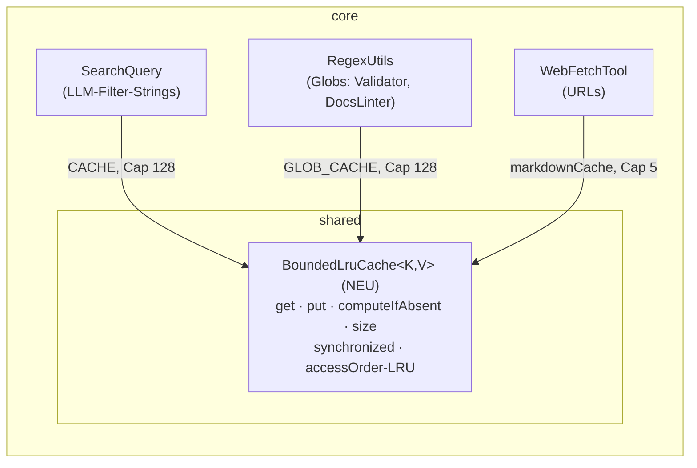

# Bounded Caches — geteilter `BoundedLruCache` für die 3 RAM-Caches

## 0. STOP-AND-ASK (bindend, vor jeder Iteration prüfen)

Bei: Compile-Fehler ohne Lösung · nicht grün werdendem Test · IST-Widerspruch zum Plan
(Zahlen/Strings weichen von §4/§7 ab) · Scope-Unklarheit → **STOP und Jon fragen (askDev-Kanal)**.
Nie still workarounden, nie SOLL ändern. TABU-Liste (§6.1) ist bindend: keine Edits, keine
Commits in TABU-Dateien — auch kein „harmloser" One-Liner dort.

**Setup-Check zuerst:**
1. `git branch --show-current` muss `story/night-5-2026-10-16` sein — **kein Branch-Wechsel**.
2. Working Tree: Pauls WIP = exakt die §6.1-Liste (3× M, 4× untracked) — nichts mehr, nichts
   weniger; weicht ab → STOP.
3. Surefire-Baseline (core): `mvn -pl org.sterl.llmpeon.core clean test` → Testzahl
   **aufnehmen, nicht annehmen** (Da Dok 2026-10-17: 1144, inkl. Pauls WIP-Compile).
   Pauls WIP compiliert mit im Lauf (Da Dok verifiziert) — compiliert es nicht → STOP (fremde Files).

## 1. Context

**Warum:** `SearchQuery.CACHE` (LLM-kontrollierte `filter`-Strings) und `RegexUtils.GLOB_CACHE`
sind unbounded `ConcurrentHashMap`s — echtes Leak, erst nach Tagen sichtbar.
`WebFetchTool.markdownCache` hat Cap 5, aber **FIFO** (`LinkedHashMap` Insertion-Order,
`get` pflegt die Recency nicht) — das Javadoc-Label „LRU" ist falsch.

**SOLL = `docs/bounded-caches.md` (❌ specified 2026-10-17, Paul specified)** — Regeln
R-BC-1…R-BC-5 mit BDDs + fixen Testnamen. Was das Doc nicht sagt, ist nicht entschieden;
D4/D5/D7 sind Plan-Entscheidungen (PO-Review-geflaggt, §10).

**Explizit nicht angefasst (SOLL-Audit):** `ModelListCache`, `ThinkModelMapping.CACHE`
(endlicher Key-Space). Caps = Konstanten (128/128/5), **keine User-Config**. **Kein
Homepage-Update** (keine User-sichtbare Änderung, Tool-Output bleibt bit-identisch).
**Keine neuen UC-IDs** (SOLL-Doc hat keine Use-Cases → keine ID-Marker; Tests referenzieren
die Regel per Kommentar-Zeile `// R-BC-n (docs/bounded-caches.md)`). **Status-Flip des Docs
(❌→✅) = PO-Aufgabe nach Abnahme — nicht wir; das Doc bleibt ❌ im Commit.**

**Commits:** 1 Commit pro grünem Inkrement. Docs + AGENTS.md + Trim-Plan-Archiv reisen mit dem
finalen Inkrement (§8.4). `planImplemented` = Dev-Agent, erst nach PO-Review.

## 2. Design-Entscheidungen (final — nicht re-designen)

**D1 — Komponente `BoundedLruCache<K,V>`** = `public final class` in
`org.sterl.llmpeon.shared` (neben `FileLines`/`SearchQuery`/`OutputTrim`).
Intern: JDK-Muster `LinkedHashMap(16, 0.75f, /*accessOrder=*/true)` +
`removeEldestEntry(size() > maxEntries)`. Alle public Methoden `synchronized` (Lock = `this`)
— bewusst **nicht** lock-frei (SOLL R-BC-1: Last niedrig, Korrektheit gewinnt).

**D2 — API tief und klein (SOLL R-BC-1, exakt):** `get(K)`, `put(K,V)`,
`computeIfAbsent(K, Function<K,V>)`, `size()` + Konstruktor `(int maxEntries)`.
**Keine Map-Sicht** (kein keySet/entrySet/values), kein clear/containsKey — kein Leak des
Eviction-Verhaltens.

**D3 — LRU-Semantik (FIX):** `get`/`put`/`computeIfAbsent` auf bestehenden Key frischt
Recency auf. `computeIfAbsent`: vorhanden → existierenden Wert zurück, **kein** Re-Compute
(+ Refresh); abwesend → compute + insert (evictet LRU, falls Cap überschritten).
Atomar unter Lock; Mapping-Funktion läuft unter dem Lock (CHM-Muster; Compile ist schnell).

**D4 — Null-Vertrag (Plan-Entscheidung, PO-Review):** kein null-Wert im Cache.
`put(k, null)` = No-op, liefert null. `computeIfAbsent` mit null-Ergebnis = kein Store,
liefert null. Kein NPE. Rationale: interne Optimierung; die 3 Adopter-Methoden
(`compile`/`compileGlob`/fetch) liefern nie null; die CHM-NPE-Vertrags ist nicht geerbt
(die Klasse ist kein Map).

**D5 — Keine Cap-Validierung (Plan-Entscheidung):** kein Guard, der nie feuert
(AGENTS-Dead-Guard-Kultur); alle 3 Call-Sites + alle Tests übergeben Konstanten > 0.
Javadoc benennt den Vertrag `maxEntries > 0`.

**D6 — Caps gehören den Adoptern** (nicht der Klasse, kein geteilter Magic Number):
`SearchQuery.CACHE_CAP = 128`, `RegexUtils.GLOB_CACHE_CAP = 128` (neue
`private static final int`), `WebFetchTool.CACHE_MAX_URLS = 5` (existiert, bleibt —
Javadoc + Field-Init, D9).

**D7 — Test-Seam (Plan-Entscheidung, PO-Review):** `CACHE`/`GLOB_CACHE` behalten Namen,
Typ wird `BoundedLruCache`, Sichtbarkeit `private static final` → `static final`
(package-private) — der same-package-Test proofed den Cap exakt via `.size()`
(Paul: „Cap-Nachweis = 129 Keys → size()==128"). Keine neue public API; keine Map-Sicht.
Alternative (nur bei PO-Veto): schmalere Seam `static int cacheSize()`.
`WebFetchTool.markdownCache` bleibt `private` (Test ist verhaltensbasiert, andere Package).

**D8 — Minimal-Adoption-Diff:** `SearchQuery.of` (:14) und `RegexUtils.globToPattern` (:19)
bleiben **wortgleich** (`CACHE.computeIfAbsent(query, SearchQuery::compile)` /
`GLOB_CACHE.computeIfAbsent(glob, RegexUtils::compileGlob)`) — Diff = Field-Deklaration +
Cap-Konstante + Imports. Externe API unverändert → alle Caller (`DocsLinter:222`,
`AllowlistWriteValidator:26`, Grep/Shell/Log-Tools) unberührt; für das Plugin unsichtbar
→ **kein Jar-Re-Copy, kein OSGi-Run**.

**D9 — WebFetchTool:** Field →
`private final BoundedLruCache<String, String> markdownCache = new BoundedLruCache<>(CACHE_MAX_URLS);`
— beide `synchronized (markdownCache)`-Blöcke (:118-123, :143-145) → plain `get`/`put`
(Komponente ist selbst thread-safe). Imports `java.util.LinkedHashMap` (:11) +
`java.util.Map` (:12) entfernen (keine weitere Nutzung in der Datei — verifiziert).
Class-Javadoc :26-30 bleibt: „LRU" ist jetzt wahr. `onProblem` :138 / `onTool` :142 bleiben.

**D10 — AGENTS.md-Regel (R-BC-5):** Root `AGENTS.md`, Sektion `## Architecture`, neuer
Bullet **nach** dem „Empty means unset"-Bullet, **vor** „Use a clean component architecture":

`- **Every RAM cache is bounded.** A RAM cache without self-truncation is a leak — every new cache uses \`BoundedLruCache\` (or has a finite key-space and says so in its Javadoc).`

Edit per exakter, eindeutiger oldString-Anchor + Verifikation (Grep-Count) — nie per
Zeilennummer (memory 31).

**D11 — `BoundedLruCache`-Javadoc:** echtes LRU (jeder Zugriff frischt Recency auf),
evictet das am längsten nicht benutzte Entry über dem Cap, thread-safe via `synchronized`
(bewusst nicht lock-frei), keine null-Werte, keine Map-Sicht, `maxEntries > 0`; Verweis
`docs/bounded-caches.md` (R-BC-5: jeder neue RAM-Cache nutzt diese Klasse oder hat einen
endlichen Key-Space und sagt es).

## 3. Architektur

Abhängigkeitsrichtung: die 3 Adopter zeigen nach innen auf das `shared`-Primitive;
`BoundedLruCache` kennt keine seiner Adopter.



API-Skizze (Signature-Level; Implementierung frei innerhalb D1–D5):

```java
public final class BoundedLruCache<K, V> {
    public BoundedLruCache(int maxEntries);
    public synchronized V get(K key);   // null wenn abwesend; frischt Recency auf
    public synchronized V put(K key, V value);  // insert/replace; evictet LRU über Cap; null-Wert = No-op
    public synchronized V computeIfAbsent(K key, Function<K, V> mappingFunction);
    // vorhanden → existing (+Refresh, kein Re-Compute); abwesend → compute + insert
    public synchronized int size();
}
```

## 4. VOLL-Grep-Inventar (2026-10-17, repo-weit; Duplikat-Pfade einmal gezählt)

### 4.1 `SearchQuery.CACHE` (private static → cross-File-Referenzen unmöglich)
| Referenz | Ort | Schicksal |
|---|---|---|
| Deklaration `private static final Map<String, SearchQuery> CACHE = new ConcurrentHashMap<>()` | shared/SearchQuery.java:10 | → I2 (D6/D7) |
| Nutzung `CACHE.computeIfAbsent(query, SearchQuery::compile)` | SearchQuery.java:14 | **bleibt** (D8) |
| Imports `java.util.Map` / `java.util.concurrent.ConcurrentHashMap` | SearchQuery.java:3,4 | → I2 entfernen (keine weitere Nutzung) |
| Test-Referenzen | 0 (SearchQueryTest: nur verhaltensbasiert via `of()`) | — |
| Docs | bounded-caches.md:21, index.md:92, memory.md:35, resolved-points.md:106 | Docs-Cycle (Jon) |

### 4.2 `RegexUtils.GLOB_CACHE`
| Referenz | Ort | Schicksal |
|---|---|---|
| Deklaration | shared/RegexUtils.java:11 | → I2 |
| Nutzung `GLOB_CACHE.computeIfAbsent(glob, RegexUtils::compileGlob)` | RegexUtils.java:19 | **bleibt** (D8) |
| Imports `Map`/`ConcurrentHashMap` | RegexUtils.java:3,4 | → I2 entfernen (`Pattern` bleibt) |
| Externe Caller von `globToPattern` (API unverändert, **unberührt**) | docslinter/DocsLinter.java:222, tool/AllowlistWriteValidator.java:26, RegexUtils.countOccurrences:34, RegexUtilsTest:36/44/52 | — |
| Docs | bounded-caches.md:22, index.md:92, memory.md:35, resolved-points.md:106 | Docs-Cycle |

### 4.3 `WebFetchTool.markdownCache` + `CACHE_MAX_URLS`
| Referenz | Ort | Schicksal |
|---|---|---|
| Field (anonyme `LinkedHashMap`-Subklasse, Insertion-Order) | tool/tools/WebFetchTool.java:43-50 | → I3 (D9) |
| `synchronized`-get-Block | WebFetchTool.java:118-123 | → I3 entfernen (plain `get`) |
| `synchronized`-put-Block | WebFetchTool.java:143-145 | → I3 entfernen (plain `put`) |
| `CACHE_MAX_URLS = 5` | WebFetchTool.java:37 (Deklaration), :28 (Javadoc `{@value}`), :48 (`removeEldestEntry` → stirbt mit der Anonym-Klasse) | Deklaration+Javadoc **bleiben** |
| Imports `LinkedHashMap`/`Map` | WebFetchTool.java:11,12 | → I3 entfernen |
| Test-Referenzen | 0 (WebFetchToolTest: nur verhaltensbasiert via HTTP + `callCounters`) | — |
| Docs | bounded-caches.md:23 | Docs-Cycle |

### 4.4 UNBERÜHRT verifiziert (0 relevante Referenzen — VOLL-Grep)
- `ModelListCache` (ai/), `ThinkModelMapping.CACHE` (ai/ThinkModelMapping.java:39,68) — SOLL
  „Nicht angefasst" (endlicher Key-Space).
- `BoundedLruCache`: 0 Code-Referenzen (nur Docs) → kein Name-Konflikt, Klasse ist neu.
- Plugin-Modul + OSGi-Tests: 0 Referenzen auf die 3 Fields → core-only, kein Jar-Re-Copy,
  kein OSGi-Run.

## 5. Betroffene Dateien

| Datei | Inc | Änderung |
|---|---|---|
| core/.../shared/BoundedLruCache.java | **NEU** I1 | D1–D3, D11 |
| core/.../test/.../shared/BoundedLruCacheTest.java | **NEU** I1 | 3 Tests (§7 R-BC-1) |
| core/.../shared/SearchQuery.java | I2 | :10 Field → `static final BoundedLruCache<String, SearchQuery> CACHE = new BoundedLruCache<>(CACHE_CAP);` + `private static final int CACHE_CAP = 128;` + Imports :3,:4 weg; :14 bleibt |
| core/.../shared/RegexUtils.java | I2 | :11 Field → `static final BoundedLruCache<String, Pattern> GLOB_CACHE = new BoundedLruCache<>(GLOB_CACHE_CAP);` + `GLOB_CACHE_CAP = 128` + Imports :3,:4 weg; :19 bleibt |
| core/.../test/.../shared/SearchQueryTest.java | I2 | + `searchQueryCacheBoundedAt128` (AssertJ-Stil der Datei) |
| core/.../test/.../shared/RegexUtilsTest.java | I2 | + `globCacheBoundedAt128` (JUnit-Assertion-Stil der Datei) |
| core/.../tool/tools/WebFetchTool.java | I3 | D9 (Field + 2 Blocks + Imports; :28/:37/:138/:142 bleiben) |
| core/.../test/.../tool/WebFetchToolTest.java | I3 | + `webFetchCacheUsesBoundedLru` (§7 R-BC-4) |
| AGENTS.md (root) | I3 | + Regel-Bullet (D10) |
| Docs-Liste (§8.4) | I3 | **nur committen, NICHT editieren** (Jons vorbereiteter Zustand) |

**UNBERÜHRT (verifiziert):** alle externen Caller (D8), `ModelListCache`, `ThinkModelMapping`,
Plugin-Modul, homepage/, alle übrigen core-Files.

## 6. Regeln & Constraints

- **Testnamen FIX** (SOLL): `boundedLruEvictsLeastRecentlyUsed`, `getRefreshesRecency`,
  `boundedLruIsThreadSafe`, `searchQueryCacheBoundedAt128`, `globCacheBoundedAt128`,
  `webFetchCacheUsesBoundedLru`. Regel-Kommentar auf eigener Zeile:
  `// R-BC-n (docs/bounded-caches.md)`.
- **Test-Technik:** Core = JUnit 5. `BoundedLruCacheTest` + SearchQueryTest-Zusatz = AssertJ;
  RegexUtilsTest-Zusatz = JUnit-Assertions (`assertEquals`/`assertNotSame`) — jede Datei
  bleibt im eigenen Stil. `@Timeout(30)` auf dem thread-safe-Test.
- **Gate immer** `mvn -pl org.sterl.llmpeon.core clean test` (Lombok/m2e-Falle: nie nur
  `test`). Surefire = Ground Truth für Testzahlen (nie eclipseRunJavaTests für Reports).
- **Plan-Slicing:** alle Entfernungen (Fields, Blocks, Imports) per §4 verifiziert — keine
  Referenz außerhalb der owning File. Jedes Inkrement kompiliert + testet grün für sich.
- **Grep-Gates** (nach je Inkrement, nachmessen):
  - nach I2: `ConcurrentHashMap` in SearchQuery.java + RegexUtils.java → 0;
    `new ConcurrentHashMap` in core shared/ → 0.
  - nach I3: `synchronized` in WebFetchTool.java → 0; `LinkedHashMap` in WebFetchTool.java → 0;
    `markdownCache` in Code außerhalb WebFetchTool.java → 0.
- **Keine neue public API** außer `BoundedLruCache` selbst.

### 6.1 TABU (bindend) — Pauls WIP: keine Edits, keine Commits
`org.sterl.llmpeon.core/src/main/java/org/sterl/llmpeon/tool/tools/ShellTool.java` (M),
`EclipseBuildToolTest.java` (M), `HeaderRosterStructureTest.java` (M),
`feature-request-ShellTool.md` (untracked), `org.sterl.llmpeon/agent/model/` (untracked),
`org.sterl.llmpeon/agent/tools/` (untracked), `long-shell.log` (untracked).
Weiter TABU: `docs/**` (keine Writes — nur committen, §8.4), `ModelListCache`,
`ThinkModelMapping`, homepage/, übrige AGENTS.md-Files, git (kein Branch-Wechsel,
Commits nur gelistete Files).

## 7. BDD-Akzeptanz (SOLL R-BC-1…5; Namen FIX, jede Zeile mit roter Mutation)

| Regel | Test (Klasse, Inc) | Assertions-Kern (falsifizierbar) |
|---|---|---|
| **R-BC-1** Eviction | `boundedLruEvictsLeastRecentlyUsed` (BoundedLruCacheTest, I1) | Cap 3: put a,b,c → put d → `get(a)==null`, b/c/d vorhanden, `size()==3`. Mutation „unbounded" → size 4 → rot |
| **R-BC-1** Recency | `getRefreshesRecency` (I1) | Cap 3: put a,b,c → `get(a)` → put d → **a überlebt** (`get(a)!=null`), `get(b)==null`, c/d vorhanden, size 3. Mutation „FIFO (altes WebFetch-Verhalten)" → a evictet → rot |
| **R-BC-1** thread-safe | `boundedLruIsThreadSafe` (I1) | 8 Threads × 2000 Ops (put/get/computeIfAbsent), Key-Space 64 > Cap 16, gleicher Key → immer gleicher Wert `"v<k>"`; Exception/Inkonsistenz → shared `AtomicReference` → fail. Nach join: `size() <= 16` + jede non-null `get` = korrekter Wert. Mutation „ohne Lock" → `ConcurrentModificationException`/size>16 → rot |
| **R-BC-2** SearchQuery-Cap | `searchQueryCacheBoundedAt128` (SearchQueryTest, I2) | 129 frische distinct Keys via `SearchQuery.of("bc-cap-i")` (i = 0…128) → `SearchQuery.CACHE.size()==128` (Mutation „unbounded (alt)" → size ≥129 → rot; „kein Evict" → size 129 → rot) — robust gegen Cache-Vorzustand (129 frische distinct Zugriffe dominieren). **Keine** Identity-Assertion: statische Caches laufen über Testgrenzen; Eviction-Beweis lebt ausschließlich im Komponenten-Test `boundedLruEvictsLeastRecentlyUsed` (I1). SOLL: **keine** neuen Verhaltenstests — Bestandstests (4) bleiben grün |
| **R-BC-3** Glob-Cap | `globCacheBoundedAt128` (RegexUtilsTest, I2) | gleiches Muster via `globToPattern("bc-cap-glob-i")` (i = 0…128, ohne `*` = Literal-Glob, sicher): `GLOB_CACHE.size()==128` (Mutation „unbounded (alt)" → size ≥129 → rot; „kein Evict" → size 129 → rot) — robust gegen Cache-Vorzustand; **keine** Identity-Assertion (Eviction-Beweis ausschließlich I1) |
| **R-BC-4** WebFetch-LRU | `webFetchCacheUsesBoundedLru` (WebFetchToolTest, I3 — am **Tool-Verhalten**, Fixtures der Klasse: `serve`/`page(PAGE_1000_MARKERS)`/`calls`, Contexts `/bc-a`…`/bc-f`) | fetch a..e `(1,null)` → Cache voll (5) · fetch a `(501,null)` → Hit: `calls(a)==1`, Result enthält `501: LN501` (Snapshot) · fetch f → evictet **b** (a wurde refresh) · fetch a `(501,null)` erneut → Hit: `calls(a)==1` ← **LRU-Diskriminator** (FIFO: a evictet → `calls(a)==2` → rot) · fetch b → Miss: `calls(b)==2` ← **Cap-Nachweis** (unbounded: `calls(b)==1` → rot) · `calls(c..f)==1`. Bestand UC-WEB-3 `webFetchCacheEvictionRefetches` bleibt grün (reine Insertions-Sequenz: dort LRU==FIFO) |
| **R-BC-5** Repo-Regel | — kein Test (SOLL: „Kein Test dokumentation-only") | AGENTS.md-Bullet gemäß D10; PO verifiziert per Grep |

**UC-IDs:** keine im SOLL-Doc → keine ID-Marker.

## 8. Inkremente (je für sich grün, je 1 Commit)

### I1 — Komponente `BoundedLruCache` (core, NEU) — ✅ DONE 2026-10-17 (inc-8, `d8c7b8aa`: 2 neue Files, 180 Insertionen; Gate 1147 = Baseline 1144 + 3, 0 F/E/S; Surefire-Report BoundedLruCacheTest 3/3)
- **Ziel:** Primitive existiert, kein Adopteur angefasst.
- **Dateien:** `BoundedLruCache.java` + `BoundedLruCacheTest.java` (3 Tests §7).
- **Annahmen:** `shared`-Paket-Konvention (neben FileLines/OutputTrim) — §3.
- **Risiken:** keine (additiv).
- **Gate:** Surefire = Baseline + 3, 0 F/E/S. **Commit I1:** die 2 neuen Files.

### I2 — Adoption `SearchQuery` + `RegexUtils` (Cap 128) — ✅ DONE 2026-10-17 (inc-9, `fe5cc80e`: 4 Files, 30+/6-; Gate 1149 = Baseline 1144 + 5, 0 F/E/S; SearchQueryTest 5/5 + RegexUtilsTest 7/7; Grep-Gates I2 beide 0)
- **Ziel:** die 2 unbounded Caches weg; API + Verhalten unverändert.
- **Dateien:** `SearchQuery.java`, `RegexUtils.java` (D6/D7/D8), `SearchQueryTest.java` (+1),
  `RegexUtilsTest.java` (+1).
- **Annahmen:** package-private-Field-Seam reicht (D7). Cross-Test-State der statischen
  Caches ist harmlos: kein Bestandstest hängt Identität über Test-Methoden (verifiziert per
  Lektüre — die 2 `isSameAs`-Tests sind in-Method-self-contained); der Cap-Test läuft
  unabhängig von Cache-Vorzustand (129 frische distinct Keys dominieren).
- **Risiken:** ein *zukünftiger* Test könnte Cross-Test-Identität erwarten (bekannt,
  dokumentiert, keine Aktion). Die Identity-Assertion wird bewusst **NICHT** geführt:
  statische Caches laufen über Testgrenzen (Methoden-Reihenfolge/JVM-Parallelität) —
  Eviction-Beweis lebt ausschließlich im Komponenten-Test I1.
- **Gate:** Surefire = Baseline + 5 · Grep-Gates I2 · `SearchQueryTest` (5) +
  `RegexUtilsTest` (7) grün (12/12). **Commit I2:** die 4 Files.

### I3 — Adoption `WebFetchTool` (Cap 5, echtes LRU) + R-BC-5 + Docs — ✅ DONE 2026-10-17 (inc-10, `966ae530`: 12 Files = 3 Code + 9 Docs/Plan-Liste; Gate 1150 = Baseline 1144 + 6, 0 F/E/S; WebFetchToolTest 7/7, UC-WEB-3 grün; Grep-Gates I3 alle 0; §10.1-Zeile war in Jons Prepared-State bereits aktualisiert)
- **Ziel:** handgerolltes FIFO + synchronized-Drumherum weg; Repo-Regel in AGENTS.md.
- **Dateien:** `WebFetchTool.java` (D9), `WebFetchToolTest.java` (+1), `AGENTS.md` (D10),
  Docs-Liste (nur committen).
- **Annahmen:** `onTool`/`onProblem`-Zuflüsse unverändert; Cache-Hit-Pfad ohne
  ToolLoopRequest ist No-op (Muster UC-WEB-1..4).
- **Risiken:** keine (alle Referenzen verifiziert, §4.3).
- **Gate:** Surefire = Baseline + 6 · Grep-Gates I3 · `WebFetchToolTest` 8/8 grün
  (UC-WEB-3 bleibt grün!). **Commit I3:** Code-Files (3) + §8.4-Liste.

### 8.4 Commit-Liste I3 — NUR diese Files
- Code/Tests: `WebFetchTool.java`, `WebFetchToolTest.java`, `AGENTS.md` (root).
- Docs (Jons vorbereiteter Zustand, **keine Edits**): `docs/bounded-caches.md`,
  `docs/index.md`, `docs/memory.md`, `docs/open-points.md`, `docs/resolved-points.md`,
  `docs/shell-tool.md`, `docs/glossary.md`, `docs/codegraph.md` +
  `peon-plan/overview-done-2026-10-17-11-20.md` (Trim-Plan-Archiv).
- **Nach PO-Review:** Dev-Agent `planImplemented` (rennt Plan um) → kleiner Final-Commit mit
  nur dem neuen `peon-plan/overview-done-<timestamp>.md`.

## 9. Test-Strategie (Test honesty)

- **Cap-Nachweis direkt:** 129 frische distinct Keys → `size()==128` — kein
  Verhaltens-Surrogat (Eviction-Beweis ausschließlich im Komponenten-Test I1, nicht
  doppelt am Adopter).
- **LRU-Nachweis = Recency:** get-Refresh schützt ein älteres Entry vor Eviction —
  Komponenten-Level (I1 `getRefreshesRecency`) und Tool-Level (I3 Schritt 4→6); beide rot
  auf FIFO.
- **Thread-Safety = Invarianten, nicht Timing:** keine Exception + size≤Cap +
  Wert-Konsistenz über 16k Ops; jeder Race → `ConcurrentModificationException` oder falscher
  Wert → rot.
- **Tool-Test beide Richtungen:** `calls`-Counter beweist „kein Refetch auf Hit" (==1) UND
  „evictierte URL refetcht" (==2) + Inhalt aus dem Cached-Snapshot.
- **Regression:** die 4+6+7 Bestandstests der 3 Testklassen bleiben unverändert grün —
  speziell `isCachedPerQuery`/`globToPattern_isCachedPerGlob` und UC-WEB-3 (Cap-5-Eviction
  am Tool-Level bleibt nachweisbar).
- Die 3 I1-Tests sind an die NEUE Komponente gekoppelt (per Konstruktion swap-falsifizierbar);
  jeder Pin nennt die Mutation, die ihn rot macht, als 1-Zeilen-Kommentar.

## 10. Offene Fragen

**Blockierend: keine.** Nicht-blockierend (PO-Review):
1. `docs/resolved-points.md:106` steht noch „Unbegrenzte Query-Caches → **Belassen**"
   (2026-10-14) — widerspricht dem neuen SOLL. Inhalt = Jons Docs-Cycle: wird die Zeile vor
   dem I3-Commit von Jon aktualisiert? **Empfehlung: ja, von Jon (Docs = PO-Zyklus); wir
   committen den vorbereiteten Zustand und editieren kein Doc.** Steht sie beim I3-Commit
   noch stale → im Commit vermerken, NICHT editieren.
2. D4 (Null-Vertrag) / D5 (keine Cap-Validierung) / D7 (package-private-Field-Seam) =
   Plan-Entscheidungen, nicht doc-SOLL — im Review vorgebar (D7-Alternative: schmale
   `cacheSize()`-Seam; D4-Alternative: CHM-NPE-Vertrag).

## 11. Da-Dok-Review 2026-10-17 (Bounded Caches, I1–I3) — **ACCEPTED**

3-Seiten-Prüfung Plan↔Code↔Docs gegen `d8c7b8aa` (I1), `fe5cc80e` (I2), `966ae530` (I3);
Surefire = Eigenlauf (nicht übernommen): **1150 Tests, 0 F/E/S, BUILD SUCCESS**; per Klasse:
BoundedLruCacheTest 3/3, SearchQueryTest 5/5, RegexUtilsTest 7/7, WebFetchToolTest 7/7
(UC-WEB-1…4 + R-RS-1 grün). Branch `story/night-5-2026-10-16`, HEAD = I3, kein Folge-Commit.

- **D1–D11 einzeln verifiziert: alle gehalten** — accessOrder-LRU + removeEldestEntry + alle
  public Methoden synchronized; API exakt get/put/computeIfAbsent/size (keine Map-Sicht);
  Null-Vertrag (null = No-op, kein NPE); keine Cap-Validierung (Vertrag nur in Javadoc);
  Caps = private Konstanten 128/128/5; CACHE/GLOB_CACHE package-private `static final`;
  `of()`/`globToPattern()` wortgleich (gegen `d8c7b8aa~1` diff-geprüft); WebFetchTool =
  plain get/put, 2 synchronized-Blocks + LinkedHashMap/Map-Imports weg, onProblem/onTool +
  `{@value #CACHE_MAX_URLS}`-Javadoc erhalten; D10-Bullet exakt (Text 1:1, Position AGENTS.md:39
  zwischen „Empty means unset" und „Use a clean component architecture", Grep-Count 1);
  D11-Javadoc vollständig (LRU, synchronized, no-null, no-Map-view, maxEntries>0, Doc-Verweis).
- **Grep-Gates gemessen (nicht übernommen):** `synchronized`/`LinkedHashMap` in WebFetchTool.java
  = 0/0; `ConcurrentHashMap` in SearchQuery/RegexUtils = 0/0; `markdownCache` außerhalb
  WebFetchTool.java = 0; BoundedLruCache-Adopter = exakt die 3 (keine weitere API-Fläche).
- **Docs↔Code (SOLL==IST):** R-BC-1…5 jeweils umgesetzt, Testnamen FIX; R-BC-5 = Bullet ohne
  Test (gemäß SOLL „Kein Test dokumentation-only"); „Nicht angefasst" gehalten (ModelListCache/
  ThinkModelMapping in keinem der 3 Diffs); Caps ohne User-Config; Doc-Status **❌ im Commit**
  (Flip = PO); keine ID-Marker (SOLL hat keine UCs).
- **TABU:** Pauls WIP (3× M, `agent/model/`, `agent/tools/`, `feature-request-ShellTool.md`) in
  keinem Commit; `long-shell.log` existiert, gitignored (`*.log` → unsichtbar im Status).
  HEAD-Commits enthalten nur §5/§8.4-Files.
- **Commit-Slicing 1:1:** I1 = 2 Files, I2 = 4 Files, I3 = 12 Files (3 Code + 8 Docs +
  Trim-Plan-Archiv) — exakt §8.4-Liste.
- **Intake-Lint:** kein Befund in `bounded-caches.md` oder den 3 neuen Tests; die 90
  repo-weiten UNBELEGT_ERLEDIGT/VERWAIST-Findings liegen in Stories außerhalb (u.a.
  `AiReviewAgentTest` UC-TF-1/2 — von I1–I3 nicht angerührt) → pre-existing, hier nicht
  blockierend.

**Vermerke (kein Rework):**
1. Plan-Tippfehler (Hygiene, nicht Code): §8.I3-Gate „WebFetchToolTest 8/8" = IST 7/7
   (DONE-Zeile korrekt); §9 „4+6+7 Bestandstests" = IST 4+6+6. Gemessene Evidenz trägt —
   keine Auswirkung auf die Abnahme.
2. `WebFetchToolTest.java:195` Kommentar „WHEN the **most recent** one is refreshed" — `/bc-a`
   ist das am längsten *nicht* genutzte URL (genau der LRU-Diskriminator); Wort „most" →
   „least recently used" korrigieren.
3. Working Tree zusätzlich untracked: `org.sterl.llmpeon/icons/codegraph.svg` (Jons
   Codegraph-Docs-Cycle, unvercommittet) + `peon-plan/overview.md` (Live-Plan, bewusst
   uncommitted) — kein TABU-Verstoß.

**Skill-Evolution-Outcome (Gate-Phase): no change (legitimate).** Evidenz: 0 Skill-/
Instruction-Gaps über alle 3 Inkremente; VOLL-Grep-Inventar (memory 33/37) traf IST 1:1
(alle Line-Anker + Grep-Gates stimmten ohne Nachverhandlung); Surefire 1150/0 gemessen;
einziges Abweichungs-Rauschen = Plan-Testzähl-Tippfehler (→ Vermerk 1, kein Skill-Bedarf).
Mutation-Pins sind institutionalisiert (§7: jeder Test nennt seine rote Mutation; stärkster
Pin = FIFO-Mutation in `webFetchCacheUsesBoundedLru` calls(/bc-a)==1) — kein Zusatz-
Mutation-Check empfohlen.

→ PO: §10.1-Punkt 1 geschlossen (`resolved-points.md` im I3-Commit „Überholt 2026-10-17");
§10.1-Punkt 2 (D4/D5/D7) = PO-Entscheidung. Bei Freigabe: Dev-Agent `planImplemented` →
Final-Commit mit dem Archiv-File.
