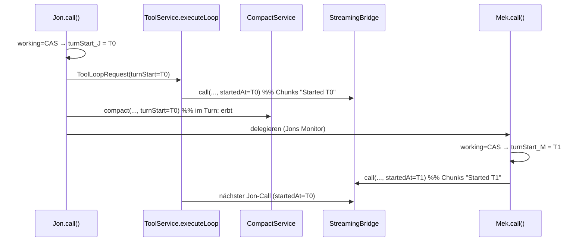
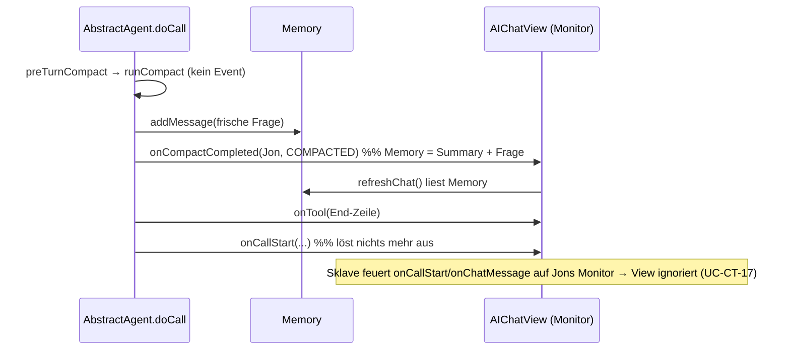

# Plan — Plugin-Regressionen fixen + Core aufräumen (Branch `web-factory`)

> Stand: 2026-10-27, Da Thinka — **FINAL, freigegeben.** Q1 = Variante B (Paul/Jon), Docs nachgezogen (`compact-lock.md` R-CT-7 ab Z. 204,
> Golden Record). Q2/Q3/Q4 entschieden, keine offenen Fragen. Reihenfolge: **1 → 3 → 4 → 2 (2a→2b→2c) → 5**.
> Dev-Disziplin: Extras außerhalb des Plans vorher melden; Falsifizierbarkeit je Test mit konkretem Pfad berichten; Testzahlen nur mit Modul (Core Surefire / Plugin Tycho).

## 1. Context

Drei Plugin-Regressionen + ein alter Bug + Aufräumen des Core nach AF-ADR-002.

| Bug | Symptom | SOLL (Jon-Docs, Golden Record) | IST-Ursache (verifiziert im Code) |
|---|---|---|---|
| 3 | Chat wird bei Delegation geleert | R-CT-7 rev., UC-CT-10/16/17 (`compact-lock.md`) | `AIChatView.onCallStart` flusht `pendingChatReset` auch bei `onCallStart` eines delegierten Sklaven (geteilter Monitor) |
| 2 | „Started"-Zeit springt (Compact/Cancel) | R19/R20 (`streaming-display.md`), `compact-architektur.md` „Turn-Zeit" | `ConfiguredChatModel.callBlocking` → `new StreamingBridge()` → Bridge-`startedAt` = Konstruktionszeit, nicht Turn-Start |
| 1 | Zweiter Überlauf im selben Turn wird nicht compactet | R-CC-18 (geschärft), UC-CC-2 (`compact.md`) | `HandleToolLoopCompactComponent.attemptedDirect` wird VOR dem Ergebnis gesetzt → sperrt auch nach `COMPACTED` |
| – | Core trägt AF-Kanäle, die niemand nutzt | AF-ADR-002 | `OriginMonitor`, `onAgentCallCompleted`, `onDelegatedAnswer`, `ToolResultAttributes`, `AbstractTool.resultAttributes` |

Docs sind Golden Record (nur Jon schreibt sie). Dieser Plan referenziert nur IDs.

## 2./3. Design- & Architekturentscheidungen

### Inc 3 (R20) — wer besitzt die Turn-Zeit

**Der Agent** (`AbstractAgent`, Feld `private volatile Instant turnStart`). Gesetzt genau dort, wo er `working` per CAS bekommt:
`call()` (`acquired == true`) und `compact()` (`acquired == true`, d. h. User-/Delegations-Compact eines idle Agenten = eigener Turn).
Im Turn (`!acquired`) liest `compact()` nur — erbt.

Durchreichen (Entscheidung Request-Feld vs. Parameter): **beides, je nach Natur des Aufrufers**
- Tool-Loop: Feld `Instant turnStart` in `ToolLoopRequest` (`@Default Instant.now()` — ein nackter Test-Builder hat nie `null`). `toBuilder()` erbt es → SearchAgent-Unterloop erbt automatisch (gewollt, R20). `ToolLoopRequest.call/asyncCall` reichen es an die Bridge.
- Compact: `CompactService.compact(..., AiMonitor callerMonitor, Instant turnStart)` — **eine** Signatur, Pflichtparameter (kein stiller `Instant.now()`-Default, der den Bug wieder einschleppt). `AbstractAgent.doCompact` übergibt sein eigenes Feld. `AiAgent.compact(monitor)` bleibt unverändert (der Agent kennt seine Zeit selbst).
- Bridge: `StreamingBridge.call(model, request, monitor, Instant startedAt)` — **nur** die 4-arg-Form; Bridge kennt keinen Turn mehr. `ConfiguredChatModel.callBlocking(ChatRequest, AgentConfig, AiMonitor, Instant)`; die Kurz-Überladungen (`callBlocking(ChatMessage)`, `(ChatRequest, AiMonitor)`) delegieren mit `Instant.now()` (Stand-alone-Call = eigener „Turn": Voice, Benchmark).
- **Nicht** am Monitor (bei Delegation geteilt), **nicht** in der Bridge.

Test-Seam: `AbstractAgent` bekommt `private Clock clock = Clock.systemUTC()` + package-private `setClock(Clock)` (Muster: `setMessageQueue`), damit Tests die Turn-Zeit deterministisch vorgeben. Die Bridge behält ihren Clock-Konstruktor für ihre Call-Timer.

### Inc 4 (R-CC-18) — Flag-Semantik

`attemptedDirect` → `failedDirect`: wird nur gesetzt, wenn `agent.compact()` ≠ `COMPACTED` liefert. Sonst keine Strukturänderung (Entscheidung bleibt in `HandleToolLoopCompactComponent`).

### Inc 2 (R-CT-7, UC-CT-10/11/12/16/17) — Variante B (entschieden)

**Soll (Doc, nicht kopieren):** Einziger Rebuild-Auslöser = `onCompactCompleted(agentName, result)`; View rebuildt, wenn `agentName` == aktiver Agent und `COMPACTED`, **sofort** (Button wie Turn). `onCallStart`/`onChatMessage` lösen nie etwas aus. Kein Aufschub, kein Merker, keine Memory-Heuristik. **Zeitpunkt-Pflicht des Agenten:** Pre-Turn-Compact feuert das Event erst **nach** `addMessage(frage)`. `AiMonitor` wird sonst NICHT erweitert (Absender an anderen Events = Backlog). `withinTurn` entfällt: `onCompactCompleted(String agentName, CompactResult result)`.

**Design (Agent besitzt den Zeitpunkt, View ist dünn):**
- `AbstractAgent.compact(monitor)` zerfällt in *ausführen* und *bekanntgeben*:
  - privater Record `CompactRun(CompactResult result, CallStats stats, int messageCountAfter, int tokensAfter, boolean withinTurn)` — die After-Zahlen werden **beim Compact** erfasst (sonst zeigt die End-Zeile nach `addMessage` „→ 2 messages" statt „→ 1").
  - `private CompactRun runCompact(AiMonitor mon)` = bisheriger Körper (CAS, `doCompact`, Flag-Release); `private void announce(AiMonitor mon, CompactRun run)` = Event (nicht bei `SKIPPED_SMALL`) **dann** End-Zeile (nur `COMPACTED`; Reihenfolge Event→End-Zeile bleibt: R-CT-8 / `compactEndLineEmittedAfterCompactCompletedEvent`).
  - öffentliches `compact(monitor)` = `runCompact` + sofort `announce` (Button, In-Loop-Direct, `compactSession` — Memory = Reseed, konsistent).
  - `preTurnCompact` gibt `@Nullable CompactRun` zurück (nur bei `COMPACTED`/FAILED_EMPTY gelaufen, sonst `null`), ruft `runCompact` **ohne** announce; `doCall` **und** `asyncCall` (Duplikat bewusst, F2) rufen `announce(...)` **nach** `addMessage(UserMessage…)` und **vor** `monitor.onCallStart(...)`. Event UND End-Zeile wandern gemeinsam hinter `addMessage` (End-Zeile würde sonst vom Rebuild weggespült).
  - Pre-Turn bei Throw (Cancel bzw. „Pre-turn compact failed"): unverändert, kein Event.
- Policy in `CompactFeedback` (bleibt „Compact-Wording/Sichtbarkeit", rein): `static boolean resetsChat(@Nullable CompactResult result, String compactedAgentName, @Nullable String activeAgentName)` — `COMPACTED` ∧ aktiv == compacted. Ersetzt `resetTiming`/`Timing`.
- `AIChatView.onCompactCompleted`: `if (CompactFeedback.resetsChat(...)) refreshChat();` im UI-Thread-Runnable (aktiver Agent erst dort lesen). Kein Feld, kein `onCallStart`-Override.

**Schnitt (je Inkrement grün; jede Zwischenstufe ist lauffähig):**
- **2a (nur hinzufügen, Core):** `CompactRun`/`announce`-Split + Pre-Turn-Timing; `CompactFeedback.resetsChat` NEBEN `resetTiming`. `withinTurn` läuft noch mit (`run.withinTurn`), die View ist unverändert und flusht weiter in `onCallStart` → bleibt korrekt (Event kommt jetzt vor `onCallStart`, wie vorher). Tests: UC-CT-16 neu, `resetsChat`-Unit (siehe BDD).
- **2b (Umverdrahtung, Plugin; Ausnahme von „eine Polarität"):** `AIChatView.onCompactCompleted` auf `resetsChat` + sofort; `pendingChatReset` (Feld Z. 125), Zeile in `refreshChat()`, `onCallStart`-Override (Z. 359-373) und Javadoc 340-344/360-363 raus. Noch 3-Arg-Signatur. Tycho grün; manueller Smoke (BDD).
- **2c (nur löschen, Core + Plugin gemeinsam):** `CompactFeedback.Timing`/`resetTiming` (+ Javadoc „deferred"), Parameter `withinTurn` aus `AiMonitor.onCompactCompleted` (Core: `AiMonitor:88`, `AbstractAgent:429`; Plugin: `AIChatView:346` Override — Core+Plugin müssen im selben Commit mit, sonst kompiliert der `@Override` nicht), `CompactRun.withinTurn`, alle Test-Monitore (s. u.). Javadoc `AiMonitor.onCompactCompleted` (Z. 82-86 „withinTurn…onCallStart" streichen, Satz „Fired after the agent released its working state" **prüfen**: gilt jetzt nur für Button — Pre-Turn/In-Loop feuern im Turn; anpassen) und `onCallStart`-Javadoc (der Satz „earliest point a rebuild cannot lose the message") überholt → kürzen. Kommentare `AIChatView:539/553` auf „R-CT-7" prüfen.

## 4. Betroffene Dateien (Pfade gecacht — nicht neu suchen)

**Inc 1 (nur löschen)** — alles unter `org.sterl.llmpeon.core/src/…`
- DELETE `main/java/org/sterl/llmpeon/shared/OriginMonitor.java`, `test/java/org/sterl/llmpeon/shared/OriginMonitorTest.java`
- DELETE `main/java/org/sterl/llmpeon/tool/ToolResultAttributes.java`, `test/java/org/sterl/llmpeon/tool/ToolResultAttributesRoundTripTest.java`
- `shared/AiMonitor.java`: `onAgentCallCompleted`, `onDelegatedAnswer` raus (Javadoc mit).
- `tool/tools/AbstractTool.java`: `attachResultAttribute`, `resultAttributes()`, Feld + Zeile in `withToolRequest`, Imports `LinkedHashMap/Map`.
- `tool/ToolService.java`: `execute(...)` Ende → `return ToolExecutionResultMessage.from(tr, result);` (Zeilen 280-282), private `resultAttributes(...)` (285-294) raus, Javadoc 254-260/285-290 anpassen; `AbstractTool`/`Map`-Import prüfen (`getTool` nutzt `AbstractTool`, `Map.Entry` bleibt).
- `agent/AbstractAgent.java`: `OriginMonitor.of(...)` in `doCall` (318), `asyncCall` (355), `compact` (415 → `AiMonitor.nullSafety(monitor)`), `monitor.onAgentCallCompleted(...)` (349) + Kommentar 347-348, Import.
- `poagent/tools/PoDelegateTool.java`: `announceFinalAnswer(...)` (Aufruf 262, Methode 275-293), Import `ToolResultAttributes`. `answer` bleibt (gebraucht für `result`).
- `tool/tools/SearchAgentTool.java`: `.monitor(OriginMonitor.of(monitor, NAME))` (90) → Monitor der Parent-Request erben (Zeile ersatzlos, `toBuilder` erbt) + Kommentar 89, Import. **Q3:** Konstante `NAME` (+Javadoc 26-31) — nur dafür da.
- Javadoc-Links auf gelöschte Klassen: `shared/OnPartialAiResponse.java` (Z. 15 `{@link OriginMonitor}`), `tool/model/SimpleMessage.java` (Z. 10) — Text auf „set by the producer's viewer chain" o. ä. kürzen, **Feld `origin` bleibt**.
- Tests: `AbstractAgentTest` → `doCallStampsMonitorWithAgentName` (1497-1522) löschen; `PoDelegateToolTest` → `delegationAnnouncesFinalAnswerAndCarriesItInResult`, `delegationWithoutAnswerAnnouncesNothingAndCarriesNoAttributes` (536-599) + Import `ToolResultAttributes` (33); `ToolServiceTest` → `AttributedTool` + `resultAttributesArePerInvocation` (529-570); `SearchAgentToolTest` → `subLoopCarriesItsOwnOrigin` + `OriginRecordingMonitor` (217-270) + Import `OriginMonitor` (28).
- **BLEIBT:** `FileLlmConfigStore`, `WriteValidator.pathScopePrompt`, Feld `origin` an `SimpleMessage`/`OnPartialAiResponse` (+ `withOrigin`).
- **NICHT anfassen:** `aifactory/**` (kompiliert danach nicht mehr — gewollt, nicht im Root-Reactor).

**Inc 3** — `org.sterl.llmpeon.core/src/main/java/org/sterl/llmpeon/…`
- `agent/AbstractAgent.java` (Feld `turnStart`, `clock`+`setClock`, Setzen in `call()`/`compact()`, Weitergabe in `doCall`/`asyncCall` → `ToolLoopRequest.builder().turnStart(...)`, `doCompact` → `CompactService.compact(..., turnStart)`)
- `tool/ToolLoopRequest.java` (Feld, `call`/`asyncCall` reichen durch)
- `streaming/StreamingBridge.java`, `streaming/AsyncStreamingBridge.java` (3b: Ctor-`startedAt`, `totalTimer`, `totalTimer()`-Accessor, `@Getter totalTimer`; `SteamHandler`: Chunks mit übergebener Turn-Zeit, `onCallCompleted`-Duration bleibt Call-Dauer — dafür eigenes Feld `callStart`)
- `ai/ConfiguredChatModel.java`, `compact/CompactService.java` (Z. 69 Signatur, Z. 103 Aufruf)
- Tests: `test/.../streaming/StreamingBridgeTest.java`, `compact/CompactServiceTest.java` (~25 Aufrufe mechanisch + Konstante `T0`), `agent/AbstractAgentTest.java` oder neue `agent/AbstractAgentTurnTimeTest.java`, `tool/tools/SearchAgentToolTest.java`.

**Inc 4** — `compact/HandleToolLoopCompactComponent.java` (Feld Z. 34, `handle` Z. 74-82, Klassen-Javadoc Z. 22-24), Test `compact/HandleToolLoopCompactComponentTest.java`.

**Inc 2** — Core `org.sterl.llmpeon.core/src/…`: `main/…/agent/AbstractAgent.java` (`compact` Z. 408-440 → `runCompact`/`announce`/`CompactRun`; `preTurnCompact` Z. 391-406; `doCall` Z. 317-351 / `asyncCall` Z. 354-382: announce nach `addMessage`, vor `onCallStart`), `main/…/compact/CompactFeedback.java` (+`resetsChat`; 2c: −`Timing`, −`resetTiming`, Javadoc Z. 74-83), `main/…/shared/AiMonitor.java` (Z. 28-33 `onCallStart`-Javadoc, Z. 73-88 `onCompactCompleted`); Tests `test/…/compact/CompactFeedbackTest.java` (Import `Timing` Z. 13 weg), `test/…/agent/AbstractAgentCompactResultTest.java`, `test/…/agent/AbstractAgentPreTurnCompactTest.java`.
Plugin `org.sterl.llmpeon/src/org/sterl/llmpeon/parts/AIChatView.java`: Feld `pendingChatReset` Z. 125, `onCompactCompleted` Z. 339-357, `onCallStart` Z. 359-373, `refreshChat()` (Zeile mit `pendingChatReset` — Dev sucht per Grep), Kommentare Z. 539/553; Import `CompactFeedback` bleibt (für `resetsChat`). Keine Treffer in `org.sterl.llmpeon.test`.

**Inc 1/Q3 (verifiziert):** `SearchAgentTool.NAME` wird nur von `SearchAgentTool:90` und dem zu löschenden `SearchAgentToolTest` genutzt; Plugin importiert `SearchAgentTool`, nutzt `NAME` nirgends; `aifactory` nutzt nur das Literal `"Peon-Search"` (`AgentNamesTest`, nicht anfassen) ⇒ `NAME` + Javadoc Z. 26-31 mitlöschen.

**Inc 5** — Root-`CHANGELOG.md` (Kopf Z. 1-7, erste Version `## [2.15.0]` Z. 8): neuer Abschnitt `## [Unreleased]` direkt davor. Den **Text schreibt Jon**; Dev legt nur den Abschnitt an, falls Jon ihn nicht schon eingecheckt hat, und committet. Kein Code, keine Tests (Docs-Inkrement), berührt keinen UC.

## 5. Rules & Constraints

- Jedes Inkrement baut allein grün: Core = Maven Surefire (Ground Truth; Zahlen immer mit Modul nennen), Plugin = Tycho.
- Eine Polarität pro Inkrement (1: nur löschen; 2a: nur hinzufügen; 2b: Umverdrahtung, einzige Ausnahme; 2c: nur löschen; 3a: hinzufügen+umschalten, 3b: nur löschen; 4: kleine Änderung; 5: Docs).
- Line-basierte Edits danach zurücklesen + Duplikat-Check (AGENTS.md).
- Thread-Safety: `turnStart` volatile, nur beim CAS-Gewinn geschrieben; View-Zugriffe nur in `EclipseUtil.runInUiThread`.
- Keine IDs erfinden. Verwendete IDs: R-CT-7, UC-CT-10/11/12/16/17, R19, R20, R-CC-18, UC-CC-2. Inc 1 berührt keinen UC (Refactoring/Löschen).
- Dev-Agent meldet Extras außerhalb des Plans VORHER (z. B. `SearchAgentTool.NAME`, Q3).
- Plugin-Tests: JUnit 4, keine Assert-Libs. Core: JUnit 5 + AssertJ.

## 6. BDD-Akzeptanz + 7. Test-Strategie (je Test: Mutation im Produktivcode)

### Inc 1 — kein UC
- GIVEN Core nach dem Löschen WHEN `mvn -pl org.sterl.llmpeon.core test` THEN grün, `grep -r "OriginMonitor\|onDelegatedAnswer\|onAgentCallCompleted\|ToolResultAttributes\|attachResultAttribute" org.sterl.llmpeon.core/src` leer. Kein neuer Test (nur-löschen); Nachweis = Build grün + leerer Grep. Plugin (`org.sterl.llmpeon`) kompiliert unverändert (kein Treffer dort — verifiziert per Grep).

### Inc 3 — R20 (+ R19-Tabelle: Bridge ohne Total-Timer)
Alle Marker `// R20`. Kernproblem: Tests mit nur EINEM Call oder gleicher ms wären vakuum → Clock per `setClock` zwischen den Calls um ≥ 1 h vorstellen.

| Test | Pfad / Mutation → rot |
|---|---|
| `AbstractAgentTurnTimeTest.toolLoopCallsOfOneTurnCarrySameStartedAt` — Jon-Turn T0, 2 Loop-Runden, Clock +1 h dazwischen; alle Chunks `startedAt == T0` | `ToolLoopRequest.call` übergibt `Instant.now()` statt `turnStart` |
| `…compressorChunksInTurnCarryTurnStartOfTheTurn` — Compact aus dem Modell-Lambda im Turn (Muster `inTurnCompactReportsTurnFlag`), Clock +1 h; Compressor-Chunks `== T0` | `AbstractAgent.doCompact` übergibt `Instant.now()` an `CompactService` / `callBlocking` |
| `…delegatedMemberHasOwnStartAndOwnerKeepsHis` — Jon (T0) ruft im Lambda `mek.call(..)` mit Clock +5 min; Mek-Chunks `== T1`, Jons nächster Chunk wieder `== T0` | `turnStart` als statisches/geteiltes Feld oder am Monitor; oder Mek erbt Jons Zeit |
| `…idleAgentCompactIsItsOwnTurn` — Mek idle, `mek.compact(monitor)` bei T2: Chunks `== T2` (≠ Jon) | `compact()` setzt `turnStart` nicht beim CAS-Gewinn |
| `…canceledTurnDoesNotLeakItsStart` — Turn 1 abgebrochen (Monitor `isCanceled`), Clock +1 h, Turn 2: Chunks `== T_turn2` | `turnStart` nur gesetzt wenn `null` |
| `SearchAgentToolTest.subLoopInheritsParentTurnStart` — Request mit `turnStart(T0)`, Clock/Wartezeit; Sniffa-Chunks `== T0` | Sub-Loop baut Request neu / setzt `turnStart(Instant.now())` statt `toBuilder`-Vererbung |
| `CompactServiceTest.compressorChunksCarryTheGivenTurnStart` | Service ignoriert Parameter, nimmt eigene Zeit |
| `StreamingBridgeTest.startedAtIsWhatTheCallerPasses` (ersetzt `startedAtSpansWholeTurn`; 2 Calls, Clock +1 h, START-Chunk jeweils == übergebene Zeit) | Bridge nimmt `Instant.now(clock)` im `call()` |

3b löscht `totalTimerRunsThroughBridgeLifetime` (Feature entfällt, kein Ersatz). **Bestehende Tests anpassen**, nicht abschwächen: `partialChunkTokenPhaseStartIsCallStartNotTurnStart` muss die Turn-Zeit jetzt explizit (T0) übergeben, sonst wäre `startedAt == tokenPhaseStart` und der Test vakuum.
Falsifizierbarkeit je Test mit konkretem Pfad im Dev-Bericht melden (keine Pauschale).
LiveStatus-Format (`LiveStatusTest`) bleibt unverändert grün (Format-Tag von R20 ist bereits gedeckt).

### Inc 4 — R-CC-18 / UC-CC-2 (`HandleToolLoopCompactComponentTest`)
- `successfulDirectCompactDoesNotBlockTheNextOne` `// UC-CC-2` — Runde 1 über Budget → `COMPACTED`; Memory per `seed(...)` ≥ 4 Nachrichten + `setCounter(170001)` erneut über Budget (Hinweis: der Stub-Agent leert auf 1 Nachricht, `MIN_COMPACT_MESSAGES` = 3 → ohne Re-Seed wäre der Test vakuum); Runde 2 → `compactCalls == 2`. **Mutation:** `attemptedDirect = true` wieder unbedingt setzen → rot.
- `failedDirectCompactIsNotRetriedInTurn` (besteht bereits; Marker `// UC-CC-2` ergänzen) — **Regressionsschranke, pre-Change grün**, kein Beleg für den Fix. Mutation: `failedDirect = true` im Fehlerzweig weglassen → 2. Versuch → rot (pinnt die Flag-Existenz nach dem Umbau).
- Edge: `agent.compact` wirft → propagiert, Flag unverändert (unverändertes Verhalten, kein neuer Test).

### Inc 2 — R-CT-7, Variante B (UC-CT-10/11/12/16/17)

**Bestehende UC-CT-Marker — was bleibt / wird ersetzt:**

| Stelle | Heute | Neu |
|---|---|---|
| `AbstractAgentCompactResultTest:500` `compactCompletedEventCarriesAgentAndResult` `// UC-CT-10` | prüft `working=false within=false` | **bleibt** (Button-Pfad: Name + Status, Flag frei). 2c: `within=` aus `completionMonitor` und den Erwartungsstrings streichen. Mutation: Event ohne Namen / vor Flag-Release → rot. |
| `…:560` `inTurnCompactReportsTurnFlag` `// UC-CT-10` | prüft `within=true` — Konzept entfällt | **ersetzt** durch `inTurnCompactCompletedNamesTheAgent` `// UC-CT-10`: Compact aus dem Modell-Lambda im Turn → genau EIN Event `Dev=COMPACTED` (kein `within`). Mutation: Event im Turn nicht feuern → rot. (2a: bleibt unverändert grün, 2c: Umbenennung + `within` raus) |
| `CompactFeedbackTest:81` `mainAgentCompactResetsChatView` `// UC-CT-10` | `resetTiming == NOW` | **ersetzt**: `resetsChat(COMPACTED, "Da Boss", "Da Boss") == true`. Mutation: `resetsChat` liefert immer `false` → rot. |
| `CompactFeedbackTest:90` `preTurnCompactDefersChatReset` `// UC-CT-10` | `DEFERRED` | **löschen** (Konzept weg); Ersatz = UC-CT-16-Agent-Test. |
| `CompactFeedbackTest:100` `slaveCompactDoesNotResetChatView` `// UC-CT-11` | NONE für Turn/kein Turn, `active == null` | **bleibt**, Assertions auf `resetsChat == false` (andere Namen, `active == null`); die `withinTurn`-Doppelungen fallen weg. Mutation: Namensvergleich weglassen (`active != null` reicht) → rot. |
| `CompactFeedbackTest:116` `failedCompactKeepsChatView` `// UC-CT-12` | NONE für Nicht-Erfolg × Timing | **bleibt**, `resetsChat == false` für `FAILED_EMPTY`/`SKIPPED_SMALL`/`null`. Mutation: Status-Prüfung weglassen → rot. |

**Neue Tests:**
- `AbstractAgentPreTurnCompactTest.preTurnCompactSignalsAfterFreshQuestion` `// UC-CT-16` — langer Verlauf über 95 %, frische Frage; Monitor liest **im** `onCompactCompleted` `agent.getMemory().getCopy()` ⇒ enthält die Frage (`ChatMessageUtil.toString`-Contains) UND die Summary; zusätzlich Reihenfolge-Liste `[start-Zeile, completed, end-Zeile, callStart]`. **Mutation:** `announce` direkt in `preTurnCompact` statt in `doCall` nach `addMessage` → Frage fehlt → rot. Ein `asyncCall`-Pendant, falls über die öffentliche API erreichbar (Dev prüft; sonst melden — NICHT still weglassen).
- `…preTurnCompactEndLineReportsMemoryAtCompactTime` — End-Zeile enthält `→ 1 messages` (Reseed), nicht 2 (Reseed + Frage). **Mutation:** `announce` liest `memory.size()` statt `run.messageCountAfter` → rot. (Ohne diesen Test wäre `CompactRun` überflüssig wirkende Komplexität — er ist der Beleg, dass sie nötig ist.)
- **UC-CT-17 (Q4 = A, entschieden)** — `agent/AbstractAgentTurnEventsTest.delegationTurnFiresOnlyTheOwnersCompactEvent`. Aufbau: Jon (langer Verlauf → Pre-Turn-Compact) und echter Mek teilen EINEN Monitor; im Modell-Lambda von Jon wird Mek delegiert (`mek.call(..)` bzw. `mek.compact(monitor)` — Muster `PoDelegateTool`), sodass Mek auf Jons Monitor `onCallStart`/`onChatMessage`/`onCompactCompleted` feuert. Der Monitor zeichnet alle Events mit Namen auf. Asserts: Event-Liste der Compacts **exakt** `[Jon=COMPACTED, Mek=COMPACTED]` (je einmal, jeweils mit dem eigenen Namen, nie Jons Name für Meks Lauf, kein Nachfeuern am Turn-Ende); Jons Event liegt **vor** Jons `onCallStart` und **nach** dessen `addMessage`.
  - **Marker-Regel (Jon):** `// UC-CT-17` NUR, wenn der Dev eine echte Mutation im Produktivcode nachweist, die den Test rot macht, und den **konkreten Pfad** meldet. Kandidaten (Dev führt aus, nicht „vermutet"): (m1) `announce` verwendet nicht `getName()`, sondern einen geteilten/ersten Namen (z. B. Name vom Monitor/statisch) → Mek-Event trägt „Jon" → rot; (m2) `announce` wird zusätzlich in `doCall` nach dem Pre-Turn-Pfad erneut aufgerufen → doppeltes Event → rot; (m3) `compact()` feuert für den Sklaven-Lauf kein eigenes Event → Liste unvollständig → rot. Ist keine rot → Test **ohne** Marker, Dev meldet das als Blocker-Info.
  - **Pflicht-Kommentar im Test (ehrlich, unabhängig vom Marker):** „Beweist nur die Agent-Hälfte: das einzige Compact-Signal ist das eine, benannte `onCompactCompleted`. Dass die View `onCallStart`/`onChatMessage` des Sklaven ignoriert, ist *fehlender Code* in `AIChatView` (Feld + Override gelöscht) und headless nicht prüfbar → manueller Smoke (R-CT-7)."
  - Kein `ChatResetGate` (B zurückgestellt, bis die Factory-View R-CT-7 umsetzt — Backlog, nicht dieser Zyklus).
- Plugin-Glue `AIChatView`: nicht headless testbar (SWT, `PeonAiServiceTest` hat keine View-Tests) → **manueller Smoke**: lange Session → Pre-Turn-Compact → Delegation ⇒ Summary + Frage bleiben, Chat wird beim Sklaven-Start nicht geleert; frischer Chat → erste Runde delegiert/`searchAgent` ⇒ Chat bleibt stehen (das war das Loch der alten Memory-Regel); Button-Compact ⇒ Rebuild.
- Core-Test-Monitore, die in 2c die 3-Arg-Signatur verlieren (mechanisch, keine Assertion abschwächen): `AbstractAgentCompactResultTest` Z. 217, 473, 543, 570, 727 (+ Javadoc 723) — `OriginMonitorTest` ist nach Inc 1 schon gelöscht.

## 8. Offene Fragen

Entschieden: Q1 = Variante B (`withinTurn` entfällt, `onCallStart` bleibt im Interface, Javadoc angepasst); Q2 = `## [Unreleased]` in Root-`CHANGELOG.md`, Text von Jon; Q3 = `SearchAgentTool.NAME` mitlöschen.

Q4 = A (Core-Test mit geteiltem Monitor; Marker nur bei nachgewiesener Mutation; B/`ChatResetGate` erst wenn die Factory-View R-CT-7 umsetzt).

**Offene Fragen: keine.** Inline-Entscheidungen des Dev, die zu melden sind (nicht zu raten): (1) `asyncCall`-Pendant des UC-CT-16-Tests — nur wenn über die öffentliche API erreichbar, sonst melden; (2) ob der UC-CT-17-Test seinen Marker behält (Mutationsnachweis, Pfad nennen).

## 9. Review Da Dok (2026-10-27) — Verdict: **CONCERNS**

Scope: Commits 1d11430a…d0b7e2a0 (Inc 1, 3a, 3b, 4, 2a, 2b, 2c) + uncommittete `CHANGELOG.md` (Inc 5). Vom Reviewer gemessen: Core Surefire (`mvn -o -pl org.sterl.llmpeon.core test`) **1392/0F/0E/0S** auf d0b7e2a0. Plugin `org.sterl.llmpeon`: keine Compile-Errors in Eclipse. Lint (`lintDocsAndTests`, Core- und Plugin-Docs): 8 Findings, alle schon vorher da (UNBELEGT UC-CT-3/5 = manueller Smoke offen, 6× MANUELL), **kein** UNBELEGT_ERLEDIGT/VERWAIST.

**Plan↔Code:** vollständig. Alle Löschungen aus Inc 1 sind erledigt, der Grep auf `OriginMonitor|onDelegatedAnswer|onAgentCallCompleted|ToolResultAttributes|attachResultAttribute|withinTurn|resetTiming|pendingChatReset|attemptedDirect|totalTimer` liefert in core/plugin/test nichts mehr. Alle geplanten Tests sind da: 5× `AbstractAgentTurnTimeTest`, `subLoopInheritsParentTurnStart`, `compressorChunksCarryTheGivenTurnStart`, `startedAtIsWhatTheCallerPasses`, `successfulDirectCompactDoesNotBlockTheNextOne`, UC-CT-16 und UC-CT-17. `AbstractAgent.compact` hat genau einen Event-Pfad (`announce`, AbstractAgent.java ~Z. 460-476). Der einzige `onCompactCompleted`-Aufrufer im Main-Code ist `announce`, es gibt kein Doppelfeuern. `AIChatView.onCompactCompleted` ist dünn (Z. 338-345: ein `if` auf `resetsChat`, kein Feld, kein `onCallStart`-Override).

**Docs↔Code:** R20, 6 GWT:
1. Format: `LiveStatusTest`, schon vorher da.
2. Leading zero: `LiveStatusTest:32`.
3. Compact im Turn: `compressorChunksInTurnCarryTurnStartOfTheTurn`. Pre-Turn läuft über dieselbe Zeile `doCompact → turnStart`, ist also mitgedeckt.
4. Delegation: `delegatedMemberHasOwnStartAndOwnerKeepsHis`.
5. Idle-Compact: `idleAgentCompactIsItsOwnTurn`.
6. Cancel: `canceledTurnDoesNotLeakItsStart`.

R-CT-7 / UC-CT-10/11/12/16 sind belegt. R-CC-18 / UC-CC-2 sind mit beiden GWT belegt. AF-ADR-002 ist erfüllt, Feld `origin` bleibt. Keine Docs↔Code-Lücke, die Rework verlangt.

**Legitime Abweichung (notiert):** Plan Z. 175 erwartete im End-Zeilen-Test „→ 1 statt → 2 messages“. Das kann so nicht funktionieren: `ThreadSafeMemory.add` (Z. 117-121) hängt aufeinanderfolgende UserMessages zusammen, die Zählung ist also in beiden Fällen 1. Der Dev hat die Assertion deshalb auf Tokens umgestellt (`AbstractAgentPreTurnCompactTest.preTurnCompactEndLineReportsMemoryAtCompactTime`: `doesNotContain("k tokens")`) und das im Kommentar begründet. Das ist richtig so: Der Planungsfehler wurde erkannt, statt einen Test ohne Aussagekraft zu bauen.

### CONCERNS (nicht blockierend)

**C1 — Zweiter `Instant.now()`-Pfad für die Turn-Zeit bleibt stehen.** `ConfiguredChatModel.java:45-46`: `callBlocking(ChatRequest, AgentConfig, AiMonitor)` ruft intern mit `Instant.now()` auf.
- Der Plan (Z. 31) erlaubt diesen Default nur für `callBlocking(ChatMessage)` und `(ChatRequest, AiMonitor)`. Die AgentConfig-Variante steht nicht auf der Liste.
- Es gibt keinen Aufrufer im Main-Code mehr (Grep), die Methode ist also toter Code.
- Gefährlich ist sie trotzdem: Genau diese Überladung (agent-config-aware) würde ein künftiger Turn-Pfad naheliegend wählen, und dann kommt der R20-Bug still zurück. Plan Z. 30 verbietet genau so einen stillen Default.
- Hätte in 3b („nur löschen“) mit weg gemusst.
- Extraktion/Fix: Überladung löschen.

**C2 — Unangemeldetes Extra.** Im Javadoc von `StreamingBridge` ist `@deprecated will be replaced by AsyncStreamingBridge` zu „Maybe replaced by …“ abgeschwächt worden (Klassen-Javadoc ~Z. 43). Das steht nicht im Plan und in keiner Commit-Message. Inhaltlich ist es vertretbar, weil die Bridge jetzt der aktive Pfad ist. Es verstößt aber gegen die Dev-Disziplin (Plan Z. 5, Z. 129). Nur notiert.

**C3 — Rule of three: `MutableClock`.** `AbstractAgentTurnTimeTest.java:48` ist die **7.** identische `extends Clock`-Testklasse:
- `CompactFeedbackTest:105`
- `UserMessageQueueTest:355`
- `CallStatsTest:22`
- `TimerTest:21`
- `StreamingBridgeTest:48`
- `EclipseRunTestToolTest:30` (Plugin)

Lokal und einfach, deshalb nur CONCERNS. Benannte Extraktion: ein Core-Test-Fixture `org.sterl.llmpeon.MutableClock` (oder in `CoreTestFixtures`), das die Core-Tests gemeinsam nutzen.

**C4 — UC-CT-17-Marker zeigt „belegt“, obwohl der eigentliche Regressionspfad nicht automatisch abgesichert ist.**
- Der Test (`AbstractAgentTurnEventsTest`) beweist ehrlich die Agent-Hälfte, mit Pflicht-Kommentar und Mutationen m1-m3.
- Die Ursache von Bug 3 lag aber im **View**: Flush in `onCallStart`. Würde jemand in `AIChatView` wieder einen `onCallStart`-Override einbauen, der `refreshChat()` auslöst, bliebe die ganze Suite grün.
- Der Plan erlaubt das (Q4 = A, manueller Smoke). Damit hängt UC-CT-17 allein am Smoke, und der steht aus.
- Empfehlung: UC-CT-17 im Doc erst nach dem Smoke auf ✅ setzen. Siehe dazu den Mutation-Check unten.

**C5 — Homepage nicht abgeglichen.** `homepage/src/usage/agents.md:54` beschreibt noch den Aufschub („An automatic compact that runs inside a turn waits a moment with that rebuild …“).
- Für Pre-Turn stimmt das aus Nutzersicht weiterhin.
- Für In-Loop/`compactSession` stimmt es nicht mehr: Dort wird jetzt sofort neu aufgebaut.
- AGENTS.md verlangt, dass nutzersichtbares Verhalten im selben Inkrement auf der Homepage nachgezogen wird. → Plan coverage gap (siehe unten), kein Dev-Fehler.

**C6 — Arbeitsbaum nicht sauber.** `git status` zeigt 4 gelöschte, nicht gestagte Dateien unter `non-peon-ai-agents-md/` (AGENTS*.md). Die gehören zu keinem Inkrement dieses Plans. Risiko: Sie landen per `commit -a` im Inc-5-Commit. Vor dem Inc-5-Commit klären, ob die Löschung gewollt ist und wohin sie gehört.

**C7 — Inc 5 offen.** Der Abschnitt `## [Unreleased]` in `CHANGELOG.md` ist vorhanden, inhaltlich passend (3 Fixed-Bullets), aber nicht committet. Laut Plan schreibt Jon den Text. Wer ihn tatsächlich geschrieben hat, ist nicht nachvollziehbar → vor dem Commit von Jon bestätigen lassen.

### Thread-Safety (e) — kein Fund, ein Restrisiko notiert
- `turnStart` ist volatile und wird nur bei gewonnenem CAS geschrieben (AbstractAgent Z. 246, Z. 448), nach Plan.
- `CompactRun` wird auf demselben Thread erzeugt und verbraucht, kein Race.
- **Restrisiko (vom Doc so gewollt, kein Rework):** In-Loop- und `compactSession`-Compacts bauen jetzt **mitten im Turn** sofort neu auf. Früher wurde das bis zum nächsten `onCallStart` aufgeschoben. `refreshChat()` liest das Memory aber erst, wenn das asyncExec-Runnable läuft, nicht zum Zeitpunkt des Events. Läuft der Turn-Thread schneller als der UI-Thread (nächster Modell-Call fertig plus `addResult`), rendert der Rebuild die neue AI-Antwort aus dem Memory, und die schon gequeueten Streaming-Chunks hängen sie ein zweites Mal an.
- Praktisch unwahrscheinlich: UI-Latenz liegt bei ms, der Netzwerk-Call bei Sekunden. Beim manuellen Smoke auf doppelte Antwortzeilen nach einem In-Loop-Compact achten.

### Test-Ehrlichkeit (f) — Stichprobe ohne Vakuum-Fund
- R20-Tests verstellen die Clock um Stunden, mehrere Calls je Test. `delegatedMember…` nutzt getrennte Clocks pro Agent, die Mutation „statisches Feld“ trifft Jons Compressor-Chunks.
- UC-CC-2 seedet nach dem Compact neu und prüft die Vorbedingungen explizit (`isGreaterThan(MIN_COMPACT_MESSAGES)`, `> BUDGET`).
- UC-CT-16 liest das Memory **im** Event, Reihenfolge mit 4 verschiedenen Elementen.
- `failedDirectCompactIsNotRetriedInTurn` ist korrekt als Regressionsschranke deklariert.

### Plan coverage gap (nicht gegen Dev)
- **PCG1:** Homepage (`homepage/src/usage/agents.md:52-56`) stand nicht unter „Betroffene Dateien“, obwohl R-CT-7 das nutzersichtbare Rebuild-Verhalten ändert (In-Loop jetzt sofort statt aufgeschoben). Der Absatz Z. 54 muss nachgezogen werden.

### Mutation-Check-Empfehlung (8)
Die eine Stelle, die einen Beweis am meisten verdient, ist die **View-Seite von UC-CT-17**. Mutation: in `AIChatView` wieder ein `onCallStart`-Override, das `refreshChat()` aufruft. Heute wird dabei **nichts** rot.
- Günstige Absicherung für den PO: eine unmarkierte Regressionsschranke, z. B. ein Plugin-Test oder ein Reflection-Check „`AIChatView` überschreibt `onCallStart`/`onChatMessage` nicht mit Chat-Rebuild“.
- Besser, sobald `org.sterl.llmpeon.test` wieder baut: ein Test auf dem `AbstractSwtUiTest`-Harness (gibt es schon, siehe `CompactRosterStatusTest`).

### Skill/instruction gaps (9)
- `repo-api-traps` (`.agents/skills/repo-api-traps/SKILL.md`) kennt den Trap „`ThreadSafeMemory.add` joint aufeinanderfolgende UserMessages“ nicht. Deshalb hat der Plan (Z. 175) einen Test ohne Aussagekraft spezifiziert („→ 1 vs → 2 messages“).
- Empfehlung: einen Eintrag ergänzen: „Nach Reseed + frischer Frage ist `memory.size()` unverändert 1; auf Inhalt oder Tokens prüfen, nie auf die Nachrichtenzahl.“

**Most likely reason this breaks later:** Jemand baut für die Factory-Web-View oder einen Refactor wieder einen Rebuild-Trigger an einem absenderlosen Event (`onCallStart`), oder er ruft im Turn-Pfad die 3-Arg-`callBlocking` mit eingebautem `Instant.now()` auf. In beiden Fällen kommt die Regression zurück und **kein** Test wird rot. — **Change that most reduces that risk:** die tote Überladung `ConfiguredChatModel.callBlocking(ChatRequest, AgentConfig, AiMonitor)` löschen (C1) und eine Regressionsschranke für „kein Rebuild an `onCallStart`“ in der View ergänzen (Mutation-Check oben).
