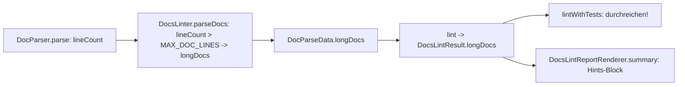

# Plan: R-DL-27 / UC-DL-100 — `ZU_LANG`-Hinweis für Docs über 1000 Zeilen

Branch `web-factory`. Ein Inkrement, genau ein Test. Golden Record: `org.sterl.llmpeon.core/docs/docs-linter.md` R-DL-27 (Z. 650) und UC-DL-100 (Z. 664). Die UC-ID wurde direkt aus dem Doc gelesen, weil ich `lintDocs` nicht aufrufen kann. Nicht kopieren oder umformulieren, das Doc gilt.

## 1. Context
Ein Doc wuchs auf ca. 15.000 Zeilen, und die Prompt-Regel "über 2 Doc-Seiten splitten" war nicht messbar. Der Linter meldet deshalb für jedes gescannte Doc mit mehr als 1000 Zeilen einen schwachen Hinweis `ZU_LANG`, auch für Docs ohne `idPrefix`. Der Hinweis ist kein Befund im Sinne von R-DL-5, er zählt nicht in `findings` und blockiert nichts (R-DL-8). Die Frage "Split sinnvoll?" geht an den PO, siehe po.md:88. Den Prompt passt Paul selbst an.

## 2. Design decisions (alle entschieden)
- **Keine neue Klasse, kein neuer `FindingType`.** Ein Hinweis ist kein `LintFinding`. Ein neuer Enum-Wert würde `findings` und `statusLine` verfälschen und den Switch in `findingPriority` erzwingen.
- **Die Zeilenzahl kommt aus dem Parser.** `DocParser.parse` liest die Datei ohnehin vollständig (`lines`, Z. 24-26). `DocParseResult` bekommt `int lineCount` (= `lines.size()`, also `BufferedReader.lines()`: eine abschließende Newline erzeugt keine Extrazeile). So gibt es kein zweites Lesen.
- **Die Schwelle ist eine Konstante.** `static final int MAX_DOC_LINES = 1000;` in `DocsLinter`, ohne Config. Der Vergleich ist `lineCount > MAX_DOC_LINES`.
- **Die Prüfung läuft in der vorhandenen Scan-Schleife** von `DocsLinter.parseDocs` (Z. 153-165). Sie steht VOR der Verzweigung `hasPrefix`/skipped, damit sie für alle Docs gilt. Das ist der Kern von R-DL-27 ("jedes gescannte Doc").
- **Datenform:** `Map<String,Integer> longDocs` (Datei → Zeilen) in `DocParseData` und `DocsLintResult`. Sie wird als `LinkedHashMap` gebaut. Im Record-Konstruktor kein `Map.copyOf`, denn das verliert die Reihenfolge und macht den Report nichtdeterministisch (NFR "Deterministisch"). Stattdessen `Collections.unmodifiableMap(new LinkedHashMap<>(m))`, null-safe wie `sourceRoots`. Die Reihenfolge ergibt sich aus der Sortierung der `mdFiles`.
- **Der Renderer hängt am Ende von `summary()` an**, nach `skippedDocsList`, einen Block nur wenn `longDocs` nicht leer ist:
  ```
  \n\nHints (not findings):\n  ZU_LANG docs/a.md 1001
  ```
  Format je Zeile: `ZU_LANG <datei> <zeilen>`. Die Überschrift darf das Wort `ZU_LANG` nicht enthalten. Bei leerer Map bleibt der Report byte-identisch, daher brechen bestehende Exakt-String-Tests nicht (z. B. `onToolLineCarriesDocAndFindingNumbers`).
- **`statusLine` und `findings.size()` bleiben unverändert.**
- `nextIds` bleibt unberührt, es rendert keinen Hinweis (R-DL-27 spricht nur vom Report).

## 3. Architecture

Abhängigkeitsrichtung unverändert: Parser → Linter → Result → Renderer.

## 4. Affected files (alle in `/llmpeon-core`)
| Datei | Änderung |
|---|---|
| `src/main/java/org/sterl/llmpeon/docslinter/DocParser.java` | `DocParseResult` + `int lineCount`; Z. 118 setzt `lines.size()`. Einziger Konstruktoraufruf. |
| `src/main/java/org/sterl/llmpeon/docslinter/DocsLinter.java` | Konstante `MAX_DOC_LINES`; Schleife in `parseDocs` füllt `longDocs`; `DocParseData` + Feld (Z. 439-449 und der Leer-Return Z. 144 mit `Map.of()`); `lint()` Z. 33 reicht `data.longDocs()` weiter; **`lintWithTests()` Z. 293 muss `docResult.longDocs()` durchreichen**, sonst verliert `lintDocsAndTests` den Hinweis. |
| `src/main/java/org/sterl/llmpeon/docslinter/DocsLintResult.java` | + Komponente `Map<String,Integer> longDocs` am Ende; Compact-Konstruktor (null → leer, Reihenfolge erhalten); Compat-Konstruktor (Z. 28-32) übergibt `Map.of()`. `DocsLinterTool.emptyDocsResult()` (Z. 163) nutzt den Compat-Konstruktor und braucht keine Änderung. |
| `src/main/java/org/sterl/llmpeon/docslinter/DocsLintReportRenderer.java` | Hints-Block am Ende von `summary(result, docRootsLine)`. |
| `src/test/java/org/sterl/llmpeon/docslinter/DocsLinterToolTest.java` | neuer Test (s. u.). Helfer `writeDoc` (Z. 521) und `rootDir`/`docsDir` sind vorhanden. |

Unberührt: `DocsLinterTool.java`, `DocRootDiscovery`, `po.md`.
Kein Test-Konstruktoraufruf von `DocsLintResult` gefunden (Grep `new DocsLintResult(` nur in main), also keine Testanpassungen nötig.
**Docs:** `docs-linter.md` ist schon spezifiziert. Das Flippen ❌→✅ von R-DL-27/UC-DL-100 macht Jon nach dem Lauf von `lintDocsAndTests`, nicht der Dev-Agent. `homepage/` bleibt unberührt, die Änderung betrifft nur Agent-Reports.

## 5. Rules & constraints
- Der Linter bleibt read-only; kein Build-Rot, kein Throw.
- "Tool lügt nie über ein Limit": die Schwelle 1000 steht im Hinweis implizit über den Zeilenwert. Die Hints-Überschrift nennt ausdrücklich "not findings".
- Ein `ZU_LANG` zählt nicht in `findings: N`.
- Die Zeilenzahl ist die rohe Dateizeilenzahl inklusive Frontmatter und Fences (kein Parsing-Raten).
- Prompt-Pfad: `po.md:88` ("Wächst ein Doc über 1000 Zeilen, frag den User …") wird von Paul selbst angepasst. **Prompt-Test auf diese Zeile: keiner.** `AiPoAgentPromptParityTest` vergleicht `po.md` nur mit sich selbst, Grep auf `1000`/`Split` in `llmpeon-core/src/test` und `org.sterl.llmpeon.test` ergab keinen Treffer. Eine Prompt-Änderung bricht also keinen Test. Eine Tool-Zuordnung je Agent ändert sich nicht (kein neues Tool).

## 6. BDD acceptance
Abgedeckte UC-ID: **UC-DL-100** (Regel R-DL-27).

| Scenario | Test |
|---|---|
| GIVEN ein Doc ohne `idPrefix` mit 1001 Zeilen und ein Doc mit `idPrefix` und genau 1000 Zeilen WHEN `lintDocs` läuft THEN genau ein `ZU_LANG` mit Datei und 1001, `findings: 0` | `DocsLinterToolTest.reportsZuLangOnlyAbove1000LinesWithoutCountingAsFinding` |

## 7. Test strategy — genau ein Test
Ort und Name: `DocsLinterToolTest`, Methode `reportsZuLangOnlyAbove1000LinesWithoutCountingAsFinding`, direkt darüber `// UC-DL-100` als reine Kommentarzeile (nach dem Muster dieser Klasse).

Fixture (`@TempDir` `docsDir` ist vorhanden):
- `docs/long.md`: **kein** Frontmatter, genau 1001 Zeilen, z. B. `"filler\n".repeat(1001)`. Keine Heading-/ID-Zeilen, damit keine Definitionen und keine Befunde entstehen. Das Doc ist "not participating".
- `docs/edge.md`: Frontmatter `---\nidPrefix: DL\n---\n` (3 Zeilen) plus 997 Filler-Zeilen, insgesamt **genau 1000 Zeilen**. Die Zeilenzahl in der Fixture ist per `Files.readAllLines(...).size()` gegenzuprüfen (in der Fixture selbst assertieren oder per Konstruktion über `repeat`), nicht nur im Kopf gezählt.

Assertions:
1. `lintDocs(null, List.of("docs"), null)` enthält `ZU_LANG docs/long.md 1001`.
2. Die Anzahl der Vorkommen von `ZU_LANG` im Output ist genau 1 (z. B. `output.split("ZU_LANG", -1)).hasSize(2)`). Das fängt `edge.md` ab, und die Überschrift des Hints-Blocks enthält das Wort nicht.
3. Der Output enthält `findings: 0`.
4. Derselbe Output-Check (1 und 2) auch für `lintDocsAndTests(null, List.of("docs"), null, null, null)`. Das bleibt im selben Test und fängt das Durchreichen in `lintWithTests`.

Falsifizierbarkeit, echte Mutation im Produktivcode und Testlauf (Surefire Modul `llmpeon-core`), je Mutation der Pfad, den sie trifft:
| Mutation | Erwartet rot durch |
|---|---|
| `>` → `>=` in `parseDocs` | `edge.md` (1000 Zeilen) erzeugt zweites `ZU_LANG` → Assertion 2 |
| Prüfung nur im Zweig `lintedDocs` (teilnehmende Docs) | `long.md` fehlt → Assertion 1 |
| Zeilenzahl aus `lines.size()-1` o. ä. | `1001` stimmt nicht → Assertion 1 |
| `longDocs` in `lintWithTests` nicht durchreichen | Assertion 4 |
| Hinweis zählt in `findings` (z. B. als `LintFinding` hinzugefügt) | `findings: 0` → Assertion 3 |

Test-Hygiene: Alle Assertions stehen im Test selbst, ohne try/finally-Aufräumen. `@TempDir` räumt auf. Beide Docs sind notwendig: das eine trifft den Ausschluss "nur teilnehmende", das andere die Grenze 1000/1001. Ein einzelnes Doc würde eine der beiden Mutationen übersehen.

Testzahlen nach dem Lauf: Maven Surefire, Modul `llmpeon-core` (Ground Truth, Modul mitnennen). Erwartet: +1 Test, bestehende Docslinter-Tests unverändert grün, da der Report bei leerer Map byte-identisch bleibt.

## 8. Open questions
Keine.
