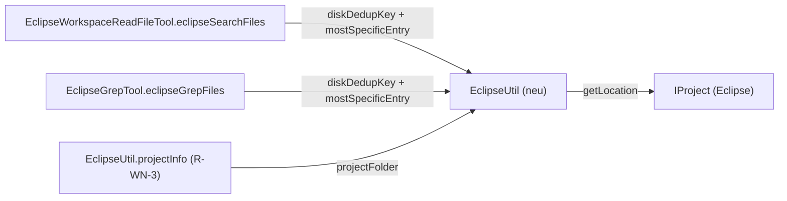

# Plan — Workspace-Sicht: verschachtelte Projekte (2.14.1)

## ⛔ STOP-AND-ASK (erster Check vor jeder Aktion)
Bei **Compile-Fehlern ohne Lösung**, **nicht-grün-bekommenden Tests**, **IST-Widerspruch zu diesem Plan**
oder **Unklarheit**: AKTIV bei Jon (askDev) nachfragen — nie still workarounden, nie SOLL ändern.
Branch: `story/workspace-nesting-2026-10-19` (existiert bereits, `.git/HEAD` verifiziert 2026-10-19).
Committet nach JEDEM grünen Inkrement — inkl. Docs — auf diesem Branch. Merge/Squash = User-Entscheidung.

## 1. Kontext
Feature-Doc: `docs/workspace-nesting.md` (❌ specified, R-WN-1/2/3) — golden record, IDs exakt zitieren,
nicht umformulieren. Architektur: **keine neue Komponente** — Erweiterung von `EclipseUtil` (plugin)
+ `EclipseWorkspaceReadFileTool` (trägt `eclipseSearchFiles`) + `EclipseGrepTool`.
`docs/eclipse-read-tools-architektur.md` existiert NICHT; Anker ist `docs/eclipse-read-tools.md`
(R4a1 = Disk-Pfad-Dedup, Cross-Referenzen auf workspace-nesting.md stehen schon da, Lines 201–204 + 277–279).

**IST (verifiziert, Anchors für Dev — nicht neu suchen):**
- `EclipseWorkspaceReadFileTool.java:141` `Map<String,String> matches` (key=Disk-Pfad, Fallback WS-Pfad, value=WS-Pfad);
  `:202` `results.putIfAbsent(diskPath==null ? file : diskPath, file)` → **first-wins** (Scan-Reihenfolge).
- `EclipseGrepTool.java:53` `matchedFiles = HashSet<String>` gefüllt mit `JdtUtil.pathOf(file)` (**WS-Pfad**, `:112`,
  Single-File-Branch `:73`, `addHits` `:125-135`) → gleiche Disk-Datei unter 2 Projekten = 2 Dateien:
  Treffer doppelt, `MAX_GREP_FILES` doppelt. Visitor-Cap `:104`, Container-Break `:121`.
- `EclipseUtil.java:346-359` `projectInfo(p)` (Name/Eclipse-Pfad/Disk-Pfad/Natures + pom/package.json);
  Call-Sites: `UserContext.java:46` (Turn-Kontext) + `EclipseBuildTool.java:35` (`eclipseListAllOpenProjects`).
- `JdtUtil.java:194-200` `diskPathOf` (rawLocation→location→toOSString, @Nullable); `:183-186` `pathOf` (WS-Pfad, portable).
- `AiReponseBuilder.java:85-113` `grepComplete` (Cap-Disclosures, `GrepHit.fileCount` über Hit-Pfade) — **bleibt unverändert** (core).
- Tests: `AbstractIntegrationTest` (JUnit 4, OSGi, nur `org.junit` Assertions); Projekt-Erstellung mit Location =
  `EclipseSearchFilesToolTest.java:317-337` (`newProjectDescription` + `setLocation` + `create` + `open` — funktioniert
  im Test-Workspace; Nesting ist erlaubt, Realfall llmpeon-parent/llmpeon-core).

## 2. Design-Entscheidungen (alle getroffen — Dev implementiert, nicht neu designt)
- **D1 — Ein Helfer, eine Semantik** („one behaviour, one implementation"): alles Neue in `EclipseUtil`
  (plugin, `org.sterl.llmpeon.parts.shared`). Kein core-Change (GrepHit/AiReponseBuilder unverändert —
  Dedup-State ist Eclipse-spezifisch → gehört ins plugin).
- **D2 — Gewinner-Regel (R-WN-1):** Map-Key = Disk-Pfad (textuell, Fallback WS-Pfad; Symlink-Resolution
  = OUT OF SCOPE laut Doc „Offene Punkte"). Gewinner = Projekt mit dem **tiefsten kanonischen Ordner**
  (strikter Abkömmling des bisherigen Ordners → ersetzt). **Gleiche Tiefe/kein Nesting → existing bleibt
  (first-wins, wie heute).** Reihenfolge der Treffer bleibt Insertion-Order (LinkedHashMap) — R4a1 gilt weiter:
  gewähltes Projekt bestimmt nur die Reihenfolge.
- **D3 — Kap-Edge (bewusste Entscheidung, begründet):** Die frühen Abbrüche beim vollen Cap
  (Visitor-Check + Project-/Container-Loop-Break) **bleiben unverändert**. Konsequenz: Ist das Cap voll,
  wird ein schon gelieferter Duplikat-Eintrag NICHT mehr durch eine tiefere Sicht ersetzt
  (Pfad = zuerst gesehene Sicht; Datei zählt aber weiterhin **einmal**). Begründung: (a) R4a1 macht das
  Cap-Ergebnis bereits scan-reihenfolge-abhängig (erste 100 in R4a1-Reihenfolge) — die Kap-Edge ist damit
  konsistent mit der akzeptierten SOLL-Reihenfolge; (b) die Alternative (Volldurchlauf nach Cap-Erreichen)
  wäre eine Performance-Regression bei jedem capped Search in großen Workspaces; (c) BDD-Szenarien der
  Rules beinhalten kein volles Cap. In Javadoc des Helfers + im Plan nachvollziehbar; Da-Dok prüft gegen Doc.
- **D4 — Kanonischer Projekt-Ordner** (Dedup UND R-WN-3, eine Normalisierung):
  `Path.of(JdtUtil.diskPathOf(project)).toAbsolutePath().normalize()`; Vergleich per `Path.startsWith`
  (element-genaue Prefix-Prüfung) + `!equals` (strikt). Null (kein Location) → defensively ignorieren.
  Kein `toRealPath` (Symlinks out of scope).
- **D5 — R-WN-3-Zeilen** (nur bei echter Verschachtelung, nur offene Projekte, `System.lineSeparator()`,
  Text **wortgetreu** aus dem Feature-Doc mit Platzhaltern):
  - `Nested in Eclipse project {parentWsPath} — the same files are also visible under {parentWsPath}/{subPath}/…; tools return the most specific project path.`
    ({subPath} = relativer Ordnerpfad des aktiven Projekts unter dem Parent, `/`-getrennt; bei mehreren
    offenen Ancestors: **eine** Zeile, der **tiefste** Ancestor — „eine zusätzliche Zeile je Richtung")
  - `Contains Eclipse projects: {namen, alphabetisch sortiert} — their files are also visible under this path; tools return the most specific project path.`
    (listet ALLE offenen, in {p} enthaltenen Projekte, beliebige Tiefe, ohne {p} selbst)
  - Ohne Verschachtelung: keine Zeile (kein Token-Aufwand im Normalfall).
- **D6 — Guard-Tests** (grün pre-fix, bewusst so, nach R7d-Vorbild in eclipse-read-tools.md):
  explizite-Scope-Tests + Negativ-Test (keine Zeile ohne Nesting). Im Test-Kommentar als
  „Regressionsschutz" benennen.

## 3. Architektur
Abhängigkeiten: Tools → `EclipseUtil`-Helfer → Eclipse Resource API. Kern unverändert.



```mermaid
sequenceDiagram
    participant V as IResourceVisitor (Projekt-Walk)
    participant H as EclipseUtil
    participant M as Map (diskKey → ProjectPathEntry)
    V->>H: diskDedupKey(file)  // Disk-Pfad, Fallback WS-Pfad
    V->>M: existing = get(key)
    V->>H: mostSpecificEntry(existing, candidate{path, project})
    H-->>V: winner (existing null → candidate; tiefer Ordner → candidate; sonst existing)
    V->>M: put(key, winner)  // search: Set; grep: bei Tausch Hit-Pfade in-place umschreiben
```

Neue API in `EclipseUtil` (Sketch — Dev ergänzt Javadoc mit R-IDs):
```java
public record ProjectPathEntry(String path, IProject project) {}          // WS-Pfad + gehörendes Projekt

/** R-WN-1: Disk-Pfad als Dedup-Identität; Fallback WS-Pfad wenn kein Location bekannt. */
public static String diskDedupKey(IResource file)

/** R-WN-1: Eintrag, der eine mehrfach sichtbare Datei repräsentiert — tiefster kanonischer
 *  Projekt-Ordner gewinnt; gleiche Tiefe → existing (first found). existing null → candidate. */
public static ProjectPathEntry mostSpecificEntry(ProjectPathEntry existing, ProjectPathEntry candidate)

/** D4: kanonischer absoluter, normalisierter Projekt-Ordner; null ohne Location. */
public static Path projectFolder(IProject project)
```
`EclipseGrepTool` intern: `matchedFiles` (Set) wird `LinkedHashMap<String,ProjectPathEntry> diskEntries`;
bei Pfad-Tausch die vorhandenen `GrepHit`s in-place ersetzen (`list.set(i, new GrepHit(newPath, h.line(), h.text()))`),
**keine** neuen Hits anhängen (gleiche Datei = gleiche Zeilen).

## 4. Test-Strategie
Plugin-Tests (JUnit 4, `org.junit` nur). **Fixture** (neu, test-module-only):
`org.sterl.llmpeon.test/src/org/sterl/llmpeon/test/NestedProjectFixture.java`
- 3-Level-Kette (deckt Multi-Ancestor ab): Temp-Dir `T/wna_root/wnb_mid/wnc_leaf`, Namen **alphabetisch
  root<mid<leaf** (a<b<c → pre-fix gewinnt die ROOT-Sicht = roter Test).
- Marker-Datei `wnc_leaf/WnNested.java` (VOR Projekt-Erstellung auf Disk): 3 Zeilen mit `wnGrepMarker`
  (Zeilen 2–4) + Class-Body. Sichtbar unter: root `/wna_root/wnb_mid/wnc_leaf/WnNested.java`,
  mid `/wnb_mid/wnc_leaf/…`, leaf `/wnc_leaf/WnNested.java`.
- `create()`: Projekte root→mid→leaf via `newProjectDescription`+`setLocation`+`create`+`open`
  (Muster `EclipseSearchFilesToolTest.attemptDuplicateFixtureView`), dann `root.refreshLocal(DEPTH_INFINITE)`.
  Idempotent: existierende Projekte gleicher Namen vorab löschen.
- `destroy(chain)`: leaf→mid→root `delete(true, monitor)`, dann Temp-Tree löschen.
- Wiring in den Test-Klassen: `@Before` (create) / `@After` (destroy) — Fixture wird VOR SUT-Build
  persistiert, immer in After/finally geräumt (kein cross-run-State, Memory-Regel 12).
- Cap-Tests: Filler-Dateien `WnFiller000…096.java` (je 1× `wnGrepMarker`) direkt im **root**-Projekt
  (nur root-sichtbar) → 97 Filler = exakt der Zwang: pre-fix 100 WS-Pfade (Cap greift), post-fix 98
  (Cap entfällt) und post-fix exakt 100 Hit-Zeilen (alle sichtbar).

**Gate je Code-Inkrement** (Reihenfolge!):
1. `eclipseBuildProject` `org.sterl.llmpeon` + `org.sterl.llmpeon.test` → 0 Errors.
2. `eclipseRunJavaTests` `org.sterl.llmpeon.test` — **GANZE Suite** (PDE/OSGi). Erster Lauf: manuelle
   Workspace-Trust-Bestätigung nötig (hängt sonst); Timeout → User informieren, auf PID warten,
   nie parallel nachstarten. (Core wird NICHT geändert → kein Maven-Surefire-Lauf nötig.)
3. `lintDocsAndTests` — idPattern `R-WN-\d+` (FULL-Match), docRoot `docs`, testRoot `org.sterl.llmpeon.test/src`
   → keine Findings außer den erwarteten R-WN-VERWAISTs. R-Form-Marker sind laut DocsLinter by-design
   VERWAIST (R-*-Definitionen werden in `DocsLinter:241/254` übersprungen; dokumentiert als offener Punkt
   in `docs/open-points.md`); Gate = keine Findings außer den R-WN-Markern (Jon-Decision 2026-10-19).
4. Commit (inkl. Docs) auf dem Story-Branch.

## 5. Inkremente (je eines grün, Abhängigkeit: 1 → 2 → 3 → 4)

### Inc 1 — R-WN-1 für `eclipseSearchFiles` (first-wins → most-specific-wins)
- **Status (2026-10-19): DONE — Gate per Jon-Decision (a) abgenommen, committet.**
  - MockLlmServer-Fix (Jon-Decision (b), eigener Commit): Probe entfernt, atomarer Single-Bind,
    `port = server.getAddress().getPort()`. Core `mvn clean test`: **1223/0/0/0**. Jar-Refresh +
    javap-Verifiziert (0 ServerSocket-Refs). OSGi: Run 1 390/0, Run 2 390/1 (ModelComboWidgetTest
    UI-Timing-Flake, benannt, kein BindException), Run 3 390/0, Run 4 390/0 → **2 consecutive greens**.
  - Inc 1 Code: Build 0 Errors / 12 Known-Warnings. `EclipseSearchFilesToolTest` 18/18.
  - Lint-Gate (Jon-Decision (a)): exakt 3× VERWAIST R-WN-1 (`EclipseSearchFilesToolTest:230/246/263`)
    = die erwarteten Marker, keine weiteren Findings. R-Form-Marker by-design VERWAIST
    (`DocsLinter:241/254`; `docs/open-points.md`); Gate-Text in §4 entsprechend angepasst.
  - Commits auf `story/workspace-nesting-2026-10-19`: [1] MockLlmServer-Fix, [2] `inc-1` (Code + Fixture +
    Tests + Zyklus-Docs + `peon-plan/`). Ausgeschlossen: `README.md` (Jon-Entscheidung offen) und Pauls
    WIP (`AbstractAgent.java`, `agent/tools/`).
- **Ziel:** Helfer in `EclipseUtil` (`ProjectPathEntry`, `diskDedupKey`, `mostSpecificEntry`, `projectFolder`)
  + `searchProjectFor` nutzt Gewinner-Logik statt `putIfAbsent`.
- **Dateien:** `org.sterl.llmpeon/src/org/sterl/llmpeon/parts/shared/EclipseUtil.java` (additiv);
  `org.sterl.llmpeon/src/org/sterl/llmpeon/parts/tools/EclipseWorkspaceReadFileTool.java`
  (`:141` Map-Typ, `:163` values→`path`-Mapping, `:187-211` searchProjectFor);
  TEST: `NestedProjectFixture.java` (neu), `EclipseSearchFilesToolTest.java` (+3 Tests, Fixture-Wiring).
- **Tests (Marker exakt `// R-WN-1`):**
  - `mostSpecificProjectPathWins` — BDD: workspace-weit `eclipseSearchFiles("WnNested.java", null, 0)`
    (currentProject=test_project) → exakt 1 Zeile = `/wnc_leaf/WnNested.java`. PRE-FIX ROT (root-Pfad).
  - `selectedProjectChangesOrderNotWinner` — currentProject=wna_root → trotzdem `/wnc_leaf/…`.
    PRE-FIX ROT (root wird zuerst gescannt).
  - `explicitProjectScopeStaysAuthoritative` (Guard, D6) — `projectName=wna_root` →
    `/wna_root/wnb_mid/wnc_leaf/WnNested.java` („dort wurde gesucht", keine Rückübersetzung).
- **BDD-Abdeckung:** R-WN-1 (Suche) + Bullet „expliziter Scope". **Gate** wie oben.

### Inc 2 — R-WN-1 + R-WN-2 für `eclipseGrepFiles` (Bugfix: Disk-Datei zählt einmal)
- **Status (2026-10-19): DONE — Gate grün, committet.**
  - Pre-Fix-Red (gezielter Lauf `EclipseGrepToolTest`, 19 Tests / 2 Failures):
    `nestedFileHitsOnceUnderMostSpecificPath` ROT (6 Treffer unter flacheren Sichten: 3× root + 3× mid),
    `nestedFileCountsOnceAgainstFileCap` ROT (100 Dateien → File-Cap-Disclosure + „showing 100 of 106“);
    Guard `explicitPathScopeStaysAuthoritative` grün (D6, by design).
  - Post-Fix: `EclipseGrepToolTest` 19/19; GANZES OSGi-Suite: 393/0/0, zweimal consecutiv grün.
  - Lint: exakt 7× VERWAIST — R-WN-1 ×5 (`EclipseGrepToolTest:352/409`,
    `EclipseSearchFilesToolTest:230/246/263`), R-WN-2 ×2 (`EclipseGrepToolTest:353/371`), keine weiteren Findings.
  - Filler (97× `WnFiller*.java`) werden test-lokal im Cap-Test angelegt/geräumt (nicht in
    `NestedProjectFixture.create()`), damit workspace-weite Grep-Tests anderer Klassen/Tests
    (z. B. `selectedProjectComesFirst`) nicht 97 Fremd-Treffer sehen — Plan-§4-Location (root-Projekt) bleibt.
  - Commit auf `story/workspace-nesting-2026-10-19`: `inc-2` (Code + Tests + `peon-plan/`).
    Ausgeschlossen: `README.md` (Codegraph-Zeile `v2.4.0` — Versionsnummer falsch, Codegraph = 2.14.0
    laut CHANGELOG; an Jon gemeldet, Korrekturentwurf `v2.14.0`).
- **Ziel:** `EclipseGrepTool` dedupliziert über Disk-Pfad mit demselben Helfer; `matchedFiles`→`diskEntries`;
  Hit-Pfade bei Tausch in-place ersetzt; Cap-Checks semantisch gleich (D3).
- **Dateien:** `org.sterl.llmpeon/src/org/sterl/llmpeon/parts/tools/EclipseGrepTool.java`
  (`:53`, `:73`, `:104`, `:112`, `:121`, `:125-135`); TEST: `EclipseGrepToolTest.java` (+3 Tests, Fixture-Wiring).
- **Tests:**
  - `nestedFileHitsOnceUnderMostSpecificPath` (Marker `// R-WN-1` + `// R-WN-2`) — BDD: workspace-weit
    `eclipseGrepFiles("wnGrepMarker", null, ".java")` → exakt 3 Hit-Zeilen, alle starten mit
    `/wnc_leaf/WnNested.java:`, KEINE Zeile mit `wnb_mid`/`wna_root`-Präfix. PRE-FIX ROT (9 Zeilen, 3 Pfade).
  - `nestedFileCountsOnceAgainstFileCap` (Marker `// R-WN-2`) — 97 Filler + nested: (a) KEIN
    `result capped at 100 files` (98 Dateien), (b) exakt 3 Zeilen `/wnc_leaf/WnNested.java:`,
    (c) KEIN Line-Cap-Disclosure (100 Zeilen). PRE-FIX ROT in allen 3 (100 Dateien → Cap, 106 Zeilen).
  - `explicitPathScopeStaysAuthoritative` (Guard, D6) — `path=/wna_root` → 3 Zeilen unter
    `/wna_root/wnb_mid/wnc_leaf/WnNested.java:`; Zusatz-Assertion: `path=/wna_root/wnb_mid`
    (Folder-Scope) → ebenfalls root-Pfad, keine Rückübersetzung.
- **BDD-Abdeckung:** R-WN-2 vollständig (Treffer einmal + Datei zählt einmal gegen `MAX_GREP_FILES`),
  R-WN-1 (Grep-Flanke). **Gate** wie oben.

### Inc 3 — R-WN-3: Projekt-Info nennt die Verschachtelung
- **Ziel:** `EclipseUtil.projectInfo` hängt je Richtung max. eine Zeile an (D5, via `projectFolder`),
  sonst unverändert. UserContext/Build-Tool bleiben unangetastet (Zeile kommt mit der projectInfo).
- **Dateien:** `org.sterl.llmpeon/src/org/sterl/llmpeon/parts/shared/EclipseUtil.java`
  (`projectInfo` + private Helper); TEST (neu): `org.sterl.llmpeon.test/src/org/sterl/llmpeon/test/NestedProjectInfoTest.java`.
- **Tests (Marker `// R-WN-3`):**
  - `turnContextCarriesNestingLine` — BDD: `new UserContext()`, `setCurrentProject(leaf)`, `get()` →
    Item „Project info wnc_leaf" enthält die exakte „Nested in …" -Zeile (mit `/wnb_mid/wnc_leaf/…`).
    PRE-FIX ROT.
  - `projectInfoNamesDeepestAncestorForNestedProject` — `projectInfo(leaf)` → genau EINE
    „Nested in Eclipse project" -Zeile, nennt `/wnb_mid` (tiefster Ancestor, nicht `/wna_root`). PRE-FIX ROT.
  - `projectInfoNamesContainedProjectsForAggregator` — `projectInfo(root)` →
    `Contains Eclipse projects: wnb_mid, wnc_leaf — …` (alle, sortiert). PRE-FIX ROT.
  - `projectInfoListsBothDirectionsForMiddleProject` — `projectInfo(mid)` → BEIDE Zeilen
    (Nested in `/wna_root` + Contains `wnc_leaf`). PRE-FIX ROT.
  - `projectInfoHasNoNestingLinesWithoutNesting` (Negativ-Guard) — `projectInfo(test_project)` →
    weder „Nested in Eclipse project" noch „Contains Eclipse projects".
  - `closedProjectsAreNotListed` — `leaf.close(monitor)` → `projectInfo(root)` listet nur `wnb_mid`
    (nur offene Projekte).
- **BDD-Abdeckung:** R-WN-3 vollständig. **Gate** wie oben.
- **Nebenwirkung (bekannt, gewollt):** `eclipseListAllOpenProjects` zeigt dieselben Zeilen
  (gemeinsame projectInfo) — bricht keinen Test (`testList` prüft nur Fixture-Name).

### Inc 4 — Release-Docs (kein Code)
- **`CHANGELOG.md`:** neuer Abschnitt `## [2.14.1]` (Datum bei Release):
  - *Changed:* verschachtelte Projekte liefern Dateien genau einmal unter dem tiefsten Projekt
    (vorher: Scan-Reihenfolge), expliziter Scope bleibt maßgeblich; Projekt-Kontext nennt die
    Verschachtelung (eine Zeile je Richtung).
  - *Fixed:* `eclipseGrepFiles` zählte doppelt sichtbare Dateien zweimal (Treffer + Datei-Cap) —
    jetzt zählt die Disk-Datei einmal.
- **`homepage/src/usage/selections.md`:** kurze Sektion „Nested Projects (Monorepos)" (≈5 Zeilen):
  Kontext-Zeile je Richtung + Tools liefern den spezifischsten Pfad + expliziter Scope bleibt.
- **`docs/eclipse-read-tools.md`:** zwei veraltete „vorher/bis"-Formulierungen an die IST anpassen
  (Lines ~203–204 „— vorher entschied die Scan-Reihenfolge." entfernen; Lines ~277–279 „bis 2.14.1 …"
  → „regelt … R-WN-2 (2.14.1 gefixt)"). Edits mit exaktem eindeutigem oldString (nie per Zeilennummer!),
  danach Grep-Count der Zielsequenz verifizieren.
- **NICHT im Dev-Scope:** Status-Flip ❌→✅ in `docs/workspace-nesting.md` = PO-Job (Jon) nach Abnahme.
- **Gate:** `lintDocs` grün; Diffs visuell gegen diesen Abschnitt geprüft.

## 6. Regeln & Constraints
- JUnit 4 + `org.junit`-Assertions nur im Test-Modul (OSGi, keine externen Libs). GIVEN/WHEN/THEN-Kommentare
  in Tests. BDD-Marker exakt `// R-WN-1` / `// R-WN-2` / `// R-WN-3` (ID-Form aus dem Doc, keine UC-IDs).
- „One behaviour, one implementation": Gewinner-Logik, Key und Ordner-Kanonisierung je genau ein Helfer
  in `EclipseUtil`, von BEIDEN Tools + projectInfo genutzt — kein Copy-Paste.
- `System.lineSeparator()` in allen neuen Projekt-Info-Zeilen (existierendes projectInfo-Muster);
  Tool-Outputs sonst unverändert. Keine neuen RAM-Caches (Maps sind call-lokal, begrenzt durch Limits).
- Tool-Verträge bleiben: Signatur, Order-Semantik (R4a1), Cap-Disclosures, Single-File-Grep-Zweig,
  Refresh-Verhalten (R7d) — alles unverändert. Core-Modul wird nicht angefasst.
- Symlink/Workspace-Link (zwei Disk-Pfade = eine Datei) ist ausdrücklich OUT OF SCOPE.
- Line-basierte Edits: nach JEDEM Edit die geänderte Zeile zurücklesen (Insert-instead-of-Replace-Pferdefuß).

## 7. Offene Fragen
Keine — alle SOLL-Entscheidungen sind im Feature-Doc oder hier als D1–D6 getroffen.
Einziger Review-Haken für Jon/Da-Dok: D3 (Kap-Edge) ist die einzige Stelle, an der der Plan eine
im Doc nicht explizit geregelte Interaktion (vollsteh Cap × most-specific) selbst klärt.
