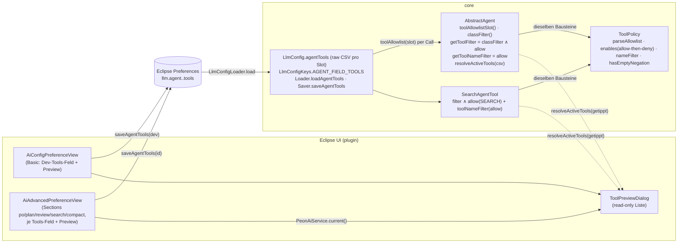

# Plan — Agent-Tool-Config (Tool-Allowlist) + Da-Dok-eigener Model-Slot (REVIEW)

Zyklus 2026-10-13 · Branch `story/agent-tool-config` (zwei Stories, EIN Branch) · Plan-Agent: Da Thinka
Docs (SOLL, vollständig gelesen): `docs/agent-tool-config.md` (R-ATC-1…9, UC-ATC-1…7) · `docs/review-agent.md` (R7) · `docs/agent-tool-filter.md` (R-TF-*, Mechanik-Owner) · `docs/custom-agents-design.md` · `docs/advanced-configuration.md` · `docs/scaffold-agent.md` (R8) · `docs/adr/0065` · `docs/adr/0066` · `docs/release-notes-2026-10.md` · Homepage `configuration.md`/`advanced-configuration.md`/`custom-agents.md`.

---

## 0. STOP-AND-ASK (Paul, 2026-09-08 — gilt für jeden Schritt)

Da Mek: Bei Compile-Fehlern ohne Lösung, nicht-grün-bekommenden Tests, IST-Widersprüchen zum Plan
oder Unklarheiten **AKTIV bei Jon nachfragen (askDev)** — nie still workarounden, nie SOLL ändern.
Git (Q6 GELÖST, Paul bestätigt 2026-10-13): Branch `story/agent-tool-config` wird von Da Mek von
AKTUELLEM `main` angelegt (1 ahead, unpushed; Story-Docs + Plan uncommitted). ERSTER COMMIT auf dem
Branch = Story-Docs + `peon-plan/overview.md` (memory 19) — erst dann bauen.
Nach jeder grünen Iteration: Commit inkl. Story-Docs (`docs/**`) + geänderten Prompts (memory 19).
Vor jedem Plugin-Testlauf: `eclipseBuildProject` über die geänderten Projekte (memory 16).

---

## 1. Kontext & Ziel

**Story 1 — Agent-Tool-Config:** User kann pro Agent über die UI konfigurieren, welche Tools aktiv
sind — wie bei Custom Agents (`tools:`-Frontmatter). EIN Matcher (`ToolPolicy`) für alle
Agententypen: Prefix/`*`/exakt, dazu `!`-Negation (allow-then-deny, Ausschluss gewinnt,
NUR-Negationen = valide → „alle Tools" minus Ausschluss); absent/leer = alle Tools; KEINE
Inheritance; Klassen-Filter bleibt UND-verknüpft (UI kann nur einschränken); Name-Filter gilt für
ALLE Tools (Built-in-Specs UND MCP); Store `llm.agent.<id>.tools` (roher String, Clean Break);
Preview-Button (GETIPPTEN Wert, R-ATC-8 präzisiert; Runtime-Filter und Preview über EINEN
gemeinsamen Kompositions-Helper — Da-Dok②); bare `!` = UI-Validierungsfehler (Speichern verweigert,
Store unverändert, R-ATC-9), Matcher bleibt defensiv no-op nur für den Frontmatter-Pfad;
Scaffold-Prompt kennt `!` (R8). Hauptmotivation: `debugJava*` & Co. ausschließen (Kontext sparen).

**Story 2 — Da-Dok-Slot:** `AiReviewAgent` (Peon-Review) bekommt eigenen Model-Slot `REVIEW`
(`llm.agent.review.*`), Aufnahme in `CORE_IDS`, Advanced-UI-Sektion, Fallback = Base (nicht Plan),
Clean Break. Migration = User-Hinweis (einmal PLAN-Werte in REVIEW kopieren).

**Warum ein Branch:** beide Features greifen in dieselben Stellen (Advanced-Page, CORE_IDS,
Agent-Filter-Familie); Paul-Order: kleine vertikale Inkremente, je grün/kompilierend.

## 2. Design-Entscheidungen (alle made, keine offenen Details im Code-Teil)

| # | Entscheidung | Rationale |
|---|---|---|
| D1 | `ToolPolicy.enables` wird **an Ort und Stelle** erweitert: `null`/`empty` → `false` bleibt (pinnt `ToolPolicyTest.emptyOrNullAllowlistEnablesNothing` + Custom-„leere Liste = nichts"); `*`/Prefix bleibt; **neu**: `!`-Tokens schneiden NACH der Allow-Bewertung aus; **kein Allow-Token** (Liste nicht-leer, nur `!`/blank) → Grundmenge „alle Tools" (R-ATC-2); **F1-Guards (blockierend behoben):** bare `!` (kein Präfix) matcht im Deny-Step NIE (`t.length() > 1`), blank-Tokens werden im Allow-Step strikt ignoriert (`isAllowToken = !isBlank && !startsWith("!")`, Klammern explizit), `allowlist.isEmpty()`-Guard bleibt Pflicht (sonst vacuous allow-all). | Ein Matcher (R-ATC-1/ADR-0065); keine Signature-Änderung → ~50 `new AgentModelConfig`-Sites und alle bestehenden Tests unberührt. |
| D2 | `CustomAgent` bleibt **unverändert** (`allowed`: `null → alle`, sonst `enables`). Negation + nur-Negationen=valide erreicht Custom **automatisch** über das erweiterte `enables`. | R-ATC-1 „Custom unverändert" + R8 (Scaffold schreibt `!` ins Frontmatter — muss wirken). Leere Liste `tools: []` bleibt „nichts" (divergiert bewusst zu Store-„leer = alle" — Q4 bestätigt). |
| D3 | Storage = separates `Map<String,String> agentTools`-Feld in `LlmConfig` (+ `toolAllowlist(slot)`-Accessor) — **NICHT** 7. Record-Komponente in `AgentModelConfig`. | ≈50 `new AgentModelConfig(`-Call-Sites (106 Zeilen, core+plugin+Tests) würden brechen; Tools ist kein Request-Parameter → domänen-falsch im Model-Record. `@EqualsAndHashCode` nimmt das Feld automatisch auf → `AIChatView.applyConfig`-Equality-Gate (L430) propagiert Tools-only-Changes. |
| D4 | `AbstractAgent` bekommt zwei HOOKS: `protected String toolAllowlistSlot() { return null; }` und `protected Predicate<SmartToolExecutor> classFilter() { return t -> true; }`. Base `getToolFilter()` = `classFilter ∧ allowlistFilter` (Allowlist liest **per Call** `configuredModel.getConfig().toolAllowlist(slot)`); `getToolNameFilter()` = Allowlist (MCP). | Persistent Agents (dev/plan/po/review/scaffold) werden bei `updateConfig` **NICHT** rebuilt (nur Custom Agents via `agentService.refresh`) → per-Call-Read ist zwingend; Präzedenz: Scaffold R6 „Config must be re-read per call". RAM-Slaves erben die Slot-Allowlist automatisch (R-ATC-5-BDD nennt explizit „Mek"). |
| D5 | Klassenvorbefindliche Overrides wandern von `getToolFilter()` nach `classFilter()`: `AiPlanAgent` (`!isEditTool`), `AiReviewAgent` (`!isEditTool ∥ ShellTool`), `BuildPoAgentComponent` ×3 anonymer Slaves (`super.classFilter().and(noPrivilegedTools)`). `CustomAgent` (Full-Override, kein super) bleibt byte-gleich. | Subdesign mit minimalem Blast Radius: die Komposition (allow ∧ class) lebt exakt einmal in `AbstractAgent`; „UI kann nur einschränken" (R-ATC-5) strukturell garantiert. |
| D6 | Slot-Wiring: `AiDevAgent → DEV`, `AiPlanAgent → PLAN`, `AiPoAgent → PO`, `AiReviewAgent → REVIEW` (je 2-Zeilen-Override `toolAllowlistSlot()`). `SearchAgentTool`: Sub-Loop-Request bekommt `.toolFilter(filter.and(allow))` **und** explizit `.toolNameFilter(allow)` mit `allow = ToolPolicy.nameFilter(cfg.toolAllowlist(SEARCH))`. Scaffold/Compressor: kein Slot (Default null → kein Filter). | `toBuilder()` erbt den Parent-`toolNameFilter` → Search-MUST ihn explizit überschreiben, sonst filterte der Parent-Slot den Sniffa-Loop. |
| D7 | REVIEW-Slot komplett in EINEM Inkrement: `AgentModelConfig.REVIEW` + `CORE_IDS` + `LlmConfig.reviewAgentConfig()` (Fallback Base, `poAgentConfig`-Muster mit `resolveModel`/`resolveThink`) + `AiReviewAgent` 4× PLAN→REVIEW + `AGENT_SECTIONS`-Eintrag + `AdvancedPreferenceSectionsTest`-Fix. | Test-Kopplung (memory 27): `everyCoreSlotHasASection` assertet `CORE_IDS \ {dev} == sections` — CORE_IDS-Wachstum OHNE Section bricht die Plugin-Suite. Jedes Inkrement grün ⇒ Story 2 steht selbstständig in inc2 (weicht von Pauls Literal-Reihenfolge 2=Store ab — Constraint erzwungen; Story 2 ist unabhängig von Story 1). |
| D8 | UI-Felder: **Basic-Page** — „Tools (CSV, empty = all):" Text-Feld in der „Default for all agents"-Gruppe (Dev-Slot). **Advanced-Page** — je ein solches Feld in jeder `AgentModelConfigSection` (also po/plan/review/search; Compact ⏳ KEIN Feld — D10, Q1-Rückversicherung ausstehend). Load via `buildWithDefaults().toolAllowlist(id)`, Save via neues `LlmConfigSaver.saveAgentTools` in beiden `performOk` — bei bare `!` verweigert (D9b/R-ATC-9). | „Ein Feld, ein Owner"-Prinzip bleibt: Basic schreibt `llm.agent.dev.tools`, Advanced die übrigen Slots (ADR-0063-Parität). |
| D9 | Preview (R-ATC-8 präzisiert, Q2/Q3 GELÖST): `PeonAiService` bekommt `static volatile PeonAiService current` (set im 6-Arg-Ctor) + package-private `clearCurrent()`-Reset-Seam für OSGi-Tests (F4-Bedingung; Präzedenz-Zitat korrigiert: `McpConnectionService.isEnabled` = statischer Preferences-Reader, `EclipseSlf4jLogger.setDebugMode` = statisches volatile Flag — `current` begründet ein neues, leichtes statisches Muster, akzeptiert) + Javadoc-Hinweis „letztes konstruiertes Service gewinnt; MCP-State je View-ToolService" (F4). **EIN gemeinsamer Kompositions-Helper** `AbstractAgent.filterFor(String rawCsv)` = `classFilter ∧ ToolPolicy.nameFilter(csv)` (Executor-Predicate) — wird vom **Runtime-Filter** (`getToolFilter()`) UND von **`resolveActiveTools(csv)`** benutzt (Da-Dok②: „ein Mechanismus strukturell", kein Drift möglich). `AbstractAgent.resolveActiveTools(String rawCsv)` = `filterFor(csv)` über `toolService.getExecutors()` + `mcpToolNames()` via `nameFilter(csv)` (sortiert). `SearchAgentTool.resolveActiveTools(csv)` analog mit seinem (plugin-componierten) `filter` — **Q2 = JA** (Search-Preview existiert). Dialog `ToolPreviewDialog` = read-only Liste + OK, **KEIN Warn-Label** (R-ATC-9: bare `!` wird in der UI nie persistiert → nichts zu warnen; Validierung liegt in inc4, D9b). Agent-Auflösung: **PO-Team-Slave bevorzugen** (trägt zusätzlich `noPrivilegedTools`, Standalone würde 2 Tools zu viel zeigen = Lüge), sonst persistent Standalone. Enable: dev/plan/po/review = `current() != null && agentForPreviewSlot(slot) != null`; **search = `current() != null`** (kein AiAgent, Auflösung via `searchAgentTool()`). **D9b (R-ATC-9, User-Entscheid):** UI verweigert das Speichern bei bare `!` (Fehlermeldung am Feld, Store bleibt unverändert); `ToolPolicy.hasEmptyNegation(parseAllowlist(csv))` ist der Validierungs-Detektor (ein Mechanismus, keine zweite Logik); der Matcher bleibt defensiv no-op nur für den Frontmatter-Pfad (Custom/Scaffold — dort keine UI-Validierung möglich). | R-ATC-8: Preview zeigt den **GETIPPTEN** Wert (Q3 bestätigt) — sonst müsste der User erst OK klicken, bevor die Preview sinnvoll ist (UX); der gemeinsame Helper macht „Ein Mechanismus" (§9) strukturell statt aspirational. |
| D10 | **Compact bekommt KEIN Tools-Feld** (Q1 ⏳ — Empfehlung steht, Paul-Rückversicherung ausstehend; Doku R-ATC-4 L78 trägt sie bereits als ⏳): `CompactService` baut den Request ohne Tools (`newRequestParameters(null)`) → ein Feld wäre inert = Lüge („tool must never lie"). | R-ATC-4 nennt zwar „Plan/Compact/PO/…" — aber der Mechanismus-Doc belegt: Compact ruft nie Tools auf. |
| D11 | Inkrement-Reihenfolge: **inc1** ToolPolicy-Semantik (core) → **inc2** REVIEW-Slot komplett (Story 2) → **inc3** Store+Wiring → **inc4** UI-Felder → **inc5** Preview → **inc6** Scaffold-Prompt. | Pauls Reihenfolge 1/3/4/5/6, nur REVIEW (Story 2) zieht nach vorn (D7). Jedes Inkrement: kompiliert + alle Tests grün + eigene Tests + Docs-Nachzug notiert. |

## 3. Architektur

### 3.1 Komponentendiagramm (Zustand NACH dem Zyklus)



### 3.2 `ToolPolicy` (einziges Herzstück — Signatur-Sketch)

```java
public final class ToolPolicy {
    // Kern wie heute (null/empty → false; * / Prefix) + F1-Guards (blockierende Rebuild-Items, NORMATIV):
    public static boolean enables(List<String> allowlist, String toolName) {
        // (F1b) Guard bleibt Pflicht: leere Liste bleibt „nichts" — sonst würde die
        // nur-Negationen-Regel vacuously allow-all (bricht emptyOrNullAllowlistEnablesNothing
        // + Custom tools:[] = nichts)
        if (allowlist == null || allowlist.isEmpty() || toolName == null) return false;
        // (F1b) isAllowToken ignoriert blank-Tokens strikt (bestehender `isEmpty()`-Skip bleibt);
        // Klammern explizit — Java-Precedence-Falle der alten Skizze
        boolean allowed = allowlist.stream()
            .anyMatch(t -> isAllowToken(t) && (t.equals("*") || toolName.startsWith(t)));
        if (!allowed && allowlist.stream().noneMatch(ToolPolicy::isAllowToken)) allowed = true; // nur Negationen = alle (Liste NICHT leer!)
        if (!allowed) return false;
        // (F1a) bare `!` (substring(1) = "") matcht NIE: t.length() > 1
        return allowlist.stream().noneMatch(t -> isNegationToken(t) && t.length() > 1 && toolName.startsWith(t.substring(1)));
    }
    // NEU: CSV → Tokenliste; null/blank/nur-Trenner → null (= absent = alle)
    public static List<String> parseAllowlist(String csv) { /* split ",", trim, leer weg, empty→null */ }
    // NEU: Predicate-Fabrik für Wiring + Preview (null/leer → allow-all)
    public static Predicate<String> nameFilter(String rawCsv) {
        var tokens = parseAllowlist(rawCsv);
        return tokens == null ? n -> true : n -> enables(tokens, n);
    }
    // NEU: R-ATC-9 — UI-VALIDIERUNGS-Detektor (Feld verweigert bare `!`, Store bleibt unverändert);
    // der Matcher selbst ist defensiv no-op für bare `!` (Frontmatter-Pfad, keine UI-Validierung möglich)
    public static boolean hasEmptyNegation(List<String> tokens) { /* token.equals("!") */ }
    // Helfer (F1): isAllowToken(t) = t != null && !t.isBlank() && !t.startsWith("!")
    //            isNegationToken(t) = t != null && t.startsWith("!")
}
```

Semantik-Tabelle (Gleichheit Built-in/Custom — R-ATC-1):

| Input | Store-Pfad (UI) | Custom-Frontmatter |
|---|---|---|
| Key abwesend / `""` / `" , "` | **alle Tools** (→ null) | — |
| `tools:` abwesend | — | **alle Tools** (`allowed`: null) |
| `tools: []` (leere Liste) | — (CSV kann das nicht) | **nichts** (bestehend, pinnt Test) |
| `eclipse` | nur `eclipse*` | nur `eclipse*` |
| `*, !debugJava*` | alle außer `debugJava*` | alle außer `debugJava*` |
| `!debugJava*` (nur Negationen) | alle außer `debugJava*` | alle außer `debugJava*` |
| `!` allein | **nicht gespeichert** — Validierungsfehler am Feld, Store unverändert (R-ATC-9, inc4) | no-op (Matcher defensiv, Frontmatter-Pfad) |

### 3.3 `AbstractAgent` (Hooks + Komposition)

```java
protected String toolAllowlistSlot() { return null; }                 // DEV/PLAN/PO/REVIEW-Override
protected Predicate<SmartToolExecutor> classFilter() { return t -> true; } // Plan/Review/Slaves-Override

/** EIN Mechanismus (R-ATC-8/Da-Dok②): Runtime UND Preview komponieren über denselben Helper. */
private Predicate<SmartToolExecutor> filterFor(String rawCsv) {
    var allow = ToolPolicy.nameFilter(rawCsv);
    var cls = classFilter();
    return exec -> cls.test(exec) && allow.test(exec.getSpec().name());
}
protected Predicate<SmartToolExecutor> getToolFilter() { return filterFor(storedAllowlist()); }
protected Predicate<String> getToolNameFilter() { return ToolPolicy.nameFilter(storedAllowlist()); } // R-ATC-6: ALLE Tools
/** Per Call (R-ATC-7-IST: persistente Agenten werden NICHT rebuilt). */
private String storedAllowlist() {
    var slot = toolAllowlistSlot();
    return slot == null ? null : configuredModel.getConfig().toolAllowlist(slot);
}
/** Preview (inc5): SELBER Helper, Token-Quelle = GETIPPTER CSV. */
public List<String> resolveActiveTools(String rawCsv) { /* filterFor(rawCsv) über toolService-Executors + mcpToolNames via nameFilter(rawCsv), sortiert */ }
```

### 3.4 Preview-Sequenz (inc5)

```mermaid
sequenceDiagram
    participant U as User (Pref-Page)
    participant S as Section/BasicPage
    participant P as PeonAiService.current()
    participant A as Agent (Slave-Bezug → Standalone) oder SearchAgentTool
    participant T as ToolPolicy
    Note over S: Enable — dev/plan/po/review: current()≠null && agentForPreviewSlot≠null; search: current()≠null (Q2=JA)
    U->>S: klickt Preview (Feld enthält z.B. "eclipse, !debugJava*")
    alt slot = search
        S->>P: searchAgentTool()  [via shared ToolService]
        S->>A: resolveActiveTools(csv)  [eigener plugin-komponierter filter]
    else slot = dev/plan/po/review
        S->>P: agentForPreviewSlot(slotId)
        P-->>S: AiAgent (PO-Team-Slave bevorzugt, sonst persistent)
        S->>A: resolveActiveTools(csv)
    end
    A->>T: filterFor(csv) = classFilter ∧ nameFilter(csv)  [EIN Helper, identisch zur Runtime]
    A->>A: über eigene ToolService (Executors + mcpToolNames)
    A-->>S: sortierte Namen
    S->>U: ToolPreviewDialog (read-only, OK)
```

## 4. Affected files (vollständige Pfade)

**core** (`org.sterl.llmpeon.core/`):
- `src/main/java/org/sterl/llmpeon/tool/ToolPolicy.java` — inc1
- `src/test/java/org/sterl/llmpeon/tool/ToolPolicyTest.java` — inc1
- `src/main/java/org/sterl/llmpeon/ai/AgentModelConfig.java` — inc2 (`REVIEW` + `CORE_IDS`)
- `src/main/java/org/sterl/llmpeon/ai/LlmConfig.java` — inc2 (`reviewAgentConfig()`), inc3 (`agentTools`-Feld + `toolAllowlist(slot)`)
- `src/main/java/org/sterl/llmpeon/ai/LlmConfigLoader.java` — inc3 (`loadAgentTools`)
- `src/main/java/org/sterl/llmpeon/ai/LlmConfigSaver.java` — inc3 (`saveAgentTools`)
- `src/main/java/org/sterl/llmpeon/ai/LlmConfigKeys.java` — inc3 (`AGENT_FIELD_TOOLS = "tools"`)
- `src/main/java/org/sterl/llmpeon/agent/AbstractAgent.java` — inc3 (Hooks + Komposition), inc5 (`resolveActiveTools`)
- `src/main/java/org/sterl/llmpeon/agent/AiDevAgent.java` — inc3 (`toolAllowlistSlot() → DEV`)
- `src/main/java/org/sterl/llmpeon/agent/AiPlanAgent.java` — inc2? nein — inc3 (`classFilter()`-Umzug + `toolAllowlistSlot() → PLAN`)
- `src/main/java/org/sterl/llmpeon/agent/AiReviewAgent.java` — inc2 (4× PLAN→REVIEW), inc3 (`classFilter()`-Umzug + `toolAllowlistSlot() → REVIEW`)
- `src/main/java/org/sterl/llmpeon/poagent/AiPoAgent.java` — inc3 (`toolAllowlistSlot() → PO`)
- `src/main/java/org/sterl/llmpeon/tool/tools/SearchAgentTool.java` — inc3 (Sub-Loop-Allowlist), inc5 (`resolveActiveTools`)
- `src/test/java/org/sterl/llmpeon/ai/LlmConfigLoaderTest.java` — inc2 (`missingReviewKeysYieldEmptySlot`), inc3 (Tools-Keys)
- `src/test/java/org/sterl/llmpeon/ai/LlmConfigSaverTest.java` — inc3 (`saveAgentTools` roundtrip)
- `src/test/java/org/sterl/llmpeon/ai/LlmConfigTest.java` — inc2 (REVIEW-Case im `switch`)
- `src/test/java/org/sterl/llmpeon/ai/AgentModelResolutionTest.java` — inc2 (`reviewFallsBackToBase` / `reviewIgnoresPlanSlot`, Muster der PO-Tests)
- `src/test/java/org/sterl/llmpeon/agent/AiReviewAgentTest.java` — inc2 (Slot-Tests)
- `src/test/java/org/sterl/llmpeon/agent/AgentToolConfigTest.java` — **NEU**, inc3 (R-ATC-4/6/7) + inc5 (resolveActiveTools)
- `src/main/resources/org/sterl/llmpeon/prompts/scaffold-agent.md` — inc6

**plugin** (`org.sterl.llmpeon/`):
- `src/org/sterl/llmpeon/parts/ai/component/BuildPoAgentComponent.java` — inc3 (3× anonymer Slave: `getToolFilter` → `classFilter`)
- `src/org/sterl/llmpeon/parts/config/AiAdvancedPreferenceView.java` — inc2 (REVIEW-Section), inc4 (Tools-Load/Save)
- `src/org/sterl/llmpeon/parts/config/widgets/AgentModelConfigSection.java` — inc4 (Tools-Feld), inc5 (Preview-Button)
- `src/org/sterl/llmpeon/parts/config/AiConfigPreferenceView.java` — inc4 (Dev-Tools-Feld), inc5 (Preview-Button)
- `src/org/sterl/llmpeon/parts/config/widgets/ToolPreviewDialog.java` — **NEU**, inc5
- `src/org/sterl/llmpeon/parts/ai/PeonAiService.java` — inc5 (`current`, `agentForPreviewSlot`)
- `org.sterl.llmpeon.test/src/org/sterl/llmpeon/test/AdvancedPreferenceSectionsTest.java` — inc2
- `org.sterl.llmpeon.test/src/org/sterl/llmpeon/test/PeonAiServiceTest.java` — inc3 (R-ATC-5)
- `org.sterl.llmpeon.test/src/org/sterl/llmpeon/test/AgentModelConfigSectionTest.java` — inc4/5
- `org.sterl.llmpeon.test/src/org/sterl/llmpeon/test/AiConfigPreferenceViewTest.java` — inc4/5

**Docs/Homepage:** `docs/agent-tool-config.md`, `docs/review-agent.md`, `docs/advanced-configuration.md`, `docs/scaffold-agent.md`, `homepage/src/setup/configuration.md`, `homepage/src/setup/advanced-configuration.md`, `homepage/src/setup/custom-agents.md`.
**Release-Notes:** `docs/release-notes-2026-10.md` wurde GELÖSCHT (Q5 GELÖST, User-Freigabe) — Release-Notes für diesen Zyklus entstehen **NEU beim Merge (Jon)**; die Inkremente enthalten KEINE Release-Notes-Änderungen.

**Nicht anfassen:** `CustomAgent.java`, `SharedToolsComponent.java` (setFilter-Komposition bleibt, wirkt automatisch mit), `CompactService.java`, `ToolService.java`, `AgentService.java`, `PromptYmlParser.java`.

## 5. Inventar (per VOLL-Grep verifiziert, 2026-10-13 — memory 37)

**CORE_IDS-Referenzen (5 + 1 versteckt):** `AgentModelConfig.java:21` (Def), `LlmConfigLoader.java:57` (Loader-Iteration), `LlmConfigLoaderTest.java:126` (assertet alle Slots empty — REVIEW auto-grün), `LlmConfigTest.java:28` (Loop) **und `LlmConfigTest.java:32-39`: `switch (id)` mit `default → throw` — inc2 MUSS `case REVIEW → reviewAgentConfig()` ergänzen**, `AdvancedPreferenceSectionsTest.java:37` (Section-Gleichheit).

**`getToolFilter`-Overrides (vollständige Liste):** `AbstractAgent.java:119` (Base), `AiPlanAgent.java:70`, `AiReviewAgent.java:75`, `CustomAgent.java:207` (Full-Override, bleibt), `BuildPoAgentComponent.java:95,103,111` (3× anonymer Slave). **`getToolNameFilter`:** `AbstractAgent.java:127` (Base), `CustomAgent.java:213` (Full-Override, bleibt). Verwender: `AbstractAgent` L134/L140 (`isToolActive`/`isMcpToolActive`), L292-293 (`doCall` → `ToolLoopRequest`); Test-Ref nur `CustomAgentServiceTest:124/135/136/162` (CustomAgent — unberührt).

**Echte Tool-Namen für Tests (R-TF-4-Muster):** debug-Familie (15, `JavaDebugTool`): `debugJavaGetState, GetStackTrace, GetVariables, EvaluateExpression, GetException, SetVariable, SetBreakpoint, SetExceptionBreakpoint, RemoveBreakpoint, ListBreakpoints, StepOver, StepIn, StepOut, Continue, Suspend`; dazu `eclipseGrepFiles, eclipseRunJavaTests, eclipseBuildProject, diskReadFile, shellRunCommand, readOperationSystemInformation, planSave, memoryAdd, skillList, mcp__docs__search_docs` (MCP-Testname).

**Agent-Instanzen (Preview-Zielaufösung):** `AgentService` Ctor L94-101: persistent `Peon-Dev`/`Peon-Plan`/`Peon-Review` (+ `Peon-PO` via `PeonAiService` L175, `Peon-Scaffold` L170). PO-Team: `AiPoAgent.getTeam()` = Da Boss + Da Thinka (plan-Slave) + Da Mek (dev-Slave) + Da Dok (review-Slave); `NamedAgent.uiName()`/`.agent()`.

**Config-Propagation (IST):** `AIChatView.applyConfig` L413-437 → `LlmPreferenceInitializer.buildWithDefaults()` (= `LlmConfigLoader.load(EclipseLlmConfigStore)`) → Equality-Gate L430 → `PeonAiService.updateConfig` L212-236 → `ConfiguredChatModel.updateConfig` (ersetzt Config; Agenten re-readen per Call). Persistent Agents werden dabei NICHT rebuilt.

**`activeToolNames(AiAgent)`** (`PeonAiServiceTest:1053`): `agent.getToolService()`-Executors gefiltert per `agent::isToolActive` — identisch mit der Preview-Komposition → wiederverwenden in inc3-Tests.

## 6. Inkremente (je: grün/kompilierend, eigene Tests, Docs-Nachzug)

### inc1 — ToolPolicy-Semantik (core, Story 1 Fundament) — ✅ DONE 2026-10-13 (Surefire core 1094/0/0; F10-Mutation-Check 4/4-Mutationen rot; Homepage custom-agents.md Negations-Semantik) — Abweichung von der literalen §3.2-Skizze (2×, beide durch die normative Test-Spec der Doku/Plan erzwungen): (a) Blank-Filter VOR der nur-Negationen-Regel (sonst blank-only-Liste = vacuous allow-all → bricht gepinnte `blankEntriesAreIgnored`); (b) Deny-Präfix: trailing `*` wird als Wildcard-Suffix gestrippt + leeres effektives Präfix matcht nie (sonst `!debugJava*` matcht `debugJavaSetBreakpoint` wörtlich nicht → bricht R-ATC-2-BDD L52 + eigene Test-Spec L241)
**Änderungen:** `ToolPolicy` (D1: `enables` allow-then-deny + nur-Negationen=alle + **F1-Guards**: (a) Deny-Step `t.length() > 1` — bare `!` matcht NIE; (b) `isAllowToken = !isBlank && !startsWith("!")` + Klammern explizit im Allow-Stream; `allowlist.isEmpty()`-Guard bleibt Pflicht; neu `parseAllowlist`, `nameFilter`, `hasEmptyNegation` (UI-Validierungs-Detektor für inc4, D9b — kein Preview-Warn-Label mehr), private Token-Helfer). **Die korrigierte §3.2-Skizze ist normativ** (Da-Dok-REJECT-Grund war die alte Skizze). Javadoc: dreistufige Allow-Semantik + defensives bare-`!`-No-Op (Frontmatter-Pfad, R-ATC-9) dokumentieren.
**Tests (`ToolPolicyTest`, echte Namen; F11: Evidenzzeilen laut §7-UC-Mapping):**
- `wildcardMinusDebugDeniesDebugKeepsOthers` — `enables(["*","!debugJava*"], "debugJavaSetBreakpoint")` false; `"eclipseGrepFiles"` true; `"mcp__docs__search_docs"` true.
- `denyWinsOverMatchingAllowToken` — `enables(["debugJava","!debugJavaSetBreakpoint"], "debugJavaSetBreakpoint")` false; `"...StepOver"` true. **(Mutation-Canary, F10)**
- `prefixAllowWithNegation` — `enables(["eclipse","debugJava","!debugJava*"], ...)` → `debugJava*` raus, `eclipse*` drin.
- `negationOnlyMeansAllMinus` — `enables(["!debugJava*"], "shellRunCommand")` true; `"debugJavaGetState"` false.
- `bareBangIsNoOp` — `enables(["!"], "anything")` true; `enables(["*","!"], ...)` true. **(Mutation-Canary, F10)** — deckt die R-ATC-9-Matcher-Seite (defensiv no-op, Frontmatter-Pfad).
- `parseAllowlist*` — null/`""`/`"   "`/`", ,"` → null; `"eclipse, !debugJava*"` → 2 Token; `" eclipse , , disk "` → `["eclipse","disk"]`.
- `nameFilterAbsentOrEmptyAllowsAll` / `hasEmptyNegation*` (`["!"]` true, `["!","x"]` true, `["!x"]` false, null/`[]` false) — `hasEmptyNegation` ist der **UI-Validierungs-Detektor** (R-ATC-9/inc4), kein Preview-Warn-Label.
- Regression: alle 6 Bestands-Tests bleiben **byte-stabil grün** — `blankEntriesAreIgnored` + `emptyOrNullAllowlistEnablesNothing` sind **Mutation-Canaries (F10)** und werden NICHT angepasst (keine „Optimierung" an Canaries).
- **Mutation-Check (F10):** die 4 Canaries (`blankEntriesAreIgnored`, `emptyOrNullAllowlistEnablesNothing`, `bareBangIsNoOp`, `denyWinsOverMatchingAllowToken`) müssen auf JEDE Reihenfolge-/Guard-Mutation in `enables` (allow-then-deny-Reihenfolge, bare-`!`-Handling, Empty/Blank-Guards) rot gehen.
**Docs-Nachzug (Jon):** `docs/agent-tool-config.md` R-ATC-1/2/3 → ✅ (nach Da-Dok-Review); **R-ATC-9 flippt erst mit inc4** (UI-Validierung ist Teil der Regel — Doc-BDD-Mapping L200). `homepage/src/setup/custom-agents.md` „Tool allowlist": `!`-Negation + nur-Negationen=alle-minus + bare `!` = no-op im Frontmatter (Capability landet hier mit inc1).

### inc2 — REVIEW-Slot, Story 2 komplett
**Änderungen:** `AgentModelConfig.REVIEW = "review"` + `CORE_IDS = List.of(DEV, PO, PLAN, SEARCH, COMPACT, REVIEW)`; `LlmConfig.reviewAgentConfig()` (Muster `poAgentConfig`: `agentBuilder(review).model(resolveModel(review.model())).id(REVIEW).think(resolveThink(review))`); `AiReviewAgent`: `getConfig`→`reviewAgentConfig()`, `isThinkSupported`/`getAgentModelName`/`setAgentModelName` → `modelConfigFor(REVIEW)`/`withModelConfig(REVIEW, ...)` (4 Methoden, L45-72); `AiAdvancedPreferenceView.AGENT_SECTIONS += new AgentSection(REVIEW, "Review agent (Da Dok)")` nach PLAN (Reihenfolge: po, plan, review, search, compact).
**Tests:**
- core `LlmConfigLoaderTest.missingReviewKeysYieldEmptySlot` (Muster `missingPoKeysYieldEmptySlot`); `LlmConfigTest`: REVIEW-Case in `switch` (sonst red).
- core `AgentModelResolutionTest`: `reviewFallsBackToBase` + `reviewIgnoresPlanSlot` (Muster `poFallsBackToBase`/`poIgnoresPlanSlot` — R7-BDDs: leer→Base, gefüllt→REVIEW gewinnt, PLAN fließt NICHT ein).
- core `AiReviewAgentTest`: `reviewAgentResolvesReviewSlotNotPlan` (setAgentModelName schreibt REVIEW, getAgentModelName liest REVIEW).
- plugin `AdvancedPreferenceSectionsTest`: `devSectionIsGoneAndSlotOrderStable` → erwartete Liste `["po","plan","review","search","compact"]`; `everyCoreSlotHasASection` auto-grün (beide Seiten wachsen).
**Docs-Nachzug (Jon):** `docs/review-agent.md` R7 → ✅ (R1-Zeile „Config/Model-Slot = PLAN" mit Update-Hinweis versehen: „— seit 2026-10-13 eigener REVIEW-Slot, R7"); `docs/advanced-configuration.md` Slot-Enum „plan/search/compact/po" → +review; `homepage/src/setup/advanced-configuration.md`: Per-Agent-Tabelle + Review-Zeile (Fallback Base), „How It Works" Punkt 2 Slot-Liste +Review, Migration-Hinweis (PLAN→REVIEW einmal kopieren). (Keine Release-Notes-Änderung — Q5 GELÖST: neu beim Merge, Jon.)

### inc3 — Store + Wiring (Story 1 Kern)
**Änderungen:**
- `LlmConfigKeys.AGENT_FIELD_TOOLS = "tools"`.
- `LlmConfig`: `@Default private final Map<String,String> agentTools = Map.of();` + `public String toolAllowlist(String agentId) { return agentTools.get(agentId); }` (null = absent = alle).
- `LlmConfigLoader.load` +`.agentTools(loadAgentTools(store))`; `loadAgentTools` iteriert `CORE_IDS`, liest `agentKey(id, AGENT_FIELD_TOOLS)` via `StringUtil.stripToNull` (roher String bleibt erhalten).
- `LlmConfigSaver.saveAgentTools(store, agentId, raw)` (reused `saveOrRemove`: trim + remove-if-blank = Clean Break: Key weg = Filter weg).
- `AbstractAgent`: Hooks `toolAllowlistSlot()`/`classFilter()` + **`filterFor(String rawCsv)`-Helper** (EIN Mechanismus, D9/R-ATC-8) + neue Base-`getToolFilter`/`getToolNameFilter` (D4/D5); **Javadoc `getToolFilter`: „static filters"-Kommentar korrigieren (F3)** — KV-Cache-Hinweis bleibt, aber „Filter wird **per Call** aus der Config gelesen (persistente Agenten werden NICHT rebuilt, R-ATC-7-IST)" dokumentieren (sonst „repariert" der nächste Leser den per-Call-Read); Javadoc `getToolNameFilter`: „alle Tools (Built-in + MCP), R-ATC-6".
- Slot-Overrides (je 2 Zeilen): `AiDevAgent → DEV`, `AiPlanAgent → PLAN`, `AiPoAgent → PO`, `AiReviewAgent → REVIEW`; `AiPlanAgent`/`AiReviewAgent`: `getToolFilter`-Override **umbenennt** zu `classFilter` (Body gleich).
- `BuildPoAgentComponent` L95/103/111: 3× `@Override getToolFilter` → `@Override classFilter` (Body `super.classFilter().and(noPrivilegedTools)`).
- `SearchAgentTool.searchAgent`: `var allow = ToolPolicy.nameFilter(cfg.toolAllowlist(AgentModelConfig.SEARCH));` → `.toolFilter(filter.and(exec -> allow.test(exec.getSpec().name()))).toolNameFilter(allow)` (beide explizit — toBuilder-Erbschaft!). **(F6, bewusste Verbesserung, SOLL-neutral):** der Sniffa-Sub-Loop ist danach parent-unabhängig — die Custom-Allowlist eines Custom-Parenten filtert Sniffas MCP nicht mehr, stattdessen der Search-Slot (konsistent mit seinem Built-in-Filter, R-TF-2).
**Tests:**
- core `AgentToolConfigTest` (NEU, JUnit5+AssertJ; `LlmConfig.builder().agentTools(Map.of(...))` + echter `ConfiguredChatModel` + `ToolService(false)` mit z. B. `new ShellTool()`):
  - `devAllowlistRestrictsDevOnly` (R-ATC-4, UC-ATC-1/5): `agentTools {dev: "eclipse"}` → Dev: `isToolActive(shellExec)` false, `isMcpToolActive("eclipseGrepFiles")` true, `isMcpToolActive("diskReadFile")` false (nur `eclipse*` aktiv); Plan/PO/Review-Slots ohne Key → `isToolActive(shellExec)` true (keine Inheritance). `// UC-ATC-1` + `// UC-ATC-5`-Zeilen (F11). (Eclipse-Familie ist plugin-seitig → in core nur als MCP-Name-Checks; ein echter Executor = `ShellTool`.)
  - `mcpNameFilterAppliesToAllTools` (R-ATC-6): Plan mit `mcp__docs` → `isMcpToolActive("mcp__docs__search_docs")` true, `isMcpToolActive("mcp__other__x")` false, `isToolActive(shellExec)` false.
  - `negationViaConfigRemovesTool` (R-ATC-2/5): Dev mit `*, !shell*` → `isToolActive(shellExec)` false, `isMcpToolActive("shellMcp")` false, `isMcpToolActive("mcp__docs__search_docs")` true (die echte `debugJava*`-Familie ist plugin-seitig → dort: `devAllowlistNegationRemovesDebugFromMek`, s.u.); Klassen-Filter-Schnittmenge: Plan mit `*` → edit-Tools bleiben aus.
  - `absentOrBlankIsAll` (R-ATC-3): kein Key / `""` / `" , "` → alles aktiv (`isToolActive(shellExec)` true, `isMcpToolActive("mcp__docs__search_docs")` true). `// UC-ATC-3`-Zeile (F11).
  - `storeKeyRoundTripsAndCleanBreak` (R-ATC-7): `MapLlmConfigStore` mit `llm.agent.plan.tools = "eclipse, !debugJava*"` → `load` → `toolAllowlist("plan")` = roher Wert; Key entfernt → null; `LlmConfigSaverTest.saveAgentToolsWritesAndRemoves` analog.
  - **UC-ATC-6-Evidenz (F11):** an der bestehenden `CustomAgentServiceTest`-Allowlist-Methode **nur eine Kommentarzeile** `// UC-ATC-6` ergänzen (Regression Custom unverändert; Test-Logik bleibt byte-stabil).
- plugin `PeonAiServiceTest` (OSGi; Config direkt via `LlmConfig.builder().agentTools(...)` — kein Preference-Fixture nötig, `beforeEach`-Muster L77-88):
  - `dokAllowlistWildcardStillClassFiltered` (R-ATC-5/UC-ATC-4): `agentTools {review: "*"}` → `activeToolNames(review)`: `shellRunCommand`/`readOperationSystemInformation` **drin**, Write-Tools (`eclipseWriteFile`…) **raus**. `// UC-ATC-4`-Zeile (F11).
  - `sniffaAllowlistWildcardStillPlanFree` (R-TF-2/R-ATC-5): `agentTools {search: "*"}` → Sub-Loop-Filter: keine `plan*`-Tools (über `SearchAgentTool`-Filter-Test oder `activeToolNames`-analog am Sub-Loop).
  - `devAllowlistNegationRemovesDebugFromMek` (R-ATC-5/UC-ATC-2): `agentTools {dev: "*, !debugJava*"}` → `activeToolNames(devSlave)`: keine `debugJava*`, `eclipseGrepFiles` drin. `// UC-ATC-2`-Zeile (F11).
  - `absentStoreLeavesMatrixUnchanged` (Regression R-TF-4): ohne `agentTools` → bestehende Matrizen identisch (Bestands-Tests decken ab; hier ein expliziter Guard für Review/Dev).
**Merge-Zone (Da-Dok, Paul baut parallel Async-Umbau):** `AbstractAgent.doCall`→`ToolLoopRequest` (L286-298) + 3 anonyme Slaves `BuildPoAgentComponent` (L94-114) sind die riskanteste Merge-Zone — falls der Async-Umbau VOR inc3 landet, die inc3-Wiring-Punkte gegen den neuen Call-Pfad NEU verifizieren, bevor inc3 startet (per-Call-Read ist lifecycle-agnostisch, D4 — die starke Eigenschaft dieser Entscheidung).
**Docs-Nachzug (Jon):** `docs/agent-tool-config.md` R-ATC-4/5/6/7 → ✅. R-ATC-7-IST ist in der Doku **bereits korrigiert** (Da-Dok-Verifikation 2026-10-13, L119-122) — der Nachzug flippt nur den Status; die Javadoc-Korrektur „static filters"→per-Call-Read ist die obige Code-Änderung (F3).

### inc4 — UI-Felder (Basic + Advanced) + R-ATC-9-UI-Validierung
**Änderungen:**
- `AgentModelConfigSection`: + `Text toolsText = addLabeledText("Tools (CSV, empty = all):")` (nach Extra-Body, Abschnittsende); + `loadTools(String csv)` / `getTools()` (`StringUtil.stripToNull`); + `boolean isToolsValid(String csv)` = `!ToolPolicy.hasEmptyNegation(ToolPolicy.parseAllowlist(csv))` (D9b — ein Mechanismus, keine zweite Detektions-Logik).
- `AiAdvancedPreferenceView.addAgentSection`: + `section.loadTools(LlmPreferenceInitializer.buildWithDefaults().toolAllowlist(agentId))`; `performOk`: bei bare `!` in JEDEM Tools-Feld → **performOk verweigert** (Fehlermeldung nennt das Feld, **gesamter Store bleibt unverändert** — R-ATC-9), sonst + `LlmConfigSaver.saveAgentTools(store, section.getAgentId(), section.getTools())`.
- `AiConfigPreferenceView`: in der „Default for all agents"-Grid + Label/Text „Tools (CSV, empty = all):" (Dev); Load aus `toolAllowlist(DEV)`; `performOk`: analog Validierung + `saveAgentTools(store, DEV, ...)`.
- **Compact-Section:** ⏳ KEIN Tools-Feld (Q1-Empfehlung D10, Paul-Rückversicherung ausstehend — Doku R-ATC-4 L78 trägt ⏳; ändert sich nur bei Rückmeldung, dann Feld wie die anderen).
**Tests:** plugin — `AgentModelConfigSectionTest`: `loadToolsAndGetToolsRoundTrip` (Display-Test mit Skip-`Assume` ohne Display, wie die Bestands-Tests — F5-Korrektur); `isToolsValidRejectsBareBang` (`"!"`/`"eclipse, !"` false, `"!debugJava*"`/`"eclipse"` true); `performOkRejectsBareBang` (R-ATC-9: CSV `"!"` → Save verweigert, Store-Key bleibt abwesend — Store-Assert). `AiConfigPreferenceViewTest`: `performOkPersistsDevTools` / `performOkRemovesDevToolsWhenEmpty` (Store-Assert, Muster `performOkPersistsExtraBody`) + `performOkRejectsBareBangKeepsStore`. `AiAdvancedPreferenceViewTest`: `performOkPersistsToolsPerSection` (je Slot) + `performOkRejectsBareBang` (je Section).
**Docs-Nachzug (Jon):** `docs/agent-tool-config.md` **R-ATC-9 → ✅** (UI-Seite voll); `homepage/src/setup/configuration.md`: „Default for all agents"-Feldliste + Tools (+ Semantik: CSV, Prefix/`*`/exakt, `!`-Negation, leer=alle, bare `!` = Validierungsfehler, gilt nur für Dev); `homepage/src/setup/advanced-configuration.md`: neuer Abschnitt „Tool allowlist" (Feld je Section, Semantik, Preview-Vorgriff, nur-einschränken-Hinweis, bare-`!`-Validierung).

### inc5 — Preview-Button (Story 1-Abschluss, R-ATC-8)
**Änderungen:**
- `PeonAiService`: `private static volatile PeonAiService current;` (set im 6-Arg-Ctor) + `public static PeonAiService current()` + package-private `clearCurrent()` (F4-Reset-Seam); + `AiAgent agentForPreviewSlot(String slotId)` (D9: PO-Team-Slave bevorzugt via `getAgent("Peon-PO")` → `getTeam()`; sonst persistent Standalone; `search` → null — **kein AiAgent, Preview via `searchAgentTool()` (Q2=JA)**; `compact` → null — D10 ⏳, kein Feld); + `SearchAgentTool searchAgentTool()` (via shared `ToolService`).
- `AbstractAgent.filterFor(String rawCsv)` (EIN Mechanismus, D9) + `AbstractAgent.resolveActiveTools(String rawCsv)` = `filterFor` über Executors + `mcpToolNames` via `nameFilter` (sortiert).
- `SearchAgentTool.resolveActiveTools(String rawCsv)` (eigener `toolService` + eigener `filter`, Q2=JA).
- `ToolPreviewDialog` (NEU, `parts/config/widgets/`): read-only `List` (sortiert), OK-Button; static `open(Shell, String title, List<String> names)`. **KEIN Warn-Label** — R-ATC-9: bare `!` wird in der UI nie persistiert (Validierung inc4) → nichts zu warnen.
- `AgentModelConfigSection` + `AiConfigPreferenceView`: Preview-Button „Preview active tools…" je Tools-Feld (eigene Grid-Row, links); enabled: dev/plan/po/review = `PeonAiService.current() != null && agentForPreviewSlot(slot) != null`; **search = `PeonAiService.current() != null`** (Q2); Click: `agent.resolveActiveTools(csv)` bzw. `searchAgentTool().resolveActiveTools(csv)` → Dialog.
**Tests:** core `AgentToolConfigTest`: `resolveActiveToolsPlanEclipseMinusDebug` (UC-ATC-7: Plan + `eclipse, !debugJava*` → `eclipseGrepFiles` drin, `shellRunCommand`/`diskReadFile`/`debugJavaSetBreakpoint` raus — Executor-Seite via `ShellTool` + Test-Stub-Executor mit `ToolSpecification`-Name `eclipseGrepFiles` (nur Name, kein Verhalten), MCP-Seite via Name-Checks; `// UC-ATC-7`-Zeile, F11), `resolveActiveToolsMatchesRuntimeFilter` (**Äquivalenz-Assert**: `resolveActiveTools(storedCsv)` == Menge des Runtime-`getToolFilter` — beweist „ein Mechanismus" strukturell), `resolveActiveToolsNegationOnlyAllMinus` (Review + `!shell*` → alle außer `shell*`, MCP-Namen einbezogen), `resolveActiveToolsEmptyCsvAllowsAll`. plugin `PeonAiServiceTest`: `agentForPreviewSlotPrefersPoSlave` (Da Thinka/Mek/Dok, nicht Standalone), `agentForPreviewSlotSearchAndCompactReturnNull`, `clearCurrent` im `@After` (F4-Test-Hygiene). `AiConfigPreferenceViewTest`/`AgentModelConfigSectionTest`: Button-Existenz + Search-Button-Enable-Ohne-AiAgent (Deklarations-Level, R-T5-Präzedenz — kein Render-Test).
**Abnahme:** **User-Smoke** (R-ATC-8-BDD): Dialog-Inhalt bei `eclipse, !debugJava*` (nur `eclipse*`, keine `debugJava*`/`disk*`), Da-Dok-Preview (Shell drin, Write raus auch bei `*`), Search-Preview (Sniffa-Menge, plan*-frei). Bare-`!`-Validierungs-Smoke gehört zu inc4 (Speichern verweigert, Store unverändert).
**Docs-Nachzug (Jon):** `docs/agent-tool-config.md` R-ATC-8 → ✅. (R-ATC-9 flippt bereits mit inc4; keine Release-Notes-Änderung — Q5: neu beim Merge, Jon.)

### inc6 — Scaffold-Prompt R8
**Änderungen:** `prompts/scaffold-agent.md` L31: `tools`-Zeile erweitern — „list of tool names/prefixes (Java startsWith); `*` = all; a `!`-prefix negates AFTER the allowlist (deny wins); negations-only = all tools minus the exclusions; a bare `!` has no effect" + „Full Agent Example" um `tools: ["*", "!debugJava*"]`-Variante ergänzen (nur wenn Paul will — optional, s. Q-Notiz im Prompt: Scaffold fragt bei Unklarheit ohnehin).
**Tests:** Prompts-Konvention: kein Unit-Test für Prompt-Text (wie R4-R6 in scaffold-agent.md: manuelle Verifikation) — stattdessen Bestands-Scaffold-Tests grün lassen.
**Docs-Nachzug (Jon):** `docs/scaffold-agent.md` R8 → ✅.

## 7. BDD-Akzeptanz (Regel → Test, vollständig)

| Regel | Test | Inkrement |
|---|---|---|
| R-ATC-1 (Gleichheit Built-in/Custom) | `ToolPolicyTest` (Bestand + neue Negation-Tests: gleicher Matcher); `AgentToolConfigTest.devAllowlistRestrictsDevOnly` (Built-in-Pfad); `CustomAgentServiceTest` (Regression, Custom unverändert) | inc1/3 |
| R-ATC-2 (Negation) | `ToolPolicyTest.wildcardMinusDebugDeniesOthers, denyWinsOverMatchingAllowToken, prefixAllowWithNegation, negationOnlyMeansAllMinus` (echte Namen: `debugJava*`, `eclipseGrepFiles`, `mcp__docs__search_docs`) | inc1 |
| R-ATC-3 (absent/leer) | `ToolPolicyTest.parseAllowlist*`, `AgentToolConfigTest.absentOrBlankIsAll` | inc1/3 |
| R-ATC-4 (Slots, keine Inheritance) | `AgentToolConfigTest.devAllowlistRestrictsDevOnly`; UI-Felder inc4 (Deklarations-Tests) | inc3/4 |
| R-ATC-5 (Schnittmenge Klassen-Filter) | `PeonAiServiceTest.dokAllowlistWildcardStillClassFiltered, sniffaAllowlistWildcardStillPlanFree, devAllowlistNegationRemovesDebugFromMek` | inc3 |
| R-ATC-6 (Name-Filter ALLE Tools) | `AgentToolConfigTest.mcpNameFilterAppliesToAllTools` | inc3 |
| R-ATC-7 (Store/Wiring/Clean Break, per-Call-Read) | `AgentToolConfigTest.storeKeyRoundTripsAndCleanBreak`, `LlmConfigSaverTest.saveAgentToolsWritesAndRemoves`, `LlmConfigLoaderTest` (Tools-Keys) + inc3-Javadoc „static filters"→per-Call-Read (F3; Doku-IST ist bereits korrigiert, L119-122) | inc3 |
| R-ATC-8 (Preview, GETIPPTER Wert, EIN Helper) | `AgentToolConfigTest.resolveActiveTools*` (inkl. `resolveActiveToolsMatchesRuntimeFilter`-Äquivalenz) + `PeonAiServiceTest.agentForPreviewSlot*` + **User-Smoke** (Dialog-Inhalt) | inc5 |
| R-ATC-9 (bare `!`) | `ToolPolicyTest.bareBangIsNoOp` (Matcher defensiv no-op, Frontmatter-Pfad) + `ToolPolicyTest.hasEmptyNegation*` (Validierungs-Detektor) + inc4 `performOkRejectsBareBang*` (UI: Save verweigert, **Store unverändert**) | inc1/4 |
| UC-ATC-Evidenz (F11: EIGENSTÄNDIGE `// UC-ATC-n`-Zeile am Test, sonst UNBELEGT beim Status-Flip) | UC-ATC-1 + UC-ATC-5 → `AgentToolConfigTest.devAllowlistRestrictsDevOnly` · UC-ATC-2 → `PeonAiServiceTest.devAllowlistNegationRemovesDebugFromMek` · UC-ATC-3 → `AgentToolConfigTest.absentOrBlankIsAll` · UC-ATC-4 → `PeonAiServiceTest.dokAllowlistWildcardStillClassFiltered` · UC-ATC-6 → Kommentarzeile an bestehender `CustomAgentServiceTest`-Allowlist-Methode (byte-stabil) · UC-ATC-7 → `AgentToolConfigTest.resolveActiveToolsPlanEclipseMinusDebug` + User-Smoke | inc3/5 |
| R7 (review-agent.md) | `LlmConfigLoaderTest.missingReviewKeysYieldEmptySlot`, `AgentModelResolutionTest.reviewFallsBackToBase/reviewIgnoresPlanSlot`, `AiReviewAgentTest.reviewAgentResolvesReviewSlotNotPlan`, `AdvancedPreferenceSectionsTest` (Section) | inc2 |

## 8. Test-Strategie

- **Ground Truth:** Maven Surefire (core, JUnit5+AssertJ) — nicht `eclipseRunJavaTests` (memory 1).
- **Plugin-Tests:** OSGi JUnit4 (keine externen Assert-Libs); VOR jedem Lauf `eclipseBuildProject` (memory 16); erster Lauf der Session braucht manuelle Workspace-Trust-Bestätigung, dann GANZЕ Suite (memory 13).
- **Test-Honesty:** die neuen Tests müssen OHNE Feature rot sein (z. B. `mcpNameFilterAppliesToAllTools`: altes Base `getToolNameFilter = n->true` → `isMcpToolActive("mcp__other__x")` true → rot). Bestands-Tests (`ToolPolicyTest` ×6, `CustomAgentServiceTest`, `AiReviewAgentTest`, R-TF-4-Matrizen in `PeonAiServiceTest`) bleiben als Regression-Guards **unberührt grün** (Ausnahme: eine `// UC-ATC-6`-Kommentarzeile in `CustomAgentServiceTest`, F11 — keine Logik-Änderung).
- **Mutation-Canaries (F10):** `ToolPolicy.enables` = der eine Mutation-Proof-Spot. Canaries: `blankEntriesAreIgnored`, `emptyOrNullAllowlistEnablesNothing` (Bestand, byte-stabil) + `bareBangIsNoOp`, `denyWinsOverMatchingAllowToken` (neu) — jeder muss auf jede Reihenfolge-/Guard-Mutation (allow-then-deny, bare-`!`, Empty/Blank-Guards) rot gehen; Canaries nie „optimieren".
- **UC-Evidenz (F11):** `lintDocsAndTests` erwartet eigenständige `// UC-ATC-n`-Zeilen in den Test-Quellen (Präzedenz `AiServicePerAgentThinkTest:46`) — Mappings in §7. Ohne die Zeilen bleiben die UCs nach dem Build **UNBELEGT** und der Status-Flip (UNBELEGT_ERLEDIGT-Gate) geht nicht. `docs/review-agent.md` hat KEINE UC-IDs (geprüft) → inc2 braucht keine Evidenzzeilen.
- **UI:** keine Render-Tests (R-T5-Präzedenz: würde ohne Display skippen) — Deklarations-Tests + User-Smoke (Preview-Dialog inc5, Felder inc4, E2E-Allowlist-Wirkung im echten Chat).
- **Timeouts:** keine neuen async-Pfade (Preview = synchrone Namensliste; keine Fetch-Jobs) → keine Timeout-Einstellungen nötig.

## 9. Regeln & Constraints

- **Blast Radius klein** (Paul baut parallel Async-Interface): `AgentModelConfig`-Record NICHT ändern (D3); `CustomAgent`/`ToolService`/`SharedToolsComponent`/`AgentService`/`CompactService` NICHT anfassen; Agent-Konstruktion nur über 2-Zeilen-Hook-Overrides.
- **Kein neuer Store-Key-Schema-Break:** `llm.agent.<id>.tools` roher String; leer entfernen = Filter weg (Clean Break, keine Migration).
- **KV-Cache:** Filter ändern sich nur bei Config-Change (bewusst, wie jeder Tool-Set-Wechsel); innerhalb einer Session stabil.
- **Secrets:** kein neuer sensitiver Wert (Tools-CSV ist unsensibel) — `LlmConfig`-`@ToString`-Exclude bleibt wie heute.
- **Log OR throw:** bare `!` wird als UI-Validierungs-Fehlermeldung gemeldet (inc4, kein throw, kein Log-Beide); der Matcher wirft für Frontmatter-Werte nie (defensiv no-op).
- **Ein Mechanismus (strukturiert, Da-Dok②):** keine zweite Parse/Match-Logik außerhalb `ToolPolicy` (R-ATC-1) — Runtime UND Preview komponieren über EINEN Helper (`AbstractAgent.filterFor(csv)`); Custom, Search und die UI-Validierung (`hasEmptyNegation`) laufen über `parseAllowlist`/`enables`/`nameFilter`.
- **Async-Merge-Zone (Da-Dok, Paul baut parallel):** riskanteste Zeilen = `AbstractAgent.doCall`→`ToolLoopRequest` (L286-298) + 3 anonyme Slaves `BuildPoAgentComponent` (L94-114). Falls der Async-Umbau zuerst landet: inc3-Wiring-Punkte gegen den neuen Call-Pfad NEU verifizieren, bevor inc3 startet (per-Call-Read ist lifecycle-agnostisch, D4).
- **Docs-first-PO-Cycle:** Status-Marker (❌→✅) werden erst nach Da-Dok-Review geflippt (Jon/Paul); Homepage-Änderungen im selben Inkrement wie die User-visible-Verhaltensänderung (AGENTS.md).
- **Namen/Konstanten:** neue Tool-Namen in Tests als Literale nur wo keine Konstante existiert (R-TF-3-Scoping); `AGENT_FIELD_TOOLS` in `LlmConfigKeys` (einzige Key-Quelle).

## 10. Offene Fragen (Stand 2026-10-13, User-Antworten eingearbeitet)

- **Q1 ⏳ Compact-Tools-Feld** — EINZIGE offene: Empfehlung steht (D10: KEIN Feld; Doku R-ATC-4 L78 trägt das ⏳), Paul-Rückversicherung ausstehend. Blockiert nur das Compact-Feld in inc4; alle anderen Felder + alle Inkremente unabhängig.
- **Q2 = JA** (Search-Preview via `SearchAgentTool.resolveActiveTools`, Button enabled bei `current() != null`) · **Q3 = getippter Wert** + EIN gemeinsamer Kompositions-Helper (R-ATC-8) · **Q4 = Divergenz bestätigt** (D2) · **Q5 = `release-notes-2026-10.md` GELÖSCHT** — Release-Notes neu beim Merge (Jon), aus allen Inkrementen entfernt · **Q6 = Branch `story/agent-tool-config` von aktuellem `main`, erster Commit = Docs+Plan** (§0).
- **Doc-Typo (non-blocking):** `docs/agent-tool-config.md` R-ATC-4 L82-83: Satz bricht ab („gleiche Semantik, kein") + doppelte Inheritance-GIVEN-Zeile (L83/L88) — mit dem R-ATC-4-Status-Flip (Jon) bereinigen, kein eigener Schritt.

(Keine weiteren offenen Code-Details — alle Design-Entscheidungen in §2 getroffen.)

---

## 11. Da-Dok-Design-Review (pre-build, 2026-10-01) — Verdict & Befunde

**Verdict: REJECTED (pre-build)** — Architektur ist insgesamt tragfähig (Inventar-Claims §5 alle
verifiziert, inkl. 53 `new AgentModelConfig(`-Sites, 5+1 CORE_IDS-Referenzen, alle
`getToolFilter`-Overrides, AgentService-Non-Rebuild, AIChatView-Equality-Gate L430, Compact
ohne Tools). ABER: die zentrale Skizze §3.2 enthält zwei Logik-Fehler, die dem SOLL (R-ATC-9)
und der eigenen Test-Spec des Plans widersprechen — Plan-Fix VOR Build-Start Pflicht. Danach +
F2/F3/F11: baubar.

### Blockierende Rebuild-Items (Plan-Fix, nicht Code)

**F1 — §3.2-Skizze widerspricht R-ATC-9 + eigener Test-Spec (zwei Sub-Bugs):**
- (a) Deny-Step L94: `toolName.startsWith(t.substring(1))` — für bare `!` ist `substring(1)=""`
  und `startsWith("")` matcht ALLES → `enables(["*","!"], "anything")` = false, `enables(["!"],…)`
  = false. Skizze macht `!`-allein aus NO-OP ein DENY-ALL. Widerspricht: R-ATC-9
  (agent-tool-config.md L140-147 „no-op, kein Tool aus"), Plan L222 (`bareBangIsNoOp` erwartet
  true), Semantik-Tabelle L119. **Fix:** Deny-Step nur für `t.length() > 1`
  (`isNegationToken(t) && t.length() > 1 && toolName.startsWith(t.substring(1))`).
- (b) Allow-Step L91: `isAllowToken(t) && t.equals("*") || toolName.startsWith(t)` — Java-
  Precedence = `(isAllowToken(t) && t.equals("*")) || toolName.startsWith(t)`. Das aktuelle
  `token.isEmpty() continue` (ToolPolicy.java L26) fehlt → für `t=""` ist `startsWith("")`
  immer true → `enables(List.of("  ",""), "any")` = true. Widerspricht: pinned Test
  `blankEntriesAreIgnored` (ToolPolicyTest L49-53) und Plan L225 („alle 6 Bestands-Tests bleiben
  unverändert grün"). **Fix:** expliziter Blank-Skip in beiden Streams (oder Helper
  `isAllowToken` auf `!t.isBlank()` + Klammern `isAllowToken(t) && (t.equals("*") || startsWith)`).
  `allowlist.isEmpty()`-Guard in L90 bleibt Pflicht (ohne ihn: nur-Negationen-Regel macht eine
  leere Liste vacuously zu allow-all → bricht `emptyOrNullAllowlistEnablesNothing` +
  Custom-`tools: []` = nichts).

**F2 — Q2 (Search-Preview) im Plan halbbeschlossen, inc5-Spec selbstwidersprüchlich:**
inc5 L272: `agentForPreviewSlot("search") → null` + Enable-Regel L276 (`agentForPreviewSlot !=
null`) ⇒ Search-Button immer disabled — aber L274 baut `SearchAgentTool.resolveActiveTools` und
L276 nennt den „SearchAgentTool-Pfad" für den Click. Entweder dead code (Q2=nein) oder falsche
Enable-Regel (Q2=ja). §10 markiert Q2 als offen, aber D9/inc5-Text muss als **conditional**
gekennzeichnet werden, bis Paul antwortet. **Empfehlung:** Q2 = ja — Search-Preview via
SearchAgentTool, enabled bei `current() != null` (keine AiAgent-Bedingung für search); D9
„search → null" umformulieren zu „kein AiAgent; Auflösung über SearchAgentTool". Kostet ~keinen
Aufwand, und „ein Preview je Feld" bleibt konsistent (Sonst: Sniffa-Menge für den User unsichtbar).

**F3 — Plan-coverage-Gap: R-ATC-7-Dokuzeile ist IST-falsch und steht nicht im Nachzug:**
agent-tool-config.md R-ATC-7 L118-119: „Agent-Instanzen werden bei Config-Änderung neu gebaut
(IST, Reload-Mechanik)" — verifiziert FALSCH für Built-ins: persistente Agenten (dev/plan/
review/po/scaffold) werden bei `updateConfig` NICHT rebuilt (AgentService-Ctor L94-106;
`reloadAgentConfig` L180-202 re-liest nur Custom Agents, und die behalten ihre Instanz, nur
`promptFile` wird getauscht L186-189). Plan D4 hat den korrekten IST (per-Call-Read zwingend) —
implementativ OK, aber der inc3-„Docs-Nachzug" (L259) flippt R-ATC-7 auf ✅, ohne diese Zeile zu
korrigieren ⇒ das SOLL-Doc trägt dann eine falsche IST-Aussage, die dem Design widerspricht.
**Fix:** inc3-Afterzug um Doku-Korrektur R-ATC-7 L118-119 erweitern (SOLL: „Filter wird per Call
aus der Config gelesen; persistente Agenten werden nicht rebuilt").

**F11 — Linter-Baseline + Test-Evidenz fehlt in der Test-Spec:**
`lintDocsAndTests`: 7× `UNBELEGT` (UC-ATC-1…7, agent-tool-config.md L151-173) — vor dem Build
erwartbar (keine Tests existieren). ABER: die Repo-Convention (docs-linter.md L17-21, Präzedenz
`AiServicePerAgentThinkTest:46 // UC-THINK-7`) verlangt als Evidenz **eigenständige
Kommentarzeilen** `// UC-ATC-n` in den Test-Quellen. Plan §7 mappt Regeln→Tests, aber kein
Inkrement verlangt die UC-ID-Zeilen. **Fix:** inc1/3/5-Test-Spec ergänzen: je zugeordnetem Test
eine `// UC-ATC-n`-Zeile (sonst bleiben die UCs nach dem Build UNBELEGT und der Docs-Zyklus
kann nicht schließen).

### CONCERNS (nicht blockierend)

- **F4 (D9):** Präzedenz-Zitat ungenau — `McpConnectionService.isEnabled` ist ein statischer
  Preferences-Reader (nur Caller: AIChatView L442), `EclipseSlf4jLogger.setDebug` ein statisches
  volatile State-Flag; KEINE ist ein statisches Instanz-Handle. `PeonAiService.current`
  begründet ein neues, leichtes statisches Muster — akzeptiert (Config-UI-Fläche ist bereits
  statik-lastig; JFace erzeugt Pref-Pages ohne Konstruktions-Injektionspunkt; null-Fall
  behandelt). Bedingungen: (1) Test-Hygiene — das statische Handle leakt über OSGi-Tests
  (PeonAiServiceTest baut je Test ein Service; beforeEach L75-88) → Reset-Seam (package-private
  Setter/`clear()` im @After) in inc5-Tests; (2) Multi-View-Edge notieren: letztes konstruiertes
  Service gewinnt; MCP-Connect-State ist je View-ToolService → Preview kann andrer View MCP-Set
  zeigen (akzeptabel, Javadoc-Kommentar reicht); (3) Zitat auf `EclipseSlf4jLogger` korrigieren.
- **F5:** inc4 L267 „Widget-Level, SWT-Display-los wie Bestands-Tests" — unzutreffend:
  `AgentModelConfigSectionTest` erbt `AbstractSwtUiTest` = **Display-Tests** mit
  Skip-`Assume` ohne Display (R-T5-Präzedenz). Test ist in beiden Varianten machbar — nur die
  Beschreibung korrigieren (neuer Test folgt dem Bestands-Muster mit Display).
- **F6 (D6, legitime Verbesserung, notieren):** Currently erbt der Sniffa-Sub-Loop den
  Parent-`toolNameFilter` (toBuilder, R-CC-15) → Custom-Agent-Parents filtern heute Sniffas MCP
  über die Custom-Allowlist. Nach D6 (explizit `allow(SEARCH)`) ist Sniffa parent-unabhängig
  (wie sein Built-in-Filter schon) — konsistenter, aber **Behavior-Change für Custom-Parents**
  (Sniffa-MCP nicht mehr durch Custom-Allowlist eingeschränkt, sondern durch Search-Slot).
  Doku sagt dazu nichts (SOLL-neutral) → als bewusste Verbesserung in inc3-Notiz aufnehmen.
- **F7 (D9-Residuum):** Dev-Slot-Preview via Slave zeigt das strengste Set — Standalone
  Peon-Dev hat 2 Tools mehr (WorkspaceMemoryTool, AskUserTool via `noPrivilegedTools`-Schnitt,
  BuildPoAgentComponent L90-91). Wahl Slave-first ist korrekt (Preview behauptet nie ein Tool,
  das nirgends existiert), Residuum = Under-Report für Standalone-Dev-Nutzer. Optional:
  Einzeilen-Hinweis im Dialog. Nicht blockierend.
- **F8 (Q6-Input, Git-IST verifiziert 2026-10-01):** Branch `main` (1 ahead, unpushed
  „clean commit"), `story/agent-tool-config` existiert NICHT (lokal/remot). Uncommitted:
  M `docs/adr/index.md`, `docs/memory.md`, `docs/review-agent.md`; ?? `docs/adr/0066-…`,
  `docs/release-notes-2026-10.md`, `peon-plan/overview.md`. Plan §0 (Branch-Name/Parent mit
  Paul abstimmen) deckt das ab; Q5 ist durch IST beantwortet (release-notes-2026-10.md existiert
  mit „Geplant"-Sektion L51-59 → inc2/inc5 flippen die beiden Einträge).
- **F9:** §4 plugin-Test-Pfade Tippfehler (`src/org/sterl/llmpeon.test/`, `src/org/sterl.llmpeon.
  test/`) — korrekt `org.sterl.llmpeon.test/src/org/sterl/llmpeon/test/` (alle 3 Dateien
  existieren: AdvancedPreferenceSectionsTest, PeonAiServiceTest, AgentModelConfigSectionTest,
  AiConfigPreferenceViewTest).
- **F10 (Mutation-Check-Empfehlung an den PO-Agent):** `ToolPolicy.enables` ist der eine Spot,
  der Mutation-Proof verdient (allow-then-deny-Reihenfolge, bare-`!`-Handling, Empty/Blank-
  Guards). F1 zeigt, dass genau diese Mutation IM PLAN SKIZZIERT IST. Canaries:
  `blankEntriesAreIgnored`, `emptyOrNullAllowlistEnablesNothing` (Bestand, byte-stabil halten)
  + `bareBangIsNoOp`, `denyWinsOverMatchingAllowToken` (neu) — einer davon muss auf jede
  Reihenfolge-/Guard-Mutation rot gehen.

### Antworten auf die 6 Review-Fragen (Jon, 2026-10-01)

1. **D9 statisches Handle:** OK, kein Architektur-Fehler. Injektion in die Preference-Page ist
   strukturell nicht verfügbar (JFace/Extension-Point erzeugt die Page); ein Locator-Klasse
   wäre dasselbe Muster + Ceremony. Bedingungen = F4.
2. **Q3 (Preview = getippter Wert):** Doku-konsistent. R-ATC-8 benennt zwar wörtlich
   `isToolActive`/`isMcpToolActive`, aber deren IST-Aufgabe ist „keine zweite Filter-Logik"
   (R-ATC-1/ADR-0065) — `isToolActive` kann den Getippten-Wert ohnehin nicht beantworten
   (liest per D4 per-Call die GESPEICHERTE Config). Plan-Lösung (gleicher Matcher + gleiche
   Komposition, andere Token-Quelle) ist die einzig saubere Option. **Härten-Recommendation:**
   Runtime-Filter und `resolveActiveTools` über EINEN gemeinsamen Helper komponieren (z. B.
   privat `filterFor(String csv) = exec -> classFilter().test(exec) && ToolPolicy.nameFilter(csv)
   .test(exec.getSpec().name())` in `AbstractAgent`; `getToolFilter()` = `filterFor(configured)`),
   damit „Ein Mechanismus" (§9) strukturell statt aspirational ist und kein Drift entstehen kann.
3. **D3 (Map-Feld in LlmConfig):** Domain-richtig. `LlmConfig` hat exakt dieses Muster schon
   (`modelConfigs` Map + `@Default Map.of()` + `@EqualsAndHashCode` + copy-on-write
   `withModelConfig`); 53 `new AgentModelConfig(`-Sites verifiziert (Record-Änderung bricht
   alles inkl. aller `withX()`-Kopien); Tools ist Visibility-Config, kein
   Request-/Connection-Parameter (gehört nicht in den Model-Record, der in
   `EffectiveConnection`/`AgentConfig` mündet).
4. **D4/D5 (Hooks + Komposition):** Tragfähig, keine Überschneidung/Zyklus-Risiken.
   `CustomAgent` full-override beide Methoden ohne super (L206-215) → Hooks werden umgangen,
   byte-gleich (verifiziert). Alle 5 `getToolFilter`-Override-Bodies migrieren sauber. Per-Call-
   Read ist zwingend (persistente Agenten werden NICHT rebuilt — verifiziert) und thread-safe
   (`ConfiguredChatModel.config` volatile). KV-Cache-Interplay in §9 bewusst notiert. Neben-
   finden: `getToolFilter`-Javadoc („Apply only static filters… any change kills the KV cache!")
   in inc3 mit-aktualisieren, sonst „repariert" der nächste Leser den per-Call-Read.
5. **D7 (inc2 REVIEW eigenständig):** Vertretbar. Test-Kopplung verifiziert:
   `everyCoreSlotHasASection` (CORE_IDS\{dev} == sections, L34-47) +
   `devSectionIsGoneAndSlotOrderStable` (Order-Liste L28-29) ⇒ CORE_IDS-Wachstum ohne
   Section bricht die Plugin-Suite. inc2 ist der minimale grüne Slice für Story 2 (konstant +
   config-Methode + 4 Agent-Overrides + Section + 2 Test-Fixes), Story 2 ist unabhängig von
   Story 1 → „kleine vertikale Inkremente" bleibt gewahrt; Abweichung von Pauls Reihenfolge
   ist Constraint-erzwungen und in D7 dokumentiert.
6. **Blast Radius (parallel Async-Umbau):** Riskanteste Stelle = **`AbstractAgent`
   Call-/Filter-Wiring (`doCall` L286-298 → `ToolLoopRequest.toolFilter`/`toolNameFilter`) +
   die 3 anonymen Slaves in `BuildPoAgentComponent` (L94-114, 3× 3-Zeilen-Overrides)** — dort
   greift der Async-Umbau (async-agent-tools-proposal.md: async `buildWithDev`/Queue-Injection,
   Slaven-`call()`-Lifecycle) an dieselben Zeilen. Konkretes Risiko: ein Merge verliert die
   2-Zeilen-Wiring `.toolFilter(getToolFilter())` oder die `classFilter`-Renames still. Plan
   berührt `PoDelegateTool` bewusst nicht (gut). **Empfehlung:** falls Async zuerst landed,
   inc3-Wiring-Punkte gegen den neuen Call-Pfad neu verifizieren (einzeilige Notiz in inc3);
   D4s per-Call-Read ist lifecycle-agnostisch (funktioniert sync UND async) — das ist die
   starke Eigenschaft dieser Entscheidung gegenüber einer Build-time-Bindung.

### Delta 2026-10-13 (REJECTED → behoben; User-Antworten eingearbeitet)

- **F1** → §3.2-Skizze korrigiert (**normativ**): (a) Deny-Step `t.length() > 1` (bare `!` matcht NIE), (b) `isAllowToken = !isBlank && !startsWith("!")` + Klammern explizit, `allowlist.isEmpty()`-Guard Pflicht. inc1 implementiert exakt diese Skizze.
- **F2** → Q2=JA (User): Search-Preview via `SearchAgentTool`, Button enabled bei `current() != null`; „search → null" bleibt nur als AiAgent-Auflösung, der Preview-Pfad läuft über `searchAgentTool()`.
- **F3** → inc3: Javadoc „static filters"→per-Call-Read (KV-Cache-Hinweis bleibt); Doku R-ATC-7-IST ist bereits korrigiert (2026-10-13, L119-122) → Nachzug flippt nur den Status.
- **F4** → Bedingungen angenommen: `clearCurrent()`-Reset-Seam + `@After`-Reset in `PeonAiServiceTest`, Javadoc-Multi-View-Hinweis, Präzedenz-Zitat korrigiert.
- **F5** → inc4-Testbeschreibung korrigiert (Display-Tests mit Skip-`Assume` ohne Display, nicht „SWT-Display-los").
- **F6** → inc3-Notiz: Sniffa-Sub-Loop parent-unabhängig (bewusste Verbesserung, SOLL-neutral).
- **F7** → nicht aufgenommen (Under-Report-Residuum für Standalone-Dev-Nutzer akzeptiert; ein Dialog-Hinweis entfällt ohnehin mit dem Warn-Label).
- **F8/Q6** → gelöst: Branch von aktuellem `main`, erster Commit = Docs+Plan (§0).
- **F9** → §4-Plugin-Test-Pfade korrigiert (`org.sterl.llmpeon.test/src/...`).
- **F10** → Mutation-Canaries in §8 + inc1-Test-Spec. **F11** → `// UC-ATC-n`-Evidenzzeilen: Mappings in §7, Pflicht in den Test-Specs von inc1/3/4/5; `review-agent.md` hat keine UC-IDs → inc2 braucht keine.
- **Q1** bleibt ⏳ (D10-Empfehlung steht). **Q5:** Release-Notes-File gelöscht → neu beim Merge (Jon), aus allen Inkrementen entfernt.
- **R-ATC-9 (User-Entscheid):** bare `!` = UI-Validierungsfehler (Fehlermeldung am Feld, Speichern verweigert, Store unverändert); Matcher bleibt defensiv no-op nur für den Frontmatter-Pfad; inc4 bekommt Validierungs-Tests (`performOkRejectsBareBang*`, R-ATC-9-Flip); inc5-Warn-Label entfällt ersatzlos.
